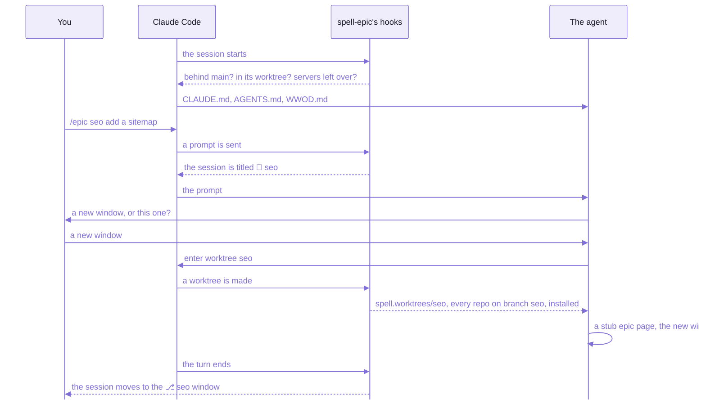

# Working with coding agents

```text
@AGENTS.md

@agents/wwod/WWOD.md
```

_The end of the kit's [CLAUDE.md](CLAUDE.md):  each `@` pulls a whole file into every Claude Code session._

Start Claude Code in `~/www/spell`, and before you type a word, the agent has read over 1,300 lines of rules:
the kit's [AGENTS.md](AGENTS.md), then the hub of [WWOD](agents/wwod/WWOD.md), the house style every repo shares.

Those rules name their reader.
WWOD opens with "Audience:  AI coding agents -- follow these over your defaults",
and its seventh section is called "Claude habits to drop".

Around the rules sits the rest:  an order the files are read in, logs agents leave for each other,
and a plugin that gives every piece of work a page, a branch and a window.
The files are plain Markdown any agent can read;  the plugin is Claude Code's for now
(below, "What's Claude-specific").

## The first minute of an epic

Here's what happens when you open a session in the kit and ask it for a piece of work:



_Seven of the plugin's eight hooks run before the agent has read a line of code._

1. **The session starts.**
   The rules load, and three `SessionStart` hooks check, silent unless something's wrong:
   - `behind-main.mjs`:  is this worktree behind `main`?
   - `worktree-guard.mjs`:  did a worktree's session start outside its worktree?  Then it's told to enter it.
   - `server-prune.mjs`, at most hourly:  is a server still running for a checkout that's gone?  Then it's stopped.
2. **You send `/epic seo add a sitemap`.**
   The `UserPromptSubmit` hook, `prompt-gate.mjs`, reads an `/epic`, `/isolate` or `/unpark` before the agent does:
   it titles the session `🚧 seo`.
   In plan mode, or inside another epic's worktree, it refuses instead, saving your text to `~/.spell/prompts/seo.md`.
3. **The agent follows the epic skill**, over a thousand lines of instructions.
   It asks whether to open a new window or stay in this one (`epic window should-stay` recommends one).
4. **It enters a worktree**, through Claude Code's own tool, `EnterWorktree`.
   The `WorktreeCreate` hook, `worktree.mjs`, makes `~/www/spell.worktrees/seo/`:
   a worktree of the repo on branch `seo`, from local `main`.
   It keeps the session saved at the main checkout's root, so every window's Claude panel still lists it,
   and runs the one `yarn install` before the window opens;
   then `behind-main.mjs` checks the new worktree too (`PostToolUse`, on `EnterWorktree`).
5. **It writes a stub epic page**, quoting your prompt, so a lost session loses nothing.
   Then it opens the new window, arms the move (`epic window handoff seo --prompt continue`), and ends its turn.
6. **The turn ends**, and two `Stop` hooks run.
   - `handoff.mjs` moves the session into the `⎇ seo` window, and types `continue` there for you to send.
   - `shared-commit.mjs` commits the content folder (`epic shared commit`), the new page with it:
     nobody commits an epic page by hand.

The next turn, in the new window, the agent plans:  it explores, read-only, and drafts the phases.
That's when it reads the code, and the rules for the code it reads.

## What's different here

If you've run a coding agent on another codebase, the code here will look familiar.
Three things around it won't.

**The rules have numbers.**
Every rule has a section and a title, so a review names the one a change broke,
`WWOD §5 › "Throw typed errors;  NEVER return error unions"`, instead of "we don't do that here".
The agent is told which rule, and goes and reads it.
The cost:  the rules ride along on every task, over 1,300 lines of context before even a one-line fix.

**The plan is a page, not a chat.**
An issue tracker holds what to do, and a pull request what was done;
the reasoning in between usually lives in a chat that scrolls away.
An epic keeps all three on one page, which you mark up while the agent works, and which outlives the session.

**What the agent finds, it writes down.**
A session forgets everything when it ends.
What it found and didn't fix goes in one of three logs, so the next session to hit the same wall finds the way round.

## The reading order

An agent reads from the general to the specific:
the kit, then the repo and folder it's working in, then the rules for the task at hand.

| # | File | When it's read | What it holds |
| --- | --- | --- | --- |
| 1 | the kit's [CLAUDE.md](CLAUDE.md) | by Claude Code, as every session starts | two `@` imports, of the next two files, then the Claude-only rules (below) |
| 2 | the kit's [AGENTS.md](AGENTS.md) | through `CLAUDE.md`;  Codex reads it itself | the kit, and what's across repos:  installs, imports, tests, CI, worktrees |
| 3 | WWOD's hub, [WWOD.md](agents/wwod/WWOD.md) | through `CLAUDE.md` | the seven sections every task needs, and the table of which spoke to read for what |
| 4 | a big folder's `AGENTS.md`, e.g. [Spell UI's](https://github.com/spell-app/spell/blob/main/ui/AGENTS.md) | when the session first works in that folder | that folder:  its sub-folders, what it may import, its commands, its own conventions |
| 5 | a folder's `AGENTS.md`, e.g. [the kit server's](src/server/AGENTS.md) | through the `CLAUDE.md` beside it:  two lines, and an `@AGENTS.md` | what's local to that folder |
| 6 | WWOD's spoke for the task | as the hub's table says, before writing | one topic's rules:  types, classes, CSS, tests ... (below) |
| 7 | the Solid 2 rules | IN FULL, before any Solid code;  the `solid-2` skill triggers on Solid work | Solid 2 as it is:  it's neither React nor Solid 1, and guessing from either writes wrong code |
| 8 | the commands guide | before adding a skill, a `spell` command or a yarn script | where each belongs:  skills keep judgement and dialog, the command line does every repo action, yarn holds each tool's own scripts |

Only the first three load by themselves;  the agent opens the rest when they tell it to.
The Solid 2 rules are kept out of the `@` imports on purpose:  they're long, and only Solid work needs them.
Both 7 and 8 live in the content folder (below, "More in the docs site").

Codex reads every `AGENTS.md` from the root down to the folder it starts in;
Claude Code loads the root's through `CLAUDE.md`, and a folder's when it works there.
So each rule is written in exactly ONE of them, and a deeper file only adds:
a section named like a WWOD rule EXTENDS it, and says so, "As WWOD §4, plus:".

- They're as long as what they hold:  the kit's runs to about 680 lines, spell-ui's to over 1,300.
  A component library has a lot of conventions.
- Every big folder (`parser/`, `ui/`, `app/`) has an `agents` link at its root, to the root's [`agents/`](agents/),
  made by every install:  so its rules can name `agents/wwod/WWOD.md` from where they are.
  - `epic/` has none, on purpose:  in a plugin, a root `agents/` folder loads as the plugin's own agent types.
  - For the same kind of reason, its `CLAUDE.md` sits in `.claude/`:
    one at a plugin's root draws a warning from `claude plugin validate`.

<details>
<summary>The Claude-only rules in the kit's CLAUDE.md</summary>

[The kit's `CLAUDE.md`](CLAUDE.md) loads its `AGENTS.md` and WWOD, then adds what only Claude Code can do, for every
repo:

1. Narrate each step in the order it actually happens,
   and bold anything in the change that has drifted from what was last asked for.
2. A question that needs a picture, or more than the question modal holds (4 options a question, 4 questions),
   goes on a `/details` page in the side bar, and is answered there.
3. A docs page named in a reply gets both its links, the side bar's and the browser's:
   `epic pages link <page> --hash <id> --show`.
4. Every agent it starts is named and listed:
   `epic agents add <name> "<task>"` before it starts, `epic agents done <name>` when it's back.
   Work on an epic page goes to a background agent, so the panel stays free.
5. A request to change how you WORK (the epic page, the Review tab, skills, windows, worktrees) isn't done there:
   `/send` files it with the epic that looks after the tooling (`epic home`), and the session carries on.
6. A reply that closes out the session's work ends with `*You can close this tab*`, when nothing is left for it,
   and asks whether to run `/isolate done` if its worktree is still there.

- Every session reads them, in any folder:
  Claude Code loads the root's `CLAUDE.md` from the folder above, then the folder's own `AGENTS.md`.

</details>

## WWOD:  rules you can cite

WWOD is the house style every repo shares, introduced on [the kit's front page](README.md):
how code, comments and docs are written here.
It's written for coding agents, to follow over their defaults;  people follow it too.
Here's one whole rule, from section 6:

```markdown
- **User-facing strings stay inline**, where they're used -- EXCEPT in code that speaks more than one language:
  - Spell UI:  its vocabularies (`UIButton.en.ts`) and dictionaries (`UIButton.es.ts`)
  - the editor app (`spell/app/app`):  every text it shows people is a key in `AppTexts.en.ts`,
    read with `appTexts.text(key, params)`;  each other language is a LAZY `AppTexts.<lang>.ts` beside it,
    with every key (its type says so)
  - the language server (`spell/app/lsp`):  its labels are keys in `LspTexts.en.ts`,
    read in the language of the FILE they're about (`LSP.LspTexts.of(scope)`)
  - A sentence that names something takes it as a param (`{type}`, `{theType}`), never glued from pieces:
    each language words it its own way.
  - NOT:  a `MSG.ts` of every string in a package that speaks only English -- one more file to keep in step, for no
    localization.
```

_A bold title to cite it by, `WWOD §6 › "User-facing strings stay inline"`, and the road not taken, kept._

- Every rule is a bullet like that:  about 230 of them, in 20 numbered sections.
- A rule lives in exactly ONE place:  the hub or one spoke, never both.
- A rule chosen AGAINST is kept, as a `NOT:` line under the winner, so nobody proposes it again.
- ONE copy, in the kit's [`agents/wwod/`](agents/wwod/), serves every repo:  edit it there.
  The content folder's older copy, `spell.epics/agents/wwod/`, is for checkouts from before the repos split,
  until it's deleted.

The hub holds what every task needs.
Its "Touching / Also read" table sends the agent on to a SPOKE, one file per topic, read when the task needs it:

| File | Sections | About |
| --- | --- | --- |
| [WWOD.md](agents/wwod/WWOD.md), the hub | 1-7 | every task:  working process, general style, naming, imports, errors, comments and docs, and the anti-patterns, from a file per helper function to `{ ok: false, error }` result unions |
| [writing.md](agents/wwod/writing.md) | 6 | the long before / afters for docstrings, comments and docs |
| [architecture.md](agents/wwod/architecture.md) | 8 | features, module layout, file names, barrels, namespaces |
| [types.md](agents/wwod/types.md) | 9 | types, function signatures, helpers |
| [server-env.md](agents/wwod/server-env.md) | 10-11 | server routes and APIs, environment, configuration |
| [classes-state.md](agents/wwod/classes-state.md) | 12-16 | classes, decorators, state, `Loadable`, value objects, records |
| [solid.md](agents/wwod/solid.md) | 17 | Solid components and JSX, on top of the Solid 2 rules |
| [css.md](agents/wwod/css.md) | 18 | CSS and styling |
| [logging.md](agents/wwod/logging.md) | 19 | logging and debug output |
| [tests.md](agents/wwod/tests.md) | 20 | tests |

`spell wwod check` resolves every citation and repo path in WWOD, every `AGENTS.md` and `CLAUDE.md`, and the
skills, and exits 1 on a broken one.
Run it after editing any of them:  a retitled rule breaks every citation of it.

**Not yet:**  over a hundred of WWOD's example lines still cite files by paths that no longer exist,
and `spell wwod check` lists each one.

<details>
<summary>Adding a rule, and where WWOD came from</summary>

Adding a rule ([WWOD's own README](agents/wwod/README.md) has the same steps):

1. Put it in the spoke for its topic, or in the hub if every task needs it, as a bullet with a **bold title**.
2. A rule chosen against:  a `NOT:` line under the winning rule, with the why.
3. Cite real code by its repo path.
4. A new section is numbered after the last;  renumbering is fine, with the citations fixed.
5. Then `spell wwod check`.

- WWOD began as rules written for another project, in Svelte.
  They were merged with Spell's own, translated to Solid 2, and reviewed file by file in October 2026.

</details>

## Do this, not that

A README, this page too, says what a thing IS and how to run it;
the rules for working on it stay in WWOD and the `AGENTS.md` files.
Most of them read like any careful team's.
These don't, or they cost the most to forget:  each links the file that holds it, and that file is the rule.

In the checkout:

| Do | Not | Where it lives |
| --- | --- | --- |
| run `yarn install` at the root | in a folder:  there's one `yarn.lock`, the root's | [the root's AGENTS.md](AGENTS.md), "The kit" |
| enter a worktree with Claude Code's own worktree tool | start a session in the worktree's folder:  only the tool brings the session back there when it's reopened | [spell-epic's README-adopting.md](https://github.com/spell-app/spell/blob/main/epic/README-adopting.md) |
| merge `main` in with `epic worktree merge-main` | a bare `git merge main`:  it line-merges the generated files the command rebuilds from the merged source | [README-development.md](README-development.md#working-on-a-branch--one-epic-one-worktree) |
| remove a worktree with `epic worktree remove <name>` | a bare `git worktree remove`:  it leaves the worktree's servers running | [spell-epic's AGENTS.md](https://github.com/spell-app/spell/blob/main/epic/AGENTS.md) |
| leave the content folder's commits to the turn-end hook | `git add`, `git checkout --` or `git restore` on its files | [the kit's AGENTS.md](AGENTS.md#shared-content), "Shared content" |
| open a worktree's window with `epic window open` | `code --add`, `--remove` or `-r`:  they can restart the window's extensions, the Claude panel and its session with them | [the kit's AGENTS.md](AGENTS.md#worktrees), "Worktrees" |

In the code:

| Do | Not | Where it lives |
| --- | --- | --- |
| import every file by its package's name and its path under `src/`:  `spell/util/string` | a path alias, a `#` import or a `../` climb, even inside one repo | [WWOD §4](agents/wwod/WWOD.md), "ONE name per file" |
| grep the whole repo before renaming or moving anything, and say what you found | rename, and hope | WWOD §1 |
| record a deviation or a known issue:  in the epic page, or a log | fix it silently | WWOD §1 |
| ask before adding a runtime dependency | add one because it's handy:  lodash and the kit's `spell/util` come first | WWOD §2 |
| finish with `yarn review` at the root of every repo you touched, and report the test count and its change | call it done because the editor shows no errors | WWOD §1, "Finishing pass" |
| write "people" in anything people read | "users" | WWOD §3 |

## The three logs

```text
- 2026-10-03 · Parallel subagents of one session (epic `spell-ui-pages` P4 page agents) share ONE scratchpad
  directory:  another agent overwrote my `scratchpad/p4/splice.py` with its own version mid-task. · Give each
  parallel agent its own scratchpad SUBFOLDER (named for its pages, e.g. `p4-collections/`), and say so in the brief.
  · claude-code
```

_A real entry, written by an agent, in the papercuts log's `claude-code` section:  date · symptom · fix · project._

Agents write to the logs as they go;  people read them when something's wrong.

| Log | What goes in it | An entry |
| --- | --- | --- |
| `PAPERCUTS.md` | anything that slowed development down;  check it FIRST when tooling fails mysteriously | date · symptom · fix · project |
| `SUSPECTED-BUGS.md` | something that looks like a bug, not yet confirmed;  deleted once it's confirmed and fixed, or disproven | the file and symbol:  what looks wrong, why, and how to prove it;  `[V]` once checked against the code by hand |
| `CODE-DEBT.md` | structural problems, too big to fix in passing, known and tolerated on purpose | a heading, then Cost, Cause, Fix and Pinned at |

- One section per package in each, `## <package>`:  add to yours.
- NOT in them:  a local cleanup.
  That's an inline `REFACTOR:` marker, at the code.
- The papercuts log runs to over 400 entries:  read it before you debug the toolchain.
- They live in the content folder, ONE copy for every repo and branch,
  linked into the kit's [`agents/`](agents/) folder under the same names.
  - Edit them at their real path, `spell.epics/agents/<log>`:
    Claude's Edit tool refuses to write through a link to a file.
  - The turn-end hook commits them, with the epic pages.
- **Not yet for someone new:**  the content folder isn't cloned with the repo,
  so in a fresh checkout these links point at nothing until it's there.

## Epics:  planning together on a page

An EPIC is a piece of work with one name:  one branch, one worktree, one VS Code window, one session, one page.
You ask for it in Claude Code;  the agent plans it on its EPIC PAGE, builds it phase by phase,
and you review it on the page, in VS Code's side bar, while the agent works.

What that asks of the agent:
- It drafts the plan in Claude Code's plan mode:  phases named `P1 · Short Name`, the last always "Doc Review".
- It records what it finds as it goes, not at the end, each with a short id:
  `Q3` a question for you, `J7` a call it made without you, `I2` an issue, `T4` a todo (or a limit it accepts),
  `M2` a manual test for you to check by hand.
  So "approve J7" works in chat.
- A call made without you is calm (yellow) by default, and red only when it would surprise you.
- It commits each phase in every repo it touched, lowest repo first, under one subject,
  then stops and asks before the next phase.
- Your marks on the page (approve, revisit, pick an option) wait there until you press Send;
  a `/epic review` session applies them.

```text
P12:  Multi-repo Tooling -- the kit's CI;  yarn clone takes --branch, --https, --shallow, --no-install;  ...
repo-split I4, J69, J70, J71:  the docs header's tabs are data the page server hands the page (siteTabs) ...
```

_Two subjects from the kit's history:  a phase's, and an item fix's, which names its epic so the page can list it._

- **Real today:**  Spell's own repos are built this way, in Claude Code;  the kit's history is phase commits.
- **Not yet:**  other agents (below, "Coming").
- How epics work, the words on a page and the review loop:  [spell-epic's README](https://github.com/spell-app/spell/blob/main/epic/README.md).

## The epic plugin

[The epic plugin](https://github.com/spell-app/spell/blob/main/epic/README.md), `epic@spell`, is a Claude Code plugin:
the epic pages and their review loop, worktrees and VS Code windows, parking and waking sessions,
and the `epic` command that drives them.
ONE copy on the machine serves every repo and every window.

- It adds 19 skills and 8 hooks, and puts `epic` on every session's `PATH`.
- An edit to it is live at once for `epic` and the hooks (once `epic plugin install` links them);
  a skill's new text after `/reload-plugins`;  its inbox monitor in sessions started after.
- A repo opts in with `.epic/config.json5`:  where its content folder, worktrees and windows are.
  The kit's [.epic/config.json5](.epic/config.json5) turns on MULTI-REPO mode, so an epic's worktree holds every repo.
- Every `epic` verb:  [README-cli.md](README-cli.md).

Installing it, once per machine, after [setup](README.md#setup-from-zero), from the kit's checkout:

```sh
node epic/bin/epic plugin install    # then /reload-plugins in each running session
```

It installs the plugin as `epic@spell`, run in place from the kit's `epic/` folder, never a copy
(epic `epic-engine`'s P49, after repo-split's P20 · One Repo).
Run again, it changes nothing and says so;  `--dry-run` says what it would change.
In order, each step skipped when it's done already:

1. Takes the old plugin, `spell-epic@spell-epic`, and its marketplace out of Claude Code's lists.
2. Adds the marketplace `spell` from the kit's main checkout, `~/www/spell`, a folder rather than GitHub.
   - Claude Code keeps it in two files:  `~/.claude/settings.json` (`extraKnownMarketplaces`) and
     `~/.claude/plugins/known_marketplaces.json`.  `claude plugin list` then says "Read from" it.
   - Left at an old folder, every hook fails ("Plugin directory does not exist"):  nothing moves a session, shared
     content isn't committed, the prompt hook titles nothing.  From repo-split's move until 2026-10-24 both named
     `~/www/spell-app/spell-epic/` (epic `epic-engine` I84).
3. Installs `epic@spell` at the plugin's version (`installed_plugins.json`).
4. Makes the copy Claude Code runs the hooks and inbox monitor from a LINK to the kit's `epic/`:
   `~/.claude/plugins/cache/spell/epic/<version>`.
   - Without it the copy stays as it was the day it was installed.  From 2026-10-18 to 2026-10-23 every session ran
     that day's hooks, and no session ran the inbox monitor, which came after (epic `epic-engine` I79).
   - Updating the plugin in Claude Code puts a copy back, and so does a new version:  run it again.
5. Links each skill into `~/.claude/skills/`, so you type a bare `/epic`:  a plugin's skills are otherwise named
   `/epic:epic`.
   - It moves a link left at an older folder:  from repo-split's move until 2026-10-24 every link named
     `~/www/spell-app/spell-epic/`, gone, so `/epic done` reached no skill (epic `epic-engine` I82).
6. Puts `epic` on your terminal's `PATH`, outside Claude Code:  `~/.local/bin/epic`.
7. Fixes a `Read` permission still naming `spell-epic/templates/epics/`.

- Outside Spell, with no checkout:  `/plugin marketplace add spell-app/spell`, then `/plugin install epic@spell`.
  - The repo's ONE marketplace file, [.claude-plugin/marketplace.json](.claude-plugin/marketplace.json), names the
    `epic/` folder as the plugin's source until it's published;  `spell publish` then turns it to the npm package
    `spell-epic`.
  - Run `epic plugin install` again after that:  it links the cache back to the checkout, at the new version.
- To try it in ONE session first, with nothing installed:  `claude --plugin-dir ~/www/spell/epic`.
- For the Review tab and window moves, install its VS Code extension too:
  [README-vscode.md](README-vscode.md#spell-epic--the-pages-beside-your-code).
- Using it in a repo that isn't Spell:  [spell-epic's README-adopting.md](https://github.com/spell-app/spell/blob/main/epic/README-adopting.md).
- The cost:  it installs only inside the kit for now, since it runs on the kit and Spell UI from the one install.

<details>
<summary>What the kit's epic settings say</summary>

The kit's [.epic/config.json5](.epic/config.json5), key by key:

| Key | The kit's | What it does |
| --- | --- | --- |
| `contentFolder` | `"spell.epics"` | the content folder:  epics, guides, sagas, pages, the logs |
| `baseBranch` | `"main"` | the branch worktrees start from and merge into |
| `worktreesFolder` | `"../spell.worktrees"` | where an epic's worktree goes:  `~/www/spell.worktrees/<name>/` |
| `installCommand`, `installOnCreate` | `"yarn install"`, `true` | the one install, run by the worktree hook before the window opens |
| `extraInstalls` | `["epic/vscode", "app/vscode"]` | the two VS Code extensions, yarn projects of their own |
| `windows` | `default` and `repoName` `"spell"`, `contentName` `"spell.epics"` | the window a worktree's window is opened from, and the names a window gives the kit's main checkout and the content folder |
| `linkSessionFolders` | `true` | each new worktree's saved-session folder is a link to the main checkout's, so every window's Claude panel lists every session, whichever folder comes first |
| `sharedFolders` | `[]` | no content folders linked in at the root:  the kit tracks `agents/` itself |
| `engineFolder` | `""` | none:  the epic engine is already a folder of the repo, `epic/` |
| `windowsFolder` | `"spell.epics/windows"` | the VS Code window files, each machine's own |
| `voices` | `code`:  `"agents/wwod/writing.md"` | the house's own voice for `/voice`, besides spell-epic's:  WWOD's writing rules |
| `checkoutPatches` | one, `vscode-ignore`:  copies `.ignore` | fixes every checkout gets at once, worktrees behind `main` too:  this one, a leftover, un-hides the `spell-*/` folders of a checkout from before the folders moved in |

- The keys it leaves out (`installTimeout`, `repoTemplates`, `app`) take their defaults.
- `epic config [key]` prints what's in force;  `epic init` writes every key, with a comment each.
- Every key and its default, in spell-epic's README-adopting.md:
  [The config file](https://github.com/spell-app/spell/blob/main/epic/README-adopting.md#the-config-file--one-per-repo-read-from-the-main-checkout).

</details>

## Skills and hooks

A SKILL is a packaged workflow Claude runs when you type its name (`/epic seo`), or when what you ask matches it.
A HOOK is a script Claude Code runs on an event:  a session starting, a prompt sent, a turn ending.

The plugin brings 19 skills in three groups;  spell-app has five of its own.

| The plugin's [`skills/`](https://github.com/spell-app/spell/tree/main/epic/skills) | For |
| --- | --- |
| Planning and review:  `/epic`, `/epics`, `/details`, `/comment`, `/docs-check`, `/voice`, `/send` | an epic's life, from the first prompt to the last review |
| Worktrees and sessions:  `/isolate`, `/park`, `/unpark`, `/wait-for`, `/worktrees`, `/session`, `/title`, `/wtf` | moving work between worktrees, windows and sessions, and keeping track of it |
| Background and offline:  `/bg`, `/bedtime`, `/airplane` | work that runs while you're elsewhere:  a named background agent, phases built overnight, pages marked up offline |

- Each one, its arguments, and when to reach for it:
  [spell-epic's README-skills.md](https://github.com/spell-app/spell/blob/main/epic/README-skills.md).

spell-app's, in its own [`.claude/skills/`](https://github.com/spell-app/spell/tree/main/app/.claude/skills):

| Skill | What it does |
| --- | --- |
| `/design` | designs with Spell's real `<ui-*>` elements, in Claude Design or in VS Code:  `push`, `pull`, `new`, `page` |
| `/fussbudget` | rewrites docstrings, comments, READMEs and docs to WWOD's writing rules, left uncommitted |
| `solid-2` | the Solid 2 rules, loaded by itself before any Solid work |
| `/spell-docs` | opens the docs in VS Code's Epic Docs tab |
| `/spell-serve` | starts this checkout's servers, and says which port each is on |

The hooks are the plugin's [`hooks.json`](https://github.com/spell-app/spell/blob/main/epic/hooks/hooks.json):
the seven in the first minute, above, and two that run on the way out.
- `worktree.mjs`, on `WorktreeRemove`, stops the checkout's servers before the worktree goes.
- `left-worktree.mjs`, on `PostToolUse` after `ExitWorktree`, reminds the reply to end with
  `*You can close this tab*`.
- Every hook acts only in a repo that has `.epic/config.json5`, and exits 0 whatever happens:
  a hook never blocks a session.
  The worktree hook is the exception:  it runs everywhere, and its failure is Claude Code's answer.
- Moving a session between windows is `handoff.mjs`'s job:
  `epic window handoff <name>` arms it, and the move happens when the turn ends.
- The behind-`main` notice exists because windows sat 54 to 154 commits behind, and nobody knew.
  It says so in one line:  `⎇ <branch> is <n> commits behind main:  its code and pages are that old.`
- Each hook's event and time limit, and the prompt gate's rules:
  [spell-epic's README-skills.md](https://github.com/spell-app/spell/blob/main/epic/README-skills.md#hooks).
- spell-app's own Claude settings hold no hooks.

## What's Claude-specific

The rules are for any agent;  the tooling around them is Claude Code's today.

| Works with any agent | Claude Code only, today |
| --- | --- |
| the `AGENTS.md` files | `CLAUDE.md`'s `@` imports |
| WWOD | the skills, and their `/slash` workflows |
| the three logs | the plugin and its hooks:  worktrees, window moves, the turn-end commit |
| `spell` and `epic`:  plain command lines | the worktree tools, the question modal, `/details` side-bar pages, `/bg` agents |
| the checks (`yarn review`) | the VS Code Claude panel's session list:  why every worktree's session folder is a link to the main checkout's |

## 🌱 Coming:  other agents

The same setup for agents other than Claude:
the plugin's worktrees, review loop and skills, driven from Codex and others the way Claude Code drives them today.
Codex already reads every `AGENTS.md`, and WWOD and both command lines are plain files and programs any agent can use.

Where it stands:  planned;  the plugin, skills and hooks are Claude Code's for now.

## See also

- [spell-epic's README](https://github.com/spell-app/spell/blob/main/epic/README.md):  epics, the method the agents here plan in
- [spell-epic's README-skills.md](https://github.com/spell-app/spell/blob/main/epic/README-skills.md):  every skill and hook, and when to reach for which
- [AGENTS.md](AGENTS.md):  the kit's rules, the ones every session loads
- [README-development.md](README-development.md):  the checks to run before calling it done, and worktrees
- [README-vscode.md](README-vscode.md):  the Review tab, windows, and the Claude panel

<details>
<summary>More in the docs site</summary>

These guides live in the content folder:
they need a checkout with `spell.epics` beside the repos,
and the page server running (`spell server start`, then the URL it prints).

- "WWOD:  the agents' house style":  `/guides/wwod.html`
- "Spell on Solid 2":  `/guides/solid/solid-2.html`;  the rules agents read, `/guides/solid/solid-2.md`
- "Commands":  `/guides/dev/commands/commands.html`;  the commands guide, `/guides/dev/commands/commands.md`
- "Background agents:  /bg":  `/guides/background-agents.html`
- "Details Pages":  `/guides/details.html`
- "spell-epic:  the epic engine, outside spell-app":  `/guides/spell-epic/spell-epic.html`
- "Airplane Mode":  `/guides/airplane.html`

</details>
