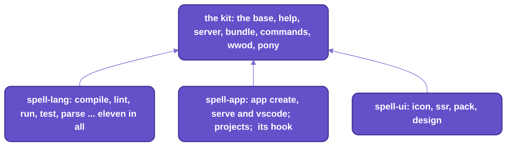

# The `spell` command line

One command line over every Spell repo.
If you've used tsc, vite or cargo, it's that shape:  one program, a verb after it, `--help` on everything.

- `spell` writes, runs and explains spell programs, and holds the tools people working on Spell use every day.
- `epic` drives the epic pages;  three small programs of the kit run the checks.
- `spell` runs every repo's SOURCE, straight from your checkout, through `tsx`:  there's no build step.
  Edit a file, and the next `spell` runs the new code.
- It sees projects exactly as the language server does, so `spell lint` and the editor agree.
- Each repo adds its own commands to it, so the command line grows with what you've cloned.



_Every repo hands its commands to the kit's base:  clone a repo, and its commands appear.
spell-epic adds none:  its tools are `epic`'s._

## How it fits together

The base of the program is the kit's:  it reads the arguments, prints the help, and finds the commands.
Each repo names its own commands in its `package.json`, and the base loads them.

- A repo's list:  `"spell": { "commands": "./cli/commands.ts" }` in its `package.json`.
  Its commands are in its own `cli/` folder.
- Commands keep plain names, `spell compile`, `spell icon`.
  - A command goes under its repo's short name when two repos want the same word (`spell lang check`,
    `spell app check`).
  - spell-app's own commands are under `app` on purpose, clash or not:  `spell app create`, `spell app serve`.
- spell-app adds a HOOK as well as commands (`"hooks": "./cli/hooks.ts"`):
  `language`, which does the work of spell-lang's commands.
  - It finds projects the app's way:  addresses and groups (`@spell/examples/drawable-solitaire`), `@here`,
    the build folder
  - the steps after a compile or a lint:  the property editor's pages
  - opening a running program in your browser, for `spell run`
- So without spell-app, the language commands stop with a message to clone it (`yarn clone spell-app`), exit 2.
  Moving their work down to spell-lang is still to come (below, "Deferred").
- One session object, spell-app's `CliSession`, runs every language command:
  it loads projects the language server's way, so the command line sees what an editor sees.

## Setting it up

You need the kit and its one install first:  [the kit's README](README.md), "Setting up".
Then, from the kit's folder:

1. Put `spell` on your `PATH`:

   ```sh
   cd ~/www/spell
   yarn cli:install
   ```

   It links `spell` into the first writable folder on your `PATH`, and prints the link:

   ```text
   Linked ~/.local/bin/spell -> ~/www/spell/bin/spell.mjs
   ```

   - The folders it tries, in order:  `~/.local/bin`, npm's global bin, `/usr/local/bin`, `/opt/homebrew/bin`.
   - `SPELL_BIN_DIR=/some/dir yarn cli:install` links it there instead.
   - None of those folders on your `PATH`:  it links into `~/.local/bin`, and says to add that folder.
   - Run it again after moving the checkout:  the link holds its full path.

2. Check it runs:

   ```sh
   spell --help
   ```

   - The first run takes a few seconds (`tsx` compiles every repo's source, then caches it);
     after that, about a second.
   - `spell --version` prints each repo's version, the kit's first:

     ```text
     spell-kit 0.0.0
     spell-lang 0.8.0
     spell-ui 0.0.1
     spell-app 0.8.0
     ```

3. Try it:

   ```sh
   spell parse "print 1 + 2 * 3"
   ```

   ```text
   statement › print  print 1 + 2 * 3
     Keyword  print
     expressions: Repeat  1 + 2 * 3
       expression  1 + 2 * 3
         lhs: operand › number  1
         Repeat  + 2 * 3
           expression_suffix › plus  + 2
             operator › Symbol  +
             expression: operand › number  2
           expression_suffix › times  * 3
             operator › Symbol  *
             expression: operand › number  3

   core.console.log(1 + 2 * 3)
   ```

   - The tree is how spell read the line;  the last line is the JavaScript it compiles to.

- No install at all:  `node ~/www/spell/bin/spell.mjs --help`, or `yarn spell --help` at the kit's root.
- A shell alias or function named `spell` hides the command:  `type -a spell` in a login shell says which runs.
- `epic` is linked by spell-epic's install ([README-agents.md](README-agents.md), "The epic plugin"):
  in Claude Code it's on every session's `PATH` while the plugin is on.

## Naming what to work on

Every project command takes one or more projects.
A lone spell file counts as a one-file project.

| You type | Means |
| --- | --- |
| `Card.spell`, `./path/to/Project`, `.` | a spell file, or the project in a folder |
| `@here` | the project in the current folder |
| `@spell/library/cards`, `@spell/examples/drawable-solitaire` | one project, by its address |
| `@spell/test/solitaire/Card.spell` | a file in one:  its name has a dot |
| `@spell/library`, `@spell` | a group, or all of a space's groups:  pick from a list, with "All projects" first |
| (nothing) | the project here;  outside one, `spell` asks, completing as you type |

- Your own projects are a space of their own, `<person>@spell`, in the `spell.spaces` folder beside the repos.
- `--all` takes every project in a group without asking, e.g. in a script.
- A group holding just one project uses it without asking.
- With no terminal to ask on, a group lists its projects and exits `2`.

<details>
<summary>Picking a project when you name none</summary>

- Outside a project, in a terminal, `spell` asks, completing as you type, like a shell.
- `Tab` completes a level at a time:
  - a group, `@spell/examples/`
  - then a project, `@spell/examples/drawable-solitaire/`
  - then "entire project", or one of its files
- Your last 3 picks come first, kept in `.recent-projects.json` (git-ignored).
- Piped, it says to name one.

</details>

## Commands for programs

Every command below works on spell projects;  each table says which repo contributes the command.
`spell help <command>` (or `spell <command> --help`) prints its options, and the expand under each table has them all.

### Writing and building

| Command | What it does | From |
| --- | --- | --- |
| `spell app create <name>` | Makes a new project:  `<name>/__project.json5` and a starter `<name>.spell` that prints a hello, in your own space. | spell-app |
| `spell compile [projects...]` | Compiles each project to JavaScript in its build folder, plus its other targets, its declarations and its words. | spell-lang |
| `spell lint [projects...]` | Lists every error as `path:line:col  message`, exiting 1 if there are any. | spell-lang |
| `spell watch [projects...]` | Recompiles on every save and shows a live list of errors, until `q` or `Ctrl-C`. | spell-lang |
| `spell format [projects...]` | Tidies the whitespace of `.spell` files, as VS Code's Format Document does. | spell-lang |

<details>
<summary>Every option of app create, compile, lint, watch and format</summary>

`app create <name>`
- Makes the project in your own space, `<person>@spell`, in `spell.spaces`.
- `--in <folder>`:  in that folder instead.
- Refuses a folder with anything in it.

`compile [projects...]`
- Writes each project's compiled JavaScript, `<Project>.spell.js`, into its build folder.
  - The build folder:  `build/` at spell-app's root, never committed, at the project's own path
    (`build/spaces/@spell/examples/drawable-solitaire`).
  - A project anywhere else keeps its output beside its source.
- Its declarations and words are committed beside its source:  `<Project>.declarations.json5` and `<Project>.en.js`.
- Each other target's output too, e.g. Python's:  the `"targets"` in its project file, or the one `--target` names.
  - Every target is in `SP.TARGETS`:  `ts/solid`, `ts/lib`, `py` ([spell-lang's README](spell-lang/README.md)).
- A target with a type checker is checked once written:  TypeScript by `tsc`, Python by `pyright`.
  Its errors are listed, but don't fail the compile.
- With no errors, its scope pack, `<Project>.scopes.js` (what the Type Explorer reads).
- Each `*.editor.html` page compiles to its `<type-editor>` module (the property editor's pages:  a spell-app hook).
- `--stdout`:  prints it and writes nothing.  A `.spell` file prints its JavaScript.
- `--target <name>`:  compile to this target too, e.g. `ts/solid`.
- `--force`:  recompiles the projects it imports, too.
- `--stale`:  compiles only the projects that are out of date, and the same for what they import;
  the rest say "up to date".
  - Out of date:  a file it builds is missing, or one of its files, its project file,
    an import's declarations or spell's compiler changed since its build (`CLI.staleBecause()`).
  - The page server runs `spell compile --stale --all @spell/examples @spell/library` as it starts,
    and the spaces routes compile a project whose built file is missing:
    nothing to run by hand in a fresh checkout.

`lint [projects...]`
- `--json`:  the errors as a JSON list.
- A project's editor pages (`*.editor.html`) are checked too, against its types.
- `--fix`:  puts the editor pages right:  drops gone properties, adds new ones, fixes controls that don't fit.

`watch [projects...]`
- `--check-only`:  re-checks, and writes nothing.
- `--test`:  runs each project's tests after each rebuild with no errors;  `--name <text>` picks which.
- Rebuilds a watched project when one it imports changes.
- What it watches:  each project's folder, its spell files, CSS and project file;
  it ignores `*.spell.js` and `*.scopes.js`.
- Watching both a project and one it imports:  the importer rebuilds, from scratch, after the imported one does.
  A project imported but not watched isn't seen changing.
- On macOS a save arrives as a `rename` event, so `watch` ignores event types and looks at what's on disk.

`format [projects...]`
- `--check`:  writes nothing, lists what would change, and exits 1 if anything would.
- Never writes into the frozen test projects (spell-lang's `tests/spaces/@spell/test/`).

</details>

### Running and testing

| Command | What it does | From |
| --- | --- | --- |
| `spell run [project]` | Compiles a project and runs it under node, showing what it prints;  one with a UI opens in your browser, until `Ctrl-C`. | spell-lang (the browser part, spell-app's hook) |
| `spell test [projects...]` | Runs each `to test ...` in a project and reports ✓, or ✗ with the checks that failed;  exits 1 on a failure. | spell-lang |

<details>
<summary>Every option of run and test, and what they do under node</summary>

`run [project]`
- What it prints goes to stdout;  a dump of a whole thing (`print the card`) to stderr.
- `--browser`:  always open a browser;  `--no-browser`:  never, just skip what needs one.
- `--seed <n>`:  starts its random numbers from `n` (1 to 2147483646), so every run deals the same.
- `--target ts` or `--target py`:  runs it as that target compiles it.
  A Python program that draws is served as its web app, on Quart ([README-server.md](README-server.md)).
- From a project's folder, spell-app's `yarn dev`, `yarn dev:ts` and `yarn dev:py` run it the same three ways.

`test [projects...]`
- `--verbose`:  shows every check;  `print` inside a test is hidden without it.
- `--name <text>`:  runs only tests whose names contain it, e.g. `"deck creation"`.
- `--seed <n>`, as `run`'s.
- `--watch`:  `spell watch --test`.
- It finds tests by their exported function names, `test_*`.
- A test the project runs ITSELF as it loads counts once, and isn't run again:
  a second run would start from what the first left behind, e.g. a dealt deck.
- A test that throws FAILS, with the error (spell's own `core.test()` swallows it silently).

Under node
- Both run in a separate node process, so each run gets a fresh runtime.
- Both compile to a temp file, never into the project.
- What needs a browser does nothing under node, with a note:  starting a UI (`start the game`), installing styles.
  Other browser-only code, e.g. touching `document` directly, will throw.
- Then `run` on a UI project opens it in your browser:
  a page with the app's `<spell-app>` element, served from localhost until you press Ctrl-C.
  - It serves the project as compiled for this run (nothing written), its scope pack for the Type Explorer, and the
    compiled projects it imports.
  - The first time in a checkout it builds `<spell-app>` (spell-app's `yarn build:element`), which takes a few seconds.
  - No live reload:  it serves what was compiled at the start.
  - `SPELL_NO_BROWSER=1` prints the URL instead of opening a browser.

</details>

### Understanding a program

These show how spell reads what you wrote:  the parse, the rules, the types.

| Command | What it does | From |
| --- | --- | --- |
| `spell parse "<text>"` | Shows how spell reads a line:  its match tree, then the JavaScript it compiles to. | spell-lang |
| `spell repl [project]` | `spell parse` a line at a time, where what a line declares is known to the lines after it;  reads stdin when piped. | spell-lang |
| `spell explain <word>` | Lists the rules a word names or starts, with their syntax and an example. | spell-lang |
| `spell describe [project] [name] [member]` | Prints what a file or project declares, as the editor's Type Explorer shows it, or everything about one type or member. | spell-lang |

<details>
<summary>Every option of parse, repl, explain and describe, with what explain prints</summary>

`parse "<text>"`
- Reads the line as a statement, then as an expression;  several lines parse as a block.
- `--rule <name>`:  parse as another rule, e.g. `--rule expression`.
- `--in <project>`:  parse in that project's scope, e.g. `@spell/test/solitaire`.
- `--tree`:  print the spell tree (what it means), not the match tree;  with `--json`, its data.
- `--html`:  with `--tree`, print it as a `<ui-tree-diagram>` for a docs page.
- `--json`.

`repl [project]`
- `↑` `↓`:  earlier lines;  `Esc` quits.
- Piped, it reads stdin.

`explain <word>`
- `--in <project>`:  also what that project declares by that name, as the editor's hover shows it.
- `--json`.
- What `spell explain print` prints:

  ```text
  print  print (operator:info|warning|error|collapsed? group)? [expressions:{expression} ,]
  e.g. print "Yo!"
  ```

`describe [project] [name] [member]`
- E.g. `spell describe Card.spell Card color`.
- `--inherited`:  list the members types inherit, too.
- `--compiled`:  the JavaScript it compiles to, when describing one thing.
- `--json`:  the Type Explorer's own data.
- Names ignore case, and a space, a dash and an underscore are all alike:  `stock pile` finds `Stock_Pile`.
- Property names show as `short_suit`, not `short-suit`:
  that's what the Type Explorer gives (a suspected bug, logged).

</details>

### Projects and the editor

| Command | What it does | From |
| --- | --- | --- |
| `spell projects [group]` | Lists the project groups, or one group's projects, by address. | spell-app |
| `spell app serve [project]` | Starts the spell editor and this checkout's page server, and opens the editor on a project, until `Ctrl-C`. | spell-app |

<details>
<summary>Every option of projects and app serve, and what it starts and stops</summary>

`projects [group]`
- `--json`.
- What it lists in a fresh checkout:

  ```text
  <person>@spell   Projects       1 project
  @spell/examples  Examples       5 projects
  @spell/guides    Guides         0 projects
  @spell/library   Libraries      2 projects
  @spell/test      Test fixtures  11 projects
  ```

`app serve [project]`
- The editor:  the spell app's, on Vite, with hot reload;  port 3000, else any free one.
- The page server:  this checkout's ([README-server.md](README-server.md)), on port 4747, else any free one.
  It serves the app's `/api`, which saves files to disk, plus the docs, the epic pages and Spell UI's docs.
- `--port <n>`:  the editor's port.
- `--headless`:  don't open a browser, just print the URL.
- It starts the page server only if it isn't running, and runs the app's Vite in its own process group,
  passing `/api` on to the page server.
  - It records the editor in `.spell-server.editor.json`, so the site header's "Editor" link (`/editor` on the page
    server) reaches it.
- `Ctrl-C`, or Vite stopping:  stops Vite, and the page server if it started it.
  - A page server that already ran stays.
  - It stops no other servers, and runs no `yarn install`.
- It refuses an editor port in use, rather than drifting to another:
  ask for another (`spell app serve --port 3100`), or stop what's there (`yarn stop` in spell-app).
- It opens only projects in the app's groups (`spell projects`):  a project in some other folder opens the chooser.
- Their output is hidden unless `--verbose`, or one fails.

</details>

### Spell UI pages and icons

| Command | What it does | From |
| --- | --- | --- |
| `spell icon [query...]` | Finds Spell UI icons by name, alias or keyword;  `--open` shows them as pictures in a browser. | spell-ui |
| `spell ssr <pages...>` | Renders `ui-*` pages as plain HTML for search engines and readers with no JavaScript:  `page.static.html`, plus one `ui.static.css` per folder. | spell-ui |

<details>
<summary>Every option of icon and ssr, and how the static render works</summary>

`icon [query...]`
- Each hit's name, pack and other names;  no query:  every icon.
- `--pack <id>`:  only `fa7-free`, `fa7-brands` or `fomantic`.
- `--json`.
- `--open`:  shows them as pictures in your browser (click one to copy its name), until `Ctrl-C`.

`ssr <pages...>`
- Each `ui-*` element rendered to light DOM (no shadow DOM), and the scripts that load the elements removed.
- Writes `page.static.html` beside `page.html`.
  Given a folder:  every `.html` in it.
- `-o <file>` (one page), or `-o <folder>` (several);  `--output` is the long form.
- `--css <file>`:  ONE stylesheet, for every page, there.
- `--inline-css`:  each page gets its own stylesheet, holding only its families, in a `<style>`;  no file.
- `--no-minify`:  leave the stylesheet readable.
- Never overwrites a page:  `-o` naming the input is refused.  Outputs are overwritten without asking.

How it renders
- Through Spell UI's static server render, in a child process on an SSR-only Vite server
  ([`StaticRenderer.ts`](spell-ui/src/tools/StaticRenderer.ts);  its child process, [`renderStatic.ts`](spell-ui/src/cli/runner/renderStatic.ts)).
  - A child, because Spell UI's Solid JSX must compile for the server, which `tsx` can't.
  - Each run starts Vite and compiles every family, so a page takes about 3 seconds;  several pages share one run.
- It renders the families in Spell UI's static catalog.
  Any other tag, e.g. `ui-code` or `ui-markdown`, stays as it is, and is listed on stderr.
- It removes the scripts that would load the elements (on a static page they'd show the content twice).
  Other scripts stay, import maps too.
  - What it removes:  a script or `<link rel="modulepreload">` naming `spell-ui`, Spell UI's `src/` or `dist/`,
    a family folder, or the docs' `spell-ui.js` bundle
- It links the stylesheet FIRST in the page's head:
  its `@layer ui-slotted, page, ui;` sets the layer order before a page's sheet names a `ui.*` layer.
- It rewrites the page's own CSS for the flattened output, e.g. `ui-card` becomes `[data-ui="card"]`.
  Its `::part()` and `:state()` rules too.
  - Its `<style>`s, and each LOCAL linked stylesheet the rewrite changes,
    inlined in its place as `<style data-static-from="...">`.
    Relative `url()`s in them are rebased.
  - Remote sheets, `@import`s and sheets that don't parse stay as they are:
    their rules for `ui-*` elements and their parts don't apply to the static page.
- ONE stylesheet per output folder, `ui.static.css`, linked from every page there, so the browser fetches it once.
  - It holds the families its pages use AND whatever it held before:
    its first line, `/*! spell-static {...} */`, records what it covers, and a later run builds the union.
  - So re-rendering one page never drops another page's styles;  to start a folder's sheet afresh, delete it.
- Minified by Lightning CSS, sheet by sheet, with nothing lowered:
  `@scope`, `@layer`, `:where()` and `light-dark()` stay as they are.
  A family sheet it can't parse (`ui-popup`'s `@container anchored()`) only has its comments and blank lines
  stripped, with a warning.

</details>

### For Spell's own developers, and the rest

| Command | What it does | From |
| --- | --- | --- |
| `spell speedtest [module]` | Times the parser's rule tests in fresh processes, as a Markdown table;  `--against HEAD` compares with a commit. | spell-lang |
| `spell help [command...]` | Lists the commands, grouped by the repo that adds them, or one command's options:  `spell help compile` is `spell compile --help`;  `spell help server stop`, a sub-command's. | the kit |
| `spell pony [words...]` | A pony in Spell's wizard hat says your words, or one of its own. | the kit |

<details>
<summary>Every option of speedtest and pony, and how speedtest compares two commits</summary>

`speedtest [module]`
- `module`:  only that module's rules, e.g. `if`.
- `--runs <count>`:  runs per side, each a fresh node process (default 3);  each is a warm-up, then 20 timed passes.
- `--json`:  each side's combined results.
- A side's runs combine as the mean of their averages, the lowest min, the highest max.
  With 3 or more runs, ONE fluke (an average 25% over the median) is dropped.
- `--against <ref>`:  times that commit too, and adds a Change row.
  - It makes a temp `git worktree` of spell-lang at the ref, and links the kit's `node_modules` into it:
    a ref with different dependencies may not run.
  - The ref must have spell-lang's `spell/src`.
  - The two sides take turns, run by run;  the worktree is removed afterwards, even on failure.

`pony [words...]`
- `--gallop`:  her legs gallop, in place in a terminal, else one stride's frames.

</details>

## Repo tools

The tools for working ON Spell, rather than in it:  servers, packs, the extension, the house checks.

| Command | What it does | From |
| --- | --- | --- |
| `spell server <verb>` | This checkout's page server:  `local`, `start [all]`, `stop [all]`, `status`, `url <file>`, `prune`. | the kit |
| `spell bundle [names...]` | Builds the page bundles the page server serves (Spell UI's docs site, the brand pages);  `spell bundle check` says which are stale. | the kit |
| `spell pack <verb>` | Component packs, a repo's custom elements loaded on demand by `<ui-root>`:  `create`, `add`, `build`, `check`. | spell-ui |
| `spell design <verb>` | Spell's design system on claude.ai:  `build`, `bundle`, `check`, `pull`, `changed`, `pushed`, `state`. | spell-ui |
| `spell app vscode [build \| install]` | Builds the VS Code language extension and installs it;  no verb does both. | spell-app |
| `spell commands [list \| check]` | Checks every yarn script, `spell` command, `epic` verb and skill against the commands page. | the kit |
| `spell wwod [check]` | Checks every WWOD citation and repo path in WWOD, every `AGENTS.md` and `CLAUDE.md`, and the skills. | the kit |

- `spell server start` sits beside `spell app serve`, and does a different job:
  - `app serve` opens the editor
  - `server` manages the page server
- The docs-page tools are `epic`'s:  `epic pages <verb>` (below, "`epic`:  the epic tools").

<details>
<summary>Every verb and option of the repo tools</summary>

`server <verb>`
- `local`:  runs this checkout's page server in the foreground, until `Ctrl-C`.
- `start`:  starts it in the background if it isn't running, and prints where it is (JSON).
  - `start all`:  every web server of the checkout (page server, the app's editor, Spell UI's site), and where each is.
- `stop`:  stops the page server, waiting for its process to end;  `stop all`:  the app's editor too, even one left
  running.
- `status`:  the running page server's details (JSON);  exit 1 when it isn't running.
- `url <file>`:  starts the page server if needed, then prints the address that serves `file`.
- `prune [--dry-run]`:  stops the page and Vite servers whose checkout is gone.
- Every verb but `start all` and `stop all` is the page server's own command line, its flags passed as typed:
  `--root <dir>`, `--port <n>`, `--spaces <dir>`.
  - Its checkout:  the one the current folder is in;  `--root` says another.
- `start all` and `stop all` work on the checkout with page server settings:
  the nearest one up, else spell-app's.
  - The editor's row:  only where those settings run spell-app's routes.
  - Spell UI's site's row:  only where they name its component set.
- The kit's `yarn server` runs `spell server`, on the kit alone, which has no page-server settings of its own;
  `epic server` runs it for the caller's checkout.
- What the page server serves, and how:  [README-server.md](README-server.md).

`bundle [names...]`
- No name:  every bundle.
- `--stale`:  builds only the bundles whose sources changed since their last build.
- `bundle check [names...]`:  says which are out of date, and why;  exits 1 if any are.
- `--json`.
- Which bundles:  the `"bundles"` in the same checkout's page server settings.
- They're never committed:  the page server builds the stale ones when it starts, and a page waits for them.

`pack <verb>`
- `create <name> [--prefix x-]`:  makes `spell-<name>/`, a pack that is a repo of its own, laid out as spell-brand is.
  - Only the files it lacks;  `package.json` is merged.
  - `--prefix`:  every tag's prefix, e.g. `card-`.
    The default is the pack's own, else `<name>-`.
  - The kit takes the new repo in at the next `yarn install`;  it prints the steps after that
    (a remote, and its line in `repos.json5`).
- `add <pack> <tag>`:  adds one element, `components/<tag>/`, with its test and its line in `components/index.ts`.
- `build <pack>`:  writes the pack's `components/__pack/`.
  It holds the catalog from its vocabularies, the entry, and ONE classic script, `<pack>.pack.js`.
- `check [<pack>]`:  exits 1 when `components/__pack/` is stale;  no pack:  every pack.
- Making a pack or an element builds it too, unless `--no-build`.
- `--json`.
- `build` and `check` run the kit's pack tooling, `spell-pack` (below),
  as each pack's `yarn pack:build` and `yarn pack:check` do.
  What a pack is:  [README-element.md](README-element.md).

`design <verb>`
- `build`, `bundle`, `check`:  Spell's design-system files and their bundle.
  `bundle` and `check` run spell-brand's `design:bundle` and `design:check`.
- `pull`:  a Claude Design board as a page.
- `changed`, `pushed`, `state`:  tracking pushes.

`app vscode [build | install]`
- `build`:  makes the extension's `.vsix`, in spell-app's vscode folder.
  It runs `yarn install && yarn build && yarn package` there.
- `install`:  installs it into VS Code.
- `--force`:  build or install even from a branch behind `main`, which would downgrade every window.
- spell-app's root scripts do the same:  `yarn vscode` (both), `yarn vscode:build`, `yarn vscode:install`.
- More:  [README-vscode.md](README-vscode.md).

`commands [list | check]`
- `list` (the default):  each command, ✓ if the commands page names it.
- `check`:  only the gaps, exiting 1 on any.
- `--json`.
- It checks the nearest kit from the current folder up, so a worktree checks its own.

`wwod [check] [files...]`
- Run it after editing WWOD or an `AGENTS.md`.
- It checks that every `WWOD §N › "title"` citation names a real section and rule,
  and that every backticked repo path exists.
- Where:  WWOD, every `AGENTS.md` and `CLAUDE.md`, the Solid 2 rules, and the skills (for citations only);
  `files` adds more.
- Exits 1 on a broken one;  `--json`.

</details>

<details>
<summary>The old names, before repo-split P13</summary>

The repo tools were under `spell dev`, and a few commands had other names.
The old spellings are gone:  a script that uses one fails with "unknown command".

| Before | Now |
| --- | --- |
| `spell dev server serve`, `start`, `ensure` | `spell server local`, `start`, `start` |
| spell-app's `scripts/serve.mjs` (`yarn serve`) | `spell server start all` |
| `spell dev bundles build`, `check` | `spell bundle`, `spell bundle check` |
| `spell dev pack new`, `element` | `spell pack create`, `add` |
| `spell dev design`, `commands`, `wwod` | `spell design`, `commands`, `wwod` |
| `spell dev vscode` | `spell app vscode` |
| `spell dev docs <verb>` | `epic pages <verb>` |
| `spell dev plan-doc`, `details`, `choices` ... | `epic <verb>`:  `details` is `epic ask` |
| `spell new`, `spell serve` | `spell app create`, `spell app serve` |
| `spell check`, `spell speed` | `spell lint`, `spell speedtest` |
| `spell icons`, `spell static` | `spell icon`, `spell ssr` |
| `spell explore` | gone:  `spell describe` prints the same text |

</details>

## `epic`:  the epic tools

`epic` is spell-epic's command:  it reads and writes epic pages, carries requests between sessions,
and runs the worktrees, windows and servers an epic works in.
It loads no spell, so it starts in a fraction of a second.

- Its whole reference:  [spell-epic's README-cli.md](spell-epic/README-cli.md).
- `epic --help` lists every verb.

| Group | Its verbs |
| --- | --- |
| Requests from other sessions | `send`, `requests`, `file`, `home`, `merge` |
| Epic page:  making and reading | `create`, `list`, `summary`, `summaries`, `items`, `docs`, `decisions`, `open`, `lint` |
| Epic page:  phases | `add-phase`, `update`, `updated`, `phase`, `commit`, `commits` |
| Epic page:  items | `add`, `calm`, `decide`, `choose`, `close`, `reopen`, `cancel`, `details`, `summarize`, `restore`, `review`, `defer`, `queue`, `unqueue` |
| Epic page:  the review inbox | `inbox`, `test` |
| Log and upkeep | `log`, `prompt`, `bedtime`, `backfill`, `convert`, `split`, `join`, `migrate` |
| Sagas | `saga` |
| Worktrees, sessions and parked work | `worktree`, `session`, `park`, `status` |
| Shared content | `shared` |
| Windows and the page server | `window`, `server`, `hub`, `pages`, `repo` |
| The repo's settings | `config`, `init` |
| Pages answered on, agents, airplane mode | `ask`, `choices`, `comments`, `notes`, `agents`, `airplane` |

A verb names what it acts on with an address after it:

```text
seo                 the epic's page, epics/seo/seo.plan.html
seo#J3              an item:  J3
seo#P3              a phase:  P3
seo#J               a new item of that kind, for add:  epic add seo#J "Title"
SAGA:/epics         a saga's page:  epic add SAGA:/epics#T "Title"
guides/x.html#M3    a comment on a docs page, for epic comments
```

```sh
epic summary seo
epic close seo#J3
epic phase seo#P3 done --done "<ul><li>...</li></ul>"
epic worktree merge-main
```

<details>
<summary>How epic reads its arguments, and what its page-tool verbs do</summary>

- An id always goes after the `#`:  the tool's own order, `epic close seo J3`, is refused.
  The message spells it right, `epic close seo#J3`.
- A phase is written one way, `seo#P3`;  the other spellings read the same, but nothing prints them.
- Every verb's help has its usage, what it does and an example:  `epic help <verb>`, or `epic <verb> --help`.
  A group's verbs too:  `epic ask create --help`.
  - An unknown verb exits 1, listing the verbs;  a usage error exits 2.
- `epic --version` says which code runs:  its commit, branch and checkout.
- Every verb runs on the caller's checkout:  a worktree's, when run in one.
  The page verbs run in the same process:  `epic summary` takes about 0.4 seconds.
- `epic worktree merge-main [--continue]`:  merges `main` into this checkout's branch,
  regenerating every generated file both sides changed
  ([README-development.md](README-development.md), "Working across six repos").
  - Another file in conflict stops it mid-merge:  resolve, `git add`, then `--continue`.
  - It lists snapshot entries neither side had, to review;  `--json`.
- `epic window <verb>`:  VS Code windows per repo and worktree.
  - Its verbs:  `open`, `close`, `handoff`, `show`, `which`, `should-stay` ...
  - It works in a worktree before its `yarn install`.
- `epic ask <verb>`:  details pages, the `/details` skill's tool.
- `epic choices <verb>`:  choice pages, a table of names with a recommendation per use site.
  Its verbs:  `create <slug> --rows <rows.json5>`, `show`, `wait`, `answer`, `list`.
- `epic comments <verb>`:  comments left on docs pages.
  Its verbs:  `list [<epic>]`, `gather`, `working <page>#<id> on | off`, `answer <page>#<id> --file <html>`.
- `epic notes <verb>`:  the older page notes, written into the pages.
  Its verbs:  `list [<epic>] [--all] [--json]` (the default), `answer <page>#<id> --file <html>`, `done <page>#<id>`.
- `epic agents <verb>`:  the running-agents list, for `/bg` and every agent Claude starts.
  - The list:  an epic's `agents.json5` in its folder, else the checkout's `.spell-agents.json5`;  both git-ignored.
  - `add <name> "<task>" [--status ...] [--task-id <id>]` prints the full name.
  - Names get the epic's prefix, else the worktree's, else `main`.
    E.g. `add aaa` in epic skillz makes `skillz-aaa`.
  - `set`, `done <name>`, `list [--json]` (the default), `told <name>`.
  - `wait [--every <s>] [--max <s>] [--json]`, in the background:
    exits 0 with an untold redirect note from the epic page, 3 when nothing runs, 2 on timeout.
  - Any verb takes `--epic <name>`;  an entry leaves when its agent finishes, and the file goes when empty.
- `epic airplane <verb>`:  `status`, `on`, `off`, `check [--fix]`, `inbox`.
- `epic inbox <verb> <epic>`:  the inbox's own verb goes first, `epic inbox wait seo`, `epic inbox done seo#J3`;
  `epic inbox seo` alone prints it.
- `epic`'s verbs took Owen's names in repo-split P13:  `new` is `create`, `check` is `lint`, `inbox listen` is
  `inbox watch`, `stock` is `status`;  an item's status card is `epic update seo#J3 underway` ...
  The old names are gone, `add-request`, `overnight` and `plan-doc` too:
  [spell-epic's README-cli.md](spell-epic/README-cli.md), "Old spellings", has the table.
- spell-app's root scripts reach it too, as `yarn epic`.
  And `yarn ask` is `epic ask`.

</details>

## The kit's own programs

Three small programs ship in the kit's package (its `bin/`), so every repo's scripts have them.
They're what the yarn scripts call;  you rarely type them yourself.

| Program | What it does |
| --- | --- |
| `spell-folders <check> [folder...]` | Runs a several-folder repo's checks folder by folder:  `ts`, `test`, `lint`, `lint:fix`, `format`, `format:check`.  What spell-app's `yarn test` runs, until it has one `src/` too. |
| `spell-types [--below] [--clean]` | Builds a package's TypeScript declarations for the repos above it;  `--below` rebuilds the lower repos' stale ones first. |
| `spell-pack build \| check [<folder>]` | Builds a component pack, or checks it's current;  spell-epic's and spell-brand's `yarn pack:build` use it. |

- Each is explained with what it serves:
  - `spell-folders` and `spell-types`:  [README-toolchain.md](README-toolchain.md)
  - `spell-pack`:  [README-element.md](README-element.md)

## Everywhere

What every `spell` command does the same way.

- No project named:  the project here (above, "Naming what to work on").
- `--verbose` lets spell's own logging through, on stderr;  `NO_COLOR=1` turns colour off.
- Output goes to stdout;  progress and screens go to stderr.
  So `spell compile --stdout x | less` still works.
- Exit codes:
  - `0`:  fine
  - `1`:  the spell has errors, or a test failed
  - `2`:  the command line is wrong

<details>
<summary>Which commands write files, and when</summary>

- `compile` writes the compiled JavaScript, `<Project>.spell.js`, into the project's build folder, as the app does.
  - With no errors, also `<Project>.scopes.js` there, as the language server does.
  - And its declarations and words beside its source, `<Project>.declarations.json5` and `<Project>.en.js`.
  - `--stale` writes only the projects that are out of date;  `--stdout` writes nothing.
  - `watch` writes the same after each rebuild, unless `--check-only`.
- `ssr` writes `<page>.static.html` beside each page and `ui.static.css` in each output folder,
  or where `-o` and `--css` say.
- `lint`, `describe`, `run` and `test` write nothing of their own.
  - But a project that imports one NEVER compiled compiles that one first, writing its `.spell.js`:
    parsing fails without it.
  - An imported project's existing `.spell.js` is used as it is, even if its sources changed since:
    compile it first.
- A folder, or a loose `.spell` file, with no project file at or above it is REFUSED:
  loading it would write one there (`projectUtils.getIndex()`).
- Loading any project may still rewrite its project file, if its imports are out of step with its files:
  `getIndex()` does that, the same as in the app.
- `pack create` and `pack add` write a pack's files, never over one that's there.
  - `pack create` writes a new repo, `spell-<name>/`, and adds its yarn scripts to the commands page's data;
    the kit itself needs no wiring.
  - So on `main` the commands check names the new scripts as missing until the branch merges.
- `pack build` writes the pack's `components/__pack/`.
- Running a frozen test project from VS Code's ▶ Run Project writes into it (`settings.json5` there);
  test projects should stay frozen, so delete it.

</details>

## How a command is built

The base of `spell` is the kit's [`cli/`](src/cli/) folder:  it reads the command line, prints the help,
and finds each repo's commands.
A repo's commands live in its own `cli/` folder, listed in that repo's commands file.

```sh
spell help                     # every command, grouped by the repo that adds it
spell help server stop         # one command's help, a sub-command's too
spell compile @spell/examples/drawable-solitaire     # spell-lang's
spell pack check               # Spell UI's
spell app serve                # spell-app's
spell server start all         # the kit's
```

- Every command's action ends in `CLI.runCommand(work)`:
  it runs `work`, prints what went wrong, and exits with its code.
  - A `CliError` prints only its message, and exits with its `exitCode` (default 2, the command line is wrong).
  - Anything else is a crash, and prints its stack (exit 1).
- A command's work is `(args, options) => Promise<exitCode>`, writing with `CLI.out()` and `CLI.err()`.
- The language commands' work is spell-app's `CliSession`:  it loads projects, and it's where their output goes.
  - `console.*` is SILENCED inside it:  spell logs a lot, e.g. every server-path lookup.
    Write output through the session.
  - Full-screen views are Ink (React for terminals);  an Ink screen MUST render with `patchConsole: false`.
  - Child processes (`run`, `test`, `speedtest`, `ssr`) import only what they need, never the CLI itself.
- The repo tools start LEAN:  they load no spell, so `spell server status` answers in a fraction of the time.
- Global flags, before or after the command's name:  `--verbose` (a command's own logging, on stderr) and
  `--all` (a group of projects means all of them).
  A command reads them with `command.optsWithGlobals()`.
- BEFORE adding, renaming or removing a command:  read the commands guide (below, "More in the docs site"),
  suggest where it belongs, then add it to the commands page's data and run `spell commands check`.

<details>
<summary>The DRY rule (one of each)</summary>

If you find yourself writing a second copy of any of these, stop and reuse.

- the program, its global flags and its help:  `spellProgram()`, `addHelp()`
- running a command and turning its result into an exit code:  `runCommand()`
- a mistake to tell people about, not a crash:  `CliError`, with `EXIT`'s codes
- the checkout to work on:  `findCheckout()`
- running another program with this terminal attached:  `runChild()`;  a repo's tool script:  `runTool()`;
  spell-epic's `epic`:  `runEpic()`

</details>

<details>
<summary>How a repo adds its commands, and the clash rule</summary>

A repo names its command list in its `package.json`:

```json
{
  "name": "spell-app",
  "spell": {
    "commands": "./cli/commands.ts",
    "hooks": "./cli/hooks.ts"
  }
}
```

- `commands`:  a file whose default export adds its commands to the program it's handed (a `CommandList`).
  It's commander, as any program:

  ```ts
  export default function appCommands(spell: Command): void {
    const app = spell.command("app").description("the spell app:  a new project, the editor, the VS Code extension")
    app
      .command("create")
      .argument("<name>", "the project's name, e.g. Snake")
      .action((name: string, _options, command: Command) =>
        CLI.runCommand(async () => (await loadApp()).appCommands.create([name], command.optsWithGlobals()))
      )
  }
  ```

- It MUST load fast:  `spell help` loads every repo's list.
  So each action imports its work when it runs (`await import(...)`).
- Which repo has which commands:

  | Repo | Its commands |
  | --- | --- |
  | the kit | `server`, `bundle`, `commands`, `wwod`, `pony` (and `help`, the program's own) |
  | spell-lang | `compile`, `lint`, `run`, `test`, `watch`, `format`, `describe`, `explain`, `parse`, `repl`, `speedtest` |
  | spell-ui | `icon`, `ssr`, `pack`, `design` |
  | spell-app | `app create \| serve \| vscode`, `projects` |

The clash rule:
- A name only one repo has goes at the top level:  `spell compile`.
- A name two or more repos have goes under EACH one's short name (its name less `spell-`),
  and the bare word only says where they are (`addRepoCommands()`):

  ```text
  $ spell lang check        # spell-lang's check
  $ spell app check         # spell-app's:  in its own app group, since it has one
  $ spell check
  "check" is in 2 repos:  spell lang check, or spell app check
  ```

- `spell help` lists the commands grouped by repo, lowest first:  `spell-kit:`, `spell-lang:`, `spell-ui:`,
  `spell-app:`.
- spell-app's commands are under `app` ON PURPOSE, not only on a clash.

How `spell` finds the repos:
- The kit `spell` runs from, then each child repo its [repos.json5](repos.json5) lists, lowest first
  (`spellRepos()`).
- Each where it is:  in the kit, at its folder (`spell-lang/`), else installed as a package
  (`node_modules/spell-lang/`).
- Only those whose `package.json` has a `"spell"` entry.
  A repo that isn't cloned is simply not there:  its commands aren't listed.

</details>

<details>
<summary>Hooks:  what a repo plugs into a lower repo's commands</summary>

- `hooks`:  a file whose default export names a loader for each hook (a `HookList`):

  ```ts
  export default {
    language: async () => (await loadApp()).languageCommands
  } satisfies HookList
  ```

- A command asks for one by name:  `await CLI.needHook<LanguageCommands>("language", "clone spell-app")`.
  - The lowest repo that has it answers;  none:  a `CliError` with the message, exit 2.
  - Only then is the hooks file loaded:  `spell help` never loads one.
- Today's one hook:  `language`, spell-app's.
  It does the work of spell-lang's commands, which still find projects the app's way (below, "Deferred").

</details>

<details>
<summary>Running another program, and exit codes</summary>

- Exit codes (`EXIT`):
  - `0`:  fine
  - `1`:  the work had errors (a line that doesn't parse, a stale bundle, a failed test)
  - `2`:  the command line is wrong
- An unknown command is commander's:  it says so, with "(spell help lists the commands)", and exits 1.
- Another program:
  - `runChild(command, args)`:  this terminal attached;  `Ctrl-C` reaches the child, which stops cleanly,
    and we exit with its code
  - `runTool(spec, args)`:  a repo's tool script, from the nearest checkout that has it, under `tsx` and the
    run-time alias hook when its `ToolSpec` says `tsx`
  - `runEpic(args)`:  spell-epic's `epic`, the nearest checkout's `spell-epic/bin/epic`, else the `PATH`'s
- `rawArgsAfter("design", "build")`:  everything typed after the command's words, flags included,
  for a command that hands them on as they are.
- `spell commands` reads each repo's command list as TEXT (`commandNames()`):
  `spell.command("x")` is `spell x`;  `const server = spell.command("server")`, then `server.command("start")`,
  is `spell server start`.
  So keep each command's name a literal at its call, and each group a `const`.

</details>

<details>
<summary>Adding a command</summary>

1. Read the commands guide (below, "More in the docs site"):  where it belongs, and its name.
2. Pick its repo:  the lowest one whose code it needs.
   - It never imports a repo above its own.
   - Something only a higher repo knows comes through a hook (`needHook()`).
3. Its work:  a file in that repo's `src/cli/`, `(args, options) => Promise<exitCode>`, throwing `CLI.CliError` for a
   mistake.
4. Its line in the repo's command list:  `spell.command("name")`, its arguments, flags and help, and an action
   that imports the file when it runs, through `CLI.runCommand()`.
   - A repo with no list yet:  `"spell": { "commands": "./src/cli/commands.ts" }` in its `package.json`.
5. Its test, then its row on the commands page, and `spell commands check`.

</details>

<details>
<summary>The kit's src/cli/ folder, file by file</summary>

| Path | What |
| --- | --- |
| [bin/spell.mjs](bin/spell.mjs) | the `spell` bin:  `tsx` with the kit's node settings, the alias hook, then `main.ts` |
| [commands.ts](src/cli/commands.ts) | the kit's own command list (its `package.json`'s `"spell": { "commands" }`) |
| [scripts/install-cli.mjs](scripts/install-cli.mjs) | `yarn cli:install`:  links `spell` onto your `PATH` |
| [main.ts](src/cli/main.ts) | the process entry:  every repo's commands, then the command line |
| [program.ts](src/cli/program.ts) | `spellProgram()`, `addRepoCommands()` (the clash rule), `addHelp()` |
| [repos.ts](src/cli/repos.ts) | `spellRepos()`, `commandLists()`, `hook()`, `needHook()` |
| [run.ts](src/cli/run.ts) | `runCommand()`, `rawArgsAfter()`, `out()`, `err()`, `relativePath()` |
| [tools.ts](src/cli/tools.ts) | `runTool()`, `runChild()`, `epicBin()`, `runEpic()` |
| [findCheckout.ts](src/cli/findCheckout.ts) | `findCheckout()`, `KIT_ROOT`, `KIT_MARKER` |
| [cli.types.ts](src/cli/cli.types.ts) | `EXIT`, `CliError`, the flags' types, `CommandList`, `HookList`, `SpellRepo`, `ToolSpec` |
| [commands/serverCommand.ts](src/cli/commands/serverCommand.ts) | `spell server`:  the page server's command line, `start all`, `stop` |
| [commands/bundleCommand.ts](src/cli/commands/bundleCommand.ts) | `spell bundle`, `spell bundle check` |
| [commands/commandsCommand.ts](src/cli/commands/commandsCommand.ts) | `spell commands`:  every command against the commands page |
| [commands/wwodCommand.ts](src/cli/commands/wwodCommand.ts) | `spell wwod`;  the check itself is [wwod.ts](src/cli/commands/wwod.ts) |
| [commands/ponyCommand.ts](src/cli/commands/ponyCommand.ts) | `spell pony` |
| [tsconfig.node.json](tsconfig.node.json) | the settings `tsx` runs EVERY repo's commands under, and the kit's node type check |

- Its tests are in [tests/cli/](tests/cli/);  each repo's commands' tests in that repo's `tests/cli/`.
- The other repos' commands:  spell-lang's `cli/` (the list, and the `language` hook's shape),
  spell-ui's ([its README-site.md](spell-ui/README-site.md)), spell-app's `cli/` (the language commands' work).
- It was spell-app's `cli/` until repo-split P13.

</details>

<details>
<summary>Under the hood:  start-up, the pinned Ink, and warnings you can ignore</summary>

- It runs the other repos' working copies:  whatever is in their folders right now.
  - A half-finished change there breaks `spell`.
  - And a repo's `yarn ts` reports their type errors too.
- Start-up:  `tsx` compiles their source on each run, and caches it.
  - About a second warm (`spell --version` measured 1.7 seconds here), a few seconds cold.
  - The repo tools and `epic` start in a fraction of that, with no spell to load.
    `epic --version` takes 0.13 seconds.
- Ink is pinned at 5, from when the command line lived beside an app on React 18:  6 and later need React 19.
  React here is the command line's own, so it's free to move.
- `yarn` warns `YN0072 ... --preserve-symlinks` about the links:  ignore it.
  Node follows each link to the real folder, so those packages' imports find their own dependencies.
- The command line moved into the repos from the parser's `CLI` branch on 2026-09-30;
  its base moved to the kit in repo-split P13.
- The language commands' tests are spell-app's `tests/cli/`, including end-to-end runs of the bin script.
- One thing it needs IN spell:  `SpellProject.compile(parentScope, { save })`.
  - `save: false` skips writing `<Project>.spell.js`.
  - Without it, `compile --stdout`, `run` and `test` would write into the project.
- Brought up to date with the parser's scope-tree rework when it moved:
  - things in the Type Explorer's tree are named by `path`, not `id`
  - where something is comes from its details' `line` and the file it's in (`CLI.declaredAt()`)
  - `describe <name>`'s first line is worked out in the CLI (`summary()`), as details no longer carry one
  - members list in the order they're declared, as the Type Explorer shows them
- Two suspected bugs found along the way, logged in the parser's section of the suspected-bugs log
  ([README-agents.md](README-agents.md), "The three logs"):
  - `SpellDiskWorkspace.diskChanged(uri, "created")` keeps a loaded file's old text
  - `ScopeExplorer` property names (`short_suit`)

</details>

<details>
<summary>Deferred</summary>

- The language commands' WORK is still spell-app's, behind its `language` hook:
  they find projects by address, through spell-app's projects and its language service.
  - Moving it down to spell-lang, command by command:  repo-split's open issue from P13.
- `serve.ts` has twins in spell-app (`spell run`'s browser page) and Spell UI (`spell icon --open`):
  one home in the kit's `cli/` would do for both.

</details>

## 🌱 Coming:  `spell lsp`, a `spell` without a checkout, and the repo-wide checks

Three additions are planned.

- `spell lsp` starts the language server, so the VS Code extension runs it rather than a `tsx` path.
- A bundled `spell` on npm, so it installs and runs with no checkout at all.
  It needs `keepNames` (rules register by class name), the version stamp, and the projects folder found some other
  way than next to `src/`.
- The repo-wide checks as commands (`ts`, `lint`, `format`, `test`, `review` over every repo), under a group of their
  own, since `lint`, `test` and `format` are the language's words.
- And `spell run` may run a UI project in a real browser (Playwright) or under a fake DOM.

Where they stand:  named in the command line's goals and the commands page's roadmap;  not started.

## See also

- [README.md](README.md):  the kit's front page, and setup from zero
- [README-development.md](README-development.md):  the checks, the tests, worktrees
- [README-vscode.md](README-vscode.md):  the extension `spell app vscode` builds
- [README-agents.md](README-agents.md):  the `epic` plugin, skills and hooks
- [README-server.md](README-server.md):  what `spell server` and `spell app serve` start
- [spell-lang's README](spell-lang/README.md):  the language the commands read
- [spell-app's README](spell-app/README.md):  the editor `spell app serve` opens
- [spell-epic's README-cli.md](spell-epic/README-cli.md):  every `epic` verb
- Also beside it:
  [README-element.md](README-element.md) · [README-toolchain.md](README-toolchain.md) · [README-util.md](README-util.md)

<details>
<summary>More in the docs site</summary>

These guides live in the content folder, so they need a checkout with `spell.epics` beside the repos and the page
server running (`spell server start`, then the URL it prints):

- "spell Command Line":  `/guides/cli.html`
- "Commands" (the map of every command, skill and yarn script, and its roadmap):  `/guides/dev/commands/commands.html`;
  the commands guide beside it, `/guides/dev/commands/commands.md`
- "Spell on Solid 2":  `/guides/solid/solid-2.html`

</details>
