# Working on Spell

```sh
# 1.  A branch of the whole repo:  in Claude Code, /isolate readme (or /epic readme)
cd ~/www/spell.worktrees/readme

# 2.  Edit, then run the tests you're near:  here, the server's router
yarn vp test run Router
#  Test Files  1 passed (1)
#       Tests  21 passed (21)

# 3.  The finishing pass:  ts, lint:fix, format and tests, in src/ and then in every folder above it
yarn review

# 4.  What changed:  the branch, how far it is from main
epic worktree repos
# spell:  readme, 0 ahead of main, 0 behind, 7 uncommitted

# 5.  One commit, whichever folders it touches
git commit -am "README-development:  the loop first"

# 6.  main moved meanwhile?  Merge it in, regenerating the generated files
epic worktree merge-main

# 7.  In Claude Code, /isolate done:  it asks, then opens the pull request and moves main up

# 8.  Push main:  GitHub marks the pull request merged
cd ~/www/spell && git push
```

_A change from branch to merged, in an epic's worktree.  The outputs are real runs._

That's every part of Spell, changed and checked as one, and nothing in the loop publishes anything:
no `npm link`, no version bump, no prerelease for the folder above to install.
Every folder runs the others' SOURCE through one install,
so the folders above your change are running it already, and step 3 checks them.

Not set up yet?  Start at [the front page](README.md#setup-from-zero), "Setup from zero".

## Workspaces, with two differences

If you've used npm or yarn workspaces, you know the shape:  several packages, one install, one lockfile.
Spell keeps all of that, and changes two things.

### A folder is a workspace, but not a package

The root is the one npm package, `spell`;  its four folders, `parser/`, `ui/`, `epic/` and `app/`, are its workspaces
([the front page](README.md#one-repo-five-parts), "One repo, five parts").
Each keeps a `package.json`, but it's a folder manifest, not a package of its own:
- its scripts, so `cd ui && yarn test` works
- its settings:  the `spell` commands it adds, its part of the page server's settings
- its dependencies, at the root's versions
- no `exports`:  the root's hold every folder's import names (`spell/ui/...`)

The install is ONE, at the root, never in a folder:  one `yarn.lock`.

<details>
<summary>What the one install does</summary>

- Each folder is a workspace (`"workspaces": ["parser", "ui", "epic", "app"]`, lowest first):  linked, never published.
- One copy of each package version, Solid above all, pinned by the root's `resolutions`.
- Its `postinstall` links `node_modules/spell` to the repo, since yarn links the root package nowhere by itself.
- It links each folder's `agents` to the root's, so every folder reads one copy of the house rules.
  `epic/` gets none:  Claude Code would load a root `agents/` there as the plugin's own agents.

</details>

### A check at the root runs every folder, bottom up, and always finishes

`yarn ts`, `yarn test`, `yarn lint` and `yarn review` at the root run the shared code's own check first (`kit:ts` ...),
then each folder's, lowest first:  `parser`, `ui`, `epic`, `app`.
Lowest first so a folder is checked after the ones it stands on.

A failure doesn't stop the run.
Every folder runs, and the summary at the end names the ones that failed.
Here's the end of a real `yarn lint`:

```text
==================== yarn lint, the kit and its folders

spell          passed  (1s)
parser/        passed  (2s)
ui/            passed  (2s)
epic/          FAILED  (1s)
app/           passed  (2s)
```

The epic folder failed on a checkout that hadn't run its VS Code extension's own install (`epic/vscode`):
its lint reads that project's TypeScript settings, and found no types for node or VS Code.
Lint fails on a warning here too, and `yarn lint` exits 1 when any folder fails.

## The checks:  four of them, and review

Every folder answers to the same script names, so `yarn test` means the same thing in each, whatever runs underneath.
`review` is the one to run before you commit:  it runs the other four, lint as `lint:fix`, and it CHANGES files.

| Check | What it does |
| --- | --- |
| `ts` | the type check:  the folder's own programs and its tests', reading every folder below as source (the app's terminal screens read built declarations, rebuilt first) |
| `lint` | oxlint, strict:  a warning fails, and so does an unused disable comment;  plus ruff, for Python |
| `lint:fix` | the same, fixing what it can |
| `format` | oxfmt, and ruff's formatter for Python, over the folder's own files and its own ignore list;  it rewrites files |
| `test` | Vitest, every project in the folder;  then pytest for its Python, and the epic folder's `node --test` scripts |
| `review` | `ts`, `lint:fix`, `format`, `test`, in that order, stopping at the first that fails;  then "REVIEW PASSED" |

- The epic folder's `review` is `ts`, `lint` and `test`:  it fixes nothing and formats nothing,
  so run its `lint:fix` and `format` yourself.
- There's no `format` over every folder:  `yarn review` formats them all, or run `yarn format` in each.
- Run TypeScript as `yarn tsc`, never `npx tsc`:  yarn picks the install's TypeScript 7.
- Two installs these checks need, once:
  - `yarn playwright install chromium`, for the browser tests (CI adds `--with-deps`, for Linux)
  - uv, which runs the parser's and the app's Python:  without it, their `test` and `lint` fail at the Python step
- Not to be confused with `spell lint` and `spell format`, which check and tidy `.spell` programs, not TypeScript.
  🌱 The repo checks as `spell` commands too, under a group of their own:  planned, not started
  ([README-cli.md](README-cli.md#-coming)).

Run them as wide or as narrow as the change:

| To check | Run |
| --- | --- |
| everything | `yarn ts`, `yarn test`, `yarn lint`, `yarn review`, at the root |
| the shared code under `src/` alone | `yarn kit:ts`, `kit:test`, `kit:lint`, `kit:lint:fix`, `kit:format`, `kit:format:check`, `kit:review`, at the root |
| one folder | its own scripts, in its folder:  `cd ui && yarn test` |
| one test project | `yarn vp test run --project server`, at the root or in the folder it's in |
| one test file | `yarn vp test run Router`:  Vitest matches the file name |
| as you edit | `yarn vp test`:  Vitest's watch mode |

<details>
<summary>Every folder's test projects, for <code>--project</code></summary>

One Vitest config at the root and one per folder, `vitest.config.ts`, with a project per folder of its `src/`;
Spell UI and the epic folder split theirs by where the tests run instead.

| Folder | Projects |
| --- | --- |
| `src/`, at the root | `util` and `element` (in Chromium);  `util:node`, `server`, `element-tools`, `cli`, `toolchain`, `tools` |
| `parser/` | `parser`, `markdown`, `core`, `py`, `spell`, `cli` |
| `ui/` | `ssr` (node, Solid's server build), then `browser` |
| `epic/` | `node`, `browser` |
| `app/` | `spaces`, `lsp`, `cli`, `app:node`, `app:browser` |

</details>

## Done means the finishing pass

A change is done when three things are true, and they're the same for a person and for a coding agent
(whose rules start at [AGENTS.md](AGENTS.md)).

1. `yarn review` passed, at the root:
   it checks every folder, so it catches a change that broke a folder above the one you changed.
2. You read your own diff for the bugs a fast draft leaves:
   an inverted guard, a `return promise` inside a `try` with no `await`,
   copy-paste residue from the file you copied.
   WWOD lists them all:  [WWOD.md](agents/wwod/WWOD.md), §1, "Finishing pass for fast-drafted code".
3. You reported it with numbers:  the test count and how it moved, with the reason;
   and what was broken before you came, called pre-existing.


## Tests live in a second tree, at the code's paths

If you keep `Button.test.tsx` beside `Button.tsx`, drop the habit here.
Each folder's tests are in `tests/` beside its `src/`, at the same paths as the code under `src/`:
[Router.test.ts](tests/server/Router.test.ts) tests [Router.ts](src/server/Router.ts).
Swap the first folder, and you've found it.
The cost is the mirror's:  move or rename a file, and its test moves too, in the other tree.

A test is ordinary code in every other way.
It imports what it tests by its package name (below, "One name per file"),
takes Vitest's API from `vite-plus/test`, never `vitest` itself, since a lint rule fails the other,
and keeps its snapshots and data beside it (`__snapshots__/`).
The tests have TypeScript settings of their own, `tests/tsconfig.json`, and `ts` checks them too.

Where a test runs is decided by its folder and its name, so a new file needs no registering:
- Anything that draws runs in a real Chromium, headless (Vitest's browser mode, with Playwright):
  the shared `util` and `element`, Spell UI's elements, the epic folder's `<epic-*>` elements, the app's `app:browser`.
- Everything else runs in node.
  A name can say which:  `*.ssr.test.tsx` runs in node in Spell UI, `*.browser.test.tsx` in Chromium in the app.
- Spell UI's `yarn test:all` adds Firefox and WebKit;  `yarn test:browsers` installs them.
- The Python tests are pytest's, run through uv inside the same `yarn test`:
  the parser's Python runtime, the app's Python web apps.
- Shared helpers:
  - the shared ones under `src/`, for every set of elements:  `spell/test-helpers/ElementFixture`, `Fixture`, `A11y`, `Viewport` ...
    ([README-element.md](README-element.md))
  - Spell UI's setup, `spell/ui/test-helpers/setup.ts`, which the app's and the epic folder's browser tests run first

Tests reach DOWN only, as code does:
- A higher folder's tests may use a lower folder's helpers and test data:
  the app's tests parse with the parser's `parseSpellProject()`.
- A lower folder's tests never read a higher one's:  they get a fixture of their own, or the test moves up.
  - Spell's frozen test projects, and the tests that compile them whole, moved up to the app that way,
    beside its other `@spell` groups:  its `spaces/@spell/test/` and `tests/spell/`.

## One name per file, from every folder

Most projects give a file two names:  a path alias from inside (`@/server/Router`), the package's name from outside.
Here a file has ONE, the same from every folder, its own included:
the package's name plus the file's path under `src/`, with no extension;  a folder's file adds the folder's name.

```ts
// a folder's barrel, by the folder's name:  src/server/index.ts
import { SRV } from "spell/server"
// one file, src/util/string.ts:  the same name from inside src/, where this line comes from
import { camelCase, kebabCase } from "spell/util/string"
// a query stays
import partsCSS from "spell/ui/components/ui-parts/UIParts.css?inline"
```

_Real lines, from [the router's test](tests/server/Router.test.ts),
[the tag names for views](src/util/spell/view.ts)
and [Spell UI's label](https://github.com/spell-app/spell/blob/main/ui/src/components/ui-label/UILabel.tsx)._

- The folders' files go the same way:  `spell/ui/components/ui-button` is `ui/src/components/ui-button/`,
  `spell/parser/spell` is `parser/src/spell/`.
- No path aliases and no `../`;  a same-folder peer stays `./Peer`.
  Lint holds it:  `spell/no-parent-import` fails a `../` that climbs into a package's `src/`,
  and its message names the import to write ([README-toolchain.md](README-toolchain.md#the-houses-own-lint-rules)).
- Every arrow points down:  a folder imports only `src/` and the folders below it, never one above.
  Lint holds that too:  `spell/no-upward-import` fails an import that climbs, in the order `src/`, `parser/`, `ui/`,
  `epic/`, `app/`.
- A file another folder needs at run time (Spell's runtime source, the Python core) is found through the package
  (`spell/package.json`, then the folder), never by a path into that folder.
- Under the hood, TypeScript reads every folder's source, and so do Vite, Vitest, `tsx` and lint;
  the one exception is the app's terminal screens, whose type check reads built declarations
  ([README-toolchain.md](README-toolchain.md#every-tool-reads-source-but-one), "Every tool reads source, but one").

The cost:  a file's path IS its name, so moving one renames it in every folder that imports it.
Search the whole repo before you move anything.

## Working on a branch:  one epic, one worktree

`git worktree` gives a repo a second checkout, on another branch.
An epic's worktree is one of those, with what Spell needs around it:

```mermaid
%%{init: {"theme":"base","themeVariables":{"fontFamily":"-apple-system, BlinkMacSystemFont, Segoe UI, Helvetica, Arial, sans-serif","fontSize":"15px","primaryColor":"#EFECFB","primaryBorderColor":"#6550CA","primaryTextColor":"#1A1C27","secondaryColor":"#F4F1E9","tertiaryColor":"#F7F6FC","lineColor":"#7F6FD6","textColor":"#7F6FD6","clusterBkg":"#F7F6FC","clusterBorder":"#B9B0E8","titleColor":"#1A1C27","edgeLabelBackground":"#F7F6FC","actorBkg":"#EFECFB","actorBorder":"#6550CA","actorTextColor":"#1A1C27","actorLineColor":"#9C90DE","signalColor":"#7F6FD6","signalTextColor":"#7F6FD6","labelBoxBkgColor":"#EFECFB","labelBoxBorderColor":"#6550CA","labelTextColor":"#1A1C27","loopTextColor":"#7F6FD6","noteBkgColor":"#F1E7D4","noteBorderColor":"#C9B48A","noteTextColor":"#1A1C27","activationBkgColor":"#DCD6F7","activationBorderColor":"#6550CA","sequenceNumberColor":"#FFFFFF"},"flowchart":{"curve":"basis","padding":12,"nodeSpacing":40,"rankSpacing":44}}}%%
flowchart LR
  subgraph main["~/www/spell:  the main checkout, on main"]
    kit1["the repo:  src/ · parser/ · ui/ · epic/ · app/"]
    nm1["node_modules/:  the one install"]
  end
  subgraph wt["~/www/spell.worktrees/readme:  an epic's worktree, on readme"]
    kit2["a worktree of the repo:  every folder on one branch"]
    nm2["node_modules/:  an install of its own"]
  end
  main -- "/isolate readme" --> wt
  wt -- "/isolate done" --> main
  %% the Spell look:  yarn mermaid:pretty
  classDef default fill:#EFECFB,stroke:#6550CA,stroke-width:1.5px,color:#1A1C27,rx:8px,ry:8px
  classDef repo fill:#6550CA,stroke:#4A3AA0,stroke-width:2px,color:#FFFFFF,rx:10px,ry:10px,font-weight:600
  classDef folder fill:#E6EAF5,stroke:#8E96B5,stroke-width:1.5px,color:#1A1C27,rx:4px,ry:4px
  class kit1,kit2 repo
  class nm1,nm2 folder
```

a worktree of the repo at `~/www/spell.worktrees/<epic>/`, on the epic's branch, with an install of its own.



_The worktree is a copy of the whole repo, every folder on the epic's branch._

**Making one:**  `/epic <name>`, or `/isolate <name>` for a smaller job, in Claude Code.
- The epic plugin's worktree hook branches from your local `main`, unpushed work included.
- It runs the one install, then the two VS Code extensions' own (`epic/vscode`, `app/vscode`).
- The edge:  it's Claude Code's worktree hook that does this, so making one needs Claude Code.
  Without it, a plain branch does (below, "The manual way").

**Merging `main` in** is the one step git can't do alone.
A generated file (a syntax table, a snapshot, a compiled library) is a function of BOTH branches' source:
after a merge neither side's copy is right, and no line merge of the two is either.
So `epic worktree merge-main` merges `main` in, and REGENERATES each generated file both sides changed, from the merged source.
- It re-runs the snapshots too, and lists any entry neither side had:  new behaviour nobody has looked at yet.
- Then it rewrites the old Spell UI names your branch still writes (`spell ui rename --write`), as a commit of its own,
  and lists them:  a tag renamed on `main` never draws an empty box on your branch.
- Any other conflict stops it mid-merge:  resolve it, `git add`, then `epic worktree merge-main --continue`.
- Never a bare `git merge main`:  git keeps your side of each such file, marks it conflicted, and can't rebuild it.

**Leaving:**  `/isolate done` merges `main` in one last time,
then offers to push and open the pull request, and to merge the branch into `main`.
- It stops when the main checkout isn't ready (not on `main`, or not clean), and says why.
- It never pushes `main`:  push it yourself, and GitHub marks the pull request merged.
- `epic worktree remove <name>` clears the worktree away after, its servers stopped first;  the branches stay.

To shelve the work instead:  `/park`, then `/unpark`;  or `/wait-for <other>`, to pick it up when another finishes.

While you're in it:
- `epic worktree repos` shows the branch, what's uncommitted, and how far it is ahead of or behind `main`.
- The worktree has its own page server.
  The first to start gets port 4747, the main checkout's usually;  a worktree's gets another free one,
  and the main page server shows the worktree at `/worktrees/<name>/` too.
- The `spell` on your `PATH` still runs your main checkout's code, on the worktree's files.
  So to try your change to a command, or to the compiler under one, run `yarn spell <command>`:  the worktree's own.
- It opens in its own VS Code window, `⎇ <name>`, where `git.detectWorktrees` shows the worktree in Source Control.
  Never `code --add`, never `code -r`:  [README-vscode.md](README-vscode.md), "Windows and worktrees", says why.
- `epic` is the epic folder's command, on every Claude Code session's `PATH` while the plugin is on:
  every verb in [the epic folder's README-cli.md](https://github.com/spell-app/spell/blob/main/epic/README-cli.md);
  epic pages, the review loop and the skills in [its README](https://github.com/spell-app/spell/blob/main/epic/README.md).

<details>
<summary>The manual way, without Claude Code</summary>

It's one git repo:  a plain branch does.

```sh
cd ~/www/spell
git switch -c my-fix
# ... edit, then check everything:
yarn review
git commit -am "my fix"
git push -u origin my-fix
```

A change across folders is the same:  one branch, one commit, one pull request.

</details>

<details>
<summary>The generated files merge-main rebuilds</summary>

The root's `.epic/generators.json5` lists them, and each branch reads its own copy,
so a branch that adds a generated file also teaches its own merge to rebuild it.

| Folder | Generated files | Made by |
| --- | --- | --- |
| `parser/` | `src/spell/spellSyntax.json`, the syntax table | `yarn spell:gen:syntax` |
| `ui/` | the theme sheets;  `docs/__data/`:  components, icons, search, custom elements, HTML and CSS custom data | `yarn gen:styles`;  `yarn site:data` |
| `app/` | the Spell libraries' compiled `*.lib.ts`;  App UI's `app/docs/__data/` | `spell compile @spell/library`;  `yarn site:data` |
| every folder | Vitest snapshots, `__snapshots__/*.snap` | `vp test run --update` |

- They're marked in the root's `.gitattributes`:
  - `merge=binary`:  changed on both sides, git keeps ours and marks the file conflicted, never interleaving the two
  - `-diff` when minified:  `git diff` says "Binary files differ" instead of printing one enormous line
  - `linguist-generated`:  folded in GitHub's pull request diffs
  - NOT `merge=ours`:  it silently drops the other side's changes
- A new committed generated file goes in both lists.
- NOT committed at all:  the bundles only the page server serves, such as Spell UI's docs site.
  It builds the stale ones when it starts, or `spell bundle --stale` builds them by hand.

</details>

## CI checks every folder, on every pull request

ONE GitHub Actions workflow, [checks.yml](.github/workflows/checks.yml), checks the whole repo:
on a push to `main`, a pull request, or by hand from the Actions tab.
It runs `yarn ts`, `yarn lint` and `yarn test` at the root, so every folder, bottom up, the same as your machine.

The edges:
- CI never checks formatting:  it runs `ts`, `lint` and `test`, never `format:check`.
  What keeps the format is `yarn review` before you commit, which formats as it goes.
- A new push to the same branch cancels the run still going.

<details>
<summary>The CI workflow, step by step</summary>

1. Check the repo out;  `corepack enable`, which turns on the yarn release the repo pins.
2. Node 24, with yarn's cache;  uv, for the parser's and the app's Python.
3. `yarn install`, then the two VS Code extensions' own installs (`epic/vscode`, `app/vscode`, yarn projects of their
   own, which their `lint` reads).
4. `yarn playwright install --with-deps chromium`, for the browser tests.
5. A git name and email:  some tests make throwaway git repos and commit to them.
6. The checks.

</details>

## Where to change what

The code for one behaviour is rarely where its name suggests:
the squiggle under a word is the app's, the rule that put it there is the parser's.
Find the row for what you want to change, then read the page beside it before you start.

| To change ... | Look in |
| --- | --- |
| how a Spell sentence parses or compiles | spell-parser's [rules](https://github.com/spell-app/spell/tree/main/parser/src/spell/rules) and its [parser](https://github.com/spell-app/spell/tree/main/parser/src/parser) (the engine, Rulex):  [README-spell.md](https://github.com/spell-app/spell/blob/main/parser/README-spell.md), [README-parser.md](https://github.com/spell-app/spell/blob/main/parser/README-parser.md) |
| a word in Spanish, or a third human language | spell-parser's [language packs](https://github.com/spell-app/spell/tree/main/parser/src/spell/languages) and each rule module's `<module>.es.ts`;  `spell translate check`:  [README-spanish.md](https://github.com/spell-app/spell/blob/main/parser/README-spanish.md) |
| what compiled code runs on | spell-parser's [core](https://github.com/spell-app/spell/tree/main/parser/src/core) (JavaScript) and [py](https://github.com/spell-app/spell/tree/main/parser/src/py) (Python):  [README-core.md](https://github.com/spell-app/spell/blob/main/parser/README-core.md) |
| the output for one language | the writers, and the list of targets in spell-parser's [`targets.ts`](https://github.com/spell-app/spell/blob/main/parser/src/spell/targets.ts):  [README-targets.md](https://github.com/spell-app/spell/blob/main/parser/README-targets.md) |
| errors, hover and completion | the language service ([`SpellLanguageService.ts`](https://github.com/spell-app/spell/blob/main/app/src/lsp/SpellLanguageService.ts)):  [README-lsp.md](https://github.com/spell-app/spell/blob/main/app/README-lsp.md) |
| the editor's screens and behaviour | spell-app's [`src/app/`](https://github.com/spell-app/spell/tree/main/app/src/app):  [`solid/`](https://github.com/spell-app/spell/tree/main/app/src/app/solid), [`pages/`](https://github.com/spell-app/spell/tree/main/app/src/app/pages), [`editor.ts`](https://github.com/spell-app/spell/blob/main/app/src/app/editor.ts);  [README-app.md](https://github.com/spell-app/spell/blob/main/app/README-app.md) |
| how programs run in a page | spell-app's [runner](https://github.com/spell-app/spell/tree/main/app/src/app/runner) |
| `<spell-viewer>`, `<spell-editor>`, `<spell-code>`, `<spell-markdown>` | spell-app's [`src/app/components/`](https://github.com/spell-app/spell/tree/main/app/src/app/components);  build with `yarn build:element`;  demos in `app/demo/` |
| VS Code language features, Run Project | spell-app's [`vscode/src/`](https://github.com/spell-app/spell/tree/main/app/vscode/src):  [README-vscode.md](README-vscode.md) |
| projects on disk, addresses, the editor's API | spell-app's [spaces](https://github.com/spell-app/spell/tree/main/app/src/spaces/server/node):  [README-spaces.md](https://github.com/spell-app/spell/blob/main/app/README-spaces.md) |
| the example projects | spell-app's [`spaces/@spell/examples/`](https://github.com/spell-app/spell/tree/main/app/spaces/@spell/examples) and `library/`:  [README-examples.md](https://github.com/spell-app/spell/blob/main/app/README-examples.md) |
| Python web apps | spell-app's [`spell_quart`](https://github.com/spell-app/spell/tree/main/app/src/spaces/server/py) |
| a `spell` command | its folder's `src/cli/`:  [README-cli.md](README-cli.md) |
| the page server | the shared [server](src/server/page/) ([README-server.md](README-server.md));  what a folder adds to it, in that folder's own `package.json` (`"pageServer"`):  the app's, [its README-page-server.md](https://github.com/spell-app/spell/blob/main/app/README-page-server.md);  the header's tabs and the writable folders, in the content repo's `page-server.json5` |
| a Spell UI element | [spell-ui](https://github.com/spell-app/spell/blob/main/ui/README.md) |
| the element framework under every set | the shared [element](src/element/):  [README-element.md](README-element.md) |
| epic pages, review, windows, hooks, skills | [spell-epic](https://github.com/spell-app/spell/blob/main/epic/README.md), with its own checks;  `/reload-plugins` for a skill's new text |
| the Review tab and Epic Docs | spell-epic's [`vscode/`](https://github.com/spell-app/spell/tree/main/epic/vscode) |
| the house style | [`agents/wwod/`](agents/wwod/), then `spell wwod check` |

## When something's wrong, read the papercuts first

Tooling failing for no reason you can see?
Check `PAPERCUTS.md` FIRST:  it's where anything that slowed development down is written up, with its fix,
and someone has often lost the same hour before you.

- It's one of three logs in the [`agents/`](agents/) folder, beside `SUSPECTED-BUGS.md` and `CODE-DEBT.md`.
- What goes in each, and how to add to them:  [README-agents.md](README-agents.md), "The three logs".

Two that nearly everyone meets once:
- "Cannot find module" in the app's terminal screens' type check, on a fresh clone:
  the declarations it reads aren't built yet (`dist-types/` is git-ignored).
  `yarn ts` at the root builds them.
- `spell` not found, or running an old checkout's code:  it's a link to one checkout's `bin/spell.mjs`.
  `yarn cli:install` at the root links it to this one;  run it again after moving the checkout
  ([README-cli.md](README-cli.md#setting-it-up)).

## Every script, folder by folder

Day to day you'll type the checks.
The rest are each folder's own tools, listed so you can find one by name before you go looking in a `package.json`.
Every script, `spell` command and skill is also on the commands page, a guide in the docs site:
add one, and `spell commands check` exits 1 until the page names it too.

<details>
<summary>Every yarn script, folder by folder</summary>

The root (`~/www/spell`)
- `postinstall` makes the links
- over everything:  `ts`, `test`, `lint`, `review`
- the shared code's own:  `kit:ts`, `kit:test`, `kit:lint`, `kit:lint:fix`, `kit:format`, `kit:format:check`, `kit:review`
- `spell` (the `spell` command, without installing it), `cli:install` (puts `spell` on your `PATH`)
- `server`:  `spell server`, the page server's command line
- `favicon [--hat 0.74]`:  Spell's favicon files, from the hat mark
- `readme:check`, `readme:pictures`, `mermaid:pretty`:  the READMEs' check, their examples' pictures, and the look of their Mermaid pictures

`parser/`
- checks:  `ts`, `test`, `lint`, `lint:fix`, `format`, `format:check`, `review`
- `spell:test:rules`, `spell:test:rules:bless`, `spell:test:ui`, `spell:test:coverage`
- `spell:gen:syntax` (the syntax table), `core:gen:declarations` (the core's method list), `markdown:spec:update`
  (GitHub's Markdown spec)

`ui/`
- checks:  `ts`, `test` (its `ssr` and `browser` projects), `test:all`, `test:watch`, `test:ui`, `lint`, `lint:fix`,
  `format`, `format:check`, `review`
- `dev` (the demo page), `build`, `preview`, `clean`
- visual and browser tests:  `test:visual`, `test:visual:update`, `test:hmr`, `test:browsers`, `smoke`, `screenshots`
- the docs site:  `site:dev`, `site:data`, `site:index`, `site:kitchen`, `site:bundle`, `site:build`, `site:new`,
  `site:sections`, `site:check`, `readme:components`
- generators:  `gen:styles`, `gen:icons`, `gen:emoji`, `gen:root`, `tokens:alias`, `icons:pack`, `manifest`
- tools:  `vendor`, `measure`, `serve`, `report`, `design:build`

`epic/`
- checks:  `ts`, `test` (with `test:scripts` and `test:vscode`), `test:node`, `test:watch`,
  `lint`, `lint:fix`, `format`, `format:check`, `review`
- `epic`, `plan-doc` (`epic`, in its own order), `pack:build`, `pack:check`, `site:data`, `plugin:validate`, `vscode:check`, `vscode:package`
- the docs tools:  `docs:update`, `docs:index`, `docs:new`, `docs:open`, `docs:link`, `details`

`app/`
- checks:  `ts`, `test`, `test:watch`, `lint`, `lint:fix`, `format`, `format:check`, `review`
- the frozen test projects:  `spell:test:fixtures`, `spell:test:fixtures:bless`
- the editor:  `start` (an install, a fresh page server, then the editor, printing its URL), `stop`,
  `start:dev` (Vite alone), `start:server` (the API alone, port 3001), `start:server:prod`, `build`, `build:runner`,
  `build:element`, `build:page`, `preview`, `site:data`, `site:pictures`, `examples:readme`, `clean`
- the language server:  `lsp:start`, `lsp:scopes`
- the command line:  `spell`;  `dev`, `dev:ts`, `dev:py` (`spell run` in the folder you're in)
- repo tools:  `vscode`, `vscode:build`, `vscode:install`, `server`, `serve` (every web server), `window`,
  `commands:check`, `epic`, `ask`

</details>

<details>
<summary>The tools underneath</summary>

- Node and yarn, and how to install them:  [the front page](README.md#setup-from-zero), "Setup from zero".
  The repo runs its own `.ts` tools with plain `node`, which needs Node 24's built-in type stripping.
- Vite+ (`vite-plus`, the `vp` command) pins Vite, Vitest, oxlint, oxfmt and tsgolint together, at the versions in
  the root's `catalog:`;  how they're bumped:
  [README-toolchain.md](README-toolchain.md#one-dependency-pins-every-tool), "One dependency pins every tool".
- TypeScript 7;  Solid 2.0.0-rc.17 for every folder;  Playwright 1.63.0 for the browser tests.

</details>

## See also

- [README-toolchain.md](README-toolchain.md):  what the checks run on, and how a type check reads another folder
- [the epic folder's README](https://github.com/spell-app/spell/blob/main/epic/README.md):  epic pages, the review loop, and the skills behind `/epic` and
  `/isolate`
- [README-vscode.md](README-vscode.md):  the extensions, and how windows and worktrees are laid out
- [README-agents.md](README-agents.md):  how a coding agent finds the rules, and the three logs
- [README-cli.md](README-cli.md):  every `spell` command, and `epic`

<details>
<summary>More in the docs site</summary>

These guides live in the content folder, so they need a checkout with `spell.epics` inside it and the page
server running (`spell server start`, which prints where it is):

- "Vite+":  `/guides/vite-plus.html`
- "Windows and Review":  `/guides/windows-and-review.html`
- "Shared Content":  `/guides/shared-content.html`
- "Commands":  `/guides/dev/commands/commands.html`

</details>
