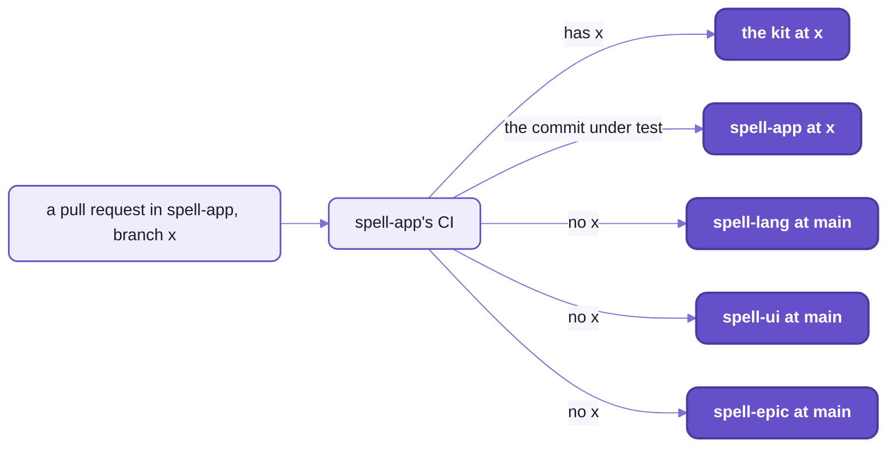

# Working on Spell

```sh
# 1.  A branch in every repo at once:  in Claude Code, /isolate readme (or /epic readme)
cd ~/www/spell.worktrees/readme

# 2.  Edit, then run the tests you're near:  here, the server's router
yarn vp test run Router
#  Test Files  1 passed (1)
#       Tests  21 passed (21)

# 3.  The finishing pass:  ts, lint:fix, format and tests, in the kit and then in every repo above it
yarn review

# 4.  What changed, and in which repo (the kit goes by its folder's name, spell)
epic worktree repos
# spell:  readme, 0 ahead of main, 0 behind, 7 uncommitted
# spell-lang:  readme, 0 ahead of main, 0 behind
# spell-ui:  readme, 0 ahead of main, 0 behind
# spell-epic:  readme, 0 ahead of main, 0 behind
# spell-app:  readme, 0 ahead of main, 0 behind

# 5.  A commit in each repo that changed:  here only the kit, the git repo at the root
git commit -am "README-development:  the loop first"

# 6.  main moved meanwhile?  Merge it into every repo, regenerating the generated files
epic worktree merge-main

# 7.  In Claude Code, /isolate done:  it asks, then opens the pull requests and moves each changed repo's main up

# 8.  Push each main, lowest first:  GitHub marks the pull requests merged
cd ~/www/spell && git push
```

_A change from branch to merged, in the worktree this page was written in.  The outputs are real runs._

That's five git repos, changed and checked as one, and nothing in the loop publishes anything:
no `npm link`, no version bump, no prerelease for the repo above to install.
Every repo runs the others' SOURCE through one install,
so the repos above your change are running it already, and step 3 checks them.

Not set up yet?  Start at [the kit's README](README.md#setup-from-zero), "Setup from zero".

## Workspaces, with three differences

If you've used npm or yarn workspaces, you know the shape:  several packages, one install, one lockfile.
Spell keeps all of that, and changes three things.

### Each workspace is its own git repo

The kit is the git repo at the root.
The other four are cloned inside it, git-ignored there, each with its own history, pull requests and CI:
[repos.json5](repos.json5) lists them, lowest first ([the kit's README](README.md), "The five repos").

So `git` acts on the repo whose folder you're in:  `cd spell-ui`, or `git -C spell-ui log`.
At the root, `git status` sees only the kit's own files.
For all of them at once, the kit has two scripts:
- `yarn status`:  each child repo's branch, how far it is ahead or behind, and up to 12 changed files;
  a clean one on one line
- `yarn pull`:  `git pull --ff-only` in each

The install is still ONE, at the kit's root, and the child repos have no lockfile.

<details>
<summary>What the one install does</summary>

- Each child repo is a workspace (`"workspaces": ["spell-*"]`):  linked, never published.
- One copy of each package version, Solid above all, pinned by the kit's `resolutions`.
- It links each child repo's `agents` folder to the kit's, so every repo reads one copy of the house rules.
  spell-epic gets none:  Claude Code would load a root `agents/` there as the plugin's own agents.

</details>

### A check at the root runs every repo, bottom up, and always finishes

`yarn ts`, `yarn test`, `yarn lint` and `yarn review` at the kit's root run the kit's own check first,
then each child repo's, lowest first.
Lowest first because each repo's type check builds the declarations the repos above it read
([README-toolchain.md](README-toolchain.md#every-tool-reads-source-but-one), "Every tool reads source, but one").

A failure doesn't stop the run.
Every repo runs, and the summary at the end names the ones that failed.
Here's the end of a real `yarn lint`, run on the day this page was written:

```text
==================== yarn lint, every repo

spell-kit      passed  (11s)
spell-lang     passed  (8s)
spell-ui       passed  (2s)
spell-epic     passed  (1s)
spell-app      FAILED  (7s)
```

One warning did that:  a hook's dependency list in spell-app's command line, whose prompts are drawn with Ink,
React for the terminal.
Lint fails on a warning here, and `yarn lint` exits 1.

### A change across repos is a branch name

A change to two repos is two commits, one in each, and two pull requests.
What ties them together is the NAME of the branch:
CI checks a repo against each other repo at the same branch name where it has one, and at `main` where it doesn't
([below](#ci-checks-a-branch-name-not-a-commit)).
An epic's worktree puts every repo on one name for you.

Merge the lower repo first.
A repo's `main` is checked against the `main` of the repos below it,
so merging spell-app before the kit change it needs leaves spell-app's `main` failing until the kit catches up.

## The checks:  four of them, and review

Every repo answers to the same script names, so `yarn test` means the same thing in each, whatever runs underneath.
`review` is the one to run before you commit:  it runs the other four, lint as `lint:fix`, and it CHANGES files.

| Check | What it does |
| --- | --- |
| `ts` | the type check:  the lower repos' declarations rebuilt where stale (`spell-types --below`), then this repo's own programs and its tests' |
| `lint` | oxlint, strict:  a warning fails, and so does an unused disable comment;  plus ruff, for Python |
| `lint:fix` | the same, fixing what it can |
| `format` | oxfmt, and ruff's formatter for Python;  it rewrites files |
| `test` | Vitest, every project in the repo;  then pytest for its Python, and spell-epic's `node --test` scripts |
| `review` | `ts`, `lint:fix`, `format`, `test`, in that order, stopping at the first that fails;  then "REVIEW PASSED" |

- spell-epic's `review` is `ts`, `lint` and `test`:  it fixes nothing and formats nothing,
  so run its `lint:fix` and `format` yourself.
- There's no `format` over every repo:  `yarn review` formats them all, or run `yarn format` in each.
- Run TypeScript as `yarn tsc`, never `npx tsc`:  yarn picks the install's TypeScript 7.
- Two installs these checks need, once:
  - `yarn playwright install chromium`, for the browser tests (CI adds `--with-deps`, for Linux)
  - uv, which runs spell-lang's and spell-app's Python:  without it, their `test` and `lint` fail at the Python step
- Not to be confused with `spell lint` and `spell format`, which check and tidy `.spell` programs, not TypeScript.
  🌱 The repo checks as `spell` commands too, under a group of their own:  planned, not started
  ([README-cli.md](README-cli.md#-coming)).

Run them as wide or as narrow as the change:

| To check | Run |
| --- | --- |
| every repo | `yarn ts`, `yarn test`, `yarn lint`, `yarn review`, at the kit's root |
| the kit alone | `yarn kit:ts`, `kit:test`, `kit:lint`, `kit:lint:fix`, `kit:format`, `kit:format:check`, `kit:review`, at the kit's root |
| one child repo | its own scripts, in its folder:  `cd spell-ui && yarn test` |
| one folder's tests | `yarn vp test run --project server`, at its repo's root |
| one test file | `yarn vp test run Router`:  Vitest matches the file name |
| as you edit | `yarn vp test`:  Vitest's watch mode, at its repo's root |

**Not checked by any of them:  a repo you haven't cloned.**
The checks over every repo run what's cloned (`yarn repos` puts a ✓ by those),
so a kit change can break a repo that isn't on your machine, and nothing here will say so.

<details>
<summary>Every repo's test projects, for <code>--project</code></summary>

One Vitest config per repo, `vitest.config.ts` at its root, with a project per folder of its `src/`;
Spell UI and spell-epic split theirs by where the tests run instead.

| Repo | Projects |
| --- | --- |
| the kit | `util` and `element` (in Chromium);  `util:node`, `server`, `element-tools`, `cli`, `toolchain`, `tools` |
| spell-lang | `parser`, `markdown`, `core`, `py`, `spell`, `cli` |
| spell-ui | `ssr` (node, Solid's server build), then `browser` |
| spell-epic | `node`, `browser` |
| spell-app | `spaces`, `lsp`, `cli`, `page-server`, `app:node`, `app:browser` |

</details>

## Done means the finishing pass

A change is done when three things are true, and they're the same for a person and for a coding agent
(whose rules start at [AGENTS.md](AGENTS.md)).

1. `yarn review` passed, at the kit's root:
   it checks every repo, so it catches a change that broke a repo above the one you changed.
2. You read your own diff for the bugs a fast draft leaves:
   an inverted guard, a `return promise` inside a `try` with no `await`,
   copy-paste residue from the file you copied.
   WWOD lists them all:  [WWOD.md](agents/wwod/WWOD.md), §1, "Finishing pass for fast-drafted code".
3. You reported it with numbers:  the test count and how it moved, with the reason;
   and what was broken before you came, called pre-existing.

The summary above is that habit at work:  spell-app's warning was there before this page was.

## Tests live in a second tree, at the code's paths

If you keep `Button.test.tsx` beside `Button.tsx`, drop the habit here.
Each repo's tests are in `tests/` at its root, at the same paths as the code under `src/`:
[Router.test.ts](tests/server/Router.test.ts) tests [Router.ts](src/server/Router.ts).
Swap the first folder, and you've found it.
The cost is the mirror's:  move or rename a file, and its test moves too, in the other tree.

A test is ordinary code in every other way.
It imports what it tests by its package name (below, "One name per file"),
takes Vitest's API from `vite-plus/test`, never `vitest` itself, since a lint rule fails the other,
and keeps its snapshots and data beside it (`__snapshots__/`).
The tests have TypeScript settings of their own, `tests/tsconfig.json`, and `ts` checks them too.

Where a test runs is decided by its folder and its name, so a new file needs no registering:
- Anything that draws runs in a real Chromium, headless (Vitest's browser mode, with Playwright):
  the kit's `util` and `element`, Spell UI's elements, spell-epic's `<epic-*>` elements, spell-app's `app:browser`.
- Everything else runs in node.
  A name can say which:  `*.ssr.test.tsx` runs in node in Spell UI, `*.browser.test.tsx` in Chromium in spell-app.
- Spell UI's `yarn test:all` adds Firefox and WebKit;  `yarn test:browsers` installs them.
- The Python tests are pytest's, run through uv inside the same `yarn test`:
  spell-lang's Python runtime, spell-app's Python web apps.
- Shared helpers:
  - the kit's, for every set of elements:  `spell-kit/test-helpers/ElementFixture`, `Fixture`, `A11y`, `Viewport` ...
    ([README-element.md](README-element.md))
  - Spell UI's setup, `spell-ui/test-helpers/setup.ts`, which spell-app's and spell-epic's browser tests run first

Tests reach DOWN only, as code does:
- A higher repo's tests may use a lower repo's helpers and test data:
  spell-app's tests read spell-lang's frozen test projects.
- A lower repo's tests never read a higher one's:  they get a fixture of their own, or the test moves up.
- A test that needs a higher repo only to check against it skips itself when that repo isn't cloned:
  spell-lang's TypeScript check of compiled Spell, against the editor's types, says "(needs spell-app)".

## One name per file, from every repo

Most projects give a file two names:  a path alias from inside (`@/server/Router`), the package's name from outside.
Here a file has ONE, the same from every repo, its own included:
the package's name plus the file's path under the repo's `src/`, with no extension.

```ts
// a folder's barrel, by the folder's name:  src/server/index.ts
import { SRV } from "spell-kit/server"
// one file, src/util/string.ts:  the same name from inside the kit, where this line comes from
import { camelCase, kebabCase } from "spell-kit/util/string"
// a query stays
import partsCSS from "spell-ui/components/ui-parts/UIParts.css?inline"
```

_Real lines, from [the router's test](tests/server/Router.test.ts),
[the kit's tag names for drawable things](src/util/spell/drawable.ts)
and [Spell UI's label](spell-ui/src/components/ui-label/UILabel.tsx)._

- The other repos' files go the same way:  `spell-ui/components/ui-button`, `spell-lang/spell`.
- No path aliases and no `../`;  a same-folder peer stays `./Peer`.
  Lint holds it:  `spell/no-parent-import` fails a `../` that climbs into a package's `src/`,
  and its message names the import to write ([README-toolchain.md](README-toolchain.md#the-houses-own-lint-rules)).
- Every arrow points down:  a repo imports only the kit and the repos it needs, never one above it.
  `yarn clone <repo>` clones exactly those, so a wrong import fails there, not in someone else's checkout.
- A file another repo needs at run time (Spell's runtime source, the frozen test projects) is found by PACKAGE,
  through `node_modules`, never by a path into that repo.
- Under the hood, the type check reads the repos below through their built declarations, and Vite, Vitest, `tsx` and
  lint read source:  each entry of a package's `exports` names both
  ([README-toolchain.md](README-toolchain.md#every-tool-reads-source-but-one), "Every tool reads source, but one").

The cost:  a file's path IS its name, so moving one renames it in every repo that imports it.
Search the whole checkout before you move anything, the child repos included.

## Working across repos:  one epic, one branch name

`git worktree` gives one repo a second checkout, on another branch.
An epic's worktree does that for the WHOLE checkout:
a worktree of the kit at `~/www/spell.worktrees/<epic>/`, with a worktree of every child repo inside it,
all on the epic's branch, and an install of its own.

```mermaid
%%{init: {"theme":"base","themeVariables":{"fontFamily":"-apple-system, BlinkMacSystemFont, Segoe UI, Helvetica, Arial, sans-serif","fontSize":"15px","primaryColor":"#EFECFB","primaryBorderColor":"#6550CA","primaryTextColor":"#1A1C27","secondaryColor":"#F4F1E9","tertiaryColor":"#F7F6FC","lineColor":"#7F6FD6","textColor":"#7F6FD6","clusterBkg":"#F7F6FC","clusterBorder":"#B9B0E8","titleColor":"#1A1C27","edgeLabelBackground":"#F7F6FC","actorBkg":"#EFECFB","actorBorder":"#6550CA","actorTextColor":"#1A1C27","actorLineColor":"#9C90DE","signalColor":"#7F6FD6","signalTextColor":"#7F6FD6","labelBoxBkgColor":"#EFECFB","labelBoxBorderColor":"#6550CA","labelTextColor":"#1A1C27","loopTextColor":"#7F6FD6","noteBkgColor":"#F1E7D4","noteBorderColor":"#C9B48A","noteTextColor":"#1A1C27","activationBkgColor":"#DCD6F7","activationBorderColor":"#6550CA","sequenceNumberColor":"#FFFFFF"},"flowchart":{"curve":"basis","padding":12,"nodeSpacing":40,"rankSpacing":44}}}%%
flowchart LR
  subgraph main["~/www/spell:  the main checkout, on main"]
    kit1["the kit, at the root"]
    kids1["spell-lang · spell-ui · spell-epic · spell-app, inside it"]
    nm1["node_modules/:  the one install"]
  end
  subgraph wt["~/www/spell.worktrees/readme:  an epic's worktree, on readme"]
    kit2["the kit, a worktree of it"]
    kids2["spell-lang · spell-ui · spell-epic · spell-app, a worktree of each"]
    nm2["node_modules/:  an install of its own"]
  end
  main -- "/isolate readme" --> wt
  wt -- "/isolate done" --> main
  %% the Spell look:  yarn mermaid:pretty
  classDef default fill:#EFECFB,stroke:#6550CA,stroke-width:1.5px,color:#1A1C27,rx:8px,ry:8px
  classDef repo fill:#6550CA,stroke:#4A3AA0,stroke-width:2px,color:#FFFFFF,rx:10px,ry:10px,font-weight:600
  classDef folder fill:#E6EAF5,stroke:#8E96B5,stroke-width:1.5px,color:#1A1C27,rx:4px,ry:4px
  class kit1,kids1,kit2,kids2 repo
  class nm1,nm2 folder
```



_The worktree is a copy of the whole checkout, on one branch name in every repo._

**Making one:**  `/epic <name>`, or `/isolate <name>` for a smaller job, in Claude Code.
- spell-epic's worktree hook branches every repo from your local `main`, unpushed work included.
- It runs the one install, then the two VS Code extensions' own (`spell-epic/vscode`, `spell-app/vscode`).
- The edge:  it's Claude Code's worktree hook that does this, so making one needs Claude Code.
  Without it, do by hand what it does:  the same branch name in each repo you change (below, "The manual way").

**Merging `main` in** is the one step git can't do alone.
A generated file (a syntax table, a snapshot, a compiled library) is a function of BOTH branches' source:
after a merge neither side's copy is right, and no line merge of the two is either.
So `epic worktree merge-main` merges `main` into every repo, child repos lowest first and the kit last,
and REGENERATES each generated file both sides changed, from the merged source.
- It re-runs the snapshots too, and lists any entry neither side had:  new behaviour nobody has looked at yet.
- Any other conflict stops it mid-merge:  resolve it, `git add`, then `epic worktree merge-main --continue`.
- Never a bare `git merge main`:  git keeps your side of each such file, marks it conflicted, and can't rebuild it.

**Leaving:**  `/isolate done` merges `main` in one last time,
then offers to push and open the pull requests, and to merge each branch into `main`.
- It moves every changed repo's `main`, or none:  one that isn't ready (not on `main`, or not clean) stops them all,
  and says which.
- It never pushes `main`:  push each yourself, lowest first, and GitHub marks the pull requests merged.
- `epic worktree remove <name>` clears the worktree away after, its servers stopped first;  the branches stay.

To shelve the work instead:  `/park`, then `/unpark`;  or `/wait-for <other>`, to pick it up when another finishes.

While you're in it:
- `epic worktree repos` shows each repo's branch, what's uncommitted, and how far it is ahead of or behind `main`.
- The worktree has its own page server.
  The first to start gets port 4747, the main checkout's usually;  a worktree's gets another free one,
  and the main page server shows the worktree at `/worktrees/<name>/` too.
- The `spell` on your `PATH` still runs your main checkout's code, on the worktree's files.
  So to try your change to a command, or to the compiler under one, run `yarn spell <command>`:  the worktree's own.
- It opens in its own VS Code window, `⎇ <name>`, where `git.detectWorktrees` shows every repo's worktree in Source
  Control.
  Never `code --add`, never `code -r`:  [README-vscode.md](README-vscode.md), "Windows and worktrees", says why.
- `epic` is spell-epic's command, on every Claude Code session's `PATH` while the plugin is on:
  every verb in [spell-epic's README-cli.md](spell-epic/README-cli.md);
  epic pages, the review loop and the skills in [spell-epic's README](spell-epic/README.md).

<details>
<summary>The manual way, for a change in one repo</summary>

Each child repo is a plain git repo:  run git in the one you mean.

```sh
cd ~/www/spell
git -C spell-ui switch -c my-fix
# ... edit, then check that repo and everything above it:
yarn review
git -C spell-ui commit -am "my fix"
git -C spell-ui push -u origin my-fix
```

Two repos by hand are the same, twice:  one branch name in both, and the lower repo's pull request merged first.

</details>

<details>
<summary>The generated files merge-main rebuilds</summary>

Each repo lists its own in its `.epic/generators.json5`, and each branch reads its own copy,
so a branch that adds a generated file also teaches its own merge to rebuild it.

| Repo | Generated files | Made by |
| --- | --- | --- |
| spell-lang | `src/spell/spellSyntax.json`, the syntax table | `yarn spell:gen:syntax` |
| spell-ui | `docs/__data/`:  components, icons, search, custom elements, HTML custom data | `yarn site:data` |
| spell-app | the Spell libraries' compiled `*.lib.ts`;  App UI's `app/docs/__data/` | `spell compile @spell/library`;  `yarn site:data` |
| every repo | Vitest snapshots, `__snapshots__/*.snap` | `vp test run --update` |

- They're marked in each repo's `.gitattributes`:
  - `merge=binary`:  changed on both sides, git keeps ours and marks the file conflicted, never interleaving the two
  - `-diff` when minified:  `git diff` says "Binary files differ" instead of printing one enormous line
  - `linguist-generated`:  folded in GitHub's pull request diffs
  - NOT `merge=ours`:  it silently drops the other side's changes
- A new committed generated file goes in both lists.
- NOT committed at all:  the bundles only the page server serves, such as Spell UI's docs site.
  It builds the stale ones when it starts, or `spell bundle --stale` builds them by hand.

</details>

## CI checks a branch name, not a commit

Every repo has ONE GitHub Actions workflow, [checks.yml](.github/workflows/checks.yml):
on a push to `main`, a pull request, or by hand from the Actions tab.
The kit's runs `kit:ts`, `kit:lint` and `kit:test`, with no child repo cloned.

A child repo's workflow rebuilds the layout you work in, and picks every other repo by the NAME of your branch:
1. the kit at the root, at the branch under test when the kit has one, else at `main`
2. the repo itself inside it, at the commit under test
3. the repos it needs, by `yarn clone <repo> --branch <branch> --https --shallow`:
   each at the branch under test when it has one, else its default branch
4. then its `yarn ts`, `yarn lint` and `yarn test`



_A change to the kit and spell-app on branch x:  spell-app's CI takes the kit at x, and every other repo at main._

So push the lower repo's branch before you open the pull request above it:
CI looks the branch up on GitHub, and takes `main` wherever it isn't there yet.

The edges:
- **The kit's own CI checks the kit ALONE.**
  A change only to the kit starts no child repo's CI:  each runs at its own next pull request, or push to `main`.
  Till then, your `yarn review` at the root is the only check of the repos above, so run it before you push.
  To have CI check one anyway, push a branch of the same name to it, and run its workflow on that branch by hand:
  the Actions tab, "checks", "Run workflow".
- The pairing is by name and nothing else:
  a `fix` branch in spell-ui runs against whatever `fix` the kit has, so pick a name nobody else is using.
- CI never checks formatting:  it runs `ts`, `lint` and `test`, never `format:check`.
  What keeps the format is `yarn review` before you commit, which formats as it goes.

<details>
<summary>The CI workflow, step by step</summary>

1. Check the kit out;  `corepack enable`, which turns on the yarn release the kit pins.
2. Node 24, with yarn's cache.
3. `yarn install`, with `YARN_ENABLE_IMMUTABLE_INSTALLS=false`:
   the lockfile lists child repos that aren't cloned there.
4. In a child repo, around the clones above:  uv, for spell-lang's and spell-app's Python;
   and spell-epic's extension install (`spell-epic/vscode`, a yarn project of its own, which its `lint` reads).
5. `yarn playwright install --with-deps chromium`, for the browser tests.
6. In a child repo, a git name and email:  some tests make throwaway git repos and commit to them.
7. The checks.

- A new push to the same branch cancels the run still going.
- The repos are public, so CI needs no token;  a `SPELL_REPOS_TOKEN` secret, when it's set, signs the clones in.
- The four child workflows are the same but for the repo's name, uv and spell-epic's extension install:
  change them together.

</details>

## Where to change what

The code for one behaviour is rarely where its name suggests:
the squiggle under a word is spell-app's, the rule that put it there is spell-lang's.
Find the row for what you want to change, then read the page beside it before you start.

| To change ... | Look in |
| --- | --- |
| how a Spell sentence parses or compiles | spell-lang's [rules](spell-lang/src/spell/rules/) and its [parser](spell-lang/src/parser/) (the engine, Rulex):  [README-spell.md](spell-lang/README-spell.md), [README-parser.md](spell-lang/README-parser.md) |
| what compiled code runs on | spell-lang's [core](spell-lang/src/core/) (JavaScript) and [py](spell-lang/src/py/) (Python):  [README-core.md](spell-lang/README-core.md) |
| the output for one language | the writers, and the list of targets in spell-lang's [`targets.ts`](spell-lang/src/spell/targets.ts):  [README-targets.md](spell-lang/README-targets.md) |
| errors, hover and completion | the language service ([`SpellLanguageService.ts`](spell-app/src/lsp/SpellLanguageService.ts)):  [README-lsp.md](spell-app/README-lsp.md) |
| the editor's screens and behaviour | spell-app's [`src/app/`](spell-app/src/app/):  [`solid/`](spell-app/src/app/solid/), [`pages/`](spell-app/src/app/pages/), [`editor.ts`](spell-app/src/app/editor.ts);  [README-app.md](spell-app/README-app.md) |
| how programs run in a page | spell-app's [runner](spell-app/src/app/runner/) |
| `<spell-app>`, `<spell-editor>`, `<spell-code>`, `<spell-markdown>` | spell-app's [`src/app/components/`](spell-app/src/app/components/);  build with `yarn build:element`;  demos in `app/demo/` |
| VS Code language features, Run Project | spell-app's [`vscode/src/`](spell-app/vscode/src/):  [README-vscode.md](README-vscode.md) |
| projects on disk, addresses, the editor's API | spell-app's [spaces](spell-app/src/spaces/server/node/):  [README-spaces.md](spell-app/README-spaces.md) |
| the example projects | spell-app's [`spaces/@spell/examples/`](spell-app/spaces/@spell/examples/) and `library/`:  [README-examples.md](spell-app/README-examples.md) |
| Python web apps | spell-app's [`spell_quart`](spell-app/src/spaces/server/py/) |
| a `spell` command | its repo's `src/cli/` folder:  [README-cli.md](README-cli.md) |
| the page server | the kit's [server](src/server/) ([README-server.md](README-server.md));  spell-app's layer in [`src/page-server/`](spell-app/src/page-server/) ([README-page-server.md](spell-app/README-page-server.md)), its settings in spell-app's root `package.json` (`"pageServer"`) |
| a Spell UI element | [spell-ui](spell-ui/README.md) |
| the element framework under every set | the kit's [element](src/element/):  [README-element.md](README-element.md) |
| epic pages, review, windows, hooks, skills | [spell-epic](spell-epic/README.md), with its own checks;  `/reload-plugins` for a skill's new text |
| the Review tab and Epic Docs | spell-epic's [`vscode/`](spell-epic/vscode/) |
| the house style | the kit's [`agents/wwod/`](agents/wwod/), then `spell wwod check` |

## When something's wrong, read the papercuts first

Tooling failing for no reason you can see?
Check `PAPERCUTS.md` FIRST:  it's where anything that slowed development down is written up, with its fix,
and someone has often lost the same hour before you.

- It's one of three logs in the kit's [`agents/`](agents/) folder, beside `SUSPECTED-BUGS.md` and `CODE-DEBT.md`.
- What goes in each, and how to add to them:  [README-agents.md](README-agents.md), "The three logs".

Two that nearly everyone meets once:
- "Cannot find module" for another repo's file, in a type check or your editor, on a fresh clone:
  the declarations it reads aren't built yet (`dist-types/` is git-ignored).
  `yarn ts` at the kit's root builds them.
- `spell` not found, or running an old checkout's code:  it's a link to one checkout's `bin/spell.mjs`.
  `yarn cli:install` at the kit's root links it to this one;  run it again after moving the checkout
  ([README-cli.md](README-cli.md#setting-it-up)).

## Every script, repo by repo

Day to day you'll type the checks, `yarn pull` and `yarn status`.
The rest are each repo's own tools, listed so you can find one by name before you go looking in a `package.json`.
Every script, `spell` command and skill is also on the commands page, a guide in the docs site:
add one, and `spell commands check` exits 1 until the page names it too.

<details>
<summary>Every yarn script, repo by repo</summary>

The kit (`~/www/spell`)
- the child repos:  `clone` (what's missing, and what it needs, then one install), `pull`, `status`, `repos`;
  `postinstall` makes the links
- over every repo:  `ts`, `test`, `lint`, `review`
- the kit's own:  `kit:ts`, `kit:test`, `kit:lint`, `kit:lint:fix`, `kit:format`, `kit:format:check`, `kit:review`
- `spell` (the `spell` command, without installing it), `cli:install` (puts `spell` on your `PATH`)
- `server`:  `spell server`, the page server's command line, on the kit's own checkout
- `favicon [--hat 0.74]`:  Spell's favicon files, from the hat mark
- `readme:check`, `mermaid:pretty`:  the READMEs' check, and the look of their Mermaid pictures

spell-lang
- checks:  `ts`, `test`, `lint`, `lint:fix`, `format`, `format:check`, `review`
- `spell:test:rules`, `spell:test:rules:bless`, `spell:test:fixtures`, `spell:test:fixtures:bless`, `spell:test:ui`,
  `spell:test:coverage`
- `spell:gen:syntax` (the syntax table), `core:gen:declarations` (the core's method list), `markdown:spec:update`
  (GitHub's Markdown spec)

spell-ui
- checks:  `ts`, `test` (its `ssr` and `browser` projects), `test:all`, `test:watch`, `test:ui`, `lint`, `lint:fix`,
  `format`, `format:check`, `review`
- `dev` (the demo page), `build`, `preview`, `clean`
- visual and browser tests:  `test:visual`, `test:visual:update`, `test:hmr`, `test:browsers`, `smoke`, `screenshots`
- the docs site:  `site:dev`, `site:data`, `site:index`, `site:kitchen`, `site:bundle`, `site:build`, `site:new`,
  `site:sections`, `site:check`, `readme:components`
- generators:  `gen:styles`, `gen:icons`, `gen:emoji`, `gen:root`, `tokens:alias`, `icons:pack`, `manifest`
- tools:  `vendor`, `measure`, `serve`, `report`, `design:build`

spell-epic
- checks:  `ts`, `test` (with `test:scripts` and `test:vscode`), `test:node`, `test:watch`,
  `lint`, `lint:fix`, `format`, `review`
- `epic`, `pack:build`, `pack:check`, `site:data`, `plugin:validate`, `vscode:check`, `vscode:package`
- the docs tools:  `docs:update`, `docs:index`, `docs:new`, `docs:open`, `docs:link`, `details`

spell-app
- checks:  `ts`, `test`, `test:watch`, `lint`, `lint:fix`, `format`, `format:check`, `review`
- the editor:  `start` (an install, a fresh page server, then the editor, printing its URL), `stop`,
  `start:dev` (Vite alone), `start:server` (the API alone, port 3001), `start:server:prod`, `build`, `build:runner`,
  `build:element`, `build:page`, `preview`, `site:data`, `site:pictures`, `examples:readme`, `clean`
- the language server:  `lsp:start`, `lsp:scopes`
- the command line:  `spell`;  `dev`, `dev:ts`, `dev:py` (`spell run` in the folder you're in)
- repo tools:  `vscode`, `vscode:build`, `vscode:install`, `server`, `serve` (every web server), `window`,
  `commands:check`, `epic`, `ask`

</details>

<details>
<summary>The tools underneath</summary>

- Node and yarn, and how to install them:  [the kit's README](README.md#setup-from-zero), "Setup from zero".
  The kit runs its own `.ts` tools with plain `node`, which needs Node 24's built-in type stripping.
- Vite+ (`vite-plus`, the `vp` command) pins Vite, Vitest, oxlint, oxfmt and tsgolint together, at the versions in
  the kit's `catalog:`;  how they're bumped:
  [README-toolchain.md](README-toolchain.md#one-dependency-pins-every-tool), "One dependency pins every tool".
- TypeScript 7;  Solid 2.0.0-rc.13 for every repo;  Playwright 1.63.0 for the browser tests.

</details>

## See also

- [README-toolchain.md](README-toolchain.md):  what the checks run on, and how a type check reads another repo
- [spell-epic's README](spell-epic/README.md):  epic pages, the review loop, and the skills behind `/epic` and
  `/isolate`
- [README-vscode.md](README-vscode.md):  the extensions, and how windows and worktrees are laid out
- [README-agents.md](README-agents.md):  how a coding agent finds the rules, and the three logs
- [README-cli.md](README-cli.md):  every `spell` command, and `epic`

<details>
<summary>More in the docs site</summary>

These guides live in the content folder, so they need a checkout with `spell.epics` beside the repos and the page
server running (`spell server start`, which prints where it is):

- "Vite+":  `/guides/vite-plus.html`
- "Windows and Review":  `/guides/windows-and-review.html`
- "Shared Content":  `/guides/shared-content.html`
- "Commands":  `/guides/dev/commands/commands.html`

</details>
