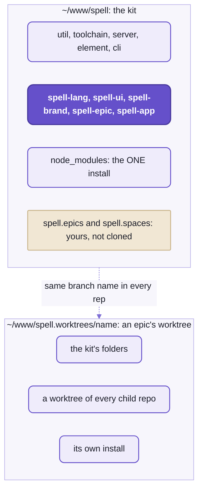

# Working on Spell

Everything a developer does day to day across the six repos, in one place:
the one install, the checks, how the tests are laid out, imports between repos, worktrees and windows, CI,
and where to go to change what.
If you know a JavaScript project with workspaces (several packages, one install), most of this will feel familiar;
the difference is that each child repo is its own git repo, cloned inside the kit.

- New here?  Set up first:  [the kit's README](README.md), "Setting up".
- The house rules for code and docs are the agents' rules too:  [README-agents.md](README-agents.md).



_One checkout holds every repo and one install;  an epic's worktree is a copy of all of it, on one branch._

## The one install

The kit is the ONLY place you run `yarn install`.
Its install covers every child repo you've cloned:  the child repos have no lock file of their own.

- Every child repo is a workspace of the kit's install (`"workspaces": ["spell-*"]`),
  so each package is linked, never published:  a repo always uses the others' source, as it is on disk.
- One copy of each package version, above all Solid, pinned by the kit's `resolutions`.
- Tool versions are bumped here only:  `vite-plus` and every `catalog:` entry together.
  Then the child repos' copies of `.yarnrc.yml`.
- `yarn install` also links each child repo's `agents` folder to the kit's (not spell-epic's),
  so every repo reads one copy of the house rules ([README-agents.md](README-agents.md)).

The kit's commands for the child repos, run in `~/www/spell`:

| Command | What it does |
| --- | --- |
| `yarn clone [repo...]` | Clones what's missing (the named repos and everything they need;  none named:  all), then one `yarn install`. |
| `yarn pull` | `git pull --ff-only` in every cloned child repo. |
| `yarn status` | Each child repo's branch, ahead / behind, and up to 12 changed files;  a clean one on one line. |
| `yarn repos` | The list:  a check mark when cloned, and what each needs. |

```text
$ yarn repos
✓ spell-lang     -
✓ spell-ui       -
✓ spell-brand    spell-ui
✓ spell-epic     spell-ui
✓ spell-app      spell-lang, spell-brand, spell-ui, spell-epic (runs)
```

<details>
<summary>yarn clone's flags, and what a partial clone does</summary>

- SSH first, HTTPS when SSH is refused (GitHub's login, `gh auth setup-git`).
- `--branch <name>`:  each repo at that branch where it has one, else its default branch.
- `--https`:  skip SSH.
- `--shallow`:  only the last commit.
- `--no-install`:  clone only.
- Run it again after `repos.json5` gains a repo:  it clones only what's missing.
- A partial clone rewrites the kit's `yarn.lock` (the lock file lists every child repo):  don't commit that change.
- The list of repos, lowest first, and what each needs:  [repos.json5](repos.json5).

</details>

## The checks

Four checks run over everything, from the kit's root:  the kit's own first, then each child repo's, lowest first.
Every repo runs even when one fails, and a summary comes at the end.

```sh
yarn ts        # type check;  each repo builds the declarations the ones above it read
yarn test      # every repo's tests
yarn lint      # every repo's lint
yarn review    # the finishing pass:  ts, lint:fix, format, test
```

- `review` CHANGES files:  it fixes what lint can, and formats.  Run it before you commit.
- `yarn tsc`, never `npx tsc`:  yarn picks the workspace's TypeScript 7.

Narrower, from wider to one file:

| Scope | Run |
| --- | --- |
| the kit only | `yarn kit:ts`, `kit:test`, `kit:lint`, `kit:lint:fix`, `kit:format`, `kit:format:check`, `kit:review` |
| one child repo | `cd spell-ui && yarn test` (each repo has `ts`, `test`, `lint`, `review`) |
| one folder of a several-folder repo | `cd spell-lang && yarn spell-folders test core`;  in the kit, `node toolchain/bin/spell-folders.ts test server element` |
| one folder's tools directly | `cd server && yarn vp test run`, `yarn vp lint src`, `yarn vp fmt` |
| one test file | `cd server && yarn vp test run Router` (Vitest matches the file name) |

```text
$ cd server && yarn vp test run Router
 Test Files  1 passed (1)
      Tests  21 passed (21)
```

- A folder has no `package.json` of its own, so no scripts:  in it, use its tools directly.
- Each check's tools are Vite+'s (Vitest, oxlint, oxfmt, the type checker):
  [README-toolchain.md](README-toolchain.md) says how they're shared.

## How the tests are organized

Tests live in a `tests/` folder at each repo's root, NOT beside the code, at the same paths as the code they test.
E.g. the kit's [Router.test.ts](tests/server/src/Router.test.ts) tests [Router.ts](server/src/Router.ts):
the same path, under `tests/`.

- A repo of several folders (the kit, spell-lang, spell-app) has `tests/<folder>/`.
  E.g. `spell-lang/tests/parser/`, `spell-app/tests/cli/`.
- A flat repo (spell-ui, spell-brand, spell-epic) has `tests/` mirroring its code.
- Snapshots and test data sit with their tests.
- Each folder's `vitest.config.ts` points at its tests folder,
  and a `tsconfig.json` in each tests folder gives them the folder's own settings.
- Browser or node:
  - browser tests run in a real Chromium, headless (Vitest's browser mode with Playwright):
    the kit's util and element, Spell UI's elements, spell-app's app
  - the rest run in node
  - so install Chromium once:  `yarn playwright install chromium` (CI adds `--with-deps`, for Linux)
- Python folders (spell-lang's py, spell-app's spaces) run pytest and ruff through uv,
  in the same `yarn test` and `yarn lint`:  install uv for them.
- Shared helpers stay in the code folders:
  every component set's element helpers are the kit's (`spell-kit/test-helpers/ElementFixture` ...);
  [README-element.md](README-element.md), "Tools and test helpers".

Tests only reach DOWN, as code does:

- A higher repo's tests may use a lower repo's helpers and test data
  (spell-app's and spell-brand's run Spell UI's setup;  spell-app's spaces reads spell-lang's frozen test projects).
- A lower repo's tests never read a higher one's:  they get a fixture of their own, or the test moves up.
- A test that needs a higher repo only to check against it skips itself when that repo isn't cloned
  (spell-lang's TypeScript check of compiled spell, against the editor's types).

## Imports across repos

Every import is a package name, from anywhere:  `spell-kit/server`, `spell-ui/core`, `spell-lang/spell`.
A package's own deep files go by `#/`, its private subpath imports:  `#/components/ui-parts/UIParts.css?inline`.

- From another repo:  the package's name and an entry its `package.json` `exports` names.
  The kit's are under its folders' names:  `spell-kit/util/class`, `spell-kit/server/page`, `spell-kit/element`.
- Every arrow points DOWN:  a repo imports only the kit and the repos it needs, never one above it.
  `yarn clone <repo>` clones exactly those, so a wrong import fails there.
- Lint fails a `../` path into another repo's package.
- A file another repo needs at run time (spell's runtime source, the frozen test projects) is found by PACKAGE,
  through `node_modules`, never by a path into that repo.

How each tool finds another repo's package:

| Tool | Reads | How |
| --- | --- | --- |
| `tsc` | its built declarations | each `exports` entry's `types` condition, `dist-types/...d.ts`, built by `spell-types`;  a repo's `yarn ts` runs `spell-types --below` first, so the lower repos' are fresh |
| Vite and Vitest | its source | the entry's `default`, a `.ts` file |
| `tsx` and node | its source | the same `default`, through node's own package resolution |

<details>
<summary>Until repo-split P14 lands:  today's aliases</summary>

- Inside a repo, today's imports start from a `$/` alias, from the repo's own `tsconfig.base.json`.
  - E.g. `$/parser`, `$/ui/components/...`.
  - The kit's own files use `$/util`, `$/server`.
  - The kit's folders import each other by package name already.
- So `tsx` needs a run-time hook to resolve them, `spell-kit/toolchain/aliases`.
  - Load it after `tsx` in every program that runs another repo's source:
    `tsx --import spell-kit/toolchain/aliases <script>`.
  - Without it:  `Cannot find package '$'`, on the first other repo's file.
- `spell-types` rewrites every `$/` in a declaration as a relative path.
- Lint also fails a `$/` alias into another repo (`spell/no-cross-repo-alias`).
- The kit's `assembler/` is its own folder today, `spell-kit/assembler`;  P14 folds it into the server.
- P14 replaces all of this with package names and `#/`:
  the alias tables, the hook, the rewrite and that lint rule go.

</details>

## Worktrees and windows

An epic works in a worktree of the WHOLE checkout:  a worktree of the kit at `~/www/spell.worktrees/<epic>/`,
with a worktree of every child repo inside it, all on the epic's branch, and one install of its own.

- `/epic <name>` or `/isolate <name>` in Claude Code makes one, through spell-epic's worktree hook:
  the branches, the install, the two VS Code extensions' own installs.
- Each worktree has its own page server:  port 4747 is the main checkout's, and a worktree gets another.
  The main page server shows it at `/worktrees/<name>/` too.
- `git.detectWorktrees` is on in every window, so each repo's worktree shows in Source Control.
- Merge `main` in with `epic worktree merge-main`, never a bare git merge:
  it REGENERATES each generated file both sides changed, from the merged source, instead of line-merging it.
- Shelving:  `/park`, `/unpark`, `/wait-for <other>`.
- Leaving:  `/isolate done` offers a merge into `main` and pull requests.
- Windows:  a worktree gets its own VS Code window, `⎇ <name>`.
  - Never `code --add`:  it restarts a one-folder window's extensions, the Claude panel too.
  - Never `code -r`.
  - How windows are laid out:  [README-vscode.md](README-vscode.md), "Windows and worktrees".

<details>
<summary>The generated files merge-main rebuilds</summary>

Each repo lists its own in its `.epic/generators.json5`, each branch's own copy:

| Repo | Generated files | Made by |
| --- | --- | --- |
| spell-lang | `spell/spellSyntax.json` | `yarn spell:gen:syntax` |
| spell-ui | `docs/__data/` (components, icons, search, custom elements, HTML custom data) | `yarn site:data` |
| spell-brand | `docs/__data/`;  `components/__pack/` | `yarn site:data`;  `yarn pack:build` |
| spell-app | the spell libraries' `*.lib.ts`;  App UI's `docs/__data/` | `spell compile @spell/library`;  `yarn site:data` |

- They're marked in each repo's `.gitattributes`:  `merge=binary` (never line-merged), `-diff` when minified,
  `linguist-generated` (folded in GitHub's diffs).
- A new committed generated file goes in both lists.
- NOT committed at all:  the bundles only the page server serves (Spell UI's docs site, the brand pages);
  it builds the stale ones when it starts, or `spell bundles build --stale` by hand.

</details>

## Working across six repos:  use spell-epic

A change that touches several repos is easiest as an epic:
spell-epic makes the worktrees, keeps the branches in step, and checks them together.

1. `/epic <name>` (or `/isolate <name>` for a smaller job) makes one worktree of the kit.
   It has a worktree of every child repo inside, all on branch `<name>`.
2. Work across them as one checkout:  one install, one `yarn review` over all.
3. `epic worktree repos` shows each repo's state:
   its branch, what's uncommitted, how far it's ahead of or behind `main`.
4. `epic worktree merge-main` brings `main` into all of them, regenerating the generated files.
5. `/isolate done` merges each branch into `main` and opens the pull requests.
6. The same branch name in every repo makes CI check them together (below, "Commits and CI").

- How the epic pages, the review loop and the skills work:  [spell-epic's README](spell-epic/README.md).

<details>
<summary>The manual way, for a change in one repo</summary>

Each child repo is a plain git repo:  run git in the one you mean.

```sh
cd ~/www/spell
git -C spell-ui switch -c my-fix
# ... edit, then check that repo and everything above it:
yarn review
git -C spell-ui commit -am "my fix"
git -C spell-ui push -u origin my-fix
```

- `git status` at the kit's root sees only the kit's own files;  `yarn status` shows every child repo.
- Two repos by hand:  the same branch name in both, one commit in each, the lower repo's merged first.

</details>

## Commits and CI

A change across repos is one commit per repo, merged lowest first.
There's no publish and no version bump:  every repo uses the others' source, through the one install.

- Every repo has one GitHub Actions workflow, [checks.yml](.github/workflows/checks.yml):
  on a push to `main`, a pull request, or by hand.
- The kit's runs `kit:ts`, `kit:lint` and `kit:test`, with no child repo cloned.
- A child repo's checks it the way it's worked on:
  - the kit at the root, at the branch under test when the kit has one, else at `main`
  - the repo itself inside it, at the commit under test
  - the repos it needs, by `yarn clone <repo> --branch <branch> --https --shallow`
  - then its `yarn ts`, `yarn lint` and `yarn test`
- So a change across repos is checked together when every repo's branch has the same name.
- The repos are public:  CI needs no token.

<details>
<summary>The CI workflow, step by step</summary>

1. Check the code out;  `corepack enable` (turns on the repo's yarn).
2. Node 24, with yarn's cache.
3. `yarn install`, with `YARN_ENABLE_IMMUTABLE_INSTALLS=false`:
   the lock file lists child repos that aren't cloned there.
4. `yarn playwright install --with-deps chromium`, for the browser tests.
5. In a child repo:  clone the repos it needs at the same branch;  uv for spell-lang's and spell-app's Python;
   spell-epic's extension install.
6. The checks.

- The five child workflows are the same but for the repo's name, uv and spell-epic's extension install:
  change them together.

</details>

## Where to hack on what

| To change ... | Look in |
| --- | --- |
| how a spell sentence parses or compiles | spell-lang's [rules](spell-lang/spell/src/rules/) and its [parser](spell-lang/parser/) (the engine, Rulex) |
| what compiled code runs on | spell-lang's [core](spell-lang/core/) (JavaScript) and [py](spell-lang/py/) (Python) |
| the output for one language | the writers, and the target list in spell-lang's [`targets.ts`](spell-lang/spell/src/targets.ts) |
| errors, hover and completion | the language service ([`SpellLanguageService.ts`](spell-app/lsp/src/SpellLanguageService.ts)) |
| the editor's screens and behaviour | spell-app's [`app/src/`](spell-app/app/src/):  [`solid/`](spell-app/app/src/solid/), [`pages/`](spell-app/app/src/pages/), [`editor.ts`](spell-app/app/src/editor.ts) |
| how programs run in a page | spell-app's [runner](spell-app/app/src/runner/) |
| `<spell-app>`, `<spell-editor>`, `<spell-code>`, `<spell-markdown>` | spell-app's [`app/components/`](spell-app/app/components/);  build with `yarn build:element`;  demos in `app/demo/` |
| VS Code language features, Run Project | spell-app's [`vscode/src/`](spell-app/vscode/src/):  [README-vscode.md](README-vscode.md) |
| projects on disk, addresses, the editor's API | spell-app's [spaces](spell-app/spaces/src/server/node/) |
| the example projects | spell-app's [`spaces/@spell/examples/`](spell-app/spaces/@spell/examples/) and `library/` |
| Python web apps | spell-app's [`spell_quart`](spell-app/spaces/src/server/py/) |
| a `spell` command | its repo's `cli/` folder:  [README-cli.md](README-cli.md), "How a command is built" |
| the page server | the kit's [server](server/) ([README-server.md](README-server.md));  spell-app's layer in [`page-server/`](spell-app/page-server/), its settings in spell-app's root `package.json` (`"pageServer"`) |
| a Spell UI element | [spell-ui](spell-ui/README.md) |
| the element framework under every set | the kit's [element](element/):  [README-element.md](README-element.md) |
| epic pages, review, windows, hooks, skills | [spell-epic](spell-epic/README.md), with its own checks;  `/reload-plugins` for a skill's new text |
| the Review tab and Epic Docs | spell-epic's [`vscode/`](spell-epic/vscode/) |
| the house style | the kit's [`agents/wwod/`](agents/wwod/), then `spell wwod check` |

## When something's wrong

Check the papercuts log FIRST when tooling fails mysteriously:  someone has often lost the same hour before.

| Log | What goes in it |
| --- | --- |
| papercuts | anything that slowed development down:  date, symptom, fix, project |
| suspected bugs | something that looks wrong, not yet confirmed:  the file and symbol, why, how to prove it |
| code debt | structural problems known and tolerated on purpose:  cost, cause, fix, where it's pinned |

- They're in the kit's [`agents/`](agents/) folder, one section per package:
  [README-agents.md](README-agents.md), "The three logs", says how to add to them.

<details>
<summary>Every yarn script, repo by repo</summary>

The kit (`~/www/spell`)
- the child repos:  `clone`, `pull`, `status`, `repos`;  `postinstall` makes the links
- over every repo:  `ts`, `test`, `lint`, `review`
- the kit's own:  `kit:ts`, `kit:test`, `kit:lint`, `kit:lint:fix`, `kit:format`, `kit:format:check`, `kit:review`
- `server`:  the page server's command line, on the kit alone
- `favicon [--hat 0.74]`:  Spell's favicon files, from the hat mark

spell-lang
- checks:  `ts`, `test`, `lint`, `lint:fix`, `format`, `format:check`, `review`
- `spell:test:rules`, `spell:test:rules:bless`, `spell:test:fixtures`, `spell:test:fixtures:bless`, `spell:test:ui`,
  `spell:test:coverage`
- `spell:gen:syntax` (the syntax table), `core:gen:declarations`, `markdown:spec:update` (GitHub's Markdown spec)

spell-ui
- checks:  `ts`, `test` (its `ssr` and `browser` projects), `test:all`, `test:watch`, `test:ui`, `lint`, `lint:fix`,
  `format`, `format:check`, `review`
- `dev` (the demo page), `build`, `preview`, `clean`
- visual and browser tests:  `test:visual`, `test:visual:update`, `test:hmr`, `test:browsers`, `smoke`, `screenshots`
- the docs site:  `site:dev`, `site:data`, `site:index`, `site:kitchen`, `site:bundle`, `site:build`, `site:new`,
  `site:sections`, `site:check`
- generators:  `gen:styles`, `gen:icons`, `gen:emoji`, `gen:root`, `tokens:alias`, `icons:pack`, `manifest`
- tools:  `vendor`, `measure`, `serve`, `report`, `design:build`

spell-brand
- checks:  `ts`, `test`, `lint`, `lint:fix`, `format`, `review`
- `build`, `compare`, `site:data`, `pack:build`, `pack:check`, `design:bundle`, `design:check`, `rename:shared`

spell-epic
- checks:  `ts`, `test` (with `test:scripts` and `test:vscode`), `test:node`, `test:watch`,
  `lint`, `lint:fix`, `format`, `review`
- `epic`, `pack:build`, `pack:check`, `site:data`, `plugin:validate`, `vscode:check`, `vscode:package`
- the docs tools:  `docs:update`, `docs:index`, `docs:new`, `docs:open`, `docs:link`, `plan-doc`, `details`

spell-app
- checks:  `ts`, `test`, `test:watch`, `lint`, `lint:fix`, `format`, `format:check`, `review`
- the editor:  `start` (page server and editor, prints the editor's URL), `stop`, `start:dev` (Vite alone),
  `start:server` (the API alone, port 3001), `start:server:prod`, `build`, `build:runner`, `build:element`,
  `build:page`, `preview`, `site:data`, `site:pictures`, `clean`
- the language server:  `lsp:start`, `lsp:scopes`
- the command line:  `spell`, `cli:install`;  `dev`, `dev:ts`, `dev:py` (`spell run` in the folder you're in)
- repo tools:  `vscode`, `vscode:build`, `vscode:install`, `server`, `serve` (every web server), `window`,
  `commands:check`, `docs:update`, `docs:index`, `docs:new`, `docs:open`, `docs:link`, `epic`, `ask`, `plan-doc`,
  `details`

</details>

<details>
<summary>The tool versions</summary>

- Node 24.11 or later (`engines`);  CI uses Node 24.
  The kit runs `.ts` files with plain `node`, which needs Node 24's built-in type stripping.
- Yarn 4.18.0, its release committed in the kit (`.yarn/releases/`);  `corepack enable` turns it on.
- Vite+ 1.0.0 (`vite-plus`, the `vp` command) pins Vite, Vitest 5.0.1, oxlint, oxfmt and tsgolint together.
  Their versions are the `catalog:` in the kit's `.yarnrc.yml`.
- TypeScript 7;  Solid 2.0.0-rc.13 for every repo;  Playwright for the browser tests.
- No ESLint, no Prettier.

</details>

## See also

- [README.md](README.md):  the kit's front page
- [README-cli.md](README-cli.md):  every `spell` command, and `epic`
- [README-toolchain.md](README-toolchain.md):  what the checks run on
- [README-vscode.md](README-vscode.md):  the extensions, windows and worktrees
- [README-agents.md](README-agents.md):  the house style and the logs
- [AGENTS.md](AGENTS.md):  the rules for the kit and across repos
- Also beside it:
  [README-element.md](README-element.md) · [README-server.md](README-server.md) · [README-util.md](README-util.md)

<details>
<summary>More in the docs site</summary>

These guides live in the content folder, so they need a checkout with `spell.epics` beside the repos and the page
server running (`spell server start`, then the URL it prints):

- "Vite+":  `/guides/vite-plus.html`
- "Windows and Review":  `/guides/windows-and-review.html`
- "Shared Content":  `/guides/shared-content.html`
- "Commands":  `/guides/dev/commands/commands.html`

</details>
