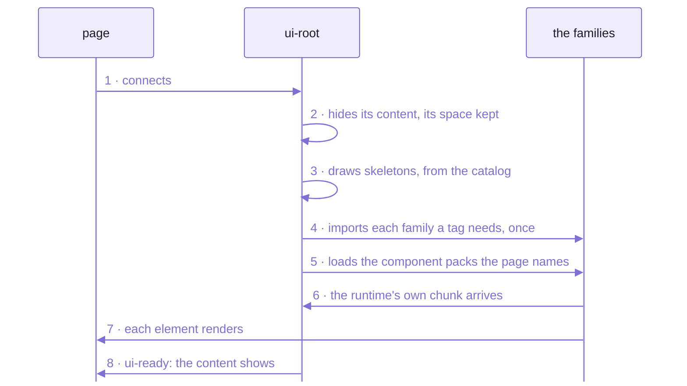
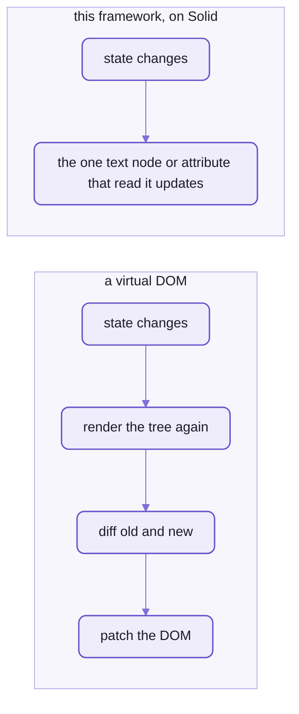
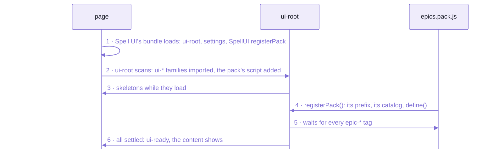

# `spell-kit/element`:  the element framework

If you know React:  a custom element here is TWO objects.
- The DOM ELEMENT is what the page talks to:  a real node with attributes, properties and events, like `<video>`.
- The COMPONENT draws it, on Solid 2:
  it holds the state, renders JSX once into the element's shadow root, and handles events.

Every set of elements in Spell is written on this one framework:
Spell UI's `<ui-*>`, spell-epic's `<epic-*>`, the brand's `<brand-*>`, the app's `<spell-app>` and `<spell-editor>`.
It's the kit's [element folder](element/), imported as `spell-kit/element`, its namespace `E`.


_Nothing loads up front;  the root loads what the page uses._

<details>
<summary>As text</summary>



</details>

- Code:  [element/](element/), its tests in [tests/element/](tests/element/).
- Rules for working on it:  [element's AGENTS.md](element/AGENTS.md).
- It's Solid work:  [Solid's docs](https://docs.solidjs.com) cover the reactivity underneath.

## What it can do

- Reactive members that read fresh right after a write:  `this.count = 2; this.count` is 2, no waiting for a flush,
  and Solid still redraws what read it.
- Attributes and properties from ONE vocabulary file per tag:  every name the tag uses, as data.
- Custom states (`:state(open)`) and ARIA (`aria-busy`) from a decorator, not by hand.
- Behaviour every element gets for free:
  `disabled`, `loading`, `hidden` with its open and close events, `animation`, `readonly`, `inert`.
- An error boundary per element:  one element that throws shows a fallback, and the page goes on.
- Hot reload in place, in development:  an edit swaps the component in every live element.
- A static render for pages with no JavaScript:  the same elements as plain HTML, for search engines and readers.

## What it is not trying to do

- It knows no set of elements:  it never imports Spell UI.
  Words, styles, focus and animation come in as settings, from the page's runtime (below, "Settings").
- No runtime services of its own:
  keyboard, overlays, translations, themes, icons and data sources are Spell UI's runtime.
- No bundle of its own:  ONE copy per page, carried by Spell UI's core;  packs leave it out.
- No build of its own:  it's source, bundled by whoever draws with it.
- No light-DOM rendering:  shadow DOM everywhere, with semantic markup inside.
- Not a framework binding:  the elements are plain custom elements, usable from plain HTML or any framework.
- No function components or hand-written Solid effects in a component file:  the lint guard flags them
  ([README-toolchain.md](README-toolchain.md), "The lint and format rules").
- Fallbacks only for form controls:  any other element shows its children if it fails.

## The two objects, and why

```mermaid
%%{init: {"theme":"base","themeVariables":{"fontFamily":"-apple-system, BlinkMacSystemFont, Segoe UI, Helvetica, Arial, sans-serif","fontSize":"15px","primaryColor":"#EFECFB","primaryBorderColor":"#6550CA","primaryTextColor":"#1A1C27","secondaryColor":"#F4F1E9","tertiaryColor":"#F7F6FC","lineColor":"#7F6FD6","textColor":"#7F6FD6","clusterBkg":"#F7F6FC","clusterBorder":"#B9B0E8","titleColor":"#1A1C27","edgeLabelBackground":"#F7F6FC","actorBkg":"#EFECFB","actorBorder":"#6550CA","actorTextColor":"#1A1C27","actorLineColor":"#9C90DE","signalColor":"#7F6FD6","signalTextColor":"#7F6FD6","labelBoxBkgColor":"#EFECFB","labelBoxBorderColor":"#6550CA","labelTextColor":"#1A1C27","loopTextColor":"#7F6FD6","noteBkgColor":"#F1E7D4","noteBorderColor":"#C9B48A","noteTextColor":"#1A1C27","activationBkgColor":"#DCD6F7","activationBorderColor":"#6550CA","sequenceNumberColor":"#FFFFFF"},"flowchart":{"curve":"basis","padding":12,"nodeSpacing":40,"rankSpacing":44}}}%%
flowchart LR
  page["the page, or any framework"] -- "attributes, properties" --> dom["DOM element<br/>&lt;ui-button&gt;"]
  dom -- "events" --> page
  dom -- "domElement.component" --> component["component<br/>UIButton"]
  component -- "component.domElement" --> dom
  component -- "render(), once" --> shadow["its shadow root"]
  %% the Spell look:  yarn mermaid:pretty
  classDef default fill:#EFECFB,stroke:#6550CA,stroke-width:1.5px,color:#1A1C27,rx:8px,ry:8px
```



_The page talks to the DOM element;  the component draws into its shadow root;  each points at the other._

- The DOM ELEMENT (`DOMElement`, the browser's side):
  attributes, a property per attribute that reflects back,
  the element's internals (custom states, ARIA defaults, a form value), the shadow root, the `ready` promise.
- The COMPONENT (a `UIComponent` subclass, `UIButton`, Solid's side):
  one per element, built on first connect and kept across moves until it's disposed.
  It holds the state, renders once into its own Solid root, handles events.

Its life, in five steps:
1. The family's barrel calls `UIButton.define()`:  the tag's own DOM element class is made and registered.
2. First connect:  the component is built, `render()` runs once, then `onConnect()`.
3. The content shows once the runtime and the class's style sheets are in, so nothing flashes unstyled.
4. A move (re-parenting, a sort) keeps the component and its state;  only `dispose()` ends it.
5. If anything throws:  `:state(errored)`, one console error, a cancelable `ui-error` event,
   then a form control shows its plain-HTML fallback and any other element its children.

### Why not one object, as in React?

A React component is a function the framework calls;  the page never holds it.
An element here is a real node:  the page, or React, or Svelte, or plain HTML, talks to it
through its attributes, properties and events, for as long as it lives.

So the browser's side and the drawing side are two objects that point at each other, and that's what buys:
- it works from plain HTML and from every framework, with no wrapper
- state survives moves and re-parenting, since the node is the same node
- each element is its own error boundary:  an uncaught error would otherwise halt Solid page-wide
- the page can be rendered static, with no script at all

### Why it's as fast as a virtual DOM, or faster

The component renders ONCE into its shadow root.
After that, Solid's fine-grained reactivity updates only the text nodes and attributes that read the changed value:
there's no tree to rebuild and diff.



_No second render, no diff:  a write goes straight to the node that shows it._

- Measured:  1,000 `<ui-button>`s put in a page at once are all built, rendered and ready in about 75 ms
  (the median of nine runs, Spell UI's button benchmark).
- A property write reaches the screen in the next frame:  only the nodes that read it change.

## The vocabulary, and the language system

Every name a tag uses lives in ONE data file named for its language, `<Name>.en.ts`:
the tag, its attributes (each with a kind, its allowed values and a description), events, slots, parts, states,
the texts people read, and the skeleton it shows while loading.
Code never writes those names as strings:  it reads them through the vocabulary.

```ts
this.partForName("count") //              a typo here fails the type check
this.translationForKey("add", { step }) // "Add 2", in the page's language
this.send("ui-change", { count })
```

- `as const satisfies E.ComponentVocabulary` keeps every name a literal type:
  so a typo, `this.partForName("cuont")`, fails `tsc`.
- One line gives a component a typed getter per attribute:
  `export interface UIButton extends E.AttributeValues<typeof buttonVocabulary> {}`.
- Vocabularies are pure data:  node reads them all to build the catalog, the docs site's data and the packs.

Translation comes in two halves:
- NAMES, what authors type, are renamed by a dictionary:
  `<ie-boton primario color="rojo">` is a Spell UI button in Spanish.
  Values arrive in English (`rojo` is `red`), so the component's code doesn't change.
- TEXTS, what people read, are looked up by Spell UI's runtime, so nothing is ever blank:
  the exact locale (`pt-BR`), then the language (`pt`), then English, then the key itself.
- What stays English always:  CSS classes, `:state()`s, property names, event details, `--ui-*` tokens.
- Where it stands:  designed and tested with a Spanish dictionary;  no translations ship yet.

## Packs and `<ui-root>`

`<ui-root>` is the top of a page or an app:
every `<ui-*>` tag inside it, now or added later, imports its family once, on demand.
Which family defines a tag comes from a generated catalog, never from guessing at the name.

A COMPONENT PACK is another package's elements, any prefix (`epic-`, `brand-`), loaded the same way.
This is how every epic page loads spell-epic's elements:

```html
<script src="/_epic/assets/spell-ui.js"></script>
<ui-root>
  <ui-components source="/_epic/pack/epics.pack.js"></ui-components>
  <epic-page>...</epic-page>
</ui-root>
```



_A pack is one classic script:  it brings its own elements, and borrows Solid and the framework from the page._

- A pack is a package whose `package.json` has `"spellPack"`:
  spell-epic's is `{ "name": "epics", "prefix": "epic-", "dir": "src" }`.
- Its build (`spell-pack build`) writes three files into `components/__pack/`:
  1. `<pack>.catalog.ts`:  each tag's family folder and skeleton, read from the vocabularies
  2. `<pack>.entry.ts`:  `SpellUI.registerPack({ name, prefix, catalog, define })`
  3. `<pack>.pack.js`:  that entry built as ONE classic script, minified, which works from `file://` too
  - then the set's docs data;  `spell-pack check` exits 1 while any of it is stale
- ONE Solid per page:  two copies of Solid, of this framework or of Spell UI's core on a page break silently
  (two registries, two owners).
  So a pack leaves the shared modules OUT and takes the page's copies:

  ```ts
  PACK_MODULES = ["solid-js", "@solidjs/web", "spell-kit/element", "spell-ui/core", "spell-ui/forms"]
  ```

- A pack's elements extend the page's one `UIComponent`:
  `spell-kit/element` on the page is Spell UI's core, which carries all of this framework.
- A pack that fails or times out is logged, and the root still gets ready.

## Theming through shared CSS

Spell UI owns the CSS foundation, and every set's elements draw with it:  they adopt its sheets through the runtime.
Page-level theming works into shadow roots because CSS custom properties inherit into them.

- Layers, in order:  `ui.reset`, `ui.tokens`, `ui.base`, `ui.components`, `ui.utilities`, `ui.theme`, `ui.app`.
  Later layers win, whatever the specificity;  a page's own unlayered CSS beats them all.
- Each component's sheet has four sub-layers (types, content, variations, states):
  so a state beats a variation with no `!important`.
- Tokens are custom properties (`--ui-*`), colours in OKLCH, sizes in `em` from one `--ui-font-size`.
- Sheets are shared, never copied:  one `CSSStyleSheet` per sheet, adopted by every shadow root that needs it.
- Themes apply page-wide and into every shadow root:  `UI.themes.apply("github")`.
  Dark is a colour scheme (`<ui-root theme="dark">`).
- More:  [Spell UI's README-themes.md](spell-ui/README-themes.md).

## Restyling your whole site with the app stylesheet

A page's own CSS can't reach inside a shadow root, so it can't restyle a component's insides.

The APP STYLESHEET can:  mark ONE `<style>` (or `<link>`) on the page with `id="ui-app-stylesheet"`.
The runtime mirrors it into every component's shadow root, adopted last, in the `ui.app` layer.

```html
<style id="ui-app-stylesheet">
  @layer ui.app {
    .ui.button { border-radius: 0 }
    .ui.card { box-shadow: none; border: 1px solid #ccc }
  }
  :root { --ui-primary: oklch(0.55 0.2 300) }
</style>
```

| Before | After |
| --- | --- |
|  |  |

- `.ui.button { border-radius: 0 }` squares every button on the site;
  `.ui.card { box-shadow: none }` flattens every card.
  The selectors are Spell UI's class grammar, the same classes Semantic UI and Fomantic UI used.
- Tokens on `:root` (`--ui-primary`, `--ui-font-size`) change every element at once.
- Edits, a late insertion and a `<link>`'s load are all picked up;  `@import`s inside it are inlined.

| Put it in | When |
| --- | --- |
| tokens, on `:root` or any ancestor | a value every element shares:  a colour, the font size, a radius |
| a theme file | a whole look you'd switch to and back, page-wide:  [README-themes.md](spell-ui/README-themes.md) |
| the app stylesheet | this site's own changes to how components are drawn inside |

## The method:  making an element for a thing

A FAMILY is one folder, `<prefix>-<name>/`, holding a tag's files, each named for its component.
The eight steps, building a `<ui-counter>`:

1. The vocabulary, `UICounter.en.ts`:  every name the tag uses.
   A new tag MUST fill `topics` and `aka` (how people find it), and may give a skeleton.

   ```ts
   export const counterVocabulary = {
     tag: "ui-counter",
     topics: ["controls", "inputs"],
     aka: ["counter", "stepper"],
     skeleton: "inline 6 x 2.5",
     attributes: [
       { name: "count", kind: "number", description: "the current count" },
       { name: "step", kind: "number", default: 1 }
     ],
     events: [{ name: "ui-change", detail: "{ count: number }", cancelable: true }],
     parts: [{ name: "count" }, { name: "button" }],
     states: [{ name: "at-max" }],
     texts: [{ key: "add", text: "Add {step}" }]
   } as const satisfies E.ComponentVocabulary
   ```

2. The component, `UICounter.tsx`:
   reactive members by decorator, and a `render()` that reads every name through the vocabulary.

   ```tsx
   export class UICounter extends E.UIComponent<typeof counterVocabulary> {
     @E.proto static vocabulary = counterVocabulary
     @E.protoMerged static elementSetup = { styleSheets: { "ui-counter": counterCSS } }

     @E.controlled("count") accessor currentCount = 0
     @E.cssState("at-max") get isAtMax() {
       return this.max !== undefined && this.currentCount >= this.max
     }

     @E.untracked add(event: Event) {
       const next = Math.min(this.currentCount + this.step!, this.max ?? Infinity)
       this.requestChange("currentCount", next, () => this.send("ui-change", { count: next, originalEvent: event }))
     }

     render() {
       return <div class={this.rootClass} part={this.partForName("count")}>...</div>
     }
   }
   ```

3. Its sheet, `UICounter.css`, in the four sub-layers.
   Its public tokens (`--ui-counter-*`) are read through a private alias, never declared.
4. Optional:  a script API above the component, a fallback (form controls only), a types file.
5. The family's barrel, `index.ts`:  `UICounter.define()`, and re-export.
   Every `<ui-counter>` already in the page upgrades at once.
6. Regenerate the catalog:  Spell UI's `yarn gen:root`, or a pack's `yarn pack:build`.
   Their tests fail while it's stale.
7. Tests at the same path under the repo's tests folder, with `ElementFixture` and `expectAccessible()`.
8. Its docs page, in the set's `docs/`, served at `/components/<set>/`.

## The examples

| Set | What it is | Its elements |
| --- | --- | --- |
| Spell UI | the HOST:  the runtime, `<ui-root>`, the styles and icons, `registerPack()` | 62 families, `<ui-accordion>` ... `<ui-visibility>`:  [spell-ui's README](spell-ui/README.md) |
| spell-epic | a PACK, prefix `epic-`:  every epic page loads it | 35 families, `<epic-page>`, `<epic-item>`, `<epic-thread>` ...:  [spell-epic's README](spell-epic/README.md) |
| spell-brand | a second pack, prefix `brand-` | 10 families |
| spell-app | a ROOT subclass, `<spell-app>`, loading its own tags;  `<spell-editor>` | [spell-app's README](spell-app/README.md) |

- Spell UI's core re-exports this whole framework, plus its own pieces:
  `E.IconGlyph`, `E.LoadableBody`, `E.NativeFallback`, `E.Converters` ...
  So a Spell UI family imports `E` from `spell-ui/core`.
- A pack's element files import `E` from `spell-kit/element`,
  or from `spell-ui/core` when they use Spell UI's own pieces:  the same names, and Spell UI's on top.

## Tools and test helpers

The tools every set's builds share (node only), and the test helpers every set's tests use.

| Tool | What |
| --- | --- |
| `spell-pack build \| check [<folder>]` | a pack's build, or whether it's current:  exits 0 built or current, 1 stale or failed, 2 bad arguments |
| `ComponentPack` | what `spell-pack` runs;  the command line's `spell pack` too |
| `RootCatalog`, `VocabularyFiles` | what `<ui-root>` needs of each tag, read from every vocabulary in a folder of families |
| `elementBaseConfig()` | the Vite settings every set's elements compile with:  the decorator pre-pass BEFORE Solid, Solid's JSX, Lightning CSS |
| `HotElements` | the Vite plugin for hot reload in `yarn dev` |
| `DevServer`, `Terminal`, `NodePackage` | a package's Vite dev server from node;  where tools print;  finding an installed package |

| Test helper | What |
| --- | --- |
| `Fixture` | render HTML into the live document, removed when the test ends |
| `ElementFixture` | render, wait for every element's `ready`, `flush()`;  `breakRender()` forces a failure |
| `A11y` | axe on a live element (`expectAccessible()`), and WCAG contrast |
| `Viewport` | resize the test's frame for one test |

- Tools:  `spell-kit/element/tools/<Name>`.
  Helpers:  `spell-kit/test-helpers/<Name>`.
- The helpers know only the DOM, Solid and this framework;  one that needs Spell UI stays in Spell UI.
- This folder's own tests run in a real Chromium with NO Spell UI on the page:
  on stand-in settings (`TestSettings`:  English names, no styles, every animation instant).
  What needs Spell UI's real runtime is tested in Spell UI.
- Run them with the kit's `yarn kit:test`, or this folder's alone:  `cd element && yarn vp test run`.

<details>
<summary>Every reactive decorator, one line each</summary>

| Decorator | What it does |
| --- | --- |
| `@E.state accessor isOpen = false` | internal state:  reads fresh after a write, and Solid follows it |
| `@E.controlled("open") accessor isOpen` | the DOM element's property when the page set it, else the component's own;  a person's change goes through `requestChange()`, a cancelable event first |
| `@E.derived get rows()` | a cached value that recomputes only when what it read changed (not a Solid memo, which would read stale after a write) |
| `@E.cssState("open")` | a boolean member shown as `:state(open)` |
| `@E.aria("busy")` | a member written to the element's ARIA (`ariaBusy`) |
| `@E.onChange("member")` | a method run when the member changes (`{ writesDOMElement: true }` to run in the static render too) |
| `@E.whileConnected` | a method run while the element is in the page, its cleanup when it leaves |
| `@E.watches` | a method run when the element's light DOM changes |
| `@E.on("click")` | a listener on the element |
| `@E.untracked` | a method that reads without subscribing |
| `@E.proto static vocabulary` | the class's vocabulary, on its prototype |
| `@E.protoMerged static elementSetup` | the class's settings, merged down the chain:  `styleSheets`, `Fallback`, `isAFormControl`, `delegatesFocus`, `disabled`, `loading` ... |

- Solid 2's one rule here:  NEVER change state while Solid is drawing,
  in `render()`, a getter, or an effect's first half.
  Change it in handlers, `@E.onChange` methods, or after an `await`.
- The generic decorators (`@proto`, `@lazy` ...) and the reactive engine's:  [README-util.md](README-util.md).

</details>

<details>
<summary>Settings:  what the framework reads from the page's runtime</summary>

The framework can't import the runtime that drives it:
so the runtime hands its settings over as it loads (`SpellSolid.install(settings)`), and the bases read them.

| Setting | What |
| --- | --- |
| `runtime` | is it loaded;  load it |
| `words` | the vocabulary layer:  names, value sets, converters, class words, texts |
| `styles` | the shared style sheets |
| `focus` | focus handling |
| `motion` | the default animation, reduced motion, running one |
| `warn()` | where warnings go |

- Spell UI installs its own as its core loads, so every page with elements has Spell UI's runtime.
- A tag defined before any settings are in WAITS for them (a split bundle may run a family first);
  still waiting after 5 s, a console warning.
- Reading the settings before any are installed throws, naming what to import.
- A set adds the names the types check against by augmenting the framework's interfaces:
  `ElementAnimations`, `ValueSetNames`, `TopicNames`.

</details>

<details>
<summary>The lint guard's rules</summary>

In every set's component folders, the `spell-ui/*` lint rules flag what a component does by hand that a decorator does:
- a hand-written Solid effect, a `MutationObserver`, a listener on the DOM element
- `untrack()`, a raw timer, an exported function component

Each message names the decorator to use:  the full table is in [README-toolchain.md](README-toolchain.md).

</details>

<details>
<summary>The files, one line each</summary>

| File | What |
| --- | --- |
| [src/index.ts](element/src/index.ts) | the barrel, `E` |
| [src/UIComponent.tsx](element/src/UIComponent.tsx) | the component base |
| [src/DOMElement.ts](element/src/DOMElement.ts) | the DOM element base |
| [src/ElementDefinition.ts](element/src/ElementDefinition.ts) | a vocabulary turned into a tag's attributes, events and slots |
| [src/Reactive.ts](element/src/Reactive.ts) | the reactive members' decorators |
| [src/Cell.ts](element/src/Cell.ts), [SlotContent.ts](element/src/SlotContent.ts) | a reactive cell;  slotted content |
| [src/PartContext.ts](element/src/PartContext.ts), [OwnerContext.ts](element/src/OwnerContext.ts) | generic content parts, and the element they belong to |
| [src/ShadowEvents.ts](element/src/ShadowEvents.ts) | Solid's delegated events kept from leaking out of shadow roots |
| [src/HotDefinitions.ts](element/src/HotDefinitions.ts) | hot reload, in development only (its own entry) |
| [src/timing.ts](element/src/timing.ts) | when to run something:  `afterSolidUpdate()`, `beforeNextPaint()`, `soon()`, `after()`, `every()` |
| [src/SkeletonText.ts](element/src/SkeletonText.ts) | a vocabulary's one-line skeleton, parsed (node too;  its own entry) |
| [src/SpellSolid.ts](element/src/SpellSolid.ts) | the settings the page's runtime installs |
| [src/elements.types.ts](element/src/elements.types.ts), [vocabulary.types.ts](element/src/vocabulary.types.ts) | the types:  `ElementSetup`, `AttributeValues`, the settings;  `ComponentVocabulary`, `Dictionary` |
| [tools/](element/tools/) | the build tools (node):  `ComponentPack`, `packModules`, `RootCatalog`, `VocabularyFiles`, `elementConfig`, `HotElements`, `DevServer`, `Terminal`, `NodePackage` |
| [test-helpers/](element/test-helpers/) | `Fixture`, `ElementFixture`, `A11y`, `Viewport`, `TestSettings` |
| [bin/spell-pack.mjs](element/bin/spell-pack.mjs) | `spell-pack build \| check` |

- Its own entries, besides the barrel:
  `spell-kit/element/elements.types` and `/vocabulary.types` (for node code that mustn't load the framework),
  `/timing`, `/SkeletonText`, `/HotDefinitions`.
- It may use only Solid and util's generic files, one by one (and the toolchain, for its configs):
  its barrel test pins that, and every export.
- Four files began as Solid's `@solidjs/element` and `component-register`, folded in and fixed:
  `UIComponent`, `DOMElement`, `ShadowEvents`, `HotDefinitions`;  each carries their MIT notice.

</details>

<details>
<summary>Until repo-split P13 and P14 land</summary>

- Inside the kit, this folder's files are imported by a short alias:
  the same name the packs share it by at run time;  the pack modules list it by that name too.
  P14 makes the package name, `spell-kit/element`, the one name everywhere, and every pack is rebuilt once.
- `spell pack build` is `spell dev pack build` until P13.

</details>

<details>
<summary>Where it came from</summary>

The framework began as the element half of Spell UI's core.
- It became its own package for every set (epic `people-and-orgs`).
- Then its own repo, spell-element, when the repos split:
  cut from the old single repository with its history (epic `repo-split` P8).
- Then a folder of the kit, history and all (P9).

</details>

<details>
<summary>More in the docs site</summary>

The docs site needs a checkout with the content folder beside it,
and the page server running ([README-server.md](README-server.md)).

- Custom Elements in Spell (two objects per tag, `<ui-counter>` built step by step, every decorator):
  `/guides/custom-elements/custom-elements.html`
- Spell on Solid 2, measured:  `/guides/solid/solid-2.html`
- Spell UI's theming notes:  `/components/ui/theming.html`

</details>

## See also

- [spell-ui's README](spell-ui/README.md):  the elements built on this, and the runtime they need
- [README-util.md](README-util.md):  the generic helpers and the reactive engine underneath
- [README-toolchain.md](README-toolchain.md):  the decorator pre-pass and the lint guard
- [README-server.md](README-server.md):  the page server that serves the packs
- [README.md](README.md):  the kit, and Spell as a whole
- Also beside it:
  [README-agents.md](README-agents.md) · [README-cli.md](README-cli.md) ·
  [README-development.md](README-development.md) · [README-vscode.md](README-vscode.md)
