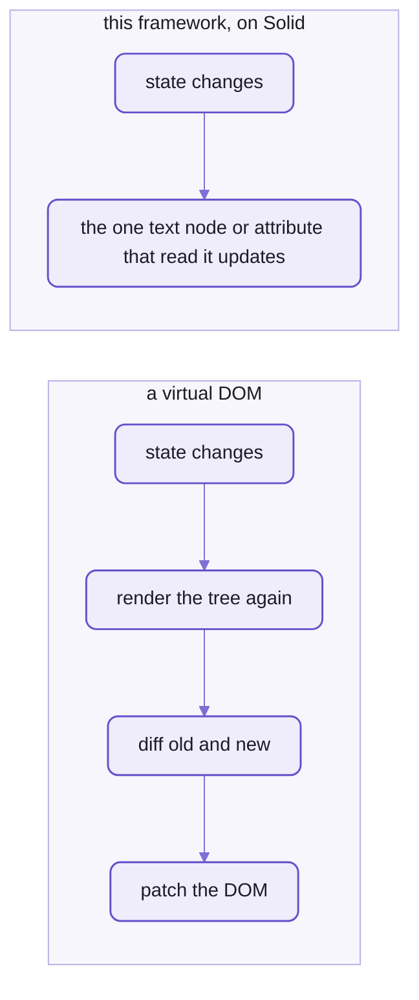
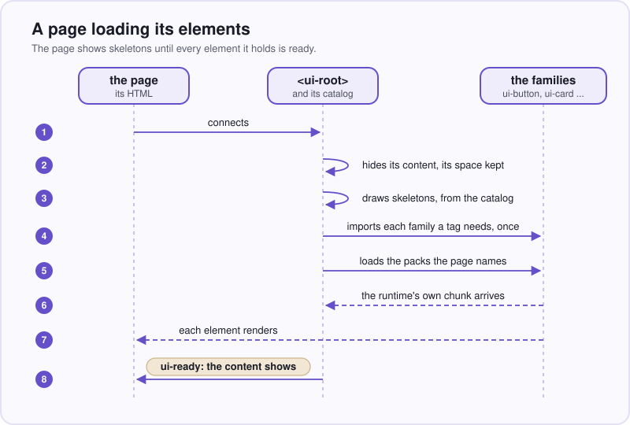
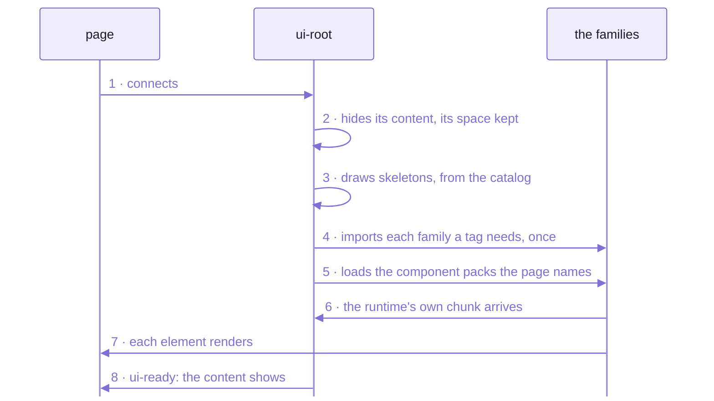
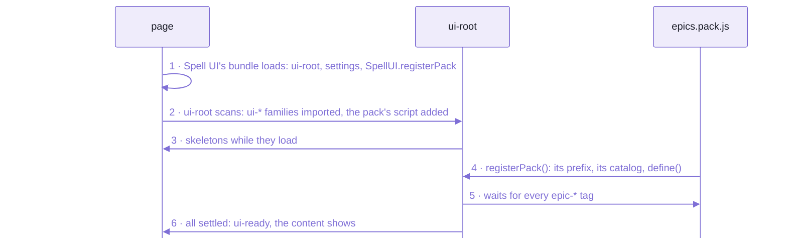
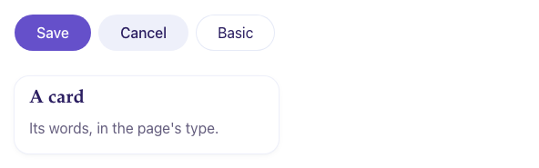
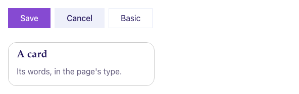

# `spell-kit/element`:  custom elements on Solid 2

```tsx
import type { JSX } from "@solidjs/web"

import { E } from "spell-kit/element"

import { epicQuestionVocabulary } from "./EpicQuestion.en"

import questionCSS from "./EpicQuestion.css?inline"
import tooltipCSS from "spell-epic/components/epic-item/Tooltip.css?inline"

export class EpicQuestion extends E.UIComponent<typeof epicQuestionVocabulary> {
  @E.proto static vocabulary = epicQuestionVocabulary
  @E.protoMerged static elementSetup = {
    styleSheets: { "epic-tooltip": tooltipCSS, "epic-question": questionCSS },
    // `disabled`:  only a look (the sheet dims it), so the text stays findable;  `loading`:  the shared spinner
    disabled: "its own",
    loading: "loader"
  } satisfies Partial<E.ElementSetup>

  render(): JSX.Element {
    return (
      <div class={this.rootClass} part={this.partForName("base")}>
        <div class={LABEL} part={this.partForName("label")}>
          {this.translationForKey("label")}
        </div>
        <slot />
      </div>
    )
  }
}

/** The vocabulary's attribute getters, typed (see "Attributes" in `UIComponent`). */
export interface EpicQuestion extends E.AttributeValues<typeof epicQuestionVocabulary> {}

/** Class of the label. */
const LABEL = "label"
```

_All of [EpicQuestion.tsx](https://github.com/spell-app/spell-epic/blob/main/src/components/epic-question/EpicQuestion.tsx), from the epic pages,
with only its class docstring left out._

Put the question inside it, as its own children:

```html
<epic-question><p>Which browser first?</p><ul><li>Firefox</li><li>Chrome</li></ul></epic-question>
```

The page shows a small grey QUESTION over the text, and the browser holds this:

```html
<epic-question>
  #shadow-root (open)
    <div class="question" part="base">
      <div class="label" part="label">Question</div>
      <slot></slot>
    </div>
  <p>Which browser first?</p>
  <ul><li>Firefox</li><li>Chrome</li></ul>
</epic-question>
```

That's a whole element:  a class, one `render()`, and a file of the names it uses.
No `useState`, no props object, and no second render:
`render()` ran once, when the element joined the page.
The question never moved into the shadow root.
It's still the page's own `<p>`, shown through the `<slot>`, so find-in-page and `#id` links still find it.

It isn't a wrapper around a framework's component, either.
`<epic-question>` is a real custom element, a node the page holds the way it holds a `<video>`:
the browser upgrades every one on the page the moment the class is defined, the ones already there included.

This is the kit's element framework, `spell-kit/element` (namespace `E`), and every set of elements in Spell is
written on it:  Spell UI's `<ui-*>`, spell-epic's `<epic-*>`, the app's `<spell-app>` and `<spell-editor>`,
and the element a Spell program draws each drawable thing in, like `<solitaire-card>`.
Its build tools and the test helpers every set's tests use sit beside it, on this page too.

- Code:  [src/element/](src/element/)
  - its tools in [src/element-tools/](src/element-tools/)
  - its test helpers in [src/test-helpers/](src/test-helpers/)
  - their tests in [tests/element/](tests/element/) and [tests/element-tools/](tests/element-tools/)
- Rules for working on it:  [element's AGENTS.md](src/element/AGENTS.md).
- The reactivity underneath is Solid's:  [Solid's docs](https://docs.solidjs.com).

## If you know React, here's the map

Most of React has a counterpart here, in another shape:
a class instead of a function, and the DOM's own attributes and events instead of props and callbacks.

| In React | Here |
| --- | --- |
| a component is a function the framework calls | a class, and one instance of it per element on the page |
| props | the element's attributes and properties, read on the component as typed getters (`this.step`) |
| `useState` | `@E.state accessor isOpen = false`:  a field, and a read right after a write sees the new value |
| `useMemo` | `@E.derived get rows()`, or a plain getter |
| `useEffect` | `@E.onChange("member")` on a method;  `@E.whileConnected` for setup and cleanup |
| a callback prop | a DOM event:  `this.send("ui-change", detail)`, cancelable when the vocabulary says so |
| context | `appContext`, set on the nearest root:  Solid's context can't cross into an element |
| unmounting when it leaves the page | none:  a removed element keeps its component and state for its next connect;  only `domElement.dispose()` ends them |
| re-rendering on every change | none:  `render()` runs once, and only the nodes that read a value update |
| an error boundary you place | one around every element, always |
| Fast Refresh | hot reload in place:  every live element redraws, attributes kept, its inner state reset |
| jsdom and Testing Library | a real Chromium, through `ElementFixture` |

### The page holds the element;  the component draws it

Every tag on the page is TWO objects that point at each other.
`document.querySelector("ui-button")` hands you the DOM element, the one the page and every framework talk to;
its `.component` is the object that draws it.



```mermaid
%%{init: {"theme":"base","themeVariables":{"fontFamily":"-apple-system, BlinkMacSystemFont, Segoe UI, Helvetica, Arial, sans-serif","fontSize":"15px","primaryColor":"#EFECFB","primaryBorderColor":"#6550CA","primaryTextColor":"#1A1C27","secondaryColor":"#F4F1E9","tertiaryColor":"#F7F6FC","lineColor":"#7F6FD6","textColor":"#7F6FD6","clusterBkg":"#F7F6FC","clusterBorder":"#B9B0E8","titleColor":"#1A1C27","edgeLabelBackground":"#F7F6FC","actorBkg":"#EFECFB","actorBorder":"#6550CA","actorTextColor":"#1A1C27","actorLineColor":"#9C90DE","signalColor":"#7F6FD6","signalTextColor":"#7F6FD6","labelBoxBkgColor":"#EFECFB","labelBoxBorderColor":"#6550CA","labelTextColor":"#1A1C27","loopTextColor":"#7F6FD6","noteBkgColor":"#F1E7D4","noteBorderColor":"#C9B48A","noteTextColor":"#1A1C27","activationBkgColor":"#DCD6F7","activationBorderColor":"#6550CA","sequenceNumberColor":"#FFFFFF"},"flowchart":{"curve":"basis","padding":12,"nodeSpacing":40,"rankSpacing":44}}}%%
flowchart LR
  page["the page, or any framework"] -- "attributes, properties" --> dom["DOM element<br/>&lt;ui-button&gt;"]
  dom -- "events" --> page
  dom -- "domElement.component" --> component["component<br/>UIButton"]
  component -- "component.domElement" --> dom
  component -- "render(), once" --> shadow["its shadow root"]
  %% the Spell look:  yarn mermaid:pretty
  classDef default fill:#EFECFB,stroke:#6550CA,stroke-width:1.5px,color:#1A1C27,rx:8px,ry:8px
```

_The page talks to the DOM element;  the component draws into its shadow root;  each points at the other._

- The **DOM element**, a `DOMElement`, is the browser's side:  what the page and every framework talk to.
  - attributes, and a property per attribute that writes back to it
  - a property the page set before the tag was defined, kept and applied once it is
  - the element's internals:  custom states, ARIA defaults, a form value
  - the shadow root, and a `ready` promise that resolves once it has drawn with its styles
- The **component**, a `UIComponent` subclass such as `UIButton`, is Solid's side.
  - one per element, built the first time the element joins a page, kept across moves until it's disposed
  - it holds the state, renders once into a Solid root of its own, and handles the events

Splitting them is what buys the rest:
- it works from plain HTML and from any framework, with no wrapper;
  Spell UI checks plain JavaScript, React, Solid and Vue, each on a page run in a headless browser,
  and Svelte's isn't checked yet ([Spell UI's README-frameworks.md](https://github.com/spell-app/spell-ui/blob/main/README-frameworks.md))
- state survives a move or a re-sort, because the node is the same node
- each element is its own error boundary:  an uncaught error would otherwise halt Solid for the whole page
- the page can be rendered as plain HTML, with no script at all

<details>
<summary>Its life, in five steps</summary>

1. The family's barrel calls `UIButton.define()`:  the tag's own DOM element class is made and registered.
2. First connect:  the component is built, `render()` runs once, then `onConnect()`.
3. The content shows once the runtime and the class's style sheets are in, so nothing flashes unstyled.
4. A move (re-parenting, a sort) keeps the component and its state;  only `dispose()` ends it.
5. If anything throws:  `:state(errored)`, one console error, a cancelable `ui-error` event,
   then a form control shows its plain-HTML fallback and any other element its children.

</details>

### It renders once, and a write reaches only what read it

Here's the state half, from spell-epic's sort buttons, `<epic-sort>`:
two buttons, A–Z and Date, the one in use pressed.

```tsx
export class EpicSort extends E.UIComponent<typeof epicSortVocabulary> {
  // ...
  /** The sort in use, as remembered. */
  @E.state accessor sort: EpicSortName = isServer ? "title" : savedSort()

  render(): JSX.Element {
    return (
      <ui-buttons class={this.rootClass} part={this.partForName("base")} ...>
        <For each={SORT_BUTTONS}>
          {(button) => {
            const words = () => this.translationForKey(button.words)
            const inUse = () => this.sort === button.sort
            return (
              <ui-button
                icon={button.icon}
                active={inUse() ? "" : undefined}
                ...
                onClick={() => this.pick(button.sort)}
              >
                {words()}
              </ui-button>
            )
          }}
        </For>
      </ui-buttons>
    )
  }

  /** A sort, clicked:  in use, remembered, and every list told. */
  @E.untracked
  private pick(sort: EpicSortName) {
    this.sort = sort
    save(SORT_KEY, sort)
    this.send("epic-sort", { sort } satisfies SortDetail)
  }
}
```

_Shortened from [EpicSort.tsx](https://github.com/spell-app/spell-epic/blob/main/src/components/epic-list/EpicSort.tsx):  `...` marks what's left out._

Click Date, and `pick()` writes `this.sort`.
In React, that `setSort` would run the component again, build both buttons anew, diff them and patch the DOM.
Here, `render()` doesn't run again, and neither does `<For>`.
The only code that runs again is the bindings that read `inUse()`,
so the only DOM that changes is each button's `active` attribute and its spoken name.
[Its test](https://github.com/spell-app/spell-epic/blob/main/tests/components/epic-list/EpicSort.test.tsx) clicks Date and checks exactly that,
and the `epic-sort` event the page hears.



_No second render, no diff:  a write goes straight to the node that shows it._

- A member reads fresh right after a write:
  once `pick()` sets `this.sort = "date"`, a read of `this.sort` on the very next line gives `"date"`,
  with no waiting for a flush, and Solid still redraws what read it.
  - A Solid memo would hand back the old value there, so `@E.derived` is a cache of its own, not a memo.
- 1,000 `<ui-button>`s put in a page at once are all built, rendered and ready in about 80 ms:
  the median of nine runs, after a warm-up, in Spell UI's
  [button benchmark](https://github.com/spell-app/spell-ui/blob/main/tests/components/ui-button/UIButton.perf.test.tsx).
- A write reaches the screen in the next frame.
  Typing "united sta" into a searching `<ui-dropdown>` of 1,000 options, a letter at a time,
  each keystroke's update took under 7 ms, about 3 on average, on the last recorded run;
  [its benchmark](https://github.com/spell-app/spell-ui/blob/main/tests/components/ui-dropdown/UIDropdown.perf.test.tsx)
  fails when the average reaches a frame, 16 ms.

The cost is one rule, Solid 2's:  NEVER change state while Solid is drawing,
so not in `render()`, a getter, or an effect's first half.
Change it in handlers, `@E.onChange` methods, or after an `await`.

One React habit doesn't survive the move:
a value worked out at the top of `render()`, outside its JSX, is worked out ONCE, a snapshot rather than a binding.
Work it out inside the JSX, or in a getter the JSX reads.

### Every name the tag uses is data

A React component's names are scattered through its code:
a props interface, class names in the JSX, an event name in each callback.
Here, every name a tag uses sits in ONE data file named for its language, its _vocabulary_, `<Name>.en.ts`.
The code never writes a name as a string;  it reads each one from there:

```ts
this.partForName("count") //              a typo here fails the type check
this.translationForKey("add", { step }) // "Add 2", in the page's language
this.send("ui-change", { count })
```

- What the file holds:  the tag;  its attributes, each with a kind, its allowed values and a description;
  its events, slots, parts and states;  the texts people read;  the skeleton it shows while loading.
- An attribute's `kind` says how its text reads and what it draws.
  `<ui-container>`'s `text` is `keyOnly`, so `<ui-container text>` draws `ui text container`,
  and `text="no"` a plain `ui container`:
  [its test](https://github.com/spell-app/spell-ui/blob/main/tests/components/ui-container/UIContainer.test.tsx) checks both.
- `as const satisfies E.ComponentVocabulary` keeps every name a literal type:
  so a typo, `this.partForName("cuont")`, fails `tsc`.
- One line gives a component a typed getter per attribute:
  `export interface UIButton extends E.AttributeValues<typeof buttonVocabulary> {}`.
- Vocabularies are pure data:  node reads them all to build the catalog, the docs site's data and the packs,
  without loading a single component.

And because every name is in one place, a tag can be translated whole, in two halves:
- **Names**, what authors type, are renamed by a dictionary:
  `UIButton.define("es-boton", es)` makes `<es-boton primario color="rojo">` a Spell UI button in Spanish.
  Values arrive in English (`rojo` is `red`), so the component's code doesn't change.
  - A translated tag's properties are translated too, the camelCase of each Spanish attribute:
    `<es-tarjeta discontinuo>` is `tarjeta.discontinuo`.
- **Texts**, what people read, are looked up by Spell UI's runtime, so nothing is ever blank:
  the exact locale (`pt-BR`), then the language (`pt`), then English, then the key itself.
- What stays English always:
  CSS classes, `:state()`s, event details, `--ui-*` tokens.

**Real today:**  Spanish, in every Spell UI component.
- Each has its Spanish beside its English, `UIButton.es.ts` beside `UIButton.en.ts`:  104 in all.
- `<ui-root lang="es">` names a page Spanish, and its components load as `es-*` tags.

**Not yet:**  a third language.
How Spell UI reads them:  [README-runtime.md](https://github.com/spell-app/spell-ui/blob/main/README-runtime.md).

## What every element gets without asking

Write `<epic-sort loading>`.
Its code never mentions `loading`, and still a spinner covers it, its buttons stop taking clicks and focus,
and a screen reader hears that it's busy.
That's the base class, and it does the same for the rest of what every element would otherwise write again:
- Shared states, on every tag whether its vocabulary names them or not:
  - `loading`:  `:state(loading)`, and by default the spinner, the content made inert and `aria-busy`
  - `disabled`:  `:state(disabled)`, and by default the content made inert and `aria-disabled`;
    a family whose disabled is only a look says so in its setup, as `<epic-question>` does above
  - `visible` and the platform's `hidden`, one fact with two names, animated in and out by `animation`;
    `animation="none"` or a person's reduced-motion setting turns the motion off for everything inside
  - the platform's own `inert`
- Custom states (`:state(open)`) and ARIA (`aria-busy`) from a decorator on a member, never set by hand.
- Hot reload in place, in development (`yarn dev`):
  an edit to a component swaps it into every live element, which redraws keeping its attributes and properties;
  an edit to its CSS swaps the sheet with no redraw at all.
  - What the browser reads only once (the observed attributes, form association, the shadow root's options)
    reloads the page instead, and so does an edit to code more than one family shares.
- A static render for pages with no JavaScript:  the same elements as plain HTML, for search engines and readers,
  by Spell UI's `spell ssr`.
  Only `@E.aria` members and `@E.onChange(..., { writesDOMElement: true })` methods run there.

## Making one:  the method, in eight steps

A _family_ is one folder, `<prefix>-<name>/`, holding a tag's files, each named for its component.
The steps below build `<ui-counter>`, the docs site's teaching element:  a number, and a button that adds to it.
It isn't part of Spell UI, so nothing ships it.

1. The vocabulary, `UICounter.en.ts`:  every name the tag uses, here the guide's file whole, its imports aside.
   A new tag must fill `topics` and `aka` (how people find it), and may give a skeleton.

   ```ts
   export const counterVocabulary = {
     tag: "ui-counter",
     topics: ["controls", "inputs"],
     aka: ["counter", "stepper", "tally"],
     skeleton: "inline 6 x 2.5",
     noun: "counter",
     description: "A counter shows a number, and a button that adds to it.",
     attributes: [
       {
         name: "count",
         kind: "number",
         description:
           "The number shown.  Leave it out and the counter keeps its own, from 0;  set it, and the page's value wins."
       },
       { name: "step", kind: "number", default: 1, description: "How much one click adds." },
       { name: "max", kind: "number", description: "The most it counts to;  none:  no limit." },
       { name: "size", kind: "size", description: "Size, `mini` ... `massive`." }
     ],
     events: [
       {
         name: "ui-change",
         detail: "{ count: number, originalEvent: Event }",
         cancelable: true,
         description: "The person asked to add:  cancel it (`preventDefault()`) to keep the old count."
       }
     ],
     slots: [{ name: "", description: "A label before the number." }],
     parts: [
       { name: "counter", description: 'The whole box (`<div class="ui counter">`).' },
       { name: "count", description: "The number (`<output>`)." },
       { name: "button", description: "The add button." }
     ],
     states: [{ name: "at-max", description: "The count has reached `max`:  the button is disabled." }],
     texts: [{ key: "add", text: "Add {step}", description: "Accessible name of the add button." }]
   } as const satisfies E.ComponentVocabulary
   ```

2. The component, `UICounter.tsx`:
   reactive members by decorator, and a `render()` that reads every name through the vocabulary.

   ```tsx
   export class UICounter extends E.UIComponent<typeof counterVocabulary> {
     @E.proto static vocabulary = counterVocabulary
     @E.protoMerged static elementSetup = { styleSheets: { counter: counterCSS } }

     @E.controlled("count") accessor currentCount = 0
     @E.cssState("at-max") get isAtMax() {
       return this.max !== undefined && this.currentCount >= this.max
     }

     @E.untracked add(event: Event) {
       const next = Math.min(this.currentCount + this.step!, this.max ?? Infinity)
       this.requestChange("currentCount", next, () => this.send("ui-change", { count: next, originalEvent: event }))
     }

     render() {
       return <div class={this.rootClass} part={this.partForName("counter")}>...</div>
     }
   }
   ```

   - `@E.controlled("count")`:  the page's `count` when it set one, else the counter's own, from 0.
     It's named `currentCount` because `this.count` is taken:
     the attribute's own getter, the page's value or `undefined`.
   - `requestChange()` sends the cancelable `ui-change` first:  a page that cancels it keeps the old count.

3. Its sheet, `UICounter.css`, in four sub-layers:  types, content, variations, states.
   So a state beats a variation with no `!important`.
   Its public tokens (`--ui-counter-*`) are read through a private alias, never declared.
4. Optional:  a script API above the component, a fallback (form controls only), a types file.
5. The family's barrel, `index.ts`:  `UICounter.define()`, and re-export.
   Every `<ui-counter>` already in the page upgrades at once.
6. Regenerate the catalog:  Spell UI's `yarn gen:root`, or a pack's `yarn pack:build`.
   Their tests fail while it's stale.
7. Tests at the same path under the repo's tests folder, with `ElementFixture` and `expectAccessible()` (below).
8. Its docs page, in the set's `docs/`, served at `/components/<set>/`.

## Nothing loads up front

A page doesn't import its elements one by one.
It wraps them in `<ui-root>`, the top of a page or an app, and the root does the importing:
every `<ui-*>` tag inside it, now or added later, imports its family once, the first time it appears.
Which family defines a tag comes from a generated catalog, never from guessing at the name:
`<ui-actions>` lives in the `ui-parts` family.



_The root loads what the page uses, and only when the page uses it._

<details>
<summary>As text</summary>



</details>

### Packs and `<ui-root>`

A _component pack_ is another package's elements, under its own prefix, loaded by the root the same way.
This is how every epic page loads spell-epic's, trimmed:

```html
<ui-root>
  <ui-components source="/_epic/pack/epics.pack.js"></ui-components>
  <epic-page>...</epic-page>
</ui-root>
<script src="/_epic/assets/spell-ui.js"></script>
```



_A pack is one classic script:  it brings its own elements, and borrows Solid and the framework from the page._

Making a package a pack takes one key in its `package.json`.
spell-epic's is `"spellPack": { "name": "epics", "prefix": "epic-", "dir": "src" }`:
- `prefix` is required, and every tag starts with it;  `name` is the folder's name unless it says otherwise.
- `dir`:  where its `components/` and `docs/` are, and its code, when that isn't the package's root.

`spell-pack build` then reads every vocabulary in the families' folder, and writes three files into its `__pack/`:
the catalog `<ui-root>` reads (`<pack>.catalog.ts`, each tag's family and skeleton),
the entry that registers it (`<pack>.entry.ts`, one `SpellUI.registerPack({ name, prefix, catalog, define })`),
and that entry built as one minified classic script, `<pack>.pack.js`, which works from `file://` too.
The set's docs data comes after;  `spell-pack check` exits 1 while any of it is stale.

- ONE Solid per page:  two copies of Solid, of this framework or of Spell UI's core on a page break silently
  (two registries, two owners).
  So a pack leaves the shared modules out, and borrows the page's copies, by their npm names:

  ```ts
  PACK_MODULES = ["solid-js", "@solidjs/web", "spell-kit/element", "spell-ui/core", "spell-ui/forms"]
  ```

  - The page offers them under those same names, in `SpellUI.packModules`;
    the docs site adds the families a pack may extend, by theirs (`spell-ui/components/ui-code`).
  - Any other Spell UI or Solid import fails the pack's build, rather than ship a second copy.

- A pack's elements extend the page's one `UIComponent`:
  `spell-kit/element` on the page is Spell UI's core, which carries all of this framework.
- A pack that fails or times out is logged, and the root still gets ready.

The check, run in spell-epic, when the pack is current:

```sh
cd spell-epic          # from the kit's root
yarn pack:check
```

<details>
<summary>Output</summary>

```text
epics:  current
```

</details>

- Stale, it names each file and why (`built from older sources`), prints the fix, `spell-pack build <folder>`,
  and exits 1.
- Each generated file's banner names the command that remakes it, `spell pack build epics`, and the sources' hash.
  The hash includes the build's own format, `spell-pack 2` today:
  a change to what the build writes bumps it, and every pack goes stale at once until it's rebuilt.
- The cost of one script:  a pack arrives whole.
  spell-epic's is 48 tags in 36 families, about 640 kB minified and 178 kB gzipped,
  and it defines every one of its tags as it registers, whichever of them the page uses.

## Styling through the shadow root

Shadow DOM's cost is the first thing a React developer hits:
a page's own CSS can't reach inside a shadow root, so it can't restyle a component's insides.
Spell UI owns the CSS every set's elements draw with, and leaves four ways in:
- Tokens, the `--ui-*` custom properties, which inherit into every shadow root:
  colours in OKLCH, sizes in `em` from one `--ui-font-size`.
- `::part()`, for the inner boxes a vocabulary names as its parts:  `ui-button::part(button)`.
- A theme, applied page-wide and into every shadow root:  `UI.themes.apply("github")`.
  Dark is a colour scheme (`<ui-root theme="dark">`).
- The app stylesheet, below:  your site's own rules, inside every component.

The sheets themselves are shared, never copied:
one `CSSStyleSheet` per sheet, adopted by every shadow root that needs it, in layers.
- The layers run `ui.reset`, `ui.tokens`, `ui.base`, `ui.components`, `ui.utilities`, `ui.theme`, `ui.app`:
  later layers win whatever the specificity, and a page's own unlayered CSS beats them all.
- The rest of theming:  [Spell UI's README-themes.md](https://github.com/spell-app/spell-ui/blob/main/README-themes.md).

### Restyling your whole site with the app stylesheet

Mark one `<style>` (or `<link>`) on the page with `id="ui-app-stylesheet"`.
The runtime mirrors it into every component's shadow root, adopted after all of the component's own sheets;
its rules go in `ui.app`, the last layer, as below.

```html
<style id="ui-app-stylesheet">
  @layer ui.app {
    .ui.button { border-radius: 0 }
    .ui.card { box-shadow: none; border: 1px solid #ccc }
  }
  :root { --ui-primary: oklch(0.55 0.2 300) }
</style>
```

| Before | After |
| --- | --- |
|  |  |

- `.ui.button { border-radius: 0 }` squares every button on the site;
  `.ui.card { box-shadow: none }` flattens every card.
  The selectors are Spell UI's class grammar, the same classes Semantic UI and Fomantic UI used.
- Tokens on `:root` (`--ui-primary`, `--ui-font-size`) change every element at once.
- Edits, a late insertion and a `<link>`'s load are all picked up;  `@import`s inside it are inlined.
- The edge:  there's one per page, found when it's inserted.
  A `<style>` that gains the id later, through `setAttribute("id", …)`, isn't noticed:  insert it with its id.

| Put it in | When |
| --- | --- |
| tokens, on `:root` or any ancestor | a value every element shares:  a colour, the font size, a radius |
| a theme file | a whole look you'd switch to and back, page-wide:  [README-themes.md](https://github.com/spell-app/spell-ui/blob/main/README-themes.md) |
| the app stylesheet | this site's own changes to how components are drawn inside |

## Testing it:  a real browser, never jsdom

Testing Library renders into jsdom, a stand-in for the DOM.
An element's test here renders into a real document in a real Chromium, through Vitest's browser mode,
because a custom element only upgrades, draws and gets its styles once it's connected.
This is `<epic-question>`'s first test, whole:

```tsx
test("a small `Question` label over its text;  the text is its own light children, through its slot;  axe", async () => {
  const host = await ElementFixture.render(QUESTION)
  expect(part(host, "label")!.textContent).toBe("Question")
  expect(getComputedStyle(part(host, "label")!).textTransform).toBe("uppercase")
  expect(host.querySelector("p")!.assignedSlot).toBe(part(host, "base")!.querySelector("slot"))
  await expectAccessible(host)
})
```

_From [EpicQuestion.test.tsx](https://github.com/spell-app/spell-epic/blob/main/tests/components/epic-question/EpicQuestion.test.tsx):
`QUESTION` is the markup above, `part()` finds a shadow part by name._

`ElementFixture.render()` waits for every element's `ready`, then runs Solid's `flush()`,
so the test asserts on the drawn element, not after a guessed number of ticks.
`expectAccessible()` runs axe through the shadow roots, and fails with a list of what to fix.
The cost is a real browser to run them in:
Playwright's Chromium, installed once in [Setup from zero](README.md#setup-from-zero).

| Test helper | What |
| --- | --- |
| `Fixture` | render HTML into the live document, removed when the test ends |
| `ElementFixture` | the render above, with its wait;  `settle()` and `tick()` for later changes;  `breakRender()` forces a failure |
| `A11y` | axe on a live element (`expectAccessible()`), and WCAG contrast |
| `Viewport` | resize the test's frame for one test |

- Import them by name:  `spell-kit/test-helpers/<Name>`, from any repo.
- The helpers know only the DOM, Solid and this framework;  one that needs Spell UI stays in Spell UI.
- The framework's own tests run with no Spell UI on the page:
  on stand-in settings (`TestSettings`:  English names, no styles, every animation instant).
  What needs Spell UI's real runtime is tested in Spell UI.
- Run them with the kit's `yarn kit:test`, or these alone, at the kit's root:
  `yarn vp test run --project element --project element-tools`.

## The build tools

A set's elements are TypeScript with decorators, JSX and CSS files;  a page wants one script and a catalog of tags.
These close the gap, for every set, in node:

| Tool | What |
| --- | --- |
| `spell-pack build \| check [<folder>]` | a pack's build, or whether it's current:  exits 0 built or current, 1 stale or failed, 2 bad arguments |
| `ComponentPack` | what `spell-pack` runs;  the command line's [`spell pack`](README-cli.md#spell-ui) too |
| `RootCatalog`, `VocabularyFiles` | what `<ui-root>` needs of each tag, read from every vocabulary in a folder of families |
| `elementBaseConfig()` | the Vite settings every set's elements compile with:  the decorator pre-pass before Solid, Solid's JSX, Lightning CSS |
| `HotElements` | the Vite plugin for hot reload in `yarn dev` |
| `DevServer`, `Terminal`, `NodePackage` | a package's Vite dev server from node;  where tools print;  finding an installed package |

- Import them by name:  `spell-kit/element-tools/<Name>`.
- `spell-pack` is a bin of the kit:  spell-epic's `yarn pack:build` and `pack:check` run it, from its own folder.

## The elements help:  slots, parts and dashed attributes in JSX

The JSX types can say which attributes a tag takes, but not what goes INSIDE it.
The app's VS Code extension adds that, in every `.tsx` and `.jsx` file:

```tsx
<ui-panel>
  <div slot="acions">...</div>      {/* warning:  <ui-panel> has no slot "acions";  its slots:  label, hint ... */}
</ui-panel>
<ui-button text-alin="left" />      {/* warning:  <ui-button> has no attribute "text-alin" */}
```

- `slot="` on a child of a custom element lists the PARENT tag's slots, each with its description;
  a slot it doesn't have is a warning (a yellow squiggle, not an error).
- `part="` in a component's own JSX (a file in its family's folder) lists that component's parts;
  a part it doesn't list is a warning.
  - Most of Spell UI writes `part={this.partForName("...")}`, which its types already check.
- A dashed attribute a custom tag doesn't have is a warning, with a "did you mean" when one is close:
  TypeScript never checks a dashed name in JSX.
  - Always allowed:  `data-*`, `aria-*`, and `on-<event>` for each event the tag dispatches (`on-ui-change`).
- Which children a tag takes isn't checked:  no vocabulary says so yet.

Where it learns the tags:  the Custom Elements Manifest of the file's own package and of each package it depends on,
named by the package's `"customElements"` field (Spell UI's, from its `yarn site:data`).

- A manifest is re-read as soon as it changes, with no restart.
- Each file reads its OWN checkout's:  in an epic's window, a worktree's file gets the worktree's manifests.
- So any set that ships a manifest gets it;  the kit imports none of them.

How it works:

- The checks are the kit's, in [jsx-help/](src/element-tools/jsx-help/):
  - [`JsxElementHelp`](src/element-tools/jsx-help/JsxElementHelp.ts) finds the completions and warnings,
    as plain data for any editor
  - [`ElementCatalog`](src/element-tools/jsx-help/ElementCatalog.ts) reads the manifests
- The app's VS Code extension shows them ([`ElementsHelp`](https://github.com/spell-app/spell-app/blob/main/vscode/src/ElementsHelp.ts)):
  completions as you type `"`, warnings in the Problems list as you edit.
  - Its log, the manifests it found and anything that failed:  the "Spell Elements" output.
- The editor's own TypeScript stays TypeScript 7:  nothing to switch, no "Use Workspace Version".
  - The extension reads the JSX with TypeScript 6's JavaScript API, which it carries inside:
    TypeScript 7 has none yet.
- `tsc` and `yarn ts` don't run these checks:  they're the editor's only.
- A change to the checks shows after the extension is rebuilt and installed (`spell app vscode`), then "Reload Window".

## Who's written on it

| Set | What it is | Its elements |
| --- | --- | --- |
| Spell UI | the host:  the runtime, `<ui-root>`, the styles and icons, `registerPack()` | 62 families, `<ui-accordion>` ... `<ui-visibility>`:  [spell-ui's README](https://github.com/spell-app/spell-ui/blob/main/README.md) |
| spell-epic | a pack, prefix `epic-`:  every epic page loads it | 36 families, `<epic-page>`, `<epic-item>`, `<epic-thread>` ...:  [spell-epic's README](https://github.com/spell-app/spell-epic/blob/main/README.md) |
| spell-app | a root subclass, `<spell-app>`, loading its own tags;  `<spell-editor>`;  each drawable thing's element in a Spell program (`<solitaire-card>`) | [spell-app's README](https://github.com/spell-app/spell-app/blob/main/README.md) |

- Spell UI's core re-exports this whole framework, plus its own pieces:
  `E.IconGlyph`, `E.LoadableBody`, `E.NativeFallback`, `E.Converters` ...
  So a Spell UI family imports `E` from `spell-ui/core`.
- A pack's element files import `E` from `spell-kit/element`, as `<epic-question>` does,
  or from `spell-ui/core` when they use Spell UI's own pieces, as `<epic-sort>` does:
  the same names, and Spell UI's on top.

## What it costs, and what it won't do

The trade is plain:  you get real elements that work on any page,
and you give up some freedom in how you write them.

What it costs a page is small, and paid once:
the framework and the util helpers it carries come to 45 kB minified, about 15 kB gzipped,
and 31 kB gzipped with Solid beside them (esbuild, minified, then gzip -9).
It ships no bundle of its own, though:  it's source, bundled by whoever draws with it,
so on a page it arrives inside Spell UI's core, and packs leave it out.

What it costs you, writing one:
- **Solid 2 is a release candidate:**  `solid-js` 2.0.0-rc.17, pinned to one copy across every repo.
- **A component is a class.**
  No function components, and no hand-written Solid effects in a component file:
  the lint guard flags them, and names the decorator to use ([README-toolchain.md](README-toolchain.md)).
- **A build step,** for the standard decorators, lowered before Solid's compiler reads the JSX
  (`elementBaseConfig()`).
- **Shadow DOM everywhere,** with semantic markup inside and never the light DOM:
  page CSS needs one of the four ways in (above).

What it won't do:
- **Draw anything by itself.**
  It knows no set of elements and never imports Spell UI,
  so its words, styles, focus and animation come in as settings from the page's runtime (below, "Settings").
  In practice that runtime is Spell UI's, and so are the services:
  keyboard, overlays, translations, themes, icons and data sources.
- **Bind to a framework:**  the elements are plain custom elements, used the same from plain HTML or any framework.
- **Fall back, except in a form:**  only form controls get a plain-HTML fallback;
  any other element that fails shows its children.
- 🌱 Not on npm yet:  today it runs from a checkout of the kit, like every Spell repo.

<details>
<summary>Every reactive decorator, one line each</summary>

| Decorator | What it does |
| --- | --- |
| `@E.state accessor isOpen = false` | internal state:  reads fresh after a write, and Solid follows it |
| `@E.controlled("open") accessor isOpen` | the DOM element's property when the page set it, else the component's own;  a person's change goes through `requestChange()`, a cancelable event first |
| `@E.derived get rows()` | a cached value that recomputes only when what it read changed (not a Solid memo, which would read stale after a write) |
| `@E.cssState("open")` | a boolean member shown as `:state(open)` |
| `@E.aria("busy")` | a member written to the element's ARIA (`ariaBusy`) |
| `@E.onChange("member")` | a method run at the start and whenever the member changes, the function it returns its cleanup (`{ writesDOMElement: true }` to run in the static render too) |
| `@E.whileConnected` | a method run while the element is in the page, its cleanup when it leaves |
| `@E.watches` | a getter or a method that follows the element's light DOM |
| `@E.on("click")` | a listener on the element |
| `@E.untracked` | a method that reads without subscribing |
| `@E.proto static vocabulary` | the class's vocabulary, on its prototype |
| `@E.protoMerged static elementSetup` | the class's settings, merged down the chain:  `styleSheets`, `Fallback`, `isAFormControl`, `delegatesFocus`, `disabled`, `loading` ... |

- The generic decorators (`@proto`, `@lazy` ...) and the reactive engine's:  [README-util.md](README-util.md).

</details>

<details>
<summary>Settings:  what the framework reads from the page's runtime</summary>

The framework can't import the runtime that drives it:
so the runtime hands its settings over as it loads (`SpellSolid.install(settings)`), and the bases read them.

| Setting | What |
| --- | --- |
| `runtime` | is it loaded;  load it |
| `words` | the vocabulary layer:  names, value sets, converters, class words, texts |
| `styles` | the shared style sheets |
| `focus` | focus handling |
| `motion` | the default animation, reduced motion, running one |
| `warn()` | where warnings go |

- Spell UI installs its own as its core loads.
- A tag defined before any settings are in waits for them (a split bundle may run a family first);
  still waiting after 5 s, a console warning.
- Reading the settings before any are installed throws, naming what to import.
- A set adds the names the types check against by augmenting the framework's interfaces:
  `ElementAnimations`, `ValueSetValues`, `KindValueSets`, `TopicNames`.
  - `ValueSetValues` carries each value set's values too,
    so an attribute of a set reads as them (`this.size`:  the sizes, not any text).

</details>

<details>
<summary>The files, one line each</summary>

| File | What |
| --- | --- |
| [index.ts](src/element/index.ts) | the barrel, `E` |
| [UIComponent.tsx](src/element/UIComponent.tsx) | the component base |
| [DOMElement.ts](src/element/DOMElement.ts) | the DOM element base |
| [ElementDefinition.ts](src/element/ElementDefinition.ts) | a vocabulary turned into a tag's attributes, events and slots |
| [Reactive.ts](src/element/Reactive.ts) | the reactive members' decorators |
| [Cell.ts](src/element/Cell.ts), [SlotContent.ts](src/element/SlotContent.ts) | a reactive cell;  slotted content |
| [PartContext.ts](src/element/PartContext.ts), [OwnerContext.ts](src/element/OwnerContext.ts) | generic content parts, and the element they belong to |
| [ShadowEvents.ts](src/element/ShadowEvents.ts) | Solid's delegated events kept from leaking out of shadow roots |
| [RichAttributes.ts](src/element/RichAttributes.ts) | a function or object given to an element's attribute, as Solid hands a plain JSX prop:  `on-ui-change={f}` listens, `options={[...]}` sets the property;  `<ui-root pure>` turns its page-wide patch off |
| [HotDefinitions.ts](src/element/HotDefinitions.ts) | hot reload, in development only (its own entry) |
| [timing.ts](src/element/timing.ts) | when to run something:  `afterSolidUpdate()`, `beforeNextPaint()`, `soon()`, `after()`, `every()` |
| [SkeletonText.ts](src/element/SkeletonText.ts) | a vocabulary's one-line skeleton, parsed (node too;  its own entry) |
| [SpellSolid.ts](src/element/SpellSolid.ts) | the settings the page's runtime installs |
| [elements.types.ts](src/element/elements.types.ts), [vocabulary.types.ts](src/element/vocabulary.types.ts) | the types:  `ElementSetup`, `AttributeValues`, the settings;  `ComponentVocabulary`, `Dictionary` |
| [src/element-tools/](src/element-tools/) | the build tools (node):  `ComponentPack`, `packModules`, `RootCatalog`, `VocabularyFiles`, `elementConfig`, `HotElements`, `DevServer`, `Terminal`, `NodePackage`;  their shapes and their error, `tools.types`;  the elements help for JSX, `jsx-help/` (`JsxElementHelp`, `ElementCatalog`, and its tests' fixture package, `test/jsxFixture`) |
| [src/test-helpers/](src/test-helpers/) | `Fixture`, `ElementFixture`, `A11y`, `Viewport`, `TestSettings` |
| [bin/spell-pack.mjs](bin/spell-pack.mjs) | `spell-pack build \| check` |

- Its own entries, besides the barrel:
  `spell-kit/element/elements.types` and `/vocabulary.types` (for node code that mustn't load the framework),
  `/timing`, `/SkeletonText`, `/HotDefinitions`.
- It may use only Solid and util's generic files, one by one (and the toolchain, for its configs):
  its barrel test pins that, and every export.
- Four files are derived from Solid's `@solidjs/element` and `component-register`, and carry their MIT notice:
  `UIComponent`, `DOMElement`, `ShadowEvents`, `HotDefinitions`.

</details>

<details>
<summary>More in the docs site</summary>

The docs site needs a checkout with the content folder beside it,
and the page server running ([README-server.md](README-server.md)).

- Custom Elements in Spell (two objects per tag, `<ui-counter>` built step by step, every decorator):
  `/guides/custom-elements/custom-elements.html`
- Spell on Solid 2, measured:  `/guides/solid/solid-2.html`
- Spell UI's theming notes:  `/components/ui/theming.html`

</details>

## See also

- [spell-ui's README](https://github.com/spell-app/spell-ui/blob/main/README.md):  the elements built on this, and the runtime they need
- [spell-ui's README-runtime.md](https://github.com/spell-app/spell-ui/blob/main/README-runtime.md):  the runtime's half of every element, from words to
  the static render
- [README-util.md](README-util.md):  the generic helpers and the reactive engine underneath
- [README-toolchain.md](README-toolchain.md):  the decorator pre-pass and the lint guard
- [README.md](README.md):  the kit's front page, and every page of every repo
