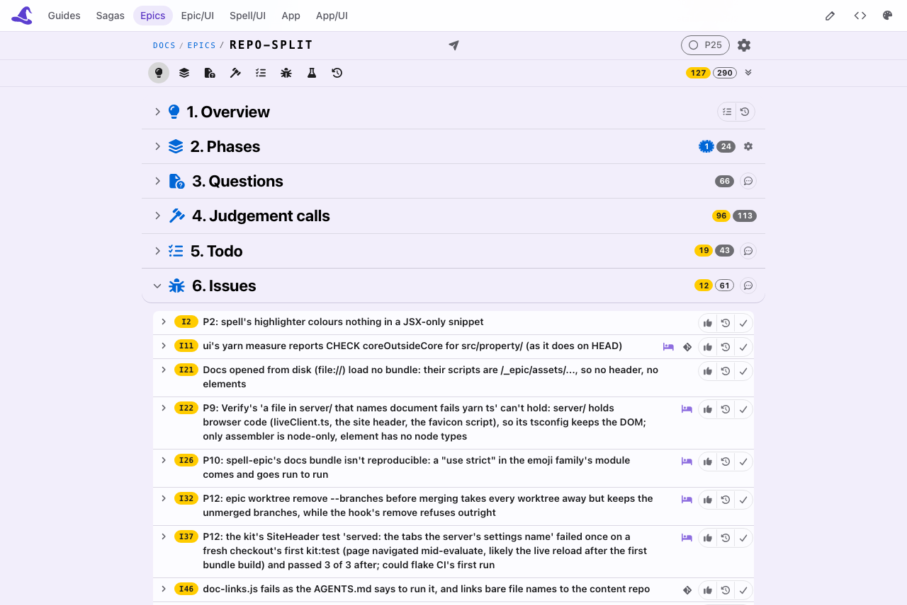
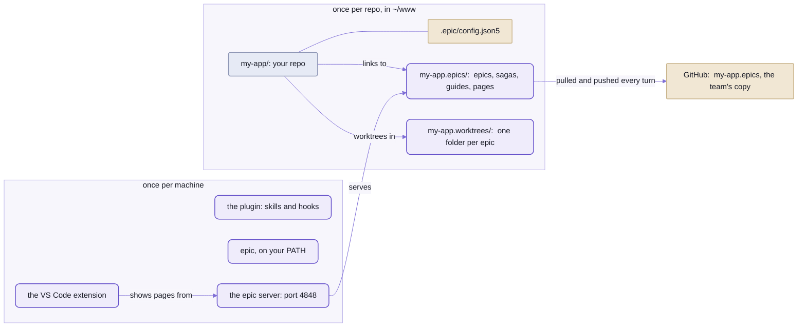

# Epics:  plan on a page, build with your coding agent

An epic is one piece of work a coding agent does for you, start to finish, with its plan on a page that stays true.

You start one by typing a line in Claude Code:

```text
/epic seo make the docs findable
```

From that line, the agent:
- makes a git branch and a worktree of its own, so your checkout isn't touched until you merge
- writes an EPIC PAGE, open beside your code in VS Code:  what it understood, what it needs to ask you, its plan in phases
- keeps that page current as it builds:  each phase done, each choice it made without you, each problem it found



_An epic page:  everything on it has a short id, and buttons for answering it._

## Why you'd want it

If you've used a coding agent on anything bigger than a small fix, you've met these:
- **The reasoning scrolls away.**
  A ticket says what to do, and goes stale the day the work starts.
  A pull request shows what was done, not the decisions behind it.
  The chat in between is gone by morning.
  An epic page holds all three, during the work and after the merge.
- **The agent guesses, or sits waiting for you.**
  Here a question goes on the page, with its options, what each would cost, and the one the agent recommends.
  You answer when you have time.
- **A new session starts from nothing.**
  `/epic resume seo` picks up from the page, not from a summary of a chat.
- **Two agents trip over each other.**
  Each epic has its own branch, worktree and VS Code window, so several can run at once.

What it costs:
- every worktree is another checkout, with an install of its own
- a page can collect more than you'll read:  the work is only as reviewed as you make it

## How you'll use it

1. **Ask.**
   In a Claude Code session in your repo:  `/epic <name> <what to plan>`.
   The page opens in VS Code's right side bar, and fills as the agent reads your code.
2. **Answer its questions, on the page.**
   Press Choose on the option you want, or leave a note.
3. **Agree the plan.**
   Accept Overview once it has understood the job;  it then writes the phases, and you press Accept Phases.
4. **Let it build.**
   It works through the phases in its worktree and commits each one.
   You can go and do something else, or start another epic.
5. **Review whenever you like.**
   Every item has buttons:  Approve, Revisit with a note, Do this.
   Any paragraph takes a comment.
   Press Send, or wait two minutes for it to send itself, and the agent takes your marks.
6. **Finish.**
   `/epic done` merges the branch, or opens a pull or merge request.
   The worktree goes;  the page stays, as the record.

The pages are plain HTML files, in a git repo of their own beside your code, so a whole team can share them.
A question or a bug has an id you can say out loud:  "approve J3" works in the chat.

## Try it

In your repo, a git repo with at least one commit:

```sh
npx spell@next epic init
```

It asks your name and a colour, installs the Claude Code plugin and the VS Code extension,
makes the shared repo for the pages, and starts a small local server that shows them.
It leaves one config file and a block in `.gitignore` in your repo.

The full steps, what each question means, and working with others are below.
The method in more depth:  [the epic engine's front page](epic/README.md).

Three things to know before you start:
- **Sharing works with GitHub and GitLab.**
  `epic init` makes the team's epic repo with the host's own command:  `gh`, or `glab` ([On GitLab](#on-gitlab)).
  Bitbucket or a bare git server work too, but you make the repo by hand and pass its address
  (`epic init --remote <address>`).
- **Claude Code first, Codex beside it.**
  The skills run in both, from one copy;  the moves between worktrees and windows are Claude Code's,
  in VS Code or Cursor, on macOS, Linux or Windows (Cursor, Windows and Linux not yet tried by a person).
  Any other agent works an epic from `epic guide` and its own end-of-turn step:
  [With Codex](#with-codex).
- **It has run end to end outside Spell once**, in a throwaway repo:
  `epic init`, a saga, an epic page with a phase, a round through the review inbox, the pages on the epic server,
  `/isolate done`'s merge, and the worktree removed after it.
  - The setup on this page has run again since, for two people, against a stand-in for GitHub:
    the first `epic init`, the second one cloning, both adding a todo, the sync renumbering one,
    and the epic server showing the page.
  - The rough edges are listed at the end, not hidden.

## The plans live beside your repo, not in it



_Once per machine, `epic init` does the plugin, the command and the server;  the extension is by hand.
Once per repo:  one small file in it, two folders beside it, and the team's copy of the plans on GitHub._

The plans are NOT in your repo.
An epic page is in the epic repo:  ONE copy, in the epic folder, which every checkout links in.

So the session in a worktree and you on the main checkout read the same page,
and it never conflicts on a code merge or turns up in a pull request.
Your teammates have the same page too, a turn behind at most.

The work IS in your repo:  one worktree per epic, on a branch named after it,
beside the main checkout rather than inside it.

## Setting it up:  one command, and an extension

You need Claude Code, VS Code, git, Node 24.11 or later, and your code host's command:  GitHub's `gh`, or GitLab's `glab`
([On GitLab](#on-gitlab)).
These steps are for the FIRST person on a team;  everyone after them:  "A teammate joins", below.

### 1. GitHub's command, logged in

`epic init` uses it to make the team's epic repo, so install it first.
On macOS, with Homebrew:

```sh
brew install gh
gh auth login
```

- Other systems:  https://cli.github.com.
- `gh auth login` asks a few questions and opens your browser;  SSH or HTTPS, as you like:
  the epic repo's address follows your choice.
- Without it, `epic init` still sets everything else up, and says how to get it.
  Run `epic init` again once you're logged in:  it makes the epic repo then.

### 2. `epic init`, in your repo

From any folder of your repo, a git repo with at least one commit:

```sh
cd ~/www/my-app
npx spell@next epic init
```

- That fetches Spell's package and runs its `spell epic`, which runs the epic tool installed beside it.
  Once `epic` is on your `PATH` (its plugin step puts it there), `epic init` is the same thing.
- `epic` and the plugin then run from npm's cache (`~/.npm/_npx`):
  after `npm cache clean`, run this line again.
- Your project doesn't need yarn:  an npm repo works, and yarn, pnpm and bun repos are found by their lock files.

In a terminal, it asks every question FIRST but the commit, each `? ` and the question in yellow, then sums up the
answers (`> Your name  :  Ana`, the values bold) before it does anything.
A pick-one question is a numbered list:  the arrow keys and Enter, or a number key, pick.
A teammate joining has the team's plans cloned before the colour question, so the list leaves out the colours taken.
- **What do you want to be called?**  Your short name on the pages, suggesting the one you keep already,
  else your GitHub login;  asked every time, Enter keeps it.
  `--name Ana` answers it.
- **Which colour should your words be?**  The colour your replies and comments are drawn in, on every page.
  A list of Spell UI's colour names nobody on the team has yet, the first marked.
  `--color green` answers it;  any CSS colour works too.
- **What should the epic repo be called?**  Only when it's about to make one on GitHub.  Suggesting `<repo>.epics`, here `my-app.epics`.
  `--content-repo <name>` answers it.
- **Private or public?**  A list of the two, private marked.
  `--public` answers it;  with no terminal to ask in, it's private unless you say `--public`.
  A public repo shows everything in the plans to anyone:  epic pages, guides, comments.
  `epic init` says so in a line of its own.
- **Commit and push .epic/config.json5 and .gitignore on main?**  Asked last, after the files;  suggesting yes,
  and with no terminal to ask in, yes.  It pushes to the branch's upstream, else `origin`.
  `--no-commit` leaves them for you.

Then, in order, each step under a bold heading, the files in a gray table, a gray line before each slow step:
1. Installs the epic plugin for Claude Code, when it isn't there yet:  once per machine.
   - Its skills and hooks, a bare `/epic`, and `epic` on your terminal's `PATH`
     ([README/agents.md](README/agents.md#the-epic-plugin) says what each step does).
   - Installed for the machine, its hooks run in every repo, not just yours:
     in one `epic init` never set up they do nothing, and its worktrees are Claude Code's own.
   - `--no-plugin` skips it;  `epic plugin install` does it by itself.
2. Writes `.epic/config.json5`, every key with a comment on each, valued for THIS repo
   ("The config file", below).
   A file already there is kept as it is.
3. Makes the epic folder, `../<repo>.epics`, a git repo of its own.
   It holds the four folders, a README, and a `.gitignore` for what's never committed.
4. Makes the epic repo on GitHub or GitLab:  private unless you said public, under your account,
   or under the organization or group your code repo is on.
   It pushes the epic repo there, and writes its address in the config, `contentRemote`.
5. Links each of the four folders in at the checkout's root;  every new worktree gets the same links.
6. Lists the links in a block of your `.gitignore`.
   The block starts `# shared:start` and ends `# shared:end`.
7. Keeps your name, in `~/.spell-epic/person.json5`.
8. Keeps your colour WITH THE PLANS, `people/<name>.json5` in the epic repo, and pushes it:
   your teammates see it, and nobody commits anything in the code repo for it.
9. Commits `.epic/config.json5` and `.gitignore` on the base branch, only those two files, and pushes them:
   every new worktree branches from there.  On another branch it commits nothing, and says so.
10. Starts the epic server, serving your repo, and ends with where to see the epics:  its address, a link in a
    terminal ("One epic server", below), and how to open them in VS Code (or Cursor).
    `--no-server` skips the server.

- Pushed, a teammate's `epic init` reads the epic repo's address from the base branch.
- Each step is skipped when it's done, so it's safe to run again:  a second run's table says `already` on every row.
- `--remote <address>` uses an epic repo you made already (on GitHub or anywhere else git reaches).
- `--no-remote` makes none:  the plans stay on this machine, as they did before sharing existed.

Try it first in a throwaway repo:  `--dry-run` says what it would do, and writes nothing.

```sh
cd "$(mktemp -d)" && git init -q -b main my-app && cd my-app
git commit -q --allow-empty -m first
epic init --dry-run --no-remote --no-plugin
```

<details>
<summary>Output</summary>

```text
Initializing Epic for repo .../my-app
...
Setting up epic files:
  would write            .../my-app/.epic/config.json5
  would make             .../my-app.epics
  would link (missing)   .../my-app/epics
  would link (missing)   .../my-app/sagas
  would link (missing)   .../my-app/guides
  would link (missing)   .../my-app/pages
  would update           .../my-app/.gitignore
...
dry run:  nothing changed
```

</details>

<details>
<summary>The install command it picks, by lock file</summary>

The first match wins;  no match leaves `installCommand` empty, and nothing is installed.

```text
yarn.lock               yarn install
pnpm-lock.yaml          pnpm install
bun.lock, bun.lockb     bun install
package-lock.json       npm install
a bare package.json     npm install
uv.lock                 uv sync
Gemfile.lock            bundle install
```

</details>

<details>
<summary>npm or yarn:  what your repo needs</summary>

Your repo doesn't need yarn.
A plain npm repo, with a `package-lock.json`, works:
- `epic init` writes `npm install` as the install command, and every new worktree runs it.
- `epic worktree merge-main` rewrites a `package-lock.json` that both sides changed with
  `npm install --package-lock-only`, then installs.
  `pnpm-lock.yaml`, `yarn.lock` and `bun.lock` get their own tools the same way.
- Vitest snapshots are updated with your repo's own runner:  `npx vitest run ... --update` for npm.
  With no Vitest in your `package.json` (Jest, say), nothing runs, and a snapshot both sides changed is an ordinary
  conflict, for you to resolve or to list in `.epic/generators.json5`.

Yarn is on your machine for one reason:  the clone of Spell that `epic` runs from uses it,
in its own folder, for its own install and to format pages.
No command runs yarn in your repo.

</details>

Then check that `epic` answers:

```sh
epic --version
```

<details>
<summary>Output</summary>

```text
epic ... (...) .../epic
```

</details>

- `--version` names the code that answers:  its commit, its branch and the folder it's in.
- `~/.local/bin`, where the plugin step links `epic`, may not be on your `PATH`:  put the link wherever yours looks.

🌱 Planned:  the plugin from Claude Code's marketplace, without `npx`.

### And the extension

The Review tab, where you mark up a page, and the moves between windows need Spell's VS Code extension:
the same one in VS Code or Cursor, which runs VS Code's extensions.
`epic init` installs it, from the package:  reload your windows when it says so (**Developer:  Reload Window**).
From a clone of Spell instead:  [the extension's README](epic/README-vscode.md#install-it--three-commands-and-a-reload).

In Cursor, the epic tools use `cursor` where VS Code's take `code`:  they tell from the window they run in.
- Say it outright with `editor` in `.epic/config.json5` (below), or for one machine `SPELL_EPIC_EDITOR=cursor`.
- Cursor keeps its right side bar for its own agent, so the Review tab may not show there:
  open it with **View: Open View...** › Review, then drag it where you want it (or **View: Move View**).

Then, in a Claude Code session in your repo, `/epic <name> <what to plan>`:

```text
/epic seo make the docs findable
```

The session titles itself for the epic and makes its worktree, `~/www/my-app.worktrees/seo`.
Its epic page, `~/www/my-app.epics/epics/seo/seo.plan.html`, opens in the Review tab and fills as it plans.

What happens from there:  [the epic engine's front page](epic/README.md).

## <a id="working-with-others"></a>Working with others

Everyone runs their own Claude Code, their own epic server and their own worktrees.
What they share is the epic repo:  every turn pulls the others' changes in, and pushes yours out.

### A teammate joins

The same one command:  `epic init` finds the epic repo's address in the config the first person committed,
and CLONES it, beside the code repo:

```sh
git clone git@github.com:ana/my-app.git && cd my-app
npx spell@next epic init
```

- The plugin and the extension are set up on their machine by the same line.
- It asks your name and your colour, as it asked the first person, from any folder of the code repo:
  it finds the repo's main checkout from wherever it runs.
- The epic repo is private, unless the first person chose public:  they add each teammate to it on GitHub or GitLab,
  with write access, since every turn pushes.
- Joining needs no `gh` or `glab`:  plain git clones the epic repo.
  With one logged in, though, your short name defaults to your login there.
- The plugin step and the extension are once per machine, so a teammate does those too.

### Who you are

```sh
epic whoami
```

Your SHORT NAME is who you are on the epics:  what's stamped on your replies, comments, picks and log lines.
- It's the one you kept (`epic init` asks;  `epic whoami Ana` changes it),
  else your GitHub login, else git's `user.name`.
- Your full name is git's `user.name`;  the GitHub login is looked up once with `gh` and kept,
  so no page or hook waits on the network.
- `epic whoami --rename Ana Lima --dry-run` says what a new name would change:
  `--rename` writes it over your old one everywhere it says who wrote something, on every page.
- `epic whois Ben` lists what the pages say about Ben:  his replies and comments, by page, and when last.
- The AGENT under you is the one running `epic`:  what its words are stamped with, so Bob's Codex reads "Codex (Bob)".
  - Found from the mark each agent leaves on the commands it runs (Claude Code's `CLAUDECODE`, Codex's
    `CODEX_THREAD_ID`).
  - Another agent names itself with `SPELL_EPIC_AGENT=gemini`, set in its own settings.
  - None of them:  `claude`, and `epic whoami` says it guessed.

On a page, your own replies say "You", and everyone else's their name.
Claude's replies say "Claude", or "Claude (Ben)" when Ben's session wrote them,
so you can tell your Claude at work from his.

### Every turn syncs

At the end of every turn, Claude Code's or Codex's, a hook commits the epic repo, one commit per epic, guide or folder.
With an epic repo named in the config (`contentRemote`), the same hook then syncs it:
1. pulls, rebasing this machine's commits on top of the others'
2. renumbers any id both sides made (below)
3. pushes

`epic shared sync` does the same by hand:

```sh
epic shared sync
```

- Offline, the commits stay here, and the next sync pushes them.
- A repo whose config names no `contentRemote` only commits, every turn, and never pulls or pushes,
  even when its epic repo has a remote of its own.

### When two people edit one page

Most of it merges by itself, because a page is many small files:
- **Each item and phase is a file of its own**, so edits to different items never touch each other.
- **Ids made twice are renumbered.**
  - A new id is the highest plus one, so Ana and Ben can both make T22.
  - The sync gives THIS machine's one the next free number, T23, its file and every link to it following.
  - A log line says so:  "Renumbered as the plans synced: T22 → T23 (the same ids came from someone else first)".
  - An id you said in chat before the sync can change:  the log is where to look.
- **The log keeps both people's lines**, in time order:  git's `union` merge keeps both, and the sync re-sorts them.
- **Two items added at the same place**, or two "updated" dates, are settled by the sync:  both items, the later date.

Anything else, the same words changed two ways, is a real conflict:
- the sync undoes its rebase, keeps your commits here unpushed, and stops
- your next session starts by saying which files clash, and how to settle them
- to settle it:  in the epic repo, `git pull --rebase`, keep both people's words in each file, `git add` it,
  `git rebase --continue`, then `epic shared sync`

### Everyone sees every comment;  your agent answers yours

A comment you leave on a page is shared with the plans, the moment the turn's sync runs, answered or not.
- It's kept in a file of YOUR comments beside the page, `<page>.comments.<you>.json5`:
  only your machine writes it, so two people commenting never clash.
- A teammate's sync brings your thread to their page.
  They can reply on it;  their reply goes in their own file, and your sync brings it back.
- **Each person's agent answers that person's threads**, their Claude or their Codex.
  - Your Send hands your session only yours;  a teammate's waits for theirs.
  - The thread says whose agent took it:  "Claude (Ana): thinking…".
- Only the comment's writer edits, deletes or clears it.
- Two people adding a comment between syncs may both make `C4`:  the sync gives yours the next free number.
- `epic whoami --rename` moves your comments file to your new name, in one commit.

**Still on your machine:**  your marks (the pills you press on items), your Send, and who's listening,
in the page's review inbox, a file never committed.
What your agent makes of a mark lands in the epic page, under your name, which everyone shares.

## <a id="when-main-takes-only-pull-requests"></a>When main takes only pull requests

Plenty of GitHub orgs and GitLab groups refuse direct pushes to `main`.
Below, "pull request" means a GitLab merge request too;  on GitLab, `epic` says "merge request".
Tell the repo so with one setting, and nothing `epic` does tries to land there:

```sh
epic init --protected-base
```

`baseBranchProtected` in `.epic/config.json5` says the base branch can't be pushed to,
and work reaches it only through a pull request.

**You usually don't have to say so.**
With `gh` or `glab` logged in, `epic init` asks the host whether the branch takes only requests
(GitHub:  a ruleset's `pull_request` rule and, if you're allowed to read it, classic branch protection;
GitLab:  the project's protected branches:  nobody allowed to push, or a push level above yours),
turns the setting on, and says so in one line.
If it can't find out, it carries on without it.
A config that already says `false` stays `false`, and `epic init` tells you how to change it.

**Setting up the repo goes through a pull request too.**
`epic init` never commits on `main`:
- `.epic/config.json5` and `.gitignore` go on a new branch, `epic-setup`, which it pushes.
- It opens the pull request with `gh` or `glab`, or prints exactly what to run without one.
- Your local `main` is left clean:  the two files aren't in it until the merge.
- Epics start working in the repo once it's merged and you've run `git pull`.
  Teammates can join then.

Ran `epic init` before the rule existed, and its push was refused?
It left a commit on your local `main`, and it says what to do:
`epic init --protected-base` takes that commit back and moves it onto `epic-setup`.

**The epic repo is the exception, and it has to stay one.**
Your plans live in `<repo>.epics`, and every turn pushes straight to its main branch.
An org-wide rule requiring pull requests must leave that repo out, or the plans stop syncing.
The setting changes nothing about it.

**What changes with the setting on:**

| Where | What it does instead |
| --- | --- |
| `epic merge <name>` | refuses, in one line saying to open a pull request |
| `/epic done`, `/isolate done` | no "Merge now":  "Push and open a pull request", or "Leave it" |
| a standing epic's phase | pushed and put in a pull request, rather than merged at once |
| a new worktree, `epic worktree merge-main` | fast-forward your local `main` from `origin` first |
| `epic worktree remove --branches` | a branch whose pull request the code host merged counts as merged, a squash included |

Local `main` only moves when you pull, so those fast-forwards keep it from going stale.
They happen only when it's safe:  fast-forward only, nothing uncommitted.
Offline, or with `main` diverged, they carry on from what you have, and say so.

A branch is deleted only if all its commits are in `main`,
or a merged pull request holds its last commit:  a commit made after the merge keeps the branch.
Asking the host takes `gh` or `glab`;  without it, the branch stays, and the line says why.

To push a branch and open its pull request by hand:  `epic pr <name>` ([the CLI page](epic/README-cli.md)).

**After a pull request merges,** in the main checkout:

```sh
git pull
epic worktree remove <name> --branches
```

## <a id="on-gitlab"></a>On GitLab

`epic init` works on GitLab, self-hosted too, as it does on GitHub:  the shared epic repo made, and a setup merge request
where `main` is protected.
**So far this has run only against a stand-in `glab`**:  a script that answers as GitLab's API documents,
with real `git` pushes to a local repo whose hook refuses `main`.
No real GitLab has been tried yet, so expect rough edges and tell us.

You need GitLab's command, `glab`, logged in:

```sh
brew install glab                        # other systems:  https://gitlab.com/gitlab-org/cli
glab auth login                          # gitlab.com
glab auth login --hostname git.acme.com  # your own GitLab
```

- **Which host:**  `codeHost` in `.epic/config.json5`, `"github"` or `"gitlab"`.
  Left out, it's read off the `origin` address each time:  a host with `gitlab` in it is GitLab, `github.com` GitHub,
  anything else GitHub.
- **A self-hosted GitLab whose address doesn't say so** (`git.acme.com`):  `epic init --host gitlab`.
  In a terminal it asks;  with no terminal it stays on GitHub and says so in one line.
- **Groups and subgroups:**  the epic repo goes under the group your code is in (`group/sub/my-app.epics`),
  else your own namespace.
- **The epic repo must take pushes from teammates, every turn.**
  GitLab protects a new project's default branch, so Developers can't push.
  `epic init` unprotects it right after the first push.
  If it can't (no right to), it says so in one line:  unprotect it in the project's
  Settings › Repository › Protected branches, or nobody else can sync.
  An epic repo you made yourself (`--remote`) is yours to open up.
- **Commit links** on the epic pages go to GitLab's `/-/commit/<sha>`.

## <a id="with-codex"></a>With Codex (or another agent)

```sh
epic guide --list
```

_The epic workflow, for an agent with none of the skills:  `epic guide` prints it, `epic guide build` one topic._

Bob uses Codex, Ana uses Claude Code, and they work the same epic:  the same pages, the same comments,
each answer stamped with whose agent wrote it, "Codex (Bob)".
Both run the same skills:  ONE copy of each, which Codex calls as `$epic review` where Claude Code says `/epic review`.
An agent with no skills at all gets the workflow from `epic guide`.

**Setting Codex up**, once per machine, after `epic init` (which puts `epic` on your `PATH`):

```sh
epic plugin install --codex
```

- It writes three hooks into Codex's own hooks file, `~/.codex/hooks.json` (`$CODEX_HOME` moves it):
  - as each turn ends, `epic turn end`:  the plans committed and synced, as Claude's turns do
  - as a session starts, two notices:  its worktree is behind `main`, or the last sync stopped on a conflict
- It links each of the plugin's skills into `~/.agents/skills/` (`$SPELL_EPIC_AGENTS_HOME` moves `~/.agents`), where the Codex CLI finds your own skills in every repo:
  the same files Claude Code reads, so an edit to one shows in both at once.
- It writes the plugin's two reviewers, the designer and coherence, as Codex custom agents in `~/.codex/agents/`:
  generated from Claude Code's agent files, so edit those and run it again.
- Your own hooks, skills and agents stay;  run again, it changes nothing.
- The Codex desktop app can add the plugin itself instead:  `epic/.codex-plugin/plugin.json` names the same skills and
  hooks.  With both, the hooks still run once:  a hook the plugin starts stands down while `~/.codex/hooks.json` runs it.
- **Codex runs a hook only once you trust it**:  `/hooks` in Codex, once, and again whenever the hooks change.
- Codex knows which agent it is by itself (it marks every command with `CODEX_THREAD_ID`).
  Another agent names itself with `SPELL_EPIC_AGENT=gemini`, set in its own settings.

**The skills in Codex.**
Type `$` and the skill's name, as `/` in Claude Code:
- `$epic review seo` takes your marks, comments and Sends from the page, as `/epic review` does;
  `$epic seo` plans or resumes one, `$wtf` says where things stand, `$details` asks a question on a page
- Codex also picks a skill by itself when the task matches it, as Claude Code does
- where a step needs something only Claude Code has, the skill says what Codex does instead, in a line beginning
  "In Codex:":
  - the question modal:  a numbered question in the chat (a details page works the same for both)
  - background agents:  Codex sub-agents, which it waits for, so the chat isn't free meanwhile
  - a worktree:  `epic worktree create seo`, then the agent works from the folder it prints
  - windows and messages to other sessions:  printed, for you to run or paste
- five skills stay Claude Code's:  `bg`, `bedtime`, `comment`, `session` and `title`
  - Codex never picks them by itself (each has an `agents/openai.yaml` saying so)
  - called by name, `$bg`, each says in its first line what to do in Codex instead
- `epic skills check` keeps the one copy honest:  it fails a skill naming a Claude-only tool with no "In Codex:" line
  beside it, and the `epic/` folder's tests run it

**What the agent runs**, in the workflow `epic guide` prints:
- `epic turn end`, as its turn's last step, when no hook runs it:  safe to run twice, quiet with nothing to do.
- `epic inbox wait <epic>`, to hear your Send:
  it waits until you press Send on the epic page, prints the work, and ends.
  - While it waits, the page says so after its review line:  "Your Codex is listening" (on Ana's page, "Bob's Codex").
  - Send never wakes a Codex that isn't waiting.
    With work sent and nobody listening, the page says "Your Codex isn't listening:  ask it to run `epic inbox wait seo`",
    and a click copies the command.

**Still Claude Code's only, for now:**
- the five skills above, and what the others do with Claude Code's own tools:
  `epic guide claude-only-tools` lists the plain way to do each
- waking a session from the page, session titles, window moves, and the worktree hooks
- the time a phase took counts only Claude's sessions

Untried so far with a real Codex:  the steps above are tested against stand-ins for Codex's files, hooks, skills and
agents.

## The epic folder:  your plans, in a repo of their own

Every page the agent writes lands in one of four folders, each linked into your checkout:

| Folder | What's in it |
| --- | --- |
| `epics/` | a page per epic, `epics/<name>/<name>.plan.html`, with its parts, review inbox and details pages;  the Epics list, `epics/index.html` |
| `sagas/` | the sagas' list, `sagas/sagas.json5` (`epic saga create`), a page per saga, the Sagas list |
| `guides/` | the guides epics write (`epic pages create durable guides/<page>.html`), the Guides list |
| `pages/` | the docs' home page, `pages/index.html` (`epic pages index` writes a card per area), and scratch details pages, `pages/details/` |

- **Committed by itself.**
  A hook commits the epic folder at the end of every turn (`epic turn end`),
  one commit per epic, guide or folder:  the plans keep a history of their own, off your branches.
  With an epic repo, the same hook syncs it ("Every turn syncs", above).
- **Never committed:**  review and comment inboxes, locks, the running-agents lists, scratch details pages,
  and the VS Code window files, each machine's own (`windows/`).
  The comments beside the inboxes ARE committed, a file per person.
- **Its own `.gitignore` and `.gitattributes`** hold a marked block each, which `epic init` and every sync keep
  current:  the logs' `union` merge is in the second.
- **No `templates/`.**
  The page templates are the engine's, in [templates/](epic/templates/).
  A repo can add its own with `repoTemplates`, found by name before the engine's.

## <a id="your-settings"></a>Your settings:  three layers, later wins

How the epic tooling behaves is separate from where a repo keeps things.
Three files of the same name and shape, `epic_settings.json5`, merged key by key:

| Layer | Where | Checked in? |
| --- | --- | --- |
| default | [epic/epic_settings.json5](epic/epic_settings.json5), every key with its value | in Spell |
| org | at the root of the epic repo;  optional | in the epic repo |
| developer | `~/.spell/epic_settings.json5`;  optional | nowhere |

To change one for yourself, write only that key:

```json5
{ away: { finishedPhaseDays: 7 } }
```

- `epic settings` prints each value and which file set it;  `epic settings <key>` one value;  `--json` for a script.
- A file that won't read, or a bad value in one, is said on stderr, and the layer below stands.

| Key | Default | What it sets |
| --- | --- | --- |
| `away.finishedPhaseDays` | `3` | how many days a finished phase (done or dropped) and a bedtime run's summary stay in "While you were out";  a phase with no recorded time stays until you read it |

## <a id="the-config-file"></a>The config file:  one per repo, read from the main checkout

`epic init` wrote this file, and most repos never touch it again.
You'd open it for one of five things:
- an epic repo made by hand (`contentRemote`)
- a different install command
- a second project in the repo that installs on its own (`extraInstalls`)
- an app for the epic server to start (`app`)
- a repo made of several repos (`repos`)

It's ONE file per repo, `.epic/config.json5` in the main checkout, read by
[`EpicConfig`](epic/src/config/EpicConfig.ts).
- Every key is optional:  one left out reads as `epic init` would write it for YOUR repo, the middle column below.
- Folders are relative to the main checkout, and every worktree reads the main checkout's file:
  a branch's change to it counts once it's merged.
- `epic config [<key>] [--json]` prints what's in force, folders made absolute.
- The hooks act only in a repo that has the file.
  In any other repo, the worktree hook makes the worktree Claude Code would make by itself:
  `.claude/worktrees/<name>`, on a new branch `worktree-<name>`, with nothing linked or installed.

| Key | `epic init` writes | What it sets |
| --- | --- | --- |
| `contentFolder` | `"../<repo>.epics"` | the epic repo:  epics, sagas, guides, pages |
| `contentRemote` | the epic repo's address, once it's made (or `--remote`);  `""` until then | where every turn pulls the epic repo from and pushes it to, and what a teammate's `epic init` clones;  `""`:  the plans stay on this machine |
| `baseBranch` | from git:  the remote's default branch, else `main` or `master`, else the branch the main checkout is on | the branch worktrees start from and merge into |
| `codeHost` | the value it settled on:  `--host`, else the `origin` address's, else GitHub;  left out, worked out from `origin` each time | where the code is hosted, `"github"` or `"gitlab"`:  picks `gh` or `glab` ([On GitLab](#on-gitlab)) |
| `baseBranchProtected` | `false`, unless `--protected-base` or the code host says otherwise | the base branch can't be pushed to, and work reaches it only through a pull request ([below](#when-main-takes-only-pull-requests)) |
| `worktreesFolder` | `"../<repo>.worktrees"` | where new worktrees go, one folder each, `<worktreesFolder>/<name>` |
| `installCommand` | from the lock file;  `""` with none | what makes a new worktree ready to run, from its root;  `""`:  nothing to install |
| `installOnCreate` | `true` with an install | whether the worktree hook runs the install before it hands the worktree over |
| `installTimeout` | `600` | the seconds that install may take before the hook fails |
| `extraInstalls` | `[]` | folders of a worktree that are projects of their OWN, outside the install at its root (a `vscode/` extension):  the install runs in each too;  one missing or failing is a warning |
| `windows.default` | the repo's name | the window file a worktree's window is opened from, by default |
| `windows.repoName` | the repo's name | the repo root's folder name in every window |
| `windows.contentName` | `"<repo>.epics"` | the epic folder's name in every window |
| `windows.worktreeOnly` | `true` | whether every worktree's window holds only the worktree and the epic folder |
| `windows.settings` | not written:  `{}` | VS Code settings every window file gets:  the WINDOW settings a folder's `.vscode/settings.json` can't give in a window of several folders (which TypeScript the editor runs, say;  none of Spell's repos names any today);  `epic window init` writes them into the files that exist |
| `windowsFolder` | `"../<repo>.epics/windows"` | where the VS Code window files go;  worktree windows in its `ongoing/` |
| `linkSessionFolders` | `true` | whether each worktree's saved Claude sessions show in every window's Claude panel |
| `sharedFolders` | `epics`, `sagas`, `guides`, `pages` | the epic repo's folders each checkout links in at its root |
| `colors` | not written:  none | a colour for each person (by the short name `epic whoami` prints) and each agent (`codex`) on the epic pages, `{ people: { ana: "green" }, agents: { codex: "#0f8b8d" } }`:  a Spell UI colour name (red, orange, yellow, olive, green, teal, blue, violet, purple, pink, brown, grey, black), drawn from the theme so it suits light and dark, or any CSS colour;  their replies and comment-thread messages draw in it, an agent's words in the agent's;  anyone left out keeps the shared person or agent colour |
| `editor` | not written:  `""` | the editor the tools drive, `code` (VS Code) or `cursor`, when neither this machine (`SPELL_EPIC_EDITOR`) nor the window they run in says;  `""`:  VS Code |
| `engineFolder` | `""` | an engine checkout to link in at each checkout's root, for a repo whose own code imports the engine;  `""`:  none |
| `repoTemplates` | `""` | the repo's own page templates, a folder from each checkout's root;  `""`:  only the engine's |
| `app.path` | not written:  a comment shows how | the repo's APP:  its address on the epic server, `/editor/`, the top bar's App tab |
| `app.url` | not written | where the app answers (`"http://localhost:3000/"`);  `""` with no `urlFile`:  no app |
| `app.urlFile` | not written | or a JSON file its server writes once it's up, `{ "url": ... }`, from the main checkout |
| `app.start` | not written | the shell command that starts the app, run in the background when it doesn't answer (`"npm run dev"`) |
| `repos` | not written | a MULTI-REPO checkout's child repos (a list, or a file such as `"repos.json5"`):  an epic's worktree is then a worktree of the top with one of every child repo inside it, all on the epic's branch;  a child finds its top as the folder above it (`epic config top`) |
| `checkoutPatches` | not written:  a comment shows how | fixes every checkout gets at once, the worktrees behind `main` too (`epic worktree patch`):  each an `id`, a `date`, a `why`, and a `copy` (a file of `main`'s, put where it isn't tracked yet, git-excluded) or a `run` (a command, once per checkout) |
| `voices` | not written | the repo's own voices, a name to a file from the main checkout (`"code": "agents/wwod/writing.md"`), over the engine's `voices/<name>.md` (`epic voice`) |
| `pageVoices` | not written | the voice each kind of page is written in, over the defaults:  `readme` for READMEs and guides, `code` for code and epic pages |
| `promptAck` | not written | whether the prompt hook shows an "On it:  ..." line for a message sent while the session is busy;  on unless `false` |

- Files your build generates (bundles, data) can be listed in `.epic/generators.json5`:
  `epic worktree merge-main` reruns them on the merged source, instead of line-merging what they wrote.
  - each entry:  its `name` and `outputs`
  - and where and how it runs:  the `cwd`, and the command to `run` there
  - read from each checkout, so a branch that adds a generated file lists it, and its own merge knows it
- Two real ones to copy from:
  - Spell's own, [.epic/config.json5](.epic/config.json5), multi-repo, with no folders linked in
  - the engine's folder's, [epic/.epic/config.json5](epic/.epic/config.json5)

<details>
<summary>The values a key takes when the file leaves it out:  your repo's own</summary>

A key the file leaves out reads as `epic init` would write it for your repo:  the middle column above.
- worked out from the repo, each time it's read:  its name, its lock file, its branches
- `windows.contentName` and `windowsFolder` follow the `contentFolder` you name;
  `installOnCreate`, the `installCommand` you name
- the keys `epic init` doesn't write take the defaults the last column gives
- `epic config` prints every value in force

- NEVER list `agents` in `sharedFolders` in a repo that's also a loaded plugin.
  - Claude Code reads a plugin's root `agents/` as agent types.
  - The engine's folder's own list is `[]`.

</details>

## Worktrees:  beside your repo, one per epic

The plugin's worktree hook replaces Claude Code's own.
An epic's worktree is `../my-app.worktrees/<name>`, on branch `<name>`,
cut from your LOCAL base branch, unpushed work included.

Before it hands the worktree over, the hook:
- links the epic repo's folders in, and the worktrees folder's one link to the epic folder,
  `my-app.worktrees/my-app.epics`, so a page's `../my-app.epics/...` links work from a worktree too
- links the worktree's saved Claude sessions to the main checkout's (`linkSessionFolders`)
- runs `installCommand` in it, when `installOnCreate` is on
- then in each of `extraInstalls`

<details>
<summary>Removing one, and the rest</summary>

- Remove a worktree with `epic worktree remove <name>`, never a bare `git worktree remove`:
  the epic tools stop its web servers (its page server, its app's dev server) BEFORE it goes, and git doesn't.
  What each worktree verb keeps, and the clean-up after a folder deleted another way:
  [the `epic` command's README](epic/README-cli.md#worktrees-sessions-and-parked-work).
- `epic worktree move <name> | --idle` moves worktrees left inside the repo, in `.claude/worktrees`
  where Claude Code puts its own, to beside it.
- Why a worktree's session must enter it through Claude Code's own worktree tool, not just start in its folder:
  the worktree guard, in [the skills' README](epic/README-skills.md#hooks).

</details>

## Your AGENTS.md fills in the rest

The skills know how to plan, build and review;  what your project counts as "done" they leave to you.

They look for it in your repo's own `AGENTS.md`.
Spell's `CLAUDE.md` loads its own with one line, `@AGENTS.md`;  yours can too.

For an agent without the skills (Codex reads `AGENTS.md` by itself), one more line there finds the workflow:
"Working an epic:  run `epic guide`, and end every turn with `epic turn end`."

What they look for:
- the checks to run before a phase is done
- its changelog, if it keeps one:
  `epic docs` looks for an epic's entry in the epic folder's guides, in `changelog.html`
- its house style, and a skill that rewrites text to it, if it has one
- NOT the pages' formatting:  that's the engine's own

## One epic server for the machine

A dev server runs one per project;  the epic server runs ONE per machine, for every repo that uses epics.

It serves each registered repo's epic folder, the engine's scripts and styles,
Epic UI (the `<epic-*>` elements' own docs), and the routes the review controls call.
It's what the Review tab shows.

```sh
epic server start                       # in your repo:  register it the first time, start the server
epic repos add ~/www/my-app --default    # or register a repo (its main checkout) by hand;  --default:  served at /
epic repos list
epic server url ~/www/my-app.epics/epics/seo/seo.plan.html
```

- In a repo `epic init` set up, `epic server` IS this server:  such a repo has no page server of its own.
  `epic hub` names it from anywhere, with the same verbs (`start`, `ensure`, `stop`, `status`, `url`).
  Spell's own repo has a page server of its own, which runs beside it, never instead of it.
- Port 4848;  `SPELL_EPIC_PORT` changes it.
  Only ever that port:  when something else holds it, `start` fails and says so,
  rather than start elsewhere, so an open page keeps its address.
- `start` restarts it when its code or the repo list changed since it started.
- Its files are in `~/.spell-epic/`, a folder `SPELL_EPIC_HOME` moves:
  - `repos.json5`:  the repos
  - `server.json`:  its process
  - `server.log`
  - `person.json5`:  who you are
- The app is the repo's own server, never the epic server's:  `/editor/` only finds it, or starts it
  (its output in `~/.spell-epic/app-<repo>.log`).
  With no app declared, it shows a page saying so.
- The epic server's code:  [epic/src/server/](epic/src/server/).

<details>
<summary>Every address it serves</summary>

| Address | What it serves |
| --- | --- |
| `/_epic/assets/...` | the engine's scripts and styles:  Spell UI's docs bundle, `spell-doc.css`, the runtime |
| `/_epic/pack/...` | the `<epic-*>` pack, `epics.pack.js` |
| `/components/epics/` | Epic UI, the elements' docs |
| `/components/<set>/` | the default repo's other component sets;  each repo's at `/r/<repo>/components/<set>/` |
| `/r/<repo>/...` | a registered repo's epic folder |
| `/...` | the default repo's epic folder too |
| `/editor/` | the default repo's APP (each repo's at `/r/<repo>/editor/`):  a redirect when it answers;  else started in the background behind a "Starting ..." page;  with none declared, a page saying so |
| `/api/app/<repo>` | how a repo's app stands:  up, starting, or failed and why |
| `/api/server` | what it serves:  its port, its repos, the default one |
| `/api/...` | the review, details, choices, comments, agents, airplane and links routes, for the default repo |

</details>

## What's still Spell-shaped

What you'd trip on today, roughly in the order you'd meet it.

1. **Everything runs from npm's cache.**
   `npx spell@next epic init` installs nothing permanent:  after `npm cache clean`, run it again.
2. **Sharing needs GitHub or GitLab.**
   `epic init` makes the epic repo through `gh` or `glab`;
   anywhere else, make it by hand and pass `--remote <address>`.
   GitLab has run only against a stand-in `glab`, not a real server ([On GitLab](#on-gitlab)).
3. **The review controls reach the DEFAULT repo only.**
   A second repo's pages draw, but their buttons, comments and details pages talk to the default repo's inbox.
   `epic repos default <name>` picks which repo that is.
4. **Your pages wear Spell's look.**
   They load Spell's theme, and the top bar's tabs are Spell's own areas, not yours.
5. **A few skills reach for Spell's own tools.**
   Where a skill wants the repo's house style or text-rewriting skill, its example is Spell's.
   - Saved prompts go to `~/.spell/prompts/`.
6. **Claude Code first.**
   The skills run in Codex too, but five stay Claude Code's, and so do waking a session from the page, session
   titles and window moves ([With Codex](#with-codex));  any other agent follows `epic guide`.
   The prompt gate renames sessions through a hook output Claude Code doesn't document yet.
7. **VS Code or Cursor, tried only on macOS, and Cursor only from its command line.**
   Cursor takes VS Code's command-line flags, so the tools run `cursor` where they'd run `code`
   (`--install-extension` checked against a scratch profile, Cursor 3.22);
   its windows, the Review tab's place and Claude Code's panel in it haven't been tried by a person yet.
   Linux and Windows have their own way of listing processes, linking folders and reading a pasted picture
   (`wl-paste` or `xclip` on Linux, PowerShell on Windows), but no person has run them there yet.
   - Windows:  a session's window can't be told from its process (Windows doesn't say which files a process has open),
     so `epic session open` opens in the last window.
   - `epic` is `epic.cmd` there, in `%USERPROFILE%\.local\bin`:  put that folder on your `PATH`.
   - The window bridge finds a session's window through its parent processes;
     `vscode://` links are avoided because macOS hands them to whichever window is focused.
   - `epic plugin install` (and so `epic init`) installs the extension from `epic/vscode/spell-epic.vsix`;  in a
     clone of Spell, build it first:  `yarn vscode:package` in `epic/`.
8. **Spell's own page server knows your project only by a file you write.**
   You need it only to see your own component set or bundles on Spell's pages, not for epics:
   the epic server above serves your plans.
   The kit's page server knows its own folders and, beside them, the projects two lists name:
   - `repos.json5`, the kit's tracked list:  only the kit's own peers, so not yours
   - `page-server.local.json5`, at the kit checkout's root, git-ignored, yours:
     `{ projects: ["../my-app"] }`, each folder from the kit's, with a `"pageServer"` part in its `package.json`
   - A kit WORKTREE reads the peers beside the MAIN checkout (`~/www/spell`), not beside itself.
   - A folder beside the kit is served under `/_beside/` (`/_beside/_up/` for one further up).
   - Your project needs its own install with `spell` in it (`"spell": "portal:../spell"`):
     its bundles are found by its npm name, through its `node_modules`.
   - What else assumes the kit's own layout:
     - `spell-types --below`, in your project, builds the local packages it depends on (`workspace:`, `portal:` ...),
       a kit among them with its folders
     - the lint's `spell-ui/*` pattern rules know only the component folders of Spell's own sets
     - `spell rename imports` renames in the peers `repos.json5` names, so never in your project
     - `spell publish` publishes only the kit's folders that have a `"spellPublish"`

**Real today:**  a repo that isn't Spell, set up with one command, its plans shared by a team through GitHub
(GitLab is built, and tried only against a stand-in `glab`),
its epics planned, built in worktrees and reviewed on their pages, each reply and comment under its writer's name,
every comment seen by the team and answered by its writer's own agent, Claude Code or Codex.
**Not yet:**
- Cursor tried by a person:  its windows, the Review tab's place, a move between windows
- Send waking an agent other than Claude Code, and the Codex side tried with a real Codex
- a real GitLab, gitlab.com or self-hosted:  `glab`'s flags are from its documentation, not a run against a server
- a host other than GitHub or GitLab, without making the epic repo by hand
- two repos reviewed from one server
- the keys added since the first outside run, tried anywhere but Spell's own repos:
  - `app`
  - `extraInstalls`
  - `windowsFolder`
  - `windows.settings`

🌱 Two are planned:  the plugin from Claude Code's plugin marketplace, with no clone,
and Send waking Codex and other agents
([the epic engine's front page](epic/README.md#-coming) says where each stands).

## See also

- [epic/README.md](epic/README.md):  the method, if you came here first:  what an epic is, and why the plan is a page
- [epic/README-pages.md](epic/README-pages.md):  what your epic folder will fill with, and how a review round works
- [epic/README-skills.md](epic/README-skills.md):  the skills and hooks you just installed, and what each hook does to a repo
- [epic/README-cli.md](epic/README-cli.md):  every `epic` verb, `init`, `whoami`, `shared` and `server` among them
- [epic/README-vscode.md](epic/README-vscode.md):  the extension's three views, and the window bridge

<details>
<summary>More in the docs site</summary>

In Spell's own epic folder, so only in a Spell checkout with `spell.epics` beside the repos,
served by `spell server start`:

- "spell-epic:  the epic engine, outside spell-app":  `/guides/spell-epic/spell-epic.html`

</details>
