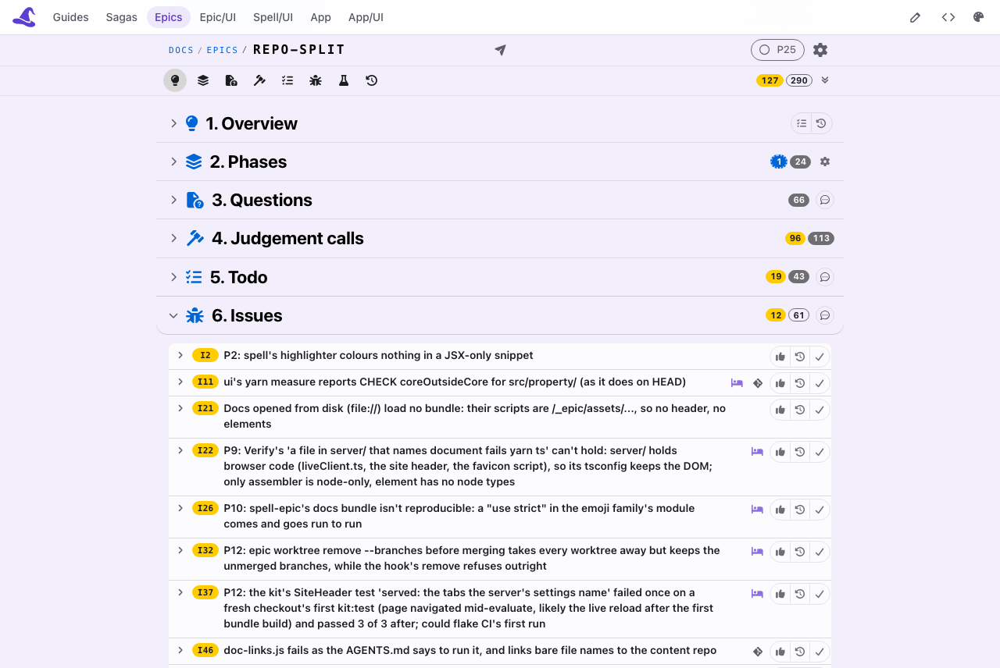

# Epics:  plan on a page, build with your coding agent

An epic is one piece of work a coding agent does for you, start to finish, with its plan on a page that stays true.

You start one by typing a line in Claude Code:

```text
/epic seo make the docs findable
```

From that line, the agent:
- makes a git branch and a WORKTREE of its own (a second checkout of your repo, in a folder beside it),
  so the files you're working on aren't touched until you merge
- writes an EPIC PAGE, open beside your code in VS Code:  what it understood, what it needs to ask you, its plan in phases
- keeps that page current as it builds:  each phase done, each choice it made without you, each problem it found



_An epic page:  everything on it has a short id, and buttons for answering it._

## Contents

- On this page:  [why you'd want it](#why-youd-want-it) · [how you'll use it](#how-youll-use-it) · [try it](#try-it)
- [How epics work](epic/README-how-it-works.md):  sagas, epics and guides;  the workflow;  the page, in pictures
- [Setting it up](epic/README-setup.md):  every step, on GitHub or **[GitLab](epic/README-setup.md#on-gitlab)**,
  and [when main takes only pull or merge requests](epic/README-setup.md#when-main-takes-only-pull-requests)
- [With a team, or Codex](epic/README-teams.md):  joining, syncing, two people on one page
- [Settings, and what's still rough](epic/README-config.md):  the config file, worktrees, the local server
- [With superpowers](epic/README-superpowers.md):  what each plugin does, and how they share a session
- [The method, in depth](epic/README.md):  how a page works, and why

## Why you'd want it

If you've used a coding agent on anything bigger than a small fix, you've met these:
- **The reasoning scrolls away.**
  An epic page holds what a ticket, a pull request and a chat each hold, during the work and after the merge:
  - a ticket says what to do, and goes stale the day the work starts
  - a pull request shows what was done, not the decisions behind it
  - the chat in between is gone by morning
- **The agent guesses, or sits waiting for you.**
  Here a question goes on the page, with its options, what each would cost, and the one the agent recommends.
  You answer when you have time.
- **A new session starts from nothing.**
  `/epic resume seo` picks up from the page, not from a summary of a chat.
- **Two agents trip over each other.**
  Each epic has its own branch, worktree and VS Code window, so several can run at once.

What it costs:
- every worktree is another checkout, with an install of its own
- a page can collect more items than you'll read, and nobody reviews them for you

## How you'll use it

1. **Ask.**
   In a Claude Code session in your repo:  `/epic <name> <what to plan>`.
   The page opens in VS Code's right side bar, in its Review tab, and fills as the agent reads your code.
   Every button named below, in annotated pictures:  [How epics work](epic/README-how-it-works.md).
   Or `/epic <name>` alone, then type the plan in the kickoff box at the top of the page, pictures and all, and Send.
2. **Answer its questions, on the page.**
   Press Choose on the option you want, or leave a note.
3. **Agree the plan.**
   Accept Overview once it has understood the job.
   It then writes the phases, each with its build plan, and one press of Accept Phases agrees them all.
4. **Let it build.**
   Named background agents build each phase in the worktree, commit it, and go straight on to the next agreed one.
   - The session you typed into stays free to answer you, usually within seconds.
   - You can go and do something else, or start another epic.
5. **Review whenever you like.**
   Every item has buttons (Approve, Revisit with a note, Do this), and any paragraph takes a comment.
   - Press Send, or leave the page alone for two minutes and it sends itself, and the agent takes your marks.
6. **Finish.**
   `/epic done` merges the branch, or opens a pull or merge request.
   The worktree goes;  the page stays, as the record.

The pages are plain HTML files, in a git repo of their own beside your code, so a whole team can share them.
A question or a bug has an id you can say out loud:  "approve J3" works in the chat.

## Try it

You need Claude Code, VS Code, git, Node 24.11 or later, and your code host's command, logged in.

**If you don't have NodeJS installed** (a Python team, say), on macOS:

```sh
brew install node                        # no Homebrew yet:  its install line is at https://brew.sh
node --version                           # v24.11.0 or higher
```

Linux or Windows:  the installer from https://nodejs.org.
Every step, Homebrew's own install included:  [If you don't have NodeJS installed](epic/README-setup.md#1-if-you-dont-have-nodejs-installed).

**On GitHub:**

```sh
brew install gh
gh auth login
```

**On GitLab** ([what's different](epic/README-setup.md#on-gitlab)):

```sh
brew install glab
glab auth login                          # your own GitLab:  glab auth login --hostname git.acme.com
```

Then in your repo, a git repo with at least one commit:

```sh
npx spell@next epic init                 # a self-hosted GitLab whose address doesn't say so:  add --host gitlab
```

To show it to people without changing anything, add `--demo`:  every question, every step, nothing written.

It asks your name and a colour, installs the Claude Code plugin and the VS Code extension,
makes the shared repo for the pages, and starts a small local server that shows them (port 4848).
It leaves one config file and a block in `.gitignore` in your repo, and puts the `epic` command on your `PATH`:
after this, every command is `epic <verb>`.
The tool ships in Spell's npm package, `spell`;  `@next` is its pre-release tag.

Every step, and what each question means:  [Setting epics up](epic/README-setup.md).

Four things to know before you start:
- **Sharing works with GitHub and GitLab.**
  `epic init` makes the team's epic repo with the host's own command:  `gh`, or `glab` ([On GitLab](epic/README-setup.md#on-gitlab)).
  Bitbucket or a bare git server work too, but you make the repo by hand and pass its address
  (`epic init --remote <address>`).
- **Claude Code first, Codex beside it.**
  Most of the skills run in both, from one copy ([which](epic/README-skills.md#in-codex));
  the moves between worktrees and windows are Claude Code's,
  in VS Code or Cursor, on macOS, Linux or Windows (Cursor, Windows and Linux not yet tried by a person).
  Any other agent works an epic from `epic guide` and its own end-of-turn step:
  [With Codex](epic/README-teams.md#with-codex).
- **Already using superpowers?**
  Both plugins plan, make worktrees and finish, so in an epic's worktree superpowers is told to stand aside for those
  three jobs;  inside a phase, its test-driven and debugging skills still run.
  - `epic init` offers to write those words into your repo's agent instructions, which every session reads.
  - The words, and the flag that skips the question:  [Epics with superpowers](epic/README-superpowers.md).
- **It has run end to end outside Spell once**, in a throwaway repo:
  `epic init`, a saga, an epic page with a phase, a round through the review inbox, the pages on the epic server,
  `/epic done`'s merge, and the worktree removed after it.
  - Its rough edges:  [what's still Spell-shaped](epic/README-config.md#whats-still-spell-shaped).

### Upgrading

When a newer `spell@next` is out:

```sh
epic upgrade --dry-run                   # says the version you have, the newest, and what it would do
epic upgrade
```

- It keeps each version in a folder of its own, `~/.spell-epic/versions/<version>/`, and points the plugin and `epic` there.
  - Not npm's download cache, where `npx` left it:  npm can clear that.
- Then type `/reload-plugins` in each Claude Code session that's open;  new sessions have it.
- Already the newest, it says so and changes nothing.

## See also

- [Setting epics up](epic/README-setup.md):  every step of setting a repo up
- [The pages you review on](epic/README-pages.md):  a review round, on the page
- [Skills and hooks](epic/README-skills.md):  the commands you type in Claude Code
- [The `epic` command](epic/README-cli.md):  every `epic` verb
- [Epic FAQ](epic/README-faq.md):  when something goes wrong, what you see, why, and the fix
- [The epic demo](epic/README-demo.md):  showing epics to your team, stage by stage, in about 20 minutes
