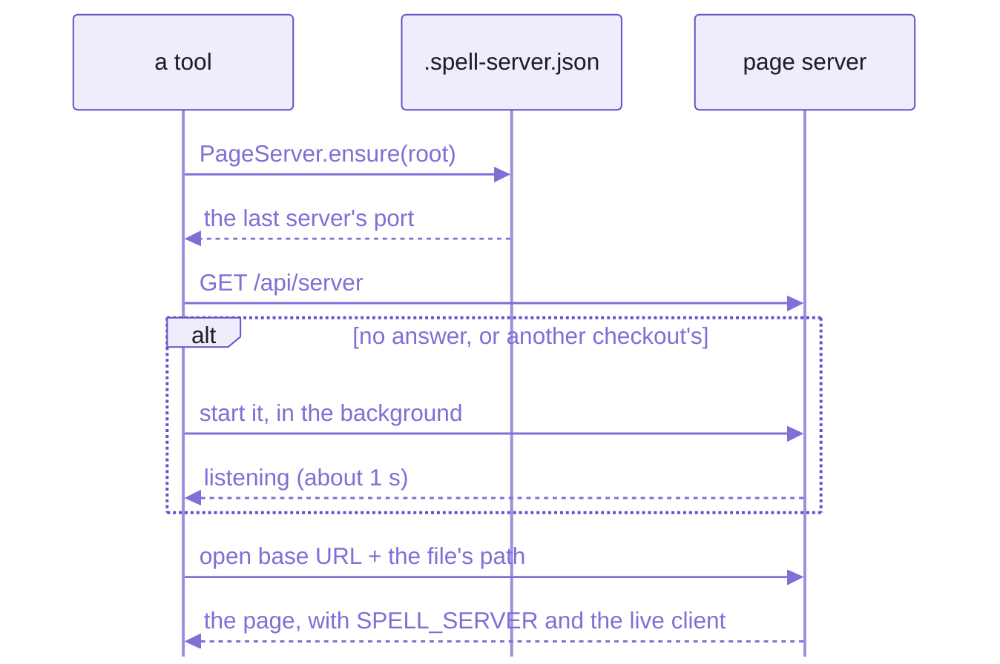
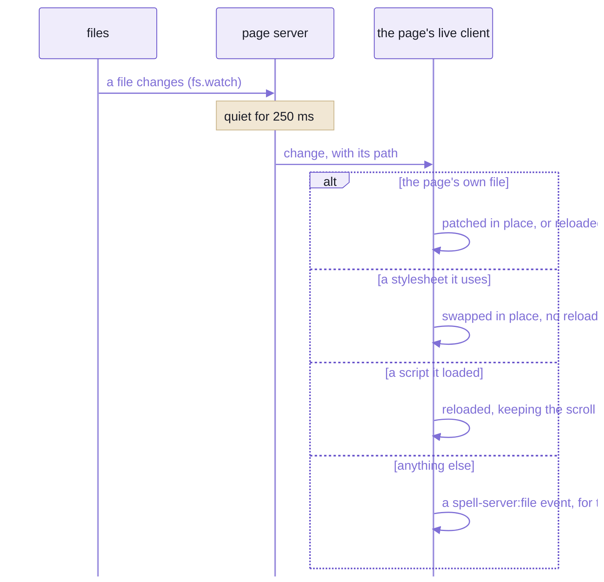
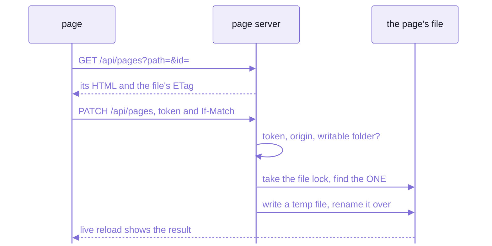
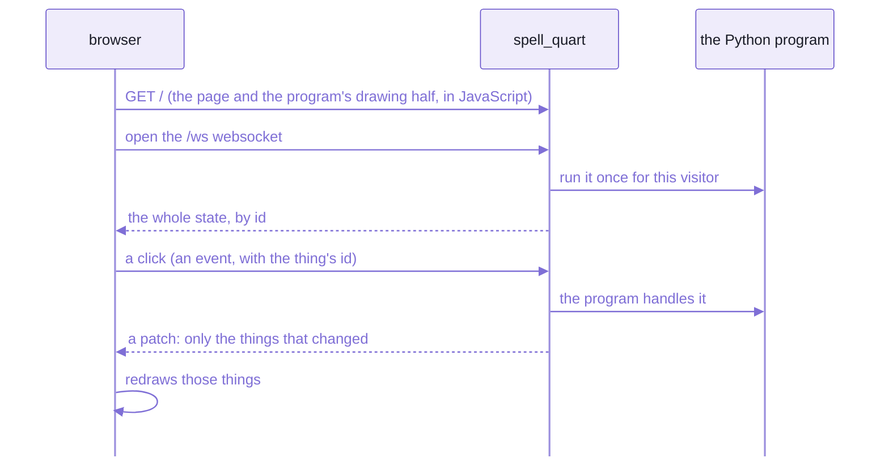

# `spell-kit/server`:  the page server

One local server per checkout serves every page the project has:
the guides and epic pages, the component sets' docs, the editor's API, and every epic's worktree,
each at its own address.
It adds live reload and editing in place to every page it serves,
and gives the tools that WRITE pages their steps:  links, formatting, bundles built on demand, data files.

- It's one thing, under one import name, `spell-kit/server`, its namespace `SRV`.
- The kit's part is GENERIC:  it knows nothing of the editor or the epics.
  What a checkout's server serves beyond its own files comes from that repo's settings:
  in practice spell-app's, which every day-to-day server runs on.
- If you've used Express and Vite's dev server:
  the router has Express's names and behaviour, and live reload is Vite's idea, for plain pages with no build.

```mermaid
%%{init: {"theme":"base","themeVariables":{"fontFamily":"-apple-system, BlinkMacSystemFont, Segoe UI, Helvetica, Arial, sans-serif","fontSize":"15px","primaryColor":"#EFECFB","primaryBorderColor":"#6550CA","primaryTextColor":"#1A1C27","secondaryColor":"#F4F1E9","tertiaryColor":"#F7F6FC","lineColor":"#7F6FD6","textColor":"#7F6FD6","clusterBkg":"#F7F6FC","clusterBorder":"#B9B0E8","titleColor":"#1A1C27","edgeLabelBackground":"#F7F6FC","actorBkg":"#EFECFB","actorBorder":"#6550CA","actorTextColor":"#1A1C27","actorLineColor":"#9C90DE","signalColor":"#7F6FD6","signalTextColor":"#7F6FD6","labelBoxBkgColor":"#EFECFB","labelBoxBorderColor":"#6550CA","labelTextColor":"#1A1C27","loopTextColor":"#7F6FD6","noteBkgColor":"#F1E7D4","noteBorderColor":"#C9B48A","noteTextColor":"#1A1C27","activationBkgColor":"#DCD6F7","activationBorderColor":"#6550CA","sequenceNumberColor":"#FFFFFF"},"flowchart":{"curve":"basis","padding":12,"nodeSpacing":40,"rankSpacing":44}}}%%
flowchart LR
  browser[browser] --> host[host check]
  host --> live[live client script]
  live --> routes[route modules]
  routes --> files["static files:  checkout,<br/>content folder, worktrees,<br/>folders beside it"]
  files --> favicon[Spell's favicon]
  favicon --> notfound[404]
  %% the Spell look:  yarn mermaid:pretty
  classDef default fill:#EFECFB,stroke:#6550CA,stroke-width:1.5px,color:#1A1C27,rx:8px,ry:8px
```



_Routes run before files;  the server imports no route module, it loads them by path from settings._

- Code:  [server/](server/), its tests in [tests/server/](tests/server/).
- Rules for working on it:  [server's AGENTS.md](server/AGENTS.md).

## What it serves

One server per checkout:  the main checkout's, and each worktree's.
Each serves the whole checkout on one port, and finds or starts itself when a tool needs a page.

| Address | What |
| --- | --- |
| `/` | the home page, then any file of the checkout |
| `/<path>` | the checkout's file;  else the shared content folder's (guides, epic pages, sagas), once a route module asks for it |
| `/components/<set>/` | a component set's docs (Spell UI, Epic UI, App UI ...), with the set's site bundle laid over it at `_assets/` |
| `/worktrees/<w>/...` | worktree `<w>`'s files, on the main checkout's server, once a route module asks for them |
| `/_beside/<folder>/` | folders outside the checkout that its settings name |
| `/_epic/assets/`, `/_epic/pack/`, `/templates/`, `/_brand/assets/` | ENGINE ROUTES:  a folder of another repo, served under a fixed prefix (today spell-app's settings name these) |
| `/api/...` | every call:  the server's own (below), and the route modules' (`/api/epics/...`, `/api/docs/...`, `/api/projects/...`) |

- The port:  `SPELL_SERVER_PORT`, else 4747 if it's free, else any free port.
- The running server's facts (pid, port, root, branch, content folder) go in `.spell-server.json`,
  at the checkout's root;  its output in `.spell-server.log`.
- Every HTML page it serves gets, before its head ends:
  - the favicon links
  - `window.SPELL_SERVER` (port, token, the file, its ETag, branch ...)
  - the live reload client
- No redirects for old addresses:  an old URL answers "not found".

## Five flows

### Opening a page

A tool that shows a page never assumes a server is up:  it asks for one, and gets one in about a second.
The tools that do:  `epic open`, `spell docs open`, `spell server url <file>`.



_`ensure()` also restarts a server older than its own code, so after a merge the next opener gets the new routes._

### Live reload

ONE websocket per page, never an `EventSource`:
each held-open request takes one of Chrome's six connections per host, and every VS Code window shares them.



_What a change means is the page's call:  a guide patches itself, a stylesheet swaps without a reload._

- A server restart:  each socket opens with `hello` and the server's run id;  a page from an older run reloads.
- Never while you type:  an "Updated:  reload" pill waits until the field loses focus.

### Editing a section in place

The site header's pencil turns edit mode on:  hover outlines any element with an `id`, and "edit" opens its HTML.



_Only the element's own bytes change, so a diff shows only the edit;  a stale ETag is refused (409)._

### A request's path

The hero picture at the top:  host check, the live client's script, the routes,
then the static mounts (the checkout, then the content folder, then the worktrees),
Spell's favicon, the fallback, and 404.

### Every epic on one port

An epic is worked in its own worktree, but its pages are read on the MAIN checkout's server:
so every epic's pages share one port, one tab, one live reload.

```mermaid
%%{init: {"theme":"base","themeVariables":{"fontFamily":"-apple-system, BlinkMacSystemFont, Segoe UI, Helvetica, Arial, sans-serif","fontSize":"15px","primaryColor":"#EFECFB","primaryBorderColor":"#6550CA","primaryTextColor":"#1A1C27","secondaryColor":"#F4F1E9","tertiaryColor":"#F7F6FC","lineColor":"#7F6FD6","textColor":"#7F6FD6","clusterBkg":"#F7F6FC","clusterBorder":"#B9B0E8","titleColor":"#1A1C27","edgeLabelBackground":"#F7F6FC","actorBkg":"#EFECFB","actorBorder":"#6550CA","actorTextColor":"#1A1C27","actorLineColor":"#9C90DE","signalColor":"#7F6FD6","signalTextColor":"#7F6FD6","labelBoxBkgColor":"#EFECFB","labelBoxBorderColor":"#6550CA","labelTextColor":"#1A1C27","loopTextColor":"#7F6FD6","noteBkgColor":"#F1E7D4","noteBorderColor":"#C9B48A","noteTextColor":"#1A1C27","activationBkgColor":"#DCD6F7","activationBorderColor":"#6550CA","sequenceNumberColor":"#FFFFFF"},"flowchart":{"curve":"basis","padding":12,"nodeSpacing":40,"rankSpacing":44}}}%%
flowchart LR
  config[".epic/config.json5<br/>worktrees and content folders"] --> module[spell-epic's running-epics route module]
  module -- "serveWorktrees()" --> server[the main checkout's page server]
  module -- "serveContent()" --> server
  server --> urls["/worktrees/&lt;w&gt;/... and /epics/..."]
  urls --> opener["spell server url hands out those URLs"]
  %% the Spell look:  yarn mermaid:pretty
  classDef default fill:#EFECFB,stroke:#6550CA,stroke-width:1.5px,color:#1A1C27,rx:8px,ry:8px
  classDef data fill:#F1E7D4,stroke:#C9B48A,stroke-width:1.5px,color:#1A1C27,rx:2px,ry:2px
  class config data
```



_The server knows nothing of epics:  a route module tells it where the worktrees and the content folder are._

## Settings and route modules

The kit has no settings of its own:
each checkout's root `package.json` has a `"pageServer"` block, and spell-app's has the real one.
A short excerpt:

```json
"pageServer": {
  "routes": ["page-server/src/pageServerRoutes.ts", "../spell-epic/src/list/runningRoutes.ts", "..."],
  "writable": ["epics", "guides", "pages", "brand"],
  "bundles": ["../spell-ui/site/_assets", "../spell-brand/_assets/ui"],
  "componentSets": { "ui": { "name": "Spell UI", "dir": "../spell-ui/docs", "assets": "../spell-ui/site/_assets" } },
  "engineRoutes": { "/_epic/pack/": "../spell-epic/src/components/__pack" }
}
```

A ROUTE MODULE is a file whose default export is a name and a `setup()` that runs once, before the server listens:

```ts
import type { RouteModule } from "spell-kit/server/page"

const helloRoutes: RouteModule = {
  name: "hello",
  setup({ router }) {
    router.get("/api/hello", (request, reply) => reply.json({ hello: request.query.name ?? "world" }))
  }
}
export default helloRoutes
```

- What `setup()` gets (its context):
  - `router`:  routes here run BEFORE static files
  - `guard`:  `guard.writeCheck` on every route that changes something
  - `live`:  `live.watch(dir)` reloads pages when files under `dir` change
  - `serveWorktrees(...dirs)`, `serveContent(dir)`:  mount the worktrees and the shared content folder
  - `addPageConfig(fn)`:  more fields on every page's `window.SPELL_SERVER`
  - `onListening(fn)`, `onStop(fn)`:  start or stop a child process with the server
  - `root`, `info`, `web`:  the checkout, the server's facts, the whole server
- This is how the server stays a leaf:  it imports no route module's package, it loads them by path from settings.
- spell-app's twelve:
  its own page layer, ten of spell-epic's (review, details, comments, the running epics ...), and the app's API.

<details>
<summary>Every settings key</summary>

| Key | What |
| --- | --- |
| `routes` | route modules, paths from the repo's root |
| `watch` | more folders live reload watches |
| `writable` | the content folders pages may be saved into (`/api/files`, `/api/pages`) |
| `bundles` | the bundles built on demand, by output folder (below, "Bundles built on demand") |
| `pageScripts` | module scripts added to every page:  `src`, `file` (added only while it exists), `skip` (URL prefixes) |
| `componentSets` | the component sets, by id:  `name`, `dir` (its pages), `assets` (the site bundle laid over it) |
| `siteTabs` | the site header's tabs, in order:  label, home, and what lights each |
| `engineRoutes` | URL prefixes served from a folder:  `{ "/_epic/pack/": "../spell-epic/src/components/__pack" }` |

- Read by `pageServerSettings()` ([settings.ts](server/src/page/settings.ts)):
  its types in [page.types.ts](server/src/page/page.types.ts).
- Settings that name no sets serve no sets;  a new set is one more entry.

</details>

## The library underneath

The page server is built from small pieces, each usable on its own.
- Six local servers used to each have their own mime table, path check, port choice and opener:
  now they share these.
- It's a LEAF:  node's built-ins only, so anything may import it.

| Piece | What it does |
| --- | --- |
| `StaticHandler` | folders under URL prefixes (longest prefix wins), one laid over another;  dot files refused;  every answer `Cache-Control: no-store` with an ETag;  hooks to rewrite HTML or transform by extension |
| `Router`, `Request`, `Reply` | the part of Express the app's API uses, with Express's names;  ONE difference:  `:name*` holds the WHOLE rest of the path |
| `LiveReload` | the watcher and the websocket;  its page-side client is served at `/api/server/live.js` |
| `Guard` | the host check, the per-run write token, same-origin writes |
| `FileLock` | `<file>.lock`, so tools writing one file take turns (waits up to 20 s;  takes a lock older than 60 s) |
| `FileOperations` | save, create, rename, duplicate, delete:  under the lock, written all at once (a temp file, then a rename) |
| `PidFile` | a background server's `.spell-server.json`:  status, ensure, stop (which waits for the PROCESS to end, so the port is free) |
| `ports` | `isFree()`, `freePort()`, `listenPreferred()` |
| openers | a browser, a new window, or a Chrome tab reused by its address |
| `resolveInside()` | the ONE path check:  a URL path to a file under a root, never outside it |
| `checkoutOf()`, `mainServerUrl()` | the git checkout a path is in and its main checkout, read from disk;  a worktree's file on the main server |
| `proxyTo()` | HTTP and websockets passed on to another local server |
| `WebServer` | all of the above on node's HTTP server |

- The site header, every page's fixed top bar, is browser code beside them (`spell-kit/server/site`):
  - `<spell-site-header>`:  the hat logo, the worktree and branch badge, the edit pencil, the light / dark switch;
    its tabs are data, from the settings' `siteTabs`
  - `<spell-section-editor>`:  the edit mode above
  - `defineSite()` defines both, for every set's site bundle
- Test helpers:
  - `spell-kit/server/test/serve`:  `serveHandler()` and `ask()`, real HTTP through node's client;
    never `fetch`, which resolves `..` before sending
  - `spell-kit/server/test/checkouts`:  fake checkouts and worktrees

## Writing a page

Every tool that WRITES a page (the epic tool, the docs tools, the command line) goes through the same steps:
so links, formatting and checks come out alike whoever wrote it.

```mermaid
%%{init: {"theme":"base","themeVariables":{"fontFamily":"-apple-system, BlinkMacSystemFont, Segoe UI, Helvetica, Arial, sans-serif","fontSize":"15px","primaryColor":"#EFECFB","primaryBorderColor":"#6550CA","primaryTextColor":"#1A1C27","secondaryColor":"#F4F1E9","tertiaryColor":"#F7F6FC","lineColor":"#7F6FD6","textColor":"#7F6FD6","clusterBkg":"#F7F6FC","clusterBorder":"#B9B0E8","titleColor":"#1A1C27","edgeLabelBackground":"#F7F6FC","actorBkg":"#EFECFB","actorBorder":"#6550CA","actorTextColor":"#1A1C27","actorLineColor":"#9C90DE","signalColor":"#7F6FD6","signalTextColor":"#7F6FD6","labelBoxBkgColor":"#EFECFB","labelBoxBorderColor":"#6550CA","labelTextColor":"#1A1C27","loopTextColor":"#7F6FD6","noteBkgColor":"#F1E7D4","noteBorderColor":"#C9B48A","noteTextColor":"#1A1C27","activationBkgColor":"#DCD6F7","activationBorderColor":"#6550CA","sequenceNumberColor":"#FFFFFF"},"flowchart":{"curve":"basis","padding":12,"nodeSpacing":40,"rankSpacing":44}}}%%
flowchart LR
  content["content<br/>(an epic page's part)"] --> link["links:  code spans<br/>become links, one tab each"]
  link --> format["formatting:  oxfmt,<br/>in memory"]
  format --> file[the file, written]
  file --> check["the check:  every link<br/>resolves, has its target"]
  check --> reload[live reload shows it]
  %% the Spell look:  yarn mermaid:pretty
  classDef default fill:#EFECFB,stroke:#6550CA,stroke-width:1.5px,color:#1A1C27,rx:8px,ry:8px
```



_The same steps for every tool, so a page reads the same whoever wrote it._

```ts
import { SRV } from "spell-kit/server"

const linker = new SRV.Linker(root)
const { text } = linker.link(html, dirname(file))
writeFileSync(file, await SRV.formatHTML(file, text))
```

ONE of each:  if you find yourself writing a second copy of any of these, stop and reuse.
- how a page's links get their targets, and what makes a link bad:  `Linker`
- formatting a page in memory, as `vp fmt` would:  `formatHTML()`
- what a bundle built on demand reads, and whether it's stale:  `Bundle`, `BUNDLES`

### Links

`Linker` turns `<code>path/to/file.ts</code>` into a link when the path is a real file.
It gives every link a named target, one per destination, so a second click reuses the tab it opened.

- `<code title="path">name</code>` links too:  that's how prose names a file without showing its path.
- `check()` verifies every local link is inside the repo, has a target, and shares it with no other destination.
- It works on TEXT, with regular expressions, never a parsed DOM:  an edit touches only what it links.
- It knows the checkout's layout as folder names, never as imports:
  every repo's folders, `tests/`, and the shared content folder laid under the checkout.

### Formatting

`formatHTML(file, html)` formats a page in memory exactly as `vp fmt` would format its file (oxfmt),
without the half second a separate process costs.

### Bundles built on demand

Some bundles only the page server serves:  Spell UI's docs site and the brand pages.
Each is git-ignored, and built when stale.

- They're NOT committed:  their chunk names carry content hashes,
  so every Spell UI change deleted and re-added most of their files, in every diff and merge.

| Bundle | Built by | Into |
| --- | --- | --- |
| `ui-site` | `yarn site:bundle` in spell-ui | `spell-ui/site/_assets/` |
| `brand` | `yarn build` in spell-brand | `spell-brand/_assets/ui/` |

```ts
for (const bundle of SRV.Bundle.all(root)) if (bundle.isStale) bundle.build()
```

- Stale:  never built, its entry missing or rewritten, or its sources' hash changed.
- `build()` runs the package's script, then records the hash in its output folder (`.bundle.json`).
- Which bundles exist:  the settings' `bundles` list;  how each is built:  `BUNDLES`.
- The page server builds the stale ones as it starts (spell-app's [BundleBuild.ts](spell-app/page-server/src/BundleBuild.ts)):
  a request for a bundle's file waits while it builds.
- By hand:  `spell bundles build [<name>...] [--stale]`, `spell bundles check [<name>...]`.
- A new bundle:  a `BUNDLES` entry;  its output folder in the settings' `bundles` list, and in the root `.gitignore`.

### Data files

`DataFile` (its own entry, node only):  the epic tooling's JSON5 data files.
They hold review inboxes, details pages' answers, choice rows, running agents, the commands page's data.

```ts
DataFile.besidePage("epics/seo/details/names.html", "answer") // => "epics/seo/details/names.answer.json5"
DataFile.read<Answer>(file)
DataFile.write(file, answer)
```

- Read by the `.json5` name, else an old `.json`.
- Written keeping hand-written comments ([README-util.md](README-util.md), "JSON5"):
  laid out as `JSON.stringify(value, null, 2)` would, all at once.
- No lock of its own:  callers hold the `FileLock`.

### The content folder

`contentFolderOf(root)` finds the shared content folder:  the guides, epic pages, sagas, the logs.
- It's the `contentFolder` in the MAIN checkout's epic settings, `.epic/config.json5`.
- `SPELL_SHARED_DIR` overrides it.
- It never throws:  a checkout with none simply has none.

<details>
<summary>Until repo-split P14 lands</summary>

- Today these steps are their own folder of the kit, [assembler/](assembler/), imported as `spell-kit/assembler`:
  - its namespace is `AS`:  `AS.Linker`, `AS.formatHTML()`, `AS.Bundle`
  - `DataFile` and `contentFolderOf()` are its entries:
    `spell-kit/assembler/DataFile` and `spell-kit/assembler/contentFolder`
- Its tests are in [its tests folder](tests/assembler/);  its rules in [assembler's AGENTS.md](assembler/AGENTS.md).
- P14 folds it into the server:  one import name, `SRV` for both.

</details>

<details>
<summary>Adding a step, and what's still to come</summary>

Adding a new step:
1. A class per capability, in its own file, its types beside the folder's other types.
2. Export it from the barrel.
3. Its test at the same path under the kit's `tests/` (node).
4. A row in "The files", below, and a line in the folder's `AGENTS.md`.

Still to come:
- The page server's own assembly code moves in beside these steps:
  so other assembly tools can be built on it (a redone goals tool, say).
- spell-epic's docs tools ([pages.js](spell-epic/src/tools/pages.js)) still keep their own list of the content areas,
  for `findPages()`;  `Linker` has the list it indexes.

</details>

## Safety

The page server writes files, so it's careful about who asks.

- Loopback only (`127.0.0.1`) by default.
- A `Host` check on every request, against DNS rebinding.
- A WRITE TOKEN per run, which only the pages it served know (`window.SPELL_SERVER.token`), sent as `x-server-token`.
- Writes only from the same origin.
- Writes only inside the settings' writable folders;  anything else is a 403.
- One path check for every file:  `..`, NUL bytes and encoded slashes are refused;  dot files are never served.

## The Python server, in spell-app

A spell program compiled to Python and run with `spell run <project> --target py` is served by a different server:
`spell_quart`, much smaller, a Quart app (Flask's asyncio twin), in spell-app's spaces.
It serves ONE program, one game per visitor, where this page server serves a whole checkout.



_The program runs in Python on the server;  the page only draws, from the state it's sent._

- A VISITOR is a browser, named by a cookie:  each plays their own game, and their tabs share it.
- Each page gets the whole state when it opens,
  then a patch after each of its messages, and at each pause, so a game animates.
- The game lives in the server's memory:  a restart ends it.
- Compiling to Python writes the app itself beside the program, `<Project>.app.py`:  its routes, spelled out.
- Where it lives:  [the Python server's folder](spell-app/spaces/src/server/py/) in spell-app, a uv project.
  More in [spell-app's README-spaces.md](spell-app/README-spaces.md).

## Commands

| Command | What |
| --- | --- |
| `spell server serve [--port N]` | run the checkout's page server here, until Ctrl-C |
| `spell server start`, `ensure` | start it in the background, or make sure it's running (and current) |
| `spell server stop`, `status` | stop it (waiting for the process to end), or say what's running |
| `spell server url <file>` | a file's URL on the right server:  a worktree's file on the main checkout's |
| `spell server prune [--dry-run]` | stop servers whose checkout is gone |
| `spell bundles build [<name>...] [--stale]`, `check` | the bundles built on demand |
| `spell serve [project]` | the editor and this server together:  [README-cli.md](README-cli.md) |
| `yarn server <same verbs>` | the same command line on the kit's own checkout, which has no settings:  plain files only |
| `yarn favicon [--hat 0.74]` | regenerate Spell's favicon from the hat mark (headless Chromium draws the PNGs) |

<details>
<summary>Until repo-split P13 lands</summary>

The repo tools are still under `spell dev`:
`spell dev server serve | start | ensure | stop | status | url | prune`, and `spell dev bundles build | check`.
They run the same command line, with spell-app's checkout as the root, so spell-app's settings apply.

</details>

<details>
<summary>Every <code>/api</code> route the server itself answers</summary>

| Route | What |
| --- | --- |
| `GET /api/server` | the server's facts (`ServerInfo`):  pid, port, root, when it started, branch, worktrees, content folder |
| `GET /api/server/live.js` | the live reload client |
| `/api/server/live` | the live reload websocket |
| `GET /api/pages?path=[&id=]` | a page's source, or one element's, with the file's ETag |
| `PUT /api/pages?path=` | the whole file, `If-Match` required |
| `PATCH /api/pages?path=` | one element by `id`, its bytes spliced;  409 on a stale ETag |
| `PUT /api/files?path=` | save a file |
| `POST /api/files/create`, `/rename`, `/duplicate` | make, rename or copy a file |
| `DELETE /api/files?path=` | delete a file |

- Every write needs the run's token, the same origin, and a writable folder.
- Route modules add their own under `/api/<their prefix>/`:
  `/api/epics/...`, `/api/docs/...`, `/api/projects/...`, `/api/spaces/...`.

</details>

<details>
<summary>The live client's decisions, in full</summary>

- A change reaches the page 250 ms after the file is last touched (per path);  a heartbeat every 30 s.
- The page's own file:  patched in place where the page knows how (the docs pages), else reloaded.
- A stylesheet the page uses:  swapped in place, no reload;  in VS Code's side bar views too.
- A script it loaded:  reloaded, keeping the scroll.
  Its `<script src>` tags, and lazily loaded chunks, packs and bundles found in the browser's resource list.
- Anything else:  a `spell-server:file` event, and the page decides.
- Reloads go through one gate:  one reload, 500 ms after the last change;
  while a field has focus, an "Updated:  reload" pill waits instead.
- Each socket opens with `hello` and the server's run id:
  a page from an earlier run reloads, for the new client and token.

</details>

<details>
<summary>The files, and their tests</summary>

| File | What |
| --- | --- |
| [src/index.ts](server/src/index.ts) | the barrel, `SRV` (node only) |
| [src/WebServer.ts](server/src/WebServer.ts) | the server, and the request order |
| [src/StaticHandler.ts](server/src/StaticHandler.ts), [mime.ts](server/src/mime.ts), [safePath.ts](server/src/safePath.ts) | static files, content types, the path check |
| [src/Router.ts](server/src/Router.ts), [Request.ts](server/src/Request.ts), [Reply.ts](server/src/Reply.ts), [bodies.ts](server/src/bodies.ts), [listener.ts](server/src/listener.ts) | the Express-shaped part |
| [src/LiveReload.ts](server/src/LiveReload.ts), [liveClient.ts](server/src/liveClient.ts), [webSocket.ts](server/src/webSocket.ts) | live reload |
| [src/Guard.ts](server/src/Guard.ts), [FileLock.ts](server/src/FileLock.ts), [FileOperations.ts](server/src/FileOperations.ts), [PidFile.ts](server/src/PidFile.ts) | safety, locks, writes, the pid file |
| [src/ports.ts](server/src/ports.ts), [open.ts](server/src/open.ts), [proxy.ts](server/src/proxy.ts), [checkout.ts](server/src/checkout.ts), [mainServer.ts](server/src/mainServer.ts), [untilInterrupted.ts](server/src/untilInterrupted.ts) | ports, openers, proxies, checkouts |
| [src/page/](server/src/page/) | the page server:  `PageServer`, `PageEditor`, its settings, its command line, `prune` |
| [src/site/](server/src/site/) | browser code:  `<spell-site-header>`, `<spell-section-editor>`, the favicon, the logo |
| [test/](server/test/) | the test helpers |
| [scripts/favicon.ts](server/scripts/favicon.ts) | `yarn favicon` |
| [assembler/src/](assembler/src/) | until P14:  `Linker` (`link()`, `check()`, `resolve()`, `targetFor()`);  `format.ts` (`formatHTML()`);  `Bundle` (`all()`, `check()`, `isStale`, `build()`, `sourcesHash()`, `sourceFiles()`);  `DataFile`;  `contentFolder.ts` (`contentFolderOf()`);  their types in `assembler.types.ts` (`LinkResult`, `LinkCheck`, `BundleSpec`, `BundleCheck`, `BundleBuilt`, `BundleRecord`, `BUNDLES`);  the barrel `index.ts` |

Tests (node), at the same paths under [tests/server/](tests/server/):
- `Router`, `StaticHandler`, `WebServer`, `LiveReload`, `PidFile`, `FileOperations`
- `checkout`, `mainServer`, `ports`, `proxy`, `safePath`, `webSocket`, `liveClient`
- `page/PageServer`, `page/prune`, `site/SiteHeader`, `site/site.types`
- and the page-writing steps':  `Bundle`, `DataFile`, `Linker`, `format`

</details>

<details>
<summary>More in the docs site</summary>

The docs site needs a checkout with the content folder beside it, and this page server running.

- The Page Server:  `/guides/server.html` (its endpoint names predate the `/api/` prefix:  this page's are current)
- Shared Content, where the docs and epic pages live:  `/guides/shared-content.html`
- The Python target:  `/guides/python-target.html`

</details>

## See also

- [README-element.md](README-element.md):  the element framework, whose packs this server serves
- [README-util.md](README-util.md), [README-toolchain.md](README-toolchain.md):  the kit's other folders
- [README-cli.md](README-cli.md):  `spell server`, `spell serve` and the rest of the command line
- [spell-app's README-page-server.md](spell-app/README-page-server.md):  spell-app's layer on this server
- [spell-epic's README](spell-epic/README.md):  the epic pages and their route modules
- [README.md](README.md):  the kit, and Spell as a whole
- Also beside it:
  [README-agents.md](README-agents.md) · [README-development.md](README-development.md) ·
  [README-vscode.md](README-vscode.md)
