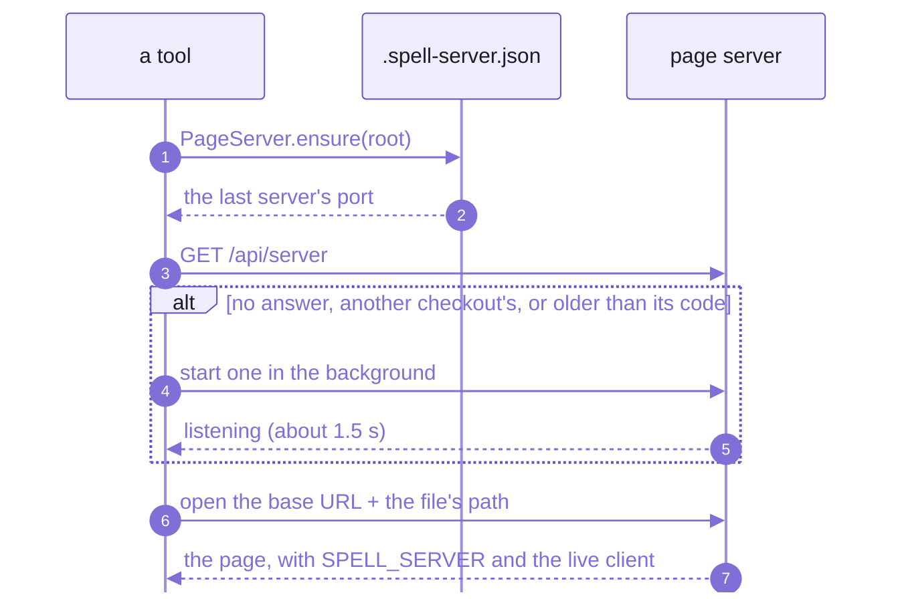
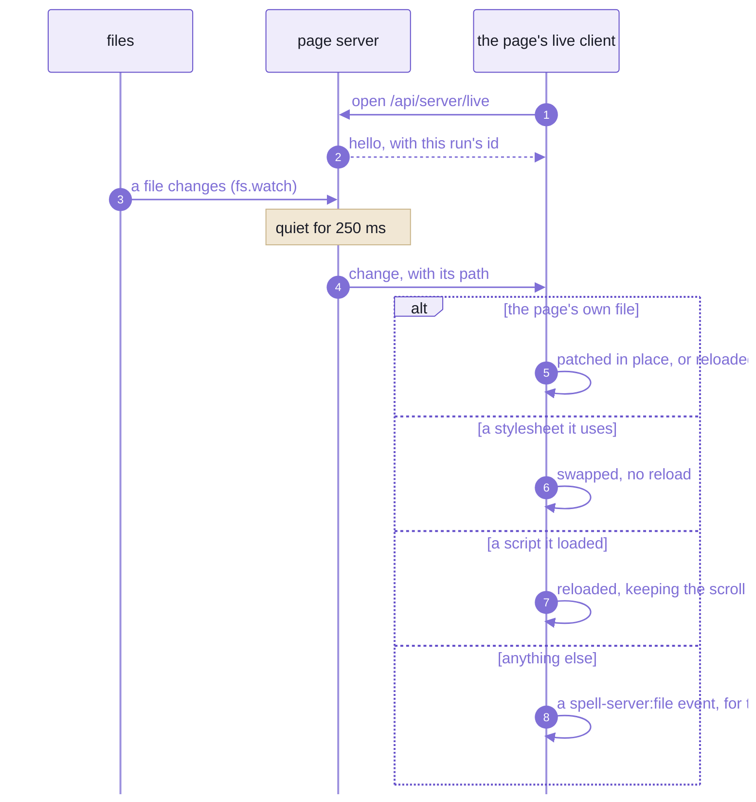
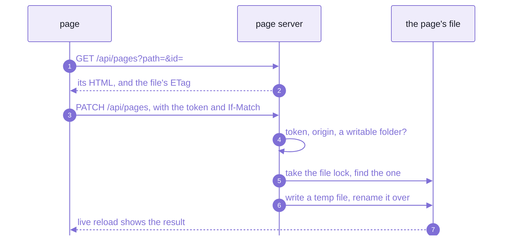

# `spell-kit/server`:  the page server

```sh
cd ~/www/spell/spell-app
spell server start
# {
#   "pid": 65490,
#   "port": 4747,
#   "root": "~/www/spell/spell-app",
#   "started": "2026-10-21T23:49:38.771Z",
#   "branch": "main",
#   "worktrees": "~/www/spell.worktrees",
#   "contentFolder": "~/www/spell/spell.epics",
#   "base": "http://127.0.0.1:4747",
#   "launched": false
# }
```

_Real output, trimmed:  `~` is the home folder, and the list of every worktree folder is left out._

That's the server every Spell page is read on:
the guides and epic pages, the component sets' docs, the editor's API and every epic's worktree, on one port.
It was already running, so the call took 0.3 s;
`"launched": true` would mean the call started it, which takes about a second and a half.

If you've used `npx serve` or `python -m http.server`, it starts out the same:
files go out exactly as they are on disk, with no build step.
Then it adds what those don't:
live reload, as Vite's dev server has it;  a router with Express's names, for the API;
and a way for a page to save itself back to disk.

Here's everything the kit's server does to a page.
A plain file, and what a browser got for it:

```html
<!-- guides/hello.html, on disk -->
<!doctype html>
<html><head><title>Hello</title></head><body><h1 id="hello">Hello</h1></body></html>
```

```html
<!-- the same file, as the page server sent it -->
<!doctype html>
<html><head><title>Hello</title><link rel="icon" href="/favicon-32.png" sizes="32x32" type="image/png">
<link rel="icon" href="/favicon.svg" type="image/svg+xml">
<link rel="apple-touch-icon" href="/apple-touch-icon.png">
<script>window.SPELL_SERVER = {"port":47998,"token":"…","events":"/api/server/live","run":"852fc1fa",
  "file":"/guides/hello.html","source":"…","root":"…","edit":"/api/pages","etag":"\"65-1a1614c20ec\""}</script>
<script src="/api/server/live.js" defer></script>
</head><body><h1 id="hello">Hello</h1></body></html>
```

_From a server on a scratch folder:  the token and two paths elided, and one long line wrapped._

Five lines, before the head ends:
Spell's favicon (unless the page links its own), the page's facts as `window.SPELL_SERVER`, and the live reload client.
The facts are what make the rest work:
- `token` is this run's write token, which only the pages it served know
- `etag` is the file's version, so a save can say which one it edited
- `run` names this run of the server, so a page from an older one knows to reload

The rest of the page is the file, byte for byte.
On spell-app's server, its settings and route module add two things more:
a script before the body ends, which colours Spell code blocks (on every page but the component sets'),
and the page's highlight.js tag pointed at a local copy, so it loads offline.

- Its import name is `spell-kit/server`, an entry of the kit's one package, its namespace `SRV`:
  node only, but for the site header's browser code, `spell-kit/server/site` ([below](#the-library-underneath)).
- Code:  [src/server/](src/server/), its tests in [tests/server/](tests/server/).
- Rules for working on it:  [server's AGENTS.md](src/server/AGENTS.md).

## If you know Vite and Express, three things are different

Vite rebuilds as you type;  Express waits for the handlers you write.
This server does less than the first, and more than the second.

### Files go out as they are

Vite's dev server transforms what it serves:  TypeScript compiled, imports rewritten, a module graph behind it all.
This one transforms nothing but the head of an HTML page.
A `.js` file is served as the file on disk, and so is a `.css`.

- So what you debug in the browser is the file you wrote:  no source maps, no generated code in between.
- Scripts arrive already built.
  The bundles a page loads, such as Spell UI's docs site, are built by their own package's script, when they're
  stale ([below](#bundles-built-on-demand-never-committed)).
- The cost:  no TypeScript, since a `.ts` file goes out as `text/plain`, to read and not to run;
  and no module swapped in place.
  A changed script reloads its page, keeping the scroll;  the editor, which does need all that, runs on Vite.

### A page can write itself back

With Express, a save is a `PUT` route you write, with whatever checks you remember.
Vite's dev server never writes your files at all.
Here every page the server sends can save a section of itself:
the site header's pencil opens an element's HTML, and the server splices the edit into the file.

- Only the element's own bytes change, so `git diff` shows only the edit.
- Nothing is committed:  the change sits in the working tree for whoever reviews it.
- The pencil is the site header's, but the call behind it is on every page the server sends.
  On a plain page with no header, `SPELL_SERVER.editPage({ id: "hello", html })` saved its `<h1>`,
  and a third of a second later the page had reloaded itself to show the edit.
- But only inside the folders the settings call writable (the content folder's epics, guides and pages),
  only with this run's token, and only from the server's own origin.

### One server, every checkout

Vite runs a dev server per project, each on a port of its own.
Here the MAIN checkout's server serves every epic's worktree too, at `/worktrees/<epic>/...`:
one port, one tab, one live reload, however many epics are open.

- What a server serves beyond plain files comes from its checkout's settings
  ([below](#settings-and-route-modules--the-kit-names-no-repo)), and only spell-app has any:
  so every day-to-day server is spell-app's.
- Mind where you start it:  `spell server start` serves the checkout the current folder is in.
  Run from the kit's root, it serves the kit's own files and nothing else:  no docs home, no epics, no component sets.
  So does `yarn server <verb>` there, which is `spell server` on the kit's own checkout.

## One port, every address

What one running server answers, from spell-app's settings:

| Address | What answers |
| --- | --- |
| `/` | a redirect to the docs home, `/pages/index.html` |
| `/<path>` | the checkout's file;  else the content folder's (guides, epic pages, sagas), once a route module serves it |
| `/components/<set>/` | a component set's docs, with the set's site bundle laid over them at `_assets/`:  Spell UI's at `/components/ui/`, Epic UI's at `/components/epics/`, App UI's at `/components/app/` |
| `/worktrees/<w>/...` | worktree `<w>`'s files, the same addresses inside, on the main checkout's server, once a route module says where the worktrees are |
| `/_beside/<folder>/` | a folder outside the checkout that the settings name (`../spell-ui/docs`), mounted on its own:  never the parent folder whole |
| `/_epic/assets/`, `/_epic/pack/`, `/templates/` | engine routes:  a prefix served from another repo's folder (spell-epic's), the same under every worktree's address |
| `/api/server` | the server's facts:  what `spell server start` printed, above |
| `/api/...` | every other call:  the server's own (`/api/files`, `/api/pages`, live reload) and the route modules' (`/api/epics/...`, `/api/docs/...`, `/api/projects/...`, `/api/spaces/...`) |

- The port:  `SPELL_SERVER_PORT`, else 4747 if it's free, else any free port.
- The running server's facts go in `.spell-server.json`, at the checkout's root, where the openers find them;
  its output, in `.spell-server.log`.
- Old addresses get no redirect:  they answer "not found".
- The docs home comes from the content folder, which someone new hasn't got:
  start at `/components/ui/`, Spell UI's pages, which need nothing but the repos.

## Five flows, a picture each

### 1. A request:  routes first, files after

Every request walks the same stops, in order, and the first that answers wins.
So a route module can stand in front of any file, and a 404 means nothing along the way claimed the path.


_Routes run before files;  the server imports no route module, it loads each by its path from the settings._

- Among the static files, the longest prefix wins (`/worktrees/` over `/`),
  and folders at one prefix are laid over each other:  the checkout first, so a path it has is its own.
- Spell's favicon comes after the files, so a folder's own icons win.
- A websocket upgrade takes a shorter road:  host check, live reload's socket, then any a route module claims.
- A page's five lines go on only for a browser that's showing it.
  A script's `fetch()` (`Sec-Fetch-Dest: empty`) gets the file as it is,
  so an element that shows a file and saves it back never sees, or writes, the added tags.

### 2. Opening a page:  ask for a server, get one

A tool that shows a page never assumes a server is up:  it asks for one with `PageServer.ensure(root)`.
`epic open`, `epic pages open`, `spell server url <file>` and `spell server start` all do.



_A server older than its own code is restarted, so after a merge the next opener gets the new routes._

Cold, spell-app's server answers in about a second and a half, because it loads twelve route modules before it
listens;  a checkout with no settings answers in about a quarter of a second.
`ensure()` gives up after 15 s, and points at the log.

"Older than its code" means older than the server's folder or its route modules' folders.
Nothing restarts a server on its own:  the next opener does, and the open pages reload when they hear the new run.

Stopping waits for the old PROCESS to end (`SIGTERM`, then `SIGKILL` after 10 s), not for it to stop answering.
A server stops answering before it lets go of its port,
and a new one started in that gap lands on another port, leaving every open page talking to nobody.

- The edges:
  - A background server runs from the checkout's own install:
    `spell server start --root` a folder outside it fails after those 15 s (its log says `Cannot find package 'tsx'`).
    `spell server local --root` serves any folder.
  - A worktree deleted by hand leaves its server running, its pid file gone with the folder;
    `epic`'s own removal stops a worktree's servers first.
    `spell server prune` finds such servers by process (`ps`, then `lsof`) and stops the ones whose checkout is gone.

### 3. Live reload:  one socket a page

Vite swaps a changed module into the running page.
This server tells the page which FILE changed, and the page decides:
patch itself, swap a stylesheet, or reload.

Here's a page's socket, while a file it shows is written twice, 100 ms apart:

```text
{"event":"hello","data":{"run":"852fc1fa"}}                as the socket opens
{"event":"change","data":{"path":"/guides/hello.html"}}    262 ms after the second write
```

_Two writes, one message:  each path waits for 250 ms of quiet, since a save is often a write and then a formatter._



_What a change means is the page's call:  a guide patches itself, a stylesheet swaps without a reload._

- One websocket a page, never an `EventSource`:
  each held-open request takes one of Chrome's six connections per host, for good, and every VS Code window shares
  those six.
- A server restart:  the new run's `hello` carries a new run id, and a page from the old run reloads,
  for the new client and token.
- Never while you type:  an "Updated:  reload" pill waits until the field you're in loses focus.
- It never reports dot files, `node_modules`, lock files or an editor's temp files.
- Only watched folders report:
  the settings' `watch` list (none named:  the docs folders, `epics`, `guides`, `pages` ...),
  each component set's folder and bundle, the engine routes' folders and the content folder.
  A file anywhere else can change all day, and no page hears of it.

### 4. Editing a section in place

The site header's pencil turns edit mode on:  hover outlines any element with an `id`, and "edit" opens its HTML.
Here is what the section editor sends, run by hand against the same scratch folder,
whose settings make `guides` writable:

```text
GET   /api/pages?path=/guides/hello.html&id=hello
200   {"path":"/guides/hello.html","etag":"\"4c-1a1614c434d\"","html":"<h1 id=\"hello\">Hello, again!</h1>"}

PATCH /api/pages?path=/guides/hello.html      x-server-token, If-Match: "4c-1a1614c434d"
      {"id":"hello","html":"<h1 id=\"hello\">Hello, edited</h1>"}
200   {"path":"/guides/hello.html","etag":"\"4c-1a1614c4837\""}

PATCH the same again, with the same If-Match
409   {"error":"the file changed since it was loaded:  reload it","etag":"\"4c-1a1614c4837\""}
```



_Only the element's own bytes change, so a diff shows only the edit;  a stale ETag is refused (409)._

- Two people editing one section:  the second save gets the 409, and the editor says to reload.
  Nobody's edit is overwritten without a word.
- No `If-Match` at all is a 428;  two elements with the same `id` is a 409:  an edit names exactly one.
- A section with no `id` of its own (the saga pages) is found through its heading's.
- Outside the writable folders, a 403 says where you can write:
  `can't change /notes/hello.html:  only files in guides/ can be changed here`.

### 5. Every epic on the main checkout's port

An epic is worked in its own worktree, but its pages are read on the main checkout's server.

```mermaid
%%{init: {"theme":"base","themeVariables":{"fontFamily":"-apple-system, BlinkMacSystemFont, Segoe UI, Helvetica, Arial, sans-serif","fontSize":"15px","primaryColor":"#EFECFB","primaryBorderColor":"#6550CA","primaryTextColor":"#1A1C27","secondaryColor":"#F4F1E9","tertiaryColor":"#F7F6FC","lineColor":"#7F6FD6","textColor":"#7F6FD6","clusterBkg":"#F7F6FC","clusterBorder":"#B9B0E8","titleColor":"#1A1C27","edgeLabelBackground":"#F7F6FC","actorBkg":"#EFECFB","actorBorder":"#6550CA","actorTextColor":"#1A1C27","actorLineColor":"#9C90DE","signalColor":"#7F6FD6","signalTextColor":"#7F6FD6","labelBoxBkgColor":"#EFECFB","labelBoxBorderColor":"#6550CA","labelTextColor":"#1A1C27","loopTextColor":"#7F6FD6","noteBkgColor":"#F1E7D4","noteBorderColor":"#C9B48A","noteTextColor":"#1A1C27","activationBkgColor":"#DCD6F7","activationBorderColor":"#6550CA","sequenceNumberColor":"#FFFFFF"},"flowchart":{"curve":"basis","padding":12,"nodeSpacing":40,"rankSpacing":44}}}%%
flowchart LR
  config[".epic/config.json5<br/>the worktrees, the content folder"]
  module["spell-epic's running-epics<br/>route module"]
  config --> module
  module -- "serveWorktrees()" --> server["the main checkout's<br/>page server"]
  module -- "serveContent()" --> server
  server --> urls["/worktrees/&lt;w&gt;/...<br/>and /epics/..."]
  %% the Spell look:  yarn mermaid:pretty
  classDef default fill:#EFECFB,stroke:#6550CA,stroke-width:1.5px,color:#1A1C27,rx:8px,ry:8px
  classDef data fill:#F1E7D4,stroke:#C9B48A,stroke-width:1.5px,color:#1A1C27,rx:2px,ry:2px
  class config data
```

This page, in an epic's worktree, is at `http://127.0.0.1:4747/worktrees/<epic>/README-server.md`.



_The server knows nothing of epics:  a route module tells it where the worktrees and the content folder are._

- A page served from a worktree is told its own branch and worktree name, for the site header's badge.
- The content folder is served after each worktree's own files, at its address:
  `/worktrees/<w>/epics/...` works, from one shared copy.
- **Not yet:**  `spell server url` gets a child repo's file in an epic's worktree wrong.
  For `~/www/spell.worktrees/<epic>/spell-app/README.md` it prints `/worktrees/spell-app/README.md`,
  which answers with another file;  the right address is `/worktrees/<epic>/spell-app/README.md`.
  Asked from spell-app's checkout about a file of the kit's own worktree,
  it prints an address with `..` in it, which the server refuses.

## Writing a page:  one set of steps for every tool

A static site generator owns its pages:  one build writes them all.
Here pages are written by many tools, often a part at a time:  the epic tool, the docs tools, the command line.
So the steps are a library every one of them calls, and links, formatting and checks come out alike,
whoever wrote the page.
They're in the server's package, under the same `SRV`, node only.

```mermaid
%%{init: {"theme":"base","themeVariables":{"fontFamily":"-apple-system, BlinkMacSystemFont, Segoe UI, Helvetica, Arial, sans-serif","fontSize":"15px","primaryColor":"#EFECFB","primaryBorderColor":"#6550CA","primaryTextColor":"#1A1C27","secondaryColor":"#F4F1E9","tertiaryColor":"#F7F6FC","lineColor":"#7F6FD6","textColor":"#7F6FD6","clusterBkg":"#F7F6FC","clusterBorder":"#B9B0E8","titleColor":"#1A1C27","edgeLabelBackground":"#F7F6FC","actorBkg":"#EFECFB","actorBorder":"#6550CA","actorTextColor":"#1A1C27","actorLineColor":"#9C90DE","signalColor":"#7F6FD6","signalTextColor":"#7F6FD6","labelBoxBkgColor":"#EFECFB","labelBoxBorderColor":"#6550CA","labelTextColor":"#1A1C27","loopTextColor":"#7F6FD6","noteBkgColor":"#F1E7D4","noteBorderColor":"#C9B48A","noteTextColor":"#1A1C27","activationBkgColor":"#DCD6F7","activationBorderColor":"#6550CA","sequenceNumberColor":"#FFFFFF"},"flowchart":{"curve":"basis","padding":12,"nodeSpacing":40,"rankSpacing":44}}}%%
flowchart LR
  content["content<br/>(an epic page's part)"] --> link["1 · links:<br/>code spans become links,<br/>a tab each"]
  link --> format["2 · formatting:<br/>oxfmt, in memory"]
  format --> file["3 · the file,<br/>written"]
  file --> check["4 · the check:<br/>every link resolves,<br/>and has its target"]
  check --> reload["5 · live reload<br/>shows it"]
  %% the Spell look:  yarn mermaid:pretty
  classDef default fill:#EFECFB,stroke:#6550CA,stroke-width:1.5px,color:#1A1C27,rx:8px,ry:8px
  classDef step fill:#EFECFB,stroke:#6550CA,stroke-width:1.5px,color:#1A1C27,rx:16px,ry:16px
  class link,format,file,check,reload step
```



_Links before formatting:  linking adds attributes, and the formatter then wraps the lines they made long._

```ts
import { SRV } from "spell-kit/server"

const linker = new SRV.Linker(root)
const { text } = linker.link(html, dirname(file))
writeFileSync(file, await SRV.formatHTML(file, text))
```

One of each:  if you find yourself writing a second copy of any of these, stop and reuse.
- how a page's links get their targets, and what makes a link bad:  `Linker`
- formatting a page in memory, as `vp fmt` would:  `formatHTML()`
- what a bundle built on demand reads, and whether it's stale:  `Bundle`, `BUNDLES`

### Links

`Linker` turns a code span naming a real file into a link,
and gives every link a named target, one per destination, so a second click reuses the tab the first one opened.
A paragraph in, and out, through `link()` then `formatHTML()`:

```html
<p>The clone command:  <code>tools/repos.ts</code>, and <code title="repos.json5">the list of repos</code>.
Not a file:  <code>no/such.ts</code></p>
```

```html
<p>
  The clone command: <a href="tools/repos.ts" target="src-tools-repos-ts"><code>tools/repos.ts</code></a
  >, and <a href="repos.json5" target="src-repos-json5"><code title="repos.json5">the list of repos</code></a
  >. Not a file: <code>no/such.ts</code>
</p>
```

_Real output, with the kit's root as the checkout:  `link()` said `{"linked":2,"unresolved":["no/such.ts"]}`._

- `<code title="path">name</code>` links too:  that's how prose names a file without showing its path.
- `check()` verifies every local link is inside the repo, has a target, and shares it with no other destination.
  On a page with a missing file and a target used twice, it said:

  ```text
  {"destinations":2,"problems":["missing:  tools/gone.ts","no target:  tools/gone.ts",
    "target one shared by ~/www/spell/repos.json5, ~/www/spell/package.json"]}
  ```

- A missing file git ignores is fine:  `.spell-server.json` exists only while a server runs.
- It works on text, with regular expressions, never a parsed DOM:  an edit touches only what it links.
- It knows the checkout's layout as folder names, never as imports:
  every repo's folders, `tests/`, and the shared content folder laid under the checkout.

### Formatting

`formatHTML(file, html)` formats a page in memory exactly as `vp fmt` would format its file (oxfmt),
so a page is written once, already tidy.
`yarn vp fmt` on one small file takes half a second, almost all of it starting a process.
In memory, a 75 KB guide takes about 110 ms the first time (most of it loading oxfmt), and about 30 ms after that.

- `file`'s extension picks the parser (`.html`, an epic page's `.htm` part ...);  the file is never read.
- It throws on a parse error, naming the file.
- The edge, visible in the output above:  oxfmt rewraps prose, so two spaces after a full stop become one.

### Bundles built on demand, never committed

Some bundles only the page server serves, like Spell UI's docs site.
Each is git-ignored, and built when it's stale:

```sh
spell bundle check ui-site
# ui-site:  current
```

| Bundle | Built by | Into |
| --- | --- | --- |
| `ui-site` | `yarn site:bundle` in spell-ui | `spell-ui/site/_assets/` |

Why not commit them:  that folder holds 136 files, 74 of them with a content hash in the name (`UIButton-Cm4_3xKY.js`).
Every Spell UI change deleted and re-added most of them, in every diff and every merge.

```ts
for (const bundle of SRV.Bundle.all(root)) if (bundle.isStale) bundle.build()
```

- Stale:  never built, its entry missing or newer than its build, or its sources' hash changed.
- `build()` runs the package's script, then records the hash in its output folder (`.bundle.json`).
- Which bundles exist:  the settings' `bundles` list;  how each is built:  `BUNDLES`.
  Each is found by its package, through `node_modules`, wherever its repo is.
- The page server builds the stale ones as it starts
  (spell-app's [BundleBuild.ts](https://github.com/spell-app/spell-app/blob/main/src/page-server/BundleBuild.ts)):
  meanwhile, a request for a bundle's file that isn't there yet waits for the build.
- By hand:  `spell bundle [<name>...] [--stale]`, `spell bundle check [<name>...]`;  `--json` for either.
- A new bundle:  a `BUNDLES` entry;  its output folder in the settings' `bundles` list, and in its repo's `.gitignore`.

### Data files

The epic tooling keeps its state in small JSON5 files beside the pages they belong to:
review inboxes, details pages' answers, choice rows, running agents, the commands page's data.
`DataFile` (an entry of its own, node only) is how every tool names, reads and writes them.

```ts
DataFile.besidePage("epics/seo/details/names.html", "answer") // => "epics/seo/details/names.answer.json5"
DataFile.read<Answer>(file)
DataFile.write(file, answer)
```

- Read by the `.json5` name, else an old `.json`.
- Written keeping hand-written comments
  ([README-util.md](README-util.md#node-only--json5-with-its-comments-kept), "JSON5 with its comments kept"),
  laid out as `JSON.stringify(value, null, 2)` would, all at once.
- No lock of its own:  callers hold the `FileLock`.

### The content folder

`contentFolderOf(root)` finds the shared content folder:  the guides, epic pages, sagas and the logs.
It reads the `contentFolder` in the main checkout's epic settings, `.epic/config.json5`,
unless `SPELL_SHARED_DIR` says otherwise, and it never throws:  a checkout with none simply has none.
It's an entry of its own too (`spell-kit/server/contentFolder`), so a command that needs only this loads no linkedom.

<details>
<summary>Adding a step, and what's coming</summary>

Adding a new step:
1. A class per capability, in its own file, its types beside the folder's other types (`server.types.ts`).
2. Export it from the barrel.
3. Its test at the same path under the kit's `tests/` (node).
4. A row in "The files", below, and a line in the folder's `AGENTS.md`.

🌱 Coming:
- The rest of the page server's page-building code moves in beside these steps, so other tools can build on it.
- One list of the content areas:  spell-epic's docs tools ([pages.js](https://github.com/spell-app/spell-epic/blob/main/src/tools/pages.js)) keep their own,
  for `findPages()`, beside the one `Linker` indexes.

</details>

## Settings and route modules:  the kit names no repo

An Express server is an app you write.
This one is an app you configure:  settings name the folders, and route modules bring the code.

The kit has no settings of its own.
A checkout's root `package.json` may have a `"pageServer"` block, and spell-app's has the real one.
A short excerpt (spell-app's whole block, explained:  [its page server page](https://github.com/spell-app/spell-app/blob/main/README-page-server.md)):

```json
"pageServer": {
  "routes": ["src/page-server/pageServerRoutes.ts", "../spell-epic/src/list/runningRoutes.ts", "..."],
  "writable": ["epics", "guides", "pages", "..."],
  "bundles": ["../spell-ui/site/_assets", "..."],
  "componentSets": { "ui": { "name": "Spell UI", "dir": "../spell-ui/docs", "assets": "../spell-ui/site/_assets" } },
  "engineRoutes": { "/_epic/pack/": "../spell-epic/src/components/__pack" }
}
```

A route module is a file whose default export is a name and a `setup()` that runs once, before the server listens:

```ts
import type { RouteModule } from "spell-kit/server/page"

const helloRoutes: RouteModule = {
  name: "hello",
  setup({ router }) {
    router.get("/api/hello", (request, reply) => reply.json({ hello: request.query.name ?? "world" }))
  }
}
export default helloRoutes
```

- What `setup()` gets (its context):
  - `router`:  routes here run before static files
  - `guard`:  `guard.writeCheck` on every route that changes something
  - `live`:  `live.watch(dir)` reloads pages when files under `dir` change
  - `serveWorktrees(...dirs)`, `serveContent(dir)`:  mount the worktrees and the shared content folder
  - `addPageConfig(fn)`:  more fields on every page's `window.SPELL_SERVER`
  - `onListening(fn)`, `onStop(fn)`:  start or stop a child process with the server
  - `root`, `info`, `web`:  the checkout, the server's facts, the whole server
- This is how the server stays a leaf:  it imports no route module's package, it loads each by its path.
- spell-app's twelve:
  its own page layer, ten of spell-epic's (review, details, comments, the running epics ...), and the app's API.
- The example runs as written:  listed in a folder's `routes`, `GET /api/hello?name=Spell` answered `{"hello":"Spell"}`.
- A route module that fails to load is logged, and the server starts without it.
  A checkout without spell-epic beside it, as in CI, serves no epics.
- This catches a new repo once:  a route module is an ES module, so its folder's `package.json` must say
  `"type": "module"`, as every Spell repo's does.
  Without it, node reads the file as CommonJS, and the log says `Cannot use import statement outside a module`.

<details>
<summary>Every settings key</summary>

| Key | What |
| --- | --- |
| `routes` | route modules, paths from the repo's root |
| `watch` | the folders live reload watches, besides the sets', the engine routes' and the content folder;  none named:  `epics`, `guides`, `pages` ...;  one the checkout hasn't got is skipped |
| `writable` | the content folders pages may be saved into (`/api/files`, `/api/pages`);  none by default, so every write is a 403 |
| `bundles` | the bundles built on demand, by output folder (above, "Bundles built on demand") |
| `pageScripts` | module scripts added to every page:  `src`, `file` (added only while it exists), `skip` (URL prefixes) |
| `componentSets` | the component sets, by id:  `name`, `dir` (its pages), `assets` (the site bundle laid over it) |
| `siteTabs` | the site header's tabs, in order:  label, home, and what lights each |
| `engineRoutes` | URL prefixes served from a folder:  `{ "/_epic/pack/": "../spell-epic/src/components/__pack" }` |

- Read by `pageServerSettings()` ([settings.ts](src/server/page/settings.ts)):
  its types in [page.types.ts](src/server/page/page.types.ts).
- Read once, as the server starts.
- Settings that name no sets serve no sets;  a new set is one more entry.

</details>

## The library underneath

Underneath, the page server is a dozen small pieces on node's HTTP server, each usable alone.
They're why the repos' other local servers carry no mime table, path check, port choice or opener of their own:
Spell UI's tools, spaces' API server and spell-epic's own server are built from them too.

| Piece | What it does |
| --- | --- |
| `StaticHandler` | folders under URL prefixes (longest prefix wins), one laid over another;  dot files refused;  every answer `Cache-Control: no-store` with an ETag;  hooks to rewrite HTML or transform by extension |
| `Router`, `Request`, `Reply` | the part of Express the app's API uses, with Express's names;  one difference:  `:name*` holds the whole rest of the path |
| `LiveReload` | the watcher and the websocket;  its page-side client is served at `/api/server/live.js` |
| `Guard` | the host check, the per-run write token, same-origin writes |
| `FileLock` | `<file>.lock`, so tools writing one file take turns (waits up to 20 s;  takes a lock older than 60 s) |
| `FileOperations` | save, create, rename, duplicate, delete:  under the lock, written all at once (a temp file, then a rename) |
| `PidFile` | a background server's `.spell-server.json`:  status, ensure, stop (which waits for the process to end, so the port is free) |
| `ports` | `isFree()`, `freePort()`, `listenPreferred()` |
| openers | a browser, a new window, or a Chrome tab reused by its address |
| `resolveInside()` | the one path check:  a URL path to a file under a root, never outside it |
| `checkoutOf()`, `mainServerUrl()` | the git checkout a path is in and its main checkout, read from disk with no `git` run;  a worktree's file on the main server |
| `proxyTo()` | HTTP and websockets passed on to another local server |
| `WebServer` | all of the above on node's HTTP server |

- Express, on purpose:  handlers move over unchanged.
  `params`, `query`, `body` (default `{}`), `originalUrl`, `baseUrl` and `status().send()` are Express's;
  `send(string)` is `text/html`, and `sendFile` skips dot files.
  Express 4 put only the first segment in `:name*`, which broke nested paths.
- What it imports:  node's own modules, `json5`, linkedom (`Linker`) and oxfmt (`formatHTML()`, loaded on its first
  call);  of the kit, util's JSON5 editor and the toolchain's format settings.
  So anything node-side may import it.
  The page server's own entry, `spell-kit/server/page`, adds parse5, which finds an element's bytes for the page editor.
- The site header, every page's fixed top bar, is browser code beside them (`spell-kit/server/site`):
  - `<spell-site-header>`:  the hat logo, the worktree and branch badge, "open in VS Code", the edit pencil,
    the light / dark switch;  its tabs are data, from the settings' `siteTabs`
  - `<spell-section-editor>`:  the edit mode above
  - `defineSite()` defines both, for every set's site bundle
- Test helpers:
  - `spell-kit/server/test/serve`:  `serveHandler()` and `ask()`, real HTTP through node's client;
    never `fetch`, which resolves `..` before sending
  - `spell-kit/server/test/checkouts`:  fake checkouts and worktrees, `fakeMainCheckout()` and `fakeWorktree()`

## Safety:  it writes files, so it checks who asks

A web page in some other tab can send requests to `127.0.0.1` too.
So before it serves or writes anything, the server asks a few questions:

```sh
curl -H "Host: attacker.example" http://127.0.0.1:4747/guides/server.html
# {"error":"unknown host"}                                403
curl http://127.0.0.1:4747/.spell-server.json
# {"error":"hidden file:  /.spell-server.json"}           403
curl --path-as-is http://127.0.0.1:4747/../etc/passwd
# {"error":"outside the root:  /../etc/passwd"}           403
curl http://127.0.0.1:4747/guides%2Fserver.html
# {"error":"bad path:  /guides%2Fserver.html"}            400
curl -X PUT "http://127.0.0.1:4747/api/files?path=guides/x.html" -d hi
# {"error":"bad token:  reload the page"}                 403
curl "http://127.0.0.1:4747/guides/server.html%00"
# {"error":"bad path:  /guides/server.html%00"}           400
curl -X PATCH "http://127.0.0.1:4747/api/pages?path=/guides/no-such-page.html" -H "x-server-token: $TOKEN" \
  -H "Origin: http://elsewhere.example" -H 'If-Match: "x"' -H "Content-Type: application/json" -d '{"id":"x"}'
# {"error":"wrong origin"}                                403
```

_Real answers from spell-app's running server;  the status codes added at the right.
`$TOKEN` was read out of a page the server sent, which any program on the machine can do._

- Loopback only (`127.0.0.1`) by default.
- A `Host` check on every request, against DNS rebinding.
- A write token per run, which only the pages it served know (`window.SPELL_SERVER.token`), sent as `x-server-token`.
- Writes only from the same origin.
- Writes only inside the settings' writable folders;  anything else is a 403.
- One path check for every file:  `..`, NUL bytes and encoded slashes are refused;  dot files are never served.
- The edge:  these keep out other web pages, not other programs on your machine.
  Any local program can fetch a page and read its token, as the section-edit run above did.

## Not this server:  Spell programs in Python

`spell run <project> --target py` starts a different, much smaller server:
`spell_quart`, a Quart app (Flask's asyncio twin), in spell-app's spaces.
It runs ONE program, a game per visitor;  this one serves a whole checkout, and never runs your program at all.
How it keeps each visitor's game, and what a restart costs it:
[spell-app's README-spaces.md](https://github.com/spell-app/spell-app/blob/main/README-spaces.md#the-python-server), beside
[its folder](https://github.com/spell-app/spell-app/tree/main/src/spaces/server/py), a uv project.
What compiling to Python writes beside the program:  [spell-lang's README-targets.md](https://github.com/spell-app/spell-lang/blob/main/README-targets.md).

## Commands:  `spell server` and `spell bundle`

Every verb and flag, `start all` and `stop all` included, is on [README-cli.md](README-cli.md#the-kit), "The kit".
This page has used them where they matter:
`start`, `url`, `local` and `prune` in the flows above (2 and 5), `bundle` and `bundle check` under
"Bundles built on demand".
What's left is a handful of facts the reference doesn't explain:
- `--root <dir>` names another checkout than the one the current folder is in.
- `epic server <verb>` is the same command line, from spell-epic's `epic`.
- `--spaces <dir>` sets `SPELL_SPACES_DIR`, which spaces' route modules read, and a background server inherits.
- `spell app serve [project]` brings up the editor and this server together ([README-cli.md](README-cli.md#spell-app)).
- `yarn favicon [--hat 0.74]`, at the kit's root, regenerates Spell's favicon from the hat mark
  (headless Chromium draws the PNGs).
- The tests alone:  `yarn vp test run --project server`, at the kit's root.

<details>
<summary>Every <code>/api</code> route the server itself answers</summary>

| Route | What |
| --- | --- |
| `GET /api/server` | the server's facts (`ServerInfo`):  pid, port, root, when it started, branch, worktrees, content folder |
| `GET /api/server/live.js` | the live reload client |
| `/api/server/live` | the live reload websocket |
| `GET /api/pages?path=[&id=]` | a page's source, or one element's, with the file's ETag |
| `PUT /api/pages?path=` | the whole file, `If-Match` required |
| `PATCH /api/pages?path=` | one element by `id`, its bytes spliced;  409 on a stale ETag |
| `PUT /api/files?path=` | save a file |
| `POST /api/files/create`, `/rename`, `/duplicate` | make, rename or copy a file |
| `DELETE /api/files?path=` | delete a file |

- Every write needs the run's token, the same origin, and a writable folder.
- `/api/pages` reads any text file the server serves, but writes only pages and text files (`.md`, `.ts`, `.css`,
  `.spell` ...), never `.json`:  `package.json` holds the server's own settings.
- Route modules add their own under `/api/<their prefix>/`:
  `/api/epics/...`, `/api/docs/...`, `/api/projects/...`, `/api/spaces/...`.

</details>

<details>
<summary>The live client's decisions, in full</summary>

- A change reaches the page 250 ms after the file is last touched (per path);  a heartbeat every 30 s.
- The page's own file:  patched in place where the page knows how (the docs pages), else reloaded.
- A stylesheet the page uses:  swapped in place, no reload;  in VS Code's side bar views too.
- A script it loaded:  reloaded, keeping the scroll.
  Its `<script src>` tags, and lazily loaded chunks, packs and bundles found in the browser's resource list.
- Anything else:  a `spell-server:file` event, and the page decides.
- Reloads go through one gate:  one reload, 500 ms after the last change;
  while a field has focus, an "Updated:  reload" pill waits instead.
- Each socket opens with `hello` and the server's run id:
  a page from an earlier run reloads, for the new client and token.

</details>

<details>
<summary>The files, and their tests</summary>

| File | What |
| --- | --- |
| [index.ts](src/server/index.ts) | the barrel, `SRV` (node only) |
| [WebServer.ts](src/server/WebServer.ts) | the server, and the request order |
| [StaticHandler.ts](src/server/StaticHandler.ts), [mime.ts](src/server/mime.ts), [safePath.ts](src/server/safePath.ts) | static files, content types, the path check |
| [Router.ts](src/server/Router.ts), [Request.ts](src/server/Request.ts), [Reply.ts](src/server/Reply.ts), [bodies.ts](src/server/bodies.ts), [listener.ts](src/server/listener.ts) | the Express-shaped part |
| [LiveReload.ts](src/server/LiveReload.ts), [liveClient.ts](src/server/liveClient.ts), [webSocket.ts](src/server/webSocket.ts) | live reload |
| [Guard.ts](src/server/Guard.ts), [FileLock.ts](src/server/FileLock.ts), [FileOperations.ts](src/server/FileOperations.ts), [PidFile.ts](src/server/PidFile.ts) | safety, locks, writes, the pid file |
| [ports.ts](src/server/ports.ts), [open.ts](src/server/open.ts), [proxy.ts](src/server/proxy.ts), [checkout.ts](src/server/checkout.ts), [mainServer.ts](src/server/mainServer.ts), [untilInterrupted.ts](src/server/untilInterrupted.ts) | ports, openers, proxies, checkouts |
| [page/](src/server/page/) | the page server:  `PageServer`, `PageEditor`, its settings, its command line, `prune` |
| [site/](src/server/site/) | browser code:  `<spell-site-header>`, `<spell-section-editor>`, the favicon, the logo |
| [test/](src/server/test/) | the test helpers |
| [scripts/favicon.ts](scripts/favicon.ts) | `yarn favicon` |
| [Linker.ts](src/server/Linker.ts), [format.ts](src/server/format.ts), [Bundle.ts](src/server/Bundle.ts), [DataFile.ts](src/server/DataFile.ts), [contentFolder.ts](src/server/contentFolder.ts) | writing a page:  `Linker` (`link()`, `check()`, `resolve()`, `targetFor()`);  `formatHTML()`;  `Bundle` (`all()`, `check()`, `isStale`, `build()`, `sourcesHash()`, `sourceFiles()`);  `DataFile`;  `contentFolderOf()`;  their types in [server.types.ts](src/server/server.types.ts) (`LinkResult`, `LinkCheck`, `BundleSpec`, `BundleCheck`, `BundleBuilt`, `BundleRecord`, `BUNDLES`) |

- Entries of their own, which plain `node` loads:
  `spell-kit/server/checkout`, `/page/settings`, `/page/prune`, `/DataFile`, `/contentFolder`.

Tests (node), at the same paths under [tests/server/](tests/server/):
[Router.test.ts](tests/server/Router.test.ts) tests [Router.ts](src/server/Router.ts).
- `Router`, `StaticHandler`, `WebServer`, `LiveReload`, `PidFile`, `FileOperations`
- `checkout`, `mainServer`, `ports`, `proxy`, `safePath`, `webSocket`, `liveClient`
- `page/PageServer`, `page/prune`, `site/SiteHeader`, `site/site.types`
- and the page-writing steps':  `Bundle`, `DataFile`, `Linker`, `format`

</details>

<details>
<summary>More in the docs site</summary>

The docs site needs a checkout with the content folder beside it, and this page server running.

- The Page Server:  `/guides/server.html` (its endpoint names predate the `/api/` prefix:  this page's are current)
- Shared Content, where the docs and epic pages live:  `/guides/shared-content.html`
- The Python target:  `/guides/python-target.html`

</details>

## See also

- [spell-app's README-page-server.md](https://github.com/spell-app/spell-app/blob/main/README-page-server.md):  the settings every day-to-day server runs on,
  and spell-app's own route module
- [README-element.md](README-element.md):  the element framework, whose packs and component pages this server serves
- [spell-epic's README](https://github.com/spell-app/spell-epic/blob/main/README.md):  the epic pages, and the route modules that serve them
- [README-cli.md](README-cli.md#the-kit):  `spell server`, `spell bundle` and the kit's other commands
- [README.md](README.md#setup-from-zero):  setup from zero, if nothing above has run for you yet
