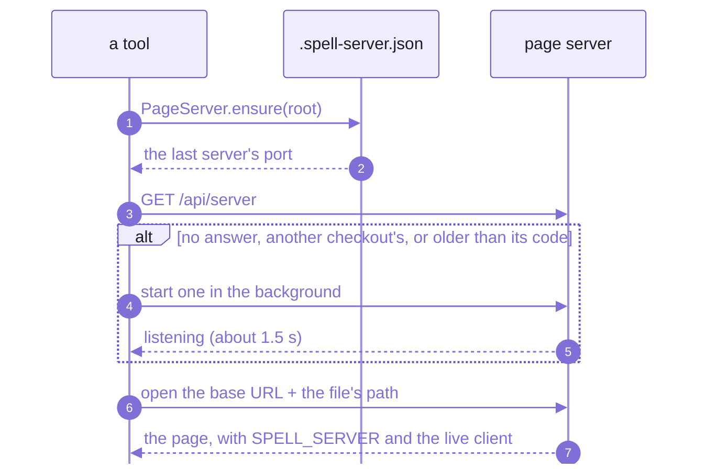
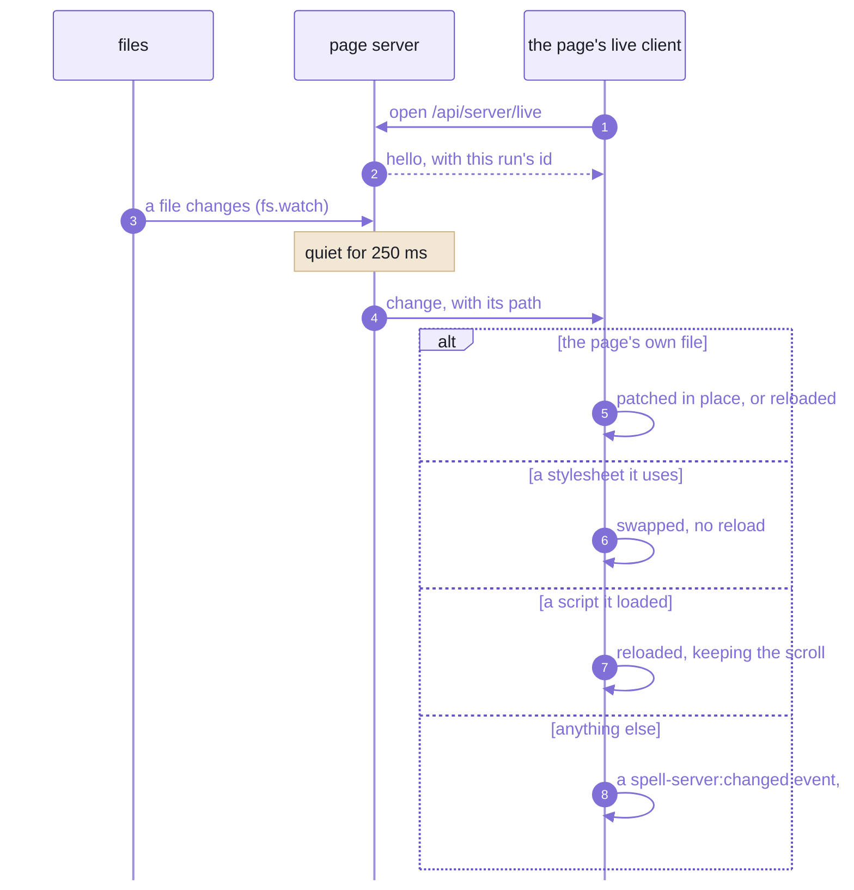
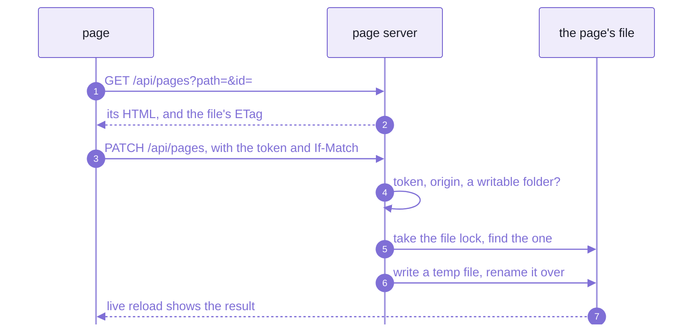

# `spell/server`:  the page server

```sh
cd ~/www/spell/spell-app
spell server status
```

<details>
<summary>What it printed</summary>

```text
{
  "pid": 80305,
  "port": 4747,
  "root": "~/www/spell",
  "started": "2026-10-22T05:57:41.696Z",
  "branch": "main",
  "worktrees": "~/www/spell.worktrees",
  "contentFolder": "~/www/spell/spell.epics",
  "base": "http://127.0.0.1:4747"
}
```

</details>

_Real output, trimmed:  `~` is the home folder, and the list of every worktree folder is left out._

That's the server every Spell page is read on:
the guides and epic pages, the component sets' docs, the editor's API and every epic's worktree, on one port.
Asked from spell-app's folder, it answered with the kit's root:  there is ONE page server per kit, whichever folder
of it you're in.
`spell server start` prints the same, plus `"launched"`:  `false` when it was already running (about 0.3 s),
`true` when the call started it, which takes about a second and a half.

If you've used `npx serve` or `python -m http.server`, it starts out the same:
files go out exactly as they are on disk, with no build step.
Then it adds what those don't:
live reload, as Vite's dev server has it;  a router with Express's names, for the API;
and a way for a page to save itself back to disk.

Here's everything the kit's server does to a page.
A plain file, and what a browser got for it:

```html
<!-- guides/hello.html, on disk -->
<!doctype html>
<html><head><title>Hello</title></head><body><h1 id="hello">Hello</h1></body></html>
```

```html
<!-- the same file, as the page server sent it -->
<!doctype html>
<html><head><title>Hello</title><link rel="icon" href="/favicon-32.png" sizes="32x32" type="image/png">
<link rel="icon" href="/favicon.svg" type="image/svg+xml">
<link rel="apple-touch-icon" href="/apple-touch-icon.png">
<script>window.SPELL_SERVER = {"port":47998,"token":"…","events":"/api/server/live","run":"852fc1fa",
  "file":"/guides/hello.html","source":"…","root":"…","edit":"/api/pages","etag":"\"65-1a1614c20ec\""}</script>
<script src="/api/server/live.js" defer></script>
</head><body><h1 id="hello">Hello</h1></body></html>
```

_From a server on a scratch folder:  the token and two paths elided, and one long line wrapped._

Five lines, before the head ends:
Spell's favicon (unless the page links its own), the page's facts as `window.SPELL_SERVER`, and the live reload client.
The facts are what make the rest work:
- `token` is this run's write token, which only the pages it served know
- `etag` is the file's version, so a save can say which one it edited
- `run` names this run of the server, so a page from an older one knows to reload

The rest of the page is the file, byte for byte.
With every repo installed, two of their settings add two things more:
spell-app's script before the body ends, which colours Spell code blocks (on every page but the component sets'),
and spell-epic's local copy of highlight.js, which the page's cdnjs tag is pointed at, so it loads offline.

- Its import name is `spell/server`, an entry of the kit's one package, its namespace `SRV`:
  node only, but for the site header's browser code, `spell/server/site` ([below](#the-library-underneath)).
- Code:  [src/server/](src/server/), its tests in [tests/server/](tests/server/).
- Rules for working on it:  [server's AGENTS.md](src/server/AGENTS.md).

## If you know Vite and Express, three things are different

Vite rebuilds as you type;  Express waits for the handlers you write.
This server does less than the first, and more than the second.

### Files go out as they are

Vite's dev server transforms what it serves:  TypeScript compiled, imports rewritten, a module graph behind it all.
This one transforms nothing but the head of an HTML page.
A `.js` file is served as the file on disk, and so is a `.css`.

- So what you debug in the browser is the file you wrote:  no source maps, no generated code in between.
- Scripts arrive already built.
  The bundles a page loads, such as Spell UI's docs site, are built by their own package's script, when they're
  stale ([below](#bundles-built-on-demand-never-committed)).
- The cost:  no TypeScript, since a `.ts` file goes out as `text/plain`, to read and not to run;
  and no module swapped in place.
  A changed script reloads its page, keeping the scroll;  the editor, which does need all that, runs on Vite.

### A page can write itself back

With Express, a save is a `PUT` route you write, with whatever checks you remember.
Vite's dev server never writes your files at all.
Here every page the server sends can save a section of itself:
the site header's pencil opens an element's HTML, and the server splices the edit into the file.

- Only the element's own bytes change, so `git diff` shows only the edit.
- Nothing is committed:  the change sits in the working tree for whoever reviews it.
- The pencil is the site header's, but the call behind it is on every page the server sends.
  On a plain page with no header, `SPELL_SERVER.editPage({ id: "hello", html })` saved its `<h1>`,
  and a third of a second later the page had reloaded itself to show the edit.
- But only inside the folders the settings call writable (the content folder's epics, guides and pages),
  only with this run's token, and only from the server's own origin.

### One server, every checkout

Vite runs a dev server per project, each on a port of its own.
Here the MAIN checkout's server serves every epic's worktree too, at `/worktrees/<epic>/...`:
one port, one tab, one live reload, however many epics are open.

- It serves the kit, and every repo cloned inside it, from the kit's root:
  `spell server start` from any folder of the kit finds that root, and so does `yarn server <verb>`.
- What it serves beyond plain files comes from the repos' settings, each repo declaring its own part
  ([below](#settings-and-route-modules--each-repo-brings-its-own)).
- It starts from the kit's root ONLY.
  Point it anywhere else, and it stops before it starts:

  ```text
  $ spell server start --root spell-app
  page server:  ~/www/spell.worktrees/readme/spell-app isn't a kit's root;  the page server starts from the kit's
    root only:  start it from the kit, ~/www/spell.worktrees/readme (`spell server start`, from any folder of the
    kit, finds it)
  ```

  _Real output, in an epic's worktree of the kit, one line wrapped;  it exits 2._

## One port, every address

A request meets the route modules first, in the order the settings list them;
whatever they don't answer is a file, from the kit, the content folder or a folder the settings name.
Try it on a running server:

```sh
curl -s http://127.0.0.1:4747/hello
curl -s http://127.0.0.1:4747/ui/
curl -s -o /dev/null -w "%{http_code}\n" http://127.0.0.1:4747/_epic/assets/highlight.min.js
```

<details>
<summary>What it printed</summary>

```text
{"message":"Hello from the API!"}
/ui/ moved out of the shared content
200
```

</details>

Three answers, from three repos' parts of the settings:  spell-app's route module, the content repo's `gone`, and a
folder of spell-epic's.
Read the right-hand column first:  when an address misbehaves, it says where to look.

| Address | What it serves | Who answers |
| --- | --- | --- |
| `/` | a redirect to the docs home, `/pages/index.html` | the kit |
| `/epics/`, `/guides/`, `/sagas/`, `/pages/`, `/goals/` ... | the content folder, `spell.epics/` (named in the kit's [epic settings](.epic/config.json5)), after the kit's own files;  the Epics list gets each running epic's card as it's served | spell-epic's `runningRoutes` |
| `/worktrees/<w>/...` | an epic's worktree, with the same addresses inside;  on the main checkout's server only | `runningRoutes` |
| `/components/<set>/` | a component set's docs, with Spell UI's site bundle laid over them at `_assets/`:  `/components/ui/`, `/components/epics/`, `/components/app/` | the settings' `componentSets`, one set from each of spell-ui, spell-epic and spell-app |
| `/_epic/assets/`, `/_epic/pack/`, `/templates/` | spell-epic's page scripts and styles, its elements' pack, its templates;  the same copy under every worktree's address | spell-epic's `engineRoutes` |
| `/saga/<saga>[/<epic>]` | a redirect to that saga's or epic's page, keeping the `#id` | spell-epic's `linkRoutes` |
| `/spaces/<project>/<file>` | a project's file, by its address | spell-app's `appRoutes` |
| `/element/...` | the editor's element bundles, from spell-app's `app/dist-element/` | `appRoutes` |
| `/editor` | a redirect to the running editor;  while it isn't up, a 503 page that says so | `appRoutes` |
| `/hello` | `{"message":"Hello from the API!"}`:  is the API up? | `appRoutes` |
| `/ui/...` | a 404, never a redirect:  the content folder still holds Spell UI's old docs there, for older checkouts | the content repo's `gone` |
| `/api/server` | the server's facts:  what `spell server status` printed, above | the kit |
| `/api/...` | every other call (below) | the kit, and the route modules |
| anything else | the kit's own files, and every repo's inside it:  `/spell-app/app/docs/index.html` | the kit |

<details>
<summary>Every call under <code>/api/</code>, and which module answers it</summary>

The prefix says whose a call is.
`/api/epics/` and `/api/docs/` are spell-epic's;  the kit keeps three;
the rest of `/api/` is the editor's:  spell-app's module is listed last, and sees every call nobody before it answered.

| Address | What it does | Who answers |
| --- | --- | --- |
| `/api/server` | the server's facts:  pid, port, branch, worktrees, content folder | the kit |
| `/api/files`, `/api/pages` | saving, making, moving and deleting files;  a page's source, and saving one section of it:  only in the writable folders | the kit |
| `/api/epics/running` | every running epic, as JSON | `runningRoutes` |
| `/api/epics/review/...` | an epic page's review inbox:  its marks, notes, test results and screenshots, and its Send | `reviewRoutes` |
| `/api/epics/new`, `favorite`, `pages`, `tests`, `saga` | the Epics page's New epic and its stars;  an epic's See also;  the epics waiting to test;  a saga's epics | `epicRoutes` |
| `/api/epics/agents` | an epic's running agents, and a note that redirects one | `agentRoutes` |
| `/api/epics/target` | what an `<epic-link>` points at:  its title and short form | `linkRoutes` |
| `/api/docs/details/...` | a details page's answers and drafts | `detailsRoutes` |
| `/api/docs/choices/...` | a choices page's answers and drafts | `choicesRoutes` |
| `/api/docs/comments`, `/api/docs/comments/send` | comments on any docs page or epic page, and their Send | `commentsRoutes` |
| `/api/docs/show` | shows a page in VS Code's side bar, or in Chrome | `showRoutes` |
| `/api/projects/...`, `/api/compile/...`, `/api/people/...` | the editor's API, bodies in JSON5 ([spell-app's README-spaces.md](https://github.com/spell-app/spell-app/blob/main/README-spaces.md)) | spell-app's `appRoutes` |

- `airplaneRoutes` answers no address:  it tells every page, as it's served, when airplane mode is on
  (`window.SPELL_SERVER.airplane`).
- Every write from a page needs the server's per-run token and the server's own origin.
  The editor's API is the exception, with no token:  its one check is the origin.
- What epic pages, details pages and comments are:  [spell-epic's pages](https://github.com/spell-app/spell-epic/blob/main/README-pages.md).

</details>

- The port:  `SPELL_SERVER_PORT`, else 4747 if it's free, else any free port.
- The running server's facts go in `.spell-server.json`, at the kit's root, where the openers find them;
  its output, in `.spell-server.log`.
- The editor spell-app's module starts records its address in `.spell-server.editor.json`, at the kit's root too;
  its output goes to `.spell-server.editor.log`.
- Old addresses get no redirect:  they answer "not found".
- The docs home comes from the content folder, which someone new hasn't got:
  start at `/components/ui/`, Spell UI's pages, which need nothing but the repos.

What serves depends on what's cloned, because each repo brings its own part:
- **Without spell-app,** the epic pages, the guides and the Spell UI and Epic UI sets all serve.
  The App/UI tab is left out of the header;  there's no editor, no `/api/projects/`, and no Spell colouring.
  The edge:  the App tab stays, and its `/editor/` answers 404.
- **Without spell-epic,** as in a child repo's CI, there are no epic pages and no guides:
  the content folder is served by one of spell-epic's modules, so it goes too.

## Five flows, a picture each

### 1. A request:  routes first, files after

Every request walks the same stops, in order, and the first that answers wins.
So a route module can stand in front of any file, and a 404 means nothing along the way claimed the path.

```mermaid
%%{init: {"theme":"base","themeVariables":{"fontFamily":"-apple-system, BlinkMacSystemFont, Segoe UI, Helvetica, Arial, sans-serif","fontSize":"15px","primaryColor":"#EFECFB","primaryBorderColor":"#6550CA","primaryTextColor":"#1A1C27","secondaryColor":"#F4F1E9","tertiaryColor":"#F7F6FC","lineColor":"#7F6FD6","textColor":"#7F6FD6","clusterBkg":"#F7F6FC","clusterBorder":"#B9B0E8","titleColor":"#1A1C27","edgeLabelBackground":"#F7F6FC","actorBkg":"#EFECFB","actorBorder":"#6550CA","actorTextColor":"#1A1C27","actorLineColor":"#9C90DE","signalColor":"#7F6FD6","signalTextColor":"#7F6FD6","labelBoxBkgColor":"#EFECFB","labelBoxBorderColor":"#6550CA","labelTextColor":"#1A1C27","loopTextColor":"#7F6FD6","noteBkgColor":"#F1E7D4","noteBorderColor":"#C9B48A","noteTextColor":"#1A1C27","activationBkgColor":"#DCD6F7","activationBorderColor":"#6550CA","sequenceNumberColor":"#FFFFFF"},"flowchart":{"curve":"basis","padding":12,"nodeSpacing":40,"rankSpacing":44}}}%%
flowchart LR
  request([a request]) --> host["1 · host check"]
  host --> live["2 · the live<br/>client's script"]
  live --> routes["3 · routes:<br/>the server's /api,<br/>then the route modules'"]
  routes --> files["4 · static files:<br/>the kit, content folder,<br/>worktrees, component sets"]
  files --> favicon["5 · Spell's favicon"]
  favicon --> fallback["6 · the fallback"]
  fallback --> notfound["7 · 404"]
  %% the Spell look:  yarn mermaid:pretty
  classDef default fill:#EFECFB,stroke:#6550CA,stroke-width:1.5px,color:#1A1C27,rx:8px,ry:8px
  classDef step fill:#EFECFB,stroke:#6550CA,stroke-width:1.5px,color:#1A1C27,rx:16px,ry:16px
  class host,live,routes,files,favicon,fallback,notfound step
```



_Routes run before files;  the server imports no route module, it loads each by its path from the settings._

- Among the static files, the longest prefix wins (`/worktrees/` over `/`),
  and folders at one prefix are laid over each other:  the kit first, so a path it has is its own.
- Spell's favicon comes after the files, so a folder's own icons win.
- A websocket upgrade takes a shorter road:  host check, live reload's socket, then any a route module claims.
- A page's five lines go on only for a browser that's showing it.
  A script's `fetch()` (`Sec-Fetch-Dest: empty`) gets the file as it is,
  so an element that shows a file and saves it back never sees, or writes, the added tags.

### 2. Opening a page:  ask for a server, get one

A tool that shows a page never assumes a server is up:  it asks for one with `PageServer.ensure(root)`.
`epic open`, `epic pages open`, `spell server url <file>` and `spell server start` all do.



_A server older than its own code is restarted, so after a merge the next opener gets the new routes._

Cold, with every repo installed, the server answers in about a second and a half,
because it loads eleven route modules before it listens;  with none to load, in about a quarter of a second.
`ensure()` gives up after 15 s, and points at the log.

"Older than its code" means older than the server's folder or its route modules' folders.
Nothing restarts a server on its own:  the next opener does, and the open pages reload when they hear the new run.

Stopping waits for the old PROCESS to end (`SIGTERM`, then `SIGKILL` after 10 s), not for it to stop answering.
A server stops answering before it lets go of its port,
and a new one started in that gap lands on another port, leaving every open page talking to nobody.

- The edges:
  - It serves a kit's root and nothing else:  `--root` names another kit, and any other folder is refused at once
    ([above](#one-server-every-checkout)).
  - A worktree deleted by hand leaves its server running, its pid file gone with the folder;
    `epic`'s own removal stops a worktree's servers first.
    `spell server prune` finds such servers by process (`ps`, then `lsof`) and stops the ones whose checkout is gone.

### 3. Live reload:  one socket a page

Vite swaps a changed module into the running page.
This server tells the page which FILE changed, and the page decides:
patch itself, swap a stylesheet, or reload.

Here's a page's socket, while a file it shows is written twice, 100 ms apart:

```text
{"event":"hello","data":{"run":"852fc1fa"}}                as the socket opens
{"event":"change","data":{"path":"/guides/hello.html"}}    262 ms after the second write
```

_Two writes, one message:  each path waits for 250 ms of quiet, since a save is often a write and then a formatter._



_What a change means is the page's call:  a guide patches itself, a stylesheet swaps without a reload._

- One websocket a page, never an `EventSource`:
  each held-open request takes one of Chrome's six connections per host, for good, and every VS Code window shares
  those six.
- A server restart:  the new run's `hello` carries a new run id, and a page from the old run reloads,
  for the new client and token.
- Never while you type:  an "Updated:  reload" pill waits until the field you're in loses focus.
- It never reports dot files, `node_modules`, lock files or an editor's temp files.
- Only watched folders report:
  the settings' `watch` list (none named:  the docs folders, `epics`, `guides`, `pages` ...),
  each component set's folder and bundle, the engine routes' folders and the content folder.
  A file anywhere else can change all day, and no page hears of it.

### 4. Editing a section in place

The site header's pencil turns edit mode on:  hover outlines any element with an `id`, and "edit" opens its HTML.
Here is what the section editor sends, run by hand against the same scratch folder,
whose settings make `guides` writable:

```text
GET   /api/pages?path=/guides/hello.html&id=hello
200   {"path":"/guides/hello.html","etag":"\"4c-1a1614c434d\"","html":"<h1 id=\"hello\">Hello, again!</h1>"}

PATCH /api/pages?path=/guides/hello.html      x-server-token, If-Match: "4c-1a1614c434d"
      {"id":"hello","html":"<h1 id=\"hello\">Hello, edited</h1>"}
200   {"path":"/guides/hello.html","etag":"\"4c-1a1614c4837\""}

PATCH the same again, with the same If-Match
409   {"error":"the file changed since it was loaded:  reload it","etag":"\"4c-1a1614c4837\""}
```



_Only the element's own bytes change, so a diff shows only the edit;  a stale ETag is refused (409)._

- Two people editing one section:  the second save gets the 409, and the editor says to reload.
  Nobody's edit is overwritten without a word.
- No `If-Match` at all is a 428;  two elements with the same `id` is a 409:  an edit names exactly one.
- A section with no `id` of its own (the saga pages) is found through its heading's.
- Outside the writable folders, a 403 says where you can write:
  `can't change /notes/hello.html:  only files in guides/ can be changed here`.

### 5. Every epic on the main checkout's port

An epic is worked in its own worktree, but its pages are read on the main checkout's server.

```mermaid
%%{init: {"theme":"base","themeVariables":{"fontFamily":"-apple-system, BlinkMacSystemFont, Segoe UI, Helvetica, Arial, sans-serif","fontSize":"15px","primaryColor":"#EFECFB","primaryBorderColor":"#6550CA","primaryTextColor":"#1A1C27","secondaryColor":"#F4F1E9","tertiaryColor":"#F7F6FC","lineColor":"#7F6FD6","textColor":"#7F6FD6","clusterBkg":"#F7F6FC","clusterBorder":"#B9B0E8","titleColor":"#1A1C27","edgeLabelBackground":"#F7F6FC","actorBkg":"#EFECFB","actorBorder":"#6550CA","actorTextColor":"#1A1C27","actorLineColor":"#9C90DE","signalColor":"#7F6FD6","signalTextColor":"#7F6FD6","labelBoxBkgColor":"#EFECFB","labelBoxBorderColor":"#6550CA","labelTextColor":"#1A1C27","loopTextColor":"#7F6FD6","noteBkgColor":"#F1E7D4","noteBorderColor":"#C9B48A","noteTextColor":"#1A1C27","activationBkgColor":"#DCD6F7","activationBorderColor":"#6550CA","sequenceNumberColor":"#FFFFFF"},"flowchart":{"curve":"basis","padding":12,"nodeSpacing":40,"rankSpacing":44}}}%%
flowchart LR
  config[".epic/config.json5<br/>the worktrees, the content folder"]
  module["spell-epic's running-epics<br/>route module"]
  config --> module
  module -- "serveWorktrees()" --> server["the main checkout's<br/>page server"]
  module -- "serveContent()" --> server
  server --> urls["/worktrees/&lt;w&gt;/...<br/>and /epics/..."]
  %% the Spell look:  yarn mermaid:pretty
  classDef default fill:#EFECFB,stroke:#6550CA,stroke-width:1.5px,color:#1A1C27,rx:8px,ry:8px
  classDef data fill:#F1E7D4,stroke:#C9B48A,stroke-width:1.5px,color:#1A1C27,rx:2px,ry:2px
  class config data
```

This page, in an epic's worktree, is at `http://127.0.0.1:4747/worktrees/<epic>/README-server.md`.



_The server knows nothing of epics:  a route module tells it where the worktrees and the content folder are._

- A page served from a worktree is told its own branch and worktree name, for the site header's badge.
- The content folder is served after each worktree's own files, at its address:
  `/worktrees/<w>/epics/...` works, from one shared copy.
- A child repo's file in an epic's worktree is the kit worktree's, since that's whose server it is:
  `spell server url spell-app/README.md`, in an epic's worktree named `readme`, printed
  `http://127.0.0.1:4747/worktrees/readme/spell-app/README.md`.

## Writing a page:  one set of steps for every tool

A static site generator owns its pages:  one build writes them all.
Here pages are written by many tools, often a part at a time:  the epic tool, the docs tools, the command line.
So the steps are a library every one of them calls, and links, formatting and checks come out alike,
whoever wrote the page.
They're in the server's package, under the same `SRV`, node only.

```mermaid
%%{init: {"theme":"base","themeVariables":{"fontFamily":"-apple-system, BlinkMacSystemFont, Segoe UI, Helvetica, Arial, sans-serif","fontSize":"15px","primaryColor":"#EFECFB","primaryBorderColor":"#6550CA","primaryTextColor":"#1A1C27","secondaryColor":"#F4F1E9","tertiaryColor":"#F7F6FC","lineColor":"#7F6FD6","textColor":"#7F6FD6","clusterBkg":"#F7F6FC","clusterBorder":"#B9B0E8","titleColor":"#1A1C27","edgeLabelBackground":"#F7F6FC","actorBkg":"#EFECFB","actorBorder":"#6550CA","actorTextColor":"#1A1C27","actorLineColor":"#9C90DE","signalColor":"#7F6FD6","signalTextColor":"#7F6FD6","labelBoxBkgColor":"#EFECFB","labelBoxBorderColor":"#6550CA","labelTextColor":"#1A1C27","loopTextColor":"#7F6FD6","noteBkgColor":"#F1E7D4","noteBorderColor":"#C9B48A","noteTextColor":"#1A1C27","activationBkgColor":"#DCD6F7","activationBorderColor":"#6550CA","sequenceNumberColor":"#FFFFFF"},"flowchart":{"curve":"basis","padding":12,"nodeSpacing":40,"rankSpacing":44}}}%%
flowchart LR
  content["content<br/>(an epic page's part)"] --> link["1 · links:<br/>code spans become links,<br/>a tab each"]
  link --> format["2 · formatting:<br/>oxfmt, in memory"]
  format --> file["3 · the file,<br/>written"]
  file --> check["4 · the check:<br/>every link resolves,<br/>and has its target"]
  check --> reload["5 · live reload<br/>shows it"]
  %% the Spell look:  yarn mermaid:pretty
  classDef default fill:#EFECFB,stroke:#6550CA,stroke-width:1.5px,color:#1A1C27,rx:8px,ry:8px
  classDef step fill:#EFECFB,stroke:#6550CA,stroke-width:1.5px,color:#1A1C27,rx:16px,ry:16px
  class link,format,file,check,reload step
```



_Links before formatting:  linking adds attributes, and the formatter then wraps the lines they made long._

```ts
import { SRV } from "spell/server"

const linker = new SRV.Linker(root)
const { text } = linker.link(html, dirname(file))
writeFileSync(file, await SRV.formatHTML(file, text))
```

One of each:  if you find yourself writing a second copy of any of these, stop and reuse.
- how a page's links get their targets, and what makes a link bad:  `Linker`
- formatting a page in memory, as `vp fmt` would:  `formatHTML()`
- what a bundle built on demand reads, and whether it's stale:  `Bundle`, `BUNDLES`

### Links

`Linker` turns a code span naming a real file into a link,
and gives every link a named target, one per destination, so a second click reuses the tab the first one opened.
A paragraph in, and out, through `link()` then `formatHTML()`:

```html
<p>The clone command:  <code>tools/repos.ts</code>, and <code title="repos.json5">the list of repos</code>.
Not a file:  <code>no/such.ts</code></p>
```

```html
<p>
  The clone command: <a href="tools/repos.ts" target="src-tools-repos-ts"><code>tools/repos.ts</code></a
  >, and <a href="repos.json5" target="src-repos-json5"><code title="repos.json5">the list of repos</code></a
  >. Not a file: <code>no/such.ts</code>
</p>
```

_Real output, with the kit's root as the checkout:  `link()` said `{"linked":2,"unresolved":["no/such.ts"]}`._

- `<code title="path">name</code>` links too:  that's how prose names a file without showing its path.
- `check()` verifies every local link is inside the repo, has a target, and shares it with no other destination.
  On a page with a missing file and a target used twice, it said:

  ```text
  {"destinations":2,"problems":["missing:  tools/gone.ts","no target:  tools/gone.ts",
    "target one shared by ~/www/spell/repos.json5, ~/www/spell/package.json"]}
  ```

- A missing file git ignores is fine:  `.spell-server.json` exists only while a server runs.
- It works on text, with regular expressions, never a parsed DOM:  an edit touches only what it links.
- It knows the checkout's layout as folder names, never as imports:
  every repo's folders, `tests/`, and the shared content folder laid under the checkout.

### Formatting

`formatHTML(file, html)` formats a page in memory exactly as `vp fmt` would format its file (oxfmt),
so a page is written once, already tidy.
`yarn vp fmt` on one small file takes half a second, almost all of it starting a process.
In memory, a 75 KB guide takes about 110 ms the first time (most of it loading oxfmt), and about 30 ms after that.

- `file`'s extension picks the parser (`.html`, an epic page's `.htm` part ...);  the file is never read.
- It throws on a parse error, naming the file.
- The edge, visible in the output above:  oxfmt rewraps prose, so two spaces after a full stop become one.

### Bundles built on demand, never committed

Some bundles only the page server serves, like Spell UI's docs site.
Each is git-ignored, and built when it's stale:

```sh
spell bundle check ui-site
```

<details>
<summary>Output</summary>

```text
ui-site:  current
```

</details>

| Bundle | Built by | Into |
| --- | --- | --- |
| `ui-site` | `yarn site:bundle` in spell-ui | `spell-ui/site/_assets/` |

Why not commit them:  that folder holds 138 files, 76 of them with a content hash in the name (`UIButton-Cm4_3xKY.js`).
Every Spell UI change deleted and re-added most of them, in every diff and every merge.

```ts
for (const bundle of SRV.Bundle.all(root)) if (bundle.isStale) bundle.build()
```

- Stale:  never built, its entry missing or newer than its build, or its sources' hash changed.
- `build()` runs the package's script, then records the hash in its output folder (`.bundle.json`).
- Which bundles exist:  the settings' `bundles` list (spell-ui's part names `ui-site`'s);  how each is built:
  `BUNDLES`.
  Each is found by its package, through `node_modules`, wherever its repo is.
- By hand:  `spell bundle [<name>...] [--stale]`, `spell bundle check [<name>...]`;  `--json` for either.
- A new bundle:  a `BUNDLES` entry;  its output folder in the settings' `bundles` list, and in its repo's `.gitignore`.

The page server builds the stale ones itself, as it starts
([BundleBuild.ts](src/server/page/BundleBuild.ts)):
- It runs `spell bundle --stale` as a child process, which rebuilds only a bundle whose sources changed.
  A start with nothing changed builds nothing.
- It runs the kit's OWN `spell`, as the kit's install finds it, never the one on your PATH:
  so a worktree's server builds with the worktree's code.
- Its output goes to the server's log, each line starting `bundles:  `.
- A request for a bundle's file that isn't there yet waits for the build, up to two minutes.
  Then it's answered as things stand:  a 404, if the file is still missing.
  A file that's there is served at once.
- When the build ends, live reload reloads the pages that load the bundle.
- Only this server's own bundles wait, for `GET` and `HEAD`;  a request under `/worktrees/<w>/` never does.
  A build that fails is logged, and leaves the bundle stale until the next start.

### Data files

The epic tooling keeps its state in small JSON5 files beside the pages they belong to:
review inboxes, details pages' answers, choice rows, running agents, the commands page's data.
`DataFile` (an entry of its own, node only) is how every tool names, reads and writes them.

```ts
DataFile.besidePage("epics/seo/details/names.html", "answer") // => "epics/seo/details/names.answer.json5"
DataFile.read<Answer>(file)
DataFile.write(file, answer)
```

- Read by the `.json5` name, else an old `.json`.
- Written keeping hand-written comments
  ([README-util.md](README-util.md#node-only--json5-with-its-comments-kept), "JSON5 with its comments kept"),
  laid out as `JSON.stringify(value, null, 2)` would, all at once.
- No lock of its own:  callers hold the `FileLock`.

### Command runs:  a command that asks on a page

A command can stop, show rows to answer on a page, wait for Send, and carry on with the answers.
`CommandRun` (in `SRV`) is the command's side;  spell-epic draws the page and serves it at `/runs/<id>/`.

```ts
const run = SRV.CommandRun.open({
  root, command: "spell translate todos --to es", title: "Names for todos, in Spanish",
  columns: [{ key: "english", label: "English" }], answerLabel: "Spanish",
  rows: [{ id: "todo", cells: { english: "Todo" }, value: "Tarea", alternatives: ["Pendiente"] }]
})
await run.show()                                         // the side bar, else a browser, else just the path
run.progress("names:  41 drafted in 6 s")
const answers = await run.wait({ timeoutMs: 30 * 60_000 })
if (answers.timedOut) console.log(`no answer yet:  ${run.path}`)
else for (const [id, { outcome, value, ticked }] of Object.entries(answers.rows)) use(id, outcome, value, ticked)
run.finish()
```

- A run is a folder of the content folder, `pages/runs/<id>/`, with three files:
  - `run.json5`:  what the command asks (its rows, its progress lines);  only the command writes it
  - `answers.json5`:  the answers, per row id, saved as they're given;  only the page writes it
  - `waiting.json5`:  a heartbeat while `wait()` runs, so the page says the command is waiting;  gone after
- `setRows()` replaces the rows, and a row already answered keeps its answer:  answers are kept by row id.
- `wait()` returns at the time limit, with `timedOut`, rather than throwing.
- Their shapes are one file, [runs.types.ts](src/server/runs/runs.types.ts):  the contract with the page side.

Or the command runs on while its answers come in, and is steered from the page:
each answer reaches it as it's given, the page shows its passes, and the effort picked there takes at the next one.

```ts
const run = SRV.CommandRun.open({ ...asked, effort: { choices: ["fast", "balanced", "best"], initial: "balanced" } })
const answering = (async () => {
  for await (const { rowId, answer } of run.answersAsTheyCome()) {   // until Send, or 4 hours
    use(rowId, answer.value)
    run.take(rowId)                                                  // the page shows the row taken
  }
})()
for (const name of ["names", "lines"]) {
  run.startPass(name, { total: rows.length })                        // stamped with run.effort, now
  rows.forEach((row, done) => {
    work(row, run.effort)
    run.updatePass({ done: done + 1 })                               // written at most 4 times a second
  })
  run.endPass()
}
await answering
run.finish()                                                         // or "stopped", "timed-out"
```

- `run.effort` is read fresh each time:  what was picked on the page, else the one it started with.
- A pass the command runs at an effort of its own (a flag of its own beat the page's pick) says so:
  `run.startPass("names", { total, effort: "best" })`, and the card shows that one.
- `updatePass()` is throttled, and `endPass()` always writes the last state.
- `answersAsTheyCome()` gives a row again when its answer changes, and keeps the heartbeat while it runs.

### The content folder

`contentFolderOf(root)` finds the shared content folder:  the guides, epic pages, sagas and the logs.
It reads the `contentFolder` in the main checkout's epic settings, `.epic/config.json5`,
unless `SPELL_SHARED_DIR` says otherwise, and it never throws:  a checkout with none simply has none.
It's an entry of its own too (`spell/server/contentFolder`), so a command that needs only this loads no linkedom.

<details>
<summary>Adding a step, and what's coming</summary>

Adding a new step:
1. A class per capability, in its own file, its types beside the folder's other types (`server.types.ts`).
2. Export it from the barrel.
3. Its test at the same path under the kit's `tests/` (node).
4. A row in "The files", below, and a line in the folder's `AGENTS.md`.

🌱 Coming:
- The rest of the page server's page-building code moves in beside these steps, so other tools can build on it.
- One list of the content areas:  spell-epic's docs tools ([pages.js](https://github.com/spell-app/spell-epic/blob/main/src/tools/pages.js)) keep their own,
  for `findPages()`, beside the one `Linker` indexes.

</details>

## Settings and route modules:  each repo brings its own

An Express server is an app you write.
This one is an app you configure:  settings name the folders, and route modules bring the code.

The kit's server names no repo.
Each repo declares its OWN part of the settings, in its `package.json`'s `"pageServer"`,
the way it declares its `spell` commands.
Spell UI's whole part:

```json
"pageServer": {
  "bundles": ["site/_assets"],
  "componentSets": { "ui": { "name": "Spell UI", "dir": "docs", "assets": "site/_assets" } }
}
```

_From [spell-ui's package.json](https://github.com/spell-app/spell-ui/blob/main/package.json):
its site bundle, built on demand, and its component set, at `/components/ui/`._

`pageServerSettings()` merges the parts as the server starts, in a fixed order:
1. the kit's own:  none today
2. the content repo's, a file of its own at the content folder's root, `page-server.json5`
3. each child repo's that's installed, lowest first, as the kit's [repos.json5](repos.json5) lists them

Each part's paths are read from its own repo's folder, so spell-ui writes `docs`, and the server serves
`spell-ui/docs`.
The lists are laid end to end, in that order;  in the maps (`componentSets`, `engineRoutes`, `localCopies`),
a later repo's entry wins.
A repo that isn't cloned brings nothing, and the server runs with whatever is there.

| Whose part | What it adds |
| --- | --- |
| the content repo's | the folders pages may save into (`writable`:  `epics`, `guides`, `pages`);  `gone`, the old `/ui` address;  `siteTabs`, the header's tabs |
| [spell-ui's](https://github.com/spell-app/spell-ui/blob/main/package.json) | its site bundle (`bundles`), and the Spell UI set at `/components/ui/` |
| [spell-epic's](https://github.com/spell-app/spell-epic/blob/main/package.json) | its ten route modules;  the folders live reload watches;  the Epic UI set at `/components/epics/`;  `/_epic/assets/`, `/_epic/pack/` and `/templates/`;  the local copy of highlight.js |
| [spell-app's](https://github.com/spell-app/spell-app/blob/main/package.json) | its route module, `appRoutes`;  the `spell-language.js` page script;  `/element/`, its element bundles (`engineRoutes`);  the App UI set at `/components/app/` ([what it serves](https://github.com/spell-app/spell-app/blob/main/README-page-server.md)) |

- The content repo isn't public, so its file is named here, not linked.
- `localCopies` is how pages load offline.
  Older pages load highlight.js from cdnjs with a plain, blocking `<script>`;
  on a plane, the wifi's "pay first" page held that tag, and every script behind it, for tens of seconds.
  spell-epic's entry points that one URL, exactly, at its copy, `/_epic/assets/highlight.min.js` (11.9.0, the same
  file):  a page loading highlight.js from anywhere else is left alone.
- `gone` answers an address "not found" though the content folder still holds it:
  `/ui/...` is Spell UI's old docs, kept for older checkouts, so nobody reads the stale copy.
  No old address redirects, by decision:  every link to one was rewritten when its pages moved.

A route module is a file whose default export is a name and a `setup()` that runs once, before the server listens:

```ts
import type { RouteModule } from "spell/server/page"

const helloRoutes: RouteModule = {
  name: "hello",
  setup({ router }) {
    router.get("/api/hello", (request, reply) => reply.json({ hello: request.query.name ?? "world" }))
  }
}
export default helloRoutes
```

- What `setup()` gets (its context):
  - `router`:  routes here run before static files
  - `guard`:  `guard.writeCheck` on every route that changes something
  - `live`:  `live.watch(dir)` reloads pages when files under `dir` change
  - `serveWorktrees(...dirs)`, `serveContent(dir)`:  mount the worktrees and the shared content folder
  - `addPageConfig(fn)`:  more fields on every page's `window.SPELL_SERVER`
  - `onListening(fn)`, `onStop(fn)`:  start or stop a child process with the server
  - `root`, `info`, `web`:  the checkout, the server's facts, the whole server
- This is how the server stays a leaf:  it imports no route module's package, it loads each by its path.
- Eleven, with every repo installed:
  ten of spell-epic's (review, details, comments, the running epics ...), then spell-app's, the app's API.
- The example runs as written:  listed in a folder's `routes`, `GET /api/hello?name=Spell` answered `{"hello":"Spell"}`.
- Nothing checks a path until the server starts, and then nothing stops for one:
  a route module that fails to load is logged in `.spell-server.log`, and the server starts without it.
- This catches a new repo once:  a route module is an ES module, so its folder's `package.json` must say
  `"type": "module"`, as every Spell repo's does.
  Without it, node reads the file as CommonJS, and the log says `Cannot use import statement outside a module`.

<details>
<summary>Every settings key</summary>

| Key | What | Paths from |
| --- | --- | --- |
| `routes` | route modules, loaded in order;  each one's `setup()` runs once, before the server listens | its repo |
| `watch` | the folders live reload watches, besides the sets', the engine routes' and the content folder;  none named:  `epics`, `guides`, `pages` ...;  one that isn't there is skipped | its repo |
| `writable` | the content folders pages may be saved into (`/api/files`, `/api/pages`);  none by default, so every write is a 403 | the content folder |
| `gone` | URL prefixes answered "not found", though the content folder still holds them | URLs |
| `bundles` | the bundles built on demand, by output folder (above, "Bundles built on demand");  `spell bundle` reads the same list | its repo |
| `pageScripts` | module scripts added before every page's `</body>`:  `src`, `file` (added only while it exists), `skip` (URL prefixes) | its repo, for `file` |
| `localCopies` | CDN URLs, each with the URL of the same file on this server, which every page loads instead | URLs |
| `componentSets` | the component sets, by id:  `name`, `dir` (its pages), `assets` (the site bundle laid over it) | its repo |
| `siteTabs` | the site header's tabs, in order:  label, home, and what lights each;  handed to every page as `SPELL_SERVER.siteTabs` | URLs |
| `engineRoutes` | URL prefixes served from a folder, the same copy under every worktree's address:  `{ "/_epic/pack/": "src/components/__pack" }` | its repo |

- Read by `pageServerSettings()` ([settings.ts](src/server/page/settings.ts)):
  its types in [page.types.ts](src/server/page/page.types.ts).
- Read once, as the server starts.
- Settings that name no sets serve no sets;  a new set is one more entry.
- `spell-language.js` is added only while its file exists:
  a checkout that hasn't run spell-app's `yarn build:element` serves its pages without it, and no 404.

</details>

<details>
<summary>The component sets</summary>

| Id | Name | Served at | Its pages | Whose part |
| --- | --- | --- | --- | --- |
| `ui` | Spell UI | `/components/ui/` | [spell-ui's docs/](https://github.com/spell-app/spell-ui/tree/main/docs) | spell-ui's |
| `epics` | Epic UI | `/components/epics/` | [spell-epic's src/docs/](https://github.com/spell-app/spell-epic/tree/main/src/docs) | spell-epic's |
| `app` | App UI | `/components/app/` | [spell-app's app/docs/](https://github.com/spell-app/spell-app/tree/main/app/docs) | spell-app's |

- Every set's site bundle is Spell UI's, `spell-ui/site/_assets`:
  its pages load `site.js` and `site.css` from their own `_assets/`.
  What's in it:  [Spell UI's site](https://github.com/spell-app/spell-ui/blob/main/README-site.md).
- `/components/ui` without its slash redirects to `/components/ui/`, so the pages' relative links hold.

</details>

<details>
<summary>The tabs</summary>

They're the content repo's, since they describe its areas and the sets beside them.

| Tab | Its home | Lit on |
| --- | --- | --- |
| Guides | `guides/index.html` | pages under `guides/` |
| Sagas | `sagas/index.html` | pages under `sagas/` or `goals/` |
| Epics | `epics/index.html` | pages under `epics/` |
| Epic/UI | `/components/epics/` | the `epics` set, and spell-epic's docs folder |
| Spell/UI | `/components/ui/` | the `ui` set, and spell-ui's docs and site folders |
| App | `/editor/` | `/editor`;  it opens in a browser tab of its own |
| App/UI | `/components/app/` | the `app` set, and spell-app's `app/docs/` |
| Templates | `templates/index.html` | pages under `templates/` |

- A tab whose home starts with `/` exists only when served:  it's greyed out on a `file://` page.
- A tab whose home is a component set none of whose sets is served is left out:  without spell-app, no App/UI.
- A component set or a path pattern lights a tab first;  a page's folder (`guides/` ...) only when none does.
- The header's code names no tab:  they're data.
  The kit's [siteTabs.test.ts](tests/server/site/siteTabs.test.ts) pins the order, and which tab lights for 59 page
  paths;  it skips itself where there's no content repo, as in the kit's CI.

</details>

<details>
<summary>Adding a route, or something that isn't one</summary>

A route is a file and one line, in the repo whose code it serves.

1. Write a route module:  a file whose default export is `{ name, setup() }`, a `RouteModule` from
   `spell/server/page` (above).
   - spell-app's [appRoutes.ts](https://github.com/spell-app/spell-app/blob/main/src/spaces/server/node/routes/appRoutes.ts)
     is a real one.
2. Add its path to `routes` in that repo's `package.json`, written from the repo's own folder.
   - Routes run in order, all before any file:  an early module can shadow a later one's address.
   - The repos' parts run lowest repo first:  spell-epic's ten come before spell-app's.
3. Restart the server.
   The next `spell server start`, or anything that opens a page, restarts a server older than its code:
   the newest `.ts`, `.js` or `.mjs` file in the kit's server or in any route module's folder.
   - A change to the settings alone isn't code:  `spell server stop`, then `spell server start`.
4. Test it with no port and no other modules:

   ```ts
   server = new PageServer({ root })
   await myRoutes.setup(server.routeContext())
   await server.start({ port: 0, routes: false, pidFile: false })
   const answer = await ask(server.info.port, "GET", "/api/hello")
   ```

   - `root` is a temporary folder with a `package.json` of its own;  `ask()` comes from `spell/server/test/serve`.

Most of what the server serves is a setting, not code:  one entry in a repo's part, then a restart (step 3).

| To add | Where | And |
| --- | --- | --- |
| a component set | one entry in `componentSets`:  its id, name, pages' folder and site bundle | usually a tab in `siteTabs` too |
| a tab | one entry in the content repo's `siteTabs`, in the order the header shows it | update [siteTabs.test.ts](tests/server/site/siteTabs.test.ts), which pins the order |
| a folder served under a fixed prefix | one entry in `engineRoutes`:  the prefix, then the folder | the same copy is served under every worktree's address |
| a script on every page | one entry in `pageScripts`:  its URL, its file, the prefixes to skip | it's added only while its file exists |
| a folder pages may save into | one entry in the content repo's `writable` | a folder of the content folder |
| a bundle built on demand | its output folder in `bundles` | and its build in [the bundle list](src/server/server.types.ts):  a folder no bundle builds into is an error |

</details>

## The library underneath

Underneath, the page server is a dozen small pieces on node's HTTP server, each usable alone.
They're why the repos' other local servers carry no mime table, path check, port choice or opener of their own:
Spell UI's tools, spaces' API server and spell-epic's own server are built from them too.

| Piece | What it does |
| --- | --- |
| `StaticHandler` | folders under URL prefixes (longest prefix wins), one laid over another;  dot files refused;  every answer `Cache-Control: no-store` with an ETag;  hooks to rewrite HTML or transform by extension |
| `Router`, `Request`, `Reply` | the part of Express the app's API uses, with Express's names;  one difference:  `:name*` holds the whole rest of the path |
| `LiveReload` | the watcher and the websocket;  its page-side client is served at `/api/server/live.js` |
| `Guard` | the host check, the per-run write token, same-origin writes |
| `FileLock` | `<file>.lock`, so tools writing one file take turns (waits up to 20 s;  takes a lock older than 60 s) |
| `FileOperations` | save, create, rename, duplicate, delete:  under the lock, written all at once (a temp file, then a rename) |
| `PidFile` | a background server's `.spell-server.json`:  status, ensure, stop (which waits for the process to end, so the port is free);  and `isProcessAlive(pid)`, which spell-epic's review inbox asks too |
| `ports` | `isFree()`, `freePort()`, `listenPreferred()` |
| openers | a browser, a new window, or a Chrome tab reused by its address |
| `resolveInside()` | the one path check:  a URL path to a file under a root, never outside it |
| `checkoutOf()`, `mainServerUrl()` | the git checkout a path is in and its main checkout, read from disk with no `git` run;  a worktree's file on the main server |
| `proxyTo()` | HTTP and websockets passed on to another local server |
| `WebServer` | all of the above on node's HTTP server |

- Express, on purpose:  handlers move over unchanged.
  `params`, `query`, `body` (default `{}`), `originalUrl`, `baseUrl` and `status().send()` are Express's;
  `send(string)` is `text/html`, and `sendFile` skips dot files.
  Express 4 put only the first segment in `:name*`, which broke nested paths.
- What it imports, so anything node-side may import it:
  - node's own modules, `json5`, linkedom (`Linker`) and oxfmt (`formatHTML()`, loaded on its first call)
  - of the kit:  util's JSON5 editor, util's preferences (`spell/util/persist`, for the site header)
    and the toolchain's format settings
  - The page server's own entry, `spell/server/page`, adds parse5, which finds an element's bytes for the page editor.
- The site header, every page's fixed top bar, is browser code beside them (`spell/server/site`):
  - `<spell-site-header>`:  the hat logo, the worktree and branch badge, "open in VS Code", the edit pencil,
    the light / dark switch, which remembers its choice under `spell-site:scheme`, the key Spell UI's docs read too;
    its tabs are data, from the settings' `siteTabs`
  - `<spell-section-editor>`:  the edit mode above
  - `defineSite()` defines both, for every set's site bundle
- Test helpers:
  - `spell/server/test/serve`:  `serveHandler()` and `ask()`, real HTTP through node's client;
    never `fetch`, which resolves `..` before sending
  - `spell/server/test/checkouts`:  fake checkouts and worktrees, `fakeMainCheckout()` and `fakeWorktree()`

## Safety:  it writes files, so it checks who asks

A web page in some other tab can send requests to `127.0.0.1` too.
So before it serves or writes anything, the server asks a few questions:

```sh
curl -H "Host: attacker.example" http://127.0.0.1:4747/guides/server.html
curl http://127.0.0.1:4747/.spell-server.json
curl --path-as-is http://127.0.0.1:4747/../etc/passwd
curl http://127.0.0.1:4747/guides%2Fserver.html
curl -X PUT "http://127.0.0.1:4747/api/files?path=guides/x.html" -d hi
curl "http://127.0.0.1:4747/guides/server.html%00"
curl -X PATCH "http://127.0.0.1:4747/api/pages?path=/guides/no-such-page.html" -H "x-server-token: $TOKEN" \
  -H "Origin: http://elsewhere.example" -H 'If-Match: "x"' -H "Content-Type: application/json" -d '{"id":"x"}'
```

<details>
<summary>What it printed</summary>

```text
{"error":"unknown host"}                                403
{"error":"hidden file:  /.spell-server.json"}           403
{"error":"outside the root:  /../etc/passwd"}           403
{"error":"bad path:  /guides%2Fserver.html"}            400
{"error":"bad token:  reload the page"}                 403
{"error":"bad path:  /guides/server.html%00"}           400
{"error":"wrong origin"}                                403
```

</details>

_Real answers from a running page server, one line per request in the order asked;  the status codes added at the right.
`$TOKEN` was read out of a page the server sent, which any program on the machine can do._

- Loopback only (`127.0.0.1`) by default.
- A `Host` check on every request, against DNS rebinding.
- A write token per run, which only the pages it served know (`window.SPELL_SERVER.token`), sent as `x-server-token`.
- Writes only from the same origin.
- Writes only inside the settings' writable folders;  anything else is a 403.
- One path check for every file:  `..`, NUL bytes and encoded slashes are refused;  dot files are never served.
- The edge:  these keep out other web pages, not other programs on your machine.
  Any local program can fetch a page and read its token, as the section-edit run above did.

## Not this server:  Spell programs in Python

`spell run <project> --target py` starts a different, much smaller server:
`spell_quart`, a Quart app (Flask's asyncio twin), in spell-app's spaces.
It runs ONE program, a game per visitor;  this one serves a whole checkout, and never runs your program at all.
How it keeps each visitor's game, and what a restart costs it:
[spell-app's README-spaces.md](https://github.com/spell-app/spell-app/blob/main/README-spaces.md#the-python-server), beside
[its folder](https://github.com/spell-app/spell-app/tree/main/src/spaces/server/py), a uv project.
What compiling to Python writes beside the program:  [spell-parser's README-targets.md](https://github.com/spell-app/spell-parser/blob/main/README-targets.md).

## Commands:  `spell server` and `spell bundle`

Every verb and flag, `start all` and `stop all` included, is on [README-cli.md](README-cli.md#the-kit), "The kit".
This page has used them where they matter:
`start`, `url`, `local` and `prune` in the flows above (2 and 5), `bundle` and `bundle check` under
"Bundles built on demand".
What's left is a handful of facts the reference doesn't explain:
- `--root <dir>` names another kit's root than the one the current folder is in;  any other folder is an error.
- `epic server <verb>` is the same command line, from spell-epic's `epic`.
- `--spaces <dir>` sets `SPELL_SPACES_DIR`, which spaces' route modules read, and a background server inherits.
- `spell app serve [project]` brings up the editor and this server together ([README-cli.md](README-cli.md#spell-app)).
- `yarn favicon [--hat 0.74]`, at the kit's root, regenerates Spell's favicon from the hat mark
  (headless Chromium draws the PNGs).
- The tests alone:  `yarn vp test run --project server`, at the kit's root.

<details>
<summary>Every <code>/api</code> route the server itself answers</summary>

| Route | What |
| --- | --- |
| `GET /api/server` | the server's facts (`ServerInfo`):  pid, port, root, when it started, branch, worktrees, content folder |
| `GET /api/server/live.js` | the live reload client |
| `/api/server/live` | the live reload websocket |
| `GET /api/pages?path=[&id=]` | a page's source, or one element's, with the file's ETag |
| `PUT /api/pages?path=` | the whole file, `If-Match` required |
| `PATCH /api/pages?path=` | one element by `id`, its bytes spliced;  409 on a stale ETag |
| `PUT /api/files?path=` | save a file |
| `POST /api/files/create`, `/rename`, `/duplicate` | make, rename or copy a file |
| `DELETE /api/files?path=` | delete a file |

- Every write needs the run's token, the same origin, and a writable folder.
- `/api/pages` reads any text file the server serves, but writes only pages and text files (`.md`, `.ts`, `.css`,
  `.spell` ...), never `.json`:  `package.json` holds the server's own settings.
- Route modules add their own under `/api/<their prefix>/`:
  `/api/epics/...`, `/api/docs/...`, `/api/projects/...`, `/api/spaces/...`.

</details>

<details>
<summary>The live client's decisions, in full</summary>

- A change reaches the page 250 ms after the file is last touched (per path);  a heartbeat every 30 s.
- The page's own file:  patched in place where the page knows how (the docs pages), else reloaded.
- A stylesheet the page uses:  swapped in place, no reload;  in VS Code's side bar views too.
- A script it loaded:  reloaded, keeping the scroll.
  Its `<script src>` tags, and lazily loaded chunks, packs and bundles found in the browser's resource list.
- Anything else:  a `spell-server:changed` event, and the page decides.
- Reloads go through one gate:  one reload, 500 ms after the last change;
  while a field has focus, an "Updated:  reload" pill waits instead.
- Each socket opens with `hello` and the server's run id:
  a page from an earlier run reloads, for the new client and token.

</details>

<details>
<summary>The files, and their tests</summary>

| File | What |
| --- | --- |
| [index.ts](src/server/index.ts) | the barrel, `SRV` (node only) |
| [WebServer.ts](src/server/WebServer.ts) | the server, and the request order |
| [StaticHandler.ts](src/server/StaticHandler.ts), [mime.ts](src/server/mime.ts), [safePath.ts](src/server/safePath.ts) | static files, content types, the path check |
| [Router.ts](src/server/Router.ts), [Request.ts](src/server/Request.ts), [Reply.ts](src/server/Reply.ts), [bodies.ts](src/server/bodies.ts), [listener.ts](src/server/listener.ts) | the Express-shaped part |
| [LiveReload.ts](src/server/LiveReload.ts), [liveClient.ts](src/server/liveClient.ts), [webSocket.ts](src/server/webSocket.ts) | live reload |
| [Guard.ts](src/server/Guard.ts), [FileLock.ts](src/server/FileLock.ts), [FileOperations.ts](src/server/FileOperations.ts), [PidFile.ts](src/server/PidFile.ts) | safety, locks, writes, the pid file |
| [ports.ts](src/server/ports.ts), [open.ts](src/server/open.ts), [proxy.ts](src/server/proxy.ts), [checkout.ts](src/server/checkout.ts), [mainServer.ts](src/server/mainServer.ts), [untilInterrupted.ts](src/server/untilInterrupted.ts) | ports, openers, proxies, checkouts |
| [page/](src/server/page/) | the page server:  `PageServer`, `PageEditor`, `BundleBuild`, its settings (`pageServerSettings()`, `kitRootOf()`), its command line, `prune` |
| [site/](src/server/site/) | browser code:  `<spell-site-header>`, `<spell-section-editor>`, the page patcher (`PagePatch`:  an edited page patched in place), the favicon, the logo |
| [test/](src/server/test/) | the test helpers |
| [scripts/favicon.ts](scripts/favicon.ts) | `yarn favicon` |
| [runs/](src/server/runs/) | command runs:  `CommandRun`, and the files it shares with the page side ([runs.types.ts](src/server/runs/runs.types.ts)) |
| [Linker.ts](src/server/Linker.ts), [format.ts](src/server/format.ts), [Bundle.ts](src/server/Bundle.ts), [DataFile.ts](src/server/DataFile.ts), [contentFolder.ts](src/server/contentFolder.ts) | writing a page:  `Linker` (`link()`, `check()`, `resolve()`, `targetFor()`);  `formatHTML()`;  `Bundle` (`all()`, `check()`, `isStale`, `build()`, `sourcesHash()`, `sourceFiles()`);  `DataFile`;  `contentFolderOf()`;  their types in [server.types.ts](src/server/server.types.ts) (`LinkResult`, `LinkCheck`, `BundleSpec`, `BundleCheck`, `BundleBuilt`, `BundleRecord`, `BUNDLES`) |

- Entries of their own, which plain `node` loads:
  `spell/server/checkout`, `/page/settings`, `/page/prune`, `/DataFile`, `/contentFolder`.

Tests (node), at the same paths under [tests/server/](tests/server/):
[Router.test.ts](tests/server/Router.test.ts) tests [Router.ts](src/server/Router.ts).
- `Router`, `StaticHandler`, `WebServer`, `LiveReload`, `PidFile`, `FileOperations`
- `checkout`, `mainServer`, `ports`, `proxy`, `safePath`, `webSocket`, `liveClient`
- `runs/CommandRun`
- `page/PageServer`, `page/BundleBuild`, `page/settings`, `page/prune`
- `site/SiteHeader`, `site/site.types`, `site/siteTabs`, `site/PagePatch` (its planner;  its runner on a served page:
  `site/PagePatch.browser`)
- and the page-writing steps':  `Bundle`, `DataFile`, `Linker`, `format`

</details>

<details>
<summary>More in the docs site</summary>

The docs site needs a checkout with the content folder beside it, and this page server running.

- The Page Server:  `/guides/server.html` (its endpoint names predate the `/api/` prefix:  this page's are current)
- Shared Content, where the docs and epic pages live:  `/guides/shared-content.html`
- The Python target:  `/guides/python-target.html`

</details>

## See also

- [spell-app's README-page-server.md](https://github.com/spell-app/spell-app/blob/main/README-page-server.md):  what the app's part adds,
  the editor and its API
- [README-element.md](README-element.md):  the element framework, whose packs and component pages this server serves
- [spell-epic's README](https://github.com/spell-app/spell-epic/blob/main/README.md):  the epic pages, and the route modules that serve them
- [README-cli.md](README-cli.md#the-kit):  `spell server`, `spell bundle` and the kit's other commands
- [README.md](README.md#setup-from-zero):  setup from zero, if nothing above has run for you yet
