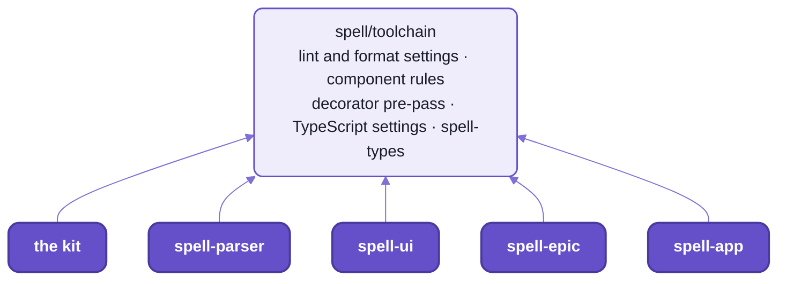
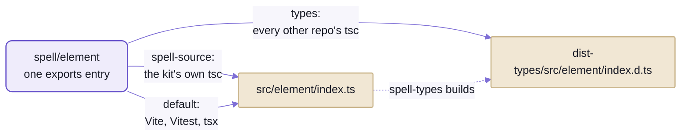

# `spell/toolchain`:  what every repo's checks share

```tsx
  /** The copy button:  the code to the clipboard, `ui-copy`, "Copied" for a moment. */
  private readonly onCopy = async () => {
    const { content } = this
    await navigator.clipboard.writeText(content)
    this.wasJustCopied = true
    this.send("ui-copy", { content })
    setTimeout(() => (this.wasJustCopied = false), COPIED_MS)
  }
```

```sh
cd ~/www/spell/spell-ui
yarn vp lint src
```

<details>
<summary>What it printed</summary>

```text
src/components/ui-code/UICode.tsx:150:5: error spell-ui(no-raw-timer): `setTimeout()` by hand: use `E.after(seconds, fn)` (or `E.soon(fn)` for a zero delay), which says WHEN it runs and can be canceled
```

</details>

_A real run, on Spell UI's `<ui-code>` with its copy button's timer written the usual way._

That `setTimeout()` is good JavaScript, and ESLint would pass it.
Here it's a bug waiting for a double-click:
click Copy twice inside two seconds, and the first timer, which nothing cancels,
takes "Copied" away before the second click's two seconds are up.
What ships in [UICode.tsx](https://github.com/spell-app/spell-ui/blob/main/src/components/ui-code/UICode.tsx) does what the message says, and passes:

```tsx
    this.copiedTimer?.cancel()
    this.copiedTimer = E.after(COPIED_MS / 1000, () => (this.wasJustCopied = false))
```

The rule is one of six the house wrote for its own components, and it ships the way everything here ships:
as source.
The toolchain is the lint and format settings, the TypeScript settings and the few small programs
that every Spell repo's checks run on, and the five repos import ONE copy of it, by package name.

If you've kept ESLint and Prettier in step across several repos, you know the usual answer:
a shared config package, published, then bumped in each repo.
Here there's nothing to publish and no version to bump:
change a rule in the kit, and the next `yarn lint` in every repo runs it.
The catch:  no repo is checked on its own, outside the kit, so CI builds the kit around each one
([README-development.md](README-development.md#ci-checks-a-branch-name-not-a-commit)).



_Every repo's `vite.config.ts` and `tsconfig.json` start from the same files, the kit's own included._

The code is in [src/toolchain/](src/toolchain/), its command `spell-types` in [bin/](bin/),
and its tests in [tests/toolchain/](tests/toolchain/).

## One dependency pins every tool

Vite, Vitest, ESLint, Prettier and a type-aware lint plugin are usually five dependencies on five release schedules.
Every Spell repo has one, `vite-plus`, and it pins a set that's known to work together:

```sh
yarn vp --version
```

<details>
<summary>Output</summary>

```text
vp v1.0.0

Local vite-plus:
  vite-plus  v1.0.0

Tools:
  vite             v8.3.1
  rolldown         v1.2.11
  vitest           v5.0.1
  oxfmt            v0.70.0
  oxlint           v1.85.0
  oxlint-tsgolint  v7.0.2003
  tsdown           v0.23.0
```

</details>

- Its command is `vp`:  `yarn vp test run`, `yarn vp lint src`, `yarn vp fmt`, `yarn vp dev`.
- No ESLint and no Prettier anywhere:  oxlint lints, oxfmt formats, and `oxlint-tsgolint` is oxlint's type-aware half.
  On Spell UI's source, about 81,000 lines, oxlint lints its 682 files with 105 rules, type-aware,
  in about 0.9 seconds;  oxfmt checks its 1,197 files in about 0.6 (18 threads, by the tools' own count).
- The type checker isn't in the set:  every repo names TypeScript 7, the native compiler (`typescript ^7.0.2`).
- The versions live in one place, the catalog in the kit's [.yarnrc.yml](.yarnrc.yml);
  every repo's `package.json` says `catalog:` for each of them it uses.
- To bump them:  `vite-plus` and every catalog entry together, in the kit, never one tool on its own;
  then the copy of the catalog in each child repo's `.yarnrc.yml`.

The cost:  Vite+ is the same engines, repackaged, so a dev server, a build or one repo's tests run no faster for it.
What it buys is versions that move together;
the price is that its pins trail the standalone releases by a release or so.

<details>
<summary>The catalog today</summary>

| Package | Version |
| --- | --- |
| `vite-plus` | 1.0.0 |
| `vite` | `npm:@voidzero-dev/vite-plus-core@1.0.0`:  Vite+'s own build of Vite |
| `vitest`, `@vitest/browser-playwright`, `@vitest/coverage-v8`, `@vitest/ui` | 5.0.1 |

</details>

## The settings are imported, not installed

ESLint shares rules through `extends: ["some-config"]`, a name that resolves to a published package.
Here a repo's `vite.config.ts` imports the settings like any other code,
spreads them into its `lint` and `fmt` blocks, and adds its own.
spell-parser's, whole but for the docstring on its export:

```ts
import { defineConfig } from "vite-plus"

import { fmtConfig, packageLint } from "spell/toolchain/lint"

/** Not linted or formatted by oxlint / oxfmt:  Python (ruff's). */
const NOT_OURS = ["src/py/core/**", "tests/py/core/**"]

export default defineConfig({
  fmt: { ...fmtConfig, ignorePatterns: [...fmtConfig.ignorePatterns, ...NOT_OURS] },
  lint: packageLint({ react: true, ignorePatterns: ["build", "dist", ".cache", "docs", ...NOT_OURS] })
})
```

`spell/toolchain/lint` is [lint.ts](src/toolchain/lint.ts), read where it sits in the kit.
Every repo has one lint block like this one, in its root `vite.config.ts`, and here's what it holds:
- **Formatting**, oxfmt's:  120 columns, 2 spaces, no semicolons, double quotes, no trailing commas,
  `package.json` keys sorted.
  - JSON5 keeps its quoted keys, so Python's `json` still reads it and VS Code checks it against its schema.
  - Markdown is left as written:  the settings skip `*.md`.
  - Never format by hand against it:  `yarn format` settles it.
- **Linting**, oxlint's:  its `correctness` rules as errors, type-aware, plus the house's own (below).
  - Type-aware, but never a second type check:  `yarn ts` already runs `tsc`, and two would report every error twice.
  - `vite-plus/prefer-vite-plus-imports`:  `vite-plus/test`, never `vitest`, so each tool comes at the version
    Vite+ pins.
  - React's rules where a repo has React code;  a looser set for tests.
- **Strict about warnings:**  every repo's lint runs with `--max-warnings 0` and `--report-unused-disable-directives`.
  React's `exhaustive-deps` is set to warn, because a dependency-array fix is a judgement call;
  `--max-warnings 0` makes sure somebody makes it.
  A disable comment that nothing needs any more fails the same way:
  "Unused oxlint-disable directive (no problems were reported)".

<details>
<summary>Each repo's lint block, and the rules switched off</summary>

| Repo | Its lint block |
| --- | --- |
| the kit | `rootLint()`:  the shared rules, and React's on the folders `KIT_REACT_FOLDERS` names (`src/cli/`'s terminal screens, and util) |
| spell-parser | `packageLint({ react: true })` |
| spell-ui | `packageLint({ name: "ui" })`:  the component rules on its `src/components/` and `src/docs-components/` |
| spell-epic | `packageLint()`, and `patternLintIn(["src/components"])` for the component rules |
| spell-app | `packageLint({ react: true })`, and `patternLintIn(["src/app/components"])`:  React's rules everywhere, for the command line's terminal screens (Ink, React for terminals) |

- NOTE:  oxlint reads the nearest config, and a nested one inherits nothing from the root's.
  So a nested `vite.config.ts` spreads `packageLint()` itself (spell-app's `app/` build folder does);
  `vp check` and the editor read only the root block.

Off on purpose, each for a reason:

| Rule | Why it's off |
| --- | --- |
| `no-unused-vars`, `typescript/no-unused-vars` | `tsc` reports them (`noUnusedLocals`):  no double diagnostics |
| `typescript/no-explicit-any` | `any` is deliberate where compiled Spell meets JavaScript |
| `typescript/unbound-method` | passing a method reference is idiomatic here, and done on purpose |
| `typescript/restrict-template-expressions` | the runtime puts any value into a string, on purpose |
| `typescript/no-unsafe-declaration-merging` | Spell UI types its attribute getters by merging an interface into the class |
| `typescript/no-misused-spread`, in tests only | WWOD compares a whole instance with `toEqual({ ...instance })`, and dropping the prototype is the point |
| the component rules, in tests | they're for a component's own files, not its tests |

- React's own:  `react-hooks/rules-of-hooks` an error (it has to be listed:  the category alone doesn't turn it on),
  `react-hooks/exhaustive-deps` a warning.

</details>

### The house's own lint rules

Six `spell-ui/*` rules ([lint.patterns.ts](src/toolchain/lint.patterns.ts)) hold component files to the element
framework's way of doing things.
Each flags what a component does BY HAND that a decorator or a helper does for it,
and its message names the replacement.

| Rule | Flags | Use instead |
| --- | --- | --- |
| `no-solid-effect` | `createEffect()`, `createRenderEffect()`, `onSettled()` or `onMount()`, imported from `solid-js` | `@E.onChange("member")` on a method;  `@E.whileConnected` for a listener or observer that stops while the element is out of the page;  an `@E.aria` / `@E.cssState` member;  `@E.watches` for the light DOM;  the component's own `onMount()` |
| `no-mutation-observer` | `new MutationObserver()` | `@E.watches({ childList: true, ... })` on a getter or method |
| `no-dom-element-listener` | `addEventListener` on `this.domElement` | `@E.on("type")` for the element's whole life;  `this.on(type, listener)` for one added later;  `@E.whileConnected` for one that stops while it's out of the page |
| `no-untrack` | `untrack()` | `@E.untracked` on the method or getter;  an `@E.on` or `@E.onChange` method needs none |
| `no-raw-timer` | `setTimeout()`, `setInterval()`, `queueMicrotask()`, `requestAnimationFrame()`, also through `window.`, `globalThis.` or `self.` | in the same order:  `E.after(seconds, fn)` (`E.soon(fn)` for no delay), `E.every(seconds, fn)`, `E.afterSolidUpdate(fn)`, `E.beforeNextPaint(fn)`;  each name says WHEN, `after()` and `every()` count seconds, and all but `afterSolidUpdate()` can be canceled |
| `no-function-component` | an exported function with a capitalised name that draws JSX | a class, `class X extends E.UIComponent`, with a tag of its own;  a piece one family draws is a private render method |

- They're on in every component set's component folders:  Spell UI's, spell-epic's `src/components/`, and the
  app's own elements in spell-app's `src/app/components/`.
- Not in tests, not in the element framework itself (it's where the decorators come from),
  and not in the app's function components.
- The decorators they point at:  [README-element.md](README-element.md).

One more house rule runs on every file of every repo, not only components:  `spell/no-parent-import`
([lint.imports.ts](src/toolchain/lint.imports.ts)).
It fails a `../` that climbs into a package's `src/`, and its message is the fix:
`` `../util/string` climbs into spell's `src/`:  import it by its package name, `spell/util/string` ``.
A same-folder `./Peer` doesn't climb, and neither does a config reaching `../vite.config.ts`;  why the rule exists:
[README-development.md](README-development.md#one-name-per-file-from-every-repo).

A use that has to stay says why, after `--`, on the line above.
Spell UI's `<ui-form>` keeps one, because its observer must stop when the form leaves the page:

```ts
// oxlint-disable-next-line spell-ui/no-mutation-observer -- only while connected:  `@E.watches` lasts the element's whole life
```

In Spell UI that isn't the end of it.
A test lists every disable comment in its component folders with its reason, fifteen today,
and a new one fails it until it's added there:  every exception is seen in review
([LintPatterns.test.ts](https://github.com/spell-app/spell-ui/blob/main/tests/tools/LintPatterns.test.ts)).
Not yet elsewhere:  spell-epic's three exceptions get only the report of an unused one, and spell-app has none.

Even this page is linted, and its examples run, by three scripts at the kit's root:
- `yarn readme:check` ([readme-check.ts](tools/readme-check.ts)) follows every link to its file and heading,
  wants an italic caption under every picture, and fails stale names.
- `yarn readme:test` ([readme-test.ts](tools/readme-test.ts)) runs every command a page shows with its output,
  and fails one that prints something else.
- `yarn mermaid:pretty` ([mermaid-pretty.ts](tools/mermaid-pretty.ts)) gives every Mermaid picture the Spell look,
  in place;  the check fails a picture it hasn't styled.
- The first two are `spell readme check` and `spell readme test` too;  both take page paths, from the kit's root.

A tested example is an `sh` block, then a fold titled Output holding a `text` block,
the way `yarn vp --version` is shown above:

````markdown
```sh
spell run @spell/examples/fizzbuzz --no-browser
```

<details>
<summary>Output</summary>

```text
✓ Compiling @spell/examples/fizzbuzz
1
...
15 fizzbuzz
...
```

</details>
````

- It runs in `bash`, from its page's repo root, with this checkout's `spell` and `epic`.
- What it prints must match line by line, but for `...`:
  alone on a line, any lines or none;  inside a line, any text there, such as a time, a hash or a port.
- A fold titled anything else, such as What it printed, is shown but never run:
  that's for installs, clones, servers and anything slow.

## Every tool reads source, but one

No repo is built before another uses it.
Vite, Vitest, `tsx` and node all run the other repos' `.ts` files as they are, through the one install.
The exception is the type check, because `tsc` reading another repo's source would check it under the READER's
settings:  the kit's node code under Spell UI's browser libraries, say.

So one wildcard entry in each package's `exports` serves both, by condition.
The kit's:

```json
"./*": {
  "spell-source": ["./src/*.ts", "./src/*.tsx", "./src/*/index.ts", "./src/*/index.tsx", "./src/*"],
  "types": ["./dist-types/src/*.d.ts", "./dist-types/src/*/index.d.ts"],
  "default": "./src/*"
}
```



_One name, three readers:  only another repo's type check reads declarations._

The kit's own `tsc` takes `spell-source` because its tsconfig asks for it, in `customConditions`;
every repo has a condition of its own, named for its package (`spell-ui-source` ...),
and Vite, Vitest and `tsx` add the `.ts` that `default` leaves off.
How an import names a file in the first place:  [README-development.md](README-development.md).

`spell-types` ([declarations.ts](src/toolchain/declarations.ts)) builds the declarations,
and it IS a repo's type check:  its `yarn ts` runs it where a bare `tsc` would run.

```sh
spell-types            # this package:  type-check it, write dist-types/
spell-types --below    # first, the packages of the lower repos this repo uses, lowest first, rebuilt where stale
spell-types --clean    # dist-types/ deleted first:  a full build
```

- Three repos build them, because other repos import them:  the kit, spell-parser and spell-ui.
  spell-epic and spell-app build none, because nothing imports them:  their `yarn ts` runs a plain `tsc`.
- Every child repo's `yarn ts` runs `spell-types --below` first, so the declarations it reads are never stale;
  a lower repo with nothing changed takes a second or two.

<details>
<summary>How <code>spell-types</code> builds them</summary>

- A repo lists its TypeScript programs in its `package.json`'s `"spellTypes"`, in build order:
  `tsconfig.json` (browser-safe code), then `tsconfig.node.json` (node code).
- Each program is built on its own settings, so each keeps its own libraries and types,
  and writes into the repo's one `dist-types/`, mirroring the repo:
  `src/util/string.ts` becomes `dist-types/src/util/string.d.ts`.
- `tsc` emits declarations only, incrementally:  nothing changed, nothing to do.
- With declaration maps, so "Go to Definition" lands in the source, not the `.d.ts`.
- The settings it generates for each program sit in `dist-types/`, rewritten on every build:
  `.tsconfig.tsconfig.json`, `.tsconfig.node.tsconfig.json`.
- `--below` finds the lower repos by the `workspace:` dependencies in each `package.json` (`spell`,
  `spell-ui` ...), through `node_modules`.

</details>

The edges:
- `dist-types/` is git-ignored.
  In a fresh clone, before it's built, the repos above say TS2307, "Cannot find module":  their `yarn ts` builds it.
- One program's own `tsc` (`yarn tsc -p tsconfig.node.json`) runs no `--below`:
  it reads whatever the lower repos last built, so after you pull one of them, run `yarn ts` once before trusting it.

<details>
<summary>What each runner needs to find the source</summary>

| Runner | What it runs | What it needs |
| --- | --- | --- |
| plain `node` | `spell-types`, the kit's glue tools | Node 24 strips the types itself, so this code writes only TypeScript that erases (no `enum`, no parameter properties) and writes `.ts` on its imports:  node adds no extension.  The bin imports its file by path, so it runs in any repo before anything is linked. |
| `tsx` | what needs more:  decorators, JSX ([the `spell` command](README-cli.md), the page server) | every import is a package name plus a path under `src/`, which it finds through node's own package resolution, from any repo.  It reads one tsconfig for every file it runs:  where the kit starts it, the kit's node settings. |
| Vite, Vitest | the browser code, the tests | the `default` condition;  `standardDecorators()` (below) |
| esbuild, called directly | spell-epic's extension and docs bundle, Spell UI's bundle measure and static server, spell-parser's library test | `sourceNames()` ([sourceNames.ts](src/toolchain/sourceNames.ts)):  esbuild reads `exports` as node does, adding no extension and no folder `index`, so this plugin finds `spell/server` as `src/server/index.ts` |

</details>

## Decorators are the standard kind, lowered first

If you've written decorators for Angular or NestJS, they were TypeScript's experimental kind.
Spell writes the standard (TC39) kind everywhere:
`@proto` and `@prop` from [util](README-util.md), `@E.state` from [the element framework](README-element.md).
Nothing runs those natively yet:  not node, not the browsers,
and Vite's own compiler, oxc, lowers only the experimental kind (`oxc-project/oxc#9170`).

So `standardDecorators()` ([decorators.ts](src/toolchain/decorators.ts)), a Vite plugin, lowers them with esbuild
before anything else sees the code.
From the kit's [vitest.config.ts](vitest.config.ts):

```ts
plugins: [standardDecorators(), solid()],
```

- First, before Solid's plugin:  both run early (`enforce: "pre"`), and Solid's compiler must see decorator-free code.
- In every Vite and Vitest config that compiles decorated code:  the kit's tests, spell-parser's and spell-app's,
  the app's build, and `elementBaseConfig()`, which Spell UI's build and every component pack's start from.
- Class names survive (`keepNames`):  a custom element's class is still `UIButton` in the browser,
  and Spell's rule classes still register under their names.
- One shared copy of esbuild's decorator helpers.
  esbuild gives each file its own, about 2.6 kB minified, and Spell UI's core had twelve;
  the plugin swaps each for an import of one shared module, keeping the line count so source maps still line up.
- esbuild, not SWC or Babel, because `tsx` runs node code through esbuild too:
  the browser, the server and the tests lower decorators the same way.

The edges:
- It only lowers a file in which some line STARTS with a decorator, after its indent.
  oxfmt lays decorators out that way, so a formatted file is always caught;
  an unformatted one whose only decorator sits mid-line (`class A { @proto x = 1 }`) slips past,
  and dies with a bare `SyntaxError`.
- It's a stopgap, and says so:  it goes when Vite's compiler lowers standard decorators itself.

## The checks are thin, and the same in every repo

Everything above surfaces through five script names every repo answers to:
`ts`, `lint`, `format`, `test`, and `review`, which runs the other four.
Each is a line or two over these settings, so `yarn lint` means the same in spell-parser as in Spell UI,
and a rule changed here reaches every repo's next run.

- The kit's own carry a prefix:  `yarn kit:ts` is `spell-types`, then its tests' `tsc`;
  `kit:lint`, `kit:format`, `kit:test` and `kit:review` the same way.
- At the kit's root, the bare names run every repo, the kit first and then lowest first,
  so each type check finds the declarations below it already fresh.
- What each check runs, how to run one folder or one file, and what CI checks:
  [README-development.md](README-development.md#the-checks--four-of-them-and-review).

## The files, and the settings they hold

<details>
<summary>The shared TypeScript settings, in words</summary>

[tsconfig.base.json](src/toolchain/tsconfig.base.json), which every repo's programs extend:
`"extends": "spell/toolchain/tsconfig.base.json"` (the kit's own, by its path).

- modern modules, resolved the way a bundler does;  `.ts` extensions allowed in imports;  JSON modules
- strict, with unused locals reported (unused parameters aren't), and no switch fall-through
- `isolatedModules` and `useDefineForClassFields`:  each file compiles on its own, and class fields work as the
  standard says
- `skipLibCheck`, and no output of its own (`noEmit`):  `spell-types` and the bundlers write what's written
- what differs stays in each program's own settings:  the target, the libraries (DOM or not), JSX, the global types,
  and its package's own condition (`customConditions`)
- each repo's programs:  one for browser-safe code (`tsconfig.json`), most a second for node code
  (`tsconfig.node.json`), and its tests' own (`tests/tsconfig.json`)

</details>

<details>
<summary>The global types and the version stamp</summary>

- `spell/toolchain/types` ([types/index.d.ts](src/toolchain/types/index.d.ts)), named in a program's `"types"`:
  - `__PACKAGE_VERSION__`
  - `Class<T>`;  `AbstractClass<T>`, for `instanceof`, never `new`
  - `Prettify<T>`, which makes an editor's hover of a complex type readable
  - `SplitString<List, Delimiter>`
  - the `global` module, for code written for a bundler that provided it
  - Vite's client types:  `import.meta.env`, `?inline` imports
- `packageVersion()` ([packageVersion.ts](src/toolchain/packageVersion.ts)), a Vite plugin, so a build knows its own
  version:  it defines `__PACKAGE_VERSION__` from the nearest `package.json` at or above the folder it's given
  (`packageVersion(import.meta.dirname)`).
  - Code reads it as `PACKAGE_VERSION`, from `spell/util`:  `"unknown"` when nothing defined it.
  - Code `tsx` runs gets it from spell-parser's
    [packageVersion.node.ts](https://github.com/spell-app/spell-parser/blob/main/src/spell/node/packageVersion.node.ts) instead.

</details>

<details>
<summary>The files, one line each</summary>

| File | Imported as | What it is |
| --- | --- | --- |
| [lint.ts](src/toolchain/lint.ts) | `spell/toolchain/lint` | the lint and format settings:  `packageLint()`, `rootLint()`, `patternLintIn()`, `fmtConfig` |
| [lint.patterns.ts](src/toolchain/lint.patterns.ts) | `spell/toolchain/lint/patterns` | the six `spell-ui/*` component rules |
| [lint.imports.ts](src/toolchain/lint.imports.ts) | `spell/toolchain/lint/imports` | `spell/no-parent-import`, on every file |
| [decorators.ts](src/toolchain/decorators.ts) | `spell/toolchain/decorators` | `standardDecorators()`, the decorator pre-pass |
| [packageVersion.ts](src/toolchain/packageVersion.ts) | `spell/toolchain/packageVersion` | `packageVersion()`:  `__PACKAGE_VERSION__` |
| [sourceNames.ts](src/toolchain/sourceNames.ts) | `spell/toolchain/sourceNames` | `sourceNames()` for esbuild, and the lookups under it:  `sourceFileFor()`, `packageRootFor()`, `resolvedFile()` |
| [declarations.ts](src/toolchain/declarations.ts), [bin/spell-types.ts](bin/spell-types.ts) | `spell/toolchain/declarations`;  the bin `spell-types` | the declarations build |
| [tsconfig.base.json](src/toolchain/tsconfig.base.json) | `spell/toolchain/tsconfig.base.json` | the shared TypeScript settings |
| [types/index.d.ts](src/toolchain/types/index.d.ts) | `spell/toolchain/types` | the global types |
| [AGENTS.md](src/toolchain/AGENTS.md) | | the rules for working on the toolchain |

</details>

<details>
<summary>More in the docs site</summary>

The docs site needs a checkout with the content folder beside it,
and the page server running ([README-server.md](README-server.md)).

- Vite+, how it's set up and its limits:  `/guides/vite-plus.html`
- Commands, every command and script:  `/guides/dev/commands/commands.html`

</details>

## See also

- [README-development.md](README-development.md):  running these checks day to day, and how an import names a file
  in another repo
- [README-element.md](README-element.md):  the decorators and helpers the component rules point you to
- [toolchain's AGENTS.md](src/toolchain/AGENTS.md):  the rules for changing the toolchain itself
- [README.md](README.md#setup-from-zero):  setup from zero, before any of this runs
