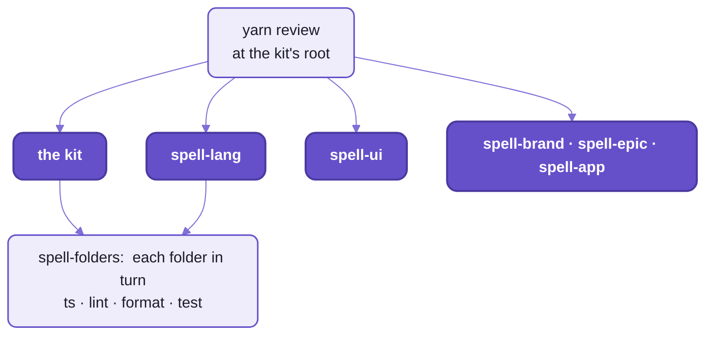

# `spell-kit/toolchain`:  what every repo's checks share

The toolchain is the settings and small programs that every repo's build, lint, format, type check and tests run on,
so six repos behave like one.
[Vite+](#vite-in-one-paragraph) pins the tools;  the toolchain holds the rules:
- the lint and format settings, and the house's own lint rules
- the decorator pre-pass
- the shared TypeScript settings
- two small commands, `spell-types` and `spell-folders`

It answers "how does each check run, in every repo".
For "how do I work across six repos at once", the answer is spell-epic, not six `git`s:
- one epic makes a worktree of every repo on one branch, keeps their commits in step,
  merges `main` into all of them, and has CI check them together
- how:  [README-development.md](README-development.md) and [spell-epic's README](spell-epic/README.md)



_The kit first, then each repo lowest first;  inside a repo, `spell-folders` runs each check folder by folder._

- Code:  [toolchain/](toolchain/), its tests in [tests/toolchain/](tests/toolchain/).
- Rules for working on it:  [toolchain's AGENTS.md](toolchain/AGENTS.md).
- Its entries are SOURCE files, imported by name:
  `spell-kit/toolchain/lint`, `spell-kit/toolchain/decorators`, `spell-kit/toolchain/tsconfig.base.json` ...
- Node runs its two commands as they are (Node 24 strips TypeScript's types), with no build.

## Vite+ in one paragraph

Every repo builds, tests, lints and formats with Vite+, ONE dev dependency, `vite-plus`,
that pins Vite, Vitest, oxlint, oxfmt and tsgolint (oxlint's type-aware half) at versions that work together.

- Its command is `vp`:  `yarn vp test run`, `yarn vp lint src`, `yarn vp fmt`, `yarn vp dev`.
- There's no ESLint and no Prettier anywhere:  oxlint and oxfmt replace them, and run in a fraction of the time.
- The versions live in ONE place, the kit's `.yarnrc.yml` catalog;  every repo's `package.json` says `catalog:`.
- To bump them:  `vite-plus` and every catalog entry together, in the kit;
  then the child repos' copies of the `.yarnrc.yml`.

<details>
<summary>The catalog today</summary>

| Package | Version |
| --- | --- |
| `vite-plus` | 1.0.0 |
| `vite` | `npm:@voidzero-dev/vite-plus-core@1.0.0` (Vite+'s own build of Vite) |
| `vitest`, `@vitest/browser-playwright`, `@vitest/coverage-v8`, `@vitest/ui` | 5.0.1 |

</details>

## The lint and format rules

Every repo's `vite.config.ts` spreads the same settings into its `lint` and `fmt` blocks,
from `spell-kit/toolchain/lint` ([lint.ts](toolchain/src/lint.ts)):

```ts
import { defineConfig } from "vite-plus"
import { fmtConfig, packageLint } from "spell-kit/toolchain/lint"

export default defineConfig({ lint: packageLint({ name: "ui" }), fmt: fmtConfig })
```

- Formatting:  120 columns, 2 spaces, no semicolons, double quotes, no trailing commas.
  - Never hand-format against it:  `yarn format` settles it.
  - Markdown is left as written:  the settings skip `*.md`.
- The READMEs' own check is `yarn readme:check`, at the kit's root ([readme-check.ts](tools/readme-check.ts)):
  every link and heading it points at, a caption under every picture, and no stale names.
  - `yarn mermaid:pretty` ([mermaid-pretty.ts](tools/mermaid-pretty.ts)) gives every Mermaid picture the Spell look;
    the check fails a picture it hasn't styled.
- Linting:  oxlint's correctness rules as errors, type-aware;  stricter settings for test files.
- A repo of several folders (the kit, spell-lang, spell-app):
  `rootLint()` at its root, and `packageLint()` in each folder.
  A flat repo (spell-ui, spell-epic) has `packageLint()` at its root.
- NOTE:  `vp check` and the editor read the ROOT block only, even inside a folder.

On top of oxlint's rules sit the house's own, as two lint plugins:

| Plugin | Where it's on | What it catches |
| --- | --- | --- |
| `spell/*`, the import rules ([lint.imports.ts](toolchain/src/lint.imports.ts)) | everywhere | a `../` path from one package (or its tests) into another package's folder:  import it by its package name instead |
| `spell-ui/*`, the component rules ([lint.patterns.ts](toolchain/src/lint.patterns.ts)) | every component set's component folders | what a component does BY HAND that a decorator does for it:  a hand-written Solid effect, a `MutationObserver`, a listener on the DOM element, `untrack()`, a raw timer, an exported function component;  each message names the decorator to use |

A kept exception says why, on the line above it:

```ts
// oxlint-disable-next-line spell-ui/no-untrack -- the value is read once, at connect, on purpose
```

<details>
<summary>Every component rule, and the decorator it points at</summary>

| Rule | Flags | Use instead |
| --- | --- | --- |
| `no-solid-effect` | `createEffect()` in a component | `@E.onChange` or `@E.whileConnected` |
| `no-mutation-observer` | a `MutationObserver` | `@E.watches` |
| `no-dom-element-listener` | `addEventListener` on the element | `@E.on("click")` |
| `no-untrack` | `untrack()` | `@E.untracked` |
| `no-raw-timer` | `setTimeout` / `setInterval` | the element framework's timing helpers (`after()`, `every()`, `soon()`) |
| `no-function-component` | an exported function component | a component class, one per family |

- Their tests stay in Spell UI (its tools' lint pattern tests):  the allow-list is Spell UI's.
- The decorators:  [README-element.md](README-element.md), "Reactive members".

</details>

## The decorator pre-pass

Spell writes STANDARD (TC39) decorators everywhere:  `@proto`, `@E.state`, `@prop`.
`standardDecorators()` ([decorators.ts](toolchain/src/decorators.ts)), a Vite plugin, lowers them with esbuild first,
before Solid's compiler sees the code.

- Why:  nothing runs them natively yet, and Vite's own compiler only lowers the older, experimental kind.

- It MUST be in every `vite.config.ts` and `vitest.config.ts` that compiles decorated code, before the Solid plugin.
- Class names survive (`keepNames`), so a custom element class is still `UIButton` in the browser.
- It swaps each file's copy of esbuild's decorator helpers for one shared module:  Spell UI's core had twelve copies.
- It goes once Vite's compiler lowers standard decorators itself.

## Declarations:  how a type check reads another repo

Every repo uses the others' SOURCE, through the one install;  there's no publish step.
But a type check that read another repo's source would have to know that repo's settings too.

So each repo's type check reads the repos below it through their BUILT DECLARATIONS (`.d.ts` files):
`spell-types` writes them, and everything else reads source.

```mermaid
%%{init: {"theme":"base","themeVariables":{"fontFamily":"-apple-system, BlinkMacSystemFont, Segoe UI, Helvetica, Arial, sans-serif","fontSize":"15px","primaryColor":"#EFECFB","primaryBorderColor":"#6550CA","primaryTextColor":"#1A1C27","secondaryColor":"#F4F1E9","tertiaryColor":"#F7F6FC","lineColor":"#7F6FD6","textColor":"#7F6FD6","clusterBkg":"#F7F6FC","clusterBorder":"#B9B0E8","titleColor":"#1A1C27","edgeLabelBackground":"#F7F6FC","actorBkg":"#EFECFB","actorBorder":"#6550CA","actorTextColor":"#1A1C27","actorLineColor":"#9C90DE","signalColor":"#7F6FD6","signalTextColor":"#7F6FD6","labelBoxBkgColor":"#EFECFB","labelBoxBorderColor":"#6550CA","labelTextColor":"#1A1C27","loopTextColor":"#7F6FD6","noteBkgColor":"#F1E7D4","noteBorderColor":"#C9B48A","noteTextColor":"#1A1C27","activationBkgColor":"#DCD6F7","activationBorderColor":"#6550CA","sequenceNumberColor":"#FFFFFF"},"flowchart":{"curve":"basis","padding":12,"nodeSpacing":40,"rankSpacing":44}}}%%
flowchart LR
  types["1 · spell-types builds the kit's<br/>declarations into dist-types/"] --> ts["2 · each repo above, lowest first,<br/>runs spell-types --below, then its own check"]
  ts --> tsc["3 · tsc meets spell-kit/element:<br/>its exports' types entry is the .d.ts"]
  tsc --> vite["4 · Vite, Vitest and node take the default entry:<br/>the source, as it is"]
  %% the Spell look:  yarn mermaid:pretty
  classDef default fill:#EFECFB,stroke:#6550CA,stroke-width:1.5px,color:#1A1C27,rx:8px,ry:8px
  classDef step fill:#EFECFB,stroke:#6550CA,stroke-width:1.5px,color:#1A1C27,rx:16px,ry:16px
  class types,ts,tsc,vite step
```



_TypeScript reads declarations, everything else reads source:  one `exports` entry carries both._

- Each entry of a package's `exports` names both:

  ```json
  "./element": { "types": "./dist-types/element/src/index.d.ts", "default": "./element/src/index.ts" }
  ```

- `dist-types/` is git-ignored;  in a fresh clone, before it's built, TypeScript falls back to the source.
- `spell-types` IS a package's type check:  `yarn ts` runs it where a bare `tsc` ran.
- A package of several folders lists them in `"spellTypes"`, in the order they're built:
  the kit's are util, server, element, element's tools.
- `spell-types --below` rebuilds the lower repos' declarations first, where they're stale:
  every repo's `yarn ts` runs it, so what it reads is never out of date.

<details>
<summary><code>spell-types</code>'s flags</summary>

```sh
spell-types            # this package:  type-check it, write dist-types/
spell-types --below    # every package of the LOWER repos this repo uses, lowest first, rebuilt where stale
spell-types --clean    # dist-types/ deleted first:  a full build
```

- Builds are incremental:  nothing changed, nothing to do (a second or two).
- The generated settings are a `.tsconfig.json` in the declarations' folder, rewritten each build.
- Declaration maps too, so "Go to Definition" lands in the source, not the `.d.ts`.
- The toolchain itself has none:  other repos read its source.

</details>

## `spell-folders`:  a repo of several folders, checked folder by folder

The kit, spell-lang and spell-app each hold several folders:
each folder is its own TypeScript program (browser or node), with its own Vite and Vitest settings.
`spell-folders` ([folders.ts](toolchain/src/folders.ts)) runs one check over each folder in turn,
and its tests' in `tests/<folder>/`.

```sh
spell-folders test                 # every folder's tests
spell-folders lint server element  # only those folders
```

- The checks:  `ts`, `test`, `lint`, `lint:fix`, `format`, `format:check`.
- The folders:  the `"spellFolders"` list in the repo's `package.json`, lowest first.
- Every folder runs, failed or not;  the summary says which failed, and it exits 1 if any did.
- How it's run:
  - in the kit, `node toolchain/bin/spell-folders.ts <check>`:  what `yarn kit:test` runs
  - in spell-lang and spell-app, `spell-folders <check>`:  what their `yarn test` runs

<details>
<summary>What each check runs, and the <code>"spellFolders"</code> keys</summary>

| Check | Runs, in each folder |
| --- | --- |
| `ts` | `spell-types` for a folder in `"spellTypes"`, else `tsc -p <folder>`;  then its configs' `tsconfig.node.json` and its tests' `tsconfig.json` |
| `test` | `yarn vp test run`;  plus `pytest` (through uv) in a folder with Python |
| `lint`, `lint:fix` | `yarn vp lint` over the folder and its tests, strict:  warnings fail, unused disable comments are reported;  plus `ruff` |
| `format`, `format:check` | `yarn vp fmt`;  plus `ruff format` |

| Key | What |
| --- | --- |
| `name` | the folder, at the repo's root;  its tests in `tests/<name>/` |
| `lint` | what oxlint looks at in it (default `["src"]`) |
| `fmt` | what oxfmt formats (default `["."]`) |
| `tests` | what both look at in its tests' folder (default `["."]`) |
| `node` | `tsc` checks its configs too (`tsconfig.node.json`) |
| `python` | a uv project in it, where ruff and pytest run |

</details>

## Running TypeScript directly

Tools and scripts run TypeScript as it is, with no build:
plain `node` for the toolchain's own commands (Node 24 strips types), and `tsx` for everything that needs more
(decorators, JSX).
Every import is a package name, and a package's own deep files use its `#/` imports:
so node's own resolver finds every file in every repo, whichever repo the program started in.

<details>
<summary>Until repo-split P14 lands</summary>

- Today, inside a repo, files import each other by short alias names from that repo's alias table
  (`tsconfig.base.json` at its root).
- `tsx` reads ONE settings file for every file it runs:
  so a program that runs several repos' source (the command line, the page server) can't resolve another repo's
  aliases, "Cannot find package".
- So it loads the run-time alias hook too, after `tsx`:

  ```sh
  tsx --import spell-kit/toolchain/aliases scripts/site-data.ts
  ```

- The hook resolves each alias by the table of the repo the IMPORTING file lives in.
- A lint rule, `spell/no-cross-repo-alias`, stops an alias reaching into another repo;
  `spell-types` rewrites the aliases in the declarations it writes.
- P14 replaces every alias with package names and `#/` imports:
  the hook, the tables, the rule and the rewrite all go.

</details>

## CI

Every repo has ONE GitHub Actions workflow, its `checks.yml`:
on a push to `main`, a pull request, or by hand from the Actions tab.

- The kit's ([checks.yml](.github/workflows/checks.yml)), with no child repo cloned:
  `yarn install`, Playwright's Chromium, then `kit:ts`, `kit:lint`, `kit:test`.
- A child repo's checks it in the layout it's worked on:
  1. the kit at the root, at the branch under test when the kit has one, else `main`
  2. the repo itself inside it, at its folder name
  3. the repos it needs, each at the same-named branch when it has one:
     `yarn clone <repo> --branch <branch> --https --shallow`
  4. its `yarn ts`, `yarn lint`, `yarn test`
- So a change across repos is checked together when every repo's branch has the same name:
  an epic's worktree gives them that.
- The repos are public:  no token needed.

## Commands

| Command | Where | What |
| --- | --- | --- |
| `yarn kit:ts`, `kit:test`, `kit:lint`, `kit:lint:fix`, `kit:format`, `kit:format:check` | the kit's root | one check over every kit folder, through `spell-folders` |
| `yarn kit:review` | the kit's root | `kit:ts`, `kit:lint:fix`, `kit:format`, `kit:test`, then "REVIEW PASSED" |
| `yarn ts`, `test`, `lint`, `review` | the kit's root | the kit's, then every cloned repo's, lowest first |
| `spell-folders <check> [folder ...]` | a repo of several folders | one check, folder by folder |
| `spell-types [--below] [--clean]` | any repo | its declarations, and its type check |
| `yarn vp test run`, `yarn vp lint src`, `yarn vp fmt` | inside one folder | that folder's tools directly |

<details>
<summary>The shared TypeScript settings, in words</summary>

[tsconfig.base.json](toolchain/tsconfig.base.json), which every repo's settings extend:
- modern modules, resolved the way a bundler does;  `.ts` extensions allowed in imports
- strict, with unused locals reported and no switch fall-through
- `isolatedModules` and `useDefineForClassFields`:  each file compiles on its own, class fields as the standard says
- no output of its own (`noEmit`):  `spell-types` and the bundlers write what's written
- what differs by folder stays in its own settings:  the target, the libraries (DOM or not), JSX, the global types

</details>

<details>
<summary>The global types and the version stamp</summary>

- `spell-kit/toolchain/types` ([index.d.ts](toolchain/types/index.d.ts)), named in a folder's `"types"`:
  `__PACKAGE_VERSION__`, `Class<T>`, `AbstractClass<T>`, `Prettify<T>`, `SplitString<List>`, and Vite's client types.
- `packageVersion()` ([packageVersion.ts](toolchain/src/packageVersion.ts)), a Vite plugin, so a build knows its own
  version:  it defines `__PACKAGE_VERSION__` from the nearest `package.json`.

</details>

<details>
<summary>The files, one line each</summary>

| File | What |
| --- | --- |
| [src/lint.ts](toolchain/src/lint.ts) | the oxlint and oxfmt settings:  `packageLint()`, `rootLint()`, `fmtConfig` |
| [src/lint.imports.ts](toolchain/src/lint.imports.ts) | the `spell/*` import rules |
| [src/lint.patterns.ts](toolchain/src/lint.patterns.ts) | the `spell-ui/*` component rules |
| [src/decorators.ts](toolchain/src/decorators.ts) | `standardDecorators()`, the decorator pre-pass |
| [src/packageVersion.ts](toolchain/src/packageVersion.ts) | `__PACKAGE_VERSION__` |
| [src/declarations.ts](toolchain/src/declarations.ts), [bin/spell-types.ts](toolchain/bin/spell-types.ts) | `spell-types` |
| [src/folders.ts](toolchain/src/folders.ts), [bin/spell-folders.ts](toolchain/bin/spell-folders.ts) | `spell-folders` |
| [src/aliases.ts](toolchain/src/aliases.ts), [src/aliasTable.ts](toolchain/src/aliasTable.ts) | the run-time alias hook, until P14 |
| [tsconfig.base.json](toolchain/tsconfig.base.json) | the shared TypeScript settings |
| [types/index.d.ts](toolchain/types/index.d.ts) | the global types |

</details>

<details>
<summary>More in the docs site</summary>

The docs site needs a checkout with the content folder beside it,
and the page server running ([README-server.md](README-server.md)).

- Vite+:  `/guides/vite-plus.html`
- The commands page, every command and script:  `/guides/dev/commands/commands.html`

</details>

## See also

- [README-development.md](README-development.md):  working on Spell day to day, across repos
- [README-util.md](README-util.md), [README-server.md](README-server.md), [README-element.md](README-element.md):
  the kit's other folders
- [README-cli.md](README-cli.md):  the `spell` command line
- [README.md](README.md):  the kit, and Spell as a whole
- Also beside it:  [README-agents.md](README-agents.md) · [README-vscode.md](README-vscode.md)
