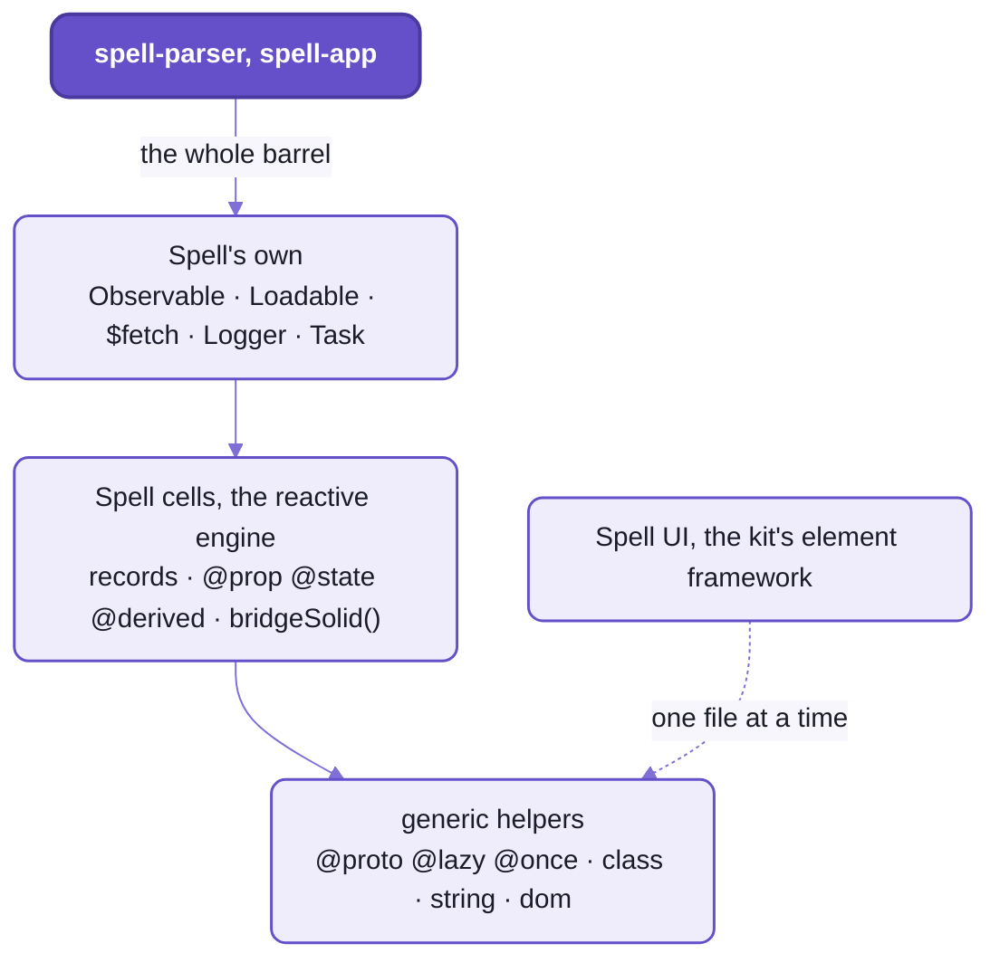

# `spell/util`:  the helpers every repo shares

```ts
import { createSignal } from "solid-js"
import { reactiveObject } from "spell/util"

const [count, setCount] = createSignal(0)
setCount(1)
count()                // 0:  Solid 2 holds the write back until it flushes

const card = reactiveObject({ direction: "down" })
card.direction = "up"
card.direction         // "up":  a Spell cell is fresh the moment it's written
```

_One run in Solid 2.0.0-rc.13's browser build, beside this folder's cells:  each comment is what its line printed.
Plain node loads Solid's server build instead, and `count()` reads 1 there._

Four lines, and the reason this folder has a reactive engine of its own.
Spell is imperative:  a line writes, and the next line reads what it wrote.
Take the Solitaire example's own test of a card, which it made face up a few lines earlier:

```spell
turn it face down
its direction should be down
```

_Two lines of `test card setup`, in Solitaire's [Card.spell](https://github.com/spell-app/spell-app/blob/main/spaces/@spell/examples/Solitaire/Card.spell):
the test passes, all 30 checks._

On signals that hold a write back, the second line would still read `up`, and the language would fail its own test.
It stands on Spell cells instead, and so does the editor.

`spell/util` is the floor of every Spell repo:  the small things more than one package needs,
in one folder of the kit, under one import name.
The cells are its middle layer.
Under them sit plain helpers with no dependencies at all;  over them, Spell's own utilities.

## This, or lodash?

Lodash, for anything general.
Util doesn't wrap it or compete with it:  the kit, spell-parser and spell-app depend on lodash themselves,
and Spell UI on `lodash-es`, which tree-shakes.
Util re-exports five of lodash's string functions, and that's all:
`toLower()`, `lowerFirst()`, `upperFirst()`, `toSnakeCase()`, and `snakeCase()`, the same one memoized.

What util holds is what lodash can't give you:
the things it has no shape for (class-default decorators, DOM helpers that cross shadow roots, the cells),
Spell's own utilities, and three it has but does differently:

| You want | lodash | util | Why util's |
| --- | --- | --- | --- |
| the attribute for property `h1Size` | `kebabCase()`:  `h-1-size` | `kebabCase()`:  `h1-size` | a page writes `h1-size`, so that's the attribute an element must listen for |
| the longest of `["a", "bb", "cc"]` | `maxBy()`:  `"bb"` | `itemsWithHighest()`:  `["bb", "cc"]` | a tie is the caller's to break, not the library's |
| `"cards[1]"` of a hand holding a Spell `List` | `get()`:  `undefined` | `getPath()`:  `"king"` | it reads a `List` through its `getItem()` |

Every result in that table came from one run, the two libraries side by side.

## One import name, three layers

```ts
import { proto, kebabCase, closestAcrossShadow, $fetch, Logger } from "spell/util"
```

One barrel, and every helper by its own name:  there's no namespace object, unlike the server's `SRV`.



_Each layer uses only the ones below it;  Spell UI takes the generic files one by one,
so nothing above them lands in its bundles._

Its biggest reader by far is the language:  242 of spell-parser's files import the barrel,
207 of them in its `spell` folder, against 14 in spell-app's editor, language server, spaces and command line.
Spell UI and [the kit's element framework](README-element.md) never touch the barrel at all:
they take the generic files, and re-export them as their own.
The code is in [src/util/](src/util/), its tests in [tests/util/](tests/util/),
and the rules for working on it in [util's AGENTS.md](src/util/AGENTS.md).

Every file also has a name of its own, the package's plus its path under `src/` (`spell/util/reactive/cells`).
Use the barrel, except for these:

| Import | Why not the barrel | Who imports it so |
| --- | --- | --- |
| `spell/util/class`, `/decorators`, `/dom`, `/string`, `/util.types` | the generic files one by one, so lodash, `chalk` and the rest never reach a bundle that doesn't want them | [Spell UI's util barrel](https://github.com/spell-app/spell-ui/blob/main/src/util/index.ts), [the element framework's](src/element/index.ts), the kit's test helpers |
| `spell/util/reactive` | the cells without Spell's layer | util's own `spell/` files:  through the barrel, which re-exports them, it'd be a cycle |
| `spell/util/spell/Derivative`, `/spell/Logger` | one class, and nothing else | spell-parser's parser:  its `Rule` and its tokenizer |
| `spell/util/spell/ResponseErrors` | the `ResponseError` family is left out of the barrel on purpose | [spell-app's disk fetch](https://github.com/spell-app/spell-app/blob/main/src/spaces/server/node/projects/disk-fetch.ts), to throw a `MissingResourceError` as a 404 would |
| `spell/util/node/json5` | node only:  never through a barrel, so no browser code pulls it in | the tools that write JSON5 (below) |

## The generic helpers:  what lodash has no shape for

Every file in this layer imports nothing:  not lodash, not Solid, not the layers above.
That's what lets Spell UI ship them in its own bundle,
and node tooling and types-only files import them too.

### `@proto`:  a default the base class can see

A class field is set only after the base class's constructor has run.
So a base class can't read its subclass's defaults, and that catches everybody once:

```ts
import { proto } from "spell/util"

class Rule {
  declare alias: string
  constructor() { console.log(this.alias) }
}
class WithField extends Rule {
  alias = "statement"
}
class WithProto extends Rule {
  @proto static alias = "statement"
}

new WithField()        // undefined:  the field arrives after Rule's constructor
new WithProto()        // statement:  the default is on the prototype, there before any instance
```

- Nothing is copied per instance:  `Object.keys()` of a `WithProto` is `[]`, of a `WithField`, `["alias"]`.
- Spell's parser is built on it.
  The [`print` rule](https://github.com/spell-app/spell-parser/blob/main/src/spell/rules/UI/Print.ts) starts `@proto static alias = "statement"`,
  and the five repos' code says `@proto static` over 400 times.
- The edge:  a `static` field only.
  On an instance field it throws `@proto x: only works on 'static' fields.`
  And the name must be one instances already `declare`, so a typo is a compile error.

### `@lazy` and `@once`:  made once, then kept

`@lazy` replaces the backing field you'd write by hand, `return (this._supports ??= this.detect())`:

```ts
// Spell UI's Browser:  feature flags, detected on first read
@lazy get supports(): BrowserSupports { return this.detect() }

// Spell UI's I18n:  the Temporal polyfill, loaded once;  every caller shares the first call's promise
@once loadTemporal(): Promise<TemporalAPI> { /* a dynamic import(), trimmed */ }
```

- Kept per object:  each instance its own, a `static` one per class.
- `forget(object, "name")` drops a kept value;  the next read makes it anew.
- `@resets("load") static accessor url` drops it on every write:
  [Spell UI's site data](https://github.com/spell-app/spell-ui/blob/main/src/docs-components/SiteData.ts) fetches again when its URL changes.
- The edges:
  - not reactive:  a `@lazy` value is made once, whatever it read;  a reactive cached value is `@derived`, below
  - a getter or method that THROWS keeps nothing, and the next call tries again;
    a promise that REJECTS is kept, so every later call gets the same rejection until `forget()`
  - `@once` takes no arguments, and must be called on its object (`X.load()`), never detached

These are standard (TC39) decorators, not TypeScript's old experimental kind;
[the toolchain's](README-toolchain.md) pre-pass lowers them before Solid's compiler sees the code.

<details>
<summary>Every generic decorator, one line each</summary>

| Decorator | On | What it does |
| --- | --- | --- |
| `@proto` | a `static` field | sets the class default on the prototype;  instances carry no copies |
| `@protoMerged` | a `static` settings object | like `@proto`, but a subclass's keys merge over its parent's instead of replacing them:  an element's `elementSetup` |
| `@lazy` | a getter | runs the getter on first read, then keeps the value (`undefined` too) |
| `@once` | a method | runs it once and keeps its result (a loader's promise);  later calls get the same result |
| `forget(object, "name")` | -- (a function) | drops what `@lazy` or `@once` kept, for a `reset()` |
| `@resets("name")` | an `accessor` | each write to it drops that kept value too, even a write of the same value |

- `@protoMerged` chains objects, it doesn't copy them:  a key the subclass doesn't state is read from its parent's.
  - So read keys by name.
    A spread, `Object.keys()` or `JSON.stringify()` of the whole object sees only the keys its own class stated.
  - A key it does state replaces the parent's value whole:
    to add to one, spread the parent's (`styleSheets: { ...Parent.prototype.elementSetup.styleSheets, panel }`).
- The reactive decorators (`@prop`, `@state`, `@derived`) are the engine's:  next section.
- The element framework's own (`@E.state`, `@E.controlled` ...):  [README-element.md](README-element.md).

</details>

### DOM helpers that cross shadow roots

`element.closest()` stops at a shadow root.
`closestAcrossShadow()` keeps climbing, through a slot or out to the shadow root's host,
so a `<ui-header>` slotted into a `<ui-card>`, or drawn inside it, finds its card.

- They touch no DOM global until they're called, so they import anywhere;
  `isBrowser()` asks whether there's a DOM to call them on.
- None of them uses `instanceof Node`:
  Spell UI's server render calls them on linkedom elements in node, where there's no `Node` to compare against.
  They read `nodeType` against `NodeType` instead.
- Beside them, the strings an element needs:  `kebabCase()` and `camelCase()`, memoized,
  and `suggest()` for a "did you mean".
  `suggest("primay", ["primary", "secondary"])` is `"primary"`;
  a word more than two edits from every candidate gets no guess at all, which beats a wild one.

### `PrefStore`:  preferences people and plain scripts can read

One store per app keeps what each person set:  a theme, a panel's width, the last file open.

```ts
import { PrefStore } from "spell/util"

const prefs = new PrefStore("spell-site").declare("scheme", { oneOf: ["light", "dark", "auto"] })
prefs.get("scheme")          // "light":  nothing kept yet, so the first choice
prefs.set("scheme", "dark")  // localStorage now holds  spell-site:scheme = dark
prefs.set("width", 250)      //                          spell-site:width  = 250
```

- Every key starts with the store's name and a colon, so two apps on one site never share a value,
  and `forgetAll()` forgets only its own.
- A value is kept as text you can read:  a string as itself (`dark`), anything else as JSON (`250`, `{"open":true}`).
  - So a page's inline script, which can't import anything, reads the same key raw, before the page draws.
  - A string that would read back as something else is quoted:  the text `"1"` is kept as `"1"`, the number as `1`.
- A declared pref's default is its `default`, else its first choice, else its type's:  `0`, `""` or `false`.
- Where it keeps them is its place's business:  `local` (the default), `session` (per tab), `memory`
  (servers, tests), or a place you hand it:
  - `DatabasePlace.shared`:  the browser's database (IndexedDB), for big values and values that aren't text.
    A `Blob`, a `Date` or a file handle comes back as it went in;
    `update()` reads, changes and saves in one transaction, so two tabs never read the same value.
  - `ServerPlace.shared`:  the page server, which keeps each store in the person's space
    ([README-spaces](https://github.com/spell-app/spell-app/blob/main/README-spaces.md)), so it follows them to every browser.
  - a `StoragePlace` over a storage you hand it (a test's).
- The edges:
  - It never throws when storage fails.
    Blocked storage (a private window) keeps values in memory for the visit, and says so once;
    a full one logs, and `get()` answers the default.
  - It throws `TypeError` for a caller's mistake:  no key, a store name with a colon,
    a value its declaration doesn't allow.
  - `load()`, `save()` and `update()` are the waited-on forms, for a place that must be waited on;
    a quick `get()` there throws, naming `load()`.
- It's generic, but not in Spell UI's core bundle:  there it cost every page 1.9 kB,
  so Spell UI's few stores import it by file, `spell/util/persist/PrefStore`.

### `UndoStack`:  one step for everything an action does

```ts
import { UndoStack } from "spell/util"

const history = new UndoStack({ limit: 100 })
await history.transaction("Deal", async () => {
  for (const card of deck) await moveCard(card)   // each move records its change:  all of them join "Deal"
})
history.undoTitle   // "Undo Deal"
history.undo()      // every card back, at once
history.redo()      // dealt again, at once:  the moves aren't run again, their end state is put back
```

- A step is a title and its records, each saying how to undo and redo itself:  the stack knows nothing of what's kept.
- A transaction stays open until its function returns, or its promise settles:
  anything recorded meanwhile, nested or begun while it waits, joins it.
- A run of steps with the same title AND target folds into one:  typing "hello" into one field undoes in one go.
- `canUndo`, `undoTitle`, `redoTitle` are Spell cells:  a menu reading them redraws by itself.
- The edges:
  - while it undoes or redoes, nothing records, so the changes it puts back aren't new steps
  - something else that changes state while an action waits joins that action's step
  - the titles are English by default;  `titleFor` words them whole in another language

## Spell cells:  a read after a write is always fresh

If you know Solid's signals or MobX, cells will feel familiar:
a reader runs, the engine notes what it read, and re-runs it when one of those changes.
Two things differ, and the hook showed you the first.

- **The value lives in the object, not in the cell.**
  Each object keeps its values in one record, a `Map`, read and written synchronously;
  a cell only knows who read what.
  So a read after a write is fresh, with no flush.
- **No proxies.**
  A list a prop holds is the same list, and `===` holds everywhere.
  So `hand.cards.push("king")` re-runs nobody:  set `hand.cards` to a new list.
  Spell's own `List`s copy on write, so a program never meets this.

The decorators make a plain class reactive:

```ts
import { prop, state, derived, typedJSON } from "spell/util"

class Card {
  @prop({ default: "down" }) accessor direction!: "up" | "down" // public:  in the class's schema and its JSON
  @state accessor isDragging = false //                            internal:  never listed
  @derived get isFaceUp() { return this.direction === "up" } //    cached:  recomputed only when direction changes
}

const card = new Card()
card.direction = "up"
card.isFaceUp            // true
typedJSON(card)          // { "$type": "Card", "direction": "up" }:  its class first, no isDragging
```



```mermaid
%%{init: {"theme":"base","themeVariables":{"fontFamily":"-apple-system, BlinkMacSystemFont, Segoe UI, Helvetica, Arial, sans-serif","fontSize":"15px","primaryColor":"#EFECFB","primaryBorderColor":"#6550CA","primaryTextColor":"#1A1C27","secondaryColor":"#F4F1E9","tertiaryColor":"#F7F6FC","lineColor":"#7F6FD6","textColor":"#7F6FD6","clusterBkg":"#F7F6FC","clusterBorder":"#B9B0E8","titleColor":"#1A1C27","edgeLabelBackground":"#F7F6FC","actorBkg":"#EFECFB","actorBorder":"#6550CA","actorTextColor":"#1A1C27","actorLineColor":"#9C90DE","signalColor":"#7F6FD6","signalTextColor":"#7F6FD6","labelBoxBkgColor":"#EFECFB","labelBoxBorderColor":"#6550CA","labelTextColor":"#1A1C27","loopTextColor":"#7F6FD6","noteBkgColor":"#F1E7D4","noteBorderColor":"#C9B48A","noteTextColor":"#1A1C27","activationBkgColor":"#DCD6F7","activationBorderColor":"#6550CA","sequenceNumberColor":"#FFFFFF"},"flowchart":{"curve":"basis","padding":12,"nodeSpacing":40,"rankSpacing":44}}}%%
flowchart LR
  write["1 · card.direction = 'up'<br/>the record is written at once"]
  mark["2 · whoever read it is told:<br/>a derived value re-checks before it recomputes"]
  read["3 · card.direction reads 'up'<br/>no flush"]
  redraw["4 · a Solid computation that read it re-runs<br/>on Solid's schedule, if the value really changed"]
  write --> mark --> read --> redraw
  %% the Spell look:  yarn mermaid:pretty
  classDef default fill:#EFECFB,stroke:#6550CA,stroke-width:1.5px,color:#1A1C27,rx:8px,ry:8px
  classDef step fill:#EFECFB,stroke:#6550CA,stroke-width:1.5px,color:#1A1C27,rx:16px,ry:16px
  class write,mark,read,redraw step
```

_A write, a read, a redraw:  step 3 never waits for Solid._

Turn the card face up when it's already up, and nothing re-runs:  a write of an equal value tells nobody.
The same holds one step further on:  `isFaceUp` recomputed to what it was leaves its own readers alone.

Who hears of a write depends on who's listening, and the two listeners behave in opposite ways:
- **JSX, through Solid's bridge:**  a reader of `card.isFaceUp` redraws on Solid's schedule,
  so ten writes in a row redraw it ONCE, when Solid next runs, or at `flushCells()` (below).
- **Plain code, through `observe(fn)`:**  `fn` runs again synchronously, so ten writes run it ten times.
  Only a change to a derived value it read waits for a microtask.
  The editor follows a file's `contents` into its Monaco model this way.

<details>
<summary>Wiring cells to Solid:  the host's job</summary>

- `bridgeSolid({ enableExternalSource, flush })`, from `solid-js`, makes every Solid computation
  (a memo, an effect, a JSX expression) re-run when a cell it read changes.
  - The HOST calls it, with its own Solid:  [the editor's bridge](https://github.com/spell-app/spell-app/blob/main/src/app/solid/cellsBridge.ts),
    the command line's runner.
    Util never imports Solid, so the runtime compiled Spell loads (`spell-runtime.js`) holds none.
  - Once per Solid, however many hosts call it, and before anything that reads cells is drawn.
  - Solid re-runs readers on ITS schedule, a microtask or a flush:  never in the middle of a program's own writes.
- `flushCells()` settles everything now:  pending derived checks, then the host's Solid `flush()`.
  Compiled Spell calls it `core.flush()`;  tests call it, never Solid's `flush()` alone, which skips the checks.
- One context per page, on `globalThis`.
  The editor's own copy of util and each `<spell-viewer>`'s runtime share it, so one bridge sees every program's things.
  Two builds that disagree on its shape throw, rather than mis-track in silence.

</details>

### Compiled Spell and hand-written classes meet in one schema

Each class has a schema:  its props' types, defaults and legal values.
[The card example](https://github.com/spell-app/spell-app/blob/main/tests/spell/__examples__/Solitaire/Solitaire.snapshot.js) compiles to a declaration
and an accessor pair;  `@prop` writes the same runtime shape by hand:

```js
// compiled from Card.spell
static { this.declareProp("suit", { oneOf: Card.Suits }) }
get suit() { return this.getProp("suit") }
set suit(value) { this.setProp("suit", value) }
```

```ts
// the same prop, hand-written
@prop({ oneOf: ["clubs", "diamonds", "hearts", "spades"] }) accessor suit!: string
```

An unset prop reads as its default, which is never stored, so it's never in the JSON:
its declared `default`, else its first choice, else its type's.
A new card's `suit` above reads `clubs`;  a `number` reads `0`, a `text` `""`, a `choice` `false`;
a prop typed as a class has none, so it reads as nothing.
Python's runtime reads the same.

- A drawn thing's element shows no attribute for an implied default, only for what was set:
  `<solitaire-card>` doesn't grow `suit="clubs"` (`readsAsImpliedDefault()`).
- A pref store declares its prefs with the same rule, through the same helper (`defaultFor()`).
- A prop declared `remembered: true` keeps its value from run to run, in the person's preferences:
  Spell's runtime reads and saves it, under the project's id (`core.remember()`);  the schema only carries the flag.

A schema warns;  it never refuses.
On an `Observable` (every compiled `Thing` and `List` is one), `card.suit = "stars"` printed
`Card.suit:  expected one of clubs, diamonds, hearts, spades, got stars`, and stored `"stars"` anyway.

- A prop nobody declared gets its type from what it's given, per class,
  and a second type widens it (`number | text`) with a dev warning.
- Prop rules say what a value must be beyond its type, in Fomantic's object form
  (`{ type: "minLength", value: "3", prompt: "Make it longer" }`), which Spell UI's form checks read too:
  a form drawn for the type checks the same rules.
- `@state` and `@derived` take the same names and `{ equals }` option as the element framework's,
  so moving a member between them is a change of import.

**The cost**, measured under node 24:
- `@prop` costs at construction, not after.
  100,000 objects with two `@prop`s took about 22 ms to build,
  against 1.8 ms for the same class written the way compiled Spell writes it;  reads and writes cost the same.
  So keep decorated fields off a base class every `Thing` inherits.
- `@derived` is for loops and list totals, not cheap getters.
  On `direction === "up"`, a write-then-read loop ran four times slower with it than without.
- A plain field (`foo = 1`) isn't reactive at all, and isn't one of the object's props.

## Spell's own utilities:  a fetch that throws, files that load themselves

Everything above could ship in any app.
This layer is Spell's:  what the language, the editor and the tools share, flattened into the barrel last.
It has dependencies (lodash, `chalk`, `pluralize`, `query-string`, `json5` and two small shims),
which is why Spell UI never imports it.

### `$fetch()` and `die()`:  a failure you can catch by name

`fetch()` resolves on a 404 and leaves `response.ok` to you.
`$fetch()` throws instead, a subclass of `ResponseError` for each way a request fails:
no `{ ok: false }` comes back for a caller to forget to check.
Here it is in spell-app, with `getDier()` adding what the code was doing when it failed:

```ts
// spell-app's ProjectFiles.create(), trimmed
const die = getDier(project, "creating file", { projectId: project.projectId, filePath })
if (project.getFile(filePath)) die("File already exists.")
try {
  project.contents = await $fetch({
    url: `/api/projects/create/file`,
    contents: {
      projectId: project.projectId,
      filePath,
      contents: contents ?? `## This space intentionally left blank`
    },
    requestFormat: KnownFormat.json,
    format: "json"
  })
} catch (e) {
  die("Server error creating file", e)
}
```

- `die()` throws a `UIError` that carries the activity, the project, the params and the error it caught, in its
  `props`.
  The plain `die(message)`, without `getDier()`, RETURNS its error, for you to throw.
- `contents` makes it a `POST`, sent as JSON;  `format: "json"` parses the answer
  (text by default, JSON5 too, a `Blob` for a binary format).
- `defaultContents`:  on a 404, or a connection that fails, return this instead of throwing.
- `abortableFetch()` underneath gives the promise a `cancel()`, for a request a person can stop.
  It survives `.then()` and `.catch()`, but not a return from an `async` function.
- **Not yet:  two things that bite.**
  - `error.status` is `undefined` on whatever `$fetch()` throws;  read `error.props.status` instead.
  - A request that never connects leaves an unhandled rejection behind, even when you catch its `OfflineError`,
    and under node an unhandled rejection ends the process.

<details>
<summary>The <code>ResponseError</code> family</summary>

| Thrown | When | Its message, from <code>$fetch()</code> |
| --- | --- | --- |
| `MissingResourceError` | a 404, with no `defaultContents` | the response's text:  an empty 404 body gives `""` |
| `AuthenticationError` | a 401 or a 403 | the response's text, empty or not |
| `ResponseError` | any other status that isn't ok | the response's text |
| `ResponseParseError` | the body won't parse as `format` | "There was an error understanding the response." |
| `OfflineError` | the request never got an answer | "You must be online to do this." |
| `AbortedRequestError` | `cancel()`, or another abort | "The action was cancelled." |
| `SaveError` | nothing in util throws it:  it's kept for callers | "There was a problem saving this thing." |

- Each carries the request in its `props`:  `url`, `method`, `headers`, `body`,
  and the response's `status`, or the transport's own `error`.
- For a status error, the response's text REPLACES the class's own message.
  So `MissingResourceError`'s "There was a problem loading this thing." and `AuthenticationError`'s
  "You are not authorized to do this." show only on one you build yourself.
- The family is left out of the barrel on purpose, and the `spell/` barrel's comment asks whether it should stay so.
  A caller that names one imports it from `spell/util/spell/ResponseErrors`.

</details>

### The rest of Spell's layer

The everyday pieces of the language and the editor, a row each.
`Loadable` is the one worth a second look:  a file that knows how to fetch and save itself,
so the editor and the command line load a project the same way, from a server or from disk.

| Name | What it is |
| --- | --- |
| `Observable` | the base class with props and state on cells:  every compiled `Thing` and `List` extends it.  `@thing` runs a hand-written thing's `create()` after its field initializers, so a field can't clobber what `create()` set |
| `Loadable`, `LoadableFile` | a resource that loads and saves itself:  subclass, write `getLoader()` and `getSaver()`.  `TextFile`, `JSONFile`, `JSON5File`, `ImageFile` are ready-made, and every file fetches through `LoadableFile.fetch`, which spell-app swaps for one that reads the disk under node |
| `Task`, `TaskList` | an async function in an object you can inspect, `cancel()` and `restart()`;  a list runs them in order, each given the last one's result, stopping at a failure unless the task is `optional` or the list says `continueOnError` |
| `Logger` | named, levelled logging:  `new Logger({ prefix: "Foo", level: Logger.INFO })`, from `OFF` through `ERROR`, `WARN` (the default), `INFO` to `DEBUG`, the prefix in colour |
| `CustomError`, `UIError` | errors that carry their context in `props` (`activity`, `context`, `params`, the original `error`), as `die()`'s above |
| `assert.string()`, `.number()`, `.boolean()` | narrow a value, or throw a `TypeError` |
| `elementTagFor()` | a view's tag:  `elementTagFor("Solitaire", "Card")` is `"solitaire-card"`, the same in the runtime, the editor and the TypeScript writer |

## Node only:  JSON5 with its comments kept

`JSON.stringify()` writes a settings file back without its comments.
`json5Edited()` writes it back with every comment where the person left it:

```ts
import { json5Edited } from "spell/util/node/json5"

json5Edited(`{
  // 4747 unless you say otherwise
  "port": 4747,
  "name": "docs"
}`, { port: 4848, name: "docs" })
```

```json5
{
  // 4747 unless you say otherwise
  "port": 4848,
  "name": "docs"
}
```

It writes a WHOLE value at a time, so an edit reads the file, changes the object and writes all of it back:
a key the new value leaves out is gone.
An array is matched item by item, by position,
so a comment inside an item stays with its position when an item before it comes or goes.

- What it writes is the JSON-compatible part of JSON5:  double quotes, quoted keys, no trailing commas.
- `readJSON5File()` reads one, and throws a `SyntaxError` that names the file.
- Who writes through it:  Spell UI's tools, spell-app's editor tools and spaces, spell-epic's site,
  and the kit's own page server (its [data files](README-server.md)) and command line (it reads `repos.json5`).
- The cost:  the layout is json5-writer's, not yours.
  Adding a key on the run above also left a blank line in the middle of the object.
- Node only, because json5-writer runs on jscodeshift:  imported by its own path, never through a barrel.

<details>
<summary>For a generator that writes JSON5:  <code>keepingComments()</code></summary>

`keepingComments(before, text)`, or `keepingCommentsIn(file, text)` to read `before` from disk,
returns what the generator should write over a file whose new value is `text`:
- a file nobody has commented gets `text` itself, in the generator's own layout
- once somebody has, it gets the old file edited to `text`'s value, so their comments stay
- an unchanged value gives back the file as it was, so a generator's `--check` stays quiet
- a file that isn't `.json5` gets `text` as it is, so a generator may pass every file it writes through it

</details>

## Rules of the folder

Where a new helper goes, in order:
1. Lodash has it:  use lodash.
2. Only one package uses it:  leave it in that package.
3. Generic, dependency-free and worth its bytes on every Spell UI page:  beside the generic files.
   - Spell UI's core bundle carries every generic file, used or not.
   - Add it to [Spell UI's util barrel](https://github.com/spell-app/spell-ui/blob/main/src/util/index.ts) and the element framework's,
     which import these files one by one.
4. Part of the engine:  `reactive/`, still with no lodash, no Solid and nothing Spell-specific.
   What an app keeps for people (`PrefStore`, `UndoStack`):  `persist/`, generic too.
5. Spell-specific, or it needs lodash, `chalk`, `pluralize` ...:  `spell/`.
6. It needs node:  `node/`, imported by its own path.

And when you're in there:
- The generic files import each other as peers (`./class`), and so do the engine's.
- `spell/` imports the generic files by their own path (`spell/util/class`) and the engine as
  `spell/util/reactive`, never through `spell/util`:  that barrel re-exports `spell/`, so it'd be a cycle.
- A decorator starts its line (`@proto static x = 1` is fine):  the toolchain's pre-pass finds it there,
  and misses the file otherwise.
- Reactive work is Solid work:  read the Solid 2 rules in full first (below, "More in the docs site").
- The tests, in [tests/util/](tests/util/) at the same paths as the code:
  - the generic files' in a real Chromium, Vitest's project `util`
  - the engine's, `spell/`'s and `node/`'s in node, project `util:node`
  - every test of the kit:  `yarn kit:test`;  util's alone, at the kit's root:
    `yarn vp test run --project util --project util:node`

<details>
<summary>The files, one line each</summary>

| File | What |
| --- | --- |
| [index.ts](src/util/index.ts) | the barrel:  the generic files, then the reactive engine and `persist/`, then Spell's own |
| [decorators.ts](src/util/decorators.ts) | `@proto`, `@protoMerged`, `@lazy`, `@once`, `forget()`, `@resets()` |
| [class.ts](src/util/class.ts) | `hasOwnProp()`, `getSuperHierarchy()`, `hasDescriptor()` |
| [string.ts](src/util/string.ts) | `kebabCase()`, `camelCase()`, `numberToWord()` (Fomantic's column words:  `4` is `"four"`), `levenshtein()`, `suggest()` |
| [dom.ts](src/util/dom.ts) | `NodeType`, `byDocumentOrder()`, `isBrowser()`, `nextFrame()`, `whenDefined()`, `closestAcrossShadow()`, `flatParentFor()` |
| [util.types.ts](src/util/util.types.ts) | `Constructor`, `AbstractClass`, `Prettify` |
| [reactive/](src/util/reactive/) | the engine:  `cells.ts` (the page-wide context, tracking, `flushCells()`), `Cell`, `Derived`, `Reaction`, `extend.ts` (the records:  `getProp()` / `setProp()`, `getState()` / `setState()`, `reactiveObject()`, `typedJSON()`), `Schema`, `PropRules`, `decorators.ts` (`@prop`, `@state`, `@derived`), `bridges.ts` (`bridgeSolid()`, `observe()`) |
| [persist/](src/util/persist/) | what an app keeps for people:  `PrefStore`;  where it keeps them, `PrefPlace`:  `StoragePlace`, and the waited-on `WaitedOnPlace`, `DatabasePlace` and `ServerPlace`;  `MemoryStorage`;  `UndoStack`, `values.ts` (`textForValue()`, `valueForText()`, `defaultFor()`, `isAllowed()`), `persist.types.ts` (the server's protocol too) |
| [`spell/`](src/util/spell/) | Spell's own:  `Observable`, `Derivative`, `Loadable`, `LoadableFile`, `Task`, `TaskList`, `$fetch`, `abortableFetch`, `ResponseErrors`, `CustomError`, `Logger`, `assert`, `die`, `Assertable`, `spellDecorators` (`@thing`), `view` (`elementTagFor()`, `viewAttributeFor()`), `json` (`parseJSON()`, `parseJSON5()`), `paths` (`getPath()`, `setPath()`), `array` (`itemsWithHighest()`), `string` (`typeCase()`, `instanceCase()`, `singularize()`, `pluralize()`), `constants` (`KnownFormat`, `TaskStatus`, `CONFIRM`, `PACKAGE_VERSION` ...) |
| [node/json5.ts](src/util/node/json5.ts) | JSON5 written with its comments kept (node only) |
| [vitest.config.ts](vitest.config.ts) | the kit's tests:  util's two projects, `util` (a browser) and `util:node` |

</details>

## 🌱 Coming

Spell UI's components on Spell cells.
The engine is generic so that Spell UI can import it file by file, as it does the helpers;
today its components still keep their own reactive members, in the element framework.
Where it stands:  planned, with the move's costs still to weigh.

<details>
<summary>More in the docs site</summary>

These guides live in the content folder, so they need a checkout with `spell.epics` beside the repos and the page
server running (`spell server start`, then the URL it prints):

- "Spell on Solid 2", the rules for any Solid code, cells included, and the measurements behind them:
  `/guides/solid/solid-2.html`

</details>

## See also

- [README-element.md](README-element.md):  the element framework, which re-exports the generic helpers
  and has a `@state` and `@derived` of its own
- [spell-parser's README-core.md](https://github.com/spell-app/spell-parser/blob/main/README-core.md):  the runtime compiled Spell runs on,
  where the same write-then-read happens in English
- [README-toolchain.md](README-toolchain.md):  the decorator pre-pass every decorator on this page goes through
- [README-server.md](README-server.md):  the page server, whose data files are written through the JSON5 helper
- [README.md](README.md):  the kit, and the five repos it holds
