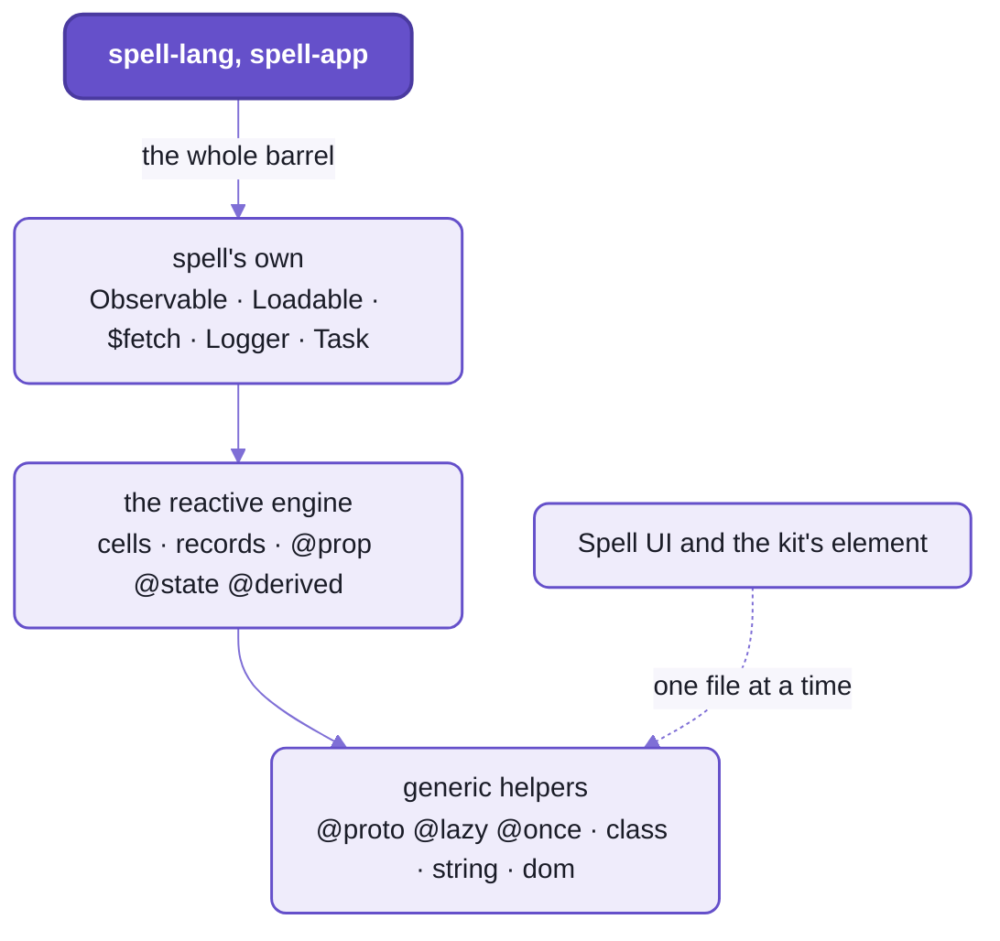

# `spell-kit/util`:  the helpers every repo shares

The small things every Spell repo reaches for, in one folder of the kit and under one import name, `spell-kit/util`.
It comes in three layers, from the most generic up:
- generic helpers:  standard decorators, class, string and DOM helpers, with no dependencies at all
- the reactive engine, spell CELLS:  the one engine every reactive class shares, the language's runtime included
- spell's own utilities:  loading and saving, fetching, tasks, logging, preferences, errors

Beside them, one node-only file:  JSON5 written with its comments kept.

If you've used lodash and a signals library, you've met most of the ideas here;
what's different is why the reactive engine isn't Solid's (below, "The reactive engine").



_Each layer uses only the ones below it;  Spell UI takes only the generic files, one by one._

- Code:  [util/](util/), its tests in [tests/util/](tests/util/).
- Rules for working on it:  [util's AGENTS.md](util/AGENTS.md).

## Importing it

Everything comes from one barrel, imported by name (there's no namespace object, unlike the server's `SRV`):

```ts
import { proto, kebabCase, closestAcrossShadow, $fetch, Logger } from "spell-kit/util"
```

- A few files are also entries of their own, for code that must not load the whole barrel:

  | Entry | Why it's separate |
  | --- | --- |
  | `spell-kit/util/class`, `/decorators`, `/dom`, `/string`, `/util.types` | the generic files, one by one:  what Spell UI and the kit's element import |
  | `spell-kit/util/reactive/cells` | the cells alone |
  | `spell-kit/util/spell/Derivative`, `/spell/Logger` | single classes, for code that wants nothing else |
  | `spell-kit/util/spell/ResponseErrors` | the `ResponseError` family:  deliberately NOT in the barrel (its file's header says why) |
  | `spell-kit/util/node/json5` | node only:  never through a barrel, so no browser code pulls it in |

- Who uses it:
  - spell-lang most of all:  its `spell` folder alone imports it from over 200 files
  - spell-app's app, language server, spaces and command line
  - Spell UI, the generic files only
  - the kit's [element framework](README-element.md)

## The generic helpers

Small, dependency-free helpers, safe anywhere:  in the browser, in node, in a types-only file.
Spell UI is published and bundles what it imports from here, so nothing spell-specific may land in these files.

The decorators are STANDARD (TC39) decorators, the kind TypeScript 5 and every modern bundler understand;
the [toolchain](README-toolchain.md)'s decorator pre-pass lowers them before Solid's compiler sees the code.

```ts
import { proto, lazy, once } from "spell-kit/util"

class IconSet {
  @proto static prefix = "icon" //            a class default, on the prototype:  no copy per instance
  @lazy get names() { return this.readNames() } // made on first read, then kept
  @once load() { return fetch(this.url) } //      runs once;  later calls get the same promise
}
```

- `@proto`:  a class default set on the prototype, so instances carry no copies.
- `@protoMerged`:  `@proto` for a settings object whose keys merge down the class chain,
  like an element's `elementSetup`.
- `@lazy`, `@once`, `forget()` and `@resets()`:  values made once and kept, and how to drop them again.
- `hasOwnProp()` and friends:  class helpers.
- `kebabCase()`, `camelCase()`, `numberToWord()`, `suggest()` ("did you mean ...?"):  strings.
- `closestAcrossShadow()`, `byDocumentOrder()`, `isBrowser()`, `nextFrame()`, `whenDefined()`:
  the DOM, shadow roots included.
- `Constructor`, `AbstractClass`, `Prettify`:  types.

<details>
<summary>Every decorator, one line each</summary>

| Decorator | On | What it does |
| --- | --- | --- |
| `@proto` | a static or instance field | sets the class default on the prototype;  instances carry no copies |
| `@protoMerged` | a static settings object | like `@proto`, but a subclass's keys merge over its parent's instead of replacing them |
| `@lazy` | a getter | runs the getter on first read, then keeps the value |
| `@once` | a method | runs it once and keeps its result (a loader's promise);  later calls get the same result |
| `forget(object, "name")` | -- (a function) | drops what `@lazy` or `@once` kept, for a `reset()` |
| `@resets("name")` | an accessor | each write to it drops that kept value too:  `@resets("load") static accessor url` fetches again when the URL changes |

- The reactive decorators (`@prop`, `@state`, `@derived`) are the engine's:  next section.
- The element framework's decorators (`@E.state`, `@E.controlled` ...):  [README-element.md](README-element.md).

</details>

## The reactive engine:  spell cells

The ONE reactive engine every reactive class shares:  the language's runtime (compiled spell's `Thing`s),
the editor's classes, and in time Spell UI's components.
Generic too:  no lodash, no Solid, nothing spell-specific.

Why not Solid's signals, which the rest of Spell draws with?
- Solid 2 stages writes:  a read right after a write sees the OLD value until Solid flushes.
- Spell is imperative:  `set x to 1` then `print x` must print 1.
- So cells are push-pull with an equality cutoff, and a read is always fresh;
  Solid still follows them through a bridge.

```mermaid
%%{init: {"theme":"base","themeVariables":{"fontFamily":"-apple-system, BlinkMacSystemFont, Segoe UI, Helvetica, Arial, sans-serif","fontSize":"15px","primaryColor":"#EFECFB","primaryBorderColor":"#6550CA","primaryTextColor":"#1A1C27","secondaryColor":"#F4F1E9","tertiaryColor":"#F7F6FC","lineColor":"#7F6FD6","textColor":"#7F6FD6","clusterBkg":"#F7F6FC","clusterBorder":"#B9B0E8","titleColor":"#1A1C27","edgeLabelBackground":"#F7F6FC","actorBkg":"#EFECFB","actorBorder":"#6550CA","actorTextColor":"#1A1C27","actorLineColor":"#9C90DE","signalColor":"#7F6FD6","signalTextColor":"#7F6FD6","labelBoxBkgColor":"#EFECFB","labelBoxBorderColor":"#6550CA","labelTextColor":"#1A1C27","loopTextColor":"#7F6FD6","noteBkgColor":"#F1E7D4","noteBorderColor":"#C9B48A","noteTextColor":"#1A1C27","activationBkgColor":"#DCD6F7","activationBorderColor":"#6550CA","sequenceNumberColor":"#FFFFFF"},"flowchart":{"curve":"basis","padding":12,"nodeSpacing":40,"rankSpacing":44}}}%%
flowchart LR
  write["1 · thing.x = 1<br/>the record is written at once"] --> mark["2 · direct readers marked dirty,<br/>further ones marked check"]
  mark --> read["3 · thing.x reads 1<br/>no flush needed"]
  read --> redraw["4 · a Solid computation that read x re-runs,<br/>only if the value really changed"]
  %% the Spell look:  yarn mermaid:pretty
  classDef default fill:#EFECFB,stroke:#6550CA,stroke-width:1.5px,color:#1A1C27,rx:8px,ry:8px
  classDef step fill:#EFECFB,stroke:#6550CA,stroke-width:1.5px,color:#1A1C27,rx:16px,ry:16px
  class write,mark,read,redraw step
```



_A write, a read, a redraw:  the read in step 3 never waits for Solid;  a write of an equal value notifies nobody._

- Cells:  `Cell`, `Derived` and `Reaction`, with one page-wide context, so every copy of the engine on a page agrees.
- Records:  each object's values live in one record per object.
  - Public props are read and written through `getProp()` / `setProp()`.
  - Internal state, through `getState()` / `setState()`.
  - `typedJSON()` writes an object's props as JSON, its class's name first.
- Schemas:  each class's prop types and rules (`Schema`, `PropRules`), which compiled spell's setters check.
- Decorators, the same names and options as the element framework's:
  so moving a class between them is a change of import.

  ```ts
  import { prop, state, derived } from "spell-kit/util"

  class Card {
    @prop({ default: "up" }) accessor direction!: "up" | "down" // public, in the class's schema
    @state accessor isDragging = false //                          internal, never listed
    @derived get isFaceUp() { return this.direction === "up" } //   cached, recomputed only when it must be
  }
  ```

- The Solid bridge:  `bridgeSolid(solid)`, called by the HOST with its own Solid (util never imports Solid).
  `observe()` runs a function again whenever what it read changes.

## Spell's own utilities

What the language, the app and the tools share, flattened into the barrel last.
These have dependencies, which is why Spell UI never imports this layer:
lodash, chalk, pluralize and query-string, all the kit's own.

- `Observable`:  reactive props and state on spell cells, with `@thing` for spell's own classes.
- `Loadable` and `LoadableFile`:  a resource that knows how to load and save itself (`getLoader()`, `getSaver()`).
- `Task` and `TaskList`:  work with progress, run in order.
- `$fetch()`:  fetch that THROWS for every failure, never returns `{ ok: false }`.
  - Each failure is a subclass of `ResponseError`, so a caller catches the one it expects:
    `OfflineError`, `MissingResourceError` (404), `AuthenticationError` (401 / 403), `ResponseParseError`,
    `AbortedRequestError`, `SaveError`.
  - `abortableFetch()` beside it, for requests a person can cancel.
- `Logger`:  named, levelled logging.
- Preferences:  `prefs` and `AppPrefStore`, kept in the browser.
- `CustomError`, `UIError`, `assert()` and `die()`:  errors with a typed `cause`.
- Smaller helpers:  lodash, strings, arrays, JSON, paths, `drawable` (DOM), constants.

## Node only:  JSON5 with its comments kept

[json5.ts](util/src/node/json5.ts), imported as `spell-kit/util/node/json5`:
reads a JSON5 file and writes it back with every hand-written comment kept.

- `readJSON5File()`, `json5Edited()`, `keepingComments()`, on json5-writer.
- Who uses it:  Spell UI's tools, the app, spaces, spell-epic, and the page server's data files
  ([README-server.md](README-server.md), "Data files").
- Node only:  never through a barrel, so no browser code pulls it in.

## Rules of the folder

- Nothing spell-specific in the generic files, and nothing only one package uses:
  Spell UI's core bundle carries every generic file whether it uses it or not.
- Spell's own files import the generic ones by their entries, never the barrel:
  the barrel re-exports them, so that would be a cycle.
- Tests in [tests/util/](tests/util/), at the same paths as the code:
  - the generic files in a real Chromium (the `browser` project)
  - the reactive engine, spell's own and node's in node (the `spell` project)
- Run them with the kit's `yarn kit:test`, or this folder's alone:  `cd util && yarn vp test run`.

<details>
<summary>The files, one line each</summary>

| File | What |
| --- | --- |
| [src/index.ts](util/src/index.ts) | the barrel:  the generic files, then the reactive engine, then spell's own |
| [src/decorators.ts](util/src/decorators.ts) | `@proto`, `@protoMerged`, `@lazy`, `@once`, `forget()`, `@resets()` |
| [src/class.ts](util/src/class.ts) | `hasOwnProp()`, `getSuperHierarchy()`, `hasDescriptor()` |
| [src/string.ts](util/src/string.ts) | `kebabCase()`, `camelCase()`, `numberToWord()`, `levenshtein()`, `suggest()` |
| [src/dom.ts](util/src/dom.ts) | `NodeType`, `byDocumentOrder()`, `isBrowser()`, `nextFrame()`, `whenDefined()`, `closestAcrossShadow()`, `flatParentFor()` |
| [src/util.types.ts](util/src/util.types.ts) | `Constructor`, `AbstractClass`, `Prettify` |
| [src/reactive/](util/src/reactive/) | the engine:  `cells.ts` (the page-wide context, tracking, `flushCells()`), `Cell`, `Derived`, `Reaction`, `extend.ts` (the records), `Schema`, `PropRules`, `decorators.ts` (`@prop`, `@state`, `@derived`), `bridges.ts` (`bridgeSolid()`, `observe()`) |
| [src/spell/](util/src/spell/) | spell's own:  `Observable`, `Derivative`, `Loadable`, `LoadableFile`, `Task`, `TaskList`, `$fetch`, `abortableFetch`, `ResponseErrors`, `CustomError`, `Logger`, `prefs`, `AppPrefStore`, `assert`, `die`, `Assertable`, `spellDecorators` (`@thing`), `drawable`, `json`, `paths`, `array`, `string`, `constants` |
| [src/node/json5.ts](util/src/node/json5.ts) | JSON5 written with its comments kept (node only) |
| [vitest.config.ts](util/vitest.config.ts) | the two test projects, `browser` and `spell` |

</details>

<details>
<summary>Until repo-split P14 lands</summary>

- Today the kit's own files import this folder by a short alias, from the kit's alias table
  ([tsconfig.base.json](tsconfig.base.json)).
- Other repos already use `spell-kit/util`, as above.
- Once every repo imports by package name, the alias goes and the kit's files use `spell-kit/util` too.

</details>

## See also

- [README-element.md](README-element.md):  the element framework, which builds on the generic helpers
- [README-toolchain.md](README-toolchain.md):  the decorator pre-pass and the checks
- [README-server.md](README-server.md):  the page server, the kit's other node folder
- [README.md](README.md):  the kit, and Spell as a whole
- [spell-lang's README](spell-lang/README.md):  the language whose runtime runs on cells
- Also beside it:
  [README-agents.md](README-agents.md) · [README-cli.md](README-cli.md) ·
  [README-development.md](README-development.md) · [README-vscode.md](README-vscode.md)
