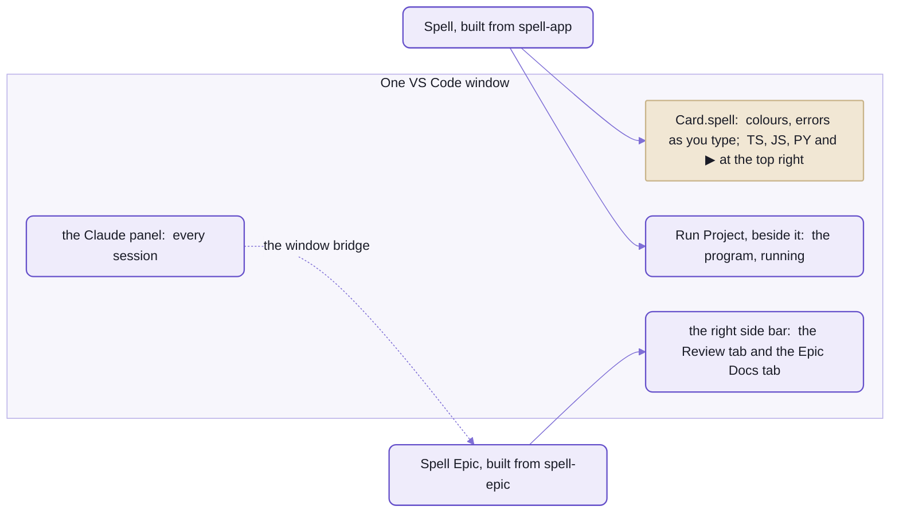
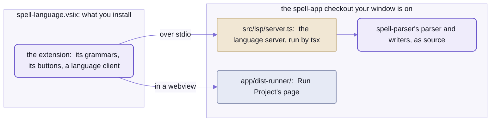

# Spell in VS Code

```spell
a "card" is a view:
	- its "suit" is one of clubs, diamonds, hearts or spades
	- its "color" is:
		red if its suit is diamonds or hearts
		black otherwise

	- its "rank" is one of ace, 2 ... 10, jack, queen, king
	- it "is a face card" if its rank is jack, queen or king
	- it "is a (rank)"
	- it "is the (rank) of (suit)"
```

Open a file like that in VS Code, press the button marked TS at the top right of the editor,
and this opens beside it:

```ts
export type Suit = (typeof Card.Suits)[number]

export class Card extends View {
  static elementTag = core.defineElement(this, "solitaire")

  // - its "suit" is one of clubs, diamonds, hearts or spades
  static Suits = ["clubs", "diamonds", "hearts", "spades"] as const
  @prop({ oneOf: () => Card.Suits })
  accessor suit!: Suit

  get color() {
    if (core.includes(["diamonds", "hearts"], this.suit)) return "red"
    return "black"
  }

  // ...the rank, the same way

  get isAFaceCard() {
    return core.includes(["jack", "queen", "king"], this.rank)
  }
}
```

_Trimmed from the TypeScript `spell compile --target ts/solid` writes for the card, in a project named `solitaire`._

`suit` is typed as exactly the four suits, because the sentence said "one of".
And nothing was written to disk:
the view is a read-only document the language server fills from its parse of your editor's text.
Type in the Spell, and 300 ms after you stop, it asks again, unsaved edits and all.

<details>
<summary>The whole file, with the card's own element</summary>

```ts
import { core, Thing, List, App, View, ViewableList, prop } from "@spell/core"
import { E, SpellElement } from "@spell/elements"

export type Suit = (typeof Card.Suits)[number]
export type Rank = (typeof Card.Ranks)[number]

export class Card extends View {
  static elementTag = core.defineElement(this, "solitaire")

  // - its "suit" is one of clubs, diamonds, hearts or spades
  static Suits = ["clubs", "diamonds", "hearts", "spades"] as const
  @prop({ oneOf: () => Card.Suits })
  accessor suit!: Suit

  get color() {
    if (core.includes(["diamonds", "hearts"], this.suit)) return "red"
    return "black"
  }

  // - its "rank" is one of ace, 2 ... 10, jack, queen, king
  static Ranks = ["ace", 2, 3, 4, 5, 6, 7, 8, 9, 10, "jack", "queen", "king"] as const
  @prop({ oneOf: () => Card.Ranks })
  accessor rank!: Rank

  get isAFaceCard() {
    return core.includes(["jack", "queen", "king"], this.rank)
  }

  isARank(rank: Rank) {
    return this.rank === rank
  }

  isTheRankOfSuit(rank: Rank, suit: Suit) {
    return this.rank === rank && this.suit === suit
  }
}

/**
 * `<solitaire-card>`:  a card, drawn in its own element, e.g. by `draw the card`.
 * - The page defines its tag with this class:  `core.useElement()`, below.
 * - Its attributes are its card's properties;  its methods call its card's.
 * - What every drawable thing's element does, e.g. drawing its card, is `SpellElement`'s.
 */
export class CardElement extends SpellElement<Card> {
  @E.proto static vocabulary = SpellElement.vocabularyFor("solitaire-card", "card", [
    { name: "suit", kind: "string", description: "Its suit." },
    { name: "rank", kind: "string", description: "Its rank." }
  ])

  isARank(rank: Rank) {
    return this.currentThing?.isARank(rank)
  }

  isTheRankOfSuit(rank: Rank, suit: Suit) {
    return this.currentThing?.isTheRankOfSuit(rank, suit)
  }
}
core.useElement(Card, CardElement)

// each drawable type's tag, for the JSX
declare module "@solidjs/web/types/jsx.js" {
  namespace JSX {
    interface IntrinsicElements {
      /** `CardElement` */
      "solitaire-card": HTMLAttributes<HTMLElement> & { [attribute: string]: unknown }
    }
  }
}
```

</details>

The buttons beside TS do the same for JavaScript and Python,
and the ▶ after them runs the project in a panel next to its code.

All of that is one extension, Spell, built from spell-app's [vscode/](https://github.com/spell-app/spell/tree/main/app/vscode) folder.
A second, Spell Epic, from [spell-epic](https://github.com/spell-app/spell/blob/main/epic/README.md), puts the epic page you're reviewing,
and the docs, in a side bar beside your code.
They're separate on purpose:  you can write Spell without the epic tooling, and review an epic without Spell.
Here to install them?  [Skip to it](#two-you-build-the-rest-from-the-marketplace).



_Spell draws on the `.spell` file and beside it;  Spell Epic draws the right side bar,
and a session in the Claude panel reaches its own window through it._

## It runs the Spell on your disk

Most language extensions carry their language server inside them:
to get a newer language, you update the extension.
Spell's carries no Spell at all.



_The `.vsix` holds no Spell:  the language server, the parser under it and Run Project's page
all come from the checkout, as they are on disk._

When a window opens its first `.spell` file, the extension finds the spell-app checkout the window is on,
and starts THAT checkout's language server, from source, with the kit's `tsx`.

- So the editor runs Spell as it is on disk:  change a rule in spell-parser's parser, restart the server,
  and the squiggles follow.  No rebuild, no reinstall.
- And one install serves the main checkout and every epic's worktree:  each window runs its own checkout's Spell.
- A window with no `.spell` file open starts no server.

### Which checkout it runs

It picks ONE, when the server starts, and keeps it until the server restarts:

1. the `spell.parserRoot` setting, when it's set:  then it looks nowhere else
2. else the window's folders, its FIRST folder last:  the first folder that leads to a checkout wins
3. else the checkout the extension was built in, for a `.spell` file opened in a window with no checkout

- A folder leads to a checkout when it's spell-app itself, holds `app/` (the kit, or an epic's worktree of it),
  or is anywhere inside one of those.
- The Output panel's Spell channel says which it picked, and why:
  `Language server from <checkout>:  window folder <folder>`.

The two catches:

- **In an epic's window, it runs the main checkout's server, not the worktree's.**
  First-folder-last suits a window that lists the main checkout first and the worktree after it;
  an epic's window lists its worktree FIRST.
  Set `spell.parserRoot` to the worktree's full path in that window's settings
  ("Preferences:  Open Workspace Settings";  a `~` isn't expanded), and the Output line will name it.
- **No command restarts Spell's server alone.**
  "Developer:  Restart Extension Host" restarts it, and every other extension in the window with it,
  the Claude panel included.

## Two you build, the rest from the Marketplace

You need the kit set up ([setup from zero](README.md#setup-from-zero))
and `spell` on your `PATH` ([README/cli.md](README/cli.md#setting-it-up), "Setting it up").

1. Put VS Code's `code` command on your `PATH`, from the command palette:
   "Shell Command:  Install 'code' command in PATH".  Both installs below use it.
2. Spell:

   ```sh
   cd ~/www/spell/app
   spell app vscode        # builds spell-language.vsix, then installs it into VS Code
   ```

   - It builds the extension of the nearest spell-app checkout:  run it in the one you mean.
     From outside any, it builds the kit's own.
   - A step at a time:  `spell app vscode build`, then `spell app vscode install`.
     spell-app's `yarn vscode`, `yarn vscode:build` and `yarn vscode:install` run the same.
   - It refuses on a branch behind `main`:  every window runs the ONE installed extension,
     so an older build would downgrade them all.
     It says to merge `main` in first (`epic worktree merge-main`);  `--force` builds anyway.
   - The build fails unless the extension's version matches spell-parser's (0.8.0, both):  they're released together.
3. Spell Epic, for the epic pages and the docs beside your code:

   ```sh
   cd ~/www/spell/epic/vscode
   yarn install        # once:  it's a yarn project of its own
   yarn package        # builds it, then writes spell-epic.vsix
   code --install-extension spell-epic.vsix
   ```

   - Or `yarn vscode:package` at spell-epic's root, then the same `code --install-extension`.
   - No script installs it for you:  install it again after a change you want in every window.
4. From the Marketplace, Oxc at least (the table below):  `code --install-extension oxc.oxc-vscode`.
5. Open the kit, `code ~/www/spell`, and any `.spell` or `.spellml` file in it:
   `app/spaces/@spell/examples/Solitaire/Solitaire.spellml`, say.
   With epics, every window opens from a window file instead ([below](#windows-and-worktrees)).

Neither of Spell's two is on the Marketplace:  like the rest of Spell today, they run from a checkout of the kit.

### Extensions you'll want

| Extension | What it does here |
| --- | --- |
| Oxc (`oxc.oxc-vscode`) | the lint and format every repo uses, oxlint and oxfmt, in the editor;  spell-app recommends it |
| Vitest | run or debug one test from the gutter |
| Markdown Preview Mermaid Support | draws the READMEs' pictures in VS Code's Markdown preview |
| Python and Ruff | the two uv projects:  spell-parser's Python runtime, `spell-core`, and spell-app's Python web server, `spell-quart` |
| Claude Code | the agent, and its panel of sessions:  [README/agents.md](README/agents.md) |
| GitLens or Git Graph | five repos' histories side by side |

Turn OFF Prettier and ESLint in these folders.
No repo has a config for either, so Prettier formats with its own defaults (semicolons, 80 columns),
and fights oxfmt on every save.
spell-app marks both unwanted, and pins its formatter to Oxc for each language.

## What it does for a `.spell` file

The colours start in the grammar inside the `.vsix`;  everything else comes from your checkout, as it is on disk.
A `.spellml` file, Spell's tag-shaped form, gets all of it too, plus one view of its own:
[its page](https://github.com/spell-app/spell/blob/main/parser/README-spellx.md) says what the tags mean.

- **Colours.**  Spell's grammar,
  with the `<css>` and `<markdown>` blocks inside a template coloured as CSS and Markdown.
  - Comments are Markdown:  `#` headings and `**bold**` come out bold;  `*italic*`, links and `~~struck~~` too.
  - A `` css`...` `` template in a JavaScript or TypeScript file is coloured as CSS:
    that's how compiled Spell writes a view's style sheet.
  - `.spell` and `.spellml` files indent with tabs.
  - A `.spellml` file's tag heads (`<property "suit">`) are coloured as the Spell they read as.
- **The language server:**  errors as you type, hover, completion, go to definition and references, rename,
  an outline.  [Its page](https://github.com/spell-app/spell/blob/main/app/README-lsp.md) lists every feature.
- **TS, JS, PY:**  the code the file compiles to, beside it and read-only, as above.
  - The writers `spell compile` uses:
    JavaScript is the target the editor runs, TypeScript is `ts/solid`, Python is `py`.
  - Each view's tab ends in its language, `Card.spell.ts`, so all three can be open at once.
  - A file outside any Spell project gets a one-line comment saying so.
- **Show as Code Spell**, first in a `.spellml` file's title bar:  the same file written as plain Spell,
  beside it and read-only.
- **▶ Run Project:**  the project, running in a panel beside its code ("Run Solitaire").
  - It's the runner Spell's editor uses in the browser,
    so a game in progress survives your change:  only the panel's Restart starts afresh.
  - It compiles when it opens, on Restart, and each time you save one of the project's files.
    A compile that fails keeps the last good program running, and says so in the status bar.
  - It runs again when the project's compiled file changes on disk, e.g. compiled by the browser editor.
  - It remembers how it shows the project (its console, its tab, its Type Explorer)
    in a `settings.json5` beside the project's own file.
- **Run Tests** (the flask in the panel, or the beaker at the top right):  the project's tests, as `spell test` runs them.
  - Each `to test ...` runs on a copy of its own, so the game in progress is left alone.
  - A project that starts no app, e.g. one of types and their tests, runs them after every run, by itself.
  - Program Output says how they went:  `✓` for a test that passed, `✗` and its failed checks for one that didn't,
    in the project's language.
  - Each failed check is an error on its own line in the editor, e.g. under
    `it is the queen of spades should be yes` when it's `no`.
    An edit to the file clears them;  the next test run shows them again.
- **`spell.compileOnSave`**, off by default:  compile the project on every save,
  to `<Project>.spell.js` in the build folder (`build/` at the repo's root),
  so anything running that file picks the change up.  Run Project doesn't need it.

The edges:

- **"Show Tree for This Line", in the right-click menu, has no command behind it yet:**
  VS Code says it can't find the command.
  `spell parse --tree "<the line>"` prints that tree in a terminal.
- Run Project needs the checkout's runner bundle, `app/dist-runner/`, which git ignores:
  a fresh worktree has none until `yarn build:runner` runs in its spell-app, or the extension's build does.
- What the extension says when it can't start:

  | It says | Do this |
  | --- | --- |
  | no spell-app checkout in this window's folders | open one, or set `spell.parserRoot` |
  | no spell-app checkout at the `spell.parserRoot` you set | fix the setting, or clear it to use the window's |
  | no `tsx` for the checkout | run `yarn install` at its kit's root |
  | no language server at `<spell-app>/src/lsp/server.ts` | that checkout is older than the extension, and there's no fallback:  pull it, or point `spell.parserRoot` at a newer one |
  | no runner bundle | `yarn build:runner` in that spell-app |
  | this file isn't in a Spell project | open a file from a project, one with a `__project.json5` |

<details>
<summary>Every command and setting of the Spell extension</summary>

| Command | Title | Where |
| --- | --- | --- |
| `spell.showCodeSpell` | Show as Code Spell | the editor's title bar, first, in a `.spellml` file only |
| `spell.showCompiledTypeScript` | Show Compiled TypeScript | the editor's title bar, first in a `.spell` file |
| `spell.showCompiled` | Show Compiled JavaScript | the title bar |
| `spell.showCompiledPython` | Show Compiled Python | the title bar |
| `spell.runProject` | Run Project | the title bar, last (▶) |
| `spell.showLineTree` | Show Tree for This Line | the right-click menu:  nothing behind it yet |

- Every one is in the command palette's "Spell" category, and works only in a `.spell` or `.spellml` file.

| Setting | Default | What it does |
| --- | --- | --- |
| `spell.parserRoot` | empty | the spell-app checkout whose language server to run:  spell-app itself, the kit folder holding it, or any folder inside one;  empty:  the window's own |
| `spell.compileOnSave` | `false` | compile the project on save, so a running app picks it up |

The settings it sets for you:

| Setting | Value |
| --- | --- |
| `[spell]` and `[spellx]` `editor.insertSpaces`, `editor.detectIndentation` | both `false`:  tabs, always |
| `[spell]` and `[spellx]` `editor.formatOnType` | `true`:  a Spanish word gets its accents as you type it (`accion` => `acción`) |
| `editor.semanticTokenColorCustomizations` | the Markdown in comments:  headings 1 to 4 and bold in bold, italic, links underlined, strikethrough |
| `editor.tokenColorCustomizations` | a `#` heading comment in bold from the grammar too |

- Its id is `spell-language` (publisher `spell-app`), shown as "Spell", version 0.8.0.
- It starts on a window's first `.spell`, `.spellml`, `.tsx` or `.jsx` file (`activationEvents`);
  the language server waits for the first `.spell` file.
- It hands VS Code the HTML and CSS data (`contributes.html.customData`, `contributes.css.customData`),
  copies in its `out/data/`.

</details>

## What it does in JSX, HTML and CSS files

The same extension helps with custom elements outside Spell, too:
Spell UI's `<ui-*>` tags, and any set that ships a Custom Elements Manifest.

- **In `.tsx` and `.jsx` files:**  what the JSX types can't say.
  - `slot="` on a child of a custom element lists the parent tag's slots;
    `part="`, in a component's own folder, lists its parts.
  - A slot, part or dashed attribute the tag doesn't have is a warning, in the Problems list:
    `<ui-button text-alin="left">`.
  - It reads the manifests of the file's own checkout, so an epic's worktree gets the worktree's.
  - The editor's own TypeScript stays TypeScript 7:  nothing to switch.
  - The checks, and where they learn the tags:
    [README/element.md](README/element.md#the-elements-help--slots-parts-and-dashed-attributes-in-jsx).
- **In `.html` files:**  autocomplete and hover docs for every `<ui-*>` tag, attribute and value.
- **In `.css` files:**  every custom property (`--ui-button-padding-block`), part (`::part(icon)`)
  and custom state (`:state(open)`), with hover docs.

The HTML and CSS data are written by each set's `yarn site:data` (Spell UI's, and our other sets'),
and copied into the extension when it's built.

- **The catch:  a vocabulary change shows in HTML and CSS only after a rebuild, `spell app vscode`,
  and "Reload Window".**
  The JSX help reads the manifests live, with no rebuild.
- One copy of each tag in every window, an epic's too:  the extension hands VS Code the data once.

## The settings the repos ship

One folder of editor settings, spell-app's `.vscode/`.
spell-ui adds a single setting;  the kit, spell-parser and spell-epic ship none.

| File | What it holds |
| --- | --- |
| spell-app's [extensions.json](https://github.com/spell-app/spell/blob/main/app/.vscode/extensions.json) | Oxc recommended;  Prettier and ESLint (`esbenp.prettier-vscode`, `dbaeumer.vscode-eslint`) marked unwanted |
| spell-app's [settings.json](https://github.com/spell-app/spell/blob/main/app/.vscode/settings.json) | Oxc lints as you type and formats on save, pinned for each language;  `.json5` read as JSON with comments;  schemas for people's files;  what search skips |
| spell-app's [launch.json](https://github.com/spell-app/spell/blob/main/app/.vscode/launch.json) | "Run Spell Extension", on F5:  a new window running the extension from `vscode/`, open on the Solitaire example |
| spell-app's [tasks.json](https://github.com/spell-app/spell/blob/main/app/.vscode/tasks.json) | "Build Spell Extension", which F5 runs first:  `yarn install && yarn build` in `vscode/` |
| spell-ui's [settings.json](https://github.com/spell-app/spell/blob/main/ui/.vscode/settings.json) | a link in the Markdown preview opens its file in the editor |

**The catch:  VS Code reads a folder's `.vscode/` only when that folder is one of the window's top-level folders.**
The kit's window and every epic's window are rooted at the kit, which ships none:
there, your own settings decide what formats on save.

- The HTML and CSS data don't depend on that:  the extension carries them, in every window.

For spell-app's settings and its F5, open spell-app in a window of its own, `code ~/www/spell/app`;
its Claude panel then lists only the sessions started there.

<details>
<summary>Every setting in spell-app's settings.json</summary>

| Setting | What it does |
| --- | --- |
| `oxc.enable`, `oxc.lint.run: "onType"` | oxlint, through the Oxc extension, as you type |
| `oxc.disableNestedConfig`, `oxc.fmt.disableNestedConfig` | read only the window's root `vite.config.ts`, as `vp check` does |
| `oxc.unusedDisableDirectives: "warn"` | a stale `// oxlint-disable` shows in the editor, not only in CI, as the lint script's `--report-unused-disable-directives` would |
| `editor.defaultFormatter: "oxc.oxc-vscode"`, `editor.formatOnSave` | oxfmt on save, for every file and pinned for each language:  TypeScript, TSX, JavaScript, JSX, JSON, JSONC, CSS, Less, YAML |
| (no Markdown) | the format settings skip `**/*.md`:  the `AGENTS.md` files and the READMEs are wrapped by hand |
| `files.associations`:  `*.json5` as `jsonc` | VS Code has no JSON5 mode, and checks a file against a schema only in its JSON modes |
| `json.schemas` | a person's `__me.json5` and an org's `__org.json5`, checked against the people library's types;  `spell compile` writes `Person.schema.json` and `Org.schema.json` into the build folder, so they're missing until it has run |
| `search.exclude` | Quick Open and Find in Files skip `__snapshots__/`, `_assets/` (the icons), `_data/`, `graphify-out/`, `app/static/semantic-ui-css/` and `yarn.lock`;  Explorer still shows them |
| `js/ts.experimental.useTsgo: false` | the editor's TypeScript stays the JavaScript one, not the native preview |
| `vetur.validation.script: false` | a leftover, for Vue's Vetur extension |

</details>

## Spell Epic:  the pages beside your code

An issue tracker lives in a browser tab, away from the code and from the agent doing the work.
Spell Epic puts the epic page in VS Code's RIGHT side bar instead, beside your code and the Claude panel,
live from a page server:  the machine's epic server (`epic hub`, port 4848) when it runs,
else a checkout's own (4747 for the main checkout).

- **Review** (`spellEpic.reviewView`, the checklist):  the epic page under review (`/epic review <name>`),
  its details pages, test runs.
  You mark items on it, and a listening Claude session acts on your marks
  ([the review loop](https://github.com/spell-app/spell/blob/main/epic/README-pages.md)).
  "Review:  Open Epic..." picks any registered repo's epic, from any window.
- **Epic Docs** (`spellEpic.docView`, the hat):  any guide or docs page, reloading as it changes
  (`epic pages open <page> --vs`, `epic open <epic>`, `/spell-docs`).
  Its one setting, `spellEpic.docPreview.location`, can move it to VS Code's Simple Browser
  (`beside`;  the default is `sidebar`);  a page for review always opens in Review.
- A page that stopped answering:  Reload, Restart Page Server, or Home Page, a fresh view at the docs' home page.

It also runs the WINDOW BRIDGE, which the windows below lean on.
It starts with VS Code, in every window (`onStartupFinished`), and writes one registry file per window,
`~/.spell-epic/windows/<pid>.json`.
A Claude Code session walks up its own processes to that file, so it reaches ITS window, not the focused one:
to show a page beside itself, add a folder, or hand itself over to a worktree's window.
`/isolate <name>` moves a session that way, and `/send` wakes an epic's session;
the prompt is typed in, never sent, so you press Enter.

- Every id it has is `spellEpic.*` (`spell-app.spell-epic`), so it runs beside the Spell extension.
- Its buttons, which server serves which page, and every operation of the bridge:
  [its own page](https://github.com/spell-app/spell/blob/main/epic/README-vscode.md).

## Windows and worktrees

In plain VS Code you open a folder.
With epics, every window opens from a WINDOW FILE, `<name>.code-workspace`,
because the order of a window's folders decides which sessions its Claude panel lists.

- They live in the content folder's `windows/`, each machine's own and git-ignored there;
  an epic's goes in `windows/ongoing/`.
  The folder is `windowsFolder`, in the kit's epic settings ([.epic/config.json5](.epic/config.json5)).
- `epic window init` writes the missing ones, and brings the rest up to date.

Here's the window this page was written in, the `readme` epic's, as `epic window` wrote it:

```json
{
  "folders": [
    { "path": "../../../../spell.worktrees/readme", "name": "⎇ readme" },
    { "path": "../..", "name": "spell.epics" }
  ],
  "settings": {
    "workbench.colorTheme": "Quiet Light",
    "files.exclude": { ".claude/worktrees": true },
    "workbench.colorCustomizations": { "titleBar.activeBackground": "#218345", "...": "..." }
  },
  "spell": { "package": "spell" }
}
```

_`ongoing/readme.code-workspace`, its colours trimmed:
the paths are relative to the file, in the content folder's `windows/`._

The worktree, then the content folder:  no main checkout (`windows.worktreeOnly`, in the kit's epic settings).
The kit's own window, `spell.code-workspace`, has just the last two:
`spell`, the main checkout at `~/www/spell`, and `spell.epics`.

- The Claude panel lists only the sessions saved under its window's FIRST folder.
  So every new worktree's session folder is a link to the main checkout's (`linkSessionFolders`, in the epic
  settings):  every session saves there, wherever it started, and every window lists them all.
- An epic's worktree comes first, so a new Claude tab starts its session inside it, with nothing to enter.
  - The main checkout isn't in it (2026-10-22):  every file was listed twice in Quick Open, the main checkout's
    beside the worktree's.
    - Its files were hidden in the Explorer, beside a `.spell-main` marker, but VS Code's file search ignores that
      kind of rule.
    - `epic window init` drops it from the worktree windows written before.
    - So an epic's window shows the worktree's Source Control only;  the main checkout's is in the kit's own window.
  - A window written with the main checkout first keeps that order:
    `init` never reorders an open window's folders, since a new first folder restarts its extensions.
- The kit's window turns `git.detectWorktrees` on, so every epic's worktree shows in its Source Control too.
- Each window is told apart by its colours.
  A new epic's window takes the look of the window it was opened from, its title bar tinted a colour of its own,
  as `readme`'s green above.
  Or ask for a LOOK:  Tomorrow Night Blue's, turned to one of 12 hues
  (red, orange, amber, green, teal, cyan, blue, indigo, purple, pink, brown, grey).
  - `/epic color teal` recolours the window you're in (`epic window color teal`), at once, with no reload.
  - `/epic <name> -teal` or `/isolate <name> -teal` opens a new one in that look.

The rules that keep windows working:

- NEVER `code --add` or `--remove`:  they act on the FOCUSED window,
  and a one-folder window restarts its extensions, the Claude panel included.
- NEVER `code -r`:  it restarts the session.
- Open a window file only through `epic window open <name>`.
- Never add a worktree's folders to another window:
  VS Code writes them into the window file, where they stay after the worktree is gone.

A session moves between windows on its own.
`/isolate <name>` opens the worktree's window, and when the session's turn ends,
the new window resumes it in an editor tab and the old one closes its tab
(`epic window handoff`, which the `Stop` hook finishes).
Or the session STAYS:  same window, now titled `⎇ <name>` and tinted (`epic window stay`);
`epic window should-stay` recommends one or the other, and says why.
`/isolate done` moves nothing back:  the worktree's window stays open for you to read the summary,
and `epic window close <name>` closes it and deletes its file.
A window the session stayed in gets its title and colours back (`epic window stay --end`).

- Every `epic window` verb:  [spell-epic's README-cli.md](https://github.com/spell-app/spell/blob/main/epic/README-cli.md).
- The skills and hooks behind the moves:  [README/agents.md](README/agents.md), "Skills and hooks".

<details>
<summary>Airplane mode, in three lines</summary>

- `/airplane` before a flight readies the pages for working with no Claude;
  `/airplane land` afterwards gathers everything you left on them.
- The Review and Epic Docs tabs keep working offline, against the laptop's page server:
  "Review:  Open Epic..." reaches any epic page with no terminal.
- It needs the main checkout's page server running and Spell Epic installed from `main`;
  `epic airplane check --fix` fixes what it can.

</details>

## Working on the extensions

Both are small TypeScript projects outside the kit's one install, each with its own `package.json` and lock file.
So each needs a `yarn install` of its own:
an epic's worktree runs both for you (`extraInstalls`, in the epic settings).

- **Spell:**  open spell-app in a window of its own, and press F5.
  - "Run Spell Extension" builds `vscode/` first, then opens a new window on the Solitaire example,
    running your build.
  - Type check:  `yarn check` in spell-app's `vscode/`.
  - While you work:  a change to the language server needs a restart of it;
    to Run Project's runner, `yarn build:runner` in that checkout;  to the extension itself, a rebuild.
  - When a stage of work on any of the three is done, rebuild and reinstall (`spell app vscode`):
    never from a branch behind `main`, since every window runs the one install.
- **Spell Epic:**  `yarn check` and `yarn package` in spell-epic's `vscode/`, then install the `.vsix`.
  spell-epic's `yarn test` runs its tests (`yarn test:vscode` alone).
  [Its source](https://github.com/spell-app/spell/tree/main/epic/vscode/src), and the rest:  [its page](https://github.com/spell-app/spell/blob/main/epic/README-vscode.md).

| Spell's file | What's in it |
| --- | --- |
| [extension.ts](https://github.com/spell-app/spell/blob/main/app/vscode/src/extension.ts) | starts the language server, and the TS, JS and PY views |
| [ElementsHelp.ts](https://github.com/spell-app/spell/blob/main/app/vscode/src/ElementsHelp.ts) | custom elements' slot, part and dashed-attribute help in `.tsx` and `.jsx` files:  shows what the kit's `JsxElementHelp` finds |
| [spellAppRoot.ts](https://github.com/spell-app/spell/blob/main/app/vscode/src/spellAppRoot.ts) | which checkout to run:  plain node, no `vscode`, so a script can check it |
| [RunnerPanel.ts](https://github.com/spell-app/spell/blob/main/app/vscode/src/RunnerPanel.ts) | Run Project's panel |
| [build.mjs](https://github.com/spell-app/spell/blob/main/app/vscode/build.mjs) | the esbuild bundle, `out/extension.js`, with the kit's elements help and TypeScript 6 inside;  the HTML and CSS data, copied into `out/data/`;  the version check;  Run Project's runner, through spell-app's `yarn build:runner` |
| [syntaxes/](https://github.com/spell-app/spell/tree/main/app/vscode/syntaxes) | the two grammars:  Spell's, and CSS in JavaScript's `` css`...` `` templates |
| [package.json](https://github.com/spell-app/spell/blob/main/app/vscode/package.json) | the commands, menus, settings, language and HTML and CSS data VS Code reads |

- `yarn package` writes `spell-language.vsix`, with `vsce`:
  only the bundle, the HTML and CSS data, the manifest, the grammars, the language settings and the icons go in it.
- The language server is spell-app's [server.ts](https://github.com/spell-app/spell/blob/main/app/src/lsp/server.ts), run by `tsx`.

## 🌱 Coming

- `spell lsp`:  a command that starts the language server, so the extension runs `spell` rather than a `tsx` path.
  Where it stands:  on the command line's roadmap ([README/cli.md](README/cli.md)), not started.

## See also

- [spell-app's README-lsp.md](https://github.com/spell-app/spell/blob/main/app/README-lsp.md):  the language server under the extension,
  every feature it answers
- [spell-epic's README-vscode.md](https://github.com/spell-app/spell/blob/main/epic/README-vscode.md):  Spell Epic in full,
  its servers and the window bridge
- [README/development.md](README/development.md):  worktrees and the checks, day to day
- [README/agents.md](README/agents.md):  Claude Code, and the skills and hooks that move sessions between windows
- [README/cli.md](README/cli.md):  `spell app vscode`, beside every other command

<details>
<summary>More in the docs site</summary>

These guides live in the content folder:
they need a checkout with `spell.epics` beside the repos,
and the page server running (`spell server start`, then the URL it prints):

- "Windows and Review":  `/guides/windows-and-review.html`
- "Reviewing an Epic Page":  `/guides/epic-components/review.html`
- "Epic Pages":  `/guides/plan-docs/plan-docs.html`
- "Airplane Mode":  `/guides/airplane.html`

</details>
