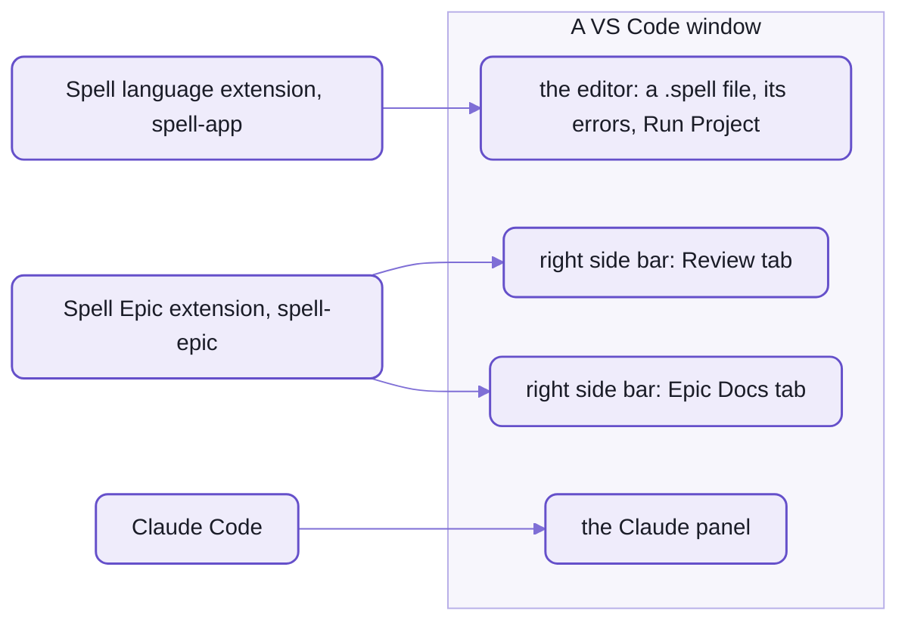

# Spell in VS Code

Spell is worked on in VS Code, with two extensions of its own:
the Spell language extension, from spell-app, for `.spell` files;
and Spell Epic, from spell-epic, for reviewing epic pages and reading the docs in the side bar.
This page says what each one does, how to install and hack on them, and how windows and worktrees are laid out.

- They're separate on purpose:  you can write spell without the epic tooling, and review epics without spell.
- Both are built from your checkout and installed by hand;  neither is on the Marketplace yet.



_The language extension draws the editor's spell features;  Spell Epic draws the two tabs in the right side bar._

## The Spell language extension

It teaches VS Code the `spell` language:
colours, errors as you type, completion, and buttons to run a project or see what it compiles to.
It starts on the first `.spell` file a window opens.

- The `spell` language for `.spell` files:
  - a grammar, with CSS and Markdown embedded
  - Markdown in comments drawn as Markdown (`#` headings in bold, links, emphasis)
  - a grammar for CSS inside template strings, injected into JavaScript and TypeScript files
  - `.spell` files indent with tabs by default
- Errors, hover and completion from spell's language server:  the checkout's own, run from its source.
- Commands, in the "Spell" category, with buttons in the title bar of a `.spell` file:
  - "Run Project" (▶)
  - "Show Compiled JavaScript", "Show Compiled TypeScript", "Show Compiled Python"
  - "Show Tree for This Line" (in the editor's right-click menu):  what `spell parse` shows
- Its source:  spell-app's [`vscode/`](spell-app/vscode/), a yarn project of its own:
  with its own lock file, outside the kit's install.

### Which checkout it runs

One install works from the main checkout and from every worktree:
the extension runs the language server of the checkout the WINDOW is on, found when the server starts.

1. the `spell.parserRoot` setting, if set
2. else the window's folders, a worktree's before the main checkout's
3. else the checkout it was built in

- The extension's output says which it picked.
- Restart the language server to pick up a change to it.

### Installing it

```sh
spell vscode            # build its .vsix, then install it into VS Code
```

- Or its two steps:  `spell vscode build`, then `spell vscode install`.
- spell-app's root scripts do the same:
  `yarn vscode`, `yarn vscode:build`, `yarn vscode:install`.
- It REFUSES on a branch behind `main`, since installing an older build would downgrade every window;
  `--force` overrides that.
- Its build fails unless its version matches spell-lang's.
- `code` must be on your `PATH` (VS Code's "Shell Command:  Install 'code' command in PATH").

<details>
<summary>Until repo-split P13 lands:  the install's name today</summary>

- Today the command is `spell dev vscode`:  the same command, under `dev`.
  - And its two steps:  `spell dev vscode build`, `install`.
- That spelling keeps working after P13.

</details>

<details>
<summary>Every command and setting of the language extension</summary>

| Command | Title | Where |
| --- | --- | --- |
| `spell.runProject` | Run Project | title bar of a `.spell` file |
| `spell.showCompiled` | Show Compiled JavaScript | title bar |
| `spell.showCompiledTypeScript` | Show Compiled TypeScript | title bar |
| `spell.showCompiledPython` | Show Compiled Python | title bar |
| `spell.showLineTree` | Show Tree for This Line | right-click menu |

| Setting | Default | What it does |
| --- | --- | --- |
| `spell.parserRoot` | empty | the spell-app checkout whose language server to run:  spell-app itself, the kit folder holding it, or any folder inside one;  empty:  the window's own |
| `spell.compileOnSave` | `false` | compile the project on save, so a running app picks it up |

- Its id is `spell-language` (publisher `spell-app`), shown as "Spell", version 0.8.0.
- Its build runs esbuild, and also spell-app's `yarn build:runner`:  the page Run Project shows.
- `yarn package` writes `spell-language.vsix`, with `vsce`.
- The language server is spell-app's [`server.ts`](spell-app/lsp/src/server.ts), run by `tsx`.
- The code that picks the checkout:  [`spellAppRoot.ts`](spell-app/vscode/src/spellAppRoot.ts).
  Run Project's panel:  [`RunnerPanel.ts`](spell-app/vscode/src/RunnerPanel.ts).

</details>

## The Spell Epic extension

Spell Epic puts two tabs in VS Code's RIGHT side bar, so a page sits beside your code and the Claude panel.

- **Review** (the checklist icon):
  the epic page being reviewed (`/epic review <name>`), its details pages and test runs.
  - Every item has buttons:  Approve, Make Todo, Revisit, Add Details Now;  and a note box (Make Todo, Later, Do Now).
  - Send (the paper plane) and Review Now (the wand) in the page's header.
  - Your marks and notes save to the epic's inbox as you type, and a listening Claude session acts on them.
  - "Review:  Open Epic..." picks any registered repo's epic, from any window.
- **Epic Docs** (the spell hat icon):  any guide or docs page, live-reloading (`epic open`, `/spell-docs`).
- Both tabs have Back, Forward, Reload, Home Page, Restart Page Server and Open in Browser buttons;
  the docs tab adds Inspect and Show Console (Developer Tools on the page).
- Copy, cut, paste, select-all and undo work inside the pages:  it forwards them into the framed page.

Pages are served live by the first of these that answers:

1. spell-epic's one epic server per machine (`epic hub`, port 4848)
2. the file's checkout's page server (port 4747 for the main checkout)
3. a small server of the extension's own

### The window bridge

A Claude Code session finds its OWN VS Code window through the extension:
so it can show a page beside itself, add a folder, or hand itself over to a worktree's window.
The session finds the window by its process, through a registry the extension keeps in `~/.spell-epic/windows/`.

- `/isolate <name>` uses it to move a session into its worktree's new window, and `/send` to wake an epic's session.
- It types a prompt into the session it opens, and never sends it for you.

### Installing it

```sh
cd ~/www/spell/spell-epic/vscode
yarn install      # once:  it's a yarn project of its own
yarn check        # type check
yarn package      # builds it, then writes spell-epic.vsix
code --install-extension spell-epic.vsix
```

- Or `yarn vscode:package` at spell-epic's root.
- No script installs it for you:  install it again after a change you want in every window.
- Every id is `spellEpic.*` (`spell-app.spell-epic`), so it runs beside the language extension.

<details>
<summary>Every command, setting and view of Spell Epic</summary>

| View | Id | Shows |
| --- | --- | --- |
| Review | `spellEpic.reviewView` | the epic page under review, details pages, test runs |
| Epic Docs | `spellEpic.docView` | docs pages |

- Each tab's commands:  Back, Forward, Reload Doc, Restart Page Server, Open Doc in Browser, Home Page.
  - Home Page:  a fresh view at the docs' home page, for a page that stopped responding.
  - The Review tab's are named "Review:  ...", and add "Review:  Open Epic...".
- The docs tab adds two:
  - Inspect:  opens Developer Tools;  then the arrow at its top left, and click in the page
  - Show Console:  then its Console tab, and the page, `127.0.0.1`, in the menu at its top left
- The pages' right-click menu:  Cut, Copy, Paste, Select All, Back, Forward, Reload, Open in Browser, Inspect.
- One setting, `spellEpic.docPreview.location`:  where docs pages open.
  - `sidebar` (the default), or `beside`, in VS Code's Simple Browser.
  - Pages for review always open in the Review tab.
- It starts with VS Code (`onStartupFinished`), and on a `vscode://` link to it.
- The window bridge's registry:  one file per window, `~/.spell-epic/windows/<pid>.json`, behind a token on localhost.
  Its operations:  add or remove a folder, show a page (docs or review), reload a view, close the window,
  open a session with a prompt typed in.
- [Its source](spell-epic/vscode/src/), in spell-epic:  the views, the docs preview, the window bridge.
- More:  [spell-epic's README-vscode.md](spell-epic/README-vscode.md).

</details>

## Windows and worktrees

Every window opens from a WINDOW FILE, `<name>.code-workspace`, kept in the content folder's `windows/`:
each machine's own, git-ignored there.
A worktree's window file goes in `windows/ongoing/`.

- Folder 1 of every window is the kit, `~/www/spell`:
  the Claude panel lists only the sessions saved under a window's FIRST folder, so every window lists every session.
- A worktree's window adds the worktree, `⎇ <name>`, as folder 2, and hides the main checkout's files.
- Then the content folder, `spell.epics`.
- `git.detectWorktrees` is on, so each repo's worktree shows in Source Control.
- Each window has a look of its own:  Tomorrow Night Blue in 12 hues
  (red, orange, amber, green, teal, cyan, blue, indigo, purple, pink, brown, grey).
  - `/epic color teal` recolours the window you're in.
  - `/epic <name> -teal` or `/isolate <name> -teal` opens a new one in that look.

The rules that keep windows working:

- NEVER `code --add` or `--remove`:  they act on the focused window,
  and a one-folder window restarts its extensions, the Claude panel included.
- NEVER `code -r`:  it restarts the session.
- Open window files only through `epic window open <name>`.
- Never add a worktree's folders to another window:
  VS Code writes them into the window file, and they stay after the worktree is gone.

<details>
<summary>Every epic window verb</summary>

| Verb | What it does |
| --- | --- |
| `epic window init` | writes the missing window files, and brings the rest up to date |
| `epic window which` | which window this session is in |
| `epic window open <name> [--color <look>]` | opens a worktree's window from its file |
| `epic window close <name>` | closes it and deletes its file |
| `epic window launch <name>` | a NEW session in a worktree's window |
| `epic window handoff` / `resume` | moves this session to another window when its turn ends (the `Stop` hook) |
| `epic window stay <name>` / `stay --end` | a session staying in its window:  titled `⎇ <name>` and tinted, then put back |
| `epic window stay-check` | recommends a new window or staying, with reasons |
| `epic window color [<look>]` | recolours the window |
| `epic window show` | shows a page beside the session, in the window it's moving to |
| `epic window reload-view` | reloads a side-bar view |
| `epic window add` / `remove` | a folder, never a worktree's |

- Where window files live:  `windowsFolder` in the repo's epic settings ([.epic/config.json5](.epic/config.json5)).
- How sessions move between windows:  [README-agents.md](README-agents.md), "Skills and hooks".

</details>

<details>
<summary>Airplane mode, in three lines</summary>

- `/airplane` before a flight readies the pages for working with no Claude;
  `/airplane land` afterwards gathers everything you left on them.
- The Review and Epic Docs tabs keep working offline, against the laptop's page server.
- It needs the main checkout's page server running and the extension installed from `main`.

</details>

## Extensions you'll want

Third-party extensions that fit how the repos are set up.

| Extension | What it does here |
| --- | --- |
| Oxc (`oxc.oxc-vscode`) | the lint and format the repos use (oxlint, oxfmt), on save;  spell-app's workspace recommends it |
| Vitest | run or debug one test from the gutter;  spell-app's root config lists every folder's tests |
| Playwright Test | the browser tests and the headless page checks |
| Markdown Preview Mermaid Support | draws the READMEs' diagrams in VS Code's Markdown preview |
| Python and Ruff | the uv projects:  spell-lang's py, spell-app's Python web server |
| Claude Code | the agent, and its panel of sessions:  [README-agents.md](README-agents.md) |
| GitLens or Git Graph | six repos' histories side by side |

- Turn OFF Prettier and ESLint in these folders:  the repos have no config for either,
  so Prettier formats with its own defaults (semicolons, 80 columns) and fights oxfmt on every save.
  - spell-app's [extension recommendations](spell-app/.vscode/extensions.json) mark both unwanted,
    and its settings pin the formatter to Oxc per language.
- Autocomplete and hover docs for every `<ui-*>` and `<brand-*>` tag in HTML files:
  from Spell UI's and the brand's vocabularies, as VS Code HTML custom data (spell-app's workspace settings name them).

## Hacking on them

Both extensions are small TypeScript projects;  each has its own `package.json` and lock file.

- The language extension:  open spell-app and press F5.
  - "Run Spell Extension" builds `vscode/` and opens a new window on the Solitaire example.
  - Type check:  `yarn check` in spell-app's `vscode/`.
- Spell Epic:  `yarn check` and `yarn package` in spell-epic's `vscode/`, then install the `.vsix`.
  spell-epic's `yarn test` runs its tests (`yarn test:vscode`).
- An epic's worktree installs both extensions' own dependencies for you (the epic settings' `extraInstalls`).
- Rebuild and reinstall the language extension when a change to the extension, the runner or the language server
  is done:  never from a branch behind `main`.

## See also

- [README.md](README.md):  the kit's front page
- [README-cli.md](README-cli.md):  `spell vscode` and the other repo tools
- [README-development.md](README-development.md):  worktrees, and the checks
- [README-agents.md](README-agents.md):  Claude Code, skills and hooks
- [spell-app's README-lsp.md](spell-app/README-lsp.md):  the language server under the extension
- [spell-epic's README](spell-epic/README.md):  epic pages and the review loop
- Also beside it:
  [README-element.md](README-element.md) · [README-server.md](README-server.md) ·
  [README-toolchain.md](README-toolchain.md) · [README-util.md](README-util.md)

<details>
<summary>More in the docs site</summary>

These guides live in the content folder:
they need a checkout with `spell.epics` beside the repos,
and the page server running (`spell server start`, then the URL it prints):

- "Windows and Review":  `/guides/windows-and-review.html`
- "Reviewing an Epic Page":  `/guides/epic-components/review.html`
- "Epic Pages":  `/guides/plan-docs/plan-docs.html`
- "Airplane Mode":  `/guides/airplane.html`

</details>
