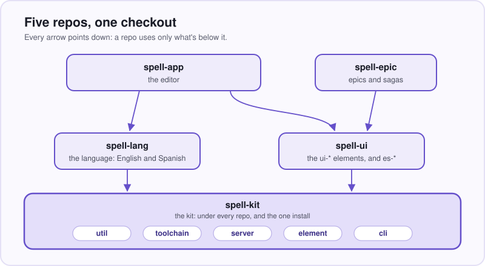
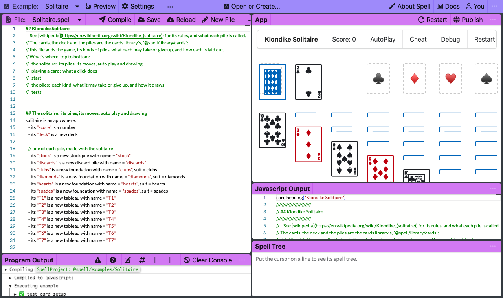

# Spell

```spell
a "card" is a drawable thing:
	- its "suit" is one of clubs, diamonds, hearts or spades
	- its "color" is:
		red if its suit is diamonds or hearts
		black otherwise

	- its "rank" is one of ace, 2 ... 10, jack, queen, king
	- it "is a face card" if its rank is jack, queen or king
	- it "is a (rank)"
	- it "is the (rank) of (suit)"
```

_A playing card, in Spell's outline style:  a name, then what's true of it.  It compiles as written._

You just read a program.
Nobody taught you its syntax, and you could explain it to a friend.

That isn't pseudo-code, and it isn't a prompt.
A rule-based parser reads it the same way every time:  no model guessing what you meant.

To you, that's a playing card.
To the compiler, it's a class called `Card`, and each bullet became a member of it:
- `suit` and `rank`, properties with a fixed list of values, where `2 ... 10` means what you'd think
- `color`, worked out from the suit each time it's read, so there's nothing to keep in step
- `isAFaceCard`, a question the card answers yes or no
- `isARank(rank)` and `isTheRankOfSuit(rank, suit)`, from the two sentences with blanks in them:
  each blank is named after a property, so the compiler wrote the method bodies too
- and `drawable` makes each card an element of its own on the page, `<solitaire-card>`

The quotes mark new words, which the parser learns as it reads.
From here on, a program can say `if the card is a queen`, and that compiles to `if (card.isARank("queen"))`.

<details>
<summary>What those sentences compile to, in JavaScript, TypeScript and Python</summary>

The whole output, unchanged, for a project named `solitaire` (hence `<solitaire-card>`):
`spell compile --stdout`, and the same with `--target ts/solid` and `--target py`.

<details>
<summary>JavaScript</summary>

```js
import { core, Thing, List, App, Drawable, DrawableList } from "@spell/core"

export class Card extends Drawable {
  static elementTag = core.defineElement(this, "solitaire")

  // - its "suit" is one of clubs, diamonds, hearts or spades
  static Suits = ["clubs", "diamonds", "hearts", "spades"]
  static { this.declareProp("suit", { oneOf: Card.Suits }) }
  get suit() { return this.getProp("suit") }
  set suit(value) { this.setProp("suit", value) }

  get color() {
    if (core.includes(["diamonds", "hearts"], this.suit)) return "red"
    return "black"
  }

  // - its "rank" is one of ace, 2 ... 10, jack, queen, king
  static Ranks = ["ace", 2, 3, 4, 5, 6, 7, 8, 9, 10, "jack", "queen", "king"]
  static { this.declareProp("rank", { oneOf: Card.Ranks }) }
  get rank() { return this.getProp("rank") }
  set rank(value) { this.setProp("rank", value) }

  get isAFaceCard() {
    return core.includes(["jack", "queen", "king"], this.rank)
  }

  isARank(rank) {
    return this.rank === rank
  }

  isTheRankOfSuit(rank, suit) {
    return this.rank === rank && this.suit === suit
  }
}
```

</details>

<details>
<summary>TypeScript</summary>

```ts
import { core, Thing, List, App, Drawable, DrawableList, prop } from "@spell/core"
import { E, SpellElement } from "@spell/elements"

export type Suit = (typeof Card.Suits)[number]
export type Rank = (typeof Card.Ranks)[number]

export class Card extends Drawable {
  static elementTag = core.defineElement(this, "solitaire")

  // - its "suit" is one of clubs, diamonds, hearts or spades
  static Suits = ["clubs", "diamonds", "hearts", "spades"] as const
  @prop({ oneOf: () => Card.Suits })
  accessor suit!: Suit

  get color() {
    if (core.includes(["diamonds", "hearts"], this.suit)) return "red"
    return "black"
  }

  // - its "rank" is one of ace, 2 ... 10, jack, queen, king
  static Ranks = ["ace", 2, 3, 4, 5, 6, 7, 8, 9, 10, "jack", "queen", "king"] as const
  @prop({ oneOf: () => Card.Ranks })
  accessor rank!: Rank

  get isAFaceCard() {
    return core.includes(["jack", "queen", "king"], this.rank)
  }

  isARank(rank: Rank) {
    return this.rank === rank
  }

  isTheRankOfSuit(rank: Rank, suit: Suit) {
    return this.rank === rank && this.suit === suit
  }
}

/**
 * `<solitaire-card>`:  a card, drawn in its own element, e.g. by `draw the card`.
 * - The page defines its tag with this class:  `core.useElement()`, below.
 * - Its attributes are its card's properties;  its methods call its card's.
 * - What every drawable thing's element does, e.g. drawing its card, is `SpellElement`'s.
 */
export class CardElement extends SpellElement<Card> {
  @E.proto static vocabulary = SpellElement.vocabularyFor("solitaire-card", "card", [
    { name: "suit", kind: "string", description: "Its suit." },
    { name: "rank", kind: "string", description: "Its rank." }
  ])

  isARank(rank: Rank) {
    return this.currentThing?.isARank(rank)
  }

  isTheRankOfSuit(rank: Rank, suit: Suit) {
    return this.currentThing?.isTheRankOfSuit(rank, suit)
  }
}
core.useElement(Card, CardElement)

// each drawable type's tag, for the JSX
declare module "@solidjs/web/types/jsx.js" {
  namespace JSX {
    interface IntrinsicElements {
      /** `CardElement` */
      "solitaire-card": HTMLAttributes<HTMLElement> & { [attribute: string]: unknown }
    }
  }
}
```

</details>

<details>
<summary>Python</summary>

```python
from __future__ import annotations

from typing import Any

from spell_core import Drawable, prop


class Card(Drawable):
    # - its "suit" is one of clubs, diamonds, hearts or spades
    SUITS = ("clubs", "diamonds", "hearts", "spades")
    suit = prop(one_of=SUITS)

    @property
    def color(self) -> Any:
        if self.suit in ["diamonds", "hearts"]:
            return "red"
        return "black"

    # - its "rank" is one of ace, 2 ... 10, jack, queen, king
    RANKS = ("ace", 2, 3, 4, 5, 6, 7, 8, 9, 10, "jack", "queen", "king")
    rank = prop(one_of=RANKS)

    @property
    def is_a_face_card(self) -> bool:
        return self.rank in ["jack", "queen", "king"]

    def is_a_rank(self, rank: Any) -> bool:
        return self.rank == rank

    def is_the_rank_of_suit(self, rank: Any, suit: Any) -> bool:
        return self.rank == rank and self.suit == suit
```

</details>

What to notice:
- **`get color()` is the whole of "its color".**
  No `useMemo`, no dependency array, no field to go stale:  the color is read from the suit, every time.
- **Nobody wrote `isTheRankOfSuit()`'s body.**
  `return this.rank === rank && this.suit === suit` is the compiler's, worked out from the names of the blanks.
- **A fifth suit is caught three times, three ways.**
  Spell won't read it:  `spell lint` answers a `suit is stars` with `Don't understand "suit is stars"`.
  TypeScript turns each list into a type, `Suit` and `Rank`, and the blanks get them too,
  so `card.suit = "stars"` and `card.isTheRankOfSuit("knight", "spades")` both fail the type check.
  And `oneOf: Card.Suits` checks once more as the JavaScript runs, but only warns, and keeps the value anyway.
- **Python gets Python's names, and Python's words.**
  `is_a_face_card` and `is_the_rank_of_suit`, a `SUITS` tuple, `@property` on the color;
  and `core.includes(["diamonds", "hearts"], this.suit)` became `self.suit in ["diamonds", "hearts"]`.
  `spell_core` comes in only for what Python has no word of its own for:  `Drawable` and `prop`.
- **One word, `drawable`, wrote a second class.**  In TypeScript, `CardElement` is the `<solitaire-card>` tag:
  its vocabulary lists its attributes, its methods ask its card,
  and the `declare module` block at the end teaches JSX the tag.
  The `solitaire` in the tag is the project's name.
- **The types thin out at the edges.**
  Python's `color` comes out `-> Any`, and so do its blanks, where TypeScript says `Rank` and `Suit`;
  and JSX takes any attribute at all on `<solitaire-card>` (`[attribute: string]: unknown`).

</details>

Spell is the language you just read, plain English that runs, and the environment around it:
an editor that runs your program as you type, a command line, a library of web components,
and the tooling that lets people and coding agents build it all together.

This repo is the kit, `spell-kit`:
the root every other Spell repo is cloned into, and the code they all stand on.
If you've used React and a compiler, you have what you need to find your way around.
Here to run it?  [Skip to setup](#setup-from-zero).

## If you know React, three things move

You know components, props and a build step.
Spell has all three;  they just live where you wouldn't look first.

### The program is English, and the compiler runs in the browser

In a React project, the build step is a dev server in a terminal, and the source is for programmers.
In Spell's editor, the PAGE compiles your sentences to JavaScript two seconds after you stop typing,
and runs them right beside the text.

- Fast Refresh keeps your component's state across an edit.
  Spell keeps what the program MADE:  change a rule mid-game, and the cards stay on the table.
- The clever part is underneath:  a parser that knows no language at all.
  Each rule is a class with a syntax string, written in [Rulex](https://github.com/spell-app/spell-lang/blob/main/README-rulex.md);
  no grammar file, no generated code.
  [GitHub's Markdown](https://github.com/spell-app/spell-lang/blob/main/README-markdown.md) runs on it too, and passes all 670 of 670 spec examples.
- Spell reads Spanish too:  a file says so in its name, `Carta.es.spell`, and its sentences compile to the same targets
  ([Spell in Spanish](https://github.com/spell-app/spell-lang/blob/main/README.md#a-third-human-language)).
  🌱 Norwegian and Portuguese are next.

### A component is a real element on the page

A React component is a function the framework calls;  the page never holds it.
Here, `<ui-button>` is a node the page holds, like `<video>`:
attributes, properties and events on the outside, a component behind it drawing into its shadow root.

- It renders ONCE.
  After that, Solid updates only the text node or attribute that read a changed value:  no second render, no diff.
  A thousand `<ui-button>`s are built, rendered and ready in about 80 ms (the median of the last recorded run).
- So it works from plain HTML and from any framework, React included, with no wrapper,
  and each element is its own error boundary.
- [Spell UI](https://github.com/spell-app/spell-ui/blob/main/README.md) is about sixty families of these, on [the kit's element framework](README-element.md).
  A page imports ONE, `<ui-root>`, and it loads each of the others the first time the page uses it.
- Your program's things are elements too:  that `drawable` card draws as its own `<solitaire-card>`.
- The catch:  Spell UI isn't on npm yet (below, "Coming").

### The packages are source, all the way down

Five repos, each one npm package, and none is published for the others to use.
They're cloned into one checkout with one install, so each runs the others' SOURCE.

- No `npm link` dance, no publish-to-test, no second copy of Solid.
- Edit a file in one repo, and every repo above it runs your edit:  the dev server, the tests and node all read source.
- The one exception is the type check, which reads type declarations (`.d.ts` files) instead.
  The three repos others import, the kit, spell-lang and spell-ui, build them from their own source,
  and `yarn ts` rebuilds them on its way up, lowest repo first.
- The cost:  today, everything runs from a checkout of the kit.

## Where it's going

The editor and the compiler are the means;  the end is software that people who don't program can read.
Ask people who don't program about a computer that takes plain English,
and you hear what a 2017 talk on Spell heard from all of them:
_"Why doesn't it do that already???"_

- People who don't program can READ, change and make real software, in plain English.
- An AI writes Spell, and you can read what it wrote:  checking and changing it is how you learn to write your own.
  This is the direction, not a feature yet.
  - Why it matters:  if the AI wrote JavaScript, a person who doesn't program can't check it, so they run it and hope.
    If it wrote Spell, they read it, find the sentence that's wrong, and change it.
  - English-like languages were tried before:  COBOL and AppleScript were easy to read, hard to write.
    Now an AI does the writing, so code a person can read is worth more than it was, not less.
- One language, many targets:  English in;  JavaScript, TypeScript and Python out today.
  The language:  [spell-lang's README](https://github.com/spell-app/spell-lang/blob/main/README.md).
- 🌱 An environment where you build by moving things around, not only by typing:  coming.
  The editor today:  [spell-app's README](https://github.com/spell-app/spell-app/blob/main/README.md).

Where that stands, plainly:
- **Real today:**  the language and its three target languages, the editor that runs as you type,
  and a game that survives an edit.  Each one is a command on this page.
- **Not yet:  the editor has no AI of its own.**
  Today a coding agent writes Spell like any other code, and you read it.

## The five repos

The kit is checked out first, and the other four are cloned inside it.



_The kit is under every repo.  The dashed arrow:  `yarn clone spell-app` brings spell-epic too, whose route modules
the kit's page server runs beside the app's;  spell-app never imports a line of them._

Why five, and not one:  each repo is one thing, with its own tests and its own CI, and the arrows stay honest.
`yarn clone` brings a repo only what it needs, so an import that climbs fails right there.

| Repo | What it is |
| --- | --- |
| spell-kit, this one | the bottom of every repo:  shared helpers, the toolchain, the page server, the element framework, the command line's base;  and the one install |
| [spell-lang](https://github.com/spell-app/spell-lang/blob/main/README.md) | the language:  a rule-based parser, Spell's rules, the runtime compiled programs run on, and its writers for JavaScript, TypeScript and Python |
| [spell-ui](https://github.com/spell-app/spell-ui/blob/main/README.md) | Spell UI:  web components for any page or framework, loaded on demand |
| [spell-epic](https://github.com/spell-app/spell-epic/blob/main/README.md) | epics and sagas:  plan on a page, build in a worktree, review on the page;  a Claude Code plugin |
| [spell-app](https://github.com/spell-app/spell-app/blob/main/README.md) | the Spell app:  the live editor, spaces for projects, the language server, the VS Code extension |

- The kit is always there;  `yarn clone` brings the rest, each with the repos it needs ([repos.json5](repos.json5)).
- Each child repo is its own git repo, git-ignored here, and this catches everybody once:
  `git status` in the kit shows only the kit's files;  run git in the repo you mean, `git -C spell-ui status`.

---

**From here down, it's the manual:**
setup, things to try, the kit's folders, the commands, the house style, and every README.

## Setup from zero

You need git and a terminal.
The repos are public, so an SSH key on GitHub is optional:  without one, everything clones over HTTPS.
Every command below runs from the folder it names, and what it prints when it works is under it:
the versions and counts will have moved on by the time you run it.

1. Install Node 24.11 or later, from nodejs.org or a version manager (`nvm install 24`).

   ```sh
   node --version
   ```

   <details>
   <summary>Output</summary>

   ```text
   v24...
   ```

   </details>

2. Turn on yarn.
   Corepack, which comes with Node, puts a `yarn` command on your `PATH`.
   Any `yarn` will do:  inside the kit it runs the version the kit pins, 4.18.0, committed under `.yarn/releases/`.

   ```sh
   corepack enable
   ```

   It prints nothing.

   - `corepack: command not found`?  Not every Node install includes it:
     `npm install -g corepack`, or skip this step if `yarn --version` already prints a version.

3. Clone the kit, and install.

   ```sh
   git clone git@github.com:spell-app/spell-kit.git ~/www/spell
   cd ~/www/spell
   yarn install          # the kit's own packages:  no child repos yet
   ```

   <details>
   <summary>What it printed</summary>

   ```text
   ➤ YN0086: │ Some peer dependencies are incorrectly met by your project; ...
   ➤ YN0000: · Done with warnings in 0s 469ms
   ```

   </details>

   - No SSH key?  Clone `https://github.com/spell-app/spell-kit.git` instead.
   - The peer-dependency warnings (`YN0060`, `YN0002`, `YN0086`) are expected:
     Vite+ stands in for Vite under its own version number.
   - A first install downloads every package, so it takes minutes, not half a second.

4. Clone the child repos.
   `yarn clone` clones every repo in [repos.json5](repos.json5), then runs ONE install for all of them.

   ```sh
   cd ~/www/spell
   yarn clone
   ```

   <details>
   <summary>What it printed</summary>

   ```text
   == cloning spell-lang  (git@github.com:spell-app/spell-lang.git, its default branch)
   ...  and the same for each repo, then the links and the one install:
   spell-lang/agents -> ../agents  (the kit's WWOD and the logs)
   == yarn install:  one install over every repo
   ```

   </details>

5. Install the browser the tests run in, and check the kit works.

   ```sh
   cd ~/www/spell
   yarn playwright install chromium
   yarn kit:test
   ```

   <details>
   <summary>What it printed</summary>

   ```text
   ... one Vitest run, a project per folder of src/, then:
    Test Files  60 passed (60)
         Tests  685 passed (685)
   ```

   </details>

6. Put `spell` on your `PATH`.
   It links into the first folder on your `PATH` that it can write to
   ([README-cli.md](README-cli.md#setting-it-up) has the rest).

   ```sh
   cd ~/www/spell
   yarn cli:install
   ```

   <details>
   <summary>What it printed</summary>

   ```text
   Linked /Users/<you>/.local/bin/spell -> /Users/<you>/www/spell/bin/spell.mjs
   ```

   </details>

   - Had `spell` already, from an older checkout?  Run it again:  the link holds the full path it points at.

7. For the Python target and the Python tests:  [uv](https://docs.astral.sh/uv/) (`brew install uv`, or its installer),
   which fetches the Python each project pins (3.12 or later).

<details>
<summary>Only part of it</summary>

Clone only what you're working on;  `yarn clone` brings what it needs too, and the kit is always there.

```sh
yarn clone spell-ui      # spell-ui alone
yarn clone spell-app     # spell-app, and every repo it needs or runs
```

- The language commands (`spell parse`, `spell run` ...) need spell-app:  for now, they find projects the app's way.
  Without it, each one stops and says `Clone spell-app:  yarn clone spell-app`.
- `yarn clone` clones over SSH, and over HTTPS (GitHub's login, `gh auth setup-git`) when SSH is refused.
- Its flags, which CI uses:  `--branch <name>` (each repo at that branch where it has one, else its default branch),
  `--https` (skip SSH), `--shallow` (only the last commit), `--no-install` (clone only).
- Run it again after `repos.json5` gains a repo:  it clones only what's missing.
- Every install links each child repo's `agents` folder to the kit's (spell-epic's excepted):
  so a checkout made without `yarn clone` (an epic's worktree, CI) has them too.
- A partial clone rewrites the kit's `yarn.lock`, which lists every repo:  leave that change uncommitted.
- A child repo on its own, with no kit around it (`git clone spell-ui && yarn install`), isn't supported:
  that comes with the npm packages (below, "Coming").

</details>

<details>
<summary>Where everything ends up</summary>

```text
~/www/spell/                    the kit (git repo spell-kit):  src/ tests/ bin/ scripts/ tools/ agents/
~/www/spell/spell-lang/         each child repo:  its own git repo, git-ignored by the kit
~/www/spell/spell-ui/
~/www/spell/spell-epic/
~/www/spell/spell-app/
~/www/spell/node_modules/       the ONE install:  node_modules/spell-kit links to the kit, each spell-* is a workspace
~/www/spell/dist-types/         built declarations, for the type checks (git-ignored)
~/www/spell/spell.epics/        the content folder:  guides, epic pages, sagas, the logs (yours, local only)
~/www/spell/spell.spaces/       your own Spell projects:  a plain folder
~/www/spell.worktrees/<epic>/   an epic's worktree of the kit, with a worktree of each child repo inside
```

- `~/www/spell` is the convention every example on these pages uses.
- Git ignores everything in the kit's folder but the kit's own files:
  the child repos, both data folders, `dist-types/` and `node_modules/`.
- The two dotted folders are yours, and `yarn clone` never touches them;
  the dot keeps them out of the `"spell-*"` workspaces, because they're data, not code.
  - `spell.epics/` is a git repo of its own, on your machine.
    The docs site needs it;  the repos, their tests and these pages don't, so someone new starts without one.
  - `spell.spaces/` is a plain folder, where the editor reads and saves your projects.

</details>

## Things to try:  from one line to the whole editor

Each of these runs as soon as setup is done, and what it printed on a real run is under it.
They work outward:  one line, one program, the same program in Python, the editor, then the components.

**One line, and how Spell reads it** ([spell-lang's README-spell.md](https://github.com/spell-app/spell-lang/blob/main/README-spell.md)):
most of us never meet our compiler, but this one shows its work.

```sh
spell parse "print 1 + 2 * 3"
```

<details>
<summary>Output</summary>

```text
statement › print  print 1 + 2 * 3
  Keyword  print
  expressions: Repeat  1 + 2 * 3
    expression  1 + 2 * 3
      lhs: operand › number  1
      Repeat  + 2 * 3
        expression_suffix › plus  + 2
          operator › Symbol  +
          expression: operand › number  2
        expression_suffix › times  * 3
          operator › Symbol  *
          expression: operand › number  3

core.console.log(1 + 2 * 3)
```

</details>

That's its match tree:  each indented line is a rule that matched, inside the one that holds it.
The last line is the JavaScript it compiles to.

**A whole program, under node** ([README-cli.md](README-cli.md)).
[FizzBuzz.spell](https://github.com/spell-app/spell-app/blob/main/spaces/@spell/examples/fizzbuzz/FizzBuzz.spell) is eight lines:
a loop from 1 to 100, an "if" for fizzbuzz, and an "otherwise if" each for fizz and buzz
([spell-lang's front page](https://github.com/spell-app/spell-lang/blob/main/README.md#fizzbuzz) has all eight, beside what they compile to).
Run it;  a program with a UI would open in your browser, and `--no-browser` skips anything that needs one.

```sh
spell run @spell/examples/fizzbuzz --no-browser
```

<details>
<summary>Output</summary>

```text
✓ Compiling @spell/examples/fizzbuzz
1
2
3 fizz
4
5 buzz
...
15 fizzbuzz
...
```

</details>

**The same program, in Python** ([spell-lang's README-targets.md](https://github.com/spell-app/spell-lang/blob/main/README-targets.md)).
Not a word-for-word port, but line for line, the way a person would write it:
"for each number from 1 to 100" comes out as `range(1, 101)`, and each "otherwise if" as an `elif`.

```sh
spell compile @spell/examples/fizzbuzz --target py --stdout
```

<details>
<summary>Output</summary>

```text
✓ @spell/examples/fizzbuzz
from __future__ import annotations

def play_fizzbuzz() -> None:
    """File FizzBuzz.spell"""
    for number in range(1, 101):
        if (number / 15).is_integer():
            print(number, "fizzbuzz")
        elif (number / 3).is_integer():
            print(number, "fizz")
        elif (number / 5).is_integer():
            print(number, "buzz")
        else:
            print(number)


play_fizzbuzz()
```

</details>

</details>

**The editor, on Solitaire:**  it runs the program as you type ([spell-app's README-app.md](https://github.com/spell-app/spell-app/blob/main/README-app.md)).
It opens a browser (`--headless` only prints the address);  Ctrl-C stops it.

```sh
spell app serve @spell/examples/Solitaire --headless
```

<details>
<summary>What it printed</summary>

```text
✓ Starting the page server  http://127.0.0.1:4747/
✓ Starting the editor  http://localhost:3000/  (/api on the page server)
The spell app is at http://localhost:3000/edit/@spell/examples/Solitaire;  docs, epics, goals and Spell UI at http://127.0.0.1:4747/ -- Ctrl-C to stop
http://localhost:3000/edit/@spell/examples/Solitaire
```

</details>

Two servers come up:  the page server on 4747, with the docs, epics, goals and Spell UI;  and the editor on 3000.
When the page server is already running, its line ends "(already running)".



_The program on the left, the game it's running on the right:  edit the left, and two seconds later the right follows._

This game's [Solitaire.spell](https://github.com/spell-app/spell-app/blob/main/spaces/@spell/examples/Solitaire/Solitaire.spell) is written in outlines,
and its cards come from the card library, which it imports.
A tableau says what it can take:
`return its color is not the color of the card and its value is the value of the card + 1`.
The game deals itself as it opens.
Find that line, and argue with it:  take out the `not`.
- Two seconds later the game deals again, by the new rule:  an edit to the file that starts the app starts afresh,
  as Restart does.  Now a red card goes on a red card, and a black one on a black one.
- Further down the same file is its test, in Spell too:  `the column can take the queen should be yes`,
  for the queen of hearts on the king of spades.
  You've just made it wrong:  save the file (⌘S, or Ctrl-S), and `spell test` says which check broke, and why.
- The example is a file in spell-app's repo, so put it back when you're done arguing:
  `git -C spell-app restore spaces/@spell/examples`.

<details>
<summary>What <code>spell test</code> says about your change</summary>

```sh
spell test @spell/examples/Solitaire
```

<details>
<summary>What it printed</summary>

```text
...
✓ test piles  (8 checks)
✗ test the moves  (11 checks)
    ❌ Unexpected: `the column can take the queen` should be `yes` but is actually `false`

5 passed, 1 failed
```

</details>

- Before your change it says `6 passed`, and `spell test` exits 1 on a failure, so a script can tell.
- The `...` at the top stands for the card library's own tests, of its card, deck and piles, which pass either way.

</details>

**Every Spell UI example on one page**, the plain class markup on the left, the elements on the right
([spell-ui's README](https://github.com/spell-app/spell-ui/blob/main/README.md)):

```sh
cd ~/www/spell/spell-ui
yarn dev
```

<details>
<summary>What it printed</summary>

```text
  VITE+ v1.0.0

  ➜  Local:   http://localhost:5173/
  ➜  Network: use --host to expose
```

</details>

- It opens [the demo page](https://github.com/spell-app/spell-ui/blob/main/src/tools/demo/index.html), at `/src/tools/demo/index.html`, in your browser;
  the port may be the next free one.

## What the kit itself holds

The kit is the floor every repo stands on:  the code the other four share, so none of them keeps a copy.
It's one npm package, `spell-kit`, with its code under one `src/`, a folder for each part.

In a React app, `@/components/Button` means whatever your config says it means.
Here a file's import name is its address:  the package's name, then its path under `src/`, with no extension.
So `spell-kit/util/string` is [string.ts](src/util/string.ts), from every repo and from the kit's own files,
with nothing to look up and no `../` to count
([README-development.md](README-development.md#one-name-per-file-from-every-repo)).

| Folder | Import name | What it is | Its page |
| --- | --- | --- | --- |
| [src/util/](src/util/) | `spell-kit/util` | the helpers every repo shares:  decorators, strings, the reactive engine, a `fetch` that throws | [README-util.md](README-util.md) |
| [src/toolchain/](src/toolchain/) | `spell-kit/toolchain/...` | what every repo's checks and builds share:  the lint and format rules, the decorator pre-pass, the TypeScript settings and declarations, the resolver every esbuild build uses | [README-toolchain.md](README-toolchain.md) |
| [src/server/](src/server/) | `spell-kit/server` | the page server, and the steps a tool runs to write a page:  links, formatting, bundles, data files | [README-server.md](README-server.md) |
| [src/element/](src/element/) | `spell-kit/element` | the element framework every set of web components is written on | [README-element.md](README-element.md) |
| [src/element-tools/](src/element-tools/) | `spell-kit/element-tools/...` | the elements' build tools:  the pack build, the root catalog, their Vite settings | [README-element.md](README-element.md) |
| [src/test-helpers/](src/test-helpers/) | `spell-kit/test-helpers/...` | the test helpers every set of elements' tests use | [README-element.md](README-element.md) |
| [src/cli/](src/cli/) | `spell-kit/cli` | the `spell` command's base:  arguments, help, every repo's commands, and the kit's own | [README-cli.md](README-cli.md) |
| [tests/](tests/) | -- | the tests, at the same paths as the code:  [Router.test.ts](tests/server/Router.test.ts) tests [Router.ts](src/server/Router.ts) | [README-development.md](README-development.md) |
| [bin/](bin/) | -- | the kit's programs:  `spell`, `spell-pack`, `spell-types` | [README-cli.md](README-cli.md) |
| [scripts/](scripts/) | -- | what `yarn cli:install` and `yarn favicon` run | -- |
| [tools/](tools/) | -- | <ul><li>[repos.ts](tools/repos.ts):  `yarn clone`, `pull`, `status`, `repos`, and the checks over every repo</li><li>[readme-check.ts](tools/readme-check.ts) and [mermaid-pretty.ts](tools/mermaid-pretty.ts):  the READMEs' check, and their pictures' look ([README-toolchain.md](README-toolchain.md#the-houses-own-lint-rules))</li></ul> | [README-development.md](README-development.md) |
| [agents/](agents/) | -- | WWOD, the house style, and links to the three logs | [README-agents.md](README-agents.md) |
| the root | -- | <ul><li>[package.json](package.json):  the one package, its `exports`, its child repos as workspaces, its scripts</li><li>the settings:  `tsconfig.json`, `vite.config.ts`, `vitest.config.ts`, `.yarnrc.yml`</li><li>[CI](.github/workflows/checks.yml), and [the epic settings](.epic/config.json5)</li></ul> | [README-toolchain.md](README-toolchain.md) |

Two more things make five repos one checkout.
[repos.json5](repos.json5) lists the child repos, lowest first, with what each needs.
And the ONE install runs here, never in a child repo:
its `postinstall` links `node_modules/spell-kit` back to the kit, since yarn links the root package nowhere by itself.

## The command line

You'll type three commands, and the job tells you which.

| Command | What it's for | For example |
| --- | --- | --- |
| `spell` | writing, running and explaining programs, and the tools for working on Spell | `spell run`, `spell lint`, `spell server`, `spell app serve` |
| `epic` | the epic pages, their worktrees and their reviews:  spell-epic's | `epic --help`, `epic summary <epic>` |
| `yarn` | each repo's own scripts, in that repo's folder | `yarn test`;  `yarn dev` in spell-ui |

`spell` grows with your checkout.
Nobody installs its verbs:  each repo you clone brings its own, so leave a repo out and its commands aren't there.
[README-cli.md](README-cli.md) lists every one under the repo that adds it
([the kit](README-cli.md#the-kit), [spell-lang](README-cli.md#spell-lang), [spell-ui](README-cli.md#spell-ui),
[spell-app](README-cli.md#spell-app)), and `epic` [beside them](README-cli.md#epic).

## Working on it:  two repos, two commits, no publish

This is where five repos stop sounding like overhead.
Day to day, from the kit's root:

```sh
yarn pull             # git pull --ff-only in every child repo
yarn status           # each child repo's branch and up to 12 changed files;  a clean one in one line
yarn repos            # which repos are cloned, and what each needs
yarn kit:review       # the kit's own finishing pass:  ts, lint:fix, format, test
yarn ts               # the type check:  the kit's, then every repo's, lowest first
yarn test             # the tests, the same way
yarn lint             # the lint, the same way
yarn review           # the finishing pass over every repo:  the one to run before you commit
```

So each repo is checked after the ones it stands on, and every repo runs, failed or not:
the summary at the end names the ones that failed.

A change across two repos is two commits, one in each, and two pull requests, the lower repo's first.
Nothing is published in between, no version bump, no canary build:
the repo above runs the lower one's source through this one install, so it's running your change already.
Mind one gap:  a change to the kit runs only the kit's CI, which checks the kit alone,
so your `yarn review` is the only check of the repos above it.

The rest is [README-development.md](README-development.md):
one folder's tests, an epic's worktree that puts every repo on one branch,
CI that pairs the repos by branch name, and every script of every repo.

## WWOD, the house style

The house style every repo shares is WWOD, "What Would Owen Do?":  how code, comments and docs are written here.
Most style guides wait to be looked up.
This one is read FIRST, by every coding agent before it touches a file;
and it's there for you when you wonder why the code looks the way it does.

It lives in [agents/wwod/](agents/wwod/):  seven universal sections in [WWOD.md](agents/wwod/WWOD.md),
and a spoke per topic (writing, types, classes, Solid, CSS, tests ...).
Three of its rules, for the flavour:
- "Throw typed errors;  NEVER return error unions"
- "Delete a field, option or export nothing reads"
- "Break lines at phrases, not at the column", which is why this page's lines end where they do

Spell is built with Claude Code today, set up so an agent finds the rules before the code.
As a session starts, the kit's [CLAUDE.md](CLAUDE.md) loads [AGENTS.md](AGENTS.md) and WWOD;
the repo's and the folder's rules come in where it works, and WWOD's spoke for the task before it writes.
The rules are plain Markdown, and Codex reads the same `AGENTS.md` files.
The tooling around them is Claude Code's alone, for now:  the epic plugin, with its skills and hooks
(🌱 the same for other agents is coming).
The whole order, the logs agents keep, and the plugin:  [README-agents.md](README-agents.md).

## 🌱 Coming

Two things that would make this page shorter, and neither is here yet:
- npm packages:  `npm install spell-ui` in any project, and a `spell` that installs without a checkout.
  Today everything runs from this checkout.
- A public website for Spell, its docs and its components.
  Today the docs site runs locally, from the page server.

## Every README

Every page of every repo, a row each, with what you'll find on it.
A repo's `README.md` is its front page;  each `README-<topic>.md` beside it goes deep on one folder or topic.
The links into a child repo work in a checkout, where it's cloned inside the kit;  on GitHub, they land nowhere.

| Page | What's on it |
| --- | --- |
| [README.md](README.md) | <ul><li>a card in Spell, and three things that move if you know React</li><li>where Spell is going;  the five repos</li><li>setup from zero;  things to try, from one line to the whole editor</li><li>what the kit holds, the command line, working across two repos, WWOD</li><li>this index of every README</li></ul> |
| [README-util.md](README-util.md) | <ul><li>the helpers every repo shares, and when lodash is the better answer</li><li>one import name over three layers</li><li>`@proto`, `@lazy`, `@once`, and DOM helpers across shadow roots</li><li>Spell cells, the reactive engine:  a read after a write is always fresh</li><li>a fetch that throws, files that load themselves;  JSON5 for node</li></ul> |
| [README-toolchain.md](README-toolchain.md) | <ul><li>Vite+:  one dependency pins every tool</li><li>settings imported like code;  the house's own lint rules, and the READMEs' check</li><li>every tool reads source but the type check:  declarations</li><li>standard decorators, lowered first;  thin checks, the same in every repo</li><li>the files, and the settings they hold</li></ul> |
| [README-server.md](README-server.md) | <ul><li>the page server, by contrast with Vite and Express:  one port, every address</li><li>five flows, a picture each, from a request to editing a section in place</li><li>writing a page:  links, formatting, bundles built on demand, data files</li><li>settings each repo declares, merged;  route modules</li><li>one server per kit, from its root;  what serves without spell-app;  the library underneath;  safety</li><li>`spell server` and `spell bundle`</li></ul> |
| [README-element.md](README-element.md) | <ul><li>custom elements on Solid 2, mapped from React</li><li>what every element gets without asking;  making one, in eight steps</li><li>nothing loads up front:  packs and `<ui-root>`</li><li>styling through the shadow root;  testing in a real browser</li><li>the build tools, who's written on it, and what it costs</li></ul> |
| [README-cli.md](README-cli.md) | <ul><li>setting up `spell`;  naming projects by path, address or group</li><li>every command, under the repo that brings it</li><li>`epic`, and two more programs for yarn scripts</li><li>output, exit codes, and what writes files</li><li>how a command is built</li></ul> |
| [README-development.md](README-development.md) | <ul><li>a change from branch to merged, in eight steps</li><li>workspaces, with three differences;  the checks, and what "done" means</li><li>tests in a second tree;  one name per file</li><li>working across repos with one branch name;  CI by branch name</li><li>where to change what;  the papercuts;  every script</li></ul> |
| [README-vscode.md](README-vscode.md) | <ul><li>the Spell extension, which runs the Spell on your disk</li><li>two extensions you build, the rest from the Marketplace</li><li>what it does for a `.spell` file;  the settings the repos ship</li><li>Spell Epic, the pages beside your code;  windows and worktrees</li><li>working on the extensions</li></ul> |
| [README-agents.md](README-agents.md) | <ul><li>the first minute of an epic, and what's different here</li><li>what an agent reads, in order;  WWOD, and citing its rules;  do this, not that</li><li>the three logs</li><li>epics on a page;  the epic plugin, its skills and hooks</li><li>what's Claude-specific, and 🌱 other agents</li></ul> |
| [spell-lang/README.md](https://github.com/spell-app/spell-lang/blob/main/README.md) | <ul><li>English you can run:  FizzBuzz, and what it compiles to</li><li>a parser that knows no language;  languages in, targets out</li><li>the pipeline, nine steps;  sentences or an outline, one meaning</li><li>try it in two minutes;  the language commands;  the pieces</li><li>🌱 Spanish, more targets, any program read back as Spell</li></ul> |
| [spell-lang/README-parser.md](https://github.com/spell-app/spell-lang/blob/main/README-parser.md) | <ul><li>rules as classes, for any language, by contrast with parser generators</li><li>one line through six stages:  tokens, rules, matches, the Spell tree, output, running it</li><li>how a choice is settled, and how earlier lines teach later ones</li><li>parsers for other languages, a date one in 23 lines</li><li>testing rules;  what it costs</li></ul> |
| [spell-lang/README-rulex.md](https://github.com/spell-app/spell-lang/blob/main/README-rulex.md) | <ul><li>Rulex, regular expressions for words, by contrast with the ones you know</li><li>three real rules from Spell's grammar</li><li>your program writes Rulex too</li><li>what it can't say, and when it compiles</li><li>the cheat sheet</li></ul> |
| [spell-lang/README-markdown.md](https://github.com/spell-app/spell-lang/blob/main/README-markdown.md) | <ul><li>Markdown on Spell's parser:  a heading is a rule, not a regular expression</li><li>Rulex says what a line is;  code does the rest</li><li>three functions, six options</li><li>exact, but slower and bigger than marked;  who draws with it</li><li>the spec as its scoreboard</li></ul> |
| [spell-lang/README-spell.md](https://github.com/spell-app/spell-lang/blob/main/README-spell.md) | <ul><li>what the language can say:  two styles, one meaning</li><li>the whole language, module by module</li><li>what a line can say:  types, phrases, actions, lists, drawing, events, tests</li><li>the compiler;  the frozen test projects;  adding a rule</li><li>🌱 mixins, and Spell UI written in Spell</li></ul> |
| [spell-lang/README-core.md](https://github.com/spell-app/spell-lang/blob/main/README-core.md) | <ul><li>what compiled Spell runs on:  one import, for what JavaScript has no word for</li><li>a type is a class, and the class is the core's</li><li>its pieces:  one object, built as it loads</li><li>three things a reader trips on, the Python runtime beside it</li><li>who may import it:  one copy per running app</li></ul> |
| [spell-lang/README-targets.md](https://github.com/spell-app/spell-lang/blob/main/README-targets.md) | <ul><li>one program, four targets, and what each costs</li><li>one tree, a writer per language;  the card, line by line</li><li>TypeScript as Solid developers write it;  a library for code that isn't Spell</li><li>Python in Python's own words;  choosing a target</li><li>🌱 WebAssembly, and a program on node mirrored in the page</li></ul> |
| [spell-ui/README.md](https://github.com/spell-app/spell-ui/blob/main/README.md) | <ul><li>Spell UI, by contrast with other component libraries</li><li>thirty seconds, two ways;  `<ui-root>`, the top of every page</li><li>component packs;  the 62 families;  other ways to load</li><li>what it costs and assumes;  working on it</li><li>every page of Spell UI</li></ul> |
| [spell-ui/README-components.md](https://github.com/spell-app/spell-ui/blob/main/README-components.md) | <ul><li>a family is a folder, and a row</li><li>when two families look alike</li><li>the catalogue of every family</li><li>how a family is laid out, and adding one</li><li>written from the data</li></ul> |
| [spell-ui/README-frameworks.md](https://github.com/spell-app/spell-ui/blob/main/README-frameworks.md) | <ul><li>the contract:  four rules every element keeps</li><li>plain JavaScript, React 19, Vue 3 and Solid 2;  Svelte, Angular and Preact</li><li>types:  your editor knows every tag, your JSX doesn't</li><li>using it today, with an import map</li><li>what the smoke pages prove</li></ul> |
| [spell-ui/README-migrating.md](https://github.com/spell-app/spell-ui/blob/main/README-migrating.md) | <ul><li>from Semantic UI, Fomantic UI or Semantic UI React</li><li>your classes moved inside:  a whole card, three ways</li><li>every class word becomes an attribute, and what changes under the words</li><li>from Semantic UI React:  the same words, no wrappers</li><li>moving a page by hand today;  🌱 the migration tool</li></ul> |
| [spell-ui/README-runtime.md](https://github.com/spell-app/spell-ui/blob/main/README-runtime.md) | <ul><li>one runtime per page, not one per tree</li><li>eighteen services, one field each</li><li>vocabularies and localization;  icons, and your own set</li><li>styles;  the static render, from Python too</li><li>Spell UI's half of the element core</li></ul> |
| [spell-ui/README-themes.md](https://github.com/spell-app/spell-ui/blob/main/README-themes.md) | <ul><li>theming, by contrast with MUI and Tailwind</li><li>what ships:  tokens, dark mode and the themes</li><li>four recipes, from sitewide defaults to the app stylesheet</li><li>🌱 picking and making themes</li></ul> |
| [spell-ui/README-site.md](https://github.com/spell-app/spell-ui/blob/main/README-site.md) | <ul><li>the docs site, viewed with one command</li><li>a page is its head and one `main`;  writing one, flat</li><li>the scripts, and checking in a real browser</li><li>the tools and the visual tests</li><li>Spell UI's `spell` commands</li></ul> |
| [spell-epic/README.md](https://github.com/spell-app/spell-epic/blob/main/README.md) | <ul><li>epics and sagas:  an epic's life, by contrast with tickets, pull requests and chat</li><li>try it:  a small epic, start to finish</li><li>ids you can say;  a page you act on, beside your code</li><li>built from Spell UI;  the `epic` command and the skills</li><li>beyond Spell;  working on it;  the pages</li></ul> |
| [spell-epic/README-pages.md](https://github.com/spell-app/spell-epic/blob/main/README-pages.md) | <ul><li>your first review, in four moves</li><li>the header and toolbar;  nine sections and their ids</li><li>a review round:  marks, comments, test runs, colours</li><li>the other pages, from the same parts</li><li>the `<epic-*>` elements</li></ul> |
| [spell-epic/README-skills.md](https://github.com/spell-app/spell-epic/blob/main/README-skills.md) | <ul><li>seventeen skills you type, eight hooks that run by themselves</li><li>planning and review;  worktrees and sessions</li><li>background and offline</li><li>what the hooks do, and the prompt gate first</li><li>two names for every skill in Claude Code</li></ul> |
| [spell-epic/README-cli.md](https://github.com/spell-app/spell-epic/blob/main/README-cli.md) | <ul><li>the `epic` command:  six you'll actually type</li><li>an address is a page and an id</li><li>one copy of the code;  a session wakes when its `wait` exits</li><li>`--help`, and every verb by group</li><li>where it stops</li></ul> |
| [spell-epic/README-vscode.md](https://github.com/spell-app/spell-epic/blob/main/README-vscode.md) | <ul><li>the Spell Epic extension, installed in three commands and a reload</li><li>two views, each a page that stays</li><li>which server answers, the first of four</li><li>the window bridge:  a session finds its own window</li><li>working on it</li></ul> |
| [spell-epic/README-adopting.md](https://github.com/spell-app/spell-epic/blob/main/README-adopting.md) | <ul><li>epics in a repo that isn't Spell:  the plans live beside it</li><li>setting it up, in three steps and an extension</li><li>the content folder, the config file, the worktrees</li><li>your own AGENTS.md;  one epic server per machine</li><li>what's still Spell-shaped</li></ul> |
| [spell-app/README.md](https://github.com/spell-app/spell-app/blob/main/README.md) | <ul><li>the Spell app;  spaces:  every project has an owner and an address</li><li>the live loop, from a keystroke to the app changing</li><li>what you can do today, and 🌱 the ambition</li><li>five example apps;  its folders, a page each</li><li>setup from zero;  working on it</li></ul> |
| [spell-app/README-app.md](https://github.com/spell-app/spell-app/blob/main/README-app.md) | <ul><li>the editor and the runners:  four elements, for any page</li><li>one runner, three places;  a runtime per program</li><li>the editor:  one object behind every pane</li><li>the builds:  one Solid per page</li><li>App UI, a page for every component</li></ul> |
| [spell-app/README-examples.md](https://github.com/spell-app/spell-app/blob/main/README-examples.md) | <ul><li>five example apps, simplest first, and the four parts of each</li><li>FizzBuzz:  a loop, and printing</li><li>Todos:  types, phrases, a list and a form</li><li>Solitaire, in outline and drawn</li><li>ideas for your own;  the frozen test projects</li></ul> |
| [spell-app/README-spaces.md](https://github.com/spell-app/spell-app/blob/main/README-spaces.md) | <ul><li>spaces, where projects and people live</li><li>addresses:  the folder is in the name</li><li>setting up your own</li><li>the models, the servers, and Python's</li><li>people and orgs;  🌱 sign-in and permissions</li></ul> |
| [spell-app/README-lsp.md](https://github.com/spell-app/spell-app/blob/main/README-lsp.md) | <ul><li>the language server:  the command line and the editor can't disagree</li><li>one service, three places it runs</li><li>the compiler's parse, through one queue</li><li>what it answers, request by request;  scope packs</li><li>where it stops;  🌱 moving to spell-lang, and `spell lsp`</li></ul> |
| [spell-app/README-page-server.md](https://github.com/spell-app/spell-app/blob/main/README-page-server.md) | <ul><li>spell-app's part of the kit's page server:  three settings</li><li>what its route module serves:  the editor, its API, `/element/`</li><li>the editor's record;  running it</li></ul> |

## See also

- [AGENTS.md](AGENTS.md):  the rules for working on the kit and across repos, before you change a line
- [README-development.md](README-development.md):  once you're set up, how the work goes day to day
- [spell-lang's README](https://github.com/spell-app/spell-lang/blob/main/README.md):  the language, if the card hooked you
- [spell-app's README](https://github.com/spell-app/spell-app/blob/main/README.md):  the editor, if the cards on the table did
- [README-cli.md](README-cli.md):  every command, once you've outgrown the five things you tried
