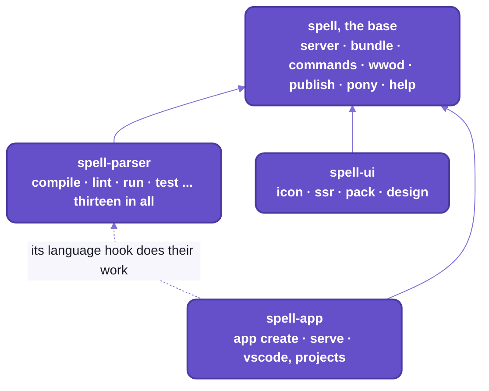

# The `spell` command line

```sh
spell --version
```

<details>
<summary>Output</summary>

```text
spell ...
```

</details>

_One package, one version, in about 0.1 s:  every folder that adds commands to `spell` ships inside it._

One command over every Spell repo.
If you've used `git`, `gh` or `cargo`, you know the shape:  one program, a verb after it, `--help` on everything.

What's different is where the verbs come from.
Nobody installs them:  each repo you clone brings its own, named in its `package.json`,
and `spell help` lists them under the repo that added them.
Clone `spell-ui` and `spell icon` is there;  leave it out and it isn't.

And there's no build step.
`spell` runs every repo's SOURCE, straight from your checkout, through `tsx`:
edit a file, and the next `spell` runs your edit.
It loads projects the way the language server does, so `spell lint` and the editor report the same errors.

- `epic`, the other command you'll type, is `spell-epic`'s:  epic pages, worktrees and reviews ([below](#epic)).
- `yarn` runs each repo's own scripts ([README/development.md](development.md)).

## Setting it up

You need the kit and its one install first:  [Setup from zero](../README.md#setup-from-zero), on the kit's front page.
Then one command, in the kit's folder, puts `spell` on your `PATH`:

```sh
cd ~/www/spell
yarn cli:install
# Linked /Users/<you>/.local/bin/spell -> /Users/<you>/www/spell/bin/spell.mjs
spell --version
```

It's a link, not a copy:  `spell` runs [bin/spell.mjs](../bin/spell.mjs) in this checkout, so a `git pull` is an upgrade.

| If | Then |
| --- | --- |
| you wonder where it went | the first folder on your `PATH` it can write to:  `~/.local/bin`, npm's global bin, `/usr/local/bin`, `/opt/homebrew/bin` |
| none of those is on your `PATH` | it links into `~/.local/bin`, and prints a `NOTE:` to add that folder |
| you want it elsewhere | `SPELL_BIN_DIR=/some/dir yarn cli:install` |
| a file that isn't a link is in the way | it replaces nothing, says so, and exits 1 |
| you moved the checkout, or linked `spell` from an older one | run it again:  the link holds a full path |
| you'd rather install nothing | `node ~/www/spell/bin/spell.mjs --help`, or `yarn spell --help` at the kit's root |
| `spell` runs something else | a shell alias or function named `spell` hides it:  `type -a spell`, in a login shell, says which runs |

- It links `spell` only, and never through `npm link`, which would run an npm install over this yarn project.
  `epic` comes with `spell-epic` ([below](#epic));  `spell-types` and `spell-pack` are for yarn scripts, which find
  them in `node_modules/.bin` ([below](#two-more-programs-for-yarn-scripts)).
- The first run takes a few seconds, while `tsx` compiles every repo's source and caches it.
  After that the base answers in about 0.1 s, and a language command, which loads the parser and Spell's rules,
  in about one:  `spell explain print` and `spell parse` each took 0.9 s here.

## Naming projects:  a path, an address or a group

Every command is `spell <command> [what] [--flags]`, and `--help` after any of them says the rest.
Most of them work on Spell projects, and you name a project the way the editor does:  by its address.

| You type | It means |
| --- | --- |
| `Card.spell`, `./path/to/Project`, `.` | a Spell file, or the project in a folder;  a lone `.spell` file counts as a one-file project |
| `@here` | the project in the current folder |
| `@spell/examples/Solitaire`, `owen@spell/x` | one project, by its address |
| `@spell/examples/Solitaire/Card.spellml` | one file in a project:  its name has a dot |
| `@spell/examples`, `owen@spell`, `@spell` | a group, or every group of a space:  pick from their projects, or pass `--all` |
| nothing | the project here;  outside one, `spell` asks, completing as you type |

A group asks which of its projects you mean, with "All projects" at the top of the list.
In a script, with no terminal to ask on, it lists them and exits 2;  `--all` takes the lot without asking:

```sh
spell lint @spell/examples
```

<details>
<summary>Output</summary>

```text
@spell/examples holds several projects -- name one, or pass --all:
  @spell/examples/bill-splitter
  @spell/examples/calculator
  @spell/examples/Counter
  @spell/examples/fizzbuzz
  @spell/examples/flash-cards
  @spell/examples/habit-tracker
  @spell/examples/ListaDeTareas
  @spell/examples/Solitaire
  @spell/examples/Solitario
  @spell/examples/TaskList
  @spell/examples/tic-tac-toe
```

</details>

```sh
spell lint --all @spell/examples
```

<details>
<summary>Output</summary>

```text
✓ @spell/examples/bill-splitter
✓ @spell/examples/calculator
✓ @spell/examples/Counter
✓ @spell/examples/fizzbuzz
✓ @spell/examples/flash-cards
✓ @spell/examples/habit-tracker
✓ @spell/examples/ListaDeTareas
✓ @spell/examples/Solitaire
✓ @spell/examples/Solitario
✓ @spell/examples/TaskList
✓ @spell/examples/tic-tac-toe
```

</details>

- A group holding one project uses it without asking.
- `owen@spell` is your own space:  the folder `spell.spaces/@spell/owen@/` beside the kit's folder, in no repo,
  ONE folder for the main checkout and every worktree.
  It has that name for everyone, for now:  the code fixes it.
  `spell projects` lists every group ([below](#spell-app)).
- Two flags work on every command, before or after its name:
  `--all`, and `--verbose`, which lets a command's own logging through on stderr.

<details>
<summary>Picking a project when you name none</summary>

- Outside a project, in a terminal, `spell` asks, completing as you type, like a shell.
- `Tab` completes a level at a time:
  - a group, `@spell/examples/`
  - then a project, `@spell/examples/Solitaire/`
  - then "entire project", or one of its files
- Your last 3 picks come first, kept in `spell-app`'s `.recent-projects.json`:
  git-ignored, so each checkout keeps its own.
  Only what the prompt picked counts;  a project typed on the command line isn't remembered.
- Piped, it says to name one, and exits 2:

  ```text
  No spell project here -- name one, e.g. @spell/examples/Solitaire, or `spell projects`
  ```

</details>

## Each folder brings its own commands

The base is [src/cli/](../src/cli/):  it reads the arguments, prints the help, and finds the commands.
Each folder hands it a list, named in the folder's own `package.json`:

```json
"spell": { "commands": "./src/cli/commands.ts" }
```



_Each folder hands its commands to the base.
The epic folder adds none:  its tools are `epic`'s._

- The base looks at the root's own `package.json`, then each folder's, lowest first (`spellRepos()`):
  `parser/`, `ui/`, `epic/`, `app/`, the root's `workspaces`, the same list in a clone or installed from npm.
  Only a `package.json` with a `"spell"` entry counts.
- `spell help` lists them in that order, one heading per folder, by its folder's name:
  `spell:` (the root's own), `parser:`, `ui:`, `app:`.
- Names stay plain:  `spell compile`, `spell icon`.
  A word two repos both add goes under EACH one's short name, the repo's name less `spell-`,
  and the bare word, hidden from the help, only says where they went.
  No two repos clash today;  this is the rule's own test, two made-up repos that both add `check`:

  ```text
  $ spell check
  "check" is in 2 repos:  spell parser check, or spell app check
  ```

- `spell-app`'s commands live under `app` on purpose, clash or not:  `spell app create`, `spell app serve`.
  The one exception is `spell projects`.
- A repo can also plug work into a lower repo's commands, by hook (`"hooks": "./src/cli/hooks.ts"`).
  Today's one hook is `spell-app`'s `language`, which does the work of `spell-parser`'s commands:
  - it finds projects the app's way:  addresses and groups, `@here`, the build folder
  - it runs the steps after a compile or a lint:  the property editor's pages
  - it opens a running program in your browser, for `spell run`

**The unfinished part:  `spell-parser`'s commands need the app folder.**
In a clone it's always there.
Without it (an install that left it out), each one stops and exits 2:
`the language commands find projects the app's way for now ... They come with the app folder, app/ ...`.
Moving their work down into the parser is still to come ([below](#-coming)).

## The kit

The commands of the shared code under `src/`:  the page server, its bundles, the house checks.
They load no Spell, so they answer in a fraction of a second.
`spell pony` exists to prove exactly that.
If a pony in a wizard hat tells you "Neigh-tive custom elements, at your service." 0.13 s later, `spell` works.

| Command | What it does |
| --- | --- |
| `spell server <verb>` | the kit's page server, from any folder of the kit:  docs, epic pages, the app's `/api`;  `start all`, every web server of the kit |
| `spell bundle [names...]` | builds the bundles the page server serves, which are built on demand and never committed:  Spell UI's docs site, `ui-site` |
| `spell bundle check [names...]` | says which bundles are out of date, and why;  exit 1 if any are |
| `spell commands [list \| check]` | every yarn script, `spell` command, `epic` verb and skill, against the commands page;  `check` exits 1 on a gap |
| `spell wwod [check] [files...]` | checks every WWOD citation and repo path in WWOD, every `AGENTS.md` and `CLAUDE.md`, and the skills |
| `spell publish [--dry-run] [--tag <tag>]` | builds, packs and checks the npm packages, installs them in a scratch project, then publishes them under the tag `next`, lowest first;  `--dry-run` stops before publishing |
| `spell map <verb>` | a map of every repo's code, and one of the docs:  what already does this, what uses it, which pages name it ([below](#asking-the-map)) |
| `spell coherence score` | how coherent the code is:  each mechanism's copies left and its users, scored 0-100, and saved so it trends ([below](#scoring-coherence)) |
| `spell epic <args...>` | the epic tool, `epic`, with its own verbs:  `npx spell@next epic init` sets a repo up for epics, from nothing installed;  it runs the checkout's `epic/bin/epic`, else the installed `spell-epic`'s, else `spell-epic` fetched at `spell`'s own version |
| `spell pony [words...]` | a pony in Spell's wizard hat says your words, or one of its own |
| `spell help [command...]` | every command, grouped by repo;  or one command's help:  `spell help compile` is `spell compile --help`, and `spell help server stop` a sub-command's |

`spell server` manages the page server;  `spell app serve` opens the editor on it.
The page server belongs to a kit, and starts from its root only:
run from any folder of an epic's worktree, `spell server start` starts that worktree's.

<details>
<summary>Every verb of server, and every option of bundle, commands, wwod, publish and pony</summary>

| Verb | What it does |
| --- | --- |
| `spell server local` | runs the page server in the foreground, until `Ctrl-C` |
| `spell server start` | starts it in the background if it isn't running, and prints where it is (JSON) |
| `spell server start all` | every web server of the kit:  the page server, the app's editor, Spell UI's site;  a row for each, and exit 1 if one didn't come up |
| `spell server stop` | stops the page server, waiting for its process to end;  its editor stops with it |
| `spell server stop all` | the page server, then the app's editor too, even one left running |
| `spell server status` | the running page server's details (JSON);  exit 1 when it isn't running |
| `spell server url <file>` | starts the page server if needed, then prints the address that serves `<file>`, of this checkout or the shared content folder |
| `spell server prune [--dry-run]` | stops the page and Vite servers whose checkout is gone, on any checkout;  `--dry-run` only lists them |

- The page server's own flags pass through, as typed:
  `--root <dir>` (another kit's root:  any other folder is an error that names the kit), `--port <n>`,
  `--spaces <dir>`.
- `start all` and `stop all` find the kit from the current folder too, and read its merged settings:
  the editor gets a row only where they run `spell-app`'s routes (it's installed);
  Spell UI's site, only where they name its component set.
- The kit's `yarn server` runs the same command line;  `epic server` runs it for the caller's kit.
- What the page server serves, and how:  [README/server.md](server.md).

| Option | What it does |
| --- | --- |
| `spell bundle` (no names) | every bundle |
| `spell bundle --stale` | only the bundles whose sources changed since their last build |
| `spell bundle --json`, `spell bundle check --json` | the report as JSON |
| `spell commands list` | the default:  each command, ✓ if the commands page names it |
| `spell commands check` | only the gaps, exit 1 on any |
| `spell commands --json` | every command, and the gaps, as JSON |
| `spell wwod check` | the default, and the only verb |
| `spell wwod check <files...>` | those files too, beyond the default set |
| `spell wwod --json` | the report as JSON |
| `spell publish --dry-run` | everything but the publish:  build, pack, check, scratch install |
| `spell publish --no-scratch` | skips the scratch install, which needs the network |
| `spell publish --json` | the packed packages and every check as JSON |
| `spell publish --tag <tag>` | the npm dist-tag to publish under, `next` when not given;  only `--tag latest` moves `latest` |
| `spell pony --gallop` | her legs gallop:  in place in a terminal, else one stride's frames |

- Which bundles there are:  the `"bundles"` in the kit's page server settings, every installed repo's merged.
  The page server builds the stale ones when it starts, and a page waits for them.
- `spell bundle check` ends with the fix:
  `ui-site:  STALE (built from older sources)`, then `fix:  spell bundle ui-site`.
- `spell commands` checks the nearest kit from the current folder up, so a worktree checks its own.
  The commands page's data is `guides/dev/commands/commands.json5`, in the shared content folder.
- `spell wwod`:  run it after editing WWOD or an `AGENTS.md`.
  - It checks that every `WWOD §N › "title"` citation names a real section and rule,
    and that every backticked repo path exists.
  - Where:  WWOD, every `AGENTS.md` and `CLAUDE.md`, the Solid 2 rules, and the skills (citations only).
  - Exits 1 on a broken one.
- `spell publish`:  three packages, `spell` first (epic `repo-split` Q65).
  - `spell`:  the ONE package, the kit's `src/` and every folder's, built into `dist/<folder>/`
    (`spell/ui/core` is `dist/ui/core.js`).
  - `spell-ui`:  Spell UI on its own, its Vite library build, with the element code inside.
  - `spell-epic`:  the epic plugin for Claude Code, its parts at its root, its code `spell`'s.
  - The code is built to JavaScript, one file per source file, so every name its `exports` gives still finds its file;
    types stripped, standard decorators lowered, Solid's JSX compiled.
  - Each is staged in the kit's `dist-packs/stage/<name>/` (git-ignored) with a `package.json` made for npm:
    no `private`, `workspaces`, scripts or dev dependencies;  the checkout's own never changes.
  - One version for all, the kit's `package.json` `version`.
  - Then `npm pack` into `dist-packs/`, the checks (built code only, every `exports` file packed, one `DOMElement`),
    and a scratch project outside the checkout:  a node import, a Vite page that draws a `<ui-button>`,
    `npx spell help`, `npx epic --help`.
  - Without `--dry-run`, and only when every check passed:  `npm publish --tag <tag>` for each, lowest first.
  - Logging in with a token, the tags, and what trips people up:  [Publishing to npm](npm.md).
  - The tag is `next` unless you say otherwise:  `npm install spell@next` gets the new version,
    while `latest` stays where it was.
    Only `--tag latest` moves `latest`;  or, for a version already out under `next`,
    `npm dist-tag add spell@<version> latest`.

</details>

### Asking the map

Before writing something new, ask what already does it.
`spell map` keeps two maps of the kit and every repo in it, and answers from them in about a second:

```sh
spell map uses Tokenizer
```

<details>
<summary>What it printed</summary>

```text
Affected nodes for Tokenizer
- RulexTokenizer [inherits] parser/src/parser/rulex/RulexTokenizer.ts:L14
- MarkdownTokenizer [inherits] parser/src/markdown/MarkdownTokenizer.ts:L15
- Parser.ts [uses] parser/src/parser/Parser.ts:L8
- SpellLanguageService.ts [uses] app/src/lsp/SpellLanguageService.ts:L35
...
```

</details>

Two subclasses already read a syntax of their own with the parser's tokenizer.
A new syntax is a third subclass, not a new parser.

| Verb | What it does |
| --- | --- |
| `spell map uses <name>` | every file and class that uses it, across repos:  `spell map uses "readJSON5File()"` |
| `spell map explain <name>` | it, and everything linked to it:  what it contains, calls, extends, and what uses it |
| `spell map query <words...>` | a question in words, matched against the names in the map;  `--budget <tokens>` caps the answer |
| `--docs`, on any of the three | asks the docs map:  `spell map explain PrefStore --docs` lists every page and section that names it |
| `spell map build [code \| docs]` | builds the maps, both by default |
| `spell map status [--json]` | whether graphify is installed, and how old each map is |
| `spell map install` | installs graphify with `uv` |

- **The code map** is graphify's, an open-source engine that reads each file's structure, with no model:
  its classes, functions, calls and imports.
  - graphify maps the kit, ONE repo with its folders inside it, and skips what git ignores.
  - Then `spell map` links what graphify can't follow:  imports by package name
    (`spell/util/node/json5`), the names each file takes from them, and classes that extend an imported one
    (`extends P.Tokenizer`).
  - About 40 seconds for every repo;  44,000 things and 126,000 links.
- **The docs map** is read by structure, in TypeScript, in under a second:
  every epic page (with its part files), guide, saga page, README, `AGENTS.md`, skill and `docs/` page;
  each one's headings, the pages it links to, and every code name it mentions.
  It knows what a page names, not what it's about.
- **A stale map** (older than the newest commit of what it maps) is rebuilt before it's asked.
  Uncommitted edits don't count:  `spell map build` takes them in.
- **graphify is optional.**  Without it, the docs map still builds, and every other verb says
  `graphify isn't installed:  spell map install`.  It needs [uv](https://docs.astral.sh/uv/).
- **A name two things share** (`Rule`):  the one in a file named for it wins;  else `spell map` lists them, each with its
  id, and takes an id in the name's place.
- The maps are in the kit's `graphify-out/`, `code.json` and `docs.json`, and each repo's own `graphify-out/`:
  git-ignored, everywhere.

### Scoring coherence

The map says what already does something.
`spell coherence score` says how often the code does it some other way:

```sh
spell coherence score --compare last
```

<details>
<summary>What it printed</summary>

```text
Coherence score:  81 / 100  (users from the code map)

Compared with 20261025-1354-68972f4:
Mechanism                                       Copies then  Now  Improvement  Score
Running git, finding a checkout, a real path             44    9          80%     84
Fetching                                                 40   22          45%     31
Timing                                                   89   76          15%     16
A headless page check                                    30    2          93%     78
...
Total                                                   517  233          55%     81

Copies:  517 → 233, 55% better (fewer copies)
Score:  61 → 81, 33% better (score up)
```

</details>

Before the first fixes, the code ran git its own way 44 times.
After them, 9 places still do;  46 files use the shared `Git` instead.

| Option | What it does |
| --- | --- |
| `spell coherence score` | each mechanism's copies, users and score, then the code's;  the words still to replace;  each repo's tests |
| `--compare <snapshot \| last>` | each row then and now, its improvement, and every file with new copies |
| `--save` | saves a snapshot of the run, so the next run can compare |
| `--at <revision \| time>` | the code as it was:  `--at "main@{2026-10-25 14:00}"` reads each repo's `main` then |
| `--json` | the snapshot, or the comparison, as JSON |

- **A mechanism** is an entry of the kit's catalog of what Spell already has, `agents/coherence/catalog.md`.
  Each one's **Score:** line is the search it counts by:  copies only, never the mechanism's own home.
- **Copies** are lines of code its search finds;  **users** are files that use its home, from the code map.
  - No code map (graphify is optional), or an older revision:  users come from a search for what the home exports,
    and the first line says so.
- **The score** is every mechanism's users over its users and copies, added up:  big mechanisms weigh more.
- **Code only:**  each repo's `src/`.  Tests, their helpers, bundles and generated files never count,
  and neither do comment lines.
  - Tests are counted instead:  each repo's `it()` and `test()` calls, on the last line.
- **Snapshots** are saved in the shared content folder, `epics/coherence/details/scores/`, named by when the code was.
- A change reads as an improvement:  "55% better (fewer copies)", or "12% worse";
  a table's Improvement column holds the bare percent, a worse one `−12%`.

## spell-parser

The language's thirteen commands:  build a program, run it, test it, see what Spell made of what you wrote,
and check its language packs.
They're `spell-parser`'s, but their work is `spell-app`'s for now, through its `language` hook
([above](#each-folder-brings-its-own-commands));  the language packs' two are the exception, `spell-parser`'s own.

### Writing and building

`spell lint` is the one for CI:  `path:line:col` lines, as `tsc` and ESLint print them, and exit 1 on an error.

| Command | What it does |
| --- | --- |
| `spell compile [projects...]` | compiles each project to JavaScript, `<Project>.spell.js` in its build folder, plus its other targets, its declarations and its words;  a lone `.spell` file prints its JavaScript |
| `spell lint [projects...]` | lists every error as `path:line:col  message`, exit 1 if there are any;  a project's editor pages (`*.editor.html`) too, against its types |
| `spell watch [projects...]` | recompiles on every save and shows a live list of errors, until `q` or `Ctrl-C` |
| `spell format [projects...]` | tidies the whitespace of `.spell` files, as VS Code's Format Document does;  never in the frozen test projects |
| `spell spellx convert [projects...]` | writes each `.spell` file as spellx, the same program in tags, `Card.spell` => `Card.spellml` beside it;  never in the frozen test projects |

<details>
<summary>Every option of compile, lint, watch, format and spellx convert</summary>

| Option | What it does |
| --- | --- |
| `spell compile --stdout` | prints the compiled output and writes nothing |
| `spell compile --target <name>` | compiles to this target too, e.g. `ts/solid`;  default:  the project file's `"targets"` |
| `spell compile --force` | recompiles the projects it imports too, even those already compiled |
| `spell compile --stale` | only the projects that are out of date, and the same for what they import;  the rest say "up to date" |
| `spell lint --json` | the errors as a JSON list |
| `spell lint --fix` | puts right what it can:  each retired word (`drawable thing` => `view`), and the editor pages (drops gone properties, adds new ones, fixes controls that don't fit) |
| `spell watch --check-only` | re-checks instead of recompiling:  writes nothing |
| `spell watch --test` | runs each project's tests after each rebuild with no errors |
| `spell watch --name <text>` | with `--test`:  only tests whose names contain it |
| `spell format --check` | writes nothing, lists the files that would change, and exits 1 if any would |
| `spell spellx convert --dry-run` | writes nothing, prints each `.spellml` file instead |

- The targets are `SP.TARGETS`:  `ts/solid`, `ts/lib`, `py`
  ([spell-parser's README-targets.md](https://github.com/spell-app/spell/blob/main/parser/README-targets.md)).
  A target with a type checker is checked once written, TypeScript by `tsc` and Python by `pyright`:
  its errors are listed, but don't fail the compile.
- Warnings, e.g. a property with no type, are listed under the errors and never counted:
  a project with only warnings compiles clean.
- A line that doesn't parse doesn't stop the compile:  it compiles to a `PARSE ERROR` comment, and the compile exits 1.
- `--stale` and `--stdout` together are refused:  one writes only what's out of date, the other writes nothing.
- Out of date means a file it builds is missing, or one of these changed since its build (`CLI.staleBecause()`):
  its files, its project file, an import's declarations, Spell's compiler.
- Nothing to run by hand in a fresh checkout:
  the page server runs `spell compile --stale --all @spell/examples @spell/library` as it starts,
  and the spaces routes compile a project whose built file is missing.
- `watch` rebuilds a watched project when one it imports changes.
  - It watches each project's folder, its `.spell` files, CSS and project file;
    it ignores `*.spell.js` and `*.scopes.js`.
  - Watching a project and one it imports:  the importer rebuilds, from scratch, after the imported one does.
    A project imported but not watched isn't seen changing.
  - On macOS a save arrives as a `rename` event, so `watch` ignores event types and looks at what's on disk.
  - Piped, it prints a timestamped line per rebuild on stderr, instead of its live screen.
  - `--test` with `--check-only` is refused:  the tests run what's compiled.
- `format` never writes into the frozen test projects, `spell-app`'s `spaces/@spell/test/`.
- What each of them writes, and where:  [below](#output-exit-codes-and-what-writes-files).

</details>

### Running and testing

No test runner to configure:  a project's tests are its `to test ...` sections, in English, in its own files.

| Command | What it does |
| --- | --- |
| `spell run [project]` | compiles a project and runs it under node, showing what it prints;  one with a UI opens in your browser, until `Ctrl-C` |
| `spell test [projects...]` | runs each `to test ...` in a project and reports ✓, or ✗ with the checks that failed;  exit 1 on a failure |

```sh
spell test @spell/examples/Solitaire 2>/dev/null
```

<details>
<summary>Output</summary>

```text
✓ test card setup  (19 checks)
✓ test a new deck  (5 checks)
✓ test piles  (8 checks)
✓ test the moves  (11 checks)

4 passed
```

</details>

The compile line went to stderr, and so would any warning, each one a fix written in Spell:
`Say what "card-names" holds, e.g. "set card-names to a new list of text"`.

<details>
<summary>Every option of run and test, and what they do under node</summary>

| Option | What it does |
| --- | --- |
| `spell run --browser` | opens it in a browser even if it shows no UI |
| `spell run --no-browser` | never opens one:  skips whatever needs it |
| `spell run --seed <n>`, `spell test --seed <n>` | starts its random numbers from `n` (1 to 2147483646), so every run deals the same |
| `spell run --target ts`, `--target py` | runs it as that target compiles it;  a Python program that draws is served as a web app, on Quart ([README/server.md](server.md)) |
| `spell test --name <text>` | only tests whose names contain it, e.g. `"deck creation"` |
| `spell test --watch` | runs them again whenever a project changes:  `spell watch --test` |
| `spell test --verbose` | shows every check;  without it, `print` inside a test is hidden |

- `spell run` prints to stdout;  a dump of a whole thing (`print the card`) goes to stderr.
- From a project's folder, `spell-app`'s `yarn dev`, `yarn dev:ts` and `yarn dev:py` run it the same three ways.
- `spell test` finds tests by the names they compile to:  `to test card setup` exports `testCardSetup`.
  - A test the project runs itself as it loads counts once, and isn't run again:
    a second run would start from what the first left behind, e.g. a dealt deck.
  - A test that throws fails, with the error;  Spell's own `core.test()` swallows it silently.

Under node:
- Both run in a separate node process, so each run gets a fresh runtime,
  and both compile to a temporary file, never into the project.
- What needs a browser does nothing under node, with a note:  starting a UI (`start the game`), installing styles.
  Other browser-only code, e.g. touching `document` directly, throws.
- Then `run` on a UI project opens it in your browser:
  a page with the app's `<spell-viewer>` element, served from localhost until `Ctrl-C`.
  - It serves the project as compiled for this run (nothing written), its scope pack for the Type Explorer,
    and the compiled projects it imports.
  - The first time in a checkout it builds `<spell-viewer>` (`spell-app`'s `yarn build:element`):  a few seconds.
  - No live reload:  it serves what was compiled at the start.
  - `SPELL_NO_BROWSER=1` prints the address instead of opening a browser:  for tests, CI, a remote shell.

</details>

### Reading a program

When a sentence doesn't do what you meant, these four show what Spell made of it:
the parse, the rules behind a word, the types a project declares.

| Command | What it does |
| --- | --- |
| `spell parse "<text>"` | how Spell reads a line:  its match tree, then the JavaScript it compiles to |
| `spell repl [project]` | `spell parse` a line at a time, where what a line declares is known to the lines after it;  piped, it reads stdin |
| `spell explain <word>` | the rules a word names or starts, with their syntax and an example |
| `spell describe [project] [name] [member]` | what a file or project declares, as the editor's Type Explorer shows it, or everything about one type or member |

```sh
spell explain print
```

<details>
<summary>Output</summary>

```text
print  print {operator:print_kind}? [expressions:{expression} ,]
e.g. print "Yo!"
```

</details>

```sh
spell describe @spell/examples/Solitaire Card color
```

<details>
<summary>Output</summary>

```text
property color of Card
app/spaces/@spell/examples/Solitaire/Card.spellml:15

Spell
    <property "color" one-of="red, black">
      red if it is a diamond or it is a heart
      black otherwise
```

</details>

Two more in action, a whole match tree from `spell parse` and FizzBuzz under `spell run`, are on
[the kit's front page](../README.md).

<details>
<summary>Every option of parse, repl, explain and describe</summary>

| Option | What it does |
| --- | --- |
| `spell parse --rule <name>` | parses as that rule only, e.g. `expression`;  default:  as a statement, then as an expression |
| `spell parse --in <project>` | parses in that project's scope, e.g. `@spell/examples/Solitaire` |
| `spell parse --tree` | prints the Spell tree, what it means, not the match tree;  with `--json`, its data |
| `spell parse --html` | with `--tree`:  prints it as a `<ui-tree-diagram>`, for a docs page |
| `spell parse --json` | the result as JSON |
| `spell repl <project>` | parses in that project's scope |
| `spell explain --in <project>` | also what that project declares by that name, as the editor's hover shows it:  a type, property or method |
| `spell explain --json` | what it found, as JSON |
| `spell describe --inherited` | lists the members types inherit, too |
| `spell describe --compiled` | the JavaScript it compiles to, when describing one thing |
| `spell describe --json` | the Type Explorer's own data |

- `parse` reads several lines as a block.
- `repl`:  `↑` and `↓` bring back earlier lines;  `Esc` quits.
- `describe`'s `name` is one thing, e.g. `Card`, or `"test card setup"`;  `member` is one of its members, e.g. `color`.
  - Names ignore case, and a space, a dash and an underscore are all alike:  `stock pile` finds `StockPile`.
  - Members are listed in the order they're declared, as the Type Explorer shows them.
  - It reads the Type Explorer's tree:  a thing by its `path`, where it's declared from its details' `line` and file
    (`declaredAt()`), and its first line worked out by the command itself (`summary()`).

</details>

### Timing the parser

| Command | What it does |
| --- | --- |
| `spell speedtest [module]` | times the parser's rule tests in fresh processes, as a Markdown table;  `--against HEAD` compares with a commit |

<details>
<summary>Every option of speedtest, and how it compares two commits</summary>

| Option | What it does |
| --- | --- |
| `spell speedtest <module>` | only that module's rules, e.g. `if` |
| `spell speedtest --runs <count>` | runs per side, each a fresh node process (default 3);  each is a warm-up, then 20 timed passes |
| `spell speedtest --against <ref>` | times that commit too, e.g. `HEAD`, and adds a Change row |
| `spell speedtest --json` | each side's combined results |

- A side's runs combine as the mean of their averages, the lowest min and the highest max.
  With 3 or more runs, one fluke (an average 25% over the median) is dropped.
- `--against` makes a temporary `git worktree` of `spell-parser` at the ref, and links the kit's `node_modules` into it:
  a ref with different dependencies may not run.
  - The ref must have `spell-parser`'s `src/spell/`;  an older one is refused, with a message.
  - The two sides take turns, run by run, so a busy moment hits both alike.
  - The worktree is removed afterwards, even on failure.

</details>

### Checking the language packs

Spell reads programs in more than one language:
each language pack registers every rule again, with its own words.
- When a rule is added in English, these two say which packs still need it, and write the stubs to translate.
- Their work is `spell-parser`'s own, not the hook's:  they read only its rule files.

| Command | What it does |
| --- | --- |
| `spell translate check [lang]` | lists, per rule file, what a pack lacks against English, and exits 1 if anything;  default:  every pack but English |
| `spell translate fix [lang]` | writes a stub for each missing registration into its `<module>.<lang>.ts`, English copied and marked `// TODO: translate`, then lists them to review |

<details>
<summary>What they check, and what fix writes</summary>

| Option | What it does |
| --- | --- |
| `spell translate check --json` | the report as JSON |
| `spell translate fix --ai` | asks `claude -p` to translate each stub, marked `// AI draft:  review` instead;  one it can't keeps the stub |

- `check` reads each rules module's files as text, English's (`<module>.en.ts`) and the pack's, and lists:
  - `missing`:  a rule English registers that the pack doesn't
  - `no tests`, `no syntax`:  a registration without them, where English's has them
  - `out of order`:  a registration in another place than English's, so a tie between two rules may go the other way
  - `unregistered`:  a rule class a rules folder exports that no `.en.ts` registers
    (a base class, or a rule built while parsing, doesn't count)
  - the pack's words:  every word table English has, and a word for every built-in type
- A difference on purpose is a comment in the pack's file, with the reason:
  - above the registration:  `// packs: ok -- si no is else AND if no, so else comes first`
  - for one left out:  `// packs: none AThingsProperty -- no "a card's color" in Spanish`
- `fix` puts each stub after the registration English has before it, and adds the imports it needs.
  A module with no file yet gets one, which the language's `parser.ts` must then import.
- `--ai` asks Claude for one stub at a time, and sends it:
  - the rule's class docstring, and its English registration
  - the module's translations so far
  - the pack's glossary, e.g. Spanish's
    [GLOSSARY.md](https://github.com/spell-app/spell/blob/main/parser/src/spell/languages/es/GLOSSARY.md)
- `fix` writes only what's missing:  translate each stub, then run `check` and the module's rule tests.

</details>


### Translating a project

`spell translate` writes a project in another language, in three passes:
1. Names:  every name its people chose (types, properties, values, methods, texts, comments).
   - First from the language's shared glossary:  a name another project chose costs no call, and reads the same.
   - The rest by Claude:  the types alone in one small call, then the other names in a few calls at once,
     each shown the types and the glossary, so one thing has one word everywhere.
   - Each noun comes with its gender, and each name is checked readable by the other language's grammar first.
2. Lines:  each line read in its own language, then written again with the same rule's words in the other.
3. Fix-ups:  the translation is linted, its tests run, and each line compiled beside its English:
   each line that fails, compiles to a different program, couldn't be written, or may read in the wrong order
   goes back to Claude, in context, a few rounds at most.

- It asks Claude through the Claude API when `ANTHROPIC_API_KEY` is set, and through `claude -p` otherwise.
  - The API is faster:  a `claude -p` call spends about 2 s starting, so without a key it says so, once, at the start.
  - On Solitaire through `claude -p`, from the shared glossary alone:  31-41 s in all, the names 22-31 s,
    the fix-ups 9-10 s, in 7 or 8 calls;  with `--cold`, nothing pre-calculated, about 52 s.
  - Either way each answer can only be JSON of the shape asked for, and the language's glossary rides in the
    system prompt, which the API caches across the calls.
  - `--effort fast|balanced|best` says how much each pass spends on its answers, `balanced` unless asked;
    the runner picks a model and how hard it thinks for each pass at each one.
    - On Solitaire and todos, more thought made no better names, only slower ones, so today `fast` and `balanced`
      ask the same, and `best` thinks harder only over the fix-ups.

- The names land in a dictionary beside the project, `<Project>.<lang>.names.json5`, for a person to review;
  with `--out`, in that folder instead, with everything else the run writes (below).
- The shared glossary is the language's own, `languages/<lang>/glossary.json5` in spell-parser:
  card games' words and common ones, each with its gender and where it came from.
- Its work is spell-app's (it finds the project the app's way), then `spell-parser`'s `translateProject.ts`.

| Command | What it does |
| --- | --- |
| `spell translate [project] --to es` | writes the project beside it, named as its dictionary names it (`Solitaire` => `Solitario`), one line for each of its lines;  exits 1 if any line still needs a person, fails lint, a test, or the shape check |
| `spell translate [project] --to es --review` | the same, but between the names and the lines it shows the names it drafted on a page, takes each answer as it's given until Send, and writes the lines with them;  the page shows each pass, and picks the effort (below, "Reviewing the names") |
| `spell translate [project] --to es --learn` | translates nothing:  adds the project's reviewed names to the shared glossary, for every project after it |
| `spell translate speedtest [projects...] --to es` | times translating them, run after run, each on a scratch copy it deletes after:  a table of min, median and max (below, "Timing it") |

<details>
<summary>Its options, and what it leaves for a person</summary>

| Option | What it does |
| --- | --- |
| `--update` | re-translates only the lines changed since the last run (a hash per line, in `<Project>.<lang>.translated.json5`);  every other line stays as it is, a hand edit too |
| `--no-ai` | never asks Claude:  each name the dictionary lacks stays `TODO` in it, and no line is fixed up |
| `--effort <tier>` | how much every pass spends on its answers:  `fast`, `balanced` (the default) or `best` |
| `--names-effort <tier>`, `--fix-ups-effort <tier>` | one pass's, over `--effort` |
| `--seed <project>` | fills the dictionary first from a translation a person made, e.g. `@spell/examples/Solitario` |
| `--out <folder>` | writes it there instead, its dictionary and record too:  nothing is written beside the project.  A dictionary already beside it is read, never written;  `--update` passes the same `--out` to find its record |
| `--review-timeout <time>` | how long `--review` takes answers before going on without Send:  minutes (`30`, the default), or `90s`, `10m`, `1h` |
| `--cold` | for timing:  starts from nothing worked out before (below, "Timing it");  needs `--out` |

- It says how long each pass took, and each call to Claude:
  the types in one, the other names in up to 6 at the same time, one more for any name it couldn't read
  (or that two calls gave the same word), one per round of fix-ups.
- A fix-up answer that isn't JSON anyway (cut off, say) is asked again in two halves, so the round isn't lost.
- Through the API, a 429 (too many requests) or an overloaded API is asked again a few times, a few seconds apart;
  any other failure says what it was (`Claude API (claude-opus-5-5):  401 authentication_error:  ...`).
- And the shape check:  how many statements compile to the same program as the English, names and texts aside.
  A line that reads and lints but means something else (`si no está boca arriba` for `if it is face up`)
  is named, with where the two programs differ.
- And each name the project chose otherwise than the glossary, so drift between projects shows.
- A line it can't write keeps its English, marked `// TODO: translate (why)`:
  a name still missing, or a rule it can't write in that language yet.
  The fix-up pass writes it, unless `--no-ai`.
- A text glued from pieces (`its color + " joker"`) may need its words in another order (`"comodín " + su color`):
  each such line goes to the fix-up pass even when it lints.
- Each fix-up is kept in the record, so `--update` writes the same line again without asking;
  a line kept as it was (a hand edit) is never sent.
- `<ui-*>` tags, their attributes and values become Spell UI's in that language (`<es-texto color="rojo">`),
  and a style sheet's selectors with them;  the app's own views follow its templates' new names.
- A project it imports keeps its own words (`increment el contador`):
  the other language's grammar reads them as the import declares them.

</details>

#### Reviewing the names

Batch by default, so CI never waits:  with `--review`, a person sees every name before a line is written with it.
- After the names pass, a page opens in the side bar's Review tab (else a browser):
  a row per name Claude drafted, never the glossary's or the dictionary's.
  - Each row:  the English, the gender, the kind (type, name, phrase, text, comment), where it came from,
    and the first line that uses it;  the other lines fold under it.
  - Accept the proposal, type over it, or pick one of the 2 or 3 alternatives Claude gave in the same calls
    (types, names and phrases;  a text or a comment has none).
  - Tick "for every project" and the name goes into the shared glossary too, as `reviewed`.
- Each answer reaches the command as you give it, no Send needed:  it goes in the dictionary at once,
  and the row shows "taken".
  - Change it again and the new one replaces it;  clear the box and Claude's proposal is back.
- A typed or picked answer is checked as it arrives, as a drafted name is.
  One Spell can't read (`carta` for `label`, when `card` is `carta`) turns its row into a note saying why, right away:
  type another.  Still unreadable at the end, the proposal stays and the report says so.
- Then Send:  the lines are written with the answers, and each goes in the dictionary marked `reviewed`,
  so `--update` never asks again, and `--learn` ranks it above a seed's.
- A type's gender:  its proposal's, the alternative's, or say it after the name, `naipe (m)`.
- No Send in time (`--review-timeout`, 30 minutes):  the answers given by then are used, the rest kept as drafted,
  and the report says `no Send in time`.
- The page's status card shows each pass as it runs:  names (how many drafted, its calls), lines, fix-ups
  (lines wanted and fixed, its rounds), each with its time and effort.
- Its effort picker (fast, balanced, best) starts at `--effort`, and takes at the next pass:
  pick it while answering and the fix-ups run at it.
  - `--names-effort` or `--fix-ups-effort` still wins for its pass, and the page says so.
- The run ends "finished", "its wait ran out" (no Send in time), or "stopped" (the command failed, or Ctrl-C).
- With `--no-ai`, its rows are the names still missing, to type.
- `--cold` refuses it:  a timing that waits for a person times nothing.
- The page is a command run of the kit's page server, at `/runs/<id>/`.

#### Timing it

A translation usually starts from lists earlier runs worked out, so a second run is quicker than the first
without saying why.
- Those lists:
  - the language's shared glossary
  - the project's own dictionary, `<Project>.<lang>.names.json5`
  - with `--update`, the record of each fix-up, `<Project>.<lang>.translated.json5`
  - with `--seed`, a person's translation
- `--cold` uses none of them, whatever is on disk:  every name is asked for, every fix-up made again.
  - It writes only into `--out`, its dictionary and record too:  never the project's folder, never the glossary.
  - So it needs `--out`, and refuses `--update`, `--seed` and `--learn`.
- Every report says which it started from, e.g. `pre-calculated:  none (--cold)`,
  or `pre-calculated:  the Spanish glossary (109 names), the project's dictionary (88 names)`.

`spell translate speedtest` does the timing for you.
- Each run copies the project to a scratch folder of its own (without its dictionary and record), translates it,
  and deletes the folder, even when the run fails.
- With no projects, it times Solitaire and todos-form-based, the two the numbers above were measured on.
- Then a table for each project, mode and tier:  the min, median and max over its runs, of
  - each pass's time, and the calls to Claude
  - the problems left, lint's, and lines still `TODO`
  - the tests passed, and statements with the same shape as their English
  - how many of the names Claude drafted are the same as a person's translation, where there is one
    (Solitaire's is Solitario)

<details>
<summary>Its options</summary>

| Option | What it does |
| --- | --- |
| `--to <lang>` | the language, e.g. `es` |
| `--runs <count>` | runs of each project, mode and tier (default 1) |
| `--effort <tiers>` | the tiers to compare, e.g. `fast,balanced` (default `balanced`) |
| `--mode <modes>` | what each run starts from (default `cold,glossary`):  `cold` (`--cold`), `glossary` (the shared glossary only, as a project translated for the first time), `update` (translated, one English comment changed, then `--update`:  only that run timed) |
| `--reference <project>` | a person's translation of the one project timed, to compare names with |
| `--json <file>` | every run's numbers and the table, for comparing over time |

- A run that fails says why, and the rest still run;  it exits 1 if any failed.
- Its work is spell-app's (it finds the projects, and translates each copy as `spell translate` does),
  then `spell-parser`'s `translateTimes.ts`.

</details>

## spell-ui

Spell UI's four:  find an icon, render pages as plain HTML, build component packs and the design system.
`spell ssr` is the odd one:  server rendering, done ahead of time and written to files,
for search engines and readers with no JavaScript.

| Command | What it does |
| --- | --- |
| `spell icon [query...]` | finds Spell UI's icons by name, alias or keyword;  `--open` shows them as pictures in a browser |
| `spell ssr <pages...>` | renders `ui-*` pages as plain HTML:  `page.static.html` beside each page, plus one `ui.static.css` per folder |
| `spell pack <verb>` | component packs, a repo's custom elements that `<ui-root>` loads on demand:  `create`, `add`, `build`, `check` |
| `spell design <verb>` | Spell's design system on claude.ai:  `build` its files, `pull` a board, and track what's `changed` and `pushed` |

```sh
spell icon bell
```

<details>
<summary>Output</summary>

```text
bell                fa7-free
bell                fomantic  also alarm
bell concierge      fa7-free  also concierge bell
bell concierge      fomantic  also concierge bell
...
```

</details>

<details>
<summary>Every option of icon and ssr, and how the static render works</summary>

| Option | What it does |
| --- | --- |
| `spell icon` (no query) | every icon:  each hit's name, its pack and its other names |
| `spell icon --pack <id>` | only that pack:  `fa7-free`, `fa7-brands` (Font Awesome's logos) or `fomantic` |
| `spell icon --json` | the icons found, as JSON |
| `spell icon --open` | shows them as pictures in your browser, until `Ctrl-C`;  click one to copy its name |
| `spell ssr <folder>` | every `.html` page in it, at any depth, but `*.static.html`, `node_modules` and dot folders |
| `spell ssr -o <file>`, `-o <folder>` | one page there, or several into that folder;  `--output` is the long form |
| `spell ssr --css <file>` | one stylesheet, for every page, there |
| `spell ssr --inline-css` | each page gets its own stylesheet, holding only its families, in a `<style>`;  no file;  never with `--css` |
| `spell ssr --no-minify` | leaves the stylesheet readable |

- `ssr` never overwrites a page:  an `-o` naming the input is refused.
  Its own outputs are overwritten without asking.

How the static render works:
- Each `ui-*` element goes to light DOM, no shadow DOM, through Spell UI's static server render
  ([src/static/](https://github.com/spell-app/spell/tree/main/ui/src/static)), in a child process ([renderStatic.ts](https://github.com/spell-app/spell/blob/main/ui/src/cli/runner/renderStatic.ts))
  on an SSR-only Vite server ([StaticRenderer.ts](https://github.com/spell-app/spell/blob/main/ui/src/tools/StaticRenderer.ts)).
  - A child, because Spell UI's Solid JSX must compile for the server, which `tsx` can't.
  - Each run starts Vite and compiles every family:  one page took 2.1 seconds here, and several pages share one run.
- Only the families in Spell UI's static catalog render:
  any other tag, e.g. `ui-code` or `ui-markdown`, stays as it is, and is listed on stderr.
- The scripts that would load the elements go, since on a static page they'd show the content twice:
  a script or `<link rel="modulepreload">` naming `spell-ui`, Spell UI's `src/` or `dist/`, a family folder,
  or the docs' `spell-ui.js` bundle.
  Other scripts stay, import maps too.
- Its stylesheet is linked first in the head:
  its `@layer ui-slotted, page, ui;` sets the layer order before a page's own sheet names a `ui.*` layer.
- The page's own CSS is rewritten for the flattened output, `::part()` and `:state()` rules too:
  `ui-card` becomes `[data-ui="card"]`.
  - Its `<style>`s, and each local linked sheet the rewrite changes, are inlined in place
    as `<style data-static-from="...">`, with relative `url()`s rebased.
  - Remote sheets, `@import`s and sheets that don't parse stay as they are:
    their rules for `ui-*` elements and their parts don't apply to the static page.
- One `ui.static.css` per output folder, linked from every page there, so the browser fetches it once.
  It holds the families its pages use AND whatever it held before:
  its first line, `/*! spell-static {...} */`, records what it covers, and each run builds the union.
  So re-rendering one page never drops another's styles;  to start a folder's sheet afresh, delete it.
- Lightning CSS minifies it, sheet by sheet, lowering nothing:  `@scope`, `@layer`, `:where()` and `light-dark()`
  stay as they are.
  A family sheet it can't parse (`ui-popup`'s `@container anchored()`) only loses its comments and blank lines,
  with a warning.
- The cost is the sheet's size:  Spell UI's own test page, nine tags, got a 260 kB `ui.static.css`,
  minified from 309 kB.

</details>

<details>
<summary>The verbs of pack and design</summary>

| Verb | What it does |
| --- | --- |
| `spell pack create <name>` | makes `spell-<name>/`, a pack that is a repo of its own:  `cards` makes `spell-cards` |
| `spell pack create <name> --prefix <prefix>` | every tag's prefix, e.g. `card-`;  default:  the pack's own, else `<name>-` |
| `spell pack add <pack> <tag>` | adds one element:  `src/components/<tag>/`, its test, and its line in `components/index.ts`;  the tag starts with the pack's prefix |
| `spell pack build <pack>` | writes the pack's `src/components/__pack/`:  the catalog from its vocabularies, the entry, and one classic script, `<pack>.pack.js` |
| `spell pack check [<pack>]` | exit 1 when a pack's `src/components/__pack/` is stale;  no pack:  every pack in the kit, e.g. `epics:  current` |
| `spell design build [--out <dir>]` | writes the design system's files, by default to `build/design-system/` |
| `spell design pull <board.dc.html> <page.html>` | pulls a Claude Design board as a page |
| `spell design changed` | what changed in the design system since it was last pushed |
| `spell design pushed` | records that it was pushed to claude.ai |
| `spell design state` | where the push record stands |

- `pack create` and `pack add` write only the files that aren't there;  `package.json` is merged.
  `create` then prints the steps after it:
  make the folder a git repo, give it its line in `repos.json5` (needing `spell-ui`), `yarn install` at the kit's root,
  then `spell pack add`.
- Making a pack or an element builds it too, unless `--no-build`;  every pack verb takes `--json`.
- `build` and `check` run the kit's pack tooling, as each pack's own `yarn pack:build` and `yarn pack:check` do.
  What a pack is:  [README/element.md](element.md).
- **The catch:  a `design` verb's `--help` isn't help.**
  Everything after the verb goes to its tool as typed, so `spell design pushed --help` records a push.
  `spell design --help` lists the verbs safely, and `spell help design pushed` prints one verb's usage.

</details>

## spell-app

The editor's commands:  make a project, open the editor on it, list the projects, build the VS Code extension,
check the built-in examples.
`spell app serve` is the one you'll type daily:  it brings up two servers,
and `Ctrl-C` takes down only what it started.
The editor itself:  [spell-app's README](https://github.com/spell-app/spell/blob/main/app/README.md).

| Command | What it does |
| --- | --- |
| `spell app create <name>` | makes a project, `<name>/__project.json5` and a starter `<name>.spell` that prints a hello, in your own space |
| `spell app serve [project]` | starts the Spell editor and the kit's page server, and opens the editor on a project, until `Ctrl-C` |
| `spell app vscode [build \| install]` | builds the VS Code language extension, `spell-language.vsix`, and installs it;  no verb does both |
| `spell app preview build` | builds the editor as plain files any web host serves, with the examples and guides compiled in:  a visitor's edits stay in their browser, until "Reset Example" |
| `spell app preview serve` | shows that build as a host would, with no page server, and opens it, until `Ctrl-C`;  `--port <n>` (default 4848), `--headless` |
| `spell projects [group]` | lists the project groups, or one group's projects, by address;  `--json` |
| `spell content check [--bless]` | runs every check of the examples, notebooks and Spell guides in one go:  their compiled output, what each prints on every target, the spellx round trip, the notebooks, the examples' page;  `--bless` rewrites every snapshot among them, then you read the diff |

```sh
spell projects
```

<details>
<summary>Output</summary>

```text
owen@spell        Projects       ...
@spell/examples   Examples       ... projects
@spell/guides     Guides         ... projects
@spell/notebooks  Notebooks      ... projects
@spell/library    Libraries      1 project
@spell/test       Test fixtures  ... projects
```

</details>

<details>
<summary>Every option of app create, app serve and app vscode, and what serve starts and stops</summary>

| Option | What it does |
| --- | --- |
| `spell app create <name> --in <folder>` | makes it in that folder instead of your own space |
| `spell app serve <project>` | opens the editor on that project, e.g. `@spell/examples/Solitaire`;  default:  the project here, else the chooser |
| `spell app serve --port <n>` | the editor's port, for a page server this starts;  default 3000, else any free one |
| `spell app serve --headless` | doesn't open a browser:  just prints the address |
| `spell app vscode build` | makes the `.vsix`, in `spell-app`'s `vscode/` folder:  `yarn install`, `yarn build`, `yarn package` there |
| `spell app vscode install` | installs the built `.vsix` into VS Code |
| `spell app vscode --force` | builds or installs even from a branch behind `main`, which would downgrade every window |

`app create`
- The name starts with a letter, then letters, digits, `-` or `_`:  `Snake`.
- It refuses a folder with anything in it, and prints the next step:  `Made Snake:  try  spell run ...`.

`app serve`
- Two servers:
  - the page server, the kit's ([README/server.md](server.md)), on port 4747, else any free one:
    the app's `/api`, which saves files to disk, plus the docs, the epic pages and Spell UI's docs
  - the editor, the Spell app's Vite with hot reload, passing `/api` on to the page server:
    the page server's own child, which it starts once it listens and stops with itself,
    so `yarn server` alone runs it too
- Their output is hidden unless `--verbose`, or one fails.
- It starts the page server only if it isn't running.
  - One already running keeps its editor where it is:  `--port` applies to a page server this starts, and it says so.
  - With `--port`, it refuses a port in use rather than drifting to another:
    ask for another (`spell app serve --port 3100`), or stop what's there (`yarn stop` in `spell-app`).
- It waits for the editor's record, `.spell-server.editor.json`, to answer;
  the site header's "Editor" link, `/editor` on the page server, reaches the editor the same way.
- `Ctrl-C` stops the page server, and so the editor, if it started them;  one that was already running stays.
  It stops no other servers, and runs no `yarn install`.
- It opens only projects in the app's groups (`spell projects`):  a project in some other folder opens the chooser.

`app vscode`
- `spell-app`'s root scripts do the same:  `yarn vscode` (both), `yarn vscode:build`, `yarn vscode:install`.
- The extension itself:  [README-vscode.md](../README-vscode.md).

</details>

## epic

`epic` is `spell-epic`'s command, beside `spell` rather than inside it.
An issue tracker keeps a plan in a web app;  an epic keeps it in an HTML page in a git repo,
and `epic` is how agents and people edit that page from a terminal:
its phases and items, the requests between sessions, the worktrees, windows and servers the work runs in.

It loads no Spell:  `epic --version` answers in 0.2 s, and `epic summary` in about 0.4.
Claude Code sessions get it from the plugin;  your own terminal needs one link
([README-epics.md](../README-epics.md)).

A verb names what it acts on with an address after it:

```text
seo                 the epic's page, epics/seo/seo.plan.html
seo#J3              an item:  J3
seo#P3              a phase:  P3
seo#J               a new item of that kind, for add:  epic add seo#J "Title"
SAGA:/epics         a saga's page:  epic add SAGA:/epics#T "Title"
guides/x.html#C3    a comment on a docs page, for epic comments
```

```sh
epic summary seo
epic close seo#J3
epic phase seo#P3 done --done "<ul><li>...</li></ul>"
epic update seo#J3 underway "Writing the answer"
epic worktree merge-main
```

- An id always goes after the `#`:  `epic close seo J3` is refused, and the message spells it right,
  `epic close seo#J3`.
- Every verb runs on the caller's checkout:  a worktree's, when run in one.
  `epic --version` says which code that is:  its commit, branch and checkout.
- `epic --help` lists all 63 verbs, in twelve groups;
  `epic help <verb>`, or `epic <verb> --help`, shows one's usage, what it does and an example,
  and a group's verbs too (`epic ask create --help`).
- An unknown verb exits 1, listing the verbs;  a usage error exits 2.
- The docs pages' tools are `epic`'s too, `epic pages <verb>`;
  `spell-app`'s root scripts reach it as `yarn epic`, and `yarn ask` for `epic ask`.
- Every verb, by group, with what each takes:  [spell-epic's README-cli.md](https://github.com/spell-app/spell/blob/main/epic/README-cli.md).

## Two more programs, for yarn scripts

The kit's package ships two more programs (its `bin/`), so every repo's scripts have them.
You'll rarely type either:  the yarn scripts do.

| Program | What it does |
| --- | --- |
| `spell-types [--below] [--clean]` | builds a package's TypeScript declarations, for the repos above it;  `--below` rebuilds the lower repos' stale ones first, and `--clean` deletes its `dist-types/` first, for a full build ([README/toolchain.md](toolchain.md)) |
| `spell-pack build \| check [<folder>]` | builds a component pack, or checks it's current;  `<folder>` is the pack's, default the current one;  exits 0 built or current, 1 stale or failed, 2 for bad arguments.  `spell-epic`'s `yarn pack:build` uses it ([README/element.md](element.md)) |

## Output, exit codes, and what writes files

Every command keeps stdout for its answer, and puts progress and screens on stderr,
so `spell compile --stdout x | less` still works.

- `--verbose` lets Spell's own logging through, on stderr;  without it, it's dropped, and Spell logs a lot.
- `NO_COLOR=1` turns colour off;  so does output that isn't a terminal.

| Exit code | Means |
| --- | --- |
| `0` | fine |
| `1` | the work had errors:  a line that doesn't parse, a failed test, a stale bundle |
| `2` | the command line is wrong:  an unknown project or verb, a group with no terminal to ask on, a language command with no `spell-app`, `spell help` for a command there isn't |

One wrinkle:  mistakes commander catches by itself, an unknown command or an unknown option, exit 1, not 2.
After an unknown command it adds `(spell help lists the commands)`.

<details>
<summary>Which commands write files, and when</summary>

- `compile` writes the compiled JavaScript, `<Project>.spell.js`, into the project's build folder, as the app does.
  - The build folder:  `build/` at `spell-app`'s root, never committed, at the project's own path
    (`build/spaces/@spell/examples/Solitaire`);  `SPELL_BUILD_DIR` sets another.
  - Beside it, its source map, `<Project>.spell.js.map`:
    each line of JavaScript back to the `.spell` line it came from.
    `spell run`, the editor's runner and `<spell-viewer>` carry it into what they run,
    so an error's stack, and the browser's debugger, show Spell's lines.
  - With no errors, also its scope pack there, `<Project>.scopes.js`, as the language server does:
    what the Type Explorer reads.
  - A library (`ts/lib`) compiled with no errors gets each of its types' JSON Schema there too, for VS Code:
    `schemas/Person.schema.json`.
  - Its declarations and words there too:  `<Project>.declarations.json5` and `<Project>.en.js`.
  - Each other target's output, e.g. `<Project>.spell.tsx`, for the `"targets"` in its project file.
  - Each `*.editor.html` page, to its `<type-editor>` module:  the property editor's pages, through the app's hook.
- `watch` writes the same after each rebuild, unless `--check-only`.
- `lint`, `describe`, `run` and `test` write nothing of their own.
  - But a project that imports one never compiled compiles that one first, writing its `.spell.js`:
    parsing fails without it.
  - An imported project's existing `.spell.js` is used as it is, even if its sources changed since:
    compile it first.
- A folder, or a loose `.spell` file, with no project file at or above it is refused:
  loading it would write one there (`projectUtils.getIndex()`).
- Loading any project may still rewrite its project file, if its imports are out of step with its files:
  `getIndex()` does that, the same as in the app.
- `app create` writes its two files itself, never through `getIndex()`, which would add an `Untitled.spell`.
- `ssr` and the `pack` verbs write what their tables above say, never over a page or a file that's there.
  - `pack create` also adds the new repo's yarn scripts to the commands page's data;  the kit itself needs no wiring.
  - So on `main` the commands check names the new scripts as missing until the branch merges.
- Running a frozen test project from VS Code's ▶ Run Project writes into it (`settings.json5` there);
  test projects should stay frozen, so delete it.

</details>

## How a command is built

A new command goes in the LOWEST repo whose code it needs, so it never imports a repo above its own;
what only a higher repo knows reaches it through a hook.
Where it belongs and what to call it are the commands guide's call:  read it first
([below](#see-also), "More in the docs site").

1. Its work:  a file in that repo's `src/cli/`, `(args, options) => Promise<exitCode>`,
   writing with `CLI.out()` and `CLI.err()`, and throwing `CLI.CliError` for a mistake.
2. Its line in the repo's command list:  `spell.command("name")`, its arguments, flags and help,
   and an action that imports the file when it runs, through `CLI.runCommand()`.
   - A repo with no list yet:  `"spell": { "commands": "./src/cli/commands.ts" }` in its `package.json`.
   - A hook it needs:  `CLI.needHook()`.
3. Its test, then its row on the commands page, and `spell commands check`.

<details>
<summary>What a command list looks like, and how a command runs</summary>

A command list is commander, like any program;  this is `spell app create`, trimmed from
[spell-app's list](https://github.com/spell-app/spell/blob/main/app/src/cli/commands.ts):

```ts
export default function appCommands(spell: Command): void {
  const app = spell.command("app").description("the spell app:  a new project, the editor, the VS Code extension")
  app
    .command("create")
    .argument("<name>", "the project's name, e.g. Snake")
    .action((name: string, _options, command: Command) =>
      CLI.runCommand(async () => (await loadApp()).appCommands.create([name], command.optsWithGlobals()))
    )
}
```

- It MUST load fast:  `spell help` loads every repo's list, so each action imports its work when it runs
  (`await import(...)`).
- Keep each command's name a literal at its call, and each group a `const`:
  `spell commands` reads the list as text (`commandNames()`), so `const server = spell.command("server")`,
  then `server.command("start")`, is `spell server start`.
- `command.optsWithGlobals()` gives a command its own flags and the global ones.
- `CLI.runCommand(work)` runs `work`, prints what went wrong, and exits with its code.
  - A `CliError` prints only its message, and exits with its `exitCode` (default 2, the command line is wrong).
    Every repo throws this one class:  `spell-app`'s `CLI.CliError` is the same one.
  - Anything else is a crash, and prints its stack (exit 1).
- A hooks file's default export names a loader for each hook (a `HookList`), so nothing loads until a command asks:

  ```ts
  export default {
    language: async () => (await loadApp()).languageCommands
  } satisfies HookList
  ```

  - A command asks for one by name:  `await CLI.needHook<LanguageCommands>("language", "clone spell-app")`.
  - The lowest repo that has it answers;  none:  a `CliError` with the message, exit 2.
  - Only then is the hooks file loaded:  `spell help` never loads one.
- The language commands' work is `spell-app`'s `CliSession`:  it loads projects, and it's where their output goes.
  - `console.*` is silenced inside it:  Spell logs a lot, e.g. every server-path lookup.
    Write output through the session.
  - Full-screen views are Ink (React for terminals);  an Ink screen MUST render with `patchConsole: false`,
    or Ink puts `console.*` back on screen.
  - Child processes (`run`, `test`, `speedtest`, `ssr`) import only what they need, never the command line itself.
- A command works on the checkout the current folder is in, found by a file only it has (`findCheckout()`),
  else on the kit `spell` runs from:
  `spell` is usually linked to the main checkout, but in an epic's worktree the files are the worktree's.
- `rawArgsAfter("design", "build")`:  everything typed after the command's words, flags included,
  for a command that hands them on as they are.

</details>

<details>
<summary>The DRY rule (one of each)</summary>

If you find yourself writing a second copy of any of these, stop and reuse.

- the program, its global flags and its help:  `spellProgram()`, `addHelp()`
- running a command and turning its result into an exit code:  `runCommand()`
- a mistake to tell people about, not a crash:  `CliError`, with `EXIT`'s codes
- the checkout to work on:  `findCheckout()`
- running another program with this terminal attached:  `runChild()`
  - `Ctrl-C` reaches the child, which stops cleanly, and we exit with its code
  - killed by a signal:  `128 +` its number, as a shell reports it
- a repo's tool script:  `runTool()`, from the nearest checkout that has it, under `tsx` when its `ToolSpec` says so
- `spell-epic`'s `epic`:  `runEpic()`, the nearest checkout's `epic/bin/epic`, else the installed `spell-epic`'s
  (`publishedEpicBin()`), else the one on the `PATH`
  - `spell epic`:  `runSpellEpic()`, the same first two, else `npx -y spell-epic@<spell's version>`, never the `PATH`'s

</details>

<details>
<summary>The kit's src/cli/ folder, file by file</summary>

| Path | What |
| --- | --- |
| [bin/spell.mjs](../bin/spell.mjs) | the `spell` bin:  `tsx` with the kit's node settings, then `main.ts` |
| [scripts/install-cli.mjs](../scripts/install-cli.mjs) | `yarn cli:install`:  links `spell` onto your `PATH` |
| [main.ts](../src/cli/main.ts) | the process entry:  every repo's commands, then the command line |
| [commands.ts](../src/cli/commands.ts) | the kit's own command list (its `package.json`'s `"spell": { "commands" }`) |
| [program.ts](../src/cli/program.ts) | `spellProgram()`, `addRepoCommands()` (the clash rule), `addHelp()` |
| [repos.ts](../src/cli/repos.ts) | `spellRepos()`, `commandLists()`, `hook()`, `needHook()` |
| [run.ts](../src/cli/run.ts) | `runCommand()`, `rawArgsAfter()`, `out()`, `err()`, `relativePath()` |
| [tools.ts](../src/cli/tools.ts) | `runTool()`, `runChild()`, `epicBin()`, `runEpic()`, `runSpellEpic()`, `publishedEpicBin()` |
| [findCheckout.ts](../src/cli/findCheckout.ts) | `findCheckout()`, `KIT_ROOT`, `KIT_MARKER` |
| [cli.types.ts](../src/cli/cli.types.ts) | `EXIT`, `CliError`, the flags' types, `CommandList`, `HookList`, `SpellRepo`, `ToolSpec` |
| [commands/serverCommand.ts](../src/cli/commands/serverCommand.ts) | `spell server`:  the page server's command line, `start all`, `stop` |
| [commands/bundleCommand.ts](../src/cli/commands/bundleCommand.ts) | `spell bundle`, `spell bundle check` |
| [commands/commandsCommand.ts](../src/cli/commands/commandsCommand.ts) | `spell commands`:  every command against the commands page |
| [commands/wwodCommand.ts](../src/cli/commands/wwodCommand.ts) | `spell wwod`;  the check itself is [wwod.ts](../src/cli/commands/wwod.ts) |
| [commands/publishCommand.ts](../src/cli/commands/publishCommand.ts) | `spell publish`:  which repos, the version, the order, the publish |
| [publish/PackageBuild.ts](../src/cli/publish/PackageBuild.ts) | one repo's `src/` built into the JavaScript its package ships |
| [publish/PublishedPackage.ts](../src/cli/publish/PublishedPackage.ts) | one package's staging folder, its published `package.json`, `npm pack`, the checks |
| [publish/ScratchInstall.ts](../src/cli/publish/ScratchInstall.ts) | the packed packages installed in a scratch project, and its three checks |
| [publish/publish.types.ts](../src/cli/publish/publish.types.ts) | `"spellPublish"`'s shape, the reports, the folders |
| [commands/ponyCommand.ts](../src/cli/commands/ponyCommand.ts) | `spell pony` |
| [tsconfig.node.json](../tsconfig.node.json) | the kit's node settings, and its node type check |
| [tsconfig.tsx.json](../tsconfig.tsx.json) | the settings `tsx` runs every folder's commands under:  `tsconfig.node.json`'s, over every folder's files |

- `tsx` takes one settings file for every file it runs, so this one holds what every folder's commands need:
  JSX for the app's Ink screens, and standard decorators lowered for the parser.
- It applies those settings only to the files the settings file includes.
  So `spell` runs under `tsconfig.tsx.json`, which includes every folder:
  under `tsconfig.node.json` alone, the app's screens crashed in a terminal with `React is not defined`.
- The tests:  the kit's in [tests/cli/](../tests/cli/), each folder's commands' in that folder's `tests/cli/`.
  - The kit's run the real `spell` as separate processes, so a broken command list in any folder fails them.
  - The app's include end-to-end runs of every language command, through the kit's bin.
- The folders' lists:  [the parser's](https://github.com/spell-app/spell/blob/main/parser/src/cli/commands.ts)
  (the `language` hook's shape is its [cli.types.ts](https://github.com/spell-app/spell/blob/main/parser/src/cli/cli.types.ts)),
  [Spell UI's](https://github.com/spell-app/spell/blob/main/ui/src/cli/commands.ts) ([its README-site.md](https://github.com/spell-app/spell/blob/main/ui/README-site.md)),
  [the app's](https://github.com/spell-app/spell/blob/main/app/src/cli/commands.ts) and [its hooks](https://github.com/spell-app/spell/blob/main/app/src/cli/hooks.ts).

</details>

<details>
<summary>Under the hood:  working copies, the pinned Ink, and a warning you can ignore</summary>

- `spell` runs the kit's working copy:  whatever is in each folder right now.
  - A half-finished change in any folder breaks `spell`.
  - And a folder's `yarn ts` reports the type errors of the folders below it too.
- Ink is at 5, with React 18:  Ink 6 and later need React 19.
  This React is only the terminal screens', so it's free to move.
- `yarn` warns `YN0072 ... --preserve-symlinks` about the links:  ignore it.
  Node follows each link to the real folder, so those packages' imports find their own dependencies.
- One thing the command line needs IN Spell:  `SpellProject.compile(parentScope, { save })`.
  `save: false` skips writing `<Project>.spell.js`;
  without it, `compile --stdout`, `run` and `test` would write into the project.
- A suspected bug found along the way, in the suspected-bugs log ([README/agents.md](agents.md)):
  `SpellDiskWorkspace.diskChanged(uri, "created")` keeps a loaded file's old text.
- `serve.ts` has twins in `spell-app` (`spell run`'s browser page) and Spell UI (`spell icon --open`):
  one home in the kit's `src/cli/` would do for both.

</details>

## 🌱 Coming

Planned, and none of it started:
- The language commands' work, moved down from `spell/app` into `spell-parser` command by command,
  so they run with `spell-parser` alone.
- `spell lsp`, which starts the language server, so the VS Code extension runs it rather than a `tsx` path.
- A BUNDLED `spell` on npm, one file.
  Today's `npm install spell@next` already runs `npx spell help` with no checkout, from the built folders.
  A bundle needs `keepNames` (rules register by class name), the version stamp, and the projects folder found some other
  way than next to `src/`.
- The repo-wide checks as commands, `ts`, `lint`, `format`, `test` and `review` over every repo,
  under a group of their own, since `lint`, `test` and `format` are the language's words.
- `spell run` on a UI project in a real browser (Playwright), or under a fake DOM.

They're named in the command line's goals and the commands page's roadmap.

## See also

- [README.md](../README.md):  setup from zero, and the index of every page
- [README/server.md](server.md):  what `spell server` and `spell app serve` start
- [spell-epic's README-cli.md](https://github.com/spell-app/spell/blob/main/epic/README-cli.md):  every `epic` verb, in full
- [spell-parser's README](https://github.com/spell-app/spell/blob/main/parser/README.md):  the language these commands read
- [README/development.md](development.md):  the checks, the tests and the worktrees around them
- [README/npm.md](npm.md):  publishing to npm, from logging in to moving `latest`

<details>
<summary>More in the docs site</summary>

These guides live in the content folder, so they need a checkout with `spell.epics` in it and the page
server running (`spell server start`, then the address it prints):

- "Commands", the map of every command, skill and yarn script, and its roadmap:  `/guides/dev/commands/commands.html`;
  the commands guide beside it, `/guides/dev/commands/commands.md`
- "Spell on Solid 2", whose rules `spell wwod` checks too:  `/guides/solid/solid-2.html`

</details>
