# The example apps, and ideas for yours

```spell
a "tableau" is a pile
	// A column, built down from king to ace, red and black in turn
	its "layout" is vertical
	its cards are draggable when the card is face up
	it is droppable when
		if it is empty
			return the card is a king
		return its color is not the color of the card and its value is the value of the card + 1
```

_Real Spell, from the Solitaire example:  the rule for one column of Klondike._

If you've played Klondike, you just read the rule for a column:
a king on an empty one, and after that, one card lower, in the other color.

That isn't a comment above the code that checks a move.
It IS the check:  click a card, and the game moves it to the first pile that says it can take it.

Twenty-three example apps ship with the Spell editor, from FizzBuzz up to that solitaire.
Beside them, in the library:  six apps an org runs on (its Admin page, chat, feed, inbox and events), and two libraries to build on.
Each one is a real project:  open it, and its app runs beside its text;  change a line, and the app follows.
Here to make your own?  [Skip to the ideas](#ideas-for-your-own).

## The apps, simplest first

Open them in this order:  each one adds an idea or two to the one before.
Each picture is the example open in the editor:
its program on the left, the app it makes on the right, and the JavaScript it compiles to under the app.

<!-- The table below is made from the projects themselves:  run `yarn examples:readme` in spell-app (see below). -->
<!-- examples:start -->

| Example | Address | What it shows | Running |
| --- | --- | --- | --- |
| FizzBuzz | [`@spell/examples/fizzbuzz`](spaces/@spell/examples/fizzbuzz/) | Counting to 100 with fizz and buzz:  a loop, `if` and `otherwise`, and an event for each number, which the console prints and Explainer.spell's page draws, explaining it beside the results | <a href="docs/images/examples/fizzbuzz.png">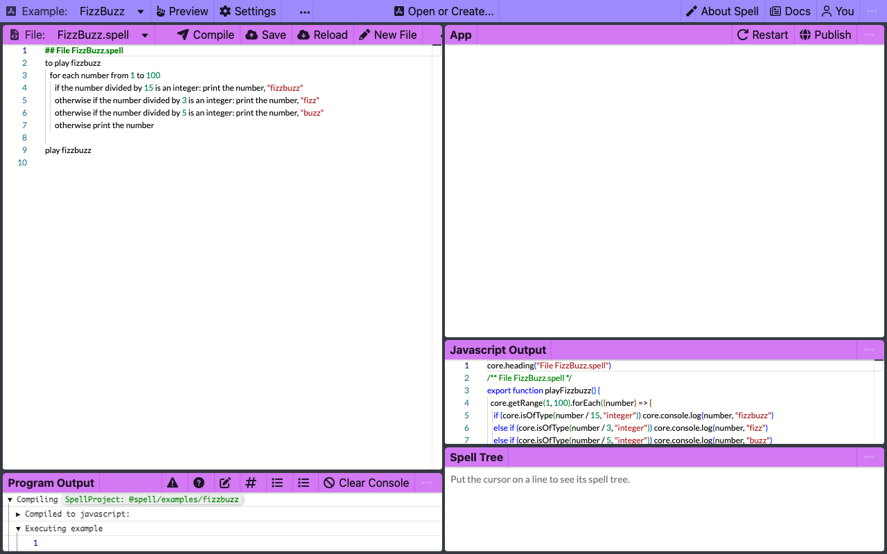</a> |
| Counter | [`@spell/examples/Counter`](spaces/@spell/examples/Counter/) | A button that counts its clicks:  a view with one property, one action and a drawing, in a few lines | <a href="docs/images/examples/Counter.png">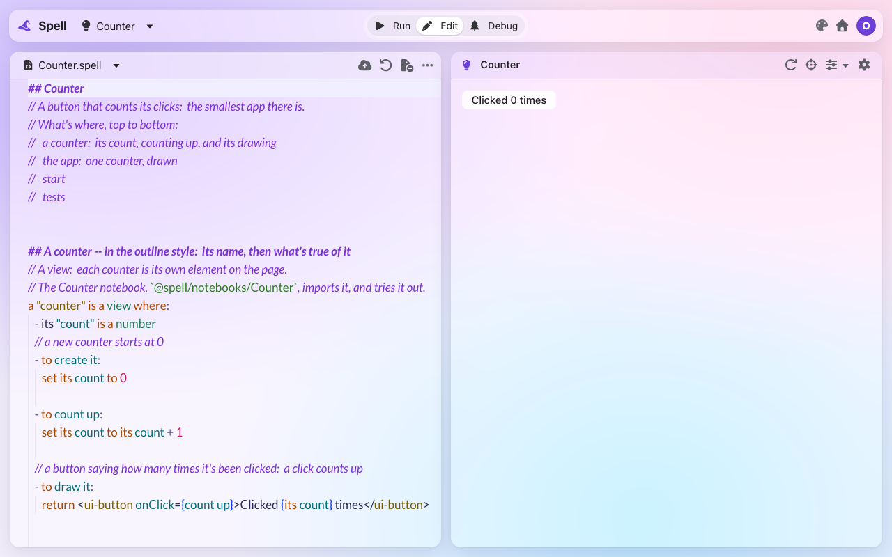</a> |
| Weekend Countdown | [`@spell/examples/WeekendCountdown`](spaces/@spell/examples/WeekendCountdown/) | How long until the weekend, ticking down every second:  a date's parts, `is a weekend day`, `the next weekend`, `as two digits` and an `every second` timer, drawn as statistics | <a href="docs/images/examples/WeekendCountdown.png">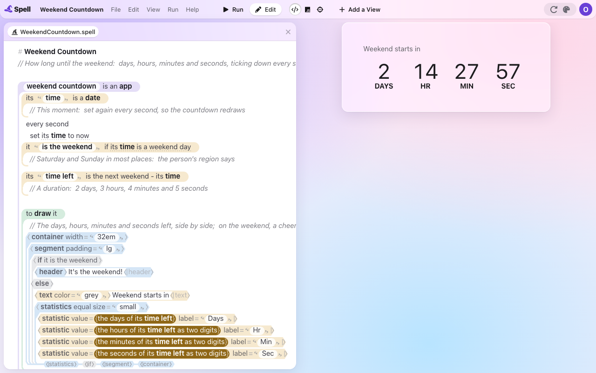</a> |
| Cuenta atrás | [`@spell/examples/CuentaAtras`](spaces/@spell/examples/CuentaAtras/) | Weekend Countdown's Spanish twin:  how long until the weekend, ticking down every second, written in Spanish;  `es un día de fin de semana`, `el próximo fin de semana`, `como dos dígitos` and a `cada segundo` timer, drawn as statistics | <a href="docs/images/examples/CuentaAtras.png">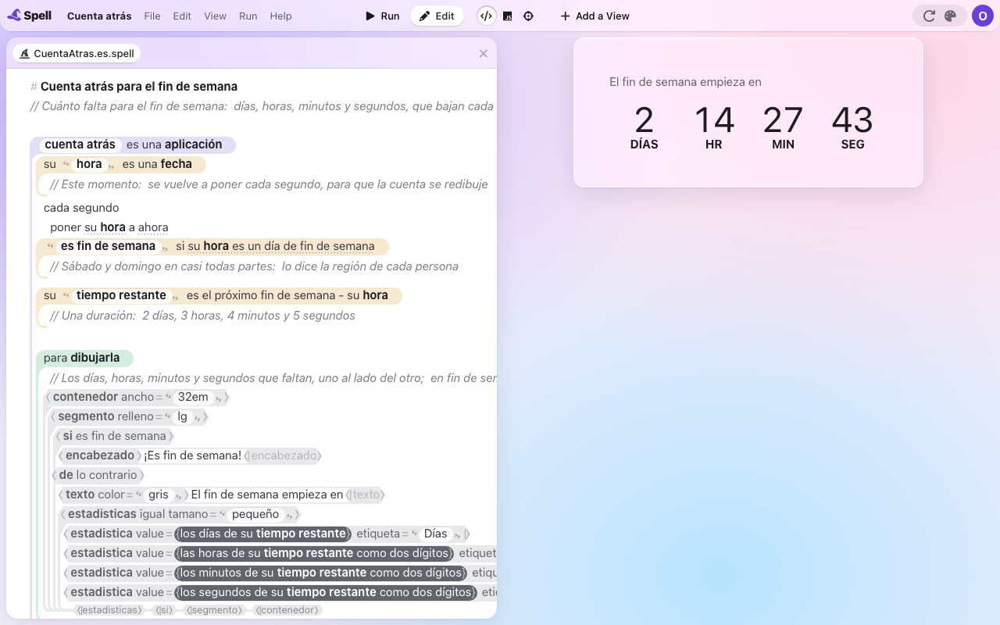</a> |
| Calculator | [`@spell/examples/calculator`](spaces/@spell/examples/calculator/) | A pocket calculator on Spell UI:  an app whose total is worked out as it's read, actions like `clear it` and `press (digit) on it`, and a keypad of buttons in a grid, whose clicks are Spell | <a href="docs/images/examples/calculator.png">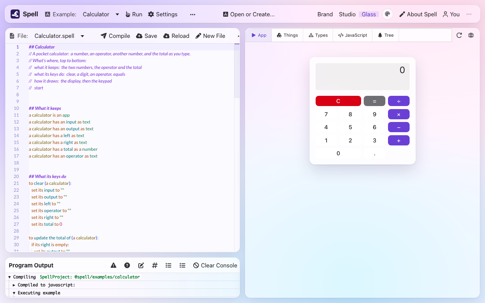</a> |
| Calculadora | [`@spell/examples/Calculadora`](spaces/@spell/examples/Calculadora/) | Calculator's Spanish twin:  a pocket calculator on Spell UI, written in Spanish;  an app whose total is worked out as it's read, actions like `borrarla` and `pulsar (dígito)`, and a keypad of buttons in a grid, whose clicks are Spell | <a href="docs/images/examples/Calculadora.png">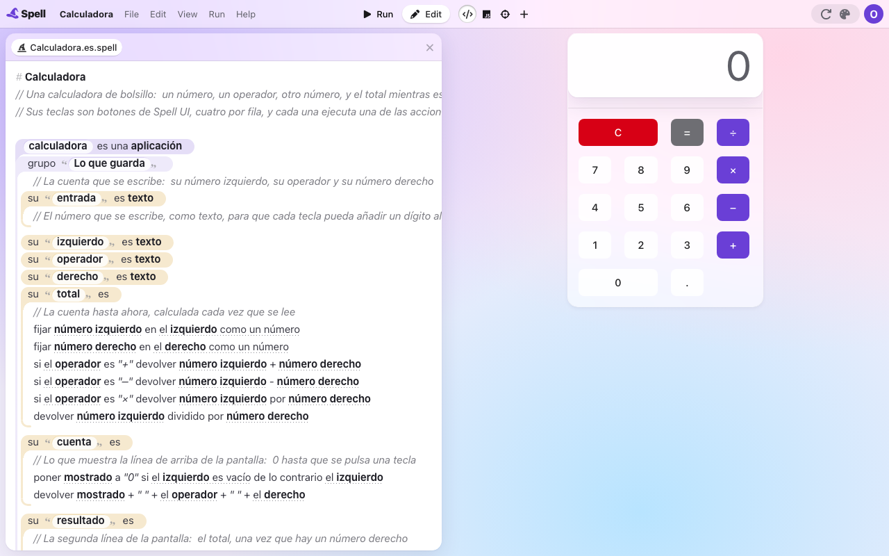</a> |
| Flash Cards | [`@spell/examples/flash-cards`](spaces/@spell/examples/flash-cards/) | A deck of Spanish words to quiz yourself on:  each card a two sided view that turns over on a click, you say whether you knew it, and a toolbar keeps the score | <a href="docs/images/examples/flash-cards.png">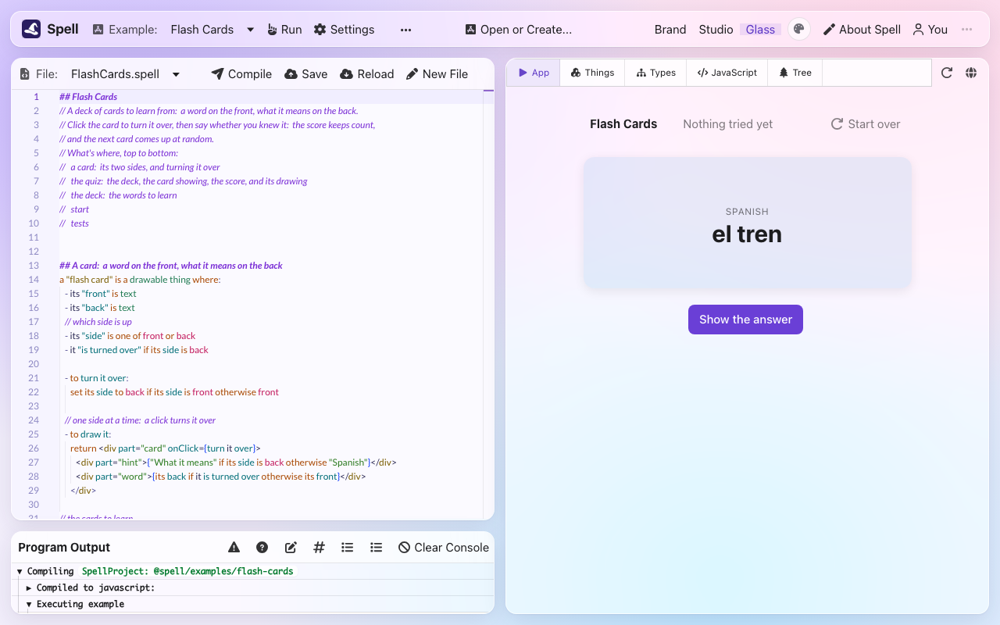</a> |
| Bill Splitter | [`@spell/examples/bill-splitter`](spaces/@spell/examples/bill-splitter/) | Who owes what after a meal:  a row of Spell UI's fields per person and what each ordered, a tip shared out the same way, and sums that follow every keystroke | <a href="docs/images/examples/bill-splitter.png">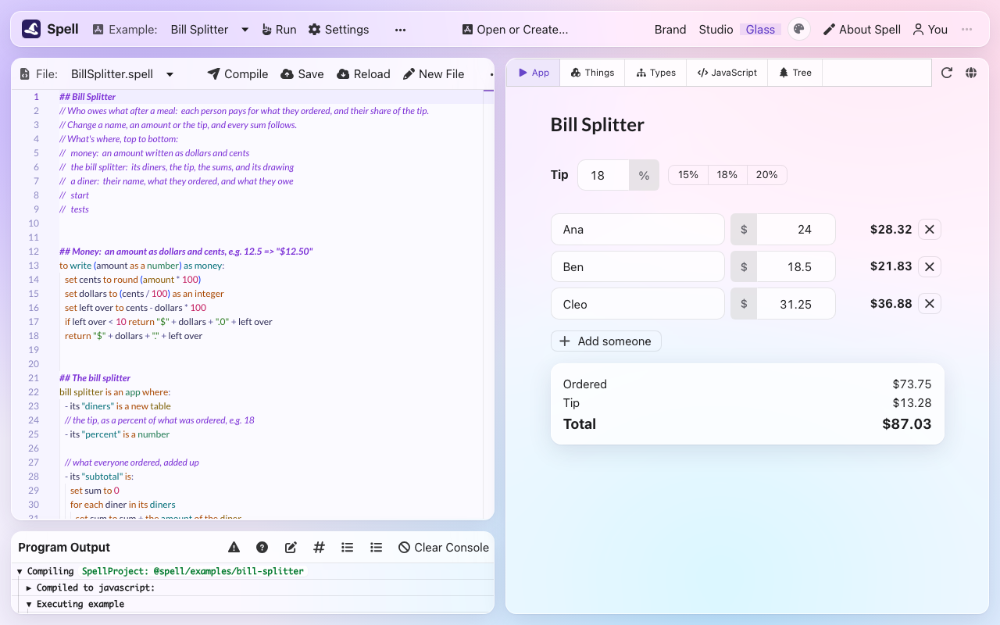</a> |
| Habit Tracker | [`@spell/examples/habit-tracker`](spaces/@spell/examples/habit-tracker/) | A week of checkboxes per habit:  each habit its own element with a form of its own, its days done and its longest streak worked out as you tick | <a href="docs/images/examples/habit-tracker.png">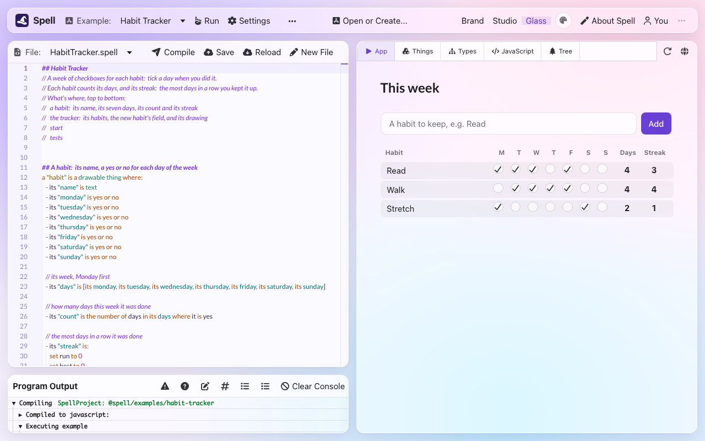</a> |
| Weather | [`@spell/examples/Weather`](spaces/@spell/examples/Weather/) | The weather in the city you pick:  now, big, with its emoji, then the next 12 hours in a row, from Open-Meteo, a server other people run;  its API in a file of its own, as `spell place ingest` wrote it | <a href="docs/images/examples/Weather.png">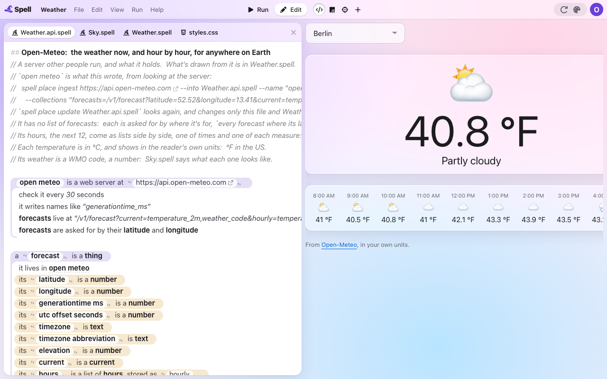</a> |
| Tic-Tac-Toe | [`@spell/examples/tic-tac-toe`](spaces/@spell/examples/tic-tac-toe/) | Noughts and crosses on Spell UI:  nine squares drawn as buttons in a grid, whose turn it is, and three in a row, written as sentences | <a href="docs/images/examples/tic-tac-toe.png">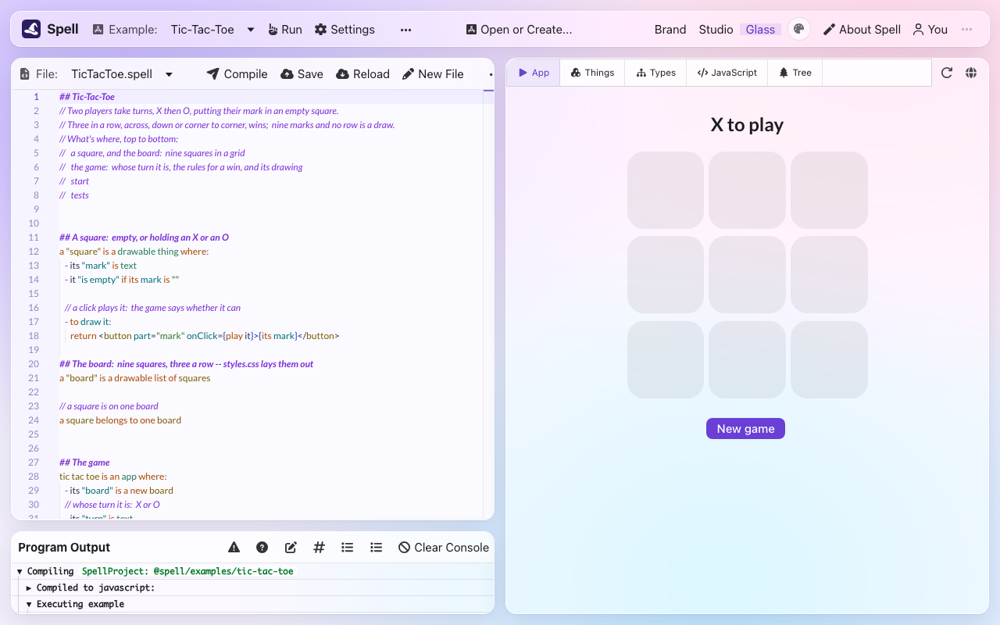</a> |
| Checkers | [`@spell/examples/Checkers`](spaces/@spell/examples/Checkers/) | Checkers against the computer, yourself or another tab:  the pieces draggable views, each move checked by the rules written as sentences, two boards side by side, and a live room for a game between two tabs | <a href="docs/images/examples/Checkers.png">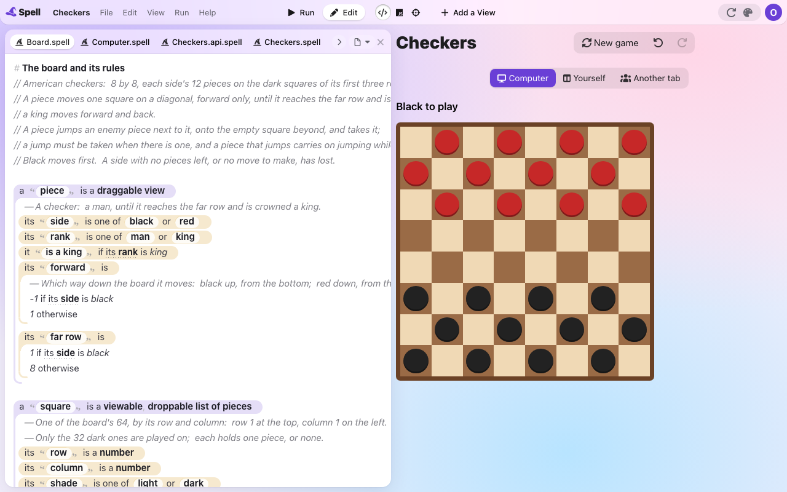</a> |
| Tarjetas de estudio | [`@spell/examples/TarjetasDeEstudio`](spaces/@spell/examples/TarjetasDeEstudio/) | Flash Cards' Spanish twin:  a deck of English words to quiz yourself on, written in Spanish;  each card a two sided view that turns over on a click, you say whether you knew it, and a toolbar keeps the score | <a href="docs/images/examples/TarjetasDeEstudio.png">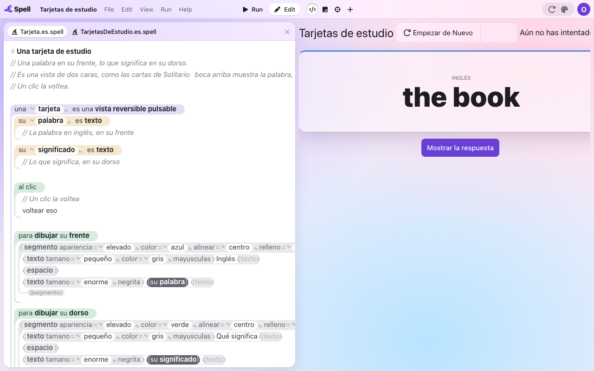</a> |
| Solitaire | [`@spell/examples/Solitaire`](spaces/@spell/examples/Solitaire/) | Klondike solitaire:  its own cards, deck and piles, each its own element;  the card a two sided view, the game's moves its actions, each with its title and key, drawn as its toolbar and its right-click menu;  `pause for` animates the deal | <a href="docs/images/examples/Solitaire.png">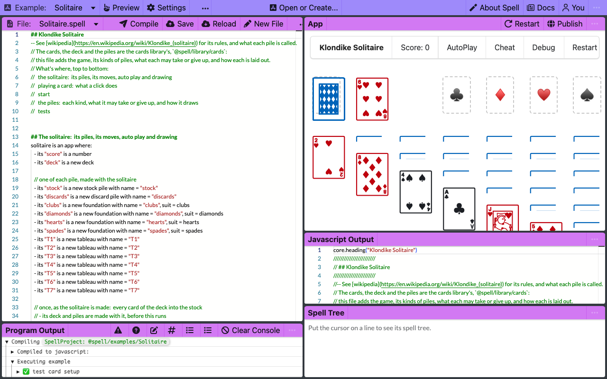</a> |
| Solitario | [`@spell/examples/Solitario`](spaces/@spell/examples/Solitario/) | Solitaire's Spanish twin:  Klondike in Spanish, with its own cards, deck and piles (`Carta`, `Mazo`, `Pila`), as Solitaire has;  the card a reversible view, the game's moves its actions, drawn as its toolbar and its right-click menu | <a href="docs/images/examples/Solitario.png">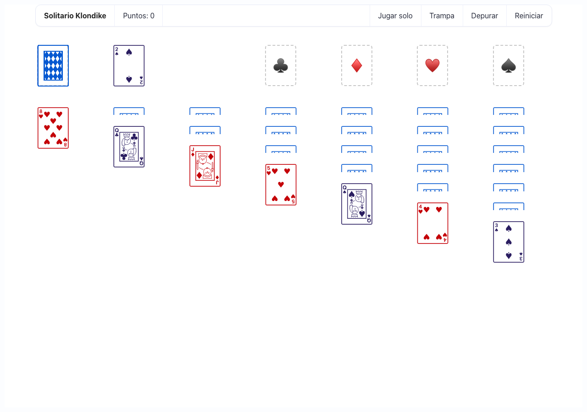</a> |
| Caja de recetas | [`@spell/examples/CajaDeRecetas`](spaces/@spell/examples/CajaDeRecetas/) | Recetas en tarjetas:  búscalas, agrégalas, cámbialas mientras escribes, quítalas y deshazlo.  Dónde se guardan lo dice una sola línea de su archivo de API, CajaDeRecetas.api.es.spell | <a href="docs/images/examples/CajaDeRecetas.png">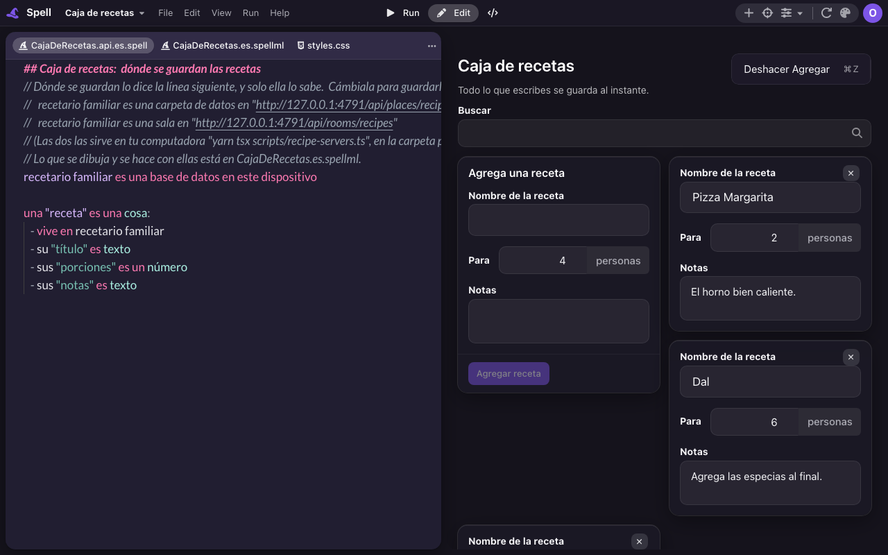</a> |
| Task List | [`@spell/examples/TaskList`](spaces/@spell/examples/TaskList/) | A to-do list:  type a task and add it, tick it off, delete it, and drag the tasks into order;  each task its own element with Spell UI's controls, and the tasks kept on this device, so they're still there next time, with no server and no sign-in | <a href="docs/images/examples/TaskList.png">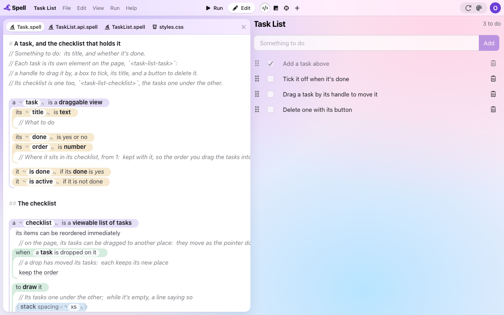</a> |
| Lista de tareas | [`@spell/examples/ListaDeTareas`](spaces/@spell/examples/ListaDeTareas/) | A to-do list in Spanish, an earlier, fuller Task List:  each task its own element with Spell UI's controls, a toolbar that filters it, and a click selecting tasks for a property editor that changes them all at once;  the tasks kept on this device, so they're still there next time, with no server and no sign-in | <a href="docs/images/examples/ListaDeTareas.png">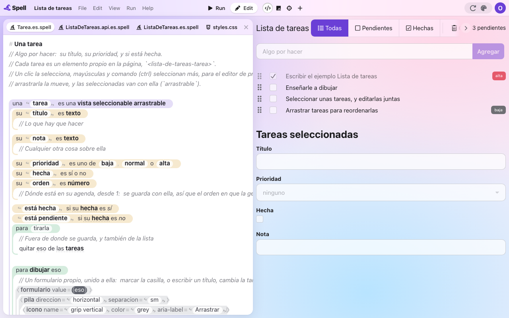</a> |
| Shopping List | [`@spell/examples/ShoppingList`](spaces/@spell/examples/ShoppingList/) | What to buy, by aisle, kept in a CSV file:  add an item, tick it off as you shop, clear what you got, and print what's left;  its rows are a real CSV file Numbers or Excel opens, in the example's own folder | <a href="docs/images/examples/ShoppingList.png">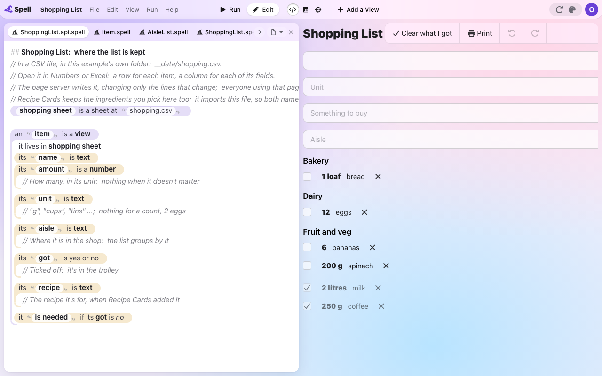</a> |
| Lista de la compra | [`@spell/examples/ListaDeLaCompra`](spaces/@spell/examples/ListaDeLaCompra/) | Shopping List in Spanish:  what to buy, by aisle, in a CSV file;  add an item, tick it off as you shop, clear what you got, and print what's left;  its rows are a real CSV file Numbers or Excel opens, in the example's own folder | <a href="docs/images/examples/ListaDeLaCompra.png">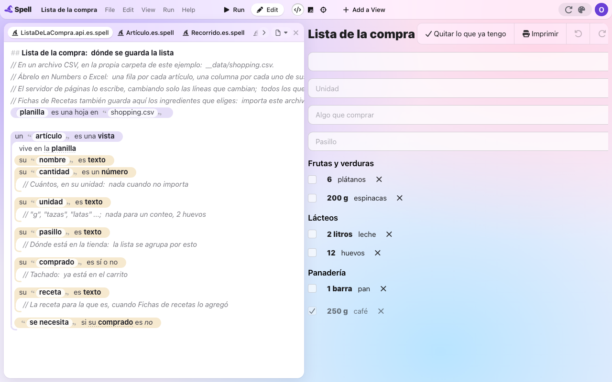</a> |
| Recipe Cards | [`@spell/examples/RecipeCards`](spaces/@spell/examples/RecipeCards/) | Recipes kept in a JSON file:  scale one for how many are eating, show it in metric or in cups and spoons, edit its ingredients and steps, and send the ingredients you pick to Shopping List's own list | <a href="docs/images/examples/RecipeCards.png">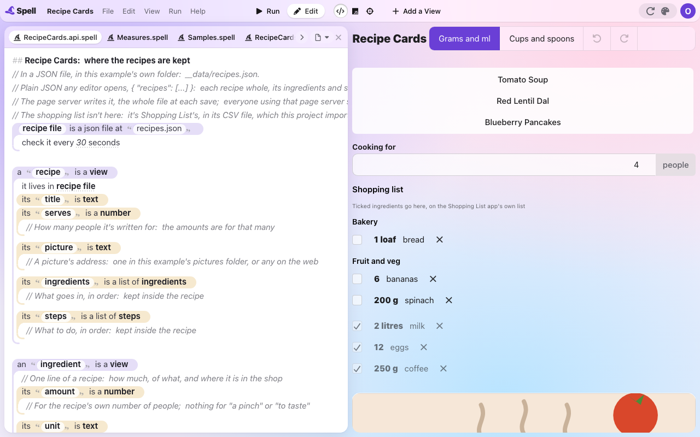</a> |
| Fichas de recetas | [`@spell/examples/FichasDeRecetas`](spaces/@spell/examples/FichasDeRecetas/) | Recipe Cards in Spanish:  recipes in a JSON file;  scale one for how many are eating, show it in metric or in cups and spoons, edit its ingredients and steps, and send the ingredients you pick to Lista de la compra's own list | <a href="docs/images/examples/FichasDeRecetas.png">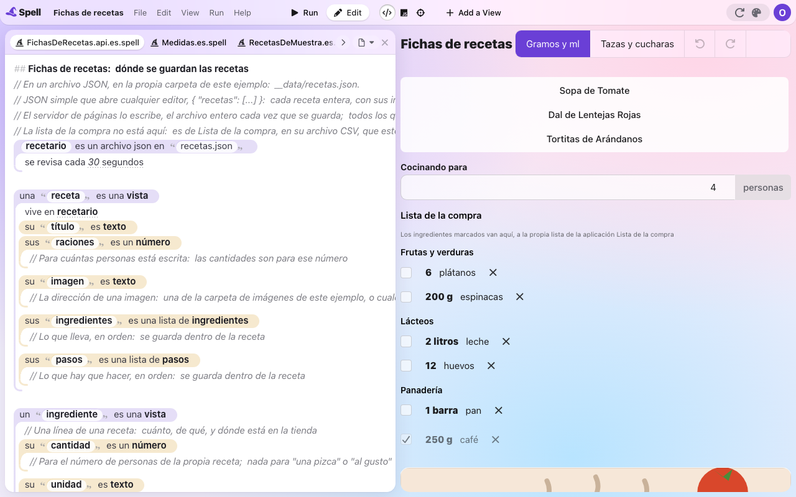</a> |
| Family Cookbook | [`@spell/examples/FamilyCookbook`](spaces/@spell/examples/FamilyCookbook/) | Your recipes on cards, saved in the cloud:  kept in this browser until you sign in, then on every device you sign in on.  One line of its API file says so, FamilyCookbook.api.spell | <a href="docs/images/examples/FamilyCookbook.png">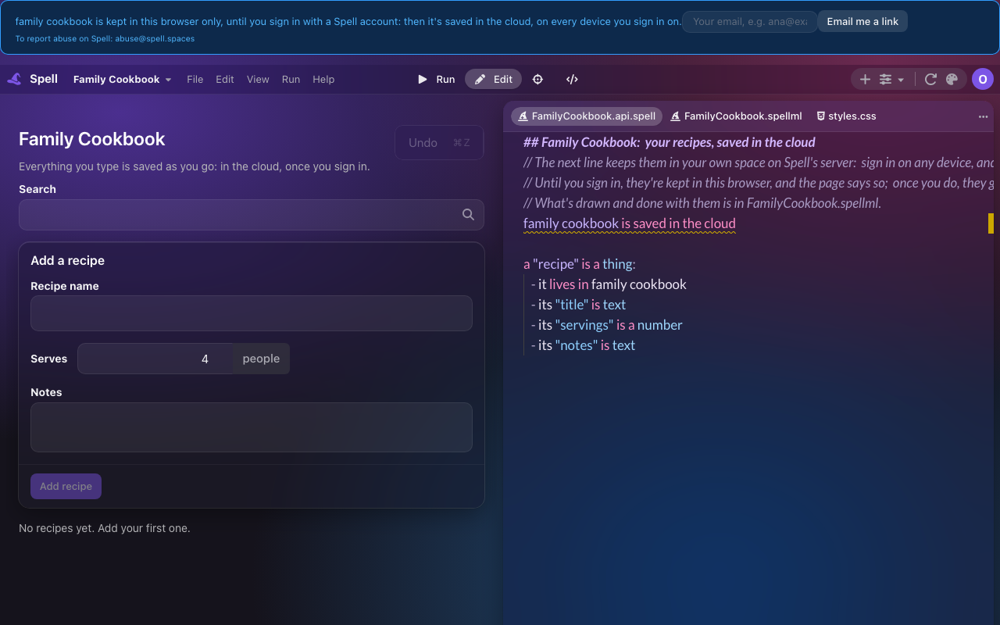</a> |
| Recipe File | [`@spell/examples/RecipeFile`](spaces/@spell/examples/RecipeFile/) | Your recipes on cards, in a JSON file on your computer:  open it once, and every change is saved back to it, after a reload too.  In Safari and Firefox, a save downloads it.  One line of its API file says so, RecipeFile.api.spell | <a href="docs/images/examples/RecipeFile.png">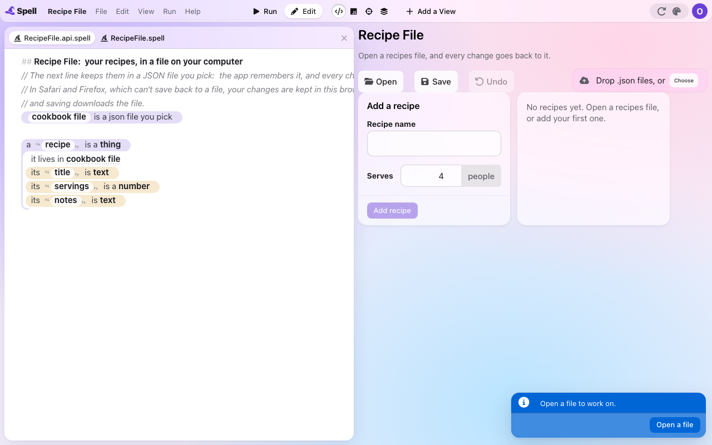</a> |
| Picnic Letter | [`@spell/examples/PicnicLetter`](spaces/@spell/examples/PicnicLetter/) | The picnic's letter to each attendee:  the day's details the same for everyone, then your own shifts from the published sheet, and how many invitations you've used, from your inbox. | <a href="docs/images/examples/PicnicLetter.png">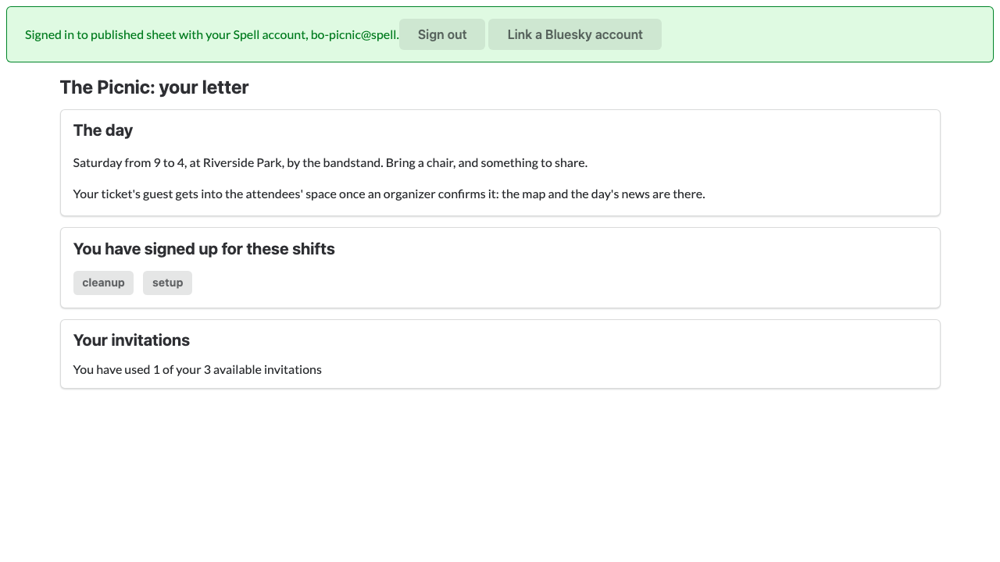</a> |
| Recipe Box | [`@spell/examples/RecipeBox`](spaces/@spell/examples/RecipeBox/) | Your recipes on cards:  find, add, change as you type, remove and undo.  Where they're kept is one line of its API file, RecipeBox.api.spell | <a href="docs/images/examples/RecipeBox.png">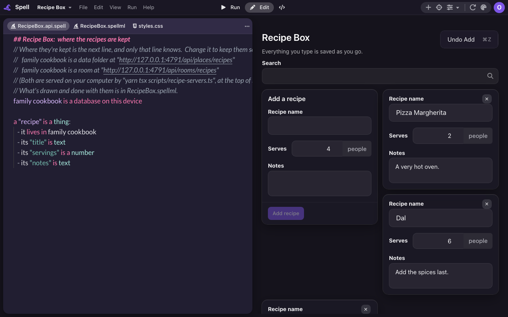</a> |
| Sign-Up Sheet | [`@spell/examples/SignUpSheet`](spaces/@spell/examples/SignUpSheet/) | A picnic's sign-up sheet:  attendees sign up for a shift from the picnic's shared space, two to a shift, while its organizers keep notes on the master that nobody else sees. | <a href="docs/images/examples/SignUpSheet.png">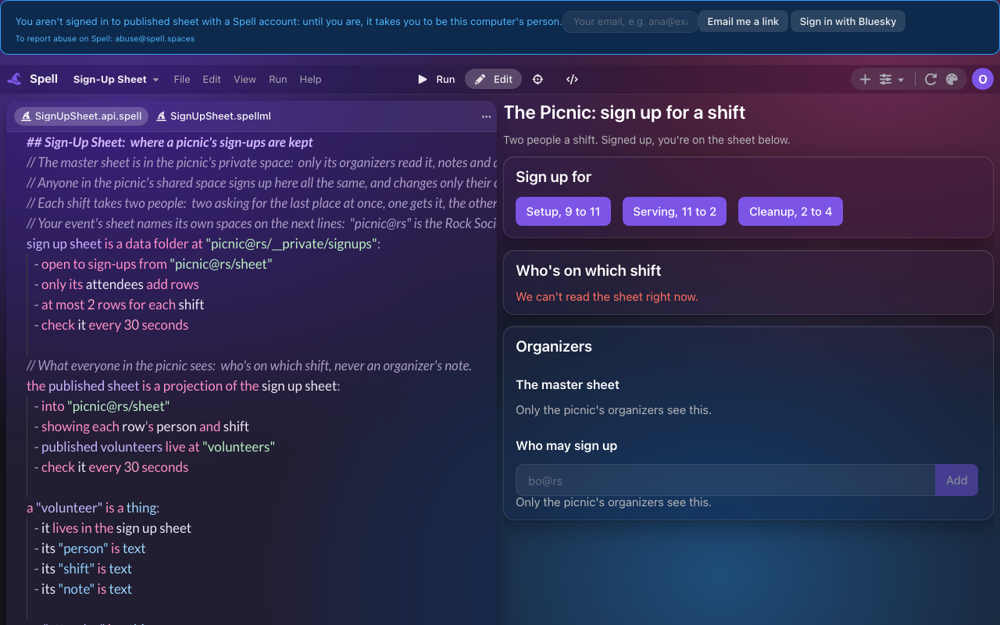</a> |
| PokéSpell | [`@spell/examples/PokeSpell`](spaces/@spell/examples/PokeSpell/) | A Pokédex for kids, playful and bright:  every Pokémon from PokéAPI, its API in a file of its own as `spell place ingest` wrote it;  favourites kept on this device beside them, in a second place;  browse by kind, search, Surprise me!, a page with its artwork, its cry and how strong it is, and Who's that Pokémon? | <a href="docs/images/examples/PokeSpell.png">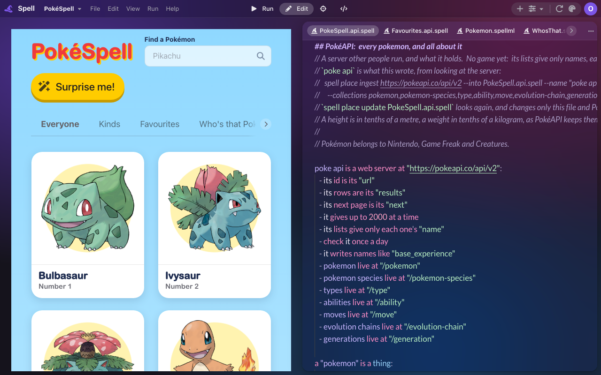</a> |
| Artworks from the Met | [`@spell/examples/MetArtworks`](spaces/@spell/examples/MetArtworks/) | The Met Museum's pictures, found by what you type:  a wall of them that goes on as you scroll;  each artwork read from its own address as it's drawn, one with no picture left out, and a picture turned over for what the Met knows of it;  its API in a file of its own, as `spell place ingest` wrote it | <a href="docs/images/examples/MetArtworks.png">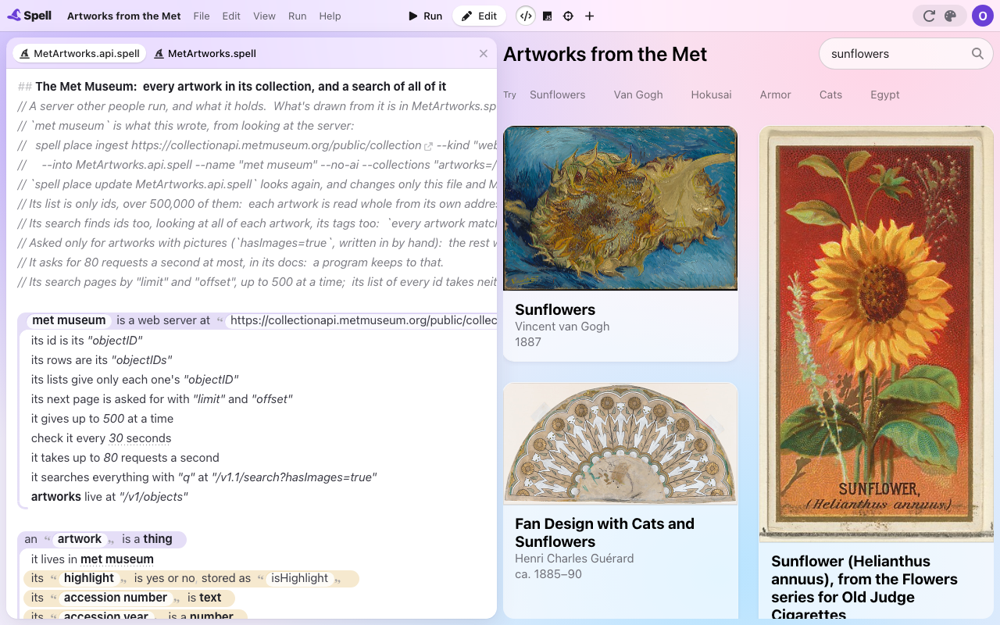</a> |
| Public Servers | [`@spell/examples/PublicServers`](spaces/@spell/examples/PublicServers/) | Public REST servers other people run:  each as `spell place ingest` wrote it, untouched, and each a page of its own.  GitHub:  a key named, never written, taken from the environment when it's set and gone without when it isn't;  lists that page by their Link header;  a rate limit read politely.  Open Library:  books found only by a search, refused at compile time without one;  each book's authors linked by their ids;  its covers on another server, each address built from the book's cover id.  JSONPlaceholder:  writes for real, adding, changing and deleting, each answered as if saved, and kept nowhere;  a post's comments read from the post's own address.  Open-Meteo:  a forecast asked for by a latitude and a longitude, refused at compile time without them;  its hours come as lists side by side, each hour read as one of each;  each measure in the unit the answer names, shown in the reader's own.  The Met Museum:  a list of over 500,000 ids, each artwork read whole from its own address only when it's drawn, a page at a time;  its search answers ids too, looking at all of each artwork;  its docs' pace, 80 requests a second, kept.  REST Countries:  every country in one request, with no paging;  its money, its languages and its names keyed by a code, each read as a list of things with that code | <a href="docs/images/examples/PublicServers.png">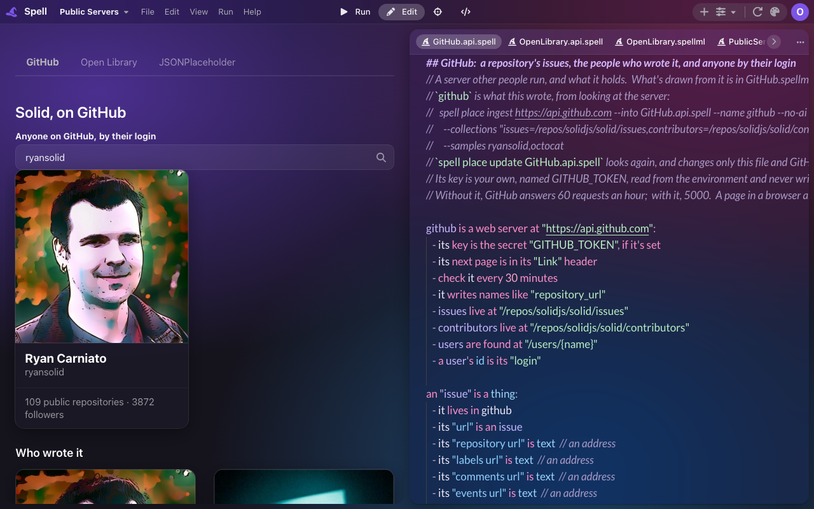</a> |
| Star Wars | [`@spell/examples/StarWars`](spaces/@spell/examples/StarWars/) | A guide to the galaxy from two servers other people run:  a place's rows linked by address, followed by saying what a field links to;  each server's API in a file of its own, Star Wars' as `spell place ingest` wrote it;  a long list that draws as you scroll;  pictures from a second place;  waiting, failing, and an opening crawl | <a href="docs/images/examples/StarWars.png">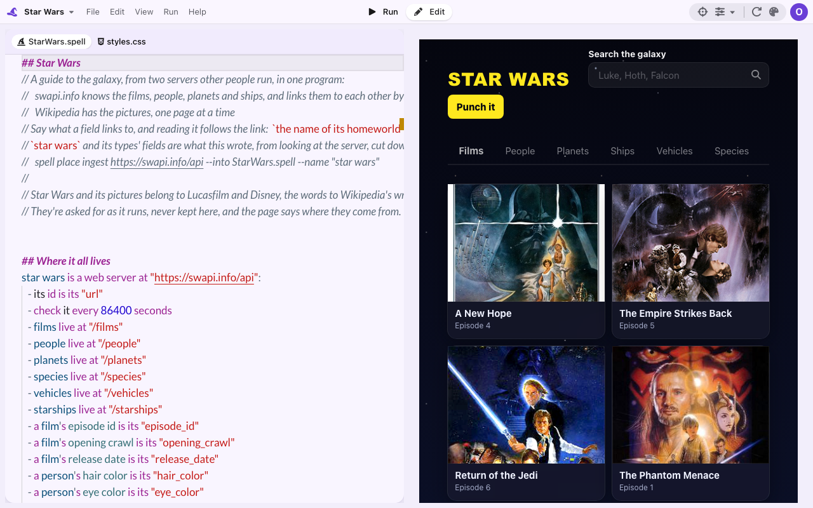</a> |
| Statusphere | [`@spell/examples/Statusphere`](spaces/@spell/examples/Statusphere/) | Bluesky's example app, Statusphere, in Spell:  set your status, an emoji, in your own atmosphere account, and see everyone's as they arrive.  Its status type is read in from Statusphere's Lexicon, Status.spell | <a href="docs/images/examples/Statusphere.png">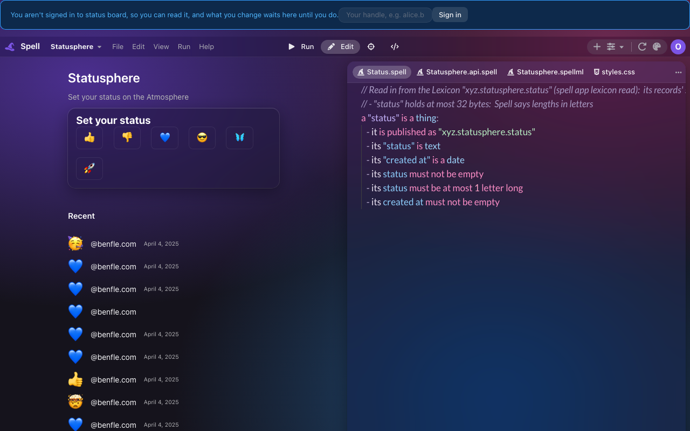</a> |
| Star Wars Site | [`@spell/examples/StarWarsSite`](spaces/@spell/examples/StarWarsSite/) | The Star Wars example as a site:  the whole of it, and its click-through mockup in the Mockup theme;  a list page and a page for one of each of its six collections (films, people, planets, species, vehicles, starships), each at its own address with what it shows in it (/films/:film);  a person opens in a sidebar, a film takes a review in a dialog, kept on this device, and the settings open from every page | <a href="docs/images/examples/StarWarsSite.png">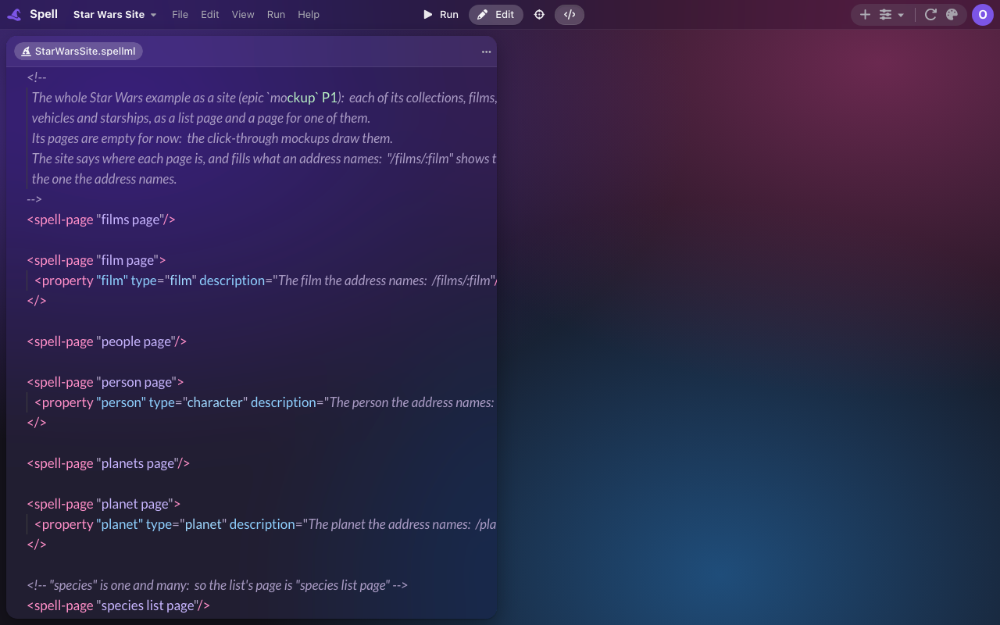</a> |
| Org Admin | [`@spell/library/OrgAdmin`](spaces/@spell/library/OrgAdmin/) | An org's Admin page:  add people, make teams and projects, name who manages what and until when, approve apps, and read the log of every change.  Each change goes through Spell's server, under the org's rules. | <a href="docs/images/examples/OrgAdmin.png">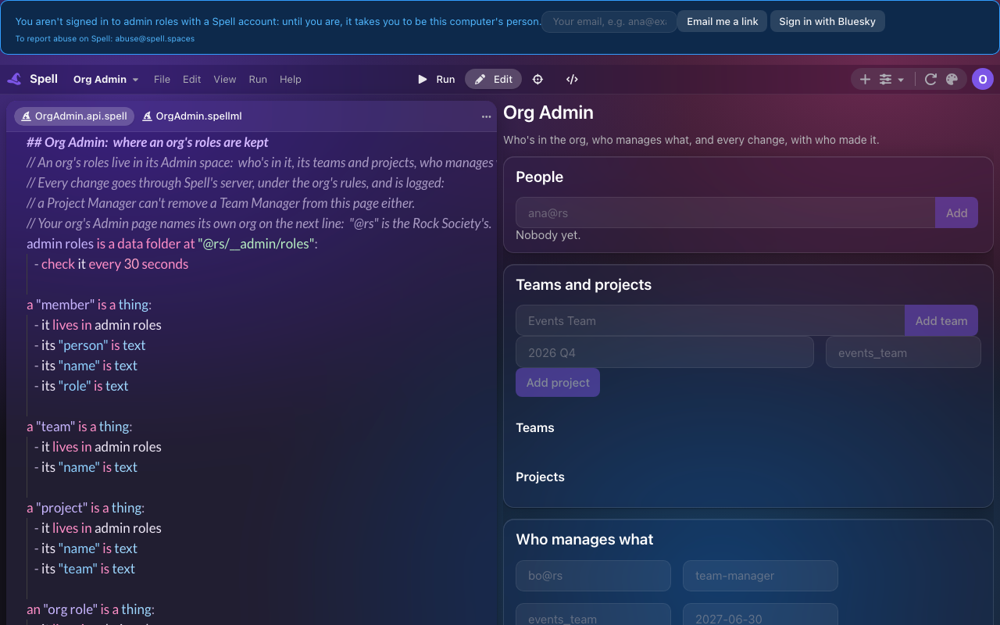</a> |
| Chat | [`@spell/library/OrgChat`](spaces/@spell/library/OrgChat/) | A team's open thread in its org, live:  a message shows on everyone's open page at once.  Everyone in the org writes in it;  you delete your own messages, and the team's Managers anyone's.  Its organizers' thread is beside it, in the team's private space. | <a href="docs/images/examples/OrgChat.png">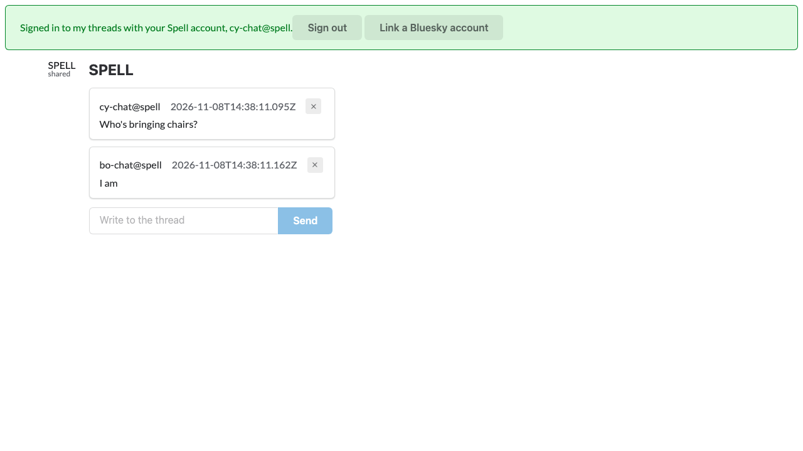</a> |
| Feed | [`@spell/library/OrgFeed`](spaces/@spell/library/OrgFeed/) | What's new across your org:  every post in every space of it you may read, newest first, a quiet event's left out.  What you see more of, and none of, is the program's to say:  change your copy of it. | <a href="docs/images/examples/OrgFeed.png">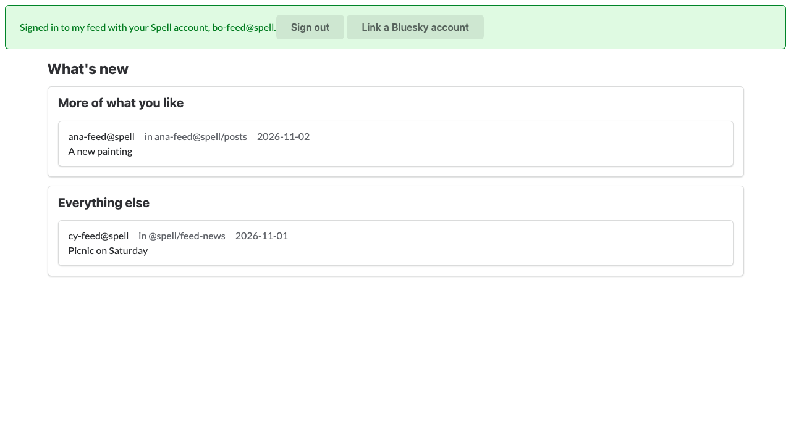</a> |
| Inbox | [`@spell/library/Inbox`](spaces/@spell/library/Inbox/) | Your inbox in an org:  messages people in it send you, and pages its Managers send, worked out when you open them.  Write to anyone in the org;  a copy lands in each inbox, and the Board and the Admins can read yours. | <a href="docs/images/examples/Inbox.png">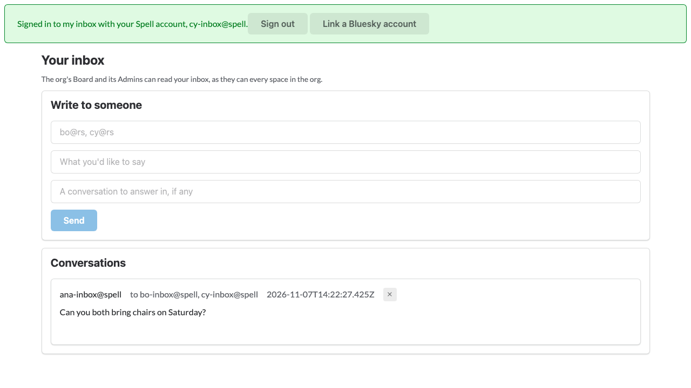</a> |
| Org Events | [`@spell/library/OrgEvents`](spaces/@spell/library/OrgEvents/) | An org's events, from someone's idea to a quiet record:  anyone proposes one, the Events Team's Managers say yes, which makes its project from a template, and its organizers move it through Planning, Open and Analysis to Quiet, when its spaces turn read only. | <a href="docs/images/examples/OrgEvents.png">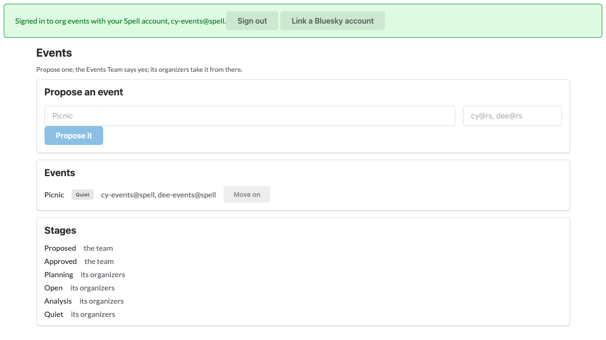</a> |
| Administración de la org | [`@spell/library/AdministracionDeLaOrg`](spaces/@spell/library/AdministracionDeLaOrg/) | La página de administración de una org:  agrega personas, crea equipos y proyectos, nombra quién dirige qué y hasta cuándo, aprueba aplicaciones, cambia las etapas de sus eventos y lee el registro de cada cambio.  Cada cambio pasa por el servidor de Encanto, con las reglas de la org. | <a href="docs/images/examples/AdministracionDeLaOrg.png">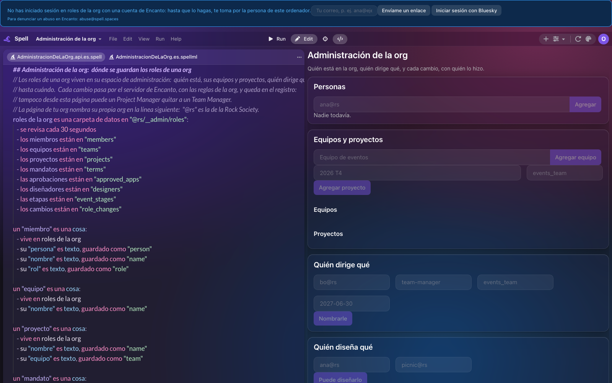</a> |
| Games | [`@spell/library/games`](spaces/@spell/library/games/) | Pieces to build games on.  In `cards/`, a standard deck of playing cards:  cards that turn over and drag, jokers, a deck with or without them, and piles that take dropped cards, each one its own element, with the styles that draw them | a library:  no app of its own |
| People | [`@spell/library/people`](spaces/@spell/library/people/) | People, orgs, notes and relationships, each saved in a readable JSON5 file;  compiled to TypeScript for the app's "You" panel and the people store | a library:  no app of its own |

<!-- examples:end -->

They're two groups in Spell's own space:
`@spell/examples`, and `@spell/library`, whose org apps each new org gets its own copy of,
and whose two libraries are for other projects to import.
Every example but Counter has a guide that takes it apart:  [guides](#guides--programs-that-read-as-prose), below.
Six of them make sounds:  Solitaire and Solitario's cards, Checkers' pieces, and the clicks of Counter and both calculators.
Each is one line, `play "card slide"`, naming a sound that comes with Spell ([Sounds](https://github.com/spell-app/spell/blob/main/parser/README-spell.md#built-in-sounds)).
Every Spell UI component page is a notebook too, in one site, `@spell/guides/SpellUI`:
a folder per component, a page for each of its tabs, the site's tab row drawn by the site itself.

### Opening one

With Spell set up ([setup from zero](https://github.com/spell-app/spell/blob/main/README.md#setup-from-zero)) and `spell` on your PATH
([setting it up](https://github.com/spell-app/spell/blob/main/README/cli.md#setting-it-up)), one command opens the editor on an example:

```sh
spell app serve @spell/examples/calculator
```

- It opens your browser on the example, until Ctrl-C ([its options](https://github.com/spell-app/spell/blob/main/README/cli.md#spell-app)).
- In the editor, **Home** (the house icon in the top bar) lists every project, these among them.
- `/run/` in place of `/edit/` shows the app alone, full size, with its console
  ([the editor's routes](README-app.md#the-editor--one-object-behind-every-pane)).
- `spell run @spell/examples/fizzbuzz` compiles one and runs it:  in your terminal,
  or, for one with an app, in your browser until Ctrl-C.
- `spell projects @spell/examples` lists them, alphabetically, which is not the order to open them in.

<details>
<summary>How the table is made, and adding an example</summary>

The table and its pictures come from the example projects, so a new example shows up by running one command.
Everything else on this page is written by hand.
A new example is tested as soon as its folder is there:  no list to add it to.

1. Make the project in `spaces/@spell/examples/<name>/`:  a `__project.json5` and its `.spell` files.
   `spell app create <name> --in spaces/@spell/examples` writes a first one.
2. Give its project file a `"description"`:  one line of what it shows.
   - Without one, the table takes the first comment of its first Spell file.
   - A `"title"` names it, when its folder's name can't (`ListaDeTareas` is "Lista de tareas").
   - Its place, in the table and on the home page:  the editor's order, [homeOrder.json](src/spaces/models/homeOrder.json);
     a new one goes after the listed ones, by name.
     On the home page, "Rearrange Home Screen" (at its foot) lets you drag its card to move it:
     as one of `@spell`'s people, in Spell's own checkout, that saves the list.
     The same list keeps the order of the home page's sections, under `"sections"`:  drag a section by its header.
     A card's title and tagline changed there are kept beside it, in [homeTexts.json](src/spaces/models/homeTexts.json),
     never in the example's own files.
3. Start the editor, `yarn start` in spell-app, and leave it running.
4. In spell-app's folder, `yarn examples:readme`:
   it opens each example in the editor, headless, in a window 1280 by 800,
   gives it 5 seconds after the page goes quiet to compile, run and draw,
   saves a picture of it into [the pictures folder](docs/images/examples/),
   then opens it in Run, alone, at a phone's width (390), and saves the top of its app as `__thumbnail.png` in its own folder:
   its card's picture on the editor's home page.
   It rewrites the table between the page's two marker comments last.

   ```text
   docs/images/examples/fizzbuzz.png
   @spell/examples/fizzbuzz:  draws nothing, so no thumbnail
   docs/images/examples/calculator.png
   spaces/@spell/examples/calculator/__thumbnail.png
   ...
   README-examples.md:  7 projects
   ```

5. `spell content check --bless`, then read the diff:
   it writes the new example's snapshots (its compiled output, and what it prints on every target)
   and runs every other check of the examples, notebooks and Spell guides, this page's table among them.

- `yarn examples:readme --no-pictures` rewrites only the table, without a browser;
  `yarn examples:readme calculator` takes only that example's pictures;
  `yarn examples:readme --thumbnails` only the home page's.
- An app that draws nothing, FizzBuzz printing, gets no thumbnail:  its card shows its first letter.
- An org app's thumbnail comes from the browser tests, which sign people in to a test org and fill it:
  in Run, nobody is signed in, so its lists would be empty.
- `yarn examples:readme --check` writes nothing:
  it fails while the table is out of date, or an example has no picture.
  spell-app's tests run it, so a new example fails `yarn test` until the page is made again.
- The table draws each picture 360 pixels wide;  a click opens it whole.
- Opening a project in the editor compiles it:  its declarations and words go in `build/` with its compiled code,
  so nothing beside its source changes.

</details>

## Every app here has four parts

FizzBuzz only prints.
The other nine draw an app, and each is built the same way:
what its things ARE, what they DO, how they DRAW, and one line that starts it.
If you know React, you know all four already, under other names.

The Calculator shows them plainest, in 113 lines, because it keeps each part in a block of its own:

| Part | In the Calculator | In React |
| --- | --- | --- |
| what its things are | `a calculator has a total as a number`, one of its six properties | the component's state |
| what they do | `to clear (a calculator):`, and four more actions | its event handlers |
| how they draw | `to draw (a calculator)`:  a keypad of Spell UI buttons, each with a click like `onClick={append "7" to it}` | its JSX |
| the start | `clear the calculator`:  the app then starts by itself, which puts its drawing on the page | `createRoot(root).render(<App />)` |

<details>
<summary>The four parts, in the Calculator's own lines</summary>

```spell
a calculator is an app
a calculator has an input as text
a calculator has an output as text
a calculator has a left as text
a calculator has a right as text
a calculator has a total as a number
a calculator has an operator as text
```

```spell
to clear (a calculator)
	set its input to ""
	set its output to ""
	set its left to ""
	set its operator to ""
	set its right to ""
	set its total to 0
```

```spell
to draw (a calculator)
	...
		<div class="Keypad">
			...
			<ui-button onClick={append "7" to it}>7</ui-button>
			<ui-button onClick={append "8" to it}>8</ui-button>
			<ui-button onClick={append "9" to it}>9</ui-button>
			<ui-button color="primary" onClick={apply "×" to it}>×</ui-button>
	...
```

```spell
set calculator to a new calculator
clear the calculator
```

- The whole program, its other four actions too:
  [Calculator.spell](spaces/@spell/examples/calculator/Calculator.spell).
- The keypad's grid, four keys a row, is a `<grid columns="4">` in the same file:
  no CSS.

</details>

The difference that matters:  a click handler is a sentence.
`onClick={clear it}` on the C key clears the calculator, and `it` is the calculator being drawn.

So the wording counts.
The operator keys say `apply "+" to it`, the calculator's own action:
a sum already typed carries its total on as the next sum's left number, and the second number starts afresh.

- `set its operator to "+"` would read as well, and only set the property:
  press 7, +, 5, and the 5 would join the 7, for 7 + 75.
- Its action was once named `set the operator of (a calculator) to (op as text)`:
  then `set the operator of it to "+"` ran it, and `set its operator to "+"`, one word apart, set only the property.
  So the action has a name no property has.

Two more things the picture won't tell you:
- The total appears as you type the second number;  the = key makes it the next sum's start.
- The display and the keypad are plain `<div>`s, laid out by the project's own stylesheet;
  the keys are Spell UI's `<ui-button>`, `primary` for an operator, `negative` for C.

## FizzBuzz:  a loop, and an event for each number

The classic programming exercise:
count to 100, saying "fizz" for multiples of 3, "buzz" for multiples of 5, and "fizzbuzz" for both.
Here's all of [FizzBuzz.spell](spaces/@spell/examples/fizzbuzz/FizzBuzz.spell), not an excerpt:

```spell
# FizzBuzz
// Counting to 100:  fizz for every number 3 goes into, buzz for 5, fizzbuzz for both.
// The counting prints nothing itself:  it says what each number is, as an event, to whoever's listening.
// - `Console.spell` listens, and prints each one.
// - `Explainer.spell` listens too, and shows them on a page.

to play fizzbuzz
	// each number from 1 to 100, as one of four events:  fizzbuzz, fizz, buzz, or a plain number
	for number from 1 to 100
		if the number divided by 15 is an integer: trigger fizzbuzz with number = the number
		otherwise if the number divided by 3 is an integer: trigger fizz with number = the number
		otherwise if the number divided by 5 is an integer: trigger buzz with number = the number
		otherwise trigger plain number with number = the number

play fizzbuzz
```

- `to play fizzbuzz` defines a new phrase, and `play fizzbuzz` says it.
- `for number from 1 to 100` names its loop variable, `number`, and later lines call it "the number".
- The counting prints nothing itself:  each number is an event, `trigger fizz with number = the number`,
  and two other files listen.
  - [Console.spell](spaces/@spell/examples/fizzbuzz/Console.spell) prints each one:
    `on fizz with number as a number`, then `print number, "fizz"`.
  - [Explainer.spell](spaces/@spell/examples/fizzbuzz/Explainer.spell) draws them on a page, a coloured label each,
    beside how it works.
  - Turn the explainer off (its import's `active`, in the project file) and it runs as a plain program.

```sh
spell run @spell/examples/fizzbuzz --no-browser
```

<details>
<summary>Output</summary>

```text
✓ Compiling @spell/examples/fizzbuzz
1
2
3 fizz
...
15 fizzbuzz
...
100 buzz
```

</details>

With `--target py`, the same hundred lines come from Python ([the targets](https://github.com/spell-app/spell/blob/main/parser/README-targets.md)).

<details>
<summary>What the counting compiles to, in JavaScript</summary>

```js
/** each number from 1 to 100, as one of four events:  fizzbuzz, fizz, buzz, or a plain number */
export function playFizzbuzz() {
  return core.asAction({ undoneAs: "Play Fizzbuzz" }, () => {
    core.getRange(1, 100).forEach((number) => {
      if (core.isOfType(number / 15, "integer")) trigger("fizzbuzz", { number: number })
      else if (core.isOfType(number / 3, "integer")) trigger("fizz", { number: number })
      else if (core.isOfType(number / 5, "integer")) trigger("buzz", { number: number })
      else trigger("plain-number", { number: number })
    })
  })
}
```

- From `spell compile @spell/examples/fizzbuzz --stdout`:  FizzBuzz.spell's function, the console's and the
  explainer's code left out.
- The new phrase is a function, `playFizzbuzz()`, and an action, one Undo step;  "the number" is the loop's `number`.
- `core` is [the runtime](https://github.com/spell-app/spell/blob/main/parser/README-core.md) compiled Spell runs on.

</details>


_FizzBuzz in an earlier editor, before its explainer page:  the App pane was empty then, and the output started at the bottom left._

## Four small apps:  a game, a form, a quiz and a checklist

Each is one file of Spell and a stylesheet, and each shows one thing the language does well.

| App | What to look at | Its edge |
| --- | --- | --- |
| [Tic-Tac-Toe](spaces/@spell/examples/tic-tac-toe/TicTacToe.spell) | the rule for a win, eight sentences:  `check the line from square 1 through 2 to 3` | inside `repeat 9 times`, `its` is the count, so the board is `tic tac toe's board` there |
| [Bill Splitter](spaces/@spell/examples/bill-splitter/BillSplitter.spell) | worked-out values a form changes:  `- its "share" is its amount + its tip`, each sum following every keystroke | no word adds up a list, nor writes money:  a loop adds the amounts, and `to write (amount as a number) as money` makes "$12.50" |
| [Flash Cards](spaces/@spell/examples/flash-cards/FlashCards.spell) | a random card, never the one just shown:  `cards in the deck where it is not quiz's card` | `a random card in ...` reads;  `a random flash card in ...`, two words, doesn't yet |
| [Habit Tracker](spaces/@spell/examples/habit-tracker/HabitTracker.spell) | a streak, worked out from a week of yes and no:  `for day in the days` | no dates:  the week is seven properties, Monday to Sunday, with no "today" |

```spell
to check the line from square (a as a number) through (b as a number) to (c as a number)
	// the same mark in all three squares wins
	set mark to the mark of square a of its board
	if mark is "" return
	if the mark of square b of its board is mark and the mark of square c of its board is mark
		set its winner to mark
```

_From Tic-Tac-Toe:  a phrase with three blanks, which the game says eight times, once a line._

- Each has a test of its own:  `spell test @spell/examples/tic-tac-toe` plays a game to a win.
- Tic-Tac-Toe, Bill Splitter and Habit Tracker draw their rows as things of their own,
  as Task List does (below):  `<tic-tac-toe-square>`, `<bill-splitter-diner>`, `<habit-tracker-habit>`.

## Task List:  things that draw themselves, kept on this device

Every framework has its to-do list, and this is Spell's:
[Task List](spaces/@spell/examples/TaskList/), the one Make something on the home page starts from.
Type a task and add it, tick it off, delete it, drag the tasks into another order:
they're kept on this device, so they're still there next time, with no server and no sign-in.
It's two files of Spell, an API file saying where it keeps its tasks, and two lines of style.
- [Task.spell](spaces/@spell/examples/TaskList/Task.spell):  what a task is, the checklist that holds it, and how a task draws.
- [TaskList.spell](spaces/@spell/examples/TaskList/TaskList.spell):  the app around them.
- [TaskList.api.spell](spaces/@spell/examples/TaskList/TaskList.api.spell):  where the tasks are kept, on this device (below).

It's written in plain Spell:  a line for each template, and under it a line for each property, alias and drawing,
with `//` comments for a person to read.
First, what a task IS:

```spell
a "task" is a draggable view
	its "title" is text
		// What to do
	its "done" is yes or no
	its "order" is number
		// Where it sits in its checklist, from 1:  kept with it, so the order you drag the tasks into comes back
	it "is done" if its done is yes
	it "is active" if it is not done
```

- `a "task" is a view` declares a new template;  `draggable` lets people drag a task to another place in its list.
- Each `its "..." is` line gives it a property, with its kind;  the comment under it says what it's for.
- The aliases are new ways to talk about a task:  later lines can say `where it is active`.
- A view makes each task an element of its own on the page, `<task-list-task>`.

Then the list that holds the tasks, and lets them be dragged into order:

```spell
a "checklist" is a viewable list of tasks
	its items can be reordered immediately
		// on the page, its tasks can be dragged to another place:  they move as the pointer does, gliding there
	when a task is dropped on it
		// a drop has moved its tasks:  each keeps its new place
		keep the order
	to draw it
		// Its tasks one under the other;  while it's empty, a line saying so
		<stack spacing="xs">
			<if it is empty>
				<text color="grey">Nothing to do</text>
			</if>
			<children />
		</stack>
	to keep the order
		// Each task keeps its place in the list, from 1:  so the order you drag them into comes back next time
		for task, place in it
			set the order of task to place
a task belongs to one checklist
```

- A viewable list is an element too, `<task-list-checklist>`, around its tasks' elements:
  each task draws itself, and `<children />` is where they go.
- `its items can be reordered immediately`:  drag a task, and it moves as the pointer goes, each task gliding
  to its new place.
  - Without `immediately`, it stays put while a blue line shows where it would go:
    rest the pointer there 2 seconds (or `after 1 second`), and it moves;  let go, and it moves at once.
- `when a task is dropped on it` runs once the dragged task is in its new place:
  `keep the order` sets each task's `order` to its place, from 1, and each task saves itself (below).
- `a task belongs to one checklist`:  a task is in one checklist at a time, and knows which, `its checklist`.

Then how a task draws, with [Spell UI](https://github.com/spell-app/spell/blob/main/ui/README.md)'s elements:
a form of its own, bound to the task, and a button to delete it.

```spell
a task
	to "delete" with title "Delete", icon "trash alternate outline"
		// Gone from its checklist, and from this device
		remove it from its checklist
		remove it from the tasks

	to draw it
		// A form of its own, bound to it:  ticking the box, or typing a title, changes the task
		<form value={it}>
			<stack direction="horizontal" spacing="sm">
				<icon name="grip vertical" color="grey" aria-label="Drag" />
				<checkbox name="done" aria-label="Done" />
				<input name="title" aria-label="Task" appearance="transparent" fluid />
				<action "delete" icon-only appearance="tertiary" />
			</stack>
		</form>
```

- `a task` alone, on its line, adds to the task template:  after `belongs to`, so `its checklist` is known.
- Every tag is Spell UI's, by its bare name:  `<stack>` is `<ui-stack>`, `<checkbox>` is `<ui-checkbox>`.
- There's no change handler anywhere.
  The form is bound to the task (`value={it}`):
  each named field shows its task's property, and writes it back as you type or tick.
- `<action "delete" />` is the action's button:  its title and icon are the action's, shown as the icon alone.
- The style sheet's two rules:  the title fills the row, and a task that's done fades.
- A press in the title field or on the checkbox is theirs:  a drag starts from the grip, or the task's bare row.

And last, the app:  `task list is an app`, with its checklist, the new task's field, and how many are left.

```spell
	// The draft, as a new task;  the field empties
	to add the draft
		if the draft is "" return
		add the task the draft
		clear the draft

	// A new task at the end of the list, kept on this device
	to add the task (title as text)
		set task to a new task with title = title
		add task to the tasks
		add task to the checklist
		set the order of task to the length of the checklist
```

- An action's body is its steps, one a line;  `the draft` is the app's own, what the new task's field holds.
- `add task to the tasks` keeps it on this device;  `add task to the checklist` shows it in the list.
- `its "active count" is the length of (tasks in the checklist where it is active)`:
  the tasks picked out with `where`, counted, which the header shows as "3 to do", or "All done".

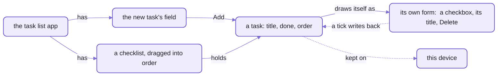

_The app keeps a checklist of tasks;  each task draws its own form, and is kept on this device._

Its tests are written in Spell, a `to test ...` inside the template each one tests:

```sh
spell test @spell/examples/TaskList
```

<details>
<summary>Output</summary>

```text
✓ Compiling @spell/examples/TaskList
✓ test a dragged order is kept  (3 checks)
✓ test checking one off  (2 checks)

2 passed
```

</details>

### Where it keeps its tasks

On this device, in the browser's own storage:  it needs no server and no sign-in,
and the tasks are still there when you come back.
Two lines say so:

```spell
my tasks is stored on this device
a task lives in my tasks
```

_TaskList.api.spell, its comments left out:  a place, and the tasks that live in it._

- After them, the words you already know reach the device:
  `every task` reads them, `add task to the tasks` keeps a new one, `remove it from the tasks` throws one away.
- The first time, with none kept yet, the app starts with four tasks saying what to try.
- A task saves itself as it changes:  ticking it or typing its title is kept, with no save step.
- The order you drag the tasks into is kept too:  each task keeps its own `order`, which the drop sets,
  and the app fills the list `sorted by its order`, so it comes back the same way.
- To keep them somewhere else, change the first line:  `my tasks is a data folder at "tasks"`,
  a JSON file a task on the server, and nothing else changes.


_Task List in the editor:  the first task is ticked, because the program ticks it as it starts._

### Lista de tareas:  the same list, in Spanish

[Lista de tareas](spaces/@spell/examples/ListaDeTareas/) is an earlier, fuller Task List, written in Spanish:
a toolbar that filters it, and a property editor for the selected tasks, kept on this device the same way:
`mis tareas se guarda en este dispositivo`.

```spell
una "tarea" es una vista seleccionable arrastrable
	su "título" es texto
		// Lo que hay que hacer
	su "nota" es texto
		// Cualquier otra cosa sobre ella
	su "prioridad" es uno de baja, normal o alta
	su "hecha" es sí o no
	su "orden" es número
		// Dónde está en su agenda, desde 1:  se guarda con ella, así que el orden en que la gente arrastra las tareas vuelve
	"está hecha" si su hecha es sí
	"está pendiente" si su hecha es no
```

_A task, in Spanish:  with a note and a priority besides._

- Its tests are three, in Spanish:  `spell test @spell/examples/ListaDeTareas` runs them.
- It draws with Spell UI's Spanish names (`<formulario>`, `<casilla>`, `<pila>`), and its toolbar says "3 pendientes".


_Lista de tareas in the editor:  a task list, its words in Spanish._

## Star Wars:  two servers other people run, in one program

[Star Wars](spaces/@spell/examples/StarWars/) reads [swapi.py4e.com](https://swapi.py4e.com/) for the films, characters, planets and ships,
and Wikipedia for their pictures.
Each is one line, and its rows' fields, in a file of its own:
Star Wars' as `spell place ingest` wrote it, Wikipedia's by hand.

```spell
star wars is a web server at "https://swapi.py4e.com/api"
	its id is its "url"
	its rows are its "results"
	its next page is its "next"
	it searches names and titles with "search"
	check it once a day at 5am
	keep a copy on this device

wikipedia is a web server at "https://en.wikipedia.org/api/rest_v1"
	wiki pages live at "/page/summary"
	a wiki page's id is its "pageid"
```

_From [StarWars.api.spell](spaces/@spell/examples/StarWars/StarWars.api.spell) and [Wikipedia.api.spell](spaces/@spell/examples/StarWars/Wikipedia.api.spell), shortened._

Its rows link to each other by address:  a character says `"homeworld": "https://swapi.py4e.com/api/planets/1/"`.
Say what a field links to, and reading it follows the link.

What's inside a field is a thing of its own, read in words, `the source of its thumbnail`:

```spell
a "character" is a thing
	it lives in star wars
	its "height" is a number or "unknown"
	its "hair color" is text
	its "homeworld" is a planet
	its "films" is a list of films

a "wiki page" is a thing
	it lives in wikipedia
	its "thumbnail" is a thumbnail

a "thumbnail" is a thing
	its "source" is text
```

_From the same file, shortened._

What's drawn is in [its own file](spaces/@spell/examples/StarWars/StarWars.spell), in Spell UI's elements, adding to those types:
`<extend "character">`.
So looking at the server again never touches a line of it.

A long list says nothing of how long it is:  it draws what fits, and more as you scroll.

Then `the name of its homeworld` is the planet's name, and `<for its films />` draws the films.

Each field finds the server's own spelling by its words:  `its "hair color"` reads `hair_color`.
And `"172"` reads as a number, `"unknown"` as nothing.
- One read per address, shared, and none for a thing another read has already brought.
- A drawing that leaves gives up the reads it was waiting on.
- It's only for a web server:  elsewhere a field holds the thing itself.

It keeps a copy of what it reads on this device:  its first load sends 6 requests to swapi, and a reload before 5am sends none.
A search goes to the server, `?search=sky`, one request a collection rather than every page.

`spell place ingest https://swapi.py4e.com/api --into StarWars.api.spell --name "star wars"` wrote those lines by looking at the server.
Its description went beside them, `StarWars.api.json5`;  `spell place update StarWars.api.spell` looks again.

Its pictures come from Wikipedia as it runs, and not every name has a page:
about one in five of its 260 names has a picture that's really of it, and the rest are an initial on a colour.

## Solitaire:  a game in plain Spell, and things that draw themselves

Klondike in four files of Spell, a stylesheet and a layout for the Inspector, written in plain Spell, as Task List is.
Its cards, its piles and its deck are its own files, before the game, in its project file's order:

```json5
[{ "path": "/Card.spell" }, { "path": "/Pile.spell" }, { "path": "/Deck.spell" }, { "path": "/Solitaire.spell" }, { "path": "/styles.css" }, { "path": "/Card.editor.spell" }]
```

_From [its project file](spaces/@spell/examples/Solitaire/__project.json5), shortened:  each file sees the ones before it._

So [Solitaire.spell](spaces/@spell/examples/Solitaire/Solitaire.spell) is only the game:
the solitaire itself, how a click or a drag plays a card, and its kinds of pile, each saying what it may take or give up.

```spell
solitaire is an app
	-- A fully playable game in 300 lines of code!
	-- See https://en.wikipedia.org/wiki/Klondike_(solitaire) for the rules
	when creating solitaire
		add each card in the deck to the stock
		deal the cards

	to draw solitaire
		-- Use magical HTML tags to draw the game.
		-- Parts in purple are "views" which can be used in the program.
		<deck "deck" hidden />
		<segment inverted attach-to="top">
			<toolbar size="small" appearance="pills" inverted shrinkable>
				<text size="big" slot="title" heavy>Spell Solitaire</>
				<action "auto play"/>
				<action "cheat"/>
				<action "deal the cards" title="Restart" />
				<spacer/>
				<action "undo" icon-only />
				<action "redo" icon-only />
				<text slot="right"><b>Score</b>: <number "score" /></>
			</>
		</>
		<container columns="7" padding="small" spacing="xs">
			<stock-pile "stock"/>
			<discard-pile "discard pile"/>
			<spacer/>
			<foundation "clubs" suit=clubs/>
```

_The solitaire's first lines, and the top of its drawing, shortened._

- The same sentences as the Calculator's, under the solitaire's line, without "a solitaire" at the start of every line
  ([the language, sentence by sentence](https://github.com/spell-app/spell/blob/main/parser/README-spell.md)).
- Each part is declared where it's drawn:  `<deck "deck" hidden />` is the solitaire's deck, `<stock-pile "stock"/>`
  its stock, `<column "C1"/>` its first column, and `<number "score" />` its score.
  So `the deck`, `the stock`, `the discard pile`, `the clubs` and `the columns` read them, with no line making them.
- The game bar is a toolbar of pills:  each `<action "cheat"/>` is a button,
  its title, icon and key the action's own, from its head line, `to "cheat" with shortcut "C", icon "eye"`.
  `title="Restart"` gives `deal the cards` a shorter one there.
- The board's right-click menu is written inside the drawing, a `<context-menu>` of the same actions.
- Winning shows a dialog, `<modal "you won">`, from `when the score changes`:  `show "you won"`.
- `group` lines are headings:  for a person to read, which the editor shows in bold.
- The card is a `draggable two sided view` ([Card.spell](spaces/@spell/examples/Solitaire/Card.spell)):
  its direction, face up or down, and `turn it over` come from that built-in template,
  and it says what its `to draw its front` and its `to draw its back` look like.
  - Both draw a `card image`, a view of its own:  the one place a card's look lives.
- Its Inspector card is laid out in a file of its own, [Card.editor.spell](spaces/@spell/examples/Solitaire/Card.editor.spell):
  `<property-editor "card">`, of Spell UI's property controls, which the program never compiles.
- [styles.css](spaces/@spell/examples/Solitaire/styles.css) shows the side turned up,
  and turns the card about its middle as its direction changes, the other side taking over halfway.
- The game pauses as long as that flip after turning the stock's card, `pause for 300 msec`,
  so the card turns over, then goes to the discard pile.
- A click on a card is its own handler, `when clicked`:  `play the card`, and the game says where it goes.

The deal is a loop with pauses in it, so you watch it happen:

```spell
to "deal the cards" with shortcut "R", icon "sync alternate"
	clear the score
	for each card in the deck
		turn the card face down without waiting
	for each card in the cards which are not in the stock
		add the card to the stock without waiting
		pause for 10 msec
	shuffle the stock
	-- each row's first card lands face down, then turns up where it lies
	for row from 1 to 7
		for column from row to 7
			add the top card of the stock to item column of the columns
			pause for 20 msec
			if column is the same as row
				turn the last card of (item column of the columns) face up
	turn over the next card
```

_From Solitaire.spell:  plain Spell, in the outline style._

- `pause for 20 msec` lets the page draw before the next line runs:  28 cards dealt, 20 ms apart.
- `without waiting` skips a step's own pause:  the cards gather at once.
- What a person starts runs one at a time:
  a second Restart during the deal does nothing, so it can't deal on top of the first.
- A card is in one pile at a time, as [Pile.spell](spaces/@spell/examples/Solitaire/Pile.spell) says
  (`belongs to one pile`):  adding it to the stock takes it off the pile it was in.

What you see:
- Each card is one character, from Unicode's playing cards:  the queen of spades is 🂭, and the card image's test checks it.
- Each card is its own element, `<solitaire-card>`;
  each pile is a viewable list, its own element (`<solitaire-column>` and the rest), holding its cards' elements.
- Each kind of pile lays its cards out by its `layout`, which [styles.css](spaces/@spell/examples/Solitaire/styles.css) draws:
  a column shows the top of each card below the one before;  a stacked pile, the stock, the discard pile and the
  foundations, shows its last card, over its placeholder while it's empty.
- Auto Play, Cheat and Restart run across the top, as pills, Undo and Redo as icons, the score on the right;
  the board's right click shows the same actions as a menu, each with its key (A, C, R).
  A card onto a foundation scores 10, one from the discard pile 5.
  Cheat turns up a random face-down card:  `set the card to a random card in the columns where it is face down`.

Its tests are written in Spell, a `to test ...` inside what each one tests, and run from the command line:
the tests of its card and card image, its piles and deck, then the moves, of what each pile may take.

```sh
spell test @spell/examples/Solitaire
```

<details>
<summary>Output</summary>

```text
✓ Compiling @spell/examples/Solitaire
✓ test card setup  (15 checks)
✓ test card images  (10 checks)
✓ test piles  (8 checks)
✓ test a new deck  (5 checks)
✓ test the moves  (11 checks)

5 passed
```

</details>


_Solitaire in the editor, dealt:  its Spell on the left, the game on the right, in an older look:  its bar of pills is newer than this picture._

### Solitario:  the same game, in Spanish

Spell reads Spanish too, a file at a time, by its name:  `Solitario.es.spell` is Spanish, a name with no language English
([Spell in Spanish](https://github.com/spell-app/spell/blob/main/parser/README-spanish.md)).
[Solitario](spaces/@spell/examples/Solitario/) is Solitaire written in it, in the outline style, cards and all:
its own `Carta`, `Mazo` and `Pila`, as Solitaire has its `Card`, `Deck` and `Pile`, so all of it reads in Spanish.

```spell
una "columna" es una pila con disposición "vertical"			-- Una columna, armada hacia abajo del rey al as, rojo y negro alternados
	sus cartas son arrastrables cuando la carta está boca arriba
	es soltable cuando
		está vacía y la carta es un rey
		o
		su color no es el color de la carta y
		  su valor es el valor de la carta + 1
```

_The tableau's rule, in Spanish:  a column, `columna`._

- Its tests are four, in Spanish:
  `spell test @spell/examples/Solitario` runs them.
- Where the two differ, a Spanish word does:  the queen is `dama`, so its shorthand is D, and the king's R.


_Solitario open in the editor, dealt:  the same board, its menu in Spanish, drawn with Spell UI's Spanish tags (`<es-menu>`, `<es-cuadricula>`)._

## Guides:  programs that read as prose

```spell
## How Tic-Tac-Toe works
// The Tic-Tac-Toe example is the paper game:  X and O take turns, and three in a row wins.
// Its rules fit in three ideas:
// - each square knows its own mark, and draws itself as a button
// - the game knows whose turn it is
// - after each move, the game checks every line of three for a winner
//
// This guide is the same game with one thing missing:  it only checks the ROWS, across.
// Three down, or corner to corner, doesn't win yet.  Adding those is your move, at the end.


## A square:  empty, or holding an X or an O
// "view" means each square shows itself on the page, here as a button
a "square" is a view
	its "mark" is text
	it "is empty" if its mark is ""
```

_The top of [How Tic-Tac-Toe works](spaces/@spell/guides/how-tic-tac-toe-works/HowTicTacToeWorks.spell):
the story in comments, the program between them._

A guide is a Spell project like any example, so it runs:
the editor shows its `##` headings in bold and its comments in italics, and the app it makes on the right.
Unlike a tutorial page, there's nothing to copy across:  you change a line where you read it, and the app follows.

Twelve of them, in `@spell/guides`, the editor's Guides column:

| Guide | What it teaches |
| --- | --- |
| [`Your first spell`](spaces/@spell/guides/a-first-spell/) | five steps on a hello sign, each a "Your move" and a "What you'll see":  change a name, change what a click does, break a line on purpose, a check that runs by itself |
| [A tour of Spell](spaces/@spell/guides/a-tour-of-spell/) | things, properties, rules and drawing, on a windowsill of plants that say when they need water |
| How FizzBuzz, the Calculator, Tic-Tac-Toe, the Bill Splitter, Flash Cards, the Habit Tracker, the Task List and Solitaire work | one each, in [the guides' folder](spaces/@spell/guides/):  a short program of its own with the example's key lines |
| [Cómo funciona Solitario](spaces/@spell/guides/como-funciona-solitario/), [Cómo funciona Lista de tareas](spaces/@spell/guides/como-funciona-lista-de-tareas/) | the two Spanish twins, written in Spanish |

- A guide opens in the editor, not the runner:  from its card, and from `Read your first spell` on the editor's home.
- Each is 52 to 111 lines, and tested as the examples are:
  compiled against snapshots (in `tests/spell/__guides__/`), type-checked as TypeScript, and run.
  A new folder in `spaces/@spell/guides/` is picked up by those tests by itself.
- A "how it works" guide is NOT the example:  it copies the key lines into a program of its own,
  so the example can change without breaking the guide;  Tic-Tac-Toe's leaves a piece out for you to add.
- **The edges:**  the guides step around a few phrases Spell doesn't read yet,
  such as `is at least`, and `a + b as a number`;
  in the guides' JSX, the spaces next to a `{...}` are dropped.

## Ideas for your own

Six programs worth writing next, each built from what an example already does.
The last column says where to borrow from;  where a part isn't in the language yet, the row says so.

| Idea | What it is | Borrow from |
| --- | --- | --- |
| A recipe scaler | ingredients with amounts, scaled to a number of servings | numbers, derived properties, `to scale (a recipe) to (servings as a number)` |
| Dice games (Yahtzee, Pig) | a die that draws itself, rolled with an animation, scored by aliases | Solitaire's card:  `a "die" is a view`, Solitaire's piles' `layout` and styles.css, `pause for`;  Task List's aliases:  `a roll "is a full house" if ...` |
| Memory | cards face up and face down in a grid | Solitaire's `Card`, `Deck` and `Pile`, copied in or imported from it;  a grid that's a view |
| A collection catalogue | movies, baseball cards:  items with categories, and filter buttons | `one of ...` kinds and Task List's filter;  `it is saved in its own file`, as the people library's person is |
| A sign-up sheet | people and a list of slots, in a form | `@spell/library/people` and Task List's forms, and Lista de tareas' property editor;  🌱 a natural first program to share, once editing together arrives |
| A text adventure | rooms as things, and each way out a button | Task List's clicks, and `print`;  typed commands, `prompt` (below) |

**Reading what someone types:  `prompt`, then `it`.**
`prompt "Where now?"` shows a dialog, and the text typed is `it` on the lines after:
`if the result is ok then go to it`.
- `the result` is the button that closed it, `ok` or `cancel`;  `it` is empty text after a cancel.
- In a terminal with no page, `prompt` prints its question and takes its starting text.
- **Not yet:**  `choose one of ... with prompt`, the natural way to pick a room:
  `spell lint` answers "Don't understand".

Start one, and it runs at once:

```sh
spell app create Flashcards
```

<details>
<summary>What it printed</summary>

```text
<your space>/Flashcards
Made Flashcards:  try  spell run <your space>/Flashcards
```

</details>

- It writes a project file and Flashcards.spell, a comment and one line that prints "hello from Flashcards".
- With no `--in`, it goes in your own space:  [setting one up](README-spaces.md#setting-up-spaces-for-your-own-project)
  says where that is, and how a project imports a library.
- Then, in its folder, `spell app serve` opens the editor on it.

## Keeping the examples current

The examples and notebooks show what the language and Spell UI could do when they were written.
Both keep learning, so now and then the examples catch up:

1. `spell content update` lists what's new since the last time:
   the commits under `parser/` and `ui/`, grouped by the epic each one names, with that epic's changelog entry;
   Spell UI's new components and attributes;  the parser's new grammar.

   ```sh
   spell content update
   ```

   <details>
   <summary>What it printed</summary>

   ```text
   Since 6efbde477 (2026-10-25), a first guess:  no update recorded yet
   up to 74fd4f9f6 (2026-10-29);  168 commits under parser/ and ui/

   Epics (9)
     debut  57 commits  changelog:  2026-10-23 · Debut:  Spell's public preview, ...
   ...
   New components (15)
     <ui-space>  A space is a gap between things. ...
   ...
   New grammar (3)
     DrawSlot (classes)  PLACE one of a view's slots in its drawing ...
   ```

   </details>

2. Turn that into features worth showing, each with the examples and notebooks it would touch,
   and add each to the content epic's standing set, "Upgrades on offer":
   `epic option add content#s-upgrades-on-offer "Title" "note"`.
   - End each note with the ids it covers (`component:ui-space`, `epic:debut`, `grammar:DrawSlot`):
     the next `spell content update` marks those as on offer, picked or turned down.
3. Tick the ones to build, and press Send:  the ticks become a "Content Update" phase, built like any other.
   - Turned down (removed from the set), a feature isn't offered again.
4. Once it's built, `spell content update --done`:  the next update starts from there.
   - `--always <id>` upgrades a kind of change from then on without asking:
     `--always component` every new component, `--always epic:debut` everything epic `debut` adds.

- `--json` prints the same as JSON, for a script or a session.
- It remembers the stop commit and the always rules in the content epic's folder of the epic repo
  (`epics/content/content-updates.json5`), never beside the examples.

## The frozen test projects

FizzBuzz and the to-do list Task List grew from have frozen twins beside them,
[`@spell/test`](spaces/@spell/test/),
which the tests in [tests/spell/](tests/spell/) compile and compare line for line
([how they're checked](https://github.com/spell-app/spell/blob/main/parser/README-spell.md#the-frozen-test-projects)).
Open them like any other project (`/edit/@spell/test/fizzbuzz`), but change the examples here instead:
even `spell format` leaves the test projects alone.

## See also

- The guide:  [Example Apps](../guides/examples/examples.html), in the kit's guides/ folder
- [The editor and the runners](README-app.md):  how the editor runs an example as you type,
  and keeps a game going across an edit
- [Spaces](README-spaces.md):  addresses, your own space, and importing a library into a project
- [The language, sentence by sentence](https://github.com/spell-app/spell/blob/main/parser/README-spell.md):  every kind of sentence these examples use,
  and how the frozen test projects are checked
- [spell-app's commands](https://github.com/spell-app/spell/blob/main/README/cli.md#spell-app):  `spell app create`, `spell app serve` and `spell projects`,
  in full
- [Spell UI's components](https://github.com/spell-app/spell/blob/main/ui/README-components.md):
  the `<ui-*>` elements Task List and Solitaire draw with
