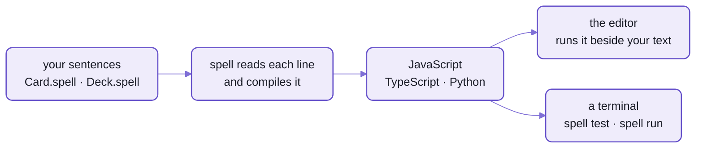
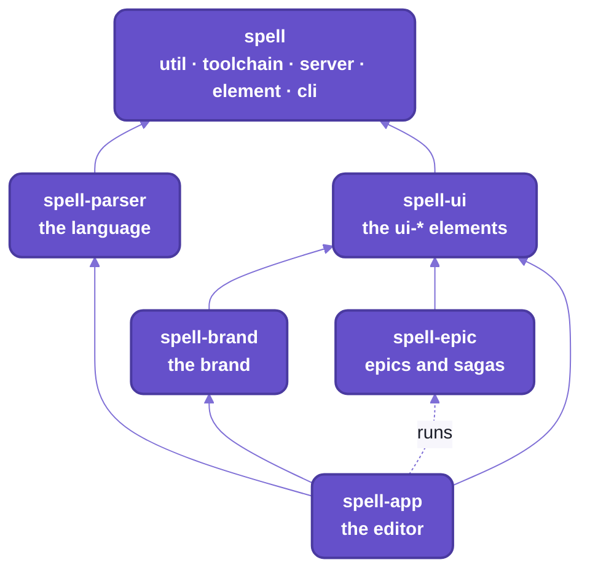

# Spell

Spell is a programming language you can read:  its programs are written in plain English.
Around the language is everything you need to make something with it:
an editor that runs your program as you type, a command line, a library of web components,
and the tooling that lets people and coding agents build it all together.

This page starts from zero, for anyone curious:  no programming assumed.
Halfway down, [a line](#working-on-spell-itself) marks where it turns to working on Spell's own code.

## Here is a program

A program is a list of instructions for a computer.
This is part of one, the card in a game of solitaire:

```spell
a card is a drawable thing where:
	- suit is a suit of its deck
	- its "rank" is a rank of its deck
	- its direction is up or down
	- it "is face up" if its direction is up
	- its "color" is:
		return the color of its suit
```

_Real spell:  `spell check` reads it with no errors._
- The bullets are from [Outline Solitaire's card](spell-app/spaces/@spell/examples/outline-solitaire/Card.spell),
  with others between them;  its own first line is `a "card" is a thing where:`.
- `a card is a drawable thing` begins [Drawable Solitaire's](spell-app/spaces/@spell/examples/drawable-solitaire/Card.spell):
  with it, Outline Solitaire still checks with no errors, and passes its tests.

## What each line means

Read it top to bottom:  each line says one thing that's true of every card.

| The line | What it says |
| --- | --- |
| `a card is a drawable thing where:` | There's a kind of thing called a card.  It can draw itself on the screen, and the lines under it say what every card is like. |
| `- suit is a suit of its deck` | Every card has a suit, one of those its deck names:  clubs, diamonds, hearts or spades. |
| `- its "rank" is a rank of its deck` | And a rank:  ace, 2 to 10, jack, queen or king. |
| `- its direction is up or down` | It lies face up or face down, and nothing else. |
| `- it "is face up" if its direction is up` | A new phrase:  from here on, "the card is face up" means its direction is up. |
| `- its "color" is:` | Its color isn't written on the card:  spell works it out from the suit, each time something asks. |

- Words in quotes are new:  each teaches spell a word or phrase it understands from the next line on.
- This is the OUTLINE style:  a heading line, then bullets of what's true of it.
  Spell also reads plain sentences, one fact to a line, and a file may mix the two.

The suits come from the deck, a few lines more in the same game:

```spell
a "deck" is a list of cards with:
	- "suits" as one of clubs, diamonds, hearts or spades
	- the "color" of a suit is:
		red if it is diamonds or hearts
		black otherwise
	- "ranks" as one of ace, 2 ... 10, jack, queen, king
```

_The start of [Outline Solitaire's deck file](spell-app/spaces/@spell/examples/outline-solitaire/Deck.spell), as written there:
these lines and the card's, on their own, check with no errors too._

## Try it now:  read it the way a computer would

Nothing to install:  answer from the lines above, and nothing else.

1. What color is the queen of spades?
2. Can a card lie on its side?
3. To make the clubs and spades red instead, which line would you change?

<details>
<summary>The answers</summary>

1. Black:  a suit is red only if it's diamonds or hearts.
   The game's own test asks it too:  `its color should be black`, for the queen of spades.
2. No:  its direction is up or down, and nothing else.
3. The deck's `red if it is diamonds or hearts`:  next, change it, and watch what happens.

</details>

## Change a line, and see it change

Running spell needs Spell on your computer first:  [eight steps, below](#setup-from-zero).
Each command goes in a TERMINAL, the window where you type commands to your computer.
What it printed on a real run is under it, on the lines that start with `#`.

**1. Break a test.**
A test is a few lines that check the program does what it should;  Solitaire's are in English too,
and `spell test @spell/examples/outline-solitaire` runs them:  `2 passed`.
Now open [the deck file](spell-app/spaces/@spell/examples/outline-solitaire/Deck.spell) in any text editor,
change `diamonds or hearts` to `clubs or spades`, save it, and run them again:

```sh
spell test @spell/examples/outline-solitaire
# ✓ Compiling @spell/examples/outline-solitaire
# ✓ test deck creation  (8 checks)
# ✗ test card setup  (36 checks)
#     ❌ Unexpected: `its color` should be `black` but is actually `red`
#
# 1 passed, 1 failed
```

The test caught your change, in words:  the queen of spades came out red.
Change the line back, and both tests pass again.

**2. Watch the game change as you type.**
The editor shows your spell on one side and your program running on the other
([spell-app's README-app.md](spell-app/README-app.md)).
Open it on Drawable Solitaire, the same game with each card drawn on its own:

```sh
spell serve @spell/examples/drawable-solitaire --headless
# ✓ Starting the page server  http://127.0.0.1:4747/
# ✓ Starting the editor  http://localhost:3000/  (/api on the page server)
# The spell app is at http://localhost:3000/edit/@spell/examples/drawable-solitaire;  docs, epics, goals and Spell UI at http://127.0.0.1:4747/ -- Ctrl-C to stop
# http://localhost:3000/edit/@spell/examples/drawable-solitaire
```

- It opens a browser;  `--headless` only prints the address.  Ctrl-C stops it.
- When the page server is already running, its line ends "(already running)".


_The editor:  a card file on the left, the game running on the right, the JavaScript and the program's output below._

Play a few moves, then find the color rule:
in this version it's one sentence, in [its card file](spell-app/spaces/@spell/examples/drawable-solitaire/Card.spell).

```spell
the color of a card is red if its suit is either diamonds or hearts otherwise it is black
```

Change `diamonds or hearts` to `clubs or spades`, and stop typing:
- Two seconds later the editor runs the new version, and the face-up clubs and spades turn red.
- The game in progress carries over:  every card stays where it was.  Restart starts afresh.

## How Spell runs your sentences

Your sentences don't run as they are.
Spell first turns them into JavaScript, the language every web browser runs:  that step is called COMPILING.



_You write the first box;  Spell does the rest, each time you change a line._

- Spell reads by rules, not by guessing:  the same sentence always means the same thing.
  A line it can't read gets an error saying where, `Don't understand "..."`.
- Out come JavaScript, TypeScript or Python, each written the way a person would write it
  ([spell-parser's README](spell-parser/README.md)).

<details>
<summary>What the deck's color rule compiles to, in JavaScript</summary>

```js
export class Suit {
  static color(suit) {
    if (core.includes(["diamonds", "hearts"], suit)) return "red"
    return "black"
  }
}
```

- From `spell compile --stdout`, for the deck and card lines above.
- The card becomes `class Card extends Drawable`:  each card an element of its own on the page, `<solitaire-card>`.

</details>

## What Spell is made of, in the order you'll meet it

Spell is six REPOS, short for repositories:  six projects, each with its own code and its own history.
With the command line, in about the order you'll meet them ([how they fit](#six-repos-one-checkout)):

1. **The editor**, where you write spell and watch it run:  [spell-app](spell-app/README.md).
2. **The language**, which reads your sentences and compiles them:  [spell-parser](spell-parser/README.md).
3. **The command line**, `spell`, typed in a terminal, as above:  [every command](README-cli.md).
4. **The pieces on the screen**:  [Spell UI](spell-ui/README.md), new HTML tags like `<ui-button>` for any web page.
5. **The plans**, how people and coding agents build Spell together:  [spell-epic](spell-epic/README.md).
6. **The kit**, the code under all of them, and this page;
   beside them, spell-brand, the brand's look, being reworked.

## 🌱 Where it's going

The aim:  people who don't program can READ, change and make real software, in plain English.
- One language, many targets:  English in;  JavaScript, TypeScript and Python out today.
- An AI writes spell, and you read what it wrote:  checking and changing it is how you learn to write your own.
  This is the direction, not a feature yet.
  **The editor has no AI of its own:**  today a coding agent writes spell like any other code, and you read it
  ([spell-app's README](spell-app/README.md), "AI in the editor").
- 🌱 Coming:  an environment where you build by moving things around, not only by typing.
  **It isn't in the editor yet.**
- 🌱 Coming:  npm packages:  `npm install spell-ui` in any project, and a `spell` that installs without a checkout.
  **Today everything runs from this checkout.**
- 🌱 Coming:  a public website for Spell, its docs and its components.
  **Today the docs site runs locally, from the page server.**

## Setup from zero

Today, running Spell means putting its code on your computer, and running it from there:
eight steps, a command or two each.

You need:
- git, the tool that copies code and keeps its history, and a GitHub login (an SSH key, or `gh auth login`)
- a terminal:  Terminal on a Mac, or the one in your code editor

Every command below runs from the folder it names;  what it prints when it worked is under it.

1. Install Node 24.11 or later, from nodejs.org or a version manager (`nvm install 24`).
   Node runs JavaScript outside a browser:  Spell's tools run on it.

   ```sh
   node --version
   # v24.21.0
   ```

2. Turn on yarn, which fetches the packages Spell's code uses, and runs its scripts.
   Node ships corepack, which hands every `yarn` command to the version the kit pins (4.18.0, committed in the
   repo).

   ```sh
   corepack enable
   # (prints nothing)
   ```

3. Clone the kit, and install.
   Cloning copies a repo, its code and its history, to your computer;  the kit is the repo the other five go inside.

   ```sh
   git clone git@github.com:spell-app/spell.git ~/www/spell
   cd ~/www/spell
   yarn install          # the kit's own packages:  no child repos yet
   # ...
   # ➤ YN0086: │ Some peer dependencies are incorrectly met by your project; ...
   # ...
   # ➤ YN0000: · Done with warnings in 0s 469ms
   ```

   - The peer-dependency warnings (`YN0060`, `YN0002`, `YN0086`) are expected:
     Vite+ stands in for Vite under its own version number.
   - A first install downloads every package, so it takes minutes, not half a second.

4. Clone the child repos, the other five.
   `yarn clone` clones every repo in [repos.json5](repos.json5), then runs ONE install for all of them.

   ```sh
   cd ~/www/spell
   yarn clone
   ```

5. Install the browser the tests run in, and check the kit works.

   ```sh
   cd ~/www/spell
   yarn playwright install chromium
   yarn kit:test
   # ... each folder's Vitest run, then:
   # ==================== test
   #
   # toolchain      passed
   # util           passed
   # server         passed
   # assembler      passed
   # element        passed
   # element/tools  passed
   # tools          passed
   ```

6. See what's cloned.

   ```sh
   yarn repos
   # ✓ spell-parser     -
   # ✓ spell-ui       -
   # ✓ spell-brand    spell-ui
   # ✓ spell-epic     spell-ui
   # ✓ spell-app      spell-parser, spell-brand, spell-ui, spell-epic (runs)
   ```

7. Put `spell` on your PATH, so typing `spell` works in any folder:
   [the command line's page, "Setting it up"](README-cli.md#setting-it-up).
8. For the Python target and the Python tests:  `uv`, which fetches the Python each project pins (3.12 or later).

<details>
<summary>Only part of it</summary>

Clone only what you're working on;  `yarn clone` brings what it needs too, and the kit is always there.

```sh
yarn clone spell-ui      # spell-ui alone
yarn clone spell-app     # spell-app, and spell-parser, spell-brand, spell-ui, spell-epic
```

- `yarn clone` clones over SSH, and over HTTPS (GitHub's login, `gh auth setup-git`) when SSH is refused.
- Its flags (CI's):
  - `--branch <name>`:  each repo at that branch where it has one, else its default branch
  - `--https`:  skip SSH
  - `--shallow`:  only the last commit
  - `--no-install`:  clone only
- Run it again after `repos.json5` gains a repo:  it clones only what's missing.
- Every install links each child repo's `agents` folder to the kit's:
  so a checkout made without `yarn clone` (an epic's worktree, CI) has them too.
- A partial clone rewrites the kit's `yarn.lock`, which lists every repo:  leave that change uncommitted.
- A child repo on its own, with no kit around it (`git clone spell-ui && yarn install`), isn't supported:
  that comes with the npm packages ([above, "Where it's going"](#-where-its-going)).

</details>

<details>
<summary>Where everything ends up, and what's not cloned</summary>

```text
~/www/spell/                    the kit (git repo spell):  util/ toolchain/ server/ element/ cli/ tests/ tools/ agents/
~/www/spell/spell-parser/         each child repo:  its own git repo, git-ignored by the kit
~/www/spell/spell-ui/
~/www/spell/spell-brand/
~/www/spell/spell-epic/
~/www/spell/spell-app/
~/www/spell/node_modules/       the ONE install:  node_modules/spell links to the kit, each spell-* is a workspace
~/www/spell/dist-types/         built declarations, for the type checks (git-ignored)
~/www/spell/spell.epics/        the content folder:  guides, epic pages, sagas, the logs (yours, local only)
~/www/spell/spell.spaces/       your own spell projects:  a plain folder
~/www/spell.worktrees/<epic>/   an epic's worktree of the kit, with a worktree of each child repo inside
```

- `~/www/spell` is the convention every example on these pages uses.
- The dot in `spell.epics` and `spell.spaces` keeps them out of the `"spell-*"` workspaces:  they're data, not code.
- What's not cloned:  those two folders are yours, and `yarn clone` never touches them.
  - `spell.epics/`, the CONTENT FOLDER:  the guides, the epic pages, the sagas and the three logs,
    in a git repo of its own that lives on your machine.
    The docs site needs it;  the repos and their tests don't.
    Someone new starts without one:  the READMEs stand on their own.
  - `spell.spaces/`:  your own spell projects, a plain folder the editor reads and saves.

</details>

## More things to try

Each of these runs as soon as setup is done;  what it printed on a real run is under it.

**See how spell reads a line** ([spell-parser's README-spell.md](spell-parser/README-spell.md)):
its match tree, each indented line a rule that matched inside the one that holds it;
then the JavaScript it compiles to.

```sh
spell parse "print 1 + 2 * 3"
# statement › print  print 1 + 2 * 3
#   Keyword  print
#   expressions: Repeat  1 + 2 * 3
#     expression  1 + 2 * 3
#       lhs: operand › number  1
#       Repeat  + 2 * 3
#         expression_suffix › plus  + 2
#           operator › Symbol  +
#           expression: operand › number  2
#         expression_suffix › times  * 3
#           operator › Symbol  *
#           expression: operand › number  3
#
# core.console.log(1 + 2 * 3)
```

**Run an example program under node, in the terminal** ([README-cli.md](README-cli.md)):
[FizzBuzz](spell-app/spaces/@spell/examples/fizzbuzz/FizzBuzz.spell), eight lines of spell.

```sh
spell run @spell/examples/fizzbuzz --no-browser
# ✓ Compiling @spell/examples/fizzbuzz
# 1
# 2
# 3 fizz
# 4
# 5 buzz
# ...
# 15 fizzbuzz
```

**Compile the same program to Python, and print it** ([spell-parser's README-targets.md](spell-parser/README-targets.md)):
"for each number from 1 to 100" comes out as `range(1, 101)`, and each "otherwise if" as an `elif`.

```sh
spell compile @spell/examples/fizzbuzz --target py --stdout
# ✓ @spell/examples/fizzbuzz
# from __future__ import annotations
#
# def play_fizzbuzz() -> None:
#     """File FizzBuzz.spell"""
#     for number in range(1, 101):
#         if (number / 15).is_integer():
#             print(number, "fizzbuzz")
#         elif (number / 3).is_integer():
#             print(number, "fizz")
#         elif (number / 5).is_integer():
#             print(number, "buzz")
#         else:
#             print(number)
#
#
# play_fizzbuzz()
```

**Every Spell UI element on one page**, as plain class markup beside the elements
([spell-ui's README](spell-ui/README.md)):

```sh
cd ~/www/spell/spell-ui
yarn dev
#   VITE+ v1.0.0
#
#   ➜  Local:   http://localhost:5173/
#   ➜  Network: use --host to expose
```

- It opens the demo page, `/tools/demo/index.html`, in your browser;  the port may be the next free one.

---

## Working on Spell itself

Everything above the line is for anyone;  below it is for people working on Spell's own code.

This repo is THE KIT, `spell`:  the root every other Spell repo is cloned into, and the code they all stand on.
If you've used React and a compiler, you have what you need to find your way around;  two things move:
- **The compiler runs in the page:**  Spell's editor compiles your sentences in the browser.
  Where Fast Refresh keeps a component's state across an edit, Spell keeps what the program MADE.
- **A component is a real element**, a node the page holds like `<video>`:  it renders once, then Solid updates
  only what changed;  1,000 `<ui-button>`s are ready in about 75 ms ([the element framework](README-element.md)).

## Six repos, one checkout

Spell is six git repos, each ONE npm package named after it.
The kit is checked out first;  the other five are cloned INSIDE it, and all six share one install.


_Every arrow points down:  a repo uses only what's below it._

<details>
<summary>As text</summary>



</details>

| Repo | What it is | Its README |
| --- | --- | --- |
| spell | the bottom of every repo:  shared helpers, the toolchain, the page server, the element framework, the command line's base;  and the one install | this page |
| spell-parser | the language:  a rule-based parser, spell's rules, the runtime compiled spell runs on, and its writers for JavaScript, TypeScript and Python | [spell-parser/README.md](spell-parser/README.md) |
| spell-ui | Spell UI:  web components for any page or framework, loaded on demand | [spell-ui/README.md](spell-ui/README.md) |
| spell-brand | the brand's theme, pack and assets;  being reworked | -- |
| spell-epic | epics and sagas:  plan on a page, build in a worktree, review on the page;  a Claude Code plugin | [spell-epic/README.md](spell-epic/README.md) |
| spell-app | the Spell app:  the live editor, spaces for projects, the language server, the VS Code extension | [spell-app/README.md](spell-app/README.md) |

- The kit is always there;  `yarn clone` brings the rest, each with the repos it needs ([repos.json5](repos.json5)).
- Each child repo is its own git repo, git-ignored here:  `git status` in the kit shows only the kit's files;
  run git in the repo you mean, `git -C spell-ui status`.
- No publish step:  every repo uses the others' SOURCE, through the one install.

## The kit's own folders

The kit is ONE npm package, `spell`, made of five folders of code:
each is its own TypeScript program, and each has a page.

| Folder | Import name | What it is | Its page |
| --- | --- | --- | --- |
| [util/](util/) | `spell/util` | the helpers every repo shares:  standard decorators, class, string and DOM helpers, the reactive engine, spell's own utilities, node-only JSON5 | [README-util.md](README-util.md) |
| [toolchain/](toolchain/) | `spell/toolchain/...` | what every repo's checks share:  the lint and format rules, the decorator pre-pass, declarations, `spell-folders` | [README-toolchain.md](README-toolchain.md) |
| [server/](server/) | `spell/server` | the page server:  every page on one port, live reload, editing in place, and the steps a tool runs to write a page | [README-server.md](README-server.md) |
| [element/](element/) | `spell/element` | the element framework every set of web components is written on;  its build tools and test helpers | [README-element.md](README-element.md) |
| `cli/` | `spell/cli` | the `spell` command line's base:  arguments, help, finding each repo's commands | [README-cli.md](README-cli.md) |

And the glue that makes six repos one checkout:
- the ONE install:  `yarn install` runs here, never in a child repo, and links `node_modules/spell` to the kit
- the list of child repos, lowest first, with what each needs:  [repos.json5](repos.json5)
- [the commands over them](tools/repos.ts):  `clone`, `pull`, `status`, `repos`, and the checks over every repo

<details>
<summary>Until repo-split P13 and P14 land</summary>

- The page-writing steps (links, formatting, bundles built on demand, data files) are their own folder today,
  [assembler/](assembler/), imported as `spell/assembler`:  [README-server.md](README-server.md) covers them.
- The `spell` command line lives in spell-app's `cli/` folder, not the kit's.
- Inside a repo, files import each other by short alias names from the repo's alias table;
  other repos already import by package name.

</details>

<details>
<summary>Every file the kit tracks besides its folders</summary>

| File | What it is |
| --- | --- |
| [package.json](package.json) | the ONE package `spell`:  its `exports`;  `"workspaces": ["spell-*"]`, every child repo;  `"spellTypes"` and `"spellFolders"`, its folders;  the `resolutions` (one Solid);  the scripts |
| [tsconfig.base.json](tsconfig.base.json) | the kit's TypeScript settings, which every folder's extends |
| [vite.config.ts](vite.config.ts) | the kit's lint and format settings, what `vp check` and the editor read |
| `yarn.lock`, [.yarnrc.yml](.yarnrc.yml), `.yarn/releases/` | the one lockfile;  the one catalog of tool versions;  the yarn release |
| [repos.json5](repos.json5) | the child repos, lowest first:  name, git URL, which repos each needs |
| [tools/repos.ts](tools/repos.ts) | what `clone`, `pull`, `status`, `repos`, the checks over every repo and the `postinstall` run |
| [tools/readme-check.ts](tools/readme-check.ts), [tools/mermaid-pretty.ts](tools/mermaid-pretty.ts) | the READMEs' check and the Mermaid look:  `yarn readme:check`, `yarn mermaid:pretty`;  `tools/` is a folder of the kit's checks, its tests in `tests/tools/` |
| [.github/workflows/checks.yml](.github/workflows/checks.yml) | the kit's CI |
| [agents/](agents/) | WWOD, the house style, and links to the three logs in the content folder |
| [AGENTS.md](AGENTS.md), [CLAUDE.md](CLAUDE.md) | the rules for working on the kit and across repos |
| [.epic/config.json5](.epic/config.json5) | the epic settings, for a session working here |
| [docs/images/](docs/images/) | the pictures on these pages |

And the folders git ignores here:  the child repos (`spell-parser/`, `spell-ui/` ...), `spell.epics/` and
`spell.spaces/` (above, "Where everything ends up"), `dist-types/`, the kit's built declarations for the repos
above it, and `node_modules/`, the one install.

</details>

## The command line

Three commands cover everything:
- `spell`:  write, run and understand programs (`spell run`, `spell compile`, `spell parse` ...), and the repo tools
  (`spell server`, `spell pack` ...);  each repo adds its own commands
- `epic`:  the epic pages, their worktrees and their reviews, from spell-epic
- `yarn`:  each repo's own scripts, run in that repo's folder

Every command, by what it's for:  [README-cli.md](README-cli.md).

<details>
<summary>Until repo-split P13 lands</summary>

- The repo tools are under `spell dev` today:
  `spell dev server`, `spell dev pack`, `spell dev bundles`, `spell dev docs`, `spell dev design`,
  `spell dev vscode`, `spell dev commands`, `spell dev wwod`.
- The `spell` program itself lives in spell-app;  the language commands keep their names either way.

</details>

## Day to day

From the kit's root:

```sh
yarn kit:review       # the kit's own finishing pass:  ts, lint, format, tests of its folders
yarn pull             # git pull --ff-only in every child repo
yarn status           # each child repo's branch and changes;  a clean one in one line
yarn repos            # the list:  which are cloned, and what each needs
yarn ts               # the kit's, then every repo's type check, lowest first:
                      #   each builds the declarations the ones above read
yarn test             # the kit's tests, then every repo's
yarn lint             # the kit's lint, then every repo's
yarn review           # the kit's finishing pass, then every repo's
```

- In a child repo, its own scripts:  `cd spell-ui && yarn test`.
  One folder of a repo with several (spell-parser, spell-app):  `cd spell-parser && yarn spell-folders test core`.
- Tests live in `tests/<folder>/`, at the same paths as the code they test:
  [Router.test.ts](tests/server/src/Router.test.ts) tests the server's [Router.ts](server/src/Router.ts).
- A change across two repos is two commits, one in each, and two pull requests, the lower repo's first.
  No publish, no version bump:  every repo uses the others' source, through this one install.
- Working across several repos at once ([README-development.md](README-development.md)):
  an epic's worktree puts every repo on one branch.

<details>
<summary>Every yarn script at the kit's root, one line each</summary>

| Script | What |
| --- | --- |
| `yarn install` | the ONE install;  its `postinstall` links `node_modules/spell` and each child repo's `agents` |
| `yarn clone [repo ...]` | clone what's missing (and what it needs), then one install |
| `yarn pull` | `git pull --ff-only` in every cloned child repo |
| `yarn status` | each child repo's branch, ahead / behind, and up to 12 changed files |
| `yarn repos` | the list:  a check mark when cloned, and what each needs |
| `yarn ts`, `test`, `lint`, `review` | the check over the kit, then every cloned repo, lowest first;  every repo runs, with a summary at the end |
| `yarn kit:ts` | the kit's declarations, then every folder's type check |
| `yarn kit:test` | every kit folder's tests |
| `yarn kit:lint`, `kit:lint:fix` | every kit folder's lint (warnings fail) |
| `yarn kit:format`, `kit:format:check` | every kit folder's formatting |
| `yarn kit:review` | `kit:ts`, `kit:lint:fix`, `kit:format`, `kit:test`, then "REVIEW PASSED" |
| `yarn server <verb>` | the page server's command line, on the kit's own checkout ([README-server.md](README-server.md)) |
| `yarn favicon [--hat 0.74]` | regenerate Spell's favicon from the hat mark |
| `yarn readme:check [page ...]` | the READMEs' check over every repo's pages:  links and headings, captions, stale names;  exits 1 on a finding |
| `yarn mermaid:pretty [page ...]` | gives every Mermaid picture on the pages the Spell look, in place |

</details>

<details>
<summary>CI, in words</summary>

Every repo has one workflow, run on a push to `main`, a pull request, or by hand
([README-toolchain.md](README-toolchain.md#ci), "CI").
- The kit's:
  - Node 24 and yarn, one install with no child repo cloned, Playwright's Chromium
  - then `kit:ts`, `kit:lint` and `kit:test`
- A child repo's checks it inside the kit, with the repos it needs:
  - the kit at the branch under test (else `main`), the repo inside it
  - the repos it needs, cloned at the same-named branch where they have one
  - then its `yarn ts`, `yarn lint`, `yarn test`
- So a change across repos is checked together when every repo's branch has the same name.
- The repos are public:  no token needed.

</details>

## WWOD and agents

The house style every repo shares is WWOD, "What Would Owen Do?":  how code, comments and docs are written here.
It lives in [agents/wwod/](agents/wwod/):  seven universal sections in [WWOD.md](agents/wwod/WWOD.md),
and a spoke per topic (writing, types, classes, Solid, CSS, tests ...).

Spell is built with Claude Code today, set up so an agent finds the rules before the code.
It reads, in this order:
1. [CLAUDE.md](CLAUDE.md), which loads the cross-model [AGENTS.md](AGENTS.md) (Codex reads that directly)
2. the `AGENTS.md` of the kit, then of the repo, then of the folder it's working in
3. WWOD, then the spoke for what it's touching

More:  [README-agents.md](README-agents.md).

## Every README

Every page, by repo.
A repo's `README.md` is its front page;  the `README-<topic>.md` pages beside it go deep on one folder or topic.

| Repo | Pages |
| --- | --- |
| the kit | [README.md](README.md) (this page) · [README-util.md](README-util.md) · [README-toolchain.md](README-toolchain.md) · [README-server.md](README-server.md) · [README-element.md](README-element.md) · [README-cli.md](README-cli.md) · [README-development.md](README-development.md) · [README-vscode.md](README-vscode.md) · [README-agents.md](README-agents.md) |
| spell-parser | [README.md](spell-parser/README.md) · [README-parser.md](spell-parser/README-parser.md) · [README-rulex.md](spell-parser/README-rulex.md) · [README-markdown.md](spell-parser/README-markdown.md) · [README-spell.md](spell-parser/README-spell.md) · [README-core.md](spell-parser/README-core.md) · [README-targets.md](spell-parser/README-targets.md) |
| spell-ui | [README.md](spell-ui/README.md) · [README-components.md](spell-ui/README-components.md) · [README-migrating.md](spell-ui/README-migrating.md) · [README-runtime.md](spell-ui/README-runtime.md) · [README-themes.md](spell-ui/README-themes.md) · [README-frameworks.md](spell-ui/README-frameworks.md) · [README-site.md](spell-ui/README-site.md) |
| spell-epic | [README.md](spell-epic/README.md) · [README-pages.md](spell-epic/README-pages.md) · [README-skills.md](spell-epic/README-skills.md) · [README-cli.md](spell-epic/README-cli.md) · [README-vscode.md](spell-epic/README-vscode.md) · [README-adopting.md](spell-epic/README-adopting.md) |
| spell-app | [README.md](spell-app/README.md) · [README-app.md](spell-app/README-app.md) · [README-spaces.md](spell-app/README-spaces.md) · [README-examples.md](spell-app/README-examples.md) · [README-lsp.md](spell-app/README-lsp.md) · [README-page-server.md](spell-app/README-page-server.md) |

- The kit's pages:  one per folder (the table in ["The kit's own folders"](#the-kits-own-folders)), and
  [README-development.md](README-development.md), working on Spell day to day;
  [README-vscode.md](README-vscode.md), Spell in VS Code;  [README-agents.md](README-agents.md), working with coding agents.
- The child repos' pages link up here;
  the links into a child repo work in a checkout, where it's cloned inside the kit.

<details>
<summary>Where Spell came from, in three lines</summary>

- Spell was one repository until 2026-09, all its packages in one tree.
- Then it was split into six repos, each one package, with its history kept.
- The kit is what three of them became:  the shared helpers and toolchain, the server, and the element framework,
  merged back in as its folders.

</details>

## See also

- [AGENTS.md](AGENTS.md):  the rules for working on the kit and across repos
- [README-development.md](README-development.md):  working on Spell day to day
- [README-cli.md](README-cli.md):  every command
- [spell-parser](spell-parser/README.md), [spell-ui](spell-ui/README.md), [spell-epic](spell-epic/README.md),
  [spell-app](spell-app/README.md):  the child repos' front pages
- Also beside it:
  [README-agents.md](README-agents.md) · [README-element.md](README-element.md) ·
  [README-server.md](README-server.md) · [README-toolchain.md](README-toolchain.md) ·
  [README-util.md](README-util.md) · [README-vscode.md](README-vscode.md)
