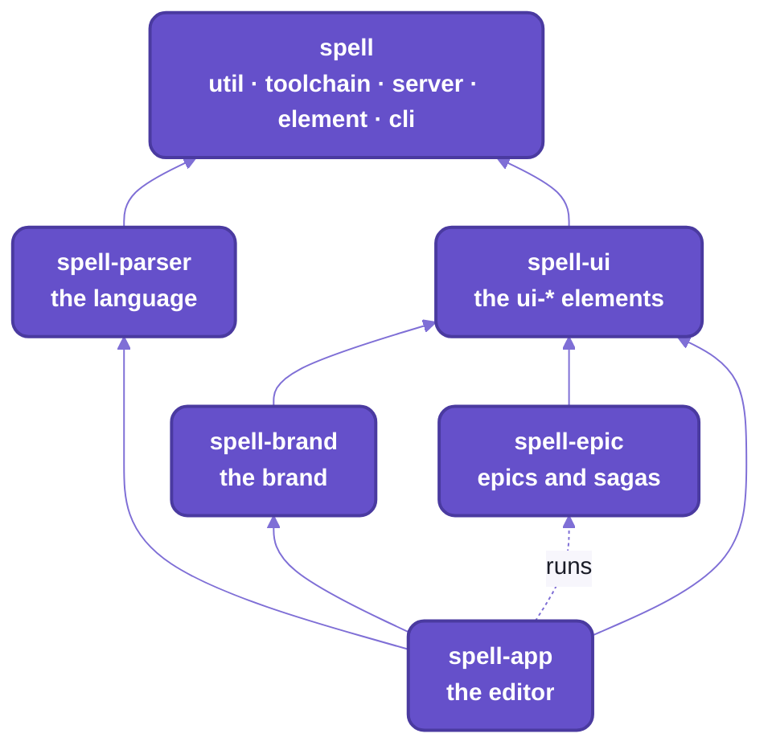

# Spell

Spell is a programming language written in plain English, and the environment around it:
an editor that runs your program as you type, a command line, a library of web components,
and the tooling that lets people and coding agents build it all together.

You're standing in the kit, `spell`:  the root the other Spell repos are cloned into, and the code they all stand on.
Everything else is in here with you:  the language through that door, the web components across the hall,
and the editor on the top floor, standing on all of it.

If you've used React and a compiler, you have what you need to find your way around.
Before we walk, here's what the whole building is for:

```spell
a card is a thing
cards have a suit as one of clubs, diamonds, hearts or spades
the color of a card is red if its suit is either diamonds or hearts otherwise it is black
```

_Real spell, from the Solitaire example:  it compiles to JavaScript, TypeScript or Python._

Read it out loud:  that's a card game's data model, and someone who has never programmed could follow it.
Everything else on this tour is here to make that true of whole programs.

## Where it's headed

Some of it you'll see running before the tour ends;  what's still being built is marked 🌱, here and on every page.

- People who don't program can READ, change and make real software, in plain English.
- 🌱 An AI writes spell, and you can read what it wrote:  checking and changing it is how you learn to write your own.
  This is the direction, not a feature yet.
- One language, many targets:  English in;  JavaScript, TypeScript and Python out today.
  The language:  [spell-parser's README](spell-parser/README.md).
- 🌱 An environment where you build by moving things around, not only by typing:  coming.
  The editor today:  [spell-app's README](spell-app/README.md).

## The map:  six repos, one folder

Spell is six git repos, each ONE npm package named after it.
The kit is checked out first;  the other five are cloned INSIDE it, and all six share one install.

Picture a building:  the kit is the ground floor, and the language and the components stand on it;
the brand and the epics stand on the components, and the editor sits on top, with every floor below to stand on.


_Every arrow points down:  a repo uses only what's below it._

<details>
<summary>As text</summary>



</details>

The floors, from the ground up:

| Repo | What it is | Its README |
| --- | --- | --- |
| spell | the bottom of every repo:  shared helpers, the toolchain, the page server, the element framework, the command line's base;  and the one install | this page |
| spell-parser | the language:  a rule-based parser, spell's rules, the runtime compiled spell runs on, and its writers for JavaScript, TypeScript and Python | [spell-parser/README.md](spell-parser/README.md) |
| spell-ui | Spell UI:  web components for any page or framework, loaded on demand | [spell-ui/README.md](spell-ui/README.md) |
| spell-brand | the brand's theme, pack and assets;  being reworked | -- |
| spell-epic | epics and sagas:  plan on a page, build in a worktree, review on the page;  a Claude Code plugin | [spell-epic/README.md](spell-epic/README.md) |
| spell-app | the Spell app:  the live editor, spaces for projects, the language server, the VS Code extension | [spell-app/README.md](spell-app/README.md) |

On disk it's NESTED, not stacked:  once you're set up, the floor plan has every repo as a folder inside the kit.

```text
~/www/spell/                    the kit (git repo spell):  util/ toolchain/ server/ element/ cli/ tests/ tools/ agents/
~/www/spell/spell-parser/         each child repo:  its own git repo, git-ignored by the kit
~/www/spell/spell-ui/
~/www/spell/spell-brand/
~/www/spell/spell-epic/
~/www/spell/spell-app/
~/www/spell/node_modules/       the ONE install:  node_modules/spell links to the kit, each spell-* is a workspace
~/www/spell/dist-types/         built declarations, for the type checks (git-ignored)
~/www/spell/spell.epics/        the content folder:  guides, epic pages, sagas, the logs (yours, local only)
~/www/spell/spell.spaces/       your own spell projects:  a plain folder
~/www/spell.worktrees/<epic>/   an epic's worktree of the kit, with a worktree of each child repo inside
```

- `~/www/spell` is the convention every example on these pages uses.
- The dot in `spell.epics` and `spell.spaces` keeps them out of the `"spell-*"` workspaces:  they're data, not code.

<details>
<summary>What's not cloned:  the two folders that are yours</summary>

Two folders beside the repos are yours, and `yarn clone` never touches them:
- `spell.epics/`, the CONTENT FOLDER:  the guides, the epic pages, the sagas and the three logs,
  in a git repo of its own that lives on your machine.
  - The docs site needs it;  the repos and their tests don't.
  - Someone new starts without one:  the READMEs stand on their own.
- `spell.spaces/`:  your own spell projects, a plain folder the editor reads and saves.

</details>

Three things worth knowing before you go upstairs:
- The kit is always there;  `yarn clone` brings the rest, each with the repos it needs ([repos.json5](repos.json5)).
- Each child repo is its own git repo, git-ignored here, and this catches everybody once:
  `git status` in the kit shows only the kit's files;  run git in the repo you mean, `git -C spell-ui status`.
- No publish step:  every repo uses the others' SOURCE, through the one install.

## Setup from zero:  getting in the door

You need git, a GitHub login (an SSH key, or `gh auth login`), and a terminal.
Every command runs from the folder it names;  what it prints when it worked is under it, so you can check each step.

1. Install Node 24.11 or later, from nodejs.org or a version manager (`nvm install 24`).

   ```sh
   node --version
   # v24.21.0
   ```

2. Turn on yarn.
   Node ships corepack, which hands every `yarn` command to the version the kit pins (4.18.0, committed in the
   repo).

   ```sh
   corepack enable
   # (prints nothing)
   ```

3. Clone the kit, and install.

   ```sh
   git clone git@github.com:spell-app/spell.git ~/www/spell
   cd ~/www/spell
   yarn install          # the kit's own packages:  no child repos yet
   # ...
   # ➤ YN0086: │ Some peer dependencies are incorrectly met by your project; ...
   # ...
   # ➤ YN0000: · Done with warnings in 0s 469ms
   ```

   - The peer-dependency warnings (`YN0060`, `YN0002`, `YN0086`) are expected:
     Vite+ stands in for Vite under its own version number.
   - A first install downloads every package, so it takes minutes, not half a second:  put the kettle on.

4. Clone the child repos:  this is where the other five floors arrive.
   `yarn clone` clones every repo in [repos.json5](repos.json5), then runs ONE install for all of them.

   ```sh
   cd ~/www/spell
   yarn clone
   ```

5. Install the browser the tests run in, and check the kit works.

   ```sh
   cd ~/www/spell
   yarn playwright install chromium
   yarn kit:test
   # ... each folder's Vitest run, then:
   # ==================== test
   #
   # toolchain      passed
   # util           passed
   # server         passed
   # assembler      passed
   # element        passed
   # element/tools  passed
   # tools          passed
   ```

6. See what's cloned:  the map above, as a list, with what each repo needs.

   ```sh
   yarn repos
   # ✓ spell-parser     -
   # ✓ spell-ui       -
   # ✓ spell-brand    spell-ui
   # ✓ spell-epic     spell-ui
   # ✓ spell-app      spell-parser, spell-brand, spell-ui, spell-epic (runs)
   ```

7. Put `spell` on your PATH, for the command line:  [README-cli.md, "Setting it up"](README-cli.md#setting-it-up).
8. For the Python target and the Python tests:  `uv`, which fetches the Python each project pins (3.12 or later).

<details>
<summary>Only part of it:  clone just the floor you're working on</summary>

Clone only what you're working on;  `yarn clone` brings what it needs too, and the kit is always there.

```sh
yarn clone spell-ui      # spell-ui alone
yarn clone spell-app     # spell-app, and spell-parser, spell-brand, spell-ui, spell-epic
```

- `yarn clone` clones over SSH, and over HTTPS (GitHub's login, `gh auth setup-git`) when SSH is refused.
- Its flags (CI's):
  - `--branch <name>`:  each repo at that branch where it has one, else its default branch
  - `--https`:  skip SSH
  - `--shallow`:  only the last commit
  - `--no-install`:  clone only
- Run it again after `repos.json5` gains a repo:  it clones only what's missing.
- Every install links each child repo's `agents` folder to the kit's:
  so a checkout made without `yarn clone` (an epic's worktree, CI) has them too.
- A partial clone rewrites the kit's `yarn.lock`, which lists every repo:  leave that change uncommitted.
- A child repo on its own, with no kit around it (`git clone spell-ui && yarn install`), isn't supported:
  that comes with the npm packages ([below, "Coming"](#-coming--spell-outside-this-checkout)).

</details>

## Things to try:  a five-stop walk

Setup's done, so here's the walk:  five stops, from one line of spell up to the editor and across to the components.
Each is one command that runs right now, with what it printed on a real run under it.

### Watch spell read a line

Read how spell understands a line ([spell-parser's README-spell.md](spell-parser/README-spell.md)):
its match tree, then the JavaScript it compiles to.

```sh
spell parse "print 1 + 2 * 3"
# statement › print  print 1 + 2 * 3
#   Keyword  print
#   expressions: Repeat  1 + 2 * 3
#     expression  1 + 2 * 3
#       lhs: operand › number  1
#       Repeat  + 2 * 3
#         expression_suffix › plus  + 2
#           operator › Symbol  +
#           expression: operand › number  2
#         expression_suffix › times  * 3
#           operator › Symbol  *
#           expression: operand › number  3
#
# core.console.log(1 + 2 * 3)
```

Each indented line is a rule that matched, inside the one that holds it;  the last line is the JavaScript.

### Run a whole program

Run an example program under node ([README-cli.md](README-cli.md)):  FizzBuzz, the interview classic, in spell.

```sh
spell run @spell/examples/fizzbuzz --no-browser
# ✓ Compiling @spell/examples/fizzbuzz
# 1
# 2
# 3 fizz
# 4
# 5 buzz
# ...
# 15 fizzbuzz
```

### The same program, in Python

Compile the same program to Python, and print it ([spell-parser's README-targets.md](spell-parser/README-targets.md)).
Same spell in, a different language out;  the function's docstring even names the spell file it came from.

```sh
spell compile @spell/examples/fizzbuzz --target py --stdout
# ✓ @spell/examples/fizzbuzz
# from __future__ import annotations
#
# def play_fizzbuzz() -> None:
#     """File FizzBuzz.spell"""
#     for number in range(1, 101):
#         if (number / 15).is_integer():
#             print(number, "fizzbuzz")
#         elif (number / 3).is_integer():
#             print(number, "fizz")
#         elif (number / 5).is_integer():
#             print(number, "buzz")
#         else:
#             print(number)
#
#
# play_fizzbuzz()
```

### Up to the top floor:  the editor

Open the editor on Solitaire:  it runs the program as you type ([spell-app's README-app.md](spell-app/README-app.md)).
It opens a browser (`--headless` only prints the address), and Ctrl-C stops it.

```sh
spell serve @spell/examples/drawable-solitaire --headless
# ✓ Starting the page server  http://127.0.0.1:4747/
# ✓ Starting the editor  http://localhost:3000/  (/api on the page server)
# The spell app is at http://localhost:3000/edit/@spell/examples/drawable-solitaire;  docs, epics, goals and Spell UI at http://127.0.0.1:4747/ -- Ctrl-C to stop
# http://localhost:3000/edit/@spell/examples/drawable-solitaire
```

Two servers come up:  the page server on 4747, with the docs, epics, goals and Spell UI;  and the editor on 3000.
When the page server is already running, its line ends "(already running)".


_Card.spell on the left, Klondike Solitaire running on the right,
the compiled JavaScript and the program's output below._

### Across the hall:  every web component, on one page

Every Spell UI element on one page, as plain class markup beside the elements ([spell-ui's README](spell-ui/README.md)).
This stop lives in spell-ui, so it starts from that folder:

```sh
cd ~/www/spell/spell-ui
yarn dev
#   VITE+ v1.0.0
#
#   ➜  Local:   http://localhost:5173/
#   ➜  Network: use --host to expose
```

- It opens [the demo page](spell-ui/tools/demo/index.html), `/tools/demo/index.html`, in your browser;
  the port may be the next free one.

## The ground floor:  the kit's own folders

You've been standing on this floor the whole tour.
The kit is ONE npm package, `spell`, made of five folders of code, the five every repo upstairs stands on:
each is its own TypeScript program, and each has a page.

| Folder | Import name | What it is | Its page |
| --- | --- | --- | --- |
| [util/](util/) | `spell/util` | the helpers every repo shares:  standard decorators, class, string and DOM helpers, the reactive engine, spell's own utilities, node-only JSON5 | [README-util.md](README-util.md) |
| [toolchain/](toolchain/) | `spell/toolchain/...` | what every repo's checks share:  the lint and format rules, the decorator pre-pass, declarations, `spell-folders` | [README-toolchain.md](README-toolchain.md) |
| [server/](server/) | `spell/server` | the page server:  every page on one port, live reload, editing in place, and the steps a tool runs to write a page | [README-server.md](README-server.md) |
| [element/](element/) | `spell/element` | the element framework every set of web components is written on;  its build tools and test helpers | [README-element.md](README-element.md) |
| `cli/` | `spell/cli` | the `spell` command line's base:  arguments, help, finding each repo's commands | [README-cli.md](README-cli.md) |

And the plumbing in the walls, the glue that makes six repos one checkout:
- the ONE install:  `yarn install` runs here, never in a child repo, and links `node_modules/spell` to the kit
- the list of child repos, lowest first, with what each needs:  [repos.json5](repos.json5)
- [the commands over them](tools/repos.ts):  `clone`, `pull`, `status`, `repos`, and the checks over every repo

<details>
<summary>Until repo-split P13 and P14 land</summary>

- The page-writing steps (links, formatting, bundles built on demand, data files) are their own folder today,
  [assembler/](assembler/), imported as `spell/assembler`:  [README-server.md](README-server.md) covers them.
- The `spell` command line lives in spell-app's `cli/` folder, not the kit's.
- Inside a repo, files import each other by short alias names from the repo's alias table;
  other repos already import by package name.

</details>

<details>
<summary>Every file the kit tracks besides its folders</summary>

| File | What it is |
| --- | --- |
| [package.json](package.json) | the ONE package `spell`:  its `exports`;  `"workspaces": ["spell-*"]`, every child repo;  `"spellTypes"` and `"spellFolders"`, its folders;  the `resolutions` (one Solid);  the scripts |
| [tsconfig.base.json](tsconfig.base.json) | the kit's TypeScript settings, which every folder's extends |
| [vite.config.ts](vite.config.ts) | the kit's lint and format settings, what `vp check` and the editor read |
| `yarn.lock`, [.yarnrc.yml](.yarnrc.yml), `.yarn/releases/` | the one lockfile;  the one catalog of tool versions;  the yarn release |
| [repos.json5](repos.json5) | the child repos, lowest first:  name, git URL, which repos each needs |
| [tools/repos.ts](tools/repos.ts) | what `clone`, `pull`, `status`, `repos`, the checks over every repo and the `postinstall` run |
| [tools/readme-check.ts](tools/readme-check.ts), [tools/mermaid-pretty.ts](tools/mermaid-pretty.ts) | the READMEs' check and the Mermaid look:  `yarn readme:check`, `yarn mermaid:pretty`;  `tools/` is a folder of the kit's checks, its tests in `tests/tools/` |
| [.github/workflows/checks.yml](.github/workflows/checks.yml) | the kit's CI |
| [agents/](agents/) | WWOD, the house style, and links to the three logs in the content folder |
| [AGENTS.md](AGENTS.md), [CLAUDE.md](CLAUDE.md) | the rules for working on the kit and across repos |
| [.epic/config.json5](.epic/config.json5) | the epic settings, for a session working here |
| [docs/images/](docs/images/) | the pictures on these pages |

And the folders git ignores here:

| Folder | What it is |
| --- | --- |
| `spell-parser/`, `spell-ui/`, `spell-brand/`, `spell-epic/`, `spell-app/` | the child repos |
| `spell.epics/` | the content folder:  its own git repo, local only |
| `spell.spaces/` | your own projects |
| `dist-types/` | the kit's built declarations, for the repos above it |
| `node_modules/` | the one install |

</details>

## The command line:  three commands, every door

Three commands cover everything, and you've already used two of them:
- `spell`:  write, run and understand programs (`spell run`, `spell compile`, `spell parse` ...), and the repo tools
  (`spell server`, `spell pack` ...);  each repo adds its own commands
- `epic`:  the epic pages, their worktrees and their reviews, from spell-epic
- `yarn`:  each repo's own scripts, run in that repo's folder

Every command, by what it's for:  [README-cli.md](README-cli.md).

<details>
<summary>Until repo-split P13 lands</summary>

- The repo tools are under `spell dev` today:
  `spell dev server`, `spell dev pack`, `spell dev bundles`, `spell dev docs`, `spell dev design`,
  `spell dev vscode`, `spell dev commands`, `spell dev wwod`.
- The `spell` program itself lives in spell-app;  the language commands keep their names either way.

</details>

## Working on it:  a day in the building

Day to day, you stand at the kit's root and look after every floor from there:

```sh
yarn kit:review       # the kit's own finishing pass:  ts, lint, format, tests of its folders
yarn pull             # git pull --ff-only in every child repo
yarn status           # each child repo's branch and changes;  a clean one in one line
yarn repos            # the list:  which are cloned, and what each needs
yarn ts               # the kit's, then every repo's type check, lowest first:
                      #   each builds the declarations the ones above read
yarn test             # the kit's tests, then every repo's
yarn lint             # the kit's lint, then every repo's
yarn review           # the kit's finishing pass, then every repo's
```

Notice the order:  ground floor first, then up, so each floor is checked after the floors it stands on.

- The kit's checks one at a time:
  `yarn kit:ts`, `kit:test`, `kit:lint`, `kit:lint:fix`, `kit:format`, `kit:format:check`.
- In a child repo, its own scripts:  `cd spell-ui && yarn test`.
  One folder of a repo with several (spell-parser, spell-app):  `cd spell-parser && yarn spell-folders test core`.
- Tests live in `tests/<folder>/`, at the same paths as the code they test:
  [Router.test.ts](tests/server/src/Router.test.ts) tests the server's [Router.ts](server/src/Router.ts).
- A change across two repos is two commits, one in each, and two pull requests, the lower repo's first.
  No publish, no version bump:  every repo uses the others' source, through this one install.
- Working across several repos at once ([README-development.md](README-development.md)):
  an epic's worktree puts every repo on one branch.
- CI:  every repo has one workflow, run on a push to `main` and on pull requests
  ([README-toolchain.md, "CI"](README-toolchain.md#ci)).
  A child repo's checks it inside the kit, with the repos it needs, at the same-named branch.

<details>
<summary>Every yarn script at the kit's root, one line each</summary>

| Script | What |
| --- | --- |
| `yarn install` | the ONE install;  its `postinstall` links `node_modules/spell` and each child repo's `agents` |
| `yarn clone [repo ...]` | clone what's missing (and what it needs), then one install |
| `yarn pull` | `git pull --ff-only` in every cloned child repo |
| `yarn status` | each child repo's branch, ahead / behind, and up to 12 changed files |
| `yarn repos` | the list:  a check mark when cloned, and what each needs |
| `yarn ts`, `test`, `lint`, `review` | the check over the kit, then every cloned repo, lowest first;  every repo runs, with a summary at the end |
| `yarn kit:ts` | the kit's declarations, then every folder's type check |
| `yarn kit:test` | every kit folder's tests |
| `yarn kit:lint`, `kit:lint:fix` | every kit folder's lint (warnings fail) |
| `yarn kit:format`, `kit:format:check` | every kit folder's formatting |
| `yarn kit:review` | `kit:ts`, `kit:lint:fix`, `kit:format`, `kit:test`, then "REVIEW PASSED" |
| `yarn server <verb>` | the page server's command line, on the kit's own checkout ([README-server.md](README-server.md)) |
| `yarn favicon [--hat 0.74]` | regenerate Spell's favicon from the hat mark |
| `yarn readme:check [page ...]` | the READMEs' check over every repo's pages:  links and headings, captions, stale names;  exits 1 on a finding |
| `yarn mermaid:pretty [page ...]` | gives every Mermaid picture on the pages the Spell look, in place |

</details>

<details>
<summary>CI, in words</summary>

- The kit's workflow runs on a push to `main`, a pull request, or by hand:
  - Node 24 and yarn, one install with no child repo cloned, Playwright's Chromium
  - then `kit:ts`, `kit:lint` and `kit:test`
- A child repo's:
  - the kit at the branch under test (else `main`), the repo inside it
  - the repos it needs, cloned at the same-named branch where they have one
  - then its `yarn ts`, `yarn lint`, `yarn test`
- So a change across repos is checked together when every repo's branch has the same name.
- The repos are public:  no token needed.

</details>

## House rules:  WWOD, and the agents who read them

Every building has house rules, and these have a name.
The house style every repo shares is WWOD, "What Would Owen Do?":  how code, comments and docs are written here.
It lives in [agents/wwod/](agents/wwod/):  seven universal sections in [WWOD.md](agents/wwod/WWOD.md),
and a spoke per topic (writing, types, classes, Solid, CSS, tests ...).

Spell is built with Claude Code today, set up so an agent finds the rules before the code.
An agent gets the same tour you just had, only stricter about the order:
the building's rules, then the floor's, then the room's.
It reads, in this order:
1. `CLAUDE.md`, which loads the cross-model `AGENTS.md` (Codex reads that directly)
2. the `AGENTS.md` of the kit, then of the repo, then of the folder it's working in
3. WWOD, then the spoke for what it's touching

More:  [README-agents.md](README-agents.md).

## 🌱 Coming:  Spell outside this checkout

Every door on this tour opens from inside this checkout.
Two are being built that open onto the street:
- npm packages:  `npm install spell-ui` in any project, and a `spell` that installs without a checkout.
  Today everything runs from this checkout.
- A public website for Spell, its docs and its components.
  Today the docs site runs locally, from the page server.

## Every README:  the directory by the elevators

Lost?  Every page is here, by repo.
A repo's `README.md` is its front page;  the `README-<topic>.md` pages beside it go deep on one folder or topic.

| Repo | Pages |
| --- | --- |
| the kit | [README.md](README.md) (this page) · [README-util.md](README-util.md) · [README-toolchain.md](README-toolchain.md) · [README-server.md](README-server.md) · [README-element.md](README-element.md) · [README-cli.md](README-cli.md) · [README-development.md](README-development.md) · [README-vscode.md](README-vscode.md) · [README-agents.md](README-agents.md) |
| spell-parser | [README.md](spell-parser/README.md) · [README-parser.md](spell-parser/README-parser.md) · [README-rulex.md](spell-parser/README-rulex.md) · [README-markdown.md](spell-parser/README-markdown.md) · [README-spell.md](spell-parser/README-spell.md) · [README-core.md](spell-parser/README-core.md) · [README-targets.md](spell-parser/README-targets.md) |
| spell-ui | [README.md](spell-ui/README.md) · [README-components.md](spell-ui/README-components.md) · [README-migrating.md](spell-ui/README-migrating.md) · [README-runtime.md](spell-ui/README-runtime.md) · [README-themes.md](spell-ui/README-themes.md) · [README-frameworks.md](spell-ui/README-frameworks.md) · [README-site.md](spell-ui/README-site.md) |
| spell-epic | [README.md](spell-epic/README.md) · [README-pages.md](spell-epic/README-pages.md) · [README-skills.md](spell-epic/README-skills.md) · [README-cli.md](spell-epic/README-cli.md) · [README-vscode.md](spell-epic/README-vscode.md) · [README-adopting.md](spell-epic/README-adopting.md) |
| spell-app | [README.md](spell-app/README.md) · [README-app.md](spell-app/README-app.md) · [README-spaces.md](spell-app/README-spaces.md) · [README-examples.md](spell-app/README-examples.md) · [README-lsp.md](spell-app/README-lsp.md) · [README-page-server.md](spell-app/README-page-server.md) |

- The kit's pages, one line each:
  - [README-util.md](README-util.md):  the helpers every repo shares
  - [README-toolchain.md](README-toolchain.md):  what every repo's checks share
  - [README-server.md](README-server.md):  the page server
  - [README-element.md](README-element.md):  the element framework
  - [README-cli.md](README-cli.md):  the command line, over every repo
  - [README-development.md](README-development.md):  working on Spell day to day
  - [README-vscode.md](README-vscode.md):  Spell in VS Code
  - [README-agents.md](README-agents.md):  working with coding agents
- The child repos' pages link up here;
  the links into a child repo work in a checkout, where it's cloned inside the kit.

That's the tour:  pick a floor, open its README, and go.  Every page links back here when you need the map again.

<details>
<summary>Where Spell came from, in three lines</summary>

- Spell was one repository until 2026-09, all its packages in one tree.
- Then it was split into six repos, each one package, with its history kept.
- The kit is what three of them became:  the shared helpers and toolchain, the server, and the element framework,
  merged back in as its folders.

</details>

## See also

- [AGENTS.md](AGENTS.md):  the rules for working on the kit and across repos
- [README-development.md](README-development.md):  working on Spell day to day
- [README-cli.md](README-cli.md):  every command
- [spell-parser](spell-parser/README.md), [spell-ui](spell-ui/README.md), [spell-epic](spell-epic/README.md),
  [spell-app](spell-app/README.md):  the child repos' front pages
- Also beside it:
  [README-agents.md](README-agents.md) · [README-element.md](README-element.md) ·
  [README-server.md](README-server.md) · [README-toolchain.md](README-toolchain.md) ·
  [README-util.md](README-util.md) · [README-vscode.md](README-vscode.md)
