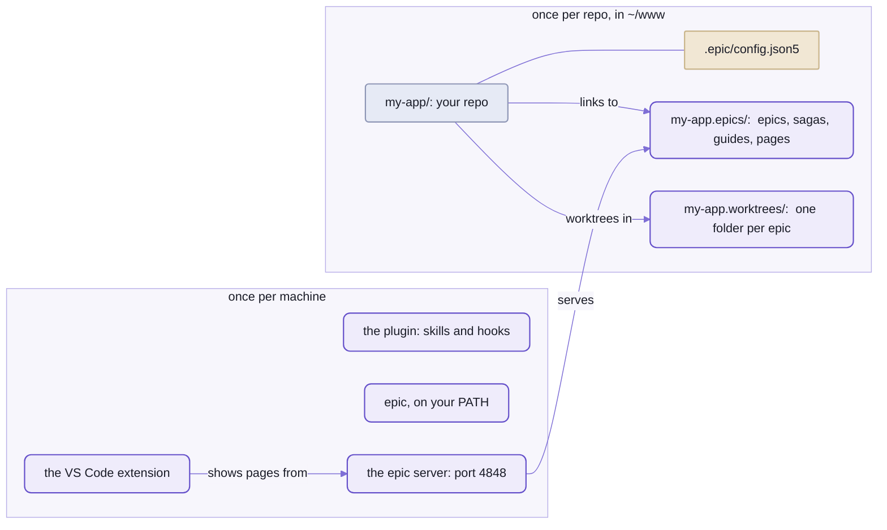

# Epics in your own repo

```sh
cd ~/www/my-app
epic init
# ~/www/my-app/.epic/config.json5:  written
#   contentFolder:  "../my-app.epics"
#   baseBranch:  "main"
#   worktreesFolder:  "../my-app.worktrees"
#   installCommand:  "npm install"
#   ... 14 more, one a line
# ~/www/my-app.epics:  made, a git repo with epics, sagas, guides, pages
# ~/www/my-app/epics:  linked
# ~/www/my-app/sagas:  linked
# ~/www/my-app/guides:  linked
# ~/www/my-app/pages:  linked
# ~/www/my-app/.gitignore:  written
# next:  commit .epic/config.json5 and .gitignore on the base branch, so every new worktree starts with them
```

_A repo that had never heard of Spell, set up for epics in one command.
Real output, trimmed, the home folder shortened to `~`._

One config file, four links and a block in `.gitignore`:  that's all it leaves in your repo.
The plans live next door, in `my-app.epics`, a git repo of their own.

An issue tracker keeps the plan away from the code, a chat scrollback loses it by morning,
and a pull request reviews the diff, not the decisions behind it.
Here the plan is a page that stays true, the epic page:
the agent writes it as it plans and builds, in a worktree of its own,
and you mark it up when you have time.
What that's like, and why:  [`spell-epic`'s front page](README.md).

Two things to know before you start:
- **Claude Code only, for now.**
  The skills, the hooks and the moves between worktrees and windows are Claude Code's,
  and the window moves assume VS Code on macOS.
- **It has run end to end outside Spell once**, in a throwaway repo:
  `epic init`, a saga, an epic page with a phase, a round through the review inbox, the pages on the epic server,
  `/isolate done`'s merge, and the worktree removed after it.
  The setup on this page has run on a second fresh repo since,
  as far as an epic page drawn by the epic server and a worktree made and removed.
  Nine rough edges are listed at the end, not hidden.

## The plans live beside your repo, not in it



_Once per machine, all from one copy of `spell-epic`:  the plugin, the command, the server and the extension.
Once per repo:  one small file in it, and two folders beside it._

The plans are NOT in your repo.
An epic page is shared content:  ONE copy, in the content folder, which every checkout links in.
So the session in a worktree and you on the main checkout read the same page,
and it never conflicts on a merge or turns up in a pull request.

The work IS in your repo:  one worktree per epic, on a branch named after it,
beside the main checkout rather than inside it.

## Setting it up:  three steps and an extension

You need Claude Code, VS Code, git and Node 24.11 or later.
And a Spell checkout:  today `spell-epic` installs only inside one.
- [Setup from zero](https://github.com/spell-app/spell-kit/blob/main/README.md#setup-from-zero), on the kit's front page, makes it.
- `yarn clone spell-epic` brings `spell-epic` and the repos it needs.
- The commands below assume the checkout is at `~/www/spell`.

### 1. The plugin, and `epic` on your PATH

Four commands, once per machine, the same as for Spell's own repos:
[the kit's README-agents.md](https://github.com/spell-app/spell-kit/blob/main/README-agents.md#the-epic-plugin) lists them and says what each does.
They install the plugin for the whole machine, straight from `spell-epic`'s folder,
link its skills in for a bare `/epic`, and put `epic` on your terminal's `PATH`.
Then check that `epic` answers:

```sh
epic --version
# epic 85f239f (main) ~/www/spell/spell-epic
```

- `--version` names the code that answers:  its commit, its branch and the checkout it's in.
- `~/.local/bin`, where the link goes, may not be on your `PATH`:  put the link wherever yours looks.
- Installed for the machine, its worktree hook runs in every repo, not just yours:  rough edge 2, below.

### 2. `epic init`, in your repo

In your repo's main checkout, a git repo with at least one commit:

```sh
cd ~/www/my-app
epic init --dry-run
epic init
git add .epic/config.json5 .gitignore && git commit -m "epic init"
```

- `--dry-run` says what it would do, and writes nothing.
- `epic init` prints what's at the top of this page.
- Commit both files on the base branch:  every new worktree branches from it,
  and needs that `.gitignore` to leave the links alone.
- Each step is skipped when it's done, so it's safe to run again:  a second run ends `set up already`.

In order, it:
1. Writes `.epic/config.json5`, every key with a comment on each, valued for THIS repo
   ("The config file", below).
   A file already there is kept as it is.
2. Makes the content folder, `../<repo>.epics`, a git repo of its own:
   the four folders, a `README.md`, and a `.gitignore` for what's never committed.
3. Links each of the four folders in at the checkout's root;  every new worktree gets the same links.
4. Lists the links in your `.gitignore`, between `# shared:start` and `# shared:end`.

<details>
<summary>The install command it picks, by lock file</summary>

The first match wins;  no match leaves `installCommand` empty, and nothing is installed.

```text
yarn.lock               yarn install
pnpm-lock.yaml          pnpm install
bun.lock, bun.lockb     bun install
package-lock.json       npm install
a bare package.json     npm install
uv.lock                 uv sync
Gemfile.lock            bundle install
```

</details>

### 3. The epic server

Register the repo with the machine's one epic server, and start it:

```sh
epic repo add && epic hub ensure
```

- `epic repo add` registers the repo it runs in, by its main checkout.
  The first repo registered is served at `/` too.
- `epic hub ensure` starts the server in the background if it isn't running,
  and prints where it is, as JSON:  `"base": "http://127.0.0.1:4848"`.
- In that order:  with no repo registered, `ensure` refuses, `no repos to serve yet`.
- More below, "One epic server for the machine".

### And the extension

The Review tab, where you mark up a page, and the moves between windows need `spell-epic`'s VS Code extension.
No script installs it:  you build it in `spell-epic`'s `vscode/` folder, install the `.vsix`, and reload your windows,
three commands in [README-vscode.md](README-vscode.md#install-it--three-commands-and-a-reload).

Then, in a Claude Code session in your repo, `/epic <name> <what to plan>`:

```text
/epic seo make the docs findable
```

The session titles itself for the epic and makes its worktree, `~/www/my-app.worktrees/seo`.
Its epic page, `~/www/my-app.epics/epics/seo/seo.plan.html`, opens in the Review tab and fills as it plans.
What happens from there:  [`spell-epic`'s front page](README.md).

## The content folder:  your plans, in a repo of their own

Every page the agent writes lands in one of four folders, each linked into your checkout:

| Folder | What's in it |
| --- | --- |
| `epics/` | a page per epic, `epics/<name>/<name>.plan.html`, with its parts, review inbox and details pages;  the Epics list, `epics/index.html` |
| `sagas/` | the sagas' list, `sagas/sagas.json5` (`epic saga create`), a page per saga, the Sagas list |
| `guides/` | the guides epics write (`epic pages create durable guides/<page>.html`), the Guides list |
| `pages/` | the docs' home page, `pages/index.html` (`epic pages index` writes a card per area), and scratch details pages, `pages/details/` |

- **Committed by itself.**
  A hook commits the content folder at the end of every Claude turn (`epic shared commit`),
  one commit per epic, guide or folder:  the plans keep a history of their own, off your branches.
- **Never committed:**  review and comment inboxes, locks, the running-agents lists, scratch details pages,
  and the VS Code window files, each machine's own (`windows/`).
- **No `templates/`.**
  The page templates are `spell-epic`'s, in [templates/](templates/).
  A repo can add its own with `repoTemplates`, found by name before `spell-epic`'s.

## <a id="the-config-file"></a>The config file:  one per repo, read from the main checkout

`epic init` wrote this file, and most repos never touch it again.
You'd open it for one of four things:  a different install command,
a second project in the repo that installs on its own (`extraInstalls`), an app for the epic server to start (`app`),
or a repo made of several repos (`repos`).

It's ONE file per repo, `.epic/config.json5` in the main checkout, read by [`EpicConfig`](src/config/EpicConfig.ts).
- Every key is optional.
- Folders are relative to the main checkout, and every worktree reads the main checkout's file:
  a branch's change to it counts once it's merged.
- `epic config [<key>] [--json]` prints what's in force, folders made absolute.
- The hooks act only in a repo that has the file.
  The worktree hook is the exception:  it makes every Claude Code worktree, file or not (rough edge 2).

| Key | `epic init` writes | What it sets |
| --- | --- | --- |
| `contentFolder` | `"../<repo>.epics"` | the content repo:  epics, sagas, guides, pages |
| `baseBranch` | from git:  the remote's default branch, else the branch the main checkout is on | the branch worktrees start from and merge into |
| `worktreesFolder` | `"../<repo>.worktrees"` | where new worktrees go, one folder each, `<worktreesFolder>/<name>` |
| `installCommand` | from the lock file;  `""` with none | what makes a new worktree ready to run, from its root;  `""`:  nothing to install |
| `installOnCreate` | `true` with an install | whether the worktree hook runs the install before it hands the worktree over |
| `installTimeout` | `600` | the seconds that install may take before the hook fails |
| `extraInstalls` | `[]` | folders of a worktree that are projects of their OWN, outside the install at its root (a `vscode/` extension):  the install runs in each too;  one missing or failing is a warning |
| `windows.default` | the repo's name | the window file a worktree's window is opened from, by default |
| `windows.repoName` | the repo's name | the repo root's folder name in every window |
| `windows.contentName` | `"<repo>.epics"` | the content folder's name in every window |
| `windows.worktreeOnly` | `true` | whether every worktree's window holds only the worktree and the content folder |
| `windowsFolder` | `"../<repo>.epics/windows"` | where the VS Code window files go;  worktree windows in its `ongoing/` |
| `linkSessionFolders` | `true` | whether each worktree's saved Claude sessions show in every window's Claude panel |
| `sharedFolders` | `epics`, `sagas`, `guides`, `pages` | the content folders each checkout links in at its root |
| `engineFolder` | `""` | a `spell-epic` checkout to link in at each checkout's root, for a repo whose own code imports the engine;  `""`:  none |
| `repoTemplates` | `""` | the repo's own page templates, a folder from each checkout's root;  `""`:  only `spell-epic`'s |
| `app.path` | not written:  a comment shows how | the repo's APP:  its address on the epic server, `/editor/`, the top bar's App tab |
| `app.url` | not written | where the app answers (`"http://localhost:3000/"`);  `""` with no `urlFile`:  no app |
| `app.urlFile` | not written | or a JSON file its server writes once it's up, `{ "url": ... }`, from the main checkout |
| `app.start` | not written | the shell command that starts the app, run in the background when it doesn't answer (`"npm run dev"`) |
| `repos` | not written | a MULTI-REPO checkout's child repos (a list, or a file such as `"repos.json5"`):  an epic's worktree is then a worktree of the top with one of every child repo inside it, all on the epic's branch;  a child finds its top as the folder above it (`epic config top`) |

- Files your build generates (bundles, data) can be listed in `.epic/generators.json5`,
  each with a `name`, its `outputs`, the `cwd` and the command to `run`.
  `epic worktree merge-main` reruns them on the merged source, instead of line-merging what they wrote.
  It's read from each checkout, so a branch that adds a generated file lists it, and its own merge knows it.
- Two real ones to copy from:  the kit's [.epic/config.json5](https://github.com/spell-app/spell-kit/blob/main/.epic/config.json5), multi-repo,
  with no folders linked in;  and `spell-epic`'s own, [.epic/config.json5](.epic/config.json5).

<details>
<summary>The values a key takes when the file leaves it out:  Spell's, not yours</summary>

The built-in defaults describe an older Spell checkout, the one the tooling grew up in.
`epic init` writes every key but `app` and `repos`, whose defaults are neutral:  keep the rest in the file.

| Key | Default |
| --- | --- |
| `contentFolder` | `"../spell-app-dev"` |
| `baseBranch` | `"main"` |
| `worktreesFolder` | `".claude/worktrees"` |
| `installCommand` | `"yarn install"` |
| `installOnCreate` | `false` |
| `installTimeout` | `600` |
| `extraInstalls` | `[]` |
| `windows` | `default` and `repoName` `"spell-app"`, `contentName` `"spell-app-dev"`, `worktreeOnly` `false` |
| `linkSessionFolders` | `false` |
| `sharedFolders` | seven of Spell's own content folders, among them `epics`, `guides`, `pages`, `goals`, `sagas` and `agents` |
| `engineFolder` | `"../spell-epic"` |
| `repoTemplates`, `windowsFolder`, `repos` | `""`;  `windowsFolder` `""` means the content folder's `windows/` |
| `app` | `path` `"/editor/"`, the rest `""` |

- NEVER list `agents` in `sharedFolders` in a repo that's also a loaded plugin.
  Claude Code reads a plugin's root `agents/` as agent types:  `spell-epic`'s own list is `[]`.

</details>

## Worktrees:  beside your repo, one per epic

The plugin's worktree hook replaces Claude Code's own.
An epic's worktree is `../my-app.worktrees/<name>`, on branch `<name>`,
cut from your LOCAL base branch, unpushed work included.

Before it hands the worktree over, the hook:
- links the content folders in, and the worktrees folder's one link to the content folder,
  `my-app.worktrees/my-app.epics`, so a page's `../my-app.epics/...` links work from a worktree too
- links the worktree's saved Claude sessions to the main checkout's (`linkSessionFolders`)
- runs `installCommand` in it (`installOnCreate`), then in each of `extraInstalls`

<details>
<summary>Removing one, and the rest</summary>

- Remove a worktree with `epic worktree remove <name>`, never a bare `git worktree remove`:
  the epic tools stop its web servers (its page server, its app's dev server) BEFORE it goes, and git doesn't.
  What each worktree verb keeps, and the clean-up after a folder deleted another way:
  [README-cli.md](README-cli.md#worktrees-sessions-and-parked-work).
- `epic worktree move <name> | --idle` moves worktrees left inside the repo, in `.claude/worktrees`
  where the hook puts them in a repo with no config, to beside it.
- Why a worktree's session must enter it through Claude Code's own worktree tool, not just start in its folder:
  the worktree guard, in [README-skills.md](README-skills.md#hooks).

</details>

## Your AGENTS.md fills in the rest

The skills know how to plan, build and review;  what your project counts as "done" they leave to you.
They look for it in your repo's own `AGENTS.md`
(the kit's `CLAUDE.md` loads its `AGENTS.md` with one line, `@AGENTS.md`;  yours can too):

- the checks to run before a phase is done
- its changelog, if it keeps one:  `epic docs` looks for an epic's entry in the content folder's
  `guides/changelog.html`
- its house style, and a skill that rewrites text to it, if it has one
- NOT the pages' formatting:  that's `spell-epic`'s own

## One epic server for the machine

A dev server runs one per project;  the epic server runs ONE per machine, for every repo that uses `spell-epic`.
`epic hub` serves each registered repo's content folder, the engine's scripts and styles,
Epic UI (the `<epic-*>` elements' own docs), and the routes the review controls call.
It's what the Review tab shows.

```sh
epic repo add ~/www/my-app --default    # register a repo (its main checkout);  --default:  served at / too
epic repo list
epic hub ensure                         # start it in the background, and print where it is
epic hub url ~/www/my-app.epics/epics/seo/seo.plan.html
```

- Port 4848;  `SPELL_EPIC_PORT` changes it.
  Only ever that port:  when something else holds it, `ensure` fails and says so,
  rather than start elsewhere, so an open page keeps its address.
- `ensure` restarts it when its code or the repo list changed since it started.
- `epic hub url <file>` prints the address that serves any page of a registered repo, starting the server first.
- In your repo, `epic server` is this server too:  a repo `epic init` set up has no page server of its own.
  Spell's own repos have one each, which runs beside it, never instead of it.
- Its files are in `~/.spell-epic/`, a folder `SPELL_EPIC_HOME` moves:
  - `repos.json5`:  the repos
  - `server.json`:  its process
  - `server.log`
- The app is the repo's own server, never the epic server's:  `/editor/` only finds it, or starts it
  (its output in `~/.spell-epic/app-<repo>.log`).
  With no app declared, it shows a page saying so.
- The epic server's code:  [src/server/](src/server/).

<details>
<summary>Every address it serves</summary>

| Address | What it serves |
| --- | --- |
| `/_epic/assets/...` | the engine's scripts and styles:  Spell UI's docs bundle, `spell-doc.css`, the runtime |
| `/_epic/pack/...` | the `<epic-*>` pack, `epics.pack.js` |
| `/components/epics/` | Epic UI, the elements' docs |
| `/components/<set>/` | the default repo's other component sets;  each repo's at `/r/<repo>/components/<set>/` |
| `/r/<repo>/...` | a registered repo's content folder |
| `/...` | the default repo's content folder too |
| `/editor/` | the default repo's APP (each repo's at `/r/<repo>/editor/`):  a redirect when it answers;  else started in the background behind a "Starting ..." page;  with none declared, a page saying so |
| `/api/app/<repo>` | how a repo's app stands:  up, starting, or failed and why |
| `/api/server` | what it serves:  its port, its repos, the default one |
| `/api/...` | the review, details, choices, comments, agents, airplane and links routes, for the default repo |

</details>

## What's still Spell-shaped

What you'd trip on today, roughly in the order you'd meet it.

1. **It installs only inside a Spell checkout.**
   `spell-epic` depends on Spell UI and the kit through the kit's one install, not from npm.
   So you clone Spell to plan work in a repo that has nothing to do with it.
2. **Its worktree hook runs in every repo.**
   Installed for the machine, the plugin makes EVERY Claude Code worktree, in repos with no config too,
   with the defaults:  `.claude/worktrees/<name>`, cut from a branch named `main`.
   In a repo whose branch is called something else, Claude Code's worktrees fail
   (`fatal: invalid reference: main`) until you run `epic init` there, which reads the branch from git.
3. **A key you leave out takes Spell's value.**
   The defaults are an older Spell checkout's (the fold under "The config file"):
   delete `contentFolder`, and the tools look for `../spell-app-dev`, then quietly use your checkout itself.
4. **The review controls reach the DEFAULT repo only.**
   A second repo's pages draw, but their buttons, comments and details pages talk to the default repo's inbox.
   `epic repo default <name>` picks which repo that is.
5. **Your pages wear Spell's look.**
   They load Spell's theme, and the top bar's tabs are Spell's own areas, not yours.
6. **The pages assume one reviewer.**
   A reply is Claude's or one named person's:  the skills, the colours table, a few element strings
   and `epic --help` itself use the first name of the person who reviews Spell's epics.
7. **A few skills reach for Spell's own tools.**
   Where a skill wants the repo's house style or text-rewriting skill, its example is Spell's.
   Saved prompts go to `~/.spell/prompts/`, and `epic worktree merge-main` updates Vitest snapshots
   with Spell's own command, `yarn vp test run --update`.
8. **Claude Code only.**
   The prompt gate renames sessions through a hook output Claude Code doesn't document yet.
9. **VS Code and macOS.**
   The window bridge finds a session's window through its parent processes;
   `vscode://` links are avoided because macOS hands them to whichever window is focused.

**Real today:**  a repo that isn't Spell, set up in three steps, its epics planned, built in worktrees and reviewed
on their pages.
**Not yet:**  an install without Spell, an agent other than Claude Code, two repos reviewed from one server,
and the keys added since the first outside run (`app`, `extraInstalls`, `windowsFolder`) tried anywhere
but Spell's own repos.

🌱 The first two are planned:  `npm install spell-epic`, with no Spell checkout, once the npm packages exist,
and the same workflow driven from Codex and other agents
([`spell-epic`'s front page](README.md#-coming) says where each stands).

## See also

- [README.md](README.md):  the method, if you came here first:  what an epic is, and why the plan is a page
- [README-pages.md](README-pages.md):  what your content folder will fill with, and how a review round works
- [README-skills.md](README-skills.md):  the skills and hooks you just installed, and what each hook does to a repo
- [README-cli.md](README-cli.md):  every `epic` verb, `init`, `config`, `repo` and `hub` among them
- [README-vscode.md](README-vscode.md):  the extension's two views, and the window bridge

<details>
<summary>More in the docs site</summary>

In Spell's own content folder, so only in a Spell checkout with `spell.epics` beside the repos,
served by `spell server start`:

- "spell-epic:  the epic engine, outside spell-app":  `/guides/spell-epic/spell-epic.html`

</details>
