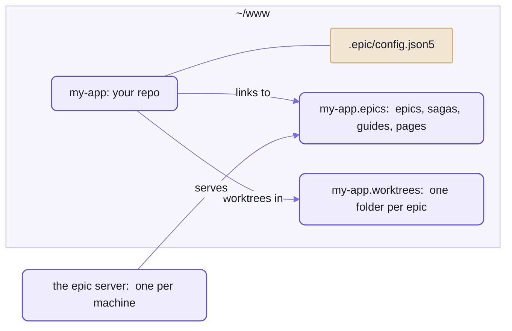

# Using spell-epic beyond Spell

What a project that isn't Spell needs to run epics:
Claude Code with the plugin, the `epic` command on your `PATH`, one config file in the repo,
a content folder beside it, and the VS Code extension.

Nothing in the method is Spell's, and `epic init` sets a repo up in one command.
It has run end to end once outside Spell, in a throwaway repo;  the rough edges are listed at the end, not hidden.

- That run covered `epic init`, a saga, an epic page with a phase, the review inbox,
  the pages served by the epic server, and `/isolate done`'s merge and the worktree's removal.



_Your repo keeps one small file;  the pages live in a git repo of their own beside it,
and each epic's worktree beside that._

## The five steps

You need Claude Code, VS Code, git and Node 24.11 or later.
spell-epic itself comes inside a Spell checkout:  the kit, with spell-epic cloned in it
([the kit's README](../README.md), "Setup from zero";  `yarn clone spell-epic` brings it and what it needs).
The commands below assume that checkout is at `~/www/spell`.

### 1. The plugin

Add spell-epic's folder as a marketplace for the whole machine, and install the plugin from it:

```sh
claude plugin marketplace add ~/www/spell/spell-epic --scope user
claude plugin install spell-epic@spell-epic --scope user
```

- A marketplace added from a local path loads its plugin IN PLACE:  no copy, no version pin.
  An edit in spell-epic's folder is the plugin.
- Bare `/epic` (rather than `/spell-epic:epic`):  link each skill into your own skills folder, once.

  ```sh
  for skill in ~/www/spell/spell-epic/skills/*/; do ln -s "$skill" ~/.claude/skills/; done
  ```

- To try it in ONE session first, with nothing installed:  `claude --plugin-dir ~/www/spell/spell-epic`.

### 2. `epic` on your `PATH`

Claude sessions get `epic` from the plugin;  your own terminal needs a link:

```sh
ln -s ~/www/spell/spell-epic/bin/epic ~/.local/bin/epic
epic --version
# epic c7bfd7c (main) ~/www/spell/spell-epic
```

- `~/.local/bin`, or wherever your `PATH` looks.

### 3. `epic init`, in your repo

In your repo's main checkout (a git repo with a first commit), see what it would do, then do it:

```sh
cd ~/www/my-app
epic init --dry-run
epic init
# ~/www/my-app/.epic/config.json5:  written
#   contentFolder:  "../my-app.epics"
#   baseBranch:  "main"
#   worktreesFolder:  "../my-app.worktrees"
#   installCommand:  "npm install"
#   installOnCreate:  true
#   ...
#   windows.worktreeOnly:  true
# ~/www/my-app.epics:  made, a git repo with epics, sagas, guides, pages
# ~/www/my-app/epics:  linked
# ~/www/my-app/sagas:  linked
# ~/www/my-app/guides:  linked
# ~/www/my-app/pages:  linked
# ~/www/my-app/.gitignore:  written
# next:  commit .epic/config.json5 and .gitignore on the base branch, so every new worktree starts with them
git add .epic/config.json5 .gitignore && git commit -m "epic init"
```

Each step is skipped when it's done, so it's safe to run again.

1. Writes `.epic/config.json5` with every key and a comment on each, valued for THIS repo
   (a file already there is kept):
   - `contentFolder`:  `../<repo>.epics`, beside it
   - `baseBranch`:  the remote's default branch, else the branch the main checkout is on
   - `worktreesFolder`:  `../<repo>.worktrees`
   - `installCommand`:  what the lock file names, else nothing;  `installOnCreate` is on when there is one
   - `windows`:  the repo's folder name, and `<repo>.epics`;  `worktreeOnly` on
   - `windowsFolder`:  `../<repo>.epics/windows`, each machine's own window files
   - `linkSessionFolders` on;  `sharedFolders`:  `epics`, `sagas`, `guides`, `pages`
2. Makes the content folder a git repo of its own:  those four folders, a `README.md`,
   and a `.gitignore` for the tooling's scratch files (inboxes, locks, running agents) and the window files.
   The turn-end hook commits it after every Claude turn.
3. Links each folder in at the checkout's root;  every new worktree gets the same links.
4. Lists the links in the repo's `.gitignore`, between `# shared:start` and `# shared:end`.

<details>
<summary>The install command, by lock file</summary>

The first match wins:

```text
yarn.lock            yarn install
pnpm-lock.yaml       pnpm install
bun.lock             bun install
package-lock.json    npm install
a bare package.json  npm install
uv.lock              uv sync
Gemfile.lock         bundle install
```

</details>

### 4. The epic server

Register the repo with the machine's one epic server, and start it:

```sh
epic repo add && epic hub ensure
```

- `epic repo add` registers the repo this runs in (its main checkout);  the first repo is served at `/` too.
- `epic hub ensure` starts the server in the background if it isn't running, and prints where it is.
- More below, "The epic server".

### 5. The VS Code extension

The Review tab and the window moves need spell-epic's extension:

```sh
cd ~/www/spell/spell-epic/vscode
yarn install && yarn package
code --install-extension spell-epic.vsix
```

- Then reload your VS Code windows.
- More:  [README-vscode.md](README-vscode.md).

Then, in a Claude Code session in your repo:  `/epic <name> <what to plan>`.

## What the content folder holds

| Folder | What's in it |
| --- | --- |
| `epics/` | a page per epic, `epics/<name>/<name>.plan.html`, with its parts, review inbox and details pages;  the Epics list, `epics/index.html` |
| `sagas/` | the sagas' list, `sagas/sagas.json5` (`epic saga new`), a page per saga, the Sagas list |
| `guides/` | the guides epics write (`epic pages new durable guides/<page>.html`), the Guides list |
| `pages/` | the docs' home page, `pages/index.html` (`epic pages index` writes a card per area), and scratch details pages, `pages/details/` |

- No `templates/`:  the templates are spell-epic's ([templates/](templates/)).
  A repo can add its own with `repoTemplates`, found by name before spell-epic's.

## The config file

Each repo says where it keeps its epic things in ONE file, `.epic/config.json5`, in its main checkout.
[`EpicConfig`](src/config/EpicConfig.ts) reads it.

- Every key is optional.
- Folders are relative to the main checkout;  every worktree reads the main checkout's file.
- `epic config [<key>] [--json]` prints what's in force.
- The hooks act only in a repo that has the file;
  the worktree hook is the exception, since Claude Code needs it everywhere.

| Key | `epic init` writes | What it sets |
| --- | --- | --- |
| `contentFolder` | `"../<repo>.epics"` | the content repo:  epics, sagas, guides, pages |
| `baseBranch` | from git | the branch worktrees start from and merge into |
| `worktreesFolder` | `"../<repo>.worktrees"` | where new worktrees go, one folder each, `<worktreesFolder>/<name>` |
| `installCommand` | from the lock file | what makes a new worktree ready to run, from its root;  `""`:  nothing to install |
| `installOnCreate` | `true` with an install | whether the worktree hook runs the install before it hands the worktree over |
| `installTimeout` | `600` | the seconds that install may take before the hook fails |
| `extraInstalls` | `[]` | folders of a worktree that are projects of their OWN, outside the one install (a `vscode/` extension):  the install runs in each too;  one missing or failing is a warning |
| `windows.default` | the repo's name | the window file a worktree's window is opened from, by default |
| `windows.repoName` | the repo's name | the repo root's folder name in every window |
| `windows.contentName` | `"<repo>.epics"` | the content folder's name in every window |
| `windows.worktreeOnly` | `true` | whether every worktree's window holds only the worktree and the content folder |
| `windowsFolder` | `"../<repo>.epics/windows"` | where the VS Code window files go;  worktree windows in its `ongoing/` |
| `linkSessionFolders` | `true` | whether each worktree's saved Claude sessions show in every window's Claude panel |
| `sharedFolders` | `epics`, `sagas`, `guides`, `pages` | the content folders each checkout links in at its root |
| `engineFolder` | `""` | a spell-epic checkout to link in at each checkout's root, for a repo that runs the engine from its own code;  `""`:  none |
| `repoTemplates` | `""` | the repo's own page templates, a folder from each checkout's root;  `""`:  only spell-epic's |
| `app.path` | `"/editor/"` | the repo's APP:  its address on the epic server, the top bar's App tab |
| `app.url` | `""` | where the app answers (`"http://localhost:3000/"`);  `""` with no `urlFile`:  no app |
| `app.urlFile` | `""` | or a JSON file its server writes once it's up, `{ "url": ... }`, from the main checkout |
| `app.start` | `""` | the shell command that starts the app, run in the background when it doesn't answer |
| `repos` | `""` | a MULTI-REPO checkout's child repos (a list, or a file such as `"repos.json5"`):  an epic's worktree is then a worktree of the top with one of every child repo inside it, all on the epic's branch |

- A repo's generated files are its own list, in each checkout:  `.epic/generators.json5`.
  `epic worktree merge-main` rebuilds them instead of line-merging them.
- Spell's own:  the kit's [.epic/config.json5](../.epic/config.json5) is multi-repo, with no shared folders linked in;
  spell-epic's own is [.epic/config.json5](.epic/config.json5).

<details>
<summary>The values a key takes when the file leaves it out</summary>

The built-in defaults are the layout of the Spell checkout the tooling grew up in.
`epic init` writes every key, so a new repo never meets them.

| Key | Default |
| --- | --- |
| `contentFolder` | `"../spell-app-dev"` |
| `baseBranch` | `"main"` |
| `worktreesFolder` | `".claude/worktrees"` |
| `installCommand` | `"yarn install"` |
| `installOnCreate` | `false` |
| `installTimeout` | `600` |
| `extraInstalls` | `[]` |
| `windows` | `default` and `repoName` `"spell-app"`, `contentName` `"spell-app-dev"`, `worktreeOnly` `false` |
| `linkSessionFolders` | `false` |
| `sharedFolders` | `epics`, `guides`, `pages`, `brand`, `goals`, `sagas`, `agents` |
| `engineFolder` | `"../spell-epic"` |
| `repoTemplates`, `windowsFolder`, `repos` | `""`;  `windowsFolder` `""` means the content folder's `windows/` |
| `app` | `path` `"/editor/"`, the rest `""` |

- NEVER list `agents` in `sharedFolders` in a repo that's also a loaded plugin.
  Claude Code reads a plugin's root `agents/` as agent types:  spell-epic's own list is `[]`.

</details>

<details>
<summary>Worktrees and the content folder, in more detail</summary>

- A worktree's web servers (its page server, its app's dev server) stop BEFORE it goes:
  removed by the worktree hook, `epic worktree remove <name>` or `epic worktree move`.
  - Never a bare `git worktree remove`:  it leaves them running, and nothing else ever stops them.
  - A folder deleted another way:  every session's start stops its servers, at most once an hour;
    `epic server prune` does it now.
  - Never a live checkout's:  a server stops only when its checkout and working folder are both gone.
- A worktree's session gets there through Claude Code's own worktree tool, never by starting in its folder:
  only then does Claude Code bring it back there when it's reopened from another window.
- `epic worktree path <name>` says where one is.
- `epic worktree move <name> | --idle` moves worktrees left inside the repo (`.claude/worktrees`, the old place)
  to beside it.
- `epic shared rename <new> [--dry-run]` renames the content folder, leaving a link at the old name.
  - It rewrites what names the old folder:
    the main checkout's `AGENTS.md`, `CLAUDE.md` and Claude settings, and the repo's memory notes.
  - Claude Code's own settings, `~/.claude/settings.json`, it only lists, line by line, to edit by hand.
- What the skills leave to the repo's own `AGENTS.md`:
  - the checks to run
  - its changelog, if it keeps one
  - its house style, and a skill that rewrites text to it, if it has one
  - NOT the pages' formatting:  that's spell-epic's own

</details>

## The epic server

`epic hub` runs ONE page server for every repo on the machine that uses spell-epic.
It serves each repo's content folder, the engine's scripts and styles, Epic UI,
and the routes the review controls call.

```sh
epic repo add ~/www/my-app --default    # register a repo (its main checkout);  --default:  served at / too
epic repo list
epic hub ensure                         # start it in the background, and print where it is
epic hub url ~/www/my-app.epics/epics/seo/seo.plan.html
```

- It asks for port 4848 first (`SPELL_EPIC_PORT` changes it), and takes another when that's busy:
  `epic hub url <file>` always prints the right address.
- `ensure` restarts it when its code or the repo list changed since it started.
- It runs beside each checkout's own page server (`epic server`), never instead of it.

| Address | What it serves |
| --- | --- |
| `/_epic/assets/...` | the engine's scripts and styles:  Spell UI's docs bundle, `spell-doc.css`, the runtime |
| `/_epic/pack/...` | the `<epic-*>` pack, `epics.pack.js` |
| `/components/epics/` | Epic UI, the elements' docs |
| `/components/<set>/` | the default repo's other component sets;  each repo's at `/r/<repo>/components/<set>/` |
| `/r/<repo>/...` | a registered repo's content folder |
| `/...` | the default repo's content folder too |
| `/editor/` | the default repo's APP (each repo's at `/r/<repo>/editor/`):  a redirect when it answers;  else started in the background behind a "Starting ..." page;  with none declared, a page saying so |
| `/api/app/<repo>` | how a repo's app stands:  up, starting, or failed and why |
| `/api/...` | the review, details, choices, comments, agents, airplane and links routes, for the default repo |

- Its files are in `~/.spell-epic/`, a folder `SPELL_EPIC_HOME` moves:
  - `repos.json5`:  the repos
  - `server.json`:  its process
  - `server.log`
- The app is the repo's own server, never the epic server's:  `/editor/` only finds it, or starts it
  (its output in `~/.spell-epic/app-<repo>.log`).
- The epic server's code:  [src/server/](src/server/).

## What's still Spell-shaped

What a project that isn't Spell would trip on today.

1. **It installs only inside a Spell checkout.**
   spell-epic depends on Spell UI and the kit through the kit's one install, not from npm.
2. **The epic server's review controls reach the DEFAULT repo only.**
   A second repo's pages draw, but their buttons, comments and details pages talk to the default repo's inbox.
3. **The pages assume one reviewer.**
   Some skills, the colours table and a few element strings name the person who reviews Spell's epics.
4. **A few skills still name Spell's own tools**:  spell-app's extension build, its house-style check, its changelog
   and its text-rewriting skill.
   Saved prompts go to `~/.spell/prompts/`.
5. **Claude Code only.**
   The prompt gate renames sessions through a hook output Claude Code doesn't document yet.
6. **VS Code and macOS.**
   The window bridge finds a session's window through its parent processes;
   `vscode://` links are avoided because macOS hands them to whichever window is focused.

## 🌱 Coming

- **npm packages**:  spell-epic, Spell UI and the kit published,
  so `npm install spell-epic` sets up a repo with no Spell checkout.
  Where it stands:  planned;  today everything installs inside the kit.
- **Other agents**:  the same workflow driven from Codex and others;
  the pages and `epic` are already plain files and a plain command line.
  Where it stands:  planned;  Claude Code only for now.

## See also

- [README.md](README.md):  spell-epic's front page, and the method
- [README-cli.md](README-cli.md):  every `epic` verb, `init`, `config`, `repo` and `hub` among them
- [README-skills.md](README-skills.md):  the skills and hooks the plugin brings
- [README-vscode.md](README-vscode.md):  the extension
- [README-pages.md](README-pages.md):  the pages your content folder will fill with
- [The kit's README](../README.md):  Spell as a whole
- [The kit's README-agents.md](../README-agents.md):  the plugin in Spell itself

<details>
<summary>More in the docs site</summary>

This guide lives in the content folder, so it needs a checkout with `spell.epics` beside the repos and the page
server running (`spell server start`, then the URL it prints):

- "spell-epic:  the epic engine, outside spell-app":  `/guides/spell-epic/spell-epic.html`

</details>
