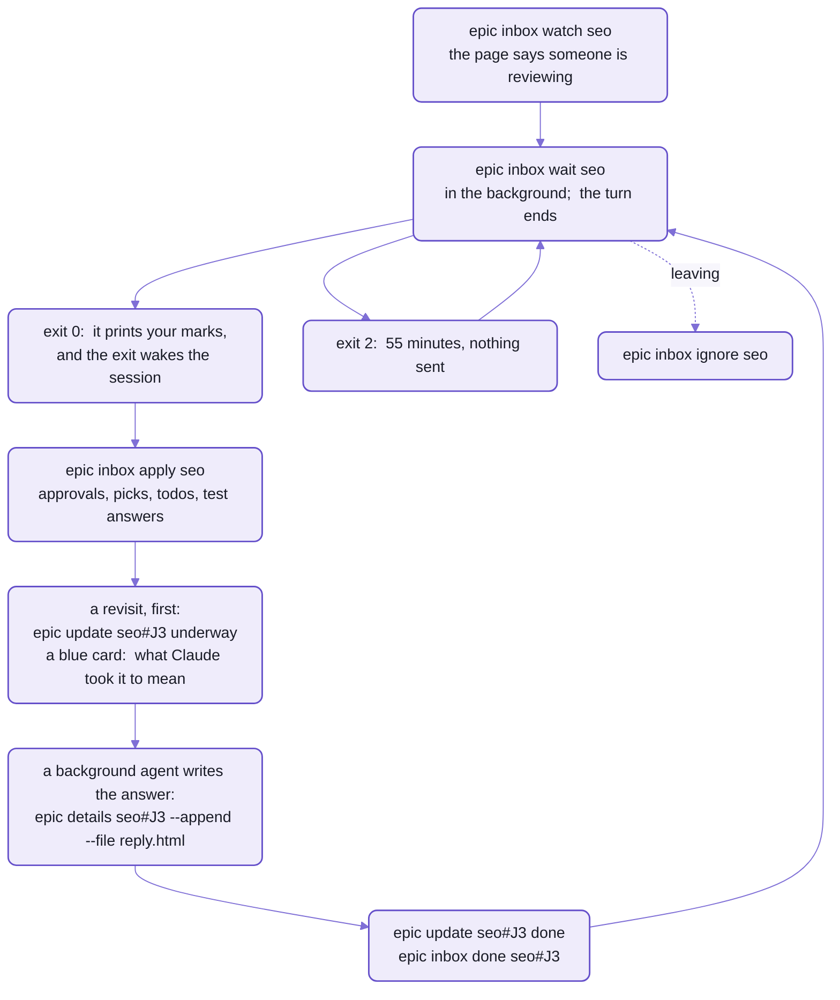
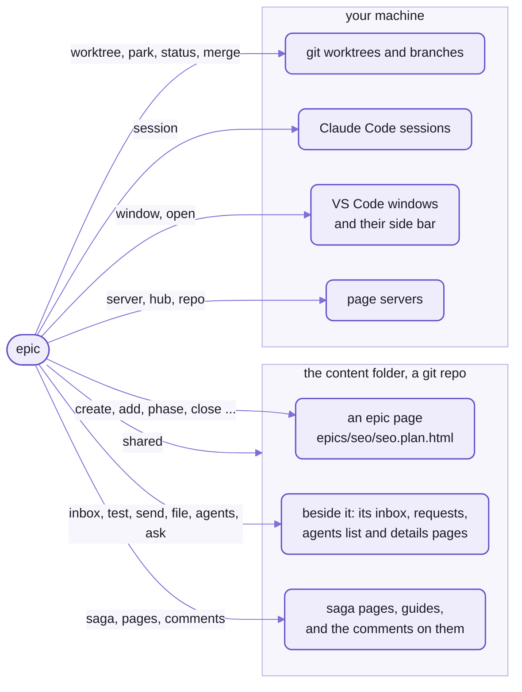

# The `epic` command

```sh
epic summary readme
```

<details>
<summary>Output</summary>

```text
READMEs
  [x] P1 · Map and Outlines  (3h)
  [x] P2 · Kit Pages  (3-4h)
...
  [x] P8 · Cross-links and Pictures  (2h)
  [x] P9 · Post-split Cleanup  (2h)
  [x] P10 · Doc Review  (1h)
  [x] P11 · Voice Rewrite  (4h)
...
estimate:  ... in all, ... left
open judgements:
...
open issues:
  - I3  Only spell-app has a .vscode/extensions.json
...
```

</details>

The plan for the pages you're reading came back in 0.4 seconds:
sixteen phases, what's left of them (P9, under way:  `[~]`), and the loose ends.
P11 is the rewrite this page came out of.

`gh issue list` asks a server for rows in a database.
This asked nobody.

`epic` read one HTML file, the epic page, from a git repo beside the checkout.
The page IS the record, and `epic` reads and writes it directly:  no database, no API, no server that has to be up.

It's the same page you review in VS Code.
When Claude runs `epic close readme#J16`, the item closes on your screen, with no reload.

`epic` is the command line under spell-epic's skills:  `/epic`, `/isolate`, `/bg` and the rest run it for Claude,
and you can type any of it yourself.
It has 63 verbs, and 111 more inside its groups (`epic window` alone has fifteen);  this page has every one.
You'll type about six.

**Claude Code only, for now:**
the verbs that find sessions, move windows and wake a session are built on Claude Code
and spell-epic's VS Code extension.

- Claude Code sessions have `epic` on their `PATH` while the spell-epic plugin is on;
  your own terminal needs one link, the last of [the plugin's four install commands](https://github.com/spell-app/spell/blob/main/README-agents.md#the-epic-plugin).
- No build step:  [bin/epic](bin/epic) runs spell-epic's source through `tsx`, so an edit to it is live at once.
- It loads no Spell, so it starts fast:  `epic --version` answers in about 0.2 s.

## Six commands you'll actually type

The skills run the rest.

```sh
epic --version
# epic 9e30810 (readme) ~/www/spell.worktrees/readme/spell-epic
epic list
# in progress:  (not reviewed / items)
#   epic-engine              148 / 281  (../../spell.worktrees/epic-engine/spell-epic)
#   ...
#   readme                    36 / 109  (../../spell.worktrees/readme/spell-epic)
#   ...
# future:  (not reviewed / items)
#   ...
#   crdt                       0 / 4
#   ...
# done:  (not reviewed / items)
#   epic-workflow            174 / 270
#   ...
epic summary readme             # one epic:  its phases, the next one, its loose ends (above)
epic open readme --review       # its page, in VS Code's Review tab
epic test readme                # your test run, one test at a time, in the Review tab
epic status                     # take stock:  worktrees, branches, sessions, parked work;  what's hung, what's dead
```

`list` counts each epic's items you haven't reviewed, out of all of them.
`--version` names the commit, branch and checkout of the code that ran,
which isn't always the code in front of you ([below](#one-copy-of-the-code-your-checkouts-files)).

## An address is a page and an id

A verb takes an ADDRESS:  the epic's name, then `#` and the id of one thing on its page.
It reads like a link because it nearly is one:  `seo#J3` is item J3 of the seo epic's page (its path:  the first line below).

```text
seo                 the epic's page, epics/seo/seo.plan.html
seo#J3              an item:  J3 (a comment on the page, seo#C3, too;  the old cm3 reads the same)
seo#P3              a phase:  P3, or by its id, seo#p-epic-migrate;  phase, updated and file take its name
                    too:  seo#epic-migrate, "seo#Epic Migrate"
seo#J               a new item of that kind, for add:  epic add seo#J "Title"
SAGA:/epics         a saga's page, sagas/epics/epics.saga.html:  epic add SAGA:/epics#Q "Title"
guides/x.html#C3    a comment on a docs page, for epic comments (and a page note, guides/x.html#n3)
```

_The forms `epic --help` lists, as it prints them._

- Ids are short so you can say them in chat:  "approve J3" means one thing on one page.
- A phase also answers to `p3` or a bare `3`.
- A new item's kind answers to its word too:  `seo#judgement` is `seo#J`.
- The id goes after the `#`, never as a word of its own.
  Write it as a word and `epic` refuses, with the right spelling, and exits 2:

  ```sh
  epic close seo J3
  ```

  <details>
  <summary>Output</summary>

  ```text
  close:  epic close seo#J3  (the id goes after a #, not "seo J3")
  ```

  </details>

- A SHORT ADDRESS names an item through its saga, `SAGA:/<saga>/<epic>#<id>`:
  you can type it in chat, and `epic pages open` and `epic pages link` take it.

## One copy of the code, your checkout's files

There's one `epic` on your machine, the main checkout's, and every window and every repo runs it.
What it works ON is wherever you are.

Type `epic server start` in an epic's worktree, and main's code starts that worktree's page server;
type `epic close seo#J3` anywhere, and it closes J3 on the one page every checkout shares.

- "Where you are" is the nearest checkout above your folder whose repo is set up for epics
  (its main checkout has `.epic/config.json5`), so any folder of the repo will do.
  Outside every such repo, it works on spell-epic's own checkout, the one its code is in.
- Pages are the exception, and the point.
  They live in the content folder, which every checkout reads where it is ([below](#shared-content)),
  so no worktree has a copy to fall out of step.
- It works in a worktree made a moment ago, before its install:
  the code that runs is main's, with its packages already installed.
  That's how `/isolate` can open a new worktree's window and move the session there first,
  and leave any install still to do to its first turn in the new window.
- In a worktree whose spell-epic code is newer than main's, though, the `epic` on your `PATH` still runs main's.
  `epic --version` says which code ran;  the worktree's own [bin/epic](bin/epic) runs its own.
- Every write takes the page's lock, so several background agents can answer items on one page at once.

<details>
<summary>Where the command's code is</summary>

- [bin/epic](bin/epic):  the entry on your `PATH`;  it runs [epicMain.ts](src/cli/epicMain.ts) through `tsx`.
- [src/cli/](src/cli/), the command itself:  [EpicProgram.ts](src/cli/EpicProgram.ts) holds every verb, its help
  and its group, and [epicGroups.ts](src/cli/epicGroups.ts) the verbs inside each group.
- What the verbs run stays beside them:
  - [src/command/](src/command/):  worktrees, sessions, requests, parked work, the shared content
  - [src/server/](src/server/):  the epic server
  - [src/tool/](src/tool/):  the epic pages and their inbox
  - [src/tools/](src/tools/):  the docs pages, answer pages, comments, agents and airplane mode
  - [window.mjs](src/window.mjs):  the windows
- It never loads the kit's `spell` program either, and spell-epic adds no commands to it.
  Its tools are all `epic`'s, the docs tools included (`epic pages <verb>`).
- `yarn epic` runs it too, in spell-epic's folder and in spell-app's.
  - spell-app adds `yarn ask` (`epic ask`)
  - and `yarn window` (`epic window`)

</details>

## A session wakes when its `wait` exits

A Claude Code session that has ended its turn sits idle until something wakes it,
and one thing that does is a command it started in the background finishing.

So a review session runs `epic inbox wait` in the background and ends its turn.
The `wait` blocks until you send something from the page, prints it and exits:  the exit is the doorbell.



_One loop, driven by exit codes:  0 means work, 2 means arm it again._

- Every `wait` works this way:  `inbox wait`, `ask wait`, `choices wait`, `comments wait`, `agents wait`, `park wait`.
  Each gives up after a time of its own, in its row below, and exits 2.
- While it waits, `inbox wait` stamps a heartbeat every 30 seconds.
  Silent for 90, and the page says nobody is reviewing.
- What you see on the page meanwhile:  [README-pages.md](README-pages.md), "A review round".

| Exit | Means |
| --- | --- |
| 0 | done;  for a `wait`, there's work, and it's printed |
| 1 | an unknown verb (the verbs are listed);  a check that failed:  `server status` or `hub status` with no server, `airplane check` not ready, `ask answer` with no answer, `ask draft` with nothing typed;  `agents add` for one already running;  a window verb with no extension to reach |
| 2 | a usage error, such as an id written without its `#`;  a `wait` that timed out:  run it again |
| 3 | `park wait` with nothing by that name;  `agents wait` with no agent left running |

## `--help` on every verb

`epic --help` lists every verb in the groups below, then the address forms and five examples.

- `epic <verb> --help`, or `epic help <verb>`:  its usage, what it does and an example.
- Inside a group too:  `epic ask create --help`.
- An unknown verb exits 1, and lists the verbs:

  ```sh
  epic stok
  ```

  <details>
  <summary>Output</summary>

  ```text
  epic stok?  no such verb.  The verbs:
    send, requests, file, home, merge, ...
  ...
  epic <verb> --help says what each does.
  ```

  </details>

## Every verb, by group

`epic --help` sorts its verbs into twelve groups, and so does this page, in the same order.
Each group is named for what it works on, so start from the thing you want to change.



_Find what you want to change:  the label on its arrow names the verbs that change it._

Each row is one verb, with the flags you'll reach for;  `epic <verb> --help` has the rest.
The background agents get the page verbs in one block instead:
the `/epic` skill pastes [its cheat sheet](skills/epic/SKILL.md) into every agent's prompt.

### Requests from other sessions

You're working in one epic and spot something that belongs to another.
`/send` files your words and screenshots as a request to that epic, and wakes its session;
these are the verbs under it.

| Verb | What it does |
| --- | --- |
| `epic send [<epic>] --text "..."` | writes a request into an epic, `epics/<epic>/requests/r3/`:  your words (`--text`, or `--file`), the newest `--images <n>` screenshots pasted into this session, `--context "..."` for what it was looking at;  then prints the request's id and the epic's running sessions to tell, or the command that opens its window;  no epic:  the tooling home |
| `epic requests <epic>` | lists every request sent to an epic, and where each one went |
| `epic file <epic>#P3 <rN>` | files a request into a phase:  its words, context and screenshots into the phase's Requests field, the request marked filed there |
| `epic file <epic> <rN> "where it went"` | marks a request with no phase, saying where it went:  `"dropped:  done in P2"` |
| `epic home [<epic>]` | prints the tooling home, the epic that requests about the tooling itself go to;  with an epic, sets it |
| `epic merge <epic> [--ditch]` | puts a standing epic's phase onto `main` at once, fast-forward only, in each repo its branch has commits in;  run it in the main checkout.  A stray snapshot or generated file there is moved aside first;  `--ditch` moves up to 3 others too, once you agree |

- A request is written BEFORE anyone is told, so nothing is lost when the epic's own session is closed.

### Epic page:  making and reading

Every verb here only reads, but `create`:  run them from anywhere, as often as you like.

| Verb | What it does |
| --- | --- |
| `epic create <epic> --title "Title"` | makes an epic page from the template, and lists it on the docs' home page;  `--prompt "..."` or `--prompt-file <file>`:  the prompt that started it;  `--saga <id>`:  the saga it serves;  `--future`:  an idea for later, not planned yet;  on a future epic's page, plans it where it is |
| `epic list [--json]` | lists every epic once:  in progress, future or done, where it runs, and how many of its items you haven't reviewed |
| `epic summary <epic> [--json]` | prints an epic's phases, the next one, and its open questions, judgement calls, issues, todos, limits and manual tests |
| `epic summaries <page.html> ...` | prints `summary --json` for each page, by path, worktrees' too:  what `/epics` reads |
| `epic items <epic>` | prints what a review walks:  sections, counts, items, the queue;  `--section issues`, `--filter unreviewed \| open \| reviewed \| queued \| all`, `--json`;  `--spec <file>`:  a review's item picker, as a details page's questions |
| `epic docs <epic> [--json]` | lists the docs an epic wrote besides its page (its guide, what its commits changed, docs that name it) and its changelog entry:  what `/docs-check` reads |
| `epic decisions <epic> [--json]` | prints what a page settled:  phases' Done and Updated notes, items' answers and chosen options |
| `epic owns <path> ... [--json]` | prints which open epics own each file, a path from the checkout's root:  their branch changes it (`branch`), or their page names it (`plan`);  each with its stage, `planning` or `building`;  `--` for a file no open epic owns:  what `/coherence` reads to land a finding in its epic |
| `epic open <epic>` | shows an epic's page in VS Code's side bar, in Epic Docs;  `--review`:  in the Review tab |
| `epic lint <epic>` | checks ids, `#id` links, phases and parts, then the page's links, then draws it in a headless browser;  `--no-browser` skips the drawing;  `--links`:  a bad link fails it |

### Epic page:  phases

A phase is one step of the plan, `P3 · Short Name`, built and committed on its own.
Insert one, and the phases after it move down a number, but keep their stable ids:
so links and comments stay on the phase they meant.

| Verb | What it does |
| --- | --- |
| `epic add-phase <epic> "Short Name" --symptom <html> --changes <html>` | adds a phase:  what's wrong, in a line, and what changes, in two or three;  `--goal`, `--files`, `--verify`, `--estimate 2h`;  `--before N` inserts it as P*N*, and links' words follow the renumbering |
| `epic update <epic>#P3 --goal "<p>...</p>"` | sets a phase's fields, an item's title, or the page's flags:  everything it takes is below |
| `epic updated <epic>#P3 "<p>...</p>"` | records a change to a phase's plan:  a dated Update block at the end of its description;  `--summary "..."`, else its first sentence;  `--file <file>` for longer HTML |
| `epic phase <epic>#P3 todo \| active \| done` | sets a phase's status;  `done --done "<ul>...</ul>"` writes what was built, and clears its UPDATE labels;  `done` writes how long Claude really worked on it too (`took`, from the transcripts, never the time waiting on you);  it brings the page forward in VS Code, unless `--no-open` |
| `epic phase <epic>#P3 took [--dry-run]` | works out again how long a phase done before took, from its log's `active` to its `done` |
| `epic commit <epic>#P3 <sha> "what it did"` | lists a commit under a phase, or an item (`<epic>#J3`), replacing its entry there |
| `epic commits <epic> --backfill` | finds every commit in the history whose subject names a phase or an item (`P3:  ...`, `seo I3:  ...`), and lists each one where it belongs, once;  `epic phase ... done` and `epic merge` do it by themselves |

<details>
<summary>Everything <code>update</code> sets</summary>

| On | Flags |
| --- | --- |
| a phase, `seo#P3` | `--symptom`, `--changes`, `--goal`, `--files`, `--verify <html>`:  its body, `""` removes one;  `--estimate 1-2h`:  the Overview's total follows;  `--title "New name" [--html]`:  renamed, and links that say the old name follow |
| an item, `seo#J3` | `--title "New title" [--html]`;  `--calm` or `--loud` |
| the page, `seo` | `--standing [on \| off]`, `--no-standing`:  a standing epic, open for good, each phase merging on its own, never done |
| Claude's status card:  an item, an Overview sub-section (`seo#o3`), a phase or `seo#summary` | `underway "<reading>"`, `done ["<summary>"]` or `noted "<what>"`:  a state word after the target, never with flags (the items' table, next) |

</details>

### Epic page:  items

Fifteen verbs, and one rule:  nothing on a page is deleted.
An item is closed, canceled (struck through) or condensed,
and the text it had moves into a folded Original Discussion.

| Verb | What it does |
| --- | --- |
| `epic add <epic>#J "Title"` | adds an item and prints its id;  the letter is its kind:  `J` judgement call, `Q` question, `I` issue, `T` todo (work still to do;  `--limit`:  a limit to know about), `M` manual test, `D` a question born answered (it gets a `Q` id);  `C` and `V`, the letters before epic-engine P44, are refused, naming the new ones (`C` is a comment's now);  `--details <html>`;  `--calm`, last, for a call or issue that wouldn't surprise you |
| `epic calm <epic>#J3 [J4 ...]` | marks calls or issues not urgent, yellow rather than red, as clicking the id chip does;  `--loud`:  red again |
| `epic decide <epic>#Q3 "answer"` | answers a question, writing the answer INTO it, and prints its id;  `--option A` marks the chosen option card;  `--details <html>` |
| `epic choose <epic>#J9 <letter> ["outcome"]` | records an option you settled in conversation, on any item, as your pick on the page would:  chosen on the item's latest set of cards (`--set N`:  the Nth), the item answered, closed or reviewed, and a Noted card |
| `epic close <epic>#J3` | closes an item:  done, never deleted |
| `epic reopen <epic>#J3` | opens a closed or canceled item again |
| `epic cancel <epic>#J3 ["why"]` | strikes through an item made moot by another decision;  `reopen` undoes it |
| `epic details <epic>#J3 --file <reply.html>` | writes an agent's details into an item, its old text moving into the Original Discussion;  `--append`:  added, as a reply;  `--more`:  a More Details card under it |
| `epic summarize <epic>#J3 --file <condensed.html>` | condenses an item after a long back and forth:  the file replaces what it shows, and its text and every reply move into its Original Discussion, folded;  your picks and the answer stay |
| `epic update <epic>#J3 underway "<reading>"` | puts Claude's status card on an item:  `underway`, blue, what Claude took the task to be, its spinner on;  `done ["<summary>"]`, green, work was done;  `noted "<what>"`, calm, your choice only recorded |
| `epic restore <epic>#J3 --file <old.html>` | puts earlier text, taken from git, into an item's Original Discussion;  `--as-of "YYYY-MM-DD HH:MM"` dates it |
| `epic review <epic>#J3 ["outcome"]` | marks an item reviewed today;  the outcome goes in the log |
| `epic defer <epic>#J3` | puts an item off:  dated, still not reviewed |
| `epic queue <epic>#J3 "the work"` | records work a review decided on, waiting to be done |
| `epic unqueue <epic>#J3` | takes it off that list:  started, or dropped |

<details>
<summary>A manual test's fields</summary>

A manual test (`M`) is something you check by hand before merging, and your test run steps you through it.
It takes its fields as it's added, each one HTML:

```sh
epic add seo#M "The sitemap lists every page" --step "Open /sitemap.xml" --should "Every guide is in it"
```

- `--step`:  exactly what to do;  a link of class `epic-test-action` in it is a button in the run.
- `--should`:  what should happen.
- `--example`:  a screenshot of it, copied to `tests/<id>.png` beside the page;  or a line of text.
- `--if-not`:  what to tell Claude when it doesn't.
- `epic details seo#M3` takes the same fields, to change them.

</details>

### Epic page:  the review inbox

Every mark you make on the page saves as you type, into a file beside it, `seo.inbox.json5`,
and waits there until a session takes it.
The inbox's own verb goes first, then the epic;  the other order is refused, with the right spelling:

```sh
epic inbox seo wait
```

<details>
<summary>Output</summary>

```text
inbox:  epic inbox wait seo  (the inbox's verb goes first)
```

</details>

| Verb | What it does |
| --- | --- |
| `epic inbox <epic>` | prints what you left on the page:  marks by action, sent or not, requests for now, agents at work, the session listening |
| `epic inbox watch <epic>` | this session is reviewing the page:  the page stops saying nobody is |
| `epic inbox ignore <epic>` | this session has stopped reviewing:  the page says so |
| `epic inbox wait <epic>` | waits in the background until there's work, prints it and exits 0, which wakes the session;  nothing in 55 minutes:  exit 2 (`--timeout <seconds>`) |
| `epic inbox apply <epic> [ids ...]` | applies the sent approvals, picks, new todos and test answers, printing each, and what it left to talk over;  `--all`:  unsent ones too |
| `epic inbox working <epic>#J3 on \| off` | turns the page's spinner on an item on or off;  on a comment (`seo#C3`), its "Claude:  thinking…" |
| `epic inbox done <epic>#J3` | an agent finished the item:  its mark and spinner go, unless you changed the mark meanwhile |
| `epic inbox clear <epic>#J3` | drops an item's marks:  a revisit talked over |
| `epic test <epic>[#M3]` | opens your test run in the Review tab, one test at a time (at M3);  `--list [--json]`:  its open tests, Not now ones last;  `--all`:  every epic's, in the sagas' order |

### Epic page:  log and upkeep

Housekeeping, most of it run once, or after a change to the page markup.

| Verb | What it does |
| --- | --- |
| `epic log <epic> "text"` | adds a timestamped line to the page's log |
| `epic prompt <epic> "text"` | sets the prompt that started the epic, quoted in the Overview;  `--file <file>`;  `""` removes it |
| `epic bedtime <epic> start "P3-P6,P9"` | turns bedtime mode on, for an overnight `/bedtime` run:  its changes stay green until you review them;  `done "summary"` turns it off |
| `epic backfill <epic> \| --all` | marks items reviewed that past sessions show you went through;  a dry run unless `--apply` |
| `epic split <epic>` | stores a page as a skeleton plus part files, `parts/<id>.html`, loaded when it opens;  `--done`:  every finished epic;  `--dry-run` |
| `epic join <epic>` | puts a split page back into one file |
| `epic migrate [<kind>] [<epic> ... \| --all]` | brings pages up to today's markup, every step of their kind, oldest first, each page under its lock;  safe to run again |

- New pages start split, and every verb reads and writes either shape.

<details>
<summary>After a change to the page markup</summary>

```sh
epic migrate --all --dry-run       # before merging:  the report only
epic migrate --all --notify        # once it's on main
```

- `--notify` migrates the idle epics, and prints a `TELL:` line for each running one, to pass to its session.
- Alone, `migrate` runs every kind on every page.
  - `<kind>`:  one kind (`epic`, `guide`, `cheatsheet` ...)
  - `--file <page>`:  one page
  - `--step <name>`:  one step
  - `--list` names the steps

</details>

### Sagas

A saga is an epic of epics:  the larger aim several epics serve.
Its page is addressed `SAGA:/<id>`, and every page verb above works on it.

- e.g. `epic add SAGA:/epics#Q "Title"`
- the page:  `<id>.saga.html`, in the content folder's `sagas/<id>/`
- the sagas' order:  `sagas/sagas.json5`
- each epic page names its own saga (`<epic-page saga="<id>">`)

| Verb | What it does |
| --- | --- |
| `epic saga list [--json]` | lists the sagas in order, each with its epics and how many guides name it |
| `epic saga set <epic> <saga>` | sets the saga an epic serves, logged;  `--none`:  no saga |
| `epic saga create <id> "Title" --purpose "..."` | adds a saga, last or `--after <id>`;  its id one or two words |
| `epic saga move <id> --before <id>` | moves a saga in the list (or `--after`) |
| `epic saga title <id> "Title"` | retitles a saga |
| `epic saga rename <old> <new>` | renames a saga's id:  its epic pages, the guides' saga tags, its folder and the `SAGA:/<old>` addresses follow |
| `epic saga page <id>` | makes a saga's page from the template, its title and purpose from `sagas.json5`;  `--force` remakes it |

### Worktrees, sessions and parked work

Each epic works in a worktree, a branch and a VS Code window of its own, so three can run at once without touching.
These verbs find them, wake them, clean up after them and say where everything stands.

Lost track?  `epic status`.

| Verb | What it does |
| --- | --- |
| `epic status [--json]` | takes stock:  worktrees, branches, sessions, parked work and plans, sorted into in process, hung or parked, and dead |
| `epic worktree list [--json]` | lists every running session with the worktree, branch and folder it works in, then the idle worktrees |
| `epic worktree status <name>` | prints, as JSON, where a worktree, branch, epic page or session of that name stands |
| `epic worktree path <name>` | prints a worktree's folder, or where a new one would go;  a session enters it by name, never by this path, or Claude Code would ask |
| `epic worktree remove <name>` | removes a worktree, its page and Vite servers stopped FIRST, and its session-folder link;  not its branch (`git branch -d` after);  `--force`:  git's, for one with changes |
| `epic worktree repos [<name>]` | each repo's checkout in an epic's worktree (default:  this one):  its branch, what's uncommitted, how far it's ahead of and behind its base |
| `epic worktree merge-main` | merges `main` into this checkout's branch, regenerating the generated files both sides changed, and commits;  then installs the packages when it changed `yarn.lock` (the repo's install command), and renames Spell UI's old names the branch still writes (`spell ui rename`);  `--continue` after you resolve any other conflict (below);  `--json` |
| `epic worktree patch [--all]` | gives this checkout (`--all`:  `main` and every worktree) the fixes its repo lists in `.epic/config.json5`'s `checkoutPatches` that it doesn't have yet:  a file copied from `main` and git-excluded, or a command run once;  `--dry-run`, `--json`;  the session-start hook runs it by itself |
| `epic worktree move <name> \| --idle` | moves a worktree from the old place inside the repo, `.claude/worktrees`, to beside it;  `--idle`:  every one no session works in;  `--dry-run` |
| `epic session list [<words> ...]` | lists this repo's saved Claude Code sessions, newest first, matching every word;  `--limit <n>`, `--all` |
| `epic session find <name>` | finds the sessions titled `<name>`, or that worked in worktree `<name>` |
| `epic session open <id prefix \| title>` | opens a session in the VS Code Claude panel:  in the window it runs in, else this one |
| `epic session title [<title>]` | prints this session's title;  with one, queues it for the session's next prompt |
| `epic session done [<name>]` | marks finished work's sessions ✅:  this one, or every session of `<name>` |
| `epic session icons` | gives every named session the icon its work's state calls for:  📅 future, 🚧 under way, 🚨 every phase done but items need you, ⏸️ untouched for days, ✅ finished;  `--dry-run` |
| `epic session window [<pid>]` | prints the VS Code window id a process runs in (default:  this session's) |
| `epic session transcript <id prefix>` | prints another session's prompts, its last reply and the question it's waiting on |
| `epic session listen [--json] [--monitor <pid>]` | one look at THIS session's epic page:  listens for the session, and prints the line to wake it when you sent work;  the plugin's monitor runs it as the page's inbox changes, its own pid as `--monitor` |
| `epic park list` | prints, as JSON, every parked worktree's PARKED note:  its state and where it stopped |
| `epic park candidates` | prints, as JSON, what `/wait-for ?` offers:  unfinished worktrees and epics, running sessions |
| `epic park wait <name>` | polls until `<name>` finishes, then prints its status;  `--every 60` seconds, for up to `--max 7140` (just under two hours);  exit 2 when time's up, 3 for nothing by that name |

- Never a bare `git worktree remove`:
  it leaves the worktree's page and Vite servers running, until a session's start prunes them (at most once an hour).
- Never a bare `git merge main` either.
  A bundle or a snapshot is made from BOTH sides' source, so no line merge of the two is right:
  `merge-main` runs its generator on the merged source instead
  (the snapshots' update, and any generator the repo lists:  [README-adopting.md](README-adopting.md#the-config-file)).
  - It prints what it regenerated, then each snapshot entry neither side had, under
    `REVIEW <file>:  neither side had these values`:  new behaviour nobody has looked at yet.
  - Any other conflict stops it mid-merge, and it exits 1 listing the files:
    resolve them, `git add` them, then `epic worktree merge-main --continue` finishes the merge.
  - In an epic's worktree of several repos, it merges every repo, the child repos lowest first,
    the top one (the kit, in Spell) last;  a repo that can't merge says FAILED, and the others go on.
  - In a Spell kit, it then rewrites the old Spell UI names the branch's own files still write
    (`spell ui rename --write`, from the kit's root), commits them on their own in each repo, and lists them
    under `renamed old names in N file(s)`.
    - The branch's files:  what the merged branch differs from `main` in.
    - Never generated files, never the content folder.
    - A kit with no `ui rename`, or a failure:  one line, `spell ui rename skipped:  ...`;  the merge stands.

- A fix to how a checkout is SET UP (a VS Code file like `.ignore`, a command to run once) reaches every checkout at once
  through `checkoutPatches`, not when each branch merges `main`
  ([README-adopting.md](README-adopting.md#the-config-file)).
  - Add the fix on `main`, list it there, then `epic worktree patch --all`;  new and reopened sessions catch up by
    themselves.
  - A copied file is git-excluded, so `git status` stays clean, and the branch's merge of `main` replaces it with
    the tracked one;  from then on the patch does nothing there.

### Shared content

The epic pages aren't in your repo.
They live in the content folder, a git repo of its own beside the checkout, which every checkout reads where it is
(a repo whose config names `sharedFolders` links those in too):
that's why `main` and each worktree edit ONE page.

You'll rarely type these:  the turn-end hook runs `epic shared commit` after every turn.

| Verb | What it does |
| --- | --- |
| `epic shared status [--json]` | prints each checkout's links, and the content folder's uncommitted files and last commit |
| `epic shared init` | creates the content folder's repo;  `--import` copies this checkout's folders in |
| `epic shared link` | links this checkout's shared folders in, the ones its config names (`sharedFolders`);  `--all`:  every checkout's |
| `epic shared commit` | commits whatever changed in the content folder, one commit per epic, guide or folder;  `--quiet`, `--session <id>` |
| `epic shared migrate <worktree>` | moves a worktree cut before the content folder existed onto it;  `--dry-run` |

### Windows and the page server

An epic's window is titled `⎇ <name>` and wears a look of its own,
so you can tell three epics' windows apart at a glance.

A session can move itself into a worktree's window, wake an epic's session, or show you a page in the side bar;
[README-vscode.md](README-vscode.md) is the extension that carries it out.
Without the extension, the window verbs exit 1, and say so.

| Verb | What it does |
| --- | --- |
| `epic window open <name>` | opens worktree `<name>` in a new window, from its window file;  `--color <look>`;  `--no-open`:  only writes the file |
| `epic window close <name>` | closes that window and deletes its file |
| `epic window launch <name>` | wakes an epic:  its running session;  else a new session in its open window;  else makes worktree `<name>` if needed, opens its window and starts a session there;  `--prompt <text>`, `--color <look>`;  `--move`:  this session goes there instead, as its turn ends, or, when nothing would carry the move out, a new session there and a line saying why |
| `epic window handoff <name>` | moves this session to `<name>`'s window when this turn ends;  `--prompt <text>`:  typed into the new tab;  `--back`:  from it to its package's window;  exits 1, saying why and what fixes it, when the end-of-turn hook won't run |
| `epic window resume <record>` | the move itself:  the turn-end hook runs it |
| `epic window should-stay [--epic]` | recommends staying in this window or moving to a new one, when isolating, and says why |
| `epic window stay <name>` | a session staying in this window for worktree `<name>`:  titles and tints the window;  `--end` puts both back |
| `epic window color [<look>]` | gives this window a look, Tomorrow Night Blue's in one of twelve hues:  `red`, `orange`, `amber`, `green`, `teal`, `cyan`, `blue`, `indigo`, `purple`, `pink`, `brown`, `grey`;  no look:  lists them |
| `epic window which` | prints this session's window:  its process, workspace file and folders |
| `epic window show <file>` | shows an `.html` page in the window's side bar, in Epic Docs;  `--review`:  the Review tab;  `--hash <id>` |
| `epic window reload` | rebuilds the side bar's view from scratch, at the page it shows;  `--review` |
| `epic window add <path>` | adds a folder to the window (`--name <name>`);  never a worktree's:  a worktree has a window of its own |
| `epic window remove <path>` | removes that folder again |
| `epic window init` | writes each missing window file, and brings every window file up to date:  its folders, `files.exclude`, and the repo's own settings (`windows.settings`) |
| `epic window move` | carries the window files, once, from the main checkout's old `workspaces/` folder to the windows folder (`windowsFolder`), the old files kept;  `--dry-run` |

Two kinds of server serve the pages:  each checkout's own page server, and ONE epic server for the machine,
which serves every repo that uses spell-epic (its address and routes:  [README-adopting.md](README-adopting.md)).

| Verb | What it does |
| --- | --- |
| `epic server serve` | runs this checkout's page server in the foreground, until Ctrl-C;  `--port <n>` |
| `epic server start` | starts it in the background if it isn't running;  `--all`:  every web server of the checkout, the editor's and Spell UI's too |
| `epic server ensure` | starts it if it isn't running, and prints where it is |
| `epic server stop` | stops it |
| `epic server status` | prints, as JSON, where it runs;  exit 1 when it isn't |
| `epic server url <file>` | makes sure it runs, then prints the URL that serves `<file>` |
| `epic server prune` | stops the page and Vite servers whose checkout is gone;  every session's start runs it, at most once an hour;  `--dry-run` |
| `epic hub serve \| start \| ensure \| stop \| status \| url <file>` | the same six for the machine's epic server:  every registered repo's pages, the engine's scripts and styles, the routes the review buttons call;  `ensure` restarts it when its code or the repo list changed |
| `epic repo add [<checkout>]` | registers a repo for the epic server (default:  this one);  `--default`:  served at `/`, as well as `/r/<name>/` |
| `epic repo list [--json]` | lists every registered repo:  its URL prefix, checkout and content folder |
| `epic repo remove <name>` | unregisters a repo |
| `epic repo default <name>` | serves that repo at `/` |

And the docs pages they serve:  the home page, the guides, and the pages made from templates.

| Verb | What it does |
| --- | --- |
| `epic pages index` | writes the docs' home page cards, and each area's list page (Epics, Guides, Sagas ...);  a missing one is made |
| `epic pages update [<page> ...]` | checks the docs pages against their template:  sections, links, the engine's assets |
| `epic pages create <kind> <page> --title "..."` | makes a page from a template (`durable`, for a guide ...), at the right depth, and lists it on its area's page;  `--dry-run`:  says which template and page, and writes nothing |
| `epic pages template [<name>]` | prints where a template is, the repo's own first (`repoTemplates`), then spell-epic's;  no name:  the template folders |
| `epic pages open [<page>]` | shows a page in Chrome, or in VS Code's side bar (`--vs`;  `--review`:  the Review tab) |
| `epic pages link <page>` | prints a page's two links for a reply, the side bar's and the browser's;  `--hash <id>`, `--review`;  `--show`:  shows it too |
| `epic pages fuss <path> ... \| --branch` | checks the writing of pages and comments against the house rules |
| `epic pages voice [<page> ...] [--voice <name>] [--done <page> ...]` | lists the guides a voice hasn't gone over yet (`/voice` rewrites them), with their word counts;  `--done` stamps one as gone over |
| `epic pages offline [<page> ...]` | lists what the docs pages load from the internet, for airplane mode |

### The repo's settings

Two verbs:  `init` sets a repo up, and `config` says what it set.
Every key of the config file, and what `epic init` writes:  [README-adopting.md](README-adopting.md).

| Verb | What it does |
| --- | --- |
| `epic config [<key>]` | prints where this repo keeps its epic things, from `.epic/config.json5`:  one value, or all of them (`--json`);  folders print absolute |
| `epic init` | sets a repo up for epics:  its config file, the content folder beside it, the links and their `.gitignore` lines;  `--dry-run` first;  safe to run again |
| `epic voice [<name> \| --for <kind>]` | prints a VOICE's file, the rules a kind of page is written to:  `epic voice readme`, or the voice a kind of page takes, `epic voice --for guide`;  no argument lists every voice and the kinds that use it.  A repo names its own in `.epic/config.json5` (`"voices"`, `"pageVoices"`);  spell-epic ships four, which `epic voice` lists |

### Pages you answer on, agents, airplane mode

Some questions need a picture, or more than Claude Code's question box holds (four options, four questions).
So Claude writes a page you answer ON, shows it in your Review tab, and waits in the background for your Send:
a details page for one question, a choice page for a table of names.

The same group keeps the comments you leave on any docs page, the background agents at work, and airplane mode.

| Verb | What it does |
| --- | --- |
| `epic ask create <slug>` | makes a details page from the template, and prints its path;  `--epic <epic>`:  in that epic's `details/`, else a scratch page, swept after 14 days;  `--title`, `--description`;  `--from <questions.json5>`:  the whole page from a list of questions |
| `epic ask show <page>` | shows the page in this session's Review tab;  `--wait`:  then waits |
| `epic ask wait <page>` | waits in the background until you send an answer, prints it and exits 0;  exit 2 after `--timeout` (8h) |
| `epic ask answer <page>` | prints the answer you already sent;  exit 1 if none |
| `epic ask draft <page>` | prints what you've typed on the page and not sent, exit 1 if nothing:  run it before rewriting a page you may have open |
| `epic ask list [<epic>]` | lists every details page, answered or waiting;  with an epic, only its own |
| `epic ask sweep [--days 14]` | deletes the scratch details pages, and their answers, older than that;  never an epic's |
| `epic choices create <slug> --rows <rows.json5>` | makes a choice page from its rows, names Claude recommends for you to type over, and prints its path;  `--epic`, `--title`, `--description` |
| `epic choices show \| wait \| answer \| list` | as for details pages:  shows it (`--wait`), waits for your "Do it" (8h), prints the answer you sent, lists them, answered, draft or waiting |
| `epic comments list [<epic>]` | lists the comments you left on docs pages that still wait for Claude;  `--all`:  taken and answered ones too |
| `epic comments wait [<page> ...]` | waits until a comment starts waiting, on those pages or any, prints it and exits 0;  exit 2 after `--timeout` (8h) |
| `epic comments gather [<page> ... \| --all]` | gathers the waiting comments, and new page notes, into the standing epic `feedback`, one phase per page |
| `epic comments working <page>#C3 on \| off` | shows "Claude:  thinking…" on a comment's thread, or stops |
| `epic comments answer <page>#C3 --file <reply.html>` | writes Claude's answer into the comment's thread;  `--commit <sha>`:  the commit it was built in |
| `epic notes list \| answer \| done` | page notes, the kind from before comments:  lists them (`--all`), answers one (`<page>#n3 --file <reply.html>`), marks one done |
| `epic agents [list]` | lists the background agents running now, oldest first:  this epic's, else this checkout's |
| `epic agents add <name> "<task>"` | records an agent starting, and prints its full name (below);  exit 1 if it's running already;  `--status`, `--task-id` |
| `epic agents set <name>` | sets an agent's status (`active`, or `"blocked on <name>"`) or its task id |
| `epic agents done <name>` | takes an agent off the list:  it's back;  says how long it worked, and logs it on the epic page |
| `epic agents wait` | waits until you send an agent a note from the epic page (exit 0, printing it) or none is left running (exit 3);  `--every 2`, `--max 3600` seconds |
| `epic agents told <name>` | marks your notes to the agent as passed on:  the page shows them told |
| `epic airplane [status]` | says whether airplane mode is on, and since when |
| `epic airplane on \| off` | turns airplane mode on, so everything you leave on the pages waits for `/airplane land`;  or off |
| `epic airplane check` | checks the laptop is ready to fly:  exit 1 while anything isn't;  `--fix` fixes what it can |
| `epic airplane inbox [--since <iso>]` | lists everything you left on the pages while flying, by place:  what `/airplane land` works through |

The running agents are a list in a file, kept only while they run and never committed:
- in an epic:  `agents.json5`, beside the epic's page
- outside one:  `.spell-agents.json5`, at the checkout's root

An agent's full name starts with the epic's name, else the worktree's, else `main`.
- in epic skillz, `epic agents add aaa` makes `skillz-aaa`
- every `agents` verb takes either name

## Where it stops

- **🌱 Other coding agents.**
  The page verbs are plain file edits, which Codex or any other agent could run as they are;
  the skills and the wake-up loop are what's Claude Code's.
  Driving it all from other agents is planned ([README.md](README.md#-coming)).
- **Fast to start, not always to finish.**
  `epic` starts fast, but a verb that reads every page reads every page:
  `epic list` took 4.8 s here, over 50 epics.
- **No undo verb.**
  Each verb writes at once.
  The undo is git:  the content folder commits after every turn,
  and `epic restore` puts an item's old text back from a file you took from it.
- **Written for one reviewer.**
  Where you'd expect "you", its help text and the pages' own strings name the one person it was built for.
  [README-adopting.md](README-adopting.md) lists that with the other edges a repo that isn't Spell would meet.

## See also

- [README-skills.md](README-skills.md):  the skills that run these verbs for you, and when to reach for which
- [README-pages.md](README-pages.md):  what the verbs write, and a review round as you see it on the page
- [README-adopting.md](README-adopting.md):  `epic init` in a repo of your own, every config key, the epic server
- [The kit's README-cli.md](https://github.com/spell-app/spell/blob/main/README-cli.md#epic):  `epic` beside `spell`, and the rest of the command line
- [README.md](README.md):  what an epic is, its words and its life, if this page assumed too much
