# How epics work:  sagas, epics, guides


_The home page of the pages `epic init` sets up:  three kinds of page, one tab each._

Not set up yet?  One command does it:  [Try it](https://github.com/spell-app/spell/blob/main/README-epics.md#try-it).
This page is the map once you have.

Three kinds of page, and each one holds the next:
- A **saga** is a big aim, too big for one branch.  Its page lists the epics that serve it.
- An **epic** is one piece of work:  one branch, one worktree (a second checkout of your repo, beside it),
  and one EPIC PAGE, where a coding agent plans it, asks you questions and records what it built.
- A **guide** is what an epic leaves behind when it merges:  what it built, for someone who wasn't there.

If you know issue trackers:  a saga is an epic in the Jira sense, an epic here is a feature branch with its whole
conversation attached, and a guide is the design doc somebody finally wrote, except the agent wrote it before the merge.

## A saga is an epic of epics


_The Sagas tab:  each card is a saga, with how many epics serve it and how many guides came out of them._

You don't need sagas to start:  an epic serves no saga until you say so.
When several epics push toward one aim, a saga keeps them together:

```sh
epic saga create shared-editing "Shared Editing" --purpose "Two people editing one document at once"
epic saga set crdt shared-editing      # epic crdt now serves the saga
epic saga list                         # the sagas in your order, each with its epics and guide count
```

- The list is in YOUR order, most important first;  `epic saga move` reorders it.
- A saga's own page (`epic saga page <id>`) has an Overview, its Epics, Questions, Todo and a Log, like a small
  epic page.
- The catch:  a saga builds nothing by itself.  The work happens in its epics.

## An epic is planned and built on its page

You start one in a Claude Code session:  `/epic <name> <what to plan>`.
The agent makes a branch and a worktree, and opens the epic page in VS Code, beside your code.


_A sketch of the window, around a real epic page:  the page sits in VS Code's right side bar, in the Review tab._

The window is drawn, not captured;  the page inside it is real.
VS Code's side bar holds three tabs, each a page that stays put while the others move:
- **Review:**  epic pages and saga pages, the ones you mark up
- **Epic Docs:**  guides and every other page
- **Details:**  a question too big for a chat, asked on a page of its own

Any browser shows the same pages:  the side bar is the convenient place, not the only one
([README-vscode.md](README-vscode.md)).

### The header:  what's happening, at a glance

![An epic page's header, outlined part by part.  "Send to Claude" in the middle:  your marks go to Claude, by itself
after 2 minutes.  At the right, the phase pill, P77, whose icon turns while Claude works;  beside it "3" and a robot,
the background agents running;  then the gear.  Under them, a row of section buttons with red and orange badges, and at
the right a row of coloured counts, red for what needs you and yellow for what's open.  Under that,
"To review this doc, type /epic review epic-engine".](docs/images/how-header.png)

_The header and toolbar of a busy epic page, mid-build:  phase 77, three agents running._

| Part | What it tells you, or does |
| --- | --- |
| Send to Claude | sends your marks and comments to the epic's session;  with Auto Send on, it sends by itself after 2 minutes without a key, click or scroll |
| The phase pill (`P77`) | the phase being built;  its icon turns while Claude works, and its tooltip says on what |
| The robot (`3 🤖`) | the background agents running for this epic;  click it for the list, and send one a note |
| The gear | Auto Send's wait, focus mode, the page's look |
| The section buttons | one per section;  a badge counts what needs you there |
| The coloured counts | every item on the page by colour:  red needs you, orange is your turn to read, yellow is open, grey is done with;  click one to hide those |

### "0. While you were out":  read this first


_Since you last looked:  what was done, what waits on you, what's under way._

It shows only what changed since you last pressed Done reading, and hides itself when there's nothing new.
So after a night away, it's the one section to read:  the rest of the page is the record.

### Every item has an id and buttons


_A judgement call unfolded:  the agent's choice, what it changes, and your three answers._

Items come in kinds, each with a letter:  Q a question, D a decision, J a judgement call the agent made without you,
T a todo, I an issue, M a manual test.
- **Do this · Revisit · Approve:**  fix it now, talk it over (write in the note box), or fine as it is.
- **Clarify,** the (i) at the end of every item's line:  Claude rewrites that item in plainer words, at once,
  no Send needed.
- **The id works in the chat too:**  "approve J1" in Claude Code does what the button does.

Your presses wait on the page, dashed, until you press Send to Claude in the header (or Auto Send does).
The whole review round, button by button:  [README-pages.md](README-pages.md).

## The workflow:  two Accepts, then it builds

```mermaid
%%{init: {"theme":"base","themeVariables":{"fontFamily":"-apple-system, BlinkMacSystemFont, Segoe UI, Helvetica, Arial, sans-serif","fontSize":"15px","primaryColor":"#EFECFB","primaryBorderColor":"#6550CA","primaryTextColor":"#1A1C27","secondaryColor":"#F4F1E9","tertiaryColor":"#F7F6FC","lineColor":"#7F6FD6","textColor":"#7F6FD6","clusterBkg":"#F7F6FC","clusterBorder":"#B9B0E8","titleColor":"#1A1C27","edgeLabelBackground":"#F7F6FC","actorBkg":"#EFECFB","actorBorder":"#6550CA","actorTextColor":"#1A1C27","actorLineColor":"#9C90DE","signalColor":"#7F6FD6","signalTextColor":"#7F6FD6","labelBoxBkgColor":"#EFECFB","labelBoxBorderColor":"#6550CA","labelTextColor":"#1A1C27","loopTextColor":"#7F6FD6","noteBkgColor":"#F1E7D4","noteBorderColor":"#C9B48A","noteTextColor":"#1A1C27","activationBkgColor":"#DCD6F7","activationBorderColor":"#6550CA","sequenceNumberColor":"#FFFFFF"},"flowchart":{"curve":"basis","padding":12,"nodeSpacing":40,"rankSpacing":44}}}%%
flowchart LR
  ask["/epic name, what to plan"] --> overview["Overview:  what the agent understood, its questions"]
  overview -->|Accept Overview| phases["Phases, each with a build plan"]
  phases -->|Accept Phases| build["Building:  a phase at a time, each committed"]
  build <--> review["Review rounds:  your marks, then Send"]
  build --> docs["Doc Review:  the guide, the changelog"]
  docs --> done["/epic done:  merged, worktree gone"]
  %% the Spell look:  yarn mermaid:pretty
  classDef default fill:#EFECFB,stroke:#6550CA,stroke-width:1.5px,color:#1A1C27,rx:8px,ry:8px
```



_An epic's life:  you agree the Overview, then the phases;  after that it builds without stopping, and you review when you like._

1. **Overview.**
   The agent reads your code and writes what it understood, with every question it couldn't settle.
   You answer on the page;  each answer rewrites the Overview, its changed words in orange.
2. **Accept Overview.**
   The green button on the Overview's title row says "you understood the job".
   A press starts a 5-minute countdown, so you can take it back;  then it sends by itself.
3. **Phases and build plans.**
   The agent writes the phases, each with its build plan:  the files it will touch, the steps, how it'll check them.
4. **Accept Phases.**
   The same kind of button, on the Phases section's title row:  one press agrees every phase and every plan waiting.
5. **Building.**
   Named background agents build each phase in the worktree, commit it as `P3:  Name -- ...`, and go straight on
   to the next.
   Before a phase closes, a plan-check agent holds its diff up against the plan you accepted.
6. **Review, whenever you like.**
   Mark items, comment on any paragraph, press Send to Claude;  the agent answers in the items themselves.
7. **Done.**
   The last phase, the Doc Review, writes the epic's guide and its changelog entry, and `/epic done` merges the branch or opens a
   pull request.  The worktree goes;  the page stays, as the record.


_Before anything is built:  the stage pill says OVERVIEW, and Accept Overview waits on the Overview's title row._

Each Accept counts down 5 minutes, a green ring round its thumbs up:  press it again to call it off.
**Nothing is built before Accept Phases,** unless you say "go" in the chat.

## When it's done, the guide is what stays

The epic page keeps everything:  every question, call, issue and commit, so it's long.
The guide is the short version, for the next person:
- what the epic built, with real output
- how to use it
- the choices that would surprise a reader, each with the option it beat
- its limits, plainly

It's written at the epic's Doc Review, in the readme voice (`epic voice readme` prints the rules).
It lands under the top bar's Guides tab, and opens in the side bar's Epic Docs tab.
A saga's page counts its guides, so a saga's card shows how much of its aim has been written down.

## See also

- [README-epics.md](https://github.com/spell-app/spell/blob/main/README-epics.md):  why you'd want epics, and the one command to set them up
- [README-pages.md](README-pages.md):  every section and button of an epic page, and a review round on it
- [README-skills.md](README-skills.md):  `/epic`, `/epic review`, `/epic done` and the other skills you type
- [README-superpowers.md](README-superpowers.md):  using epics beside the superpowers plugin
- [README-faq.md](README-faq.md):  when something goes wrong, what you see, why, and the fix
