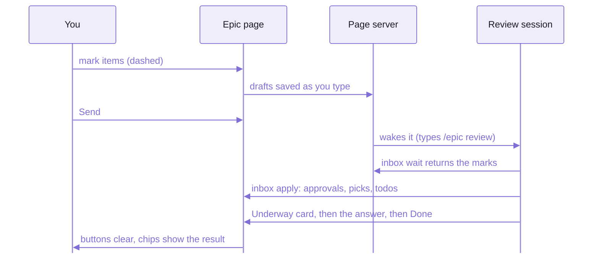
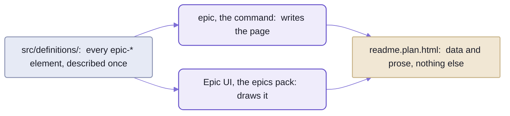
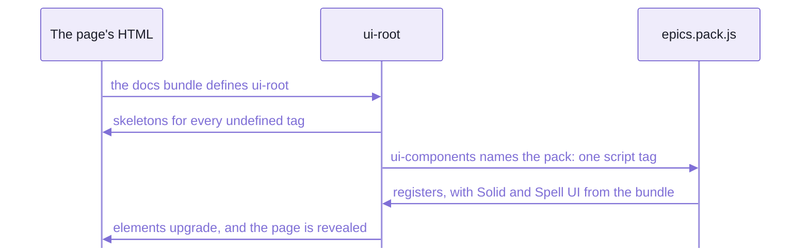

# The pages you review on

![The top of an epic page, every section folded.  The header:  REPO-SPLIT, "1 min read", the paper plane and the wand
in blue, the step pill P13, the git toggle.  The toolbar:  nine section icons, the Issues icon with a red 1;  at its
right, counts of 1 red, 173 yellow, 138 green and 24 grey.  The meta lines, with an orange "No Claude session is
reviewing" pill;  a See Also box of four details and choice pages;  then the nine sections, Overview to Log, each with
its counts, To test with a "Start testing · 7" button.](docs/images/epic-page.png)

_A real epic page, mid-build:  the repo-split epic, two of its 15 phases under way, every section folded._

Count the chips at the toolbar's right:  336 items, 173 yellow, 138 green, 24 grey, and ONE red,
the 1 on the Issues icon.
Red means a person is needed.
So the whole review, the evening this was taken, came down to one issue.

If you've run a project from an issue tracker and a pull-request thread, you know where the time goes:
grooming the list, and scrolling the conversation for whatever is still open.
Here the plan, the questions the agent couldn't settle, the calls it made without you and the record of what was
built are ONE page, and the agent keeps it true as it works.
You review on the page, item by item, when you have time;  the answers come back INTO the items, not into a chat.

- The page is plain HTML in the epic folder, a git repo of its own beside the code
  ([README-epics.md](https://github.com/spell-app/spell/blob/main/README-epics.md#the-epic-folder--your-plans-in-a-repo-of-their-own) says what it holds).
  The page server serves it live:  an edit the agent makes shows in place,
  and your scroll, your folds and your half-typed notes stay where they were.
- You read it in VS Code's side bar, the Review tab ([README-vscode.md](README-vscode.md)), or in any browser.
- **Claude Code first:**  any browser draws the page, and the session that takes your marks is a Claude Code
  session running `spell-epic`'s skills ([README-skills.md](README-skills.md)), or a Codex one running the same skills,
  which hears your Send only while it waits (`epic inbox wait`):  Send wakes only Claude Code.
- The rules the agent follows when it writes one:  [the epic-page writing rules](templates/epics/plan-doc.md).

## Your first review, in four moves

1. In Claude Code, type `/epic review <name>`.
   The epic page opens in the Review tab, and that session starts listening for your marks.
2. Open a section, open an item, and press Approve, Revisit (then type a note) or Make Todo.
   The button goes DASHED:  saved on the page server, not sent.
3. Press Send, the paper plane at the top right.
   Dashed turns OUTLINED:  the agent has it.
4. Watch the item.
   Approvals and new todos are applied as soon as the session wakes, and the buttons clear.
   A revisit comes back as an answer IN the item, under a card that goes from blue (on it) to green (done).

You can mark for an hour and send once:  nothing needs a session listening until you press Send.
Press it with nobody listening, and the page server types `/epic review <name>` into the epic's session for you;
you press Enter ("How Send wakes a session", below).

One catch:  your marks wait in a file on THIS machine until they're applied.
Mark on the laptop, press Send on the desktop, and the desktop has nothing to send.

## The header and the toolbar never scroll away

They stick to the top as you scroll, so wherever you are on the page,
where the build stands and where you're needed are one glance up.

1. **The header says where the build is.**
   The step pill names the phase under way (`P13`), else the next one to do, DONE, FUTURE or STANDING;
   it turns red when every phase is done but items still need you, and grey when the epic is paused,
   untouched for 3 days.
   - Beside it:  the gear, which picks Auto Send and the page's theme.
   - In the header's middle:  Send (the paper plane), while the page is being reviewed.
     A press sends at once;  left alone, a ring round it drains, and it sends by itself (2 minutes by default).
     Beside it, a spinner while Claude is at work.
   - The epic's name, at the left, copies `/epic resume <name>` when you click it;
     the chip after it says how long what's open takes to read.
2. **The toolbar says where you're needed.**
   An icon per section jumps there;  a red badge on it counts what needs you,
   an orange one the answers waiting on your pick.
   - At its right, a chip per item state with its count:  click one to show only those.
   - Then unfold-all, fold-all, and `+` for a new todo or question.
3. **The meta lines say how to start, and where the work lives:**
   the review command (`/epic review <name>`), the branch and worktree, the dates, the saga,
   and once Doc Review has written it, the epic's guide.
   An orange pill under the first line says when marks are waiting and no session is reviewing.
4. **See Also** lists the pages the epic made or leans on (its guide, its details and choice pages, the guides it
   links), gathered by the page server each time it serves the page, never written by hand.
5. **The eight sections** follow, folded, each with its counts.

While an agent the epic started is still running, an "Agents running" panel sits above the sections,
with a box for each agent that redirects it.
While the plan is still being written, a folded "Plan hung?" notice says how to restart it.

## Eight sections, and their ids never change

An issue tracker lets every project invent its own labels.
Every epic page has the same eight sections instead, in this order, with the same ids:
a link to `#todos` lands on the todos of any epic page, a year from now.

| Section | Id | What goes in it |
| --- | --- | --- |
| 1. Overview | `#overview` | a two-sentence summary;  the kickoff prompt, folded;  the estimate, which the tool adds up from the phases (`34h-43h in all, 4h-5h left`);  then the plan's substance, in numbered sub-sections `1.1` ... (`#o1` ...) |
| 2. Phases | `#phases` | a block per phase (`P1 · Short Name`):  Symptom (what's wrong today), Changes, the Goal;  Done and Commits once it's built;  Files and Verify behind the folder and flask toggles |
| 3. Questions (`Q1` ...) | `#decisions` | what only you can decide:  open ones first, then the answered ones, which are the decisions |
| 4. Judgement calls (`J1` ...) | `#judgements` | choices the agent made without you, "chose X over Y because Z", open until you review them |
| 5. Todo (`T1` ...) | `#todos` | loose ends:  work still to do, and limits the plan accepts (marked `limit`, drawn calmer) |
| 6. Issues (`I1` ...) | `#issues` | problems found, open until fixed |
| 7. Manual tests (`M1` ...) | `#tests` | what you check by hand before merging:  each a Step, and what it Should do |
| 8. Log | `#log` | one line per change to the plan, with its date and time |


_Phases:  done ones ticked, two under way, one to do;  an orange pen counts the changes to a phase's plan._

You'll come back to most pages cold, weeks later, from another session.
Three habits make that safe:
- Everything starts folded.
  The page remembers what you opened, and a link to any id unfolds whatever hides it.
- Nothing is deleted.
  An item is closed (`done`) or canceled (struck through);  when the agent rewrites one,
  the old text moves into a folded Original Discussion.
- Every question, issue and judgement call ends with a "Net effect":  what changes, in plain words, once it's settled.

And two markers keep a second look short:
- While a phase is under way, whatever it changed wears an orange UPDATE label.
- A phase keeps its Requests (what you sent it from other sessions) and its Update blocks (each change to its plan,
  dated), even once it's done.

<details>
<summary>How a page is stored:  a skeleton, and a part file per body</summary>

- The page's file is a skeleton:  every section, every phase line and every item line, with their ids, statuses and
  counts.
- Each body is a part file, loaded the first time you open it:  Q7's is `q7.html`, in the page's `parts` folder.
- So the page opens fast, and an edit to one item patches only that item.
- What that costs:  find-in-page misses text in a body you haven't opened yet.

</details>

## A review round:  your marks wait until you send them

A pull-request review is a batch:  you comment, then you submit.
This is the same idea with two differences.
The batch can wait a day, and the answers come back as edits to the plan, not as replies stacked under your comment.



_Your marks travel through the page server;  answers land IN the items, never only in the chat._

You never have to watch the other end, but it's worth reading once:
it explains every card and colour change you'll see on an item.

1. A session starts reviewing, and the page stops saying nobody is.
   It waits in the background, its turn over, costing nothing.
2. Your Send wakes it, with a list of your marks.
3. It applies the mechanical ones at once:
   approvals, picks, new todos, a todo's plane or x, skips, new items, test results.
   A pick or a queued todo gets a calm "Noted" card saying what happens next.
4. Each revisit asked now gets a blue "Underway" card:  what the agent took the task to be.
   A background agent writes the answer into the item, and the card turns green, "Done".
   An answer that offers options turns the item ORANGE:  your pick.
5. The page updates in place:  the buttons clear, and the chips show the result.
6. The session waits again.
   When it leaves, or is killed mid-wait, the page soon says nobody is reviewing.

The command behind each step, and why a finished `wait` is what wakes a session:
[README-cli.md](README-cli.md#a-session-wakes-when-its-wait-exits).

- Nothing goes until you press the paper plane:  it's filled blue while something waits.
- Typing in an item's note box turns its Revisit on at the first key;  the box stays open while you type.
- A request Claude is on spins its button:  click it again to call it off ("nevermind");  an answer that arrives
  after that is refused.
- A revisit on a judgement call or a todo that's work starts with `do it` already in its note box, Revisit on with it:
  type over it to say something else.


_An item:  its id chip, the three review buttons and Do Now, its text, and the note box._

Every mark, and what applying it does:

| Mark | What you press | When it's applied |
| --- | --- | --- |
| Approve | the check, green | an open question:  answered with its recommended option (none recommended:  left to talk over);  an open judgement call:  closed, accepted;  an open test:  closed, passed;  anything else:  marked reviewed |
| a pick | Choose, on an option card | a question:  answered with that option;  any other item:  approved with that option |
| Make Todo | the list, green | a new todo, "Follow up:  ...", linking back;  on any item, phase, the summary or an Overview sub-section |
| Revisit | the history arrow, blue, then a note | answered INTO the item as a reply, then cleared;  with a pick, talked over first, and recorded once you agree |
| a todo's plane | "Do it in the next phase", green | queued into the first phase still to do |
| a todo's x | "Drop it", grey | canceled, "dropped in review" |
| Skip This | the note box's x, grey | reviewed, nothing else;  your note kept as your reply |
| new | `+`, or New todo / New question at the end of those sections | made, with your note as its details |

- Each applied mark logs one line:  `J9 approved:  closed (accepted)`.
- A mark you changed meanwhile stays, for the next Send.
- The summary, each phase and each Overview sub-section take Make Todo and Revisit too, but no Approve.

<details>
<summary>How Send wakes a session</summary>

Send, while NO session listens, makes the page server wake the epic.

- Who, first match wins:
  1. the ONE running session titled for the epic, `🚧 <epic>`:  `/epic review <epic>` typed into it
  2. else the epic's worktree window:  a new session tab, the command typed in (the window opened if it's closed)
  3. else, for an epic with no worktree:  a new session in a main window
- Never a new worktree, and never sent for you:  you press Enter.
- The page says what it did, in an orange pill under the review line, until a session listens:
  "Typed /epic review seo into 🚧 seo:  press Enter there".
- Once per epic per 10 minutes, or until a session listens;  a second press says when it already did.
- No wake when several sessions are titled for the epic, in airplane mode, or for a Send with nothing new;
  clicking the pill still types the command.
- A revisit now waiting with nobody listening says "waiting for a session".

</details>

<details>
<summary>The inbox file and its shape</summary>

Your marks wait in the epic's INBOX FILE, `<name>.inbox.json5`, beside its page:
absent until the first mark, deleted once empty, git-ignored (it's per machine, never the record).
Only the tool writes it, under a lock.

```json5
{
  version: 1,
  marks: {}, // sent and unsent marks, by item id:  { action, note?, pick?, choices? }
  drafts: {
    o6: { action: "revisit", note: "Skip this, and leave it off the main page", at: "2026-10-21T12:22:58" }
  },
  urgency: {}, // a chip clicked red or yellow
  sent: "2026-10-21T12:50:32", // the last Send
  now: [], // requests for now (an older page's Do Now, a revisit now), waiting to be taken
  working: {}, // items an agent is on:  the spinner
  canceled: {}, // a request for now called off
  listening: { session: "...", since: "...", seen: "..." }, // the review session's heartbeat
  handedOver: "2026-10-21T12:50:32", // the last Send a session took
  comments: {},
  woken: null // the last time Send woke a session
}
```

- The session's `wait` prints each mark with its item's id, kind, status and title, your note, and a pick's option:

  ```text
  now (1):  start a background agent for each;  `epic inbox done review-review#<id>` after
    - I1  issue, open · The phases' progress bar label is cut off at its left end
        Add Details
  sent 2026-10-04T17:32:26.086-04:00 (4 marks):
    approve (1):
      - J9  judgement, open · A reload lands on the remembered section without unfolding it
    pick (1):
      - Q7  question, open · Should a reload land on the remembered section without unfolding it?
          picks B · Land and unfold it
  ```

- A new todo or question from the page waits under its own key, `new1`, `new2` ...
- A test answer is `{ action: "test", result, note?, shot? }`, with its screenshot saved beside the page.
- The inbox's code and every method on it:  [`ReviewInbox`](src/tool/ReviewInbox.ts);
  the verbs that read and write it:  [README-cli.md](README-cli.md#epic-page--the-review-inbox).

</details>

## Comments:  a bullhorn on every block

Marks are for items.
For anything else on a page (a sentence of a guide, a row of a table, a line of the Overview)
there's a comment:  a thread, anchored to the words it quotes, much like a code-review comment on a line.


_A thread waiting on you:  orange until you answer it, with ✓, reply or ×._

Press the BULLHORN beside any major block (a section, table, aside, code block, card, item or phase field,
or the page's header), or select text and press ⌘-I (Ctrl-I).
A small pane opens that saves as you type and never scrolls the page:
tab away or click elsewhere and it's kept, empty it and it's gone.

Saved, it becomes a THREAD under the paragraph it quotes, numbered `C1`, `C2` ...:
your "You:" messages, the agent's "Claude:" ones, and "Claude:  thinking…" while it works.
When it's your turn the thread goes orange, with three answers:  ✓ that's good, reply, or × skip it.
The toolbar's bullhorn counts those threads in orange, and jumps to the next;  ⌘-K takes an id.
The trash deletes a comment at once, with Undo for 6 seconds.

Comments ride the page's own Send, and where they land depends on the page:
- an epic page's, in that epic's review inbox
- a guide's, in the epic that OWNS it:  it wrote the guide, or its page links it
- any other page's, in the standing `feedback` epic

Send's line says who'll hear it:  "python-target is listening", or "nobody is listening:  Send wakes feedback".
Details and choice pages take no comments, since each sends its answers its own way;  nor do templates.

## Test runs:  one card per test

The Manual tests section is the list of things only a person can check:  open this page, click that, it should do this.
A test run turns it into a checklist you click through, one big card at a time, in the Review tab.


_The first of fifteen tests:  answer it, or press P, F, S or N._

- Start it with "Start testing" on the Manual tests section, or `epic test <name>`.
  `epic test --all` runs every epic's in turn, in the sagas' order:  each run's last card leads to the next epic.
- A card shows the test's Step (with a button for any page it says to open) and what it Should do;
  sometimes an Example (a screenshot the agent took) and If not (what to tell the agent).
- "4 of 9" and a thin bar say how far you are;  Back and Next, the arrows and Esc move you.
- Leaving the run sends your unsent answers, and the page says so.

| Your answer | What `inbox apply` does |
| --- | --- |
| Passed | closes the test |
| Failed, with a note and a pasted screenshot | makes a NEW issue, "M3 failed:  ...", with your note and screenshot;  the test stays open |
| Skip | cancels the test:  it no longer applies |
| Not now | leaves it open, and puts it last in the next run |

## Colours:  each one means one thing, everywhere

Each colour means ONE thing on every page:  epic pages, details pages, saga pages, the Epics list.
Only two ever ask for you, red and orange;  the other six say where things stand, or who's talking.
So you can read a page by its colours before you read a word.
A new element takes its colour from this table, never one that means something else.

| Colour | Means | For example |
| --- | --- | --- |
| red | needs you | an open question's chip;  an unreviewed judgement call or issue;  the toolbar's count |
| yellow | open, still undecided | an open todo or test;  a reviewed call or issue |
| blue | do it now, or the agent is on it | Revisit, Send;  the Underway card;  an epic in progress |
| green | decided or done, however long ago | Approve, Make Todo, a pick;  a phase done;  the Done and Noted cards |
| orange | changed since you looked;  or the agent's options, waiting for your pick | UPDATE labels;  "nobody is listening";  a replied item's chip |
| violet | the agent's voice | its reply cards;  "recommended" (a thumbs-up) |
| ivory | your voice | your note box, your replies, the answer card;  the toolbar |
| grey | no longer relevant, or not chosen | a canceled item;  buttons at rest;  a phase to do;  a future epic |

The FILL says how far a button, pill or chip has got:

| Fill | Means |
| --- | --- |
| grey outline | available:  nothing pressed |
| dashed, in its colour | you pressed it;  not sent |
| outline, in its colour | sent, or in progress:  the agent has it |
| cleared | handled:  the button is a grey outline again, and the chip has the result |
| solid | only on chips, the step pill's DONE, and a Choose pill once applied |

- So a dashed or outlined chip is ANSWERED:  don't answer it again.
  Only a solid red (needs you) or orange (your pick) chip waits on you, and the toolbar counts only those.
- Colour-blind readers tell red and green apart least:  the chip's id, the icons and the words keep them readable.

<details>
<summary>The item states, and which colour wins</summary>

The tool writes each item's state from its status and review marks on every edit.
The FIRST row that applies wins, top to bottom.

| State | Colour | When |
| --- | --- | --- |
| `progress` | blue | the agent is working on it:  an Underway card, or the spinner |
| `old` | grey | canceled:  made moot, struck through |
| `recent` | green | decided or done, however long ago |
| `open` | yellow | work a review queued (a todo's plane), not started |
| `replied` | orange | open, and the agent's last reply holds options nothing is picked in yet:  your turn |
| `attention` | red | an open question;  an open judgement call or issue not reviewed, unless marked calm |
| `recent` | green | open, but settled by a review:  approved as it stands, or made a todo |
| `open` | yellow | anything else open:  todos, tests, reviewed calls and issues |

- An item's status is `open`, `decided` (an answered question), `done` (closed, never removed) or `canceled`
  (struck through;  `reopen` undoes it).
- A judgement call or issue is CALM (yellow) by default, and red only when it would surprise you:
  it goes against something you said, narrows what you asked for, is a fork you'd plausibly have picked differently
  and that matters, or needs your answer before work can go on.
  Clicking its chip switches it.
- Saga pages colour their items by the same states.

</details>

## The other pages, from the same parts

A review takes you past an epic page, to its saga, its details and choice pages, and its guide.
They're drawn by the same elements, coloured by the same table, and commented on the same way,
so what you learned above carries over.
Each kind starts from a template:  most are in [templates/](templates/), the epic and saga pages' own in the epic
tool's folder, and `epic pages template <name>` prints where one is.

### Saga pages

A saga is an epic of epics, an aim too big for one:
the one below is how Spell reads and what it can say, served by five epics so far.
Its page is where you see the whole aim at once, and you review it like an epic page,
with `/epic review SAGA:/<id>`.

- The Overview holds the saga's purpose, then "Done so far" and "Ideas not done yet".
- Below it, a card per epic that names the saga, drawn live by the page server;  then Questions and a Log.
- `epic saga page <id>` makes the page, from the saga's line in the sagas' list.


_A saga's page:  its overview, then its epics as cards, grouped as on the Epics list._

### Details pages

When a question needs a picture, or more than Claude Code's question modal holds (four options, four questions),
the agent writes a DETAILS PAGE (`/details`) and shows it in the Review tab.
You answer ON the page:  a radio per option card, a comment box on each, "Other" for your own answer, then Send.


_A details page after you've answered:  the recommended option has the thumbs-up, your pick the green outline._

- Beside Send, who hears it:  "repo-split is listening" while a session waits for the answer,
  else "nobody is waiting yet";  Send works either way, and the answer waits beside the page.
- What you type is saved as you type.
  If the agent rewrites the page under you, your text comes back,
  and text whose question was removed is KEPT, in a box of its own above the notes.
- `/details` makes one (through `epic ask create`).
  A REVIEW PAGE is the same tool for several calls at once, keep, change or talk over each,
  made from a template of its own;  the tools count it as a details page.

### Choice pages

A CHOICE PAGE (`epic choices create`) is a table of names the agent recommends, one row per use:
you type over any you'd call something else, then press "Do it".
A changed row gets an orange bar and a button to put the recommendation back.


_A choice page:  the boxes start with the recommendation;  "Do it" sends the table._

- Your boxes are saved as you type, on the page server and in the browser.
- If the page server is gone for good, Copy my answers puts everything you typed on the clipboard.

### Run pages

A RUN PAGE is a command's review page:  a command, not the agent, stops to ask you, and carries on with your answers.
The first is the Spanish translator, with the names it drafted.

- The command opens a run through the kit's `SRV.CommandRun`;  the page is `/runs/<id>/`.
- Its header says which command is waiting, with a green dot, or that nobody is.
- Its progress lines show as the command writes them, with no reload.
- A row per thing to answer:  the command's columns, then its proposal in a box you type over,
  a pick of its alternatives when it has any, and its tick box (`Use for every project`).
- Each answer is saved as you give it;  Send, at the bottom, wakes the waiting command.

### Guides

A GUIDE is what an epic leaves behind for a reader coming to it cold:
how the thing it built works, and how to use it.
Doc Review, an epic's last phase, writes it (`epic pages create durable guides/<page>.html`);
the epic page links it in its meta lines, and its comments go to the epic that wrote it.


_A guide, with the pointer on its first section:  the bullhorn shows, to comment on it._

### The home page and the lists

The docs' HOME PAGE, their front door, has a card per area, and each area has a list page of its own:
Epics, Sagas, Guides.
`epic pages index` writes them all.


_The Epics list, every epic as a card, grouped by where it stands._

- The Epics list groups its cards as Favorites, Active, Planning, Urgent (every phase done, items waiting on you)
  and Done;  sorted A–Z or by date, filtered by a chip per saga.
- A card's star makes it a favourite, at once, for every window.
- Its header has Send (the comments on the list go to `feedback`) and "New epic", which writes a future epic.

## The `<epic-*>` elements:  the page is data, they draw it

Open an epic page's file and you won't find a button in it.
A page file holds only DATA (attributes) and PROSE (children);
custom elements draw everything else, the chips, the buttons, the folds and the counts, in their shadow roots.
This one line, from the repo-split page, is a whole judgement call:

```html
<epic-item id="j7" title="The version stamp reads the built package's own package.json" status="open" state="open"
  phase="1" calm source="parts/j7.html"></epic-item>
```

_Trimmed of its change time.  Its body waits in a part file;  the element draws its chip, buttons and fold._

Epic UI is `spell-epic`'s set of these:  one component pack, `epics`, every tag starting `epic-`,
48 tags in 36 families.
The frame around them (sections, tables, buttons, icons) is [Spell UI](https://github.com/spell-app/spell/blob/main/ui/README.md)'s `<ui-*>` elements.
44 of them have a docs page in the Epic UI set, at `/components/epics/<tag>.html`;
the other four (`epic-review`, `epic-new-item`, `epic-agents`, `epic-thread-message`)
are drawn only inside other elements.

| Group | Elements |
| --- | --- |
| Page structure | `epic-page` (the header, meta, step pill, Send, the toolbar), `epic-overview`, `epic-summary`, `epic-prompt`, `epic-section`, `epic-phase`, `epic-field`, `epic-item` (one element for every kind of item), `epic-event` (a log line), `epic-commit` |
| Prose blocks | `epic-question`, `epic-choices` and `epic-option`, `epic-answer`, `epic-net-effect`, `epic-reply`, `epic-more` (More Details), `epic-original` and `epic-version` (Original Discussion), `epic-update`, `epic-note`, `epic-aside`, `epic-code`, `epic-link` |
| Review | `epic-review` (an item's buttons), `epic-status` (Underway, Done, Noted), `epic-new-item`, `epic-state-filter`, `epic-hidden-note`, `epic-agents` (the running agents), `epic-test-run` |
| Comments | `epic-comment-pane`, `epic-thread`, `epic-thread-message`, `epic-threads`, `epic-page-note-head` (older page notes) |
| Lists | `epic-list`, `epic-card` and `epic-sort` (the Epics list), `epic-cards` (a saga's epics) |
| Answer pages | `epic-ask`, `epic-text-box`, `epic-send`, `epic-send-buttons` (Send, every page's), `epic-choice-rows` and `epic-choice-row`, `epic-choices-bar` |

- `<epic-link epic="seo" item="J3">` links an item on another page by what it is, never by a path:
  it draws "seo J3", with J3's title as its tooltip.
  A plain link can use a short address instead, `SAGA:/drawable-spell/python-target#T1`.
- One retired tag is still in the pack, `epic-updated`:  pages write `epic-update`.

Each element is described ONCE, as data, and two programs read the description:



_One description, two readers:  the command that writes a page and the elements that draw it can't disagree
about what a tag holds._

### How a page draws them



_A page loads two scripts:  Spell UI's docs bundle, then the pack, which borrows Solid and Spell UI from it._

```html
<ui-root>
  <ui-components source="/_epic/pack/epics.pack.js"></ui-components>
  <epic-page ...> ... </epic-page>
</ui-root>
<script src="/_epic/assets/spell-ui.js"></script>
```

- Spell UI's docs bundle, `/_epic/assets/spell-ui.js`, defines `<ui-root>`, which adds the pack's script.
- The pack carries none of the shared code:  it takes `solid-js`, `@solidjs/web`, `spell/element`,
  `spell/ui/core` and `spell/ui/forms` from the bundle, by those names, so a page has ONE Solid.
- Both addresses are the engine's routes, served by the epic server and the kit's page server alike.
- So a page needs one of those servers to draw at all, and the part files and review controls need it too.
  Opened straight from disk, a page shows exactly what its file holds:  its prose, unstyled.

### Working on the elements

The elements are written exactly like Spell UI's own families,
on [the kit's element framework](https://github.com/spell-app/spell/blob/main/README/element.md) and Spell UI's core.

If you find yourself writing a second copy of any of these, stop and reuse:

- the pack's build, catalog and staleness check:  the kit's `spell-pack`
- reading a vocabulary's tag and skeleton:  the kit's root catalog
- the element authoring API:  `spell/element`, and Spell UI's `spell/ui/core`

Adding a new element:

1. `spell pack add epics epic-<name>`:
   writes the family's folder, `epic-<name>/` in [src/components/](src/components/), and its test,
   adds it to the [components barrel](src/components/index.ts), and rebuilds the pack.
2. Fill in its vocabulary (description, topics, also-known-as, attributes, parts, skeleton), its class and its sheet.
3. Its page in Epic UI, `epic-<name>.html` in [src/docs/](src/docs/):  a copy of a page like it.
   Then `yarn site:data`.
4. `yarn pack:build`, then `yarn review`.
5. Commit the pack (`__pack/`, in the components folder) and the docs set (`src/docs/`) with the change.

- A change to the page markup also needs a migration step in the same commit,
  so `epic migrate` brings every page up to it ([the code's AGENTS.md](src/AGENTS.md)).
- Until your change merges, the shared pages every checkout shows still load `main`'s pack,
  and draw with the old elements.

<details>
<summary>Where the element code lives, file by file</summary>

| Path | What's in it |
| --- | --- |
| [src/components/](src/components/) | one folder per element family:  component, vocabulary, sheet, barrel, each named for the component;  its test in [tests/components/](tests/components/) |
| [src/components/index.ts](src/components/index.ts) | every family's barrel:  importing it defines every tag (a SIDE EFFECT) |
| [src/components/\_\_pack/](src/components/__pack/) | GENERATED, committed:  the catalog, the entry, and `epics.pack.js` |
| [src/index.ts](src/index.ts) | the code the elements and the node tools share, as one namespace, `EP`:  definitions, markup, dates, phases |
| [src/definitions/](src/definitions/) | the ONE description of every element:  its vocabulary as data, and the children it takes |
| [src/markup/](src/markup/) | reads, writes and checks an epic page's `<epic-*>` markup through the definitions, in node and the browser |
| [src/review/](src/review/) | the page's two server clients:  the review inbox's (marks, polling, note-draft backups) and the running agents' (the "Agents running" panel), each through one link that keeps its token fresh |
| [src/answers/](src/answers/) | the pages you answer on:  a details page's answer, gathered from its questions and text boxes;  a choice page's boxes, the draft and "Do it";  a run page's answers, saved row by row, and Send |
| [src/links/](src/links/) | short addresses (`SAGA:/<saga>/<epic>#<id>`) and `<epic-link>`'s attributes as a page and an id;  what a page holds to land on;  pure, for the elements, the docs runtime and the tool |
| [src/tool/](src/tool/) | the epic tool behind `epic`'s page verbs, node only, not in the pack;  [PLAN-DOC.md](src/tool/PLAN-DOC.md), the rules for a page's data;  [the template](src/tool/templates/plan.html) a new epic page starts from |
| [src/docs/](src/docs/) | Epic UI, the elements' docs pages, served at `/components/epics/`:  an index, a page per tag, the layout and the data |
| [src/site/](src/site/) | Epic UI's generated data (`yarn site:data`) |
| [tests/pack.test.ts](tests/pack.test.ts) | runs `spell-pack check`:  the pack and Epic UI's data are current |
| [vite.config.ts](vite.config.ts) | lint and format only:  the pack's build is the kit's |
| [vitest.config.ts](vitest.config.ts) | two projects over `tests/`:  `node` for the code, `browser` (chromium) for the elements |

</details>

## See also

- [README.md](README.md):  what an epic is, and its life from `/epic <name>` to the merge
- [README-skills.md](README-skills.md):  `/epic review`, `/details` and the other skills that open these pages
- [README-cli.md](README-cli.md):  `epic inbox`, `epic test` and every other verb that writes a page
- [README-vscode.md](README-vscode.md):  the Review tab the pages show in, and how a session reaches its window
- [The kit's README/element.md](https://github.com/spell-app/spell/blob/main/README/element.md):  how packs and elements work, before you write an `epic-*` one

<details>
<summary>More in the docs site</summary>

In the epic folder, so only where `spell.epics` sits beside the repos
([the kit's setup](https://github.com/spell-app/spell/blob/main/README.md#setup-from-zero) says where), served by `spell server start`:

- "Epic Pages":  `/guides/plan-docs/plan-docs.html`, every part of the page, every colour and button
- "Reviewing an Epic Page":  `/guides/epic-components/review.html`
- "Epic Pages as Components":  `/guides/epic-components/epic-components.html`
- "Epic Page Colours":  `/guides/epic-components/colours.html`
- "Details Pages":  `/guides/details.html`
- Epic UI, every `<epic-*>` element with a live example:  `/components/epics/`

</details>
