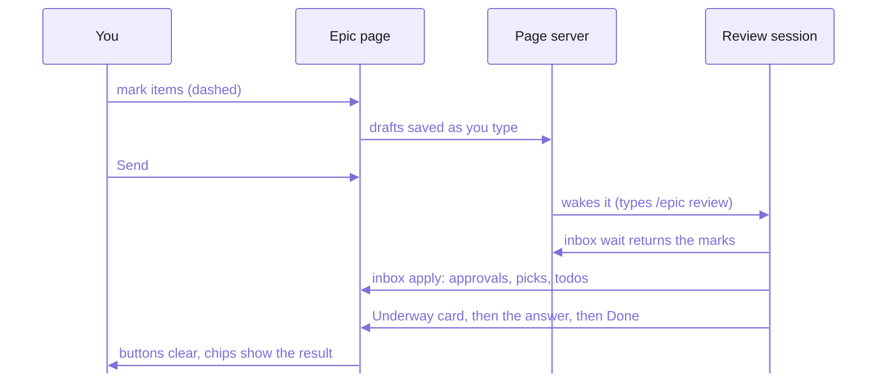
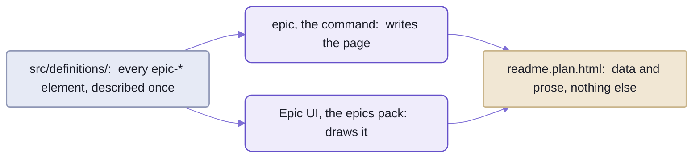
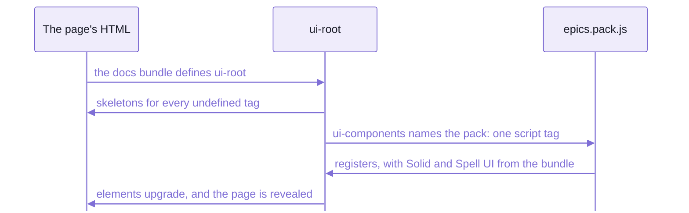

# The pages you review on


_A real epic page, mid-build:  this repo's repo-split epic at P25, its Issues section open and showing only what
isn't settled._

Count the chips at the toolbar's right:  417 items, 127 yellow, 290 grey, and no red or orange.
Red and orange mean a person is needed, so nothing here is waiting on you:
yellow is open, and you get to it when you have time.

If you've run a project from an issue tracker and a pull-request thread, you know where the time goes:
grooming the list, and scrolling the conversation for whatever is still open.
Here the plan, the questions the agent couldn't settle, the calls it made without you and the record of what was
built are ONE page, and the agent keeps it true as it works.
You review on the page, item by item, when you have time;  the answers come back INTO the items, not into a chat.

- The page is plain HTML in the epic folder, a git repo of its own beside the code
  ([README-config.md](README-config.md#the-epic-folder--your-plans-in-a-repo-of-their-own) says what it holds).
  The page server serves it live:  an edit the agent makes shows in place,
  and your scroll, your folds and your half-typed notes stay where they were.
- You read it in VS Code's side bar, the Review tab ([README-vscode.md](README-vscode.md)), or in any browser.
- **Claude Code first:**  any browser draws the page, and the session that takes your marks is a Claude Code
  session running `spell-epic`'s skills ([README-skills.md](README-skills.md)), or a Codex one running the same skills,
  which hears your Send only while it waits (`epic inbox wait`):  Send wakes only Claude Code.
- The rules the agent follows when it writes one:  [the epic-page writing rules](templates/epics/plan-doc.md).

## Your first review, in four moves

1. In Claude Code, type `/epic review <name>`.
   The epic page opens in the Review tab, and that session starts listening for your marks.
2. Open a section, open an item, and press one of its buttons:
   - most items:  Make Todo, Revisit (then type a note) and Approve
   - an issue or a judgement call:  Do this, the paper plane, first
   - a todo:  Start it now, the same plane, first

   The button goes DASHED:  saved on the page server, not sent.
3. Press Send, the paper plane in the header's middle.
   Or leave the page alone:  Auto Send sends by itself after 2 minutes.
   Dashed turns OUTLINED:  the agent has it.
4. Watch the item.
   Approvals and new todos are applied as soon as the session wakes, and the buttons clear.
   A revisit comes back as an answer on the page, under a card that goes from blue (on it) to green (done).

You can mark for an hour and send once:
every key, click or scroll restarts Auto Send's wait, and a note box you're typing in holds it.
Want only your own press to send?  The gear's Auto Send has Off.

An epic's own session listens by itself whenever it's open.
Send with nobody listening, and the page server types `/epic review <name>` into the epic's session for you;
you press Enter ("How Send wakes a session", below).

One catch:  your marks wait in a file on THIS machine until they're applied.
Mark on the laptop, press Send on the desktop, and the desktop has nothing to send.

## The header and the toolbar never scroll away

They stick to the top as you scroll, so wherever you are on the page,
where the build stands and where you're needed are one glance up.

1. **The header says where the build is.**
   The step pill names the phase under way (`P13`), else the next one to do, DONE, FUTURE or STANDING;
   while the plan is still being agreed, its stage (`OVERVIEW`, `PHASES`).
   It turns red when every phase is done but items still need you, and grey when the epic is paused,
   untouched for 3 days.
   - Beside it:  the gear, with Focus mode (while the page is being reviewed), Auto Send and the page's theme.
   - In the header's middle:  Send (the paper plane), while the page is being reviewed.
     A press sends at once;  left alone, a ring round it drains, and it sends by itself.
     The gear picks the wait:  Immediately, 2 minutes (the default), 5 minutes or Off, remembered in this browser.
   - ONE spinner says Claude is busy, and the header never spells out what at:
     while Claude is at other work (building a phase, say), the step pill's own icon turns,
     and hovering the pill shows its words last (`Claude:  Building P35`);
     while it answers what you sent, a blue arc turns round the plane instead.
   - The epic's name, at the left, copies `/epic resume <name>` when you click it.
   - While agents the epic started are running, the pill counts them after the phase (`2 🤖`):
     click it for their rows, each with a box that redirects it ([README-skills.md](README-skills.md#the-session-answers--agents-build)).
2. **The toolbar says where you're needed.**
   An icon per section jumps there;  a red badge on it counts what needs you,
   an orange one what's your turn to pick, review or see.
   - At its right, a chip per colour of item with its count, the whole page's;  each section has its own over its list.
     - A click toggles that chip:  its items hide or show, and the others stay as they are.
     - Option-click (Alt-click) shows only that group.
     - The blues toggle together, and so do the oranges and the greys.
     - Turn off the last chip showing, and the next one in the row turns on, so a list is never empty by accident.
   - Then one button that unfolds every section, or folds them all again.
   - No new item button here:  each item section has its own (New todo, New issue ...).
3. **The meta lines say how to start, and where the work lives:**
   the review command (`/epic review <name>`), the branch and worktree, the dates, the saga,
   and once Doc Review has written it, the epic's guide.
   An orange pill under the first line says when marks are waiting and no session is reviewing.
4. **See Also** lists the pages the epic made or leans on (its guide, its details and choice pages, the guides it
   links), gathered by the page server each time it serves the page, never written by hand.
5. **The eight sections** follow, folded, each with its counts.

A new epic, with no kickoff prompt and no phases yet, opens its Overview with the KICKOFF BOX:
"What should this epic do?", one box that grows as you type, pictures pasted or dropped in.
- Each picture is saved beside the page and written into your words labelled, ``, a chip on its
  thumbnail;  the x on a chip takes it out and the rest renumber.
- Send hands it over:  the session writes it as the Kickoff prompt, and plans from it.

While the plan is still being written, a folded "Plan hung?" notice says how to restart it;
it stays hidden until there's a kickoff prompt.

## Eight sections, and their ids never change

An issue tracker lets every project invent its own labels.
Every epic page has the same eight sections instead, in this order, with the same ids:
a link to `#todos` lands on the todos of any epic page, a year from now.

| Section | Id | What goes in it |
| --- | --- | --- |
| 1. Overview | `#overview` | a two-sentence summary;  the kickoff prompt, folded;  the estimate, which the tool adds up from the phases (`34h-43h in all, 4h-5h left`);  then the plan's substance, in numbered sub-sections `1.1` ... (`#o1` ...) |
| 2. Phases | `#phases` | a block per phase (`P1 · Short Name`):  Symptom (what's wrong today), Changes, the Goal;  Claude's build plan, once it's written;  Done and Commits once it's built;  Files and Verify shown from the section's gear, or a phase's own |
| 3. Questions (`Q1` ...) | `#decisions` | what only you can decide:  open ones first, then the answered ones, which are the decisions |
| 4. Judgement calls (`J1` ...) | `#judgements` | choices the agent made without you, "chose X over Y because Z", open until you review them |
| 5. Todo (`T1` ...) | `#todos` | loose ends:  work still to do, and limits the plan accepts (marked `limit`, drawn grey) |
| 6. Issues (`I1` ...) | `#issues` | problems found, open until fixed |
| 7. Manual tests (`M1` ...) | `#tests` | what you check by hand before merging:  each a Step, and what it Should do |
| 8. Log | `#log` | one entry per commit, newest first:  its time, its sentence and a chip per phase and item it names |

Three more appear only when they have something to say, and the eight never move for them:
- **0. While you were out** (`#away`), first, above the Overview.
  Its title has badges for what's new, by colour, so you can tell while it's folded;  a click on one filters the lines,
  and each line's tick wears its badge's colour, dotted once you've marked it and until you send;
  it opens the first time a page shows it, then stays as you left it.
  What Claude did since you last pressed Done reading, and what needs you now, in the order to look at it.
  The tool writes it on every edit, never by hand;  each line has its own Read.
  What you've already addressed leaves it, and a finished phase ages out after 3 days (`epic settings`).
  With nothing new, there's no section.
- **Choices** (`#choices`), between the Overview and the Phases:  an open-ended list you pick from, round after round.
  Add choice, or an option's pencil, opens ONE box that grows as you type:  its first line the option's title, the
  rest its note, pictures pasted or dropped in, or chosen with the round button at the end of its Save row.
- **A report**, after the Overview:  what a run wrote for you to read, like an overnight `/bedtime`.


_Phases:  done ones ticked, the two still to do a dotted circle.
The gears turn on each phase's Files and Verify;  an orange pen, on a phase whose plan changed, counts the changes._

You'll come back to most pages cold, weeks later, from another session.
These habits make that easier:
- Everything starts folded.
  The page remembers what you opened, and a link to any id unfolds whatever hides it.
- Nothing is deleted.
  An item is closed (`done`) or canceled (struck through);  when the agent rewrites one,
  the old text moves into a folded Original Discussion.
- Every question, issue and judgement call ends with a "Net effect":  what changes, in plain words, once it's settled.
- Every phase's and item's title says what it is, readable cold, hours later:
  at most 30 words, one sentence, no `;` list (a dash aside is fine).
  `epic add` and `epic update --title` refuse anything longer, and ask for it rewritten;  the rest goes in the text.

And two markers keep a second look short:
- While a phase is under way, whatever it changed wears an orange UPDATE label.
- A phase keeps its Requests (what you sent it from other sessions) and its Update blocks (each change to its plan,
  dated), even once it's done.

<details>
<summary>How a page is stored:  a skeleton, and a part file per body</summary>

- The page's file is a skeleton:  every section, every phase line and every item line, with their ids, statuses and
  counts.
- Each body is a part file, loaded the first time you open it:  Q7's is `q7.html`, in the page's `parts` folder.
- So the page opens fast, and an edit to one item patches only that item.
- What that costs:  find-in-page misses text in a body you haven't opened yet.

</details>

## Agreeing the plan:  three stages, each ended by your Accept

No plan mode, and no plan in a chat:  a new epic is agreed on its page, from its first minute.
Its sections appear as they get something in them.

| Stage | What's different | How it ends |
| --- | --- | --- |
| `overview` | its phases, if any, are titled `P1. DRAFT: ...` | Accept Overview, on the Overview's title row |
| `phases` | each phase has Looks good and Defer, or Accept and Defer once its build plan is up | Accept Phases, on the Phases section's title row:  one press takes the phases and every plan waiting |
| `building` | each phase has Do this and Revisit | every phase built, one after another, with no stop between them |

- Each answer to a question rewrites the Overview, its changed words orange for 3 days:  nothing to approve.
- An Accept counts down 5 minutes, a green ring round its thumbs up, whatever Auto Send is set to.
  - A second press calls it off.
  - When the ring ends, it sends by itself.
  - Press Send before then, and the Accept goes with it at once;  Auto Send's countdown never carries it early.
- The button's tooltip counts the open questions:  a reminder, never a lock.
- A section hides when it's empty, at every stage, and shows the moment it holds something.
  - While you're reviewing, an empty section with a New button stays:  its title, a short line and the button.
  - A hidden section is still in the file:  hiding is only a view.

## A review round:  your marks wait until you send them

A pull-request review is a batch:  you comment, then you submit.
This is the same idea with two differences.
The batch can wait a day, and the answers come back as edits to the plan, not as replies stacked under your comment.



_Your marks travel through the page server;  answers land IN the items, never only in the chat._

You never have to watch the other end, but it's worth reading once:
it explains every card and colour change you'll see on an item.

1. A session starts reviewing, and the page stops saying nobody is.
   It waits in the background, its turn over, costing nothing.
2. Your Send wakes it, with a list of your marks.
3. It applies the mechanical ones at once:
   approvals, picks, new todos, Do this, a todo's plane or x, skips, new items, Accepts, Seen and Read.
   A started or new todo gets a calm "Noted" card saying what happens next:
   a todo's plane, "Start now:  an agent takes it next", and the session starts one on it.
4. Each revisit asked now (Auto Send asks every revisit now) gets a blue "Underway" card:
   what the agent took the task to be.
   A background agent writes the answer into the item, and the card turns green.
   An answer that offers options turns the item ORANGE:  your pick.
   A plain note left for later becomes a comment thread on the item, answered there.
5. The page updates in place:  the buttons clear, and the chips show the result.
6. The session waits again.
   When it leaves, or is killed mid-wait, the page soon says nobody is reviewing.

The command behind each step, and why a finished `wait` is what wakes a session:
[README-cli.md](README-cli.md#a-session-wakes-when-its-wait-exits).

- Nothing goes until you press the paper plane or Auto Send's wait runs out:
  the plane is filled blue while something waits.
- Typing in an item's note box turns its Revisit on at the first key;  the box stays open while you type.
- A note box takes pictures:  paste or drop as many as you like.
  Each goes into your words labelled in order (``, `IMG2` ...), with a strip of thumbnails under the box.
- A request Claude is on spins its button:  click it again to call it off ("nevermind");  an answer that arrives
  after that is refused.
- A revisit on a judgement call or a todo that's work starts with `do it` already in its note box, Revisit on with it:
  type over it to say something else.
- An item with no details yet reads "_What it says on the tin._", then Clarify:
  a click asks Claude for its details at once, without waiting for Send.
- Every item, whatever its kind, has an (i) button last on its line while you review:
  a click asks Claude to rewrite the item's text more clearly, at once, without waiting for Send.
  - It turns like a coin while Claude works on it;  click it again to call it off.
- A request Claude took up on its own, from your words in the chat, is filed already started:
  your words as its body, blue, an Underway card naming the agent on it.
  A picture you pasted with it shows under its words, a thumbnail that opens full size;
  while you review, its trash deletes it, with Undo for 6 seconds, then its file too.
- An item left Underway more than 3 hours with nobody on it gets tidied at a turn's end:
  - its work found on `main`:  turned fixed for your review, the commit named
  - else one `Stale:` card, back on your list


_An item:  its id chip, review buttons, text and note box.
The picture is older than the buttons:  Do this is a paper plane now, where it shows a thumbs up._

Every mark, and what applying it does:

| Mark | What you press | When it's applied |
| --- | --- | --- |
| Approve | the check, green | an open question:  answered with its recommended option (none recommended:  left to talk over);  an open judgement call:  closed, accepted;  an open test:  closed, passed;  anything else:  marked reviewed.  Its name says what it means on each:  "Accept the fix" on an issue or call fixed for your review, which closes it;  "Saw it" on a finished one |
| a pick | Choose, on an option card | a question:  answered with that option;  any other item:  approved with that option |
| Make Todo | the list, green | a new todo, "Follow up:  ...", linking back;  on an item, the summary or an Overview sub-section |
| Do this | the paper plane, green, first on an open issue, an open judgement call or a phase still to do | an issue or call:  fixed in the item itself, no todo;  blue outlined until handled, orange once fixed, and your Accept the fix closes it;  a phase:  "yes, build this" |
| Revisit | the history arrow, blue, then a note | asked now:  answered INTO the item as a reply;  a plain note left for later:  a comment thread on the item;  with a pick or a picture:  talked over first, and recorded once you agree;  on a fix you're not happy with, it sends the fix back, reopened |
| a todo's plane | "Start it now", green | started now:  an agent takes it next, never into an unrelated phase;  a note asking for a phase leaves it for a new one.  A todo already in a phase has no plane:  its `in P52` pill goes to the phase, and Option-click (Alt-click) starts it |
| an x | "Drop it" on a todo, "Close it:  not needed" on an open issue, grey | canceled:  "dropped in review", or closed unfixed |
| Skip This | an older page's note box x, grey | reviewed, nothing else;  your note kept as your reply;  on a test:  canceled |
| new | `+`, or New todo / New question / New issue at the end of those sections | made, with your note as its details |

- Each applied mark logs one line:  `J9 approved:  closed (accepted)`.
- A mark you changed meanwhile stays, for the next Send.
- The summary and each Overview sub-section take Make Todo and Revisit, but no Approve;
  a phase still to do takes Do this and Revisit.
- A fix you sent back with a note that the agent then handed on to another item ("being fixed as I148")
  turns fixed again by itself once that item is fixed, with a Done card naming it.
- A Choose pill shows on EVERY option card while you review:  a question's own, and the cards in a judgement call's
  text, a reply or More Details.
  - Your pick names which set of cards it's from, so two sets on one item never get mixed up;
    the cards in an Original Discussion are never counted.
  - A closed item's cards take pills too, but only while you revisit it:  "pick B instead, because ...".
- After an item's id, a review label says where it stands with you, while nobody is reviewing:
  green `reviewed 10/3/26` (gone through with you that day, the outcome in the log),
  grey `deferred` (put off, still not reviewed) or blue `to do` (work a review decided on, not started).
  Applying your marks sets them, and every session marks the items it talks through with you.

<details>
<summary>Claude's status cards:  what it took your mark to mean, then that it's done</summary>

Each mark the agent takes gets ONE card, under your note, and only the tool writes them:

| Card | When | What it says |
| --- | --- | --- |
| `Claude • Underway`, blue | the moment it takes a revisit or a Do this | one or two sentences on what it understood, no file names;  the item turns blue until the work lands |
| `Claude • Done`, green | the SAME card, once the work lands | the reading kept, a summary under it only when there's something worth saying:  a surprise, a choice made, something left undone |
| `Claude • Noted`, a calm outline | a pick, a todo made or queued | what it recorded, and what happens next:  `Chose B · Keep one file per template:  recorded as the answer` |

- A plain Approve gets no card:  nothing to read, nothing to report.
- A later mark on the same item gets a new card;  the old ones stay, as the record.
- A run of cards about one task draws as one line, last in the item's thread:
  `✓ Noted 10/24/26 15:21 → Done 15:25 · what Claude did`.
- A card is short paragraphs and bullets:  the long story goes in the item's body.

</details>

<details>
<summary>How Send wakes a session</summary>

Send, a press or Auto Send's, while NO session listens, makes the page server wake the epic.

- Who, first match wins:
  1. the ONE running session titled for the epic, `🚧 <epic>`:  `/epic review <epic>` typed into it,
     or nothing typed when its background listener is running or its turn is still going, since that hears the Send
  2. else the epic's worktree window:  a new session tab, the command typed in (the window opened if it's closed)
  3. else, for an epic with no worktree:  a new session in a main window
- Never a new worktree, and never sent for you:  you press Enter.
- The page says what it did, in an orange pill under the review line, until a session listens:
  "Typed /epic review seo into 🚧 seo:  press Enter there".
- Once per epic per 10 minutes, or until a session listens;  a second press says when it already did.
- No wake when several sessions are titled for the epic, in airplane mode, or for a Send with nothing new;
  clicking the pill still types the command.
- A revisit now waiting with nobody listening says "waiting for a session".

</details>

<details>
<summary>The inbox file and its shape</summary>

Your marks wait in the epic's INBOX FILE, `<name>.inbox.json5`, beside its page:
absent until the first mark, deleted once empty, git-ignored (it's per machine, never the record).
Only the tool writes it, under a lock.

```json5
{
  version: 1,
  marks: {}, // sent and unsent marks, by item id:  { action, note?, pick?, choices? }
  drafts: {
    o6: { action: "revisit", note: "Skip this, and leave it off the main page", at: "2026-10-21T12:22:58" }
  },
  urgency: {}, // a chip clicked red or yellow
  sent: "2026-10-21T12:50:32", // the last Send
  now: [], // requests for now (an older page's Do Now, a revisit now), waiting to be taken
  working: {}, // items an agent is on:  the spinner
  canceled: {}, // a request for now called off
  listening: { session: "...", since: "...", seen: "..." }, // the review session's heartbeat
  handedOver: "2026-10-21T12:50:32", // the last Send a session took
  comments: {},
  woken: null, // the last time Send woke a session
  doing: null // what the session says it's on:  "Building P35", in the header's step label's tooltip
}
```

- The session's `wait` prints each mark with its item's id, kind, status and title, your note, and a pick's option:

  ```text
  now (1):  start a background agent for each;  `epic inbox done review-review#<id>` after
    - I1  issue, open · The phases' progress bar label is cut off at its left end
        Add Details
  sent 2026-10-04T17:32:26.086-04:00 (4 marks):
    approve (1):
      - J9  judgement, open · A reload lands on the remembered section without unfolding it
    pick (1):
      - Q7  question, open · Should a reload land on the remembered section without unfolding it?
          picks B · Land and unfold it
  ```

- A new todo or question from the page waits under its own key, `new1`, `new2` ...
- A note can carry `shot`, a picture you pasted or dropped in, saved beside the page in `tests/`.
- The inbox's code and every method on it:  [`ReviewInbox`](src/tool/ReviewInbox.ts);
  the verbs that read and write it:  [README-cli.md](README-cli.md#epic-page--the-review-inbox).

</details>

## Comments:  a bullhorn on every block

Marks are for items.
For anything else on a page (a sentence of a guide, a row of a table, a line of the Overview)
there's a comment:  a thread, anchored to the words it quotes, much like a code-review comment on a line.


_A thread waiting on you:  orange until you answer it, with ✓, reply or ×._

Press the BULLHORN beside any major block (a section, table, aside, code block, card, item or phase field,
or the page's header), or select text and press ⌘-I (Ctrl-I).
A small pane opens that saves as you type and never scrolls the page:
tab away or click elsewhere and it's kept, empty it and it's gone.

Saved, it becomes a THREAD under the paragraph it quotes, numbered `C1`, `C2` ...:
your "You:" messages, the agent's "Claude:" ones, and "Claude:  thinking…" while it works.
When it's your turn the thread goes orange, with three answers:  ✓ that's good, reply, or × skip it.
The toolbar's bullhorn counts those threads in orange, and jumps to the next;  ⌘-K takes an id.
The trash deletes a comment at once, with Undo for 6 seconds.

Comments ride the page's own Send, and where they land depends on the page:
- an epic page's, in that epic's review inbox
- a guide's, in the epic that OWNS it:  it wrote the guide, or its page links it
- any other page's, in the standing `feedback` epic

Send's line says who'll hear it:  "python-target is listening", or "nobody is listening:  Send wakes feedback".
A details page takes comments too, and its own Send carries them, with its answers.
Choice pages take none, since each sends its picks its own way;  nor do templates.

## Manual tests and Focus mode:  one item at a time

The Manual tests section is the list of things only a person can check:  open this page, click that, it should do this.
You answer each test where it is, with the same buttons as any item.

| Your answer | What happens |
| --- | --- |
| Approve | closes the test, passed |
| a Revisit note, with a screenshot pasted or dropped in if you like | what you saw, for the agent.  Passed:  it closes the test.  Failed:  a NEW issue, "M3 failed:  ...", with your note and screenshot, and a red "failed → I12" on the test, which stays open |
| the note box's x | cancels the test:  it no longer applies |
| nothing | it stays open |

"Start testing", on the section, has the agent get them ready first.
- It checks what it can by itself, writes out the rest step by step, with an Example screenshot where it can take one,
  and puts them in order.
- Then the first test opens in Focus mode;  the button now reads "Focus on the tests · 3 left".
- The same from a terminal:  `epic test <name>`, or `epic test <name>#M3` to land on one.
  `epic test --all` opens the first epic with open tests, in the sagas' order;
  its Manual tests section links the next once all are answered.

FOCUS MODE, the first row of the header's gear, is the way through a long page without scrolling:
a full-screen overlay that walks the open items and phases, whatever the page draws red, orange, blue or yellow.
- A tab per kind (Phases, Questions, Todos, Calls, Issues, Tests), each with its count and its own state chips.
- One item at a time:  its id, title and whole text, its own buttons and note box, then Back and Next (← and →).
- Your marks are the page's, and Send rides in the overlay's top bar.
- Esc or × closes it.
- The catch:  its place (tab, item, chips) is kept in this browser only.

## Colours:  each one means one thing, everywhere

Each colour means ONE thing on every page:  epic pages, details pages, saga pages, the Epics list.
Only red and the two oranges ever ask for you;  the others say where things stand, or who's talking.
So you can read a page by its colours before you read a word.
A new element takes its colour from this table, never one that means something else.

| Colour | Means | For example |
| --- | --- | --- |
| red | needs you | an open question's chip;  an unreviewed judgement call or issue, unless calm;  a todo flagged red as a reminder;  a phase with a choice open;  the toolbar's count |
| orange | your turn to read:  changed since you looked, or something waiting on your pick or review | UPDATE labels;  a plan waiting for your Accept;  the agent's options;  a fix to review;  a manual test whose phase isn't done;  "nobody is listening" |
| light orange | what you asked for is finished:  your turn to see it | an issue or todo filed from your own words (a request from another session included), closed by the agent, until you review it |
| yellow | open, still undecided | an open todo;  a test whose phase is done;  a calm issue;  a reviewed call or issue |
| blue | do it now, or it's with the agent | Revisit, Send;  the Underway card;  a phase under way;  a Do this not started (outlined);  a todo queued, or a phase still to do (dotted) |
| green | decided or done just now:  an item for a day after its last change, a phase for 3 days, then grey | Approve, Make Todo, a pick;  a phase just done;  the Done and Noted cards |
| violet | a person's voice:  yours, and every person's | your reply cards, your note box, a marked note;  the forms for a new item or option |
| terracotta | an agent's voice:  Claude's, Codex's | its reply cards' mark and name;  its comment messages;  "recommended" (a thumbs-up) |
| ivory | the page's own warm ground, nobody's voice | the toolbar;  a comment thread's ground |
| grey | no longer relevant, or nothing to think about | a canceled item;  a calm judgement call;  a limit;  buttons at rest;  a future or paused epic |

- Approving a green item greys it at once:  green says "new since you looked".
- A person or an agent can have a colour of their own:  `colors` in the repo's epic settings.
- One shade per meaning:  no light blue, no light green.
  Light orange is the one exception, a paler orange.
- Colours are drawn, never stored in a page:  change one in the elements' styles, and every page recolours,
  with no page edited.

The FILL says how far a button, pill or chip has got:

| Fill | Means |
| --- | --- |
| grey outline | available:  nothing pressed |
| dashed, in its colour | you pressed it;  not sent |
| outline, in its colour | sent, or in progress:  the agent has it |
| cleared | handled:  the button is a grey outline again, and the chip has the result |
| solid | only on chips, the step pill's DONE, and a Choose pill once applied |

- The buttons are your INPUT, so they never show the agent's verdict:  the id chip does.
  While your mark is live, the chip matches the button you chose, its colour and its fill:
  an Approve pressed and not sent is a dashed green chip, a revisit sent an outlined blue one.
- So a dashed or outlined chip is ANSWERED:  don't answer it again.
  Only a solid red (needs you), orange (your pick or review) or light orange (yours to see) chip waits on you,
  and the toolbar counts only those.
- Colour-blind readers tell red and green apart least:  the chip's id, the icons and the words keep them readable.

<details>
<summary>The item states, and which colour wins</summary>

The tool writes each item's state from its status and review marks on every edit.
The FIRST row that applies wins, top to bottom.

| State | Colour | When |
| --- | --- | --- |
| `progress` | blue | the agent is working on it:  an Underway card, or the spinner |
| `old` | grey | canceled:  made moot, struck through |
| `handled` | grey | its answer is a phase's text now;  or an issue the agent found and fixed itself, calm, never one you asked for |
| `requested` | light orange | an issue or todo filed from your own words, closed done, not reviewed yet |
| `recent` | green | decided or done |
| `replied` | orange | an issue or call the agent has fixed:  your turn to review it, and Approve closes it |
| `scheduled` | blue, dotted | work a review queued, agreed, not started |
| `replied` | orange | open, and the agent's last reply holds options nothing is picked in yet:  your turn |
| `attention` | red | an open question |
| `handed` | blue, outlined | a judgement call or issue you pressed Do this on, not handled yet |
| `attention` | red | an open judgement call, issue or urgent todo not reviewed, unless marked calm |
| `quiet`, `open` | grey, yellow | the same, marked calm:  a call grey, anything else yellow |
| `recent` | green | open, but settled by a review:  approved as it stands, or made a todo |
| `quiet` | grey | a limit |
| `replied` | orange | a manual test whose phase isn't done |
| `open` | yellow | anything else open:  todos, tests whose phase is done, reviewed calls and issues |

- As the page draws it, `recent` turns grey a day after the item last changed, and at once when you've approved it.
  The file keeps `recent`;  only the drawing ages.
- Blue `progress` and `handed` have no chip of their own:
  the blue badge is theirs, and counts what you marked this pass.
- An item's status is `open`, `decided` (an answered question), `done` (closed, never removed) or `canceled`
  (struck through;  `reopen` undoes it).
- A judgement call or issue is CALM by default, and red only when it would surprise you:
  it goes against something you said, narrows what you asked for, is a fork you'd plausibly have picked differently
  and that matters, or needs your answer before work can go on.
  Clicking its chip switches it.
- A phase takes ONE colour, the first that holds:  red, a choice open in it;
  orange, its plan waits for your Accept, or it changed since you looked;  blue, under way;  dotted blue, still to do;
  green, done in the last 3 days;  grey, done longer ago, or PAUSED:  a plan you accepted, then un-clicked its thumbs
  up to hold (a grey pause circle, never counted as waiting on you;  Accept takes the hold off).
- Saga pages colour their items by the same states.

</details>

## The other pages, from the same parts

A review takes you past an epic page, to its saga, its details and choice pages, and its guide.
They're drawn by the same elements, coloured by the same table, and commented on the same way,
so what you learned above carries over.
Each kind starts from a template:  most are in [templates/](templates/), the epic and saga pages' own in the epic
tool's folder, and `epic pages template <name>` prints where one is.

### Saga pages

A saga is an epic of epics, an aim too big for one:
the one below is how Spell reads and what it can say, served by nine epics so far.
Its page is where you see the whole aim at once, and you review it like an epic page,
with `/epic review SAGA:/<id>`.

- The Overview holds the saga's purpose, then "Done so far" and "Ideas not done yet".
- Below it, a card per epic that names the saga, drawn live by the page server;  then Questions and a Log.
- `epic saga page <id>` makes the page, from the saga's line in the sagas' list.


_A saga's page:  its overview, then its epics as cards, grouped as on the Epics list._

### Details pages

When a question needs a picture, or more than Claude Code's question modal holds (four options, four questions),
the agent writes a DETAILS PAGE (`/details`) and shows it in the side bar's Details tab.
You answer ON the page:  a Choose pill per option card, a Comment link on each, "Other" for your own answer, then Send.
A page still waiting for your answer is never replaced there:  the next one waits its turn, and the tab says so.


_A details page after you've answered:  the recommended option has the thumbs-up, your pick the green outline._

- Beside Send, who hears it:  "repo-split is listening" while a session waits for the answer,
  else "nobody is waiting yet";  Send works either way, and the answer waits beside the page.
- What you type is saved as you type.
  If the agent rewrites the page under you, your text comes back,
  and text whose question was removed is KEPT, in a box of its own above the notes.
- `/details` makes one (through `epic ask create`).
  A REVIEW PAGE is the same tool for several calls at once, keep, change or talk over each,
  made from a template of its own;  the tools count it as a details page.
- Page or modal goes by size:
  a question that fits the modal and needs no picture is asked in the modal;
  one that fits but a picture would help gets a PICTURE PAGE (no questions on it), then the modal;
  only one that doesn't fit gets a details page.
- The page never locks.
  A partial answer is fine, and sending again replaces the answer:  the agent is told what changed since your last Send.
- The agent ends its turn and waits in the background (`epic ask show <page> --wait`), so you can still type to it.
  Answer in the chat instead, and it stops waiting;  no answer in 8 hours, and the wait gives up, once.
- An epic's details pages live in its own `details/` folder and are committed with its page,
  because the decisions they led to link them.
  The scratch ones, from outside an epic, are swept after 14 days.

<details>
<summary>What's kept while you type, and where</summary>

Everything you pick or type and haven't sent is a DRAFT:
every pick, Other, option comment, section comment and the notes, by the id it's under.

- It's saved beside the page, `<slug>.draft.json5`, a moment after each change and as the page goes away;
  a copy stays in the browser, for when the page server can't take it.
- Send's line says how it stands, muted:  `draft saved 14:04`.
  When the page server can't take it, a red line says so:  the browser keeps it, and tries again every 3 seconds.
- When the page loads again (a reload, an agent's rewrite), the newest draft newer than your last Send goes back
  into each box by id, over what was sent, and Send says "Changes not sent".
- Text whose question the rewrite REMOVED shows in a box of its own above the notes,
  "Kept from before the page changed", under its old title.
  It's sent with the rest, and the agent reads it after your answers.
- Once sent, the draft and the browser's copy go.
  The answer is `<slug>.answer.json5`, beside the page.
- The catch:  the same page open in two places (the side bar and a browser) keeps ONE draft,
  and the last to save wins.

The routes, on the page server and the epic server alike, each POST checked for the server's token and its own origin:

| Route | What it does |
| --- | --- |
| `POST /api/docs/details/answer` | your Send:  writes the answer, deletes the draft, and carries the page's comments with it |
| `GET /api/docs/details/answer?page=<path>` | the answer sent, or `{ answer: null }`, and who's waiting for it |
| `POST /api/docs/details/draft` | what's typed and not sent;  wakes nobody |
| `GET /api/docs/details/draft?page=<path>` | the draft, or `{ draft: null }` |
| `GET /api/docs/details/listening?page=<path>` | the session waiting for the answer, or `null`:  the page asks every 30 seconds |

- `page` is the page's address as it was served, a worktree's (`/worktrees/<w>/...`) too.
- Only a page in a `details/` folder:  anything else is refused (403).

</details>

### Choice pages

A CHOICE PAGE (`epic choices create`) is a table of names the agent recommends, one row per use:
you type over any you'd call something else, then press "Do it".
A changed row gets a blue edge, its box dashed blue, and a button to put the recommendation back.


_A choice page:  the boxes start with the recommendation;  "Do it" sends the table._

- Your boxes are saved as you type, on the page server and in the browser.
- If the page server is gone for good, Copy my answers puts everything you typed on the clipboard.

### Run pages

A RUN PAGE is a command's review page:  a command, not the agent, stops to ask you, and carries on with your answers.
The first is the Spanish translator, with the names it drafted.

- The command opens a run through the kit's `SRV.CommandRun`;  the page is `/runs/<id>/`.
- Its header says which command is waiting, with a green dot, or that nobody is.
- Its progress lines show as the command writes them, with no reload.
- A row per thing to answer:  the command's columns, then its proposal in a box you type over,
  a pick of its alternatives when it has any, and its tick box (`Use for every project`).
- Each answer is saved as you give it;  Send, at the bottom, wakes the waiting command.

Unlike a choice page, which waits for the agent to read it, a run page talks to a process that is RUNNING:
the command can work on, and take each answer as it arrives.

- Each row's box starts with the command's proposal:  leave it, type over it, or pick a pill under it.
  - Typing is saved half a second after you stop;  a pick or a tick at once.  There's no Save button.
  - Anything other than the proposal turns the row orange, with a round button that puts the proposal back.
  - A row you never touch has no answer saved:  the command reads it as its own proposal.
- Send says you're done.
  Nothing sends by itself, there's no countdown, and the page never locks:  Send again whenever you like.
- Once the command has acted on a row, the row shows a quiet `✓ taken`.
  Change it after that, and an orange note says so:  the command gets the new answer, and uses it if it still can.
- When the command reports its passes, a status card has a line per pass:  its name, a small bar, how far it got,
  its calls and its time.
  The catch:  those move only when the command writes them, so a pass that stalls looks frozen, not slow.
- When the command offers one, the card has an effort picker (the translator's `fast | balanced | best`).
  A pick takes effect at the next pass, so each pass line says what it ran at;  once the run is over, it greys out.
- Once it's over, the header says how it ended:  "The command finished", "The command stopped" or
  "The command's wait ran out", then "nobody is waiting".
- Closing the page stops nothing:  everything is in the run's files, so the page picks it back up when it opens again.
- **Not yet:**  the page can't stop a run, or start one again.  Stop it where it runs.

<details>
<summary>A run's three files, and its routes</summary>

A run is a folder of the epic folder, `pages/runs/<id>/`:

| File | Who writes it | What's in it |
| --- | --- | --- |
| `run.json5` | the command | the title, columns and rows;  progress lines;  the passes, the effort's choices, the rows taken;  how it stands |
| `answers.json5` | the page's routes | each row's answer as it's given, the effort picked, and `sent` at Send |
| `waiting.json5` | the command | a heartbeat every 30 seconds while it listens:  the green dot, stale after 90 |

| Route | What it does |
| --- | --- |
| `GET /runs/<id>/` | the page, titled with the run's title |
| `GET /api/runs/<id>` | `{ page, answers, waiting }` |
| `POST /api/runs/<id>/answer` | one row's answer:  `{ rowId, outcome, value, ticked }` |
| `POST /api/runs/<id>/effort` | the effort picked, `{ effort }`;  400 unless the run offers it |
| `POST /api/runs/<id>/send` | Send:  stamps `sent`, afresh each time |

- Every write is under the file's lock, so the command never reads half a file.
- A run id is `[a-z0-9-]` only, and the routes refuse a row the run doesn't have.
- The command's side, and a run that steers as it goes:
  [the kit's README/server.md](https://github.com/spell-app/spell/blob/main/README/server.md).

</details>

### Guides

A GUIDE is what an epic leaves behind for a reader coming to it cold:
how the thing it built works, and how to use it.
Doc Review, an epic's last phase, writes it (`epic pages create durable guides/<page>.html`);
the epic page links it in its meta lines, and its comments go to the epic that wrote it.


_A guide, with the pointer on its first section:  the bullhorn shows, to comment on it._

### The home page and the lists

The docs' HOME PAGE, their front door, has a card per area, and each area has a list page of its own:
Epics, Sagas, Guides.
`epic pages index` writes them all.


_The Epics list, every epic as a card, grouped by where it stands._

- The Epics list groups its cards as Favorites, Active, Planning, Urgent (every phase done, items waiting on you)
  and Done;  sorted A–Z or by date, filtered by a chip per saga.
- A card's star makes it a favourite, at once, for every window.
- Its header has Send (the comments on the list go to `feedback`) and "New epic", which writes a future epic.

## The `<epic-*>` elements:  the page is data, they draw it

Open an epic page's file and you won't find a button in it.
A page file holds only DATA (attributes) and PROSE (children);
custom elements draw everything else, the chips, the buttons, the folds and the counts, in their shadow roots.
This one line, from the repo-split page, is a whole judgement call:

```html
<epic-item id="j7" title="The version stamp reads the built package's own package.json" status="open" state="open"
  phase="1" calm source="parts/j7.html"></epic-item>
```

_Trimmed of its change time.  Its body waits in a part file;  the element draws its chip, buttons and fold._

Epic UI is `spell-epic`'s set of these:  one component pack, `epics`, every tag starting `epic-`,
59 tags in 46 families.
The frame around them (sections, tables, buttons, icons) is [Spell UI](https://github.com/spell-app/spell/blob/main/ui/README.md)'s `<ui-*>` elements.
53 of them have a docs page in the Epic UI set, at `/components/epics/<tag>.html`.
The other six (`epic-review`, `epic-new-item`, `epic-agents`, `epic-thread-message`, `epic-option-form`,
`epic-stage-button`) are drawn only inside other elements.

| Group | Elements |
| --- | --- |
| Page structure | `epic-page` (the header, meta, step pill, Send, the toolbar), `epic-overview`, `epic-summary`, `epic-prompt`, `epic-section`, `epic-phase`, `epic-field`, `epic-item` (one element for every kind of item), `epic-away-line` (a line of While you were out), `epic-actions` (a block's actions row), `epic-mark` (an id as a chip), `epic-change` (words a decision changed), `epic-event` (a log line), `epic-commit` |
| Prose blocks | `epic-question`, `epic-choices` and `epic-option`, `epic-answer`, `epic-net-effect`, `epic-reply`, `epic-more` (More Details), `epic-original` and `epic-version` (Original Discussion), `epic-update`, `epic-note`, `epic-aside`, `epic-code`, `epic-link`, `epic-picture` (a picture given an item) |
| Review | `epic-review` (an item's buttons), `epic-stage-button` (Accept Overview, Accept Phases), `epic-status` (Underway, Done, Noted), `epic-new-item`, `epic-option-form`, `epic-state-filter`, `epic-hidden-note`, `epic-agents` (the running agents), `epic-focus` (Focus mode), `epic-clarify` (Clarify, on an item with no details;  the (i) on every item's line), `epic-kickoff` (a new epic's kickoff box) |
| Comments | `epic-comment-pane`, `epic-thread`, `epic-thread-message`, `epic-threads`, `epic-page-note-head` (older page notes) |
| Lists | `epic-list`, `epic-card` and `epic-sort` (the Epics list), `epic-cards` (a saga's epics) |
| Answer pages | `epic-ask`, `epic-text-box`, `epic-send`, `epic-send-buttons` (Send, every page's), `epic-choice-rows` and `epic-choice-row`, `epic-choices-bar`, `epic-run` and `epic-run-row` (run pages) |

- `<epic-link epic="seo" item="J3">` links an item on another page by what it is, never by a path:
  it draws "seo J3", with J3's title as its tooltip.
  A plain link can use a short address instead, `SAGA:/drawable-spell/python-target#T1`.
- One retired tag is still in the pack, `epic-updated`:  pages write `epic-update`.

Each element is described ONCE, as data, and two programs read the description:



_One description, two readers:  the command that writes a page and the elements that draw it can't disagree
about what a tag holds._

### How a page draws them



_A page loads two scripts:  Spell UI's docs bundle, then the pack, which borrows Solid and Spell UI from it._

```html
<ui-root>
  <ui-components source="/_epic/pack/epics.pack.js"></ui-components>
  <epic-page ...> ... </epic-page>
</ui-root>
<script src="/_epic/assets/spell-ui.js"></script>
```

- Spell UI's docs bundle, `/_epic/assets/spell-ui.js`, defines `<ui-root>`, which adds the pack's script.
- The pack carries none of the shared code:  it takes `solid-js`, `@solidjs/web`, `spell/element`,
  `spell/ui/core` and `spell/ui/forms` from the bundle, by those names, so a page has ONE Solid.
- Both addresses are the engine's routes, served by the epic server and the kit's page server alike.
- So a page needs one of those servers to draw at all, and the part files and review controls need it too.
  Opened straight from disk, a page shows exactly what its file holds:  its prose, unstyled.

### Working on the elements

The elements are written exactly like Spell UI's own families,
on [the kit's element framework](https://github.com/spell-app/spell/blob/main/README/element.md) and Spell UI's core.

If you find yourself writing a second copy of any of these, stop and reuse:

- the pack's build, catalog and staleness check:  the kit's `spell-pack`
- reading a vocabulary's tag and skeleton:  the kit's root catalog
- the element authoring API:  `spell/element`, and Spell UI's `spell/ui/core`

Adding a new element:

1. `spell pack add epics epic-<name>`:
   writes the family's folder, `epic-<name>/` in [src/components/](src/components/), and its test,
   adds it to the [components barrel](src/components/index.ts), and rebuilds the pack.
2. Fill in its vocabulary (description, topics, also-known-as, attributes, parts, skeleton), its class and its sheet.
3. Its page in Epic UI, `epic-<name>.html` in [src/docs/](src/docs/):  a copy of a page like it.
   Then `yarn site:data`.
4. `yarn pack:build`, then `yarn review`.
5. Commit the pack (`__pack/`, in the components folder) and the docs set (`src/docs/`) with the change.

- A change to the page markup also needs a migration step in the same commit,
  so `epic migrate` brings every page up to it ([the code's AGENTS.md](src/AGENTS.md)).
- Until your change merges, the shared pages every checkout shows still load `main`'s pack,
  and draw with the old elements.

<details>
<summary>Where the element code lives, file by file</summary>

| Path | What's in it |
| --- | --- |
| [src/components/](src/components/) | one folder per element family:  component, vocabulary, sheet, barrel, each named for the component;  its test in [tests/components/](tests/components/) |
| [src/components/index.ts](src/components/index.ts) | every family's barrel:  importing it defines every tag (a SIDE EFFECT) |
| [src/components/\_\_pack/](src/components/__pack/) | GENERATED, committed:  the catalog, the entry, and `epics.pack.js` |
| [src/index.ts](src/index.ts) | the code the elements and the node tools share, as one namespace, `EP`:  definitions, markup, dates, phases |
| [src/definitions/](src/definitions/) | the ONE description of every element:  its vocabulary as data, and the children it takes |
| [src/markup/](src/markup/) | reads, writes and checks an epic page's `<epic-*>` markup through the definitions, in node and the browser |
| [src/review/](src/review/) | the page's two server clients:  the review inbox's (marks, polling, note-draft backups) and the running agents' (the header's agents button and its rows), each through one link that keeps its token fresh |
| [src/answers/](src/answers/) | the pages you answer on:  a details page's answer, gathered from its questions and text boxes;  a choice page's boxes, the draft and "Do it";  a run page's answers, saved row by row, and Send |
| [src/links/](src/links/) | short addresses (`SAGA:/<saga>/<epic>#<id>`) and `<epic-link>`'s attributes as a page and an id;  what a page holds to land on;  pure, for the elements, the docs runtime and the tool |
| [src/tool/](src/tool/) | the epic tool behind `epic`'s page verbs, node only, not in the pack;  [PLAN-DOC.md](src/tool/PLAN-DOC.md), the rules for a page's data;  [the template](src/tool/templates/plan.html) a new epic page starts from |
| [src/docs/](src/docs/) | Epic UI, the elements' docs pages, served at `/components/epics/`:  an index, a page per tag, the layout and the data |
| [src/site/](src/site/) | Epic UI's generated data (`yarn site:data`) |
| [tests/pack.test.ts](tests/pack.test.ts) | runs `spell-pack check`:  the pack and Epic UI's data are current |
| [vite.config.ts](vite.config.ts) | lint and format only:  the pack's build is the kit's |
| [vitest.config.ts](vitest.config.ts) | two projects over `tests/`:  `node` for the code, `browser` (chromium) for the elements |

</details>

## See also

- [README.md](README.md):  what an epic is, and its life from `/epic <name>` to the merge
- [README-skills.md](README-skills.md):  `/epic review`, `/details` and the other skills that open these pages
- [README-cli.md](README-cli.md):  `epic inbox`, `epic test` and every other verb that writes a page
- [README-vscode.md](README-vscode.md):  the Review tab the pages show in, and how a session reaches its window
- [The kit's README/element.md](https://github.com/spell-app/spell/blob/main/README/element.md):  how packs and elements work, before you write an `epic-*` one

<details>
<summary>More, served by the page server</summary>

- [Epic Pages, a Tour](guides/plan-docs/plan-docs.html):  every part of an epic page, each drawn live
- Epic UI, every `<epic-*>` element with a live example:  `/components/epics/`

</details>
