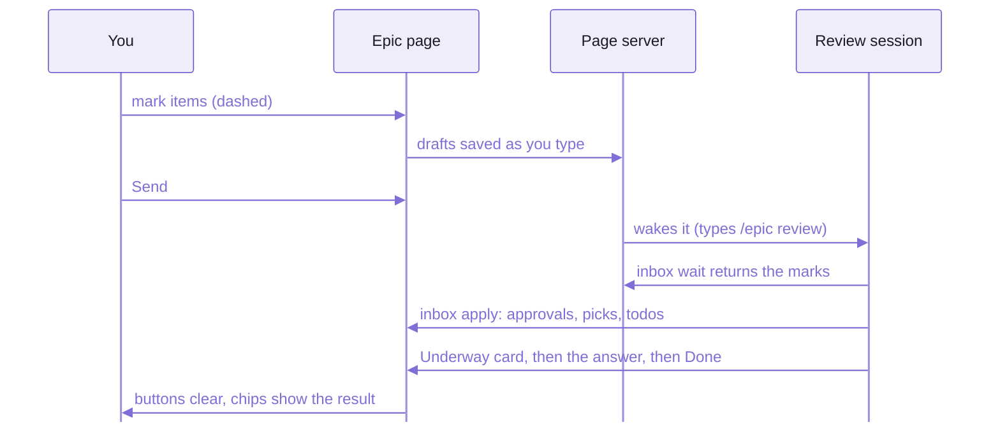
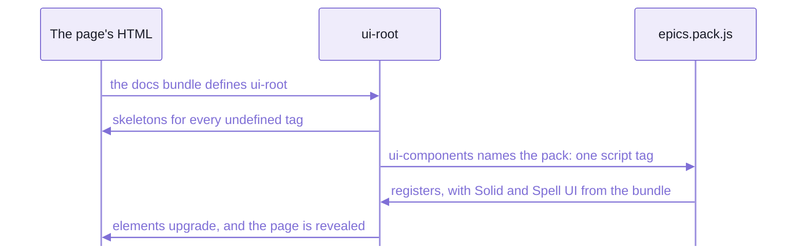

# The pages

What you meet on an epic page, section by section, and how a review on it works:
the marks you leave, the round that takes them, comments, test runs and the colours.
Then the other kinds of page (saga, details, choice, guide), and the `<epic-*>` elements that draw them all.

- Every page is plain HTML in the content folder, drawn by elements, and served live:
  an edit the agent makes shows in place, with your scroll, folds and half-typed notes kept.
- The rules the agent follows when it writes a page:  [the epic-page writing rules](templates/epics/plan-doc.md).

## An epic page


_This epic's own page, served by the epic server._

1. **The header**:  the page's title, and on the right Send (the paper plane), Review Now (the wand) and the step pill.
   The step pill shows the phase under way (`P6`), else DONE or FUTURE.
2. **The toolbar**:  an icon per section, to jump there;
   the counts of what's open (yellow) and decided (green), and red or orange ones only for what needs you;
   unfold-all and fold-all.
3. **The meta lines**:  how to review it (`/epic review <name>`), its branch and worktree, its dates, its saga,
   and once Doc Review has written it, its guide.
4. **Overview**:  a two-sentence summary, the kickoff prompt folded, the estimate (written by the tool),
   then numbered sub-sections, `1.1` ..., the substance of the plan.


_Phases with their status icons and estimates;  the item sections below, folded, with their counts._


_An item:  its id chip, the three review buttons and Do Now, its text, and the note box._

## The sections

Every epic page has the same nine sections, in this order, and their ids never change,
so a link to `#todos` always lands.
Everything starts folded;  the page remembers what you opened, and a link to any id unfolds what hides it.

| Section | Id | What goes in it |
| --- | --- | --- |
| 1. Overview | `#overview` | the summary, the kickoff prompt, the estimate, then the plan's substance in sub-sections (`#o1` ...) |
| 2. Phases | `#phases` | a block per phase:  Symptom (what's wrong today), Changes, the Goal;  Done and Commits once built;  Files and Verify behind a toggle |
| 3. Questions | `#decisions` | what only you can decide:  open ones first, then the answered ones, which are the decisions |
| 4. Judgement calls | `#judgements` | choices the agent made without you, "chose X over Y because Z", open until you review them |
| 5. Caveats | `#caveats` | limits and risks the plan accepts |
| 6. Todos | `#todos` | later work that isn't a caveat or an issue |
| 7. Issues | `#issues` | problems found, open until fixed |
| 8. To test | `#tests` | what you check by hand before merging:  each a Step, and what it Should do |
| 9. Log | `#log` | one line per change to the plan, with its date and time |

- A phase also shows Requests (what you sent it from other sessions) and Update blocks (a change to its plan,
  with the date), which stay once it's done.
- While a phase is active, what changed gets an orange UPDATE label, so a second look finds it.
- A page is stored SPLIT:  a skeleton with every section, phase and item line, plus a part file per body,
  loaded the first time you open it (Q7's is `q7.html`, in the page's `parts` folder).
  So the page opens fast and an edit to one item patches only that item.

## A review round

You review on the page, whenever you like;  the agent takes your marks in a round.
Nothing you do needs a session to be listening:  marks wait, and Send wakes one.



_Your marks travel through the page server;  answers land IN the items, never only in the chat._

1. You open the epic page in the Review tab (`/epic review <name>`, or "Review:  Open Epic...").
2. You mark items:  Approve, Revisit with a note, Make Todo, Choose an option, a todo's plane or x,
   or `+` for a new todo or question.
   Each mark saves as you type, and shows DASHED.
3. You press Send (or Review Now, or Do Now on one item, which needs no Send).
   The marks turn OUTLINED.
4. If no session is listening, the page server types `/epic review <name>` into the epic's session,
   or opens a new tab in its window;  you press Enter.
5. The session listens (`epic inbox <name> listen`), then waits in the background and ends its turn.
   Its `wait` returns when marks arrive, waking it with a list of them.
6. `epic inbox <name> apply` applies the mechanical marks:
   approvals, picks, todos, a todo's plane or x, skips, new items, test results.
   Each logs a line;  a pick or a queued todo gets a "Noted" card saying what happens next.
7. A revisit or a Do Now:  a blue "Underway" card says what the agent took the task to be;
   a background agent writes the answer into the item;  the card turns green, "Done".
   An answer with options turns the item ORANGE:  your pick.
8. The page updates in place:  the buttons clear, the chips show the result.
9. The session waits again;  `unlisten` when it leaves.
   Silent for 90 seconds, and the page says nobody is reviewing.

- Review Now sends every mark AND turns each revisit waiting into a request for now:
  the session answers them all at once, by background agents.
- "Nevermind":  click a spinning Do Now again to call it off;  a late answer is refused.
- A revisit on a judgement call or a todo starts with `do it` in its note box:  type over it to say something else.

## Comments and bullhorns

Any docs page the page server serves takes comments:  guides, epic pages, Epic UI's pages.

- A BULLHORN sits beside every major block (sections, tables, asides, code, cards, items, phase fields)
  and in the page's header;  or select text and press ⌘-I (Ctrl-I).
- A small pane opens, which saves as you type and never scrolls the page.
- A saved comment becomes a THREAD under the paragraph it quotes:
  "You:" and "Claude:" messages, "Claude:  thinking…" while it's at work,
  and Approve, Revisit or x when it's your turn.
- Comments are numbered `M1`, `M2` ...;
  the toolbar's bullhorn, with an orange count, jumps to the next thread waiting on you, and ⌘-K takes an id.
- Where they go when you press the page's Send:
  - an epic page's comments, to that epic's review inbox
  - a guide's or details page's, to the epic that OWNS the page (it wrote it, or its page links it)
  - any other page's, to the standing feedback epic

## Test runs

"Start testing" on the To test section (or `epic test <name>`) steps you through each open test,
one big card at a time, in the Review tab.
`epic test --all` runs every epic's, in saga order.

| Your answer | What `inbox apply` does |
| --- | --- |
| Passed | closes the test |
| Failed, with a note and a pasted screenshot | makes a NEW issue, "V3 failed:  ...", with your note and screenshot;  the test stays open |
| Skip | cancels the test:  it no longer applies |
| Not now | leaves it open, and puts it last in the next run |

- A test is written for the run:  Step (what to do, with a button for a page to open), Should (what should happen),
  and optionally an Example (a screenshot the agent took) and If not (what to tell the agent).

## Colours and fills

Each colour means ONE thing on every page:  epic pages, details pages, saga pages, the Epics list.
Read a page at a glance by them;  a new element takes its colour from this table.

| Colour | Means | For example |
| --- | --- | --- |
| red | needs you | an open question's chip;  an unreviewed judgement call or issue;  the toolbar's count |
| yellow | open, still undecided | an open todo, caveat or test;  a reviewed call or issue |
| blue | do it now, or the agent is on it | Do Now, Revisit, Send;  the Underway card;  an epic in progress |
| green | decided or done, however long ago | Approve, Make Todo, a pick;  a phase done;  the Done and Noted cards |
| orange | changed since you looked;  or the agent's options, waiting for your pick | UPDATE labels;  "nobody is listening";  a replied item's chip |
| violet | the agent's voice | its reply cards;  "recommended" (a thumbs-up) |
| ivory | your voice | your note box, your replies, the answer card;  the toolbar |
| grey | no longer relevant, or not chosen | a canceled item;  buttons at rest;  a phase to do;  a future epic |

The FILL says how far a button, pill or chip has got:

| Fill | Means |
| --- | --- |
| grey outline | available:  nothing pressed |
| dashed, in its colour | you pressed it;  not sent |
| outline, in its colour | sent, or in progress:  the agent has it |
| cleared | handled:  the button is a grey outline again, and the chip has the result |
| solid | only on chips, the step pill's DONE, and a Choose pill once applied |

- So a dashed or outlined chip is ANSWERED:  don't answer it again.
  Only a solid red (needs you) or orange (your pick) chip waits on you, and the toolbar counts only those.
- Colour-blind readers tell red and green apart least:  the chip's id, the icons and the words keep them readable.

<details>
<summary>The item states, and which colour wins</summary>

The tool writes each item's state from its status and review marks on every edit.
The FIRST row that applies wins, top to bottom.

| State | Colour | When |
| --- | --- | --- |
| `progress` | blue | the agent is working on it:  an Underway card, or the spinner |
| `old` | grey | canceled:  made moot, struck through |
| `recent` | green | decided or done, however long ago |
| `open` | yellow | work a review queued (a todo mark), not started |
| `replied` | orange | open, and the agent's last reply holds options nothing is picked in yet:  your turn |
| `attention` | red | an open question;  an open judgement call or issue not reviewed, unless marked calm |
| `recent` | green | open, but settled by a review:  approved as it stands, or made a todo |
| `open` | yellow | anything else open:  todos, caveats, tests, reviewed calls and issues |

- An item's status is `open`, `decided` (an answered question), `done` (closed, never removed) or `canceled`
  (struck through;  `reopen` undoes it).
- A judgement call or issue is CALM (yellow) by default, and red only when it would surprise you:
  it goes against something you said, narrows what you asked for, is a fork you'd plausibly have picked differently
  and that matters, or needs your answer before work can go on.
  Clicking its chip switches it.
- Saga pages colour their items by the same states.

</details>

<details>
<summary>What each review button does when it's applied</summary>

| Mark | On | Does |
| --- | --- | --- |
| Approve | an open question | answers it with the recommended option;  with none recommended, left to talk over |
| Approve | an open judgement call | closes it, accepted |
| Approve | an open test | closes it, passed |
| Approve | anything else | marks it reviewed |
| a pick | a question | answers it with that option |
| a pick | any other item | approves it with that option |
| Make Todo | any item, phase, the summary, an Overview sub-section | a new todo, "Follow up:  ...", linking back |
| a todo's plane | a todo | queued into the first phase still to do |
| a todo's x | a todo | canceled, "dropped in review" |
| Skip This (the note box's x) | anything but a todo | reviewed, nothing else;  your note kept as your reply |
| new (`+`) | a new todo or question | made, with your note as its details |
| Revisit | any item | answered INTO the item as a reply, then cleared |
| Revisit with a pick | any item | talked over first;  recorded once you agree |

- Each applied mark logs one line, `J9 approved:  closed (accepted)`.
- A mark you changed meanwhile stays for the next send.
- The summary, each phase and each Overview sub-section take Revisit, Make Todo and Do Now too, but no Approve.

</details>

<details>
<summary>The inbox file and its shape</summary>

Your marks wait in the epic's INBOX FILE, `<name>.inbox.json5`, beside its page:
absent until the first mark, deleted once empty, git-ignored (it's per-machine, never the record).
Only the tool writes it, under a lock.

```json5
{
  version: 1,
  marks: {}, // sent and unsent marks, by item id:  { action, note?, pick?, choices? }
  drafts: {
    o6: { action: "revisit", note: "Skip this, and leave it off the main page", at: "2026-10-21T12:22:58" }
  },
  urgency: {}, // a chip clicked red or yellow
  sent: "2026-10-21T12:50:32", // the last Send
  now: [], // Do Now and Review Now requests, waiting to be taken
  working: {}, // items an agent is on:  the spinner
  canceled: {}, // a Do Now called off
  listening: { session: "...", since: "...", seen: "..." }, // the review session's heartbeat
  handedOver: "2026-10-21T12:50:32", // the last Send a session took
  comments: {},
  woken: null // the last time Send woke a session
}
```

- `epic inbox <name>` prints what's waiting.
- `wait` prints each mark with its item's id, kind, status and title, your note, and a pick's option:

  ```text
  now (1):  start a background agent for each;  `epic inbox review-review#<id> done` after
    - I1  issue, open · The phases' progress bar label is cut off at its left end
        Add Details
  sent 2026-10-04T17:32:26.086-04:00 (4 marks):
    approve (1):
      - J9  judgement, open · A reload lands on the remembered section without unfolding it
    pick (1):
      - Q7  question, open · Should a reload land on the remembered section without unfolding it?
          picks B · Land and unfold it
  ```

- A new todo or question from the page waits under its own key, `new1`, `new2` ...
- A test answer is `{ action: "test", result, note?, shot? }`, with its screenshot saved beside the page.
- `wait` stamps the heartbeat every 30 seconds;  it gives up after 55 minutes (exit 2) and is simply run again.
- The inbox's code and every method on it:  [`ReviewInbox`](src/tool/ReviewInbox.ts).

</details>

<details>
<summary>How Send wakes a session</summary>

Send, Review Now or Do Now, pressed while NO session listens, makes the page server wake the epic.

- Who, first match wins:
  1. the ONE running session titled for the epic, `🚧 <epic>`:  `/epic review <epic>` typed into it
  2. else the epic's worktree window:  a new session tab, the command typed in (the window opened if it's closed)
  3. else, for an epic with no worktree:  a new session in a main window
- Never a new worktree, and never sent for you:  you press Enter.
- The page says what it did, in an orange pill under the review line, until a session listens:
  "Typed /epic review seo into 🚧 seo:  press Enter there".
- Once per epic per 10 minutes, or until a session listens;  a second press says when it already did.
- No wake when several sessions are titled for the epic, in airplane mode, or for a Send with nothing new;
  clicking the pill still types the command.
- A Do Now waiting with nobody listening says "waiting for a session".

</details>

## Other kinds of page

Every page kind is built from the same elements, coloured the same way, and takes comments the same way.

### Saga pages

A SAGA is an epic of epics:  the larger aim several epics serve.
You review its page like an epic page:  `/epic review SAGA:/<id>`.

- Its page has an Overview:  its purpose, "Done so far", "Ideas not done yet".
- Then a card per epic that names it, drawn live by the page server.
- Then Questions, Todos and a Log.


_A saga's page:  its overview, then its epics as cards, grouped as on the Epics list._

### Details pages

When a question needs a picture, or more than the question modal holds (four options, four questions),
the agent writes a DETAILS PAGE (`/details`) and shows it in the Review tab.
You answer ON the page:  a radio per option card, a comment box on each, "Other" for your own answer, then Send.


_A details page after you've answered:  the recommended option has the thumbs-up, your pick the green outline._

### Choice pages

A CHOICE PAGE is a table of names the agent recommends, one row per use:
you type over any you'd call something else, then press "Do it".
A changed row gets an orange bar and a button to put the recommendation back.


_A choice page:  the boxes start with the recommendation;  "Do it" sends the table._

### Guides

A GUIDE is what an epic leaves behind for a reader coming to it cold:
how the thing it built works, and how to use it.
Doc Review writes it, the epic page links it in its meta lines, and its comments go to the epic that wrote it.


_A guide, with the pointer on a paragraph:  its section's bullhorn shows, to comment on it._

- The docs' HOME PAGE has a card per area, and each area has a list page:
  Epics (open ones first, favourites, grouped by state), Sagas, Guides.


_The Epics list, every epic as a card, grouped by where it stands._

## The `<epic-*>` elements

Epic UI is spell-epic's set of custom elements, one component pack with the prefix `epic-`.

- A page file holds only DATA (attributes) and PROSE (children):
  the elements draw everything else in their shadow roots.
- Each has a docs page in the Epic UI set, at `/components/epics/<tag>.html`.

| Group | Elements |
| --- | --- |
| Page structure | `epic-page` (the header, meta, step pill, Send and Review Now, the toolbar), `epic-overview`, `epic-summary`, `epic-prompt`, `epic-section`, `epic-phase`, `epic-field`, `epic-item` (one element for every kind of item), `epic-event` (a log line), `epic-commit` |
| Prose blocks | `epic-question`, `epic-choices` and `epic-option`, `epic-answer`, `epic-net-effect`, `epic-reply`, `epic-more` (More Details), `epic-original` and `epic-version` (Original Discussion), `epic-update`, `epic-note`, `epic-aside`, `epic-code`, `epic-link` |
| Review | `epic-review` (an item's buttons), `epic-status` (Underway, Done, Noted), `epic-new-item`, `epic-state-filter`, `epic-hidden-note`, `epic-agents` (the running agents), `epic-test-run` |
| Comments | `epic-comment-pane`, `epic-thread`, `epic-thread-message`, `epic-threads`, `epic-page-note-head` (older page notes) |
| Lists | `epic-list`, `epic-card` and `epic-sort` (the Epics list), `epic-cards` (a saga's epics) |
| Answer pages | `epic-ask`, `epic-text-box`, `epic-send`, `epic-choice-rows` and `epic-choice-row`, `epic-choices-bar` |

- `<epic-link epic="seo" item="J3">` links an item on another page by what it is, never by a path:
  it draws "seo J3", with J3's title as its tooltip.
  A plain link can use a short address instead, `SAGA:/drawable-spell/python-target#T1`.
- `epic-updated` is retired.
  `epic migrate` turns it into `epic-update`.

### How a page draws them



_A page loads two scripts:  Spell UI's docs bundle, then the pack, which borrows Solid and Spell UI from it._

```html
<ui-root>
  <ui-components source="/_epic/pack/epics.pack.js"></ui-components>
  <epic-page ...> ... </epic-page>
</ui-root>
```

- The page loads Spell UI's docs bundle FIRST (`/_epic/assets/spell-ui.js`):
  the pack registers there, and takes Solid and Spell UI's shared code from it.
- The pack is a classic script, so a page draws its skeleton from `file://` too;
  part files and the review controls need the page server.
- Both addresses are the engine's routes, served by the epic server and spell-app's page server alike.

### Working on the elements

The elements are written exactly like Spell UI's own families,
on [the kit's element framework](../README-element.md) and Spell UI's core.

If you find yourself writing a second copy of any of these, stop and reuse:

- the pack's build, catalog and staleness check:  the kit's `spell-pack`
- reading a vocabulary's tag and skeleton:  the kit's root catalog
- the element authoring API:  `spell-kit/element`, and Spell UI's `spell-ui/core`

Adding a new element:

1. `spell pack add epics epic-<name>`:
   writes the family's folder, `epic-<name>/` in [src/components/](src/components/),
   adds it to the [components barrel](src/components/index.ts), and rebuilds the pack.
2. Fill in its vocabulary (description, topics, also-known-as, attributes, parts, skeleton), its class and its sheet.
3. Its page in Epic UI, `epic-<name>.html` in [src/docs/](src/docs/):  a copy of a page like it.
   Then `yarn site:data`.
4. `yarn pack:build`, then `yarn review`.
5. Commit the pack (`__pack/`, in the components folder) and the docs set (`src/docs/`) with the change.

- A change to the page markup also needs a migration step in the same commit,
  so `epic migrate` brings every page up to it ([the code's AGENTS.md](src/AGENTS.md)).

<details>
<summary>Where the element code lives, file by file</summary>

| Path | What's in it |
| --- | --- |
| [src/components/](src/components/) | one folder per element family:  component, vocabulary, sheet, barrel, each named for the component;  its test in [tests/components/](tests/components/) |
| [src/components/index.ts](src/components/index.ts) | every family's barrel:  importing it defines every tag (a SIDE EFFECT) |
| [src/components/\_\_pack/](src/components/__pack/) | GENERATED, committed:  the catalog, the entry, and `epics.pack.js` |
| [src/index.ts](src/index.ts) | the code the elements and the node tools share, as one namespace, `EP`:  definitions, markup, dates, phases |
| [src/definitions/](src/definitions/) | the ONE description of every element:  its vocabulary as data, and the children it takes |
| [src/markup/](src/markup/) | reads, writes and checks an epic page's `<epic-*>` markup through the definitions, in node and the browser |
| [src/review/](src/review/) | the page's two server clients:  the review inbox's (marks, polling, note-draft backups) and the running agents' (the "Agents running" panel), each through one link that keeps its token fresh |
| [src/answers/](src/answers/) | the pages you answer on:  a details page's answer, gathered from its questions and text boxes;  a choice page's boxes, the draft and "Do it" |
| [src/links/](src/links/) | short addresses (`SAGA:/<saga>/<epic>#<id>`) and `<epic-link>`'s attributes as a page and an id;  what a page holds to land on;  pure, for the elements, the docs runtime and the tool |
| [src/convert/](src/convert/) | the converter (`epic convert`):  a page in the old markup into `<epic-*>` markup, with a proof that no id, link or word was lost;  kept for a page restored from an old backup |
| [src/tool/](src/tool/) | the epic tool behind `epic`'s page verbs, node only, not in the pack;  [PLAN-DOC.md](src/tool/PLAN-DOC.md), the rules for a page's data;  [the template](src/tool/templates/plan.html) a new epic page starts from |
| [src/docs/](src/docs/) | Epic UI, the elements' docs pages, served at `/components/epics/`:  an index, a page per tag, the layout and the data |
| [src/site/](src/site/) | Epic UI's generated data (`yarn site:data`) |
| [tests/pack.test.ts](tests/pack.test.ts) | runs `spell-pack check`:  the pack and Epic UI's data are current |
| [vite.config.ts](vite.config.ts) | lint and format only:  the pack's build is the kit's |
| [vitest.config.ts](vitest.config.ts) | two projects over `tests/`:  `node` for the code, `browser` (chromium) for the elements |

</details>

## See also

- [README.md](README.md):  spell-epic's front page
- [README-skills.md](README-skills.md):  `/epic review`, `/details` and the rest
- [README-cli.md](README-cli.md):  `epic inbox`, `epic test` and every other verb
- [README-vscode.md](README-vscode.md):  the Review tab the pages show in
- [Spell UI's README](../spell-ui/README.md):  the `<ui-*>` elements the pages are built on
- [The kit's README](../README.md):  Spell as a whole
- [The kit's README-element.md](../README-element.md):  how packs and elements work
- Also beside it:  [README-adopting.md](README-adopting.md)

<details>
<summary>More in the docs site</summary>

These guides live in the content folder, so they need a checkout with `spell.epics` beside the repos and the page
server running (`spell server start`, then the URL it prints):

- "Epic Pages":  `/guides/plan-docs/plan-docs.html`, every part of the page, every colour and button
- "Reviewing an Epic Page":  `/guides/epic-components/review.html`
- "Epic Pages as Components":  `/guides/epic-components/epic-components.html`
- "Details Pages":  `/guides/details.html`
- Epic UI, every `<epic-*>` element with a live example:  `/components/epics/`

</details>
