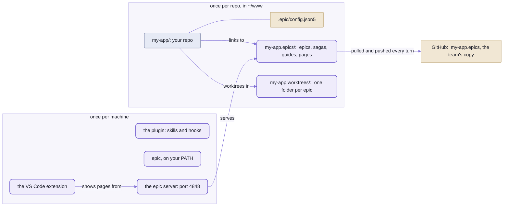

# Setting epics up in your repo

One command sets a repo up, on GitHub or GitLab.
This page is every step of it, what each question means, and what's different when your main branch takes only merge requests.

## The plans live beside your repo, not in it



_Once per machine, `epic init` does the plugin, the command and the server;  the extension is by hand.
Once per repo:  one small file in it, two folders beside it, and the team's copy of the plans on GitHub._

The plans are NOT in your repo.
An epic page is in the epic repo:  ONE copy, in the epic folder, which every checkout links in.

So the session in a worktree and you on the main checkout read the same page,
and it never conflicts on a code merge or turns up in a pull request.
Your teammates have the same page too, a turn behind at most.

The work IS in your repo:  one worktree per epic, on a branch named after it,
beside the main checkout rather than inside it.

## Setting it up:  one command, and an extension

You need Claude Code, VS Code, git, Node 24.11 or later, and your code host's command:  GitHub's `gh`, or GitLab's `glab`
([On GitLab](#on-gitlab)).
These steps are for the FIRST person on a team;  everyone after them:  [A teammate joins](README-teams.md#a-teammate-joins).

### 1. Your code host's command, logged in

`epic init` uses it to make the team's epic repo, so install it first.
On macOS, with Homebrew, on GitHub:

```sh
brew install gh
gh auth login
```

Or on GitLab:

```sh
brew install glab
glab auth login                          # your own GitLab:  glab auth login --hostname git.acme.com
```

- GitLab's differences, self-hosted included:  [On GitLab](#on-gitlab).
- Other systems:  https://cli.github.com, https://gitlab.com/gitlab-org/cli.
- `gh auth login` asks a few questions and opens your browser;  SSH or HTTPS, as you like:
  the epic repo's address follows your choice.
- Without it, `epic init` still sets everything else up, and says how to get it.
  Run `epic init` again once you're logged in:  it makes the epic repo then.

### 2. `epic init`, in your repo

From any folder of your repo, a git repo with at least one commit:

```sh
cd ~/www/my-app
npx spell@next epic init
```

- That fetches Spell's package and runs its `spell epic`, which runs the epic tool installed beside it.
  Once `epic` is on your `PATH` (its plugin step puts it there), `epic init` is the same thing.
- `epic` and the plugin then run from npm's cache (`~/.npm/_npx`):
  after `npm cache clean`, run this line again.
- Your project doesn't need yarn:  an npm repo works, and yarn, pnpm and bun repos are found by their lock files.

In a terminal, it asks every question FIRST but the commit, each `? ` and the question in yellow, then sums up the
answers (`> Your name  :  Ana`, the values bold) before it does anything.
A pick-one question is a numbered list:  the arrow keys and Enter, or a number key, pick.
A teammate joining has the team's plans cloned before the colour question, so the list leaves out the colours taken.
- **What do you want to be called?**  Your short name on the pages, suggesting the one you keep already,
  else your GitHub login;  asked every time, Enter keeps it.
  `--name Ana` answers it.
- **Which colour should your words be?**  The colour your replies and comments are drawn in, on every page.
  A list of Spell UI's colour names nobody on the team has yet, the first marked.
  `--color green` answers it;  any CSS colour works too.
- **What should the epic repo be called?**  Only when it's about to make one on GitHub.  Suggesting `<repo>.epics`, here `my-app.epics`.
  `--content-repo <name>` answers it.
- **Private or public?**  A list of the two, private marked.
  `--public` answers it;  with no terminal to ask in, it's private unless you say `--public`.
  A public repo shows everything in the plans to anyone:  epic pages, guides, comments.
  `epic init` says so in a line of its own.
- **Commit and push .epic/config.json5 and .gitignore on main?**  Asked last, after the files;  suggesting yes,
  and with no terminal to ask in, yes.  It pushes to the branch's upstream, else `origin`.
  `--no-commit` leaves them for you.

Then, in order, each step under a bold heading, the files in a gray table, a gray line before each slow step:
1. Installs the epic plugin for Claude Code, when it isn't there yet:  once per machine.
   - Its skills and hooks, a bare `/epic`, and `epic` on your terminal's `PATH`
     ([README/agents.md](https://github.com/spell-app/spell/blob/main/README/agents.md#the-epic-plugin) says what each step does).
   - Installed for the machine, its hooks run in every repo, not just yours:
     in one `epic init` never set up they do nothing, and its worktrees are Claude Code's own.
   - `--no-plugin` skips it;  `epic plugin install` does it by itself.
2. Writes `.epic/config.json5`, every key with a comment on each, valued for THIS repo
   ([the config file](README-config.md#the-config-file)).
   A file already there is kept as it is.
3. Makes the epic folder, `../<repo>.epics`, a git repo of its own.
   It holds the four folders, a README, and a `.gitignore` for what's never committed.
4. Makes the epic repo on GitHub or GitLab:  private unless you said public, under your account,
   or under the organization or group your code repo is on.
   It pushes the epic repo there, and writes its address in the config, `contentRemote`.
5. Links each of the four folders in at the checkout's root;  every new worktree gets the same links.
6. Lists the links in a block of your `.gitignore`.
   The block starts `# shared:start` and ends `# shared:end`.
7. Keeps your name, in `~/.spell-epic/person.json5`.
8. Keeps your colour WITH THE PLANS, `people/<name>.json5` in the epic repo, and pushes it:
   your teammates see it, and nobody commits anything in the code repo for it.
9. Commits `.epic/config.json5` and `.gitignore` on the base branch, only those two files, and pushes them:
   every new worktree branches from there.  On another branch it commits nothing, and says so.
10. Starts the epic server, serving your repo, and ends with where to see the epics:  its address, a link in a
    terminal ([one epic server](README-config.md#one-epic-server-for-the-machine)), and how to open them in VS Code (or Cursor).
    `--no-server` skips the server.

- Pushed, a teammate's `epic init` reads the epic repo's address from the base branch.
- Each step is skipped when it's done, so it's safe to run again:  a second run's table says `already` on every row.
- `--remote <address>` uses an epic repo you made already (on GitHub or anywhere else git reaches).
- `--no-remote` makes none:  the plans stay on this machine, as they did before sharing existed.

Try it first in a throwaway repo:  `--dry-run` says what it would do, and writes nothing.

```sh
cd "$(mktemp -d)" && git init -q -b main my-app && cd my-app
git commit -q --allow-empty -m first
epic init --dry-run --no-remote --no-plugin
```

<details>
<summary>Output</summary>

```text
Initializing Epic for repo .../my-app
...
Setting up epic files:
  would write            .../my-app/.epic/config.json5
  would make             .../my-app.epics
  would link (missing)   .../my-app/epics
  would link (missing)   .../my-app/sagas
  would link (missing)   .../my-app/guides
  would link (missing)   .../my-app/pages
  would update           .../my-app/.gitignore
...
dry run:  nothing changed
```

</details>

<details>
<summary>The install command it picks, by lock file</summary>

The first match wins;  no match leaves `installCommand` empty, and nothing is installed.

```text
yarn.lock               yarn install
pnpm-lock.yaml          pnpm install
bun.lock, bun.lockb     bun install
package-lock.json       npm install
a bare package.json     npm install
uv.lock                 uv sync
Gemfile.lock            bundle install
```

</details>

<details>
<summary>npm or yarn:  what your repo needs</summary>

Your repo doesn't need yarn.
A plain npm repo, with a `package-lock.json`, works:
- `epic init` writes `npm install` as the install command, and every new worktree runs it.
- `epic worktree merge-main` rewrites a `package-lock.json` that both sides changed with
  `npm install --package-lock-only`, then installs.
  `pnpm-lock.yaml`, `yarn.lock` and `bun.lock` get their own tools the same way.
- Vitest snapshots are updated with your repo's own runner:  `npx vitest run ... --update` for npm.
  With no Vitest in your `package.json` (Jest, say), nothing runs, and a snapshot both sides changed is an ordinary
  conflict, for you to resolve or to list in `.epic/generators.json5`.

Yarn is on your machine for one reason:  the clone of Spell that `epic` runs from uses it,
in its own folder, for its own install and to format pages.
No command runs yarn in your repo.

</details>

Then check that `epic` answers:

```sh
epic --version
```

<details>
<summary>Output</summary>

```text
epic ... (...) .../epic
```

</details>

- `--version` names the code that answers:  its commit, its branch and the folder it's in.
- `~/.local/bin`, where the plugin step links `epic`, may not be on your `PATH`:  put the link wherever yours looks.

🌱 Planned:  the plugin from Claude Code's marketplace, without `npx`.

### And the extension

The Review tab, where you mark up a page, and the moves between windows need Spell's VS Code extension:
the same one in VS Code or Cursor, which runs VS Code's extensions.
`epic init` installs it, from the package:  reload your windows when it says so (**Developer:  Reload Window**).
From a clone of Spell instead:  [the extension's README](README-vscode.md#install-it--three-commands-and-a-reload).

In Cursor, the epic tools use `cursor` where VS Code's take `code`:  they tell from the window they run in.
- Say it outright with `editor` in `.epic/config.json5` ([the config file](README-config.md#the-config-file)), or for one machine `SPELL_EPIC_EDITOR=cursor`.
- Cursor keeps its right side bar for its own agent, so the Review tab may not show there:
  open it with **View: Open View...** › Review, then drag it where you want it (or **View: Move View**).

Then, in a Claude Code session in your repo, `/epic <name> <what to plan>`:

```text
/epic seo make the docs findable
```

The session titles itself for the epic and makes its worktree, `~/www/my-app.worktrees/seo`.
Its epic page, `~/www/my-app.epics/epics/seo/seo.plan.html`, opens in the Review tab and fills as it plans.

What happens from there:  [the epic engine's front page](README.md).

## <a id="on-gitlab"></a>On GitLab

`epic init` works on GitLab, self-hosted too, as it does on GitHub:  the shared epic repo made, and a setup merge request
where `main` is protected.
**So far this has run only against a stand-in `glab`**:  a script that answers as GitLab's API documents,
with real `git` pushes to a local repo whose hook refuses `main`.
No real GitLab has been tried yet, so expect rough edges and tell us.

You need GitLab's command, `glab`, logged in:

```sh
brew install glab                        # other systems:  https://gitlab.com/gitlab-org/cli
glab auth login                          # gitlab.com
glab auth login --hostname git.acme.com  # your own GitLab
```

- **Which host:**  `codeHost` in `.epic/config.json5`, `"github"` or `"gitlab"`.
  Left out, it's read off the `origin` address each time:  a host with `gitlab` in it is GitLab, `github.com` GitHub,
  anything else GitHub.
- **A self-hosted GitLab whose address doesn't say so** (`git.acme.com`):  `epic init --host gitlab`.
  In a terminal it asks;  with no terminal it stays on GitHub and says so in one line.
- **Groups and subgroups:**  the epic repo goes under the group your code is in (`group/sub/my-app.epics`),
  else your own namespace.
- **The epic repo must take pushes from teammates, every turn.**
  GitLab protects a new project's default branch, so Developers can't push.
  `epic init` unprotects it right after the first push.
  If it can't (no right to), it says so in one line:  unprotect it in the project's
  Settings › Repository › Protected branches, or nobody else can sync.
  An epic repo you made yourself (`--remote`) is yours to open up.
- **Commit links** on the epic pages go to GitLab's `/-/commit/<sha>`.

## <a id="when-main-takes-only-pull-requests"></a>When main takes only pull requests

Plenty of GitHub orgs and GitLab groups refuse direct pushes to `main`.
Below, "pull request" means a GitLab merge request too;  on GitLab, `epic` says "merge request".
Tell the repo so with one setting, and nothing `epic` does tries to land there:

```sh
epic init --protected-base
```

`baseBranchProtected` in `.epic/config.json5` says the base branch can't be pushed to,
and work reaches it only through a pull request.

**You usually don't have to say so.**
With `gh` or `glab` logged in, `epic init` asks the host whether the branch takes only requests
(GitHub:  a ruleset's `pull_request` rule and, if you're allowed to read it, classic branch protection;
GitLab:  the project's protected branches:  nobody allowed to push, or a push level above yours),
turns the setting on, and says so in one line.
If it can't find out, it carries on without it.
A config that already says `false` stays `false`, and `epic init` tells you how to change it.

**Setting up the repo goes through a pull request too.**
`epic init` never commits on `main`:
- `.epic/config.json5` and `.gitignore` go on a new branch, `epic-setup`, which it pushes.
- It opens the pull request with `gh` or `glab`, or prints exactly what to run without one.
- Your local `main` is left clean:  the two files aren't in it until the merge.
- Epics start working in the repo once it's merged and you've run `git pull`.
  Teammates can join then.

Ran `epic init` before the rule existed, and its push was refused?
It left a commit on your local `main`, and it says what to do:
`epic init --protected-base` takes that commit back and moves it onto `epic-setup`.

**The epic repo is the exception, and it has to stay one.**
Your plans live in `<repo>.epics`, and every turn pushes straight to its main branch.
An org-wide rule requiring pull requests must leave that repo out, or the plans stop syncing.
The setting changes nothing about it.

**What changes with the setting on:**

| Where | What it does instead |
| --- | --- |
| `epic merge <name>` | refuses, in one line saying to open a pull request |
| `/epic done`, `/isolate done` | no "Merge now":  "Push and open a pull request", or "Leave it" |
| a standing epic's phase | pushed and put in a pull request, rather than merged at once |
| a new worktree, `epic worktree merge-main` | fast-forward your local `main` from `origin` first |
| `epic worktree remove --branches` | a branch whose pull request the code host merged counts as merged, a squash included |

Local `main` only moves when you pull, so those fast-forwards keep it from going stale.
They happen only when it's safe:  fast-forward only, nothing uncommitted.
Offline, or with `main` diverged, they carry on from what you have, and say so.

A branch is deleted only if all its commits are in `main`,
or a merged pull request holds its last commit:  a commit made after the merge keeps the branch.
Asking the host takes `gh` or `glab`;  without it, the branch stays, and the line says why.

To push a branch and open its pull request by hand:  `epic pr <name>` ([the CLI page](README-cli.md)).

**After a pull request merges,** in the main checkout:

```sh
git pull
epic worktree remove <name> --branches
```

## Your AGENTS.md fills in the rest

The skills know how to plan, build and review;  what your project counts as "done" they leave to you.

They look for it in your repo's own `AGENTS.md`.
Spell's `CLAUDE.md` loads its own with one line, `@AGENTS.md`;  yours can too.

For an agent without the skills (Codex reads `AGENTS.md` by itself), one more line there finds the workflow:
"Working an epic:  run `epic guide`, and end every turn with `epic turn end`."

What they look for:
- the checks to run before a phase is done
- its changelog, if it keeps one:
  `epic docs` looks for an epic's entry in the epic folder's guides, in `changelog.html`
- its house style, and a skill that rewrites text to it, if it has one
- NOT the pages' formatting:  that's the engine's own

## See also

- [README-epics.md](https://github.com/spell-app/spell/blob/main/README-epics.md):  what an epic is, why you'd want one, and the short version of all this
- [README-teams.md](README-teams.md):  once you're set up, sharing the plans with others
- [README-config.md](README-config.md):  every setting, and what's still rough
- [README-vscode.md](README-vscode.md):  the extension, if you'd rather build it yourself
