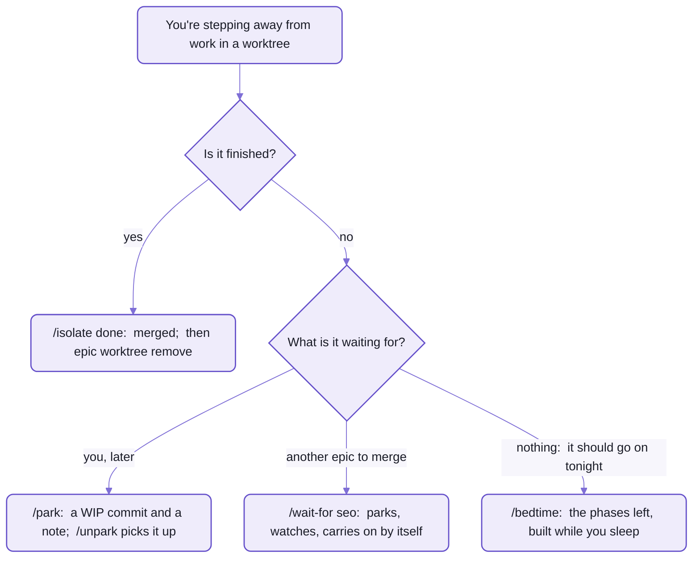
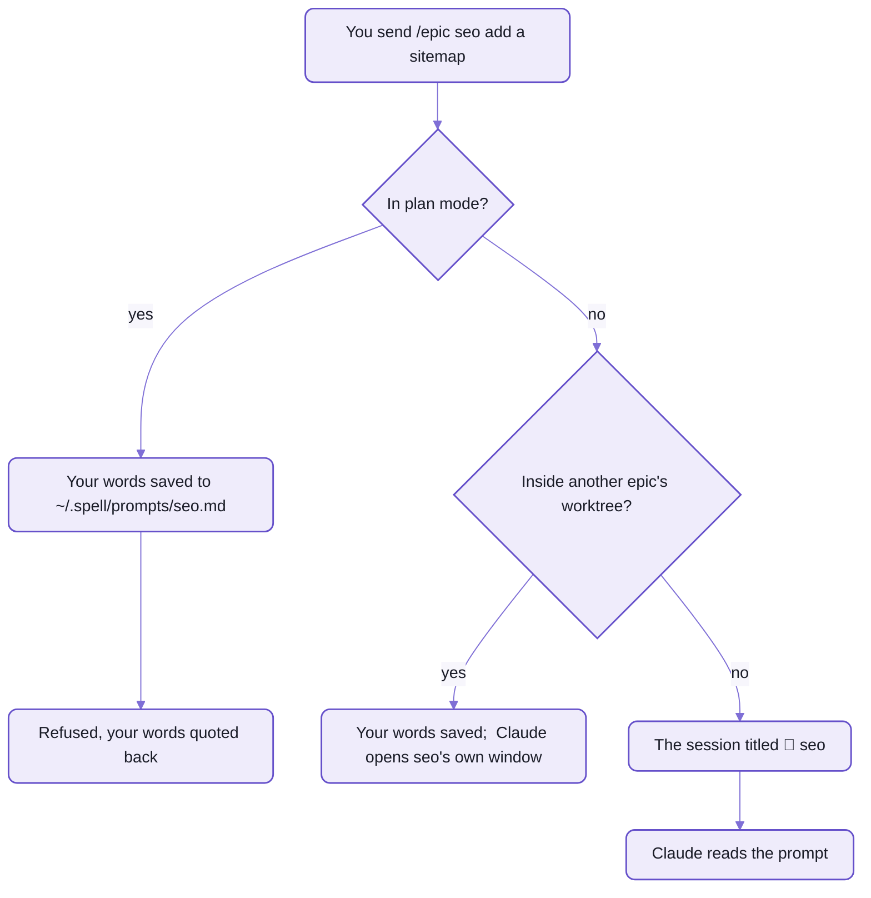

# Skills and hooks

```text
> /epic seo add a sitemap

Plan mode is on, so `/epic` can't make its worktree.  Leave plan mode (shift+tab),
then run `/epic seo` alone:  it picks the text up.

Your text is saved in ~/.spell/prompts/seo.md:

add a sitemap
```

_A skill typed in plan mode, and the hook that answered before Claude read a word:  its reply from a real run._

You asked for a skill, and a hook answered.
The prompt never reached Claude.
The hook read it first, knew that plan mode can't make a worktree, and refused it, keeping your words:
leave plan mode, type `/epic seo`, and the plan starts from what you wrote.

The whole plugin works like that.
It gives Claude Code nineteen skills, workflows you start by typing a name,
and nine hooks, scripts Claude Code runs by itself when something happens.
- Choosing a skill:  find the moment you're in, in the three tables below.
- Something happened you didn't ask for (a session renamed, a prompt refused, a commit nobody made):
  [the hooks' table](#hooks) says which one did it.
- **Both are Claude Code's, so they work in Claude Code only, for now.**
  🌱 Other agents are coming ([spell-epic's README](README.md#-coming)).

<details>
<summary>Run the gate yourself</summary>

```sh
# from the kit's root, ~/www/spell
echo '{"prompt": "/epic seo add a sitemap", "permission_mode": "plan"}' | node epic/hooks/prompt-gate.mjs
```

<details>
<summary>What it printed</summary>

```text
{"decision":"block","reason":"Plan mode is on, so `/epic` can't make its worktree.  Leave plan mode ..."}
```

</details>

- Claude Code hands a hook a JSON object like that on stdin, with more fields (`cwd`, `session_id` ...);
  the hook answers on stdout, or prints nothing to let the prompt through.
- Leave out `"permission_mode"`, and it answers `"sessionTitle": "🚧 seo"` instead:  the session's new name.
- The gate saves your text, so a run writes `~/.spell/prompts/seo.md`:
  - `SPELL_PROMPTS_DIR` moves the folder
  - an older, different `seo.md` is kept as `seo.<time>.md`

</details>

## Nineteen you type, nine that run by themselves

In most tools, a slash command is a saved prompt:  it pastes some text and hopes.
A skill here is a procedure.
Each one is a `SKILL.md` in [skills/](skills/), 41 lines for `/title` and over a thousand for `/epic`,
and Claude follows it step by step:  when to ask you, what to recommend, what to write on the epic page.
- The judgement and the questions live in the skill.
  Every change it makes goes through the `epic` command ([README-cli.md](README-cli.md)),
  so a page or a worktree changes the same way whichever session asks.
- Claude starts a skill by itself, too, when what you say matches one:
  "isolate this", "where are we?", "run this in the background".
- `/bedtime` is the exception:  it works all night without asking you anything, so only you can start it.
- A skill isn't free:  its whole text joins the conversation when it starts, over a thousand lines for `/epic`.

A hook is a git hook for Claude Code.
Instead of a commit or a push, it fires when a session starts, a prompt is sent, a worktree is made or a turn ends.
You never type one;  you notice one.
- Every hook acts only in a repo that has `.epic/config.json5`, and always exits 0:
  a broken hook never blocks a session.
- The worktree hook is the exception.
  It replaces Claude Code's own worktree logic in every repo, so when it fails, there's no worktree:
  its failure is Claude Code's answer.
- A hook can refuse a prompt, title the session or hand Claude a note, but it can't make Claude act.
  The worktree guard tells a lost session to go back to its worktree;  Claude does the going.

## Planning and review:  one page per piece of work

An epic is one piece of work with its own page, worktree and window ([spell-epic's README](README.md)).
Its whole life fits in two skills:
`/epic` plans it and builds it phase by phase, up to the merge;
`/epic review` goes through its page with you, whenever you've marked it up.
The other six here are for the moments in between.

| When | Type | What happens |
| --- | --- | --- |
| you have a piece of work worth a page | `/epic <name> [what to plan]` | plans it on its epic page, in its own worktree and window, then builds it phase by phase;  its last phase writes the epic's guide and offers the merge |
| you've marked a page, or want to go through one together | `/epic review [<name>]` | opens the page in the Review tab and listens:  applies your marks, and writes each answer into its item, not the chat;  a saga's page too, `/epic review SAGA:/<id>` |
| a session died, or you're back the next day | `/epic resume [<name>]` | a new session picks the epic up where its page says it stopped, in the right worktree and window |
| "where are my epics at?" | `/epics [all]` | lists the open epics:  phase, worktree, session, what's waiting on you;  changes nothing;  `all` adds the finished ones |
| a question needs a picture, or more than four options | `/details [topic]` | explains it on a page in the side bar, which you answer on the page itself;  Claude reaches for it by itself when the question modal is too small |
| you want to mark up a file line by line | `/comment <file> [<file> ...]` | shows each file in the editor tab plan mode opens, one round per file until you approve, then writes it back;  globs too |
| an epic is about to merge, or you're about to fly | `/docs-check <epic...>` | makes the docs an epic wrote agree with what was chosen and built, then with each other;  fixed in place, uncommitted;  no epic:  it asks which |
| guides read older than the house's voice | `/voice [<page>...] [--voice <name>]` | background agents rewrite them in the voice (`epic voice`), every fact, id and link kept, and stamp each one done;  no pages:  every guide not done yet |
| you suspect something's written twice, or a plan rebuilds what exists | `/coherence sweep [area]`, `/coherence epic <name>` | holds the code, or an epic's plan, up against your repo's catalog of the mechanisms it has and its word list (`agents/coherence/`), asks the code map what already does each thing, and lands each finding with the epic that owns the code:  worked into a plan still being made, a question for one being built, else an issue on the coherence epic |
| a page looks off, or a UI phase is ending | `/designer <page \| URL> [focus]` | screenshots it headlessly (desktop and phone, light and dark), holds every shot up against [the designer's rules](designer/designer.md), your own asks first, and lists what's wrong with the fix;  at the end of a UI phase it fixes the obvious things itself and asks about the rest with before / after pictures |
| you notice something that belongs to another epic | `/send [<epic>] <text>` | writes your words and screenshots into that epic as a request, and wakes its session;  no epic:  the tooling's |

- `/send` also goes off unasked, when you ask a session to change how you work rather than what it's building:
  the epic page, the Review tab, skills, hooks, windows.
  The request lands in the epic that looks after the tooling (`epic home` names it),
  and this session gets on with its own work.
  - Unsure which you meant, it asks;  in the tooling epic's own session, it never sends.
- `/docs-check` fixes what an epic's docs SAY;  `/voice` and spell-app's `/fussbudget` fix how they READ:
  `/voice` a whole guide at a time, `/fussbudget` line by line.
- Pressed Send on a page with nobody listening?  You needn't type `/epic review`:
  the page types it into the epic's own session, for you to send ([README-pages.md](README-pages.md)).

<details>
<summary>Six more <code>/epic</code> verbs, one for each moment inside an epic</summary>

| When | Type | What happens |
| --- | --- | --- |
| an idea for later, not planned yet | `/epic future <name> [idea]` | a stub epic page, and a page of its big open questions to answer in the Review tab;  no worktree |
| some items should become a phase | `/epic phase [ids] [name]` | adds a phase to this session's epic:  `/epic phase J1 J5, t3` makes one from those three items |
| one phase, or a handful of items, now | `/epic start <P1 \| ids>` | works it:  `/epic start J3 J4 T6` is one block, with one commit |
| a request arrived from `/send` | `/epic request <epic> [<rN>]` | files it into a phase still to do about the same thing, else into a new one |
| this window should look different | `/epic color <look>` | recolours it, in one of 12 looks;  no look:  it lists them |
| the work is finished | `/epic done` | the same as `/isolate done`, below |

- A look after a name opens that epic's window in it:  `/epic seo -teal`, `/isolate seo -teal`.
  The twelve are listed under `epic window color`, in [README-cli.md](README-cli.md#windows-and-the-page-server).

</details>

`/epic` stops after every phase, and asks before it starts the next.
That's the point while you're at the keyboard;  for a night away from it, `/bedtime` is the one that doesn't stop.

## Worktrees and sessions:  leaving work, and finding it again

A session ends, gets compacted, or opens in the wrong window.
These skills give work a worktree of its own, set it aside safely, and find it again,
so a closed tab costs you nothing but the tab.



_Four ways to leave, by what the work is waiting for._

| When | Type | What happens |
| --- | --- | --- |
| work started in `main` should have its own branch | `/isolate <name>` | moves this session into worktree `<name>`, on branch `<name>`, in a new tinted window or this one (`epic window should-stay` recommends) |
| the work is finished | `/isolate done` | offers to merge into `main` and to open a pull request, then leaves the worktree, keeping it:  `epic worktree remove <name>` takes it away after, its servers stopped first;  the session stays in the worktree's window, open for you to read, and `epic window close <name>` closes it |
| you need to stop, and pick it up later | `/park [<name>]` | commits the work as WIP in its own worktree, with a note, `PARKED-<name>.md`, of where it stopped and what's next |
| you're ready to go back | `/unpark [<name>]` | finds the parked work, offers its window, merges the new `main` in and carries on |
| this work needs another one merged first | `/wait-for <name> \| ?` | parks, then checks every minute until the other is merged, removed, exited or every phase done;  merges `main` in and carries on;  `?` lists what it could wait for |
| "what's open?", or the machine feels cluttered | `/worktrees [sessions]` | takes stock of every session and worktree:  in process, hung or parked, dead;  then cleans up what you pick;  `sessions`:  the table alone |
| a session is missing from the panel's list | `/session [<words> \| <id> \| name [<title>]]` | finds a saved session and reopens it in the Claude panel of the right window;  `name` titles this one, as `/title` does |
| a session's name doesn't say what it's doing | `/title [<title>]` | shows or changes this session's title;  no title:  it offers three |
| you've come back to a window and lost the thread | `/wtf [<name>] [?]` | the goal, the worktree, the phase, what's done, what's waiting on you;  `?` puts the open questions in the modal;  changes nothing |

Typing `/park` is your go-ahead for one WIP commit, and nothing else gets committed.
In the main checkout, where other sessions' edits may sit beside this one's,
it carries only this session's files into the worktree, and asks about the rest.
`/park <other>` parks someone else:  it tells that running session to park itself.

`/isolate done` in a standing epic asks before it does anything:
a standing epic merges each phase into `main` as it's done, and never leaves its worktree.

<details>
<summary>How <code>/worktrees</code> sorts what's open</summary>

It reads `epic status --json`, and nothing changes until you pick it in the modal.

| Group | What lands there |
| --- | --- |
| In process | a session working in it, or touched in the last 6 hours |
| Hung or parked | `/park`ed;  a `/bedtime` night not gone through;  a busy session silent 20 minutes;  a question unanswered 30 minutes;  work untouched 6 hours with no session;  a plan with phases left and nothing working on it;  a `park:` stash left behind |
| Dead, still hanging on | merged or empty worktrees and branches;  sessions idle 24 hours (6 outside a worktree), or never used;  window files for a worktree that's gone |

- Every live session on the machine is listed, in this repo or not,
  with the folder it's in now, not the one it started in.

</details>

Where they stop:
- `/wait-for` lives as long as its session.
  Close the tab or reload the window, and the wait is gone:  `/wait-for <name>` again, or `/unpark`.
  It never takes "idle" for finished, since a session goes idle every time it waits for you.
- `/session` sees this machine's saved sessions only:  web and cloud sessions never appear,
  and one running in a terminal can't be opened in the panel.
- **`/title` needs a hook the plugin doesn't ship.**
  It queues the title for your next message, and a personal hook, `~/.claude/hooks/session-title.mjs`,
  set up in your own Claude settings, applies it.
  Without that hook, a queued title never lands;  the titles the prompt gate gives (`🚧 seo`) don't need it.

## Background and offline:  work that goes on without you

Three skills for the hours you're not watching:
a chore while you talk about something else, a night's phases, a flight with no Claude at all.

| When | Type | What happens |
| --- | --- | --- |
| a task doesn't need you watching | `/bg ["name"] [n] <task>` | a copy of this session does it in the background, so the panel is free in seconds;  `n`, 1 to 5:  the most agents it may use in all, itself included (one by default) |
| the end of the day, with a clear plan | `/bedtime` | asks every question first, then builds the epic's remaining phases overnight:  a commit per phase, never merged;  it takes no arguments, and asks which phases |
| before a flight, or on bad wifi | `/airplane [land \| status]` | readies the pages to be worked on with no Claude;  `land`, after:  gathers what you left across every epic and page, and works through it in the background;  `status`:  whether it's on |

The `/bg` helper is a fork of this session, so "fix the thing we just talked about" works.
But it works alone:  it can't ask you anything,
so a choice you might make differently becomes a judgement call on the epic page,
and it stages its changes without committing them, unless the task says to.
- `/bg ?` lists what's running (name, status, age, task);  `/bg stop <name>` stops one, its staged changes left.
- Two agents never share files:  a second task that names a running one's files waits, listed as blocked,
  and starts when the first comes back.
- In an epic, each agent shows in the page's "Agents running" panel, with a note box:
  what you type there reaches the agent mid-task.
- A session with no forks (the VS Code panel's, at last check) gets an ordinary agent instead,
  which sees none of the conversation:  the skill writes what the task leans on into its prompt.

The morning after `/bedtime`, `/epic review <name>` goes through the night.
What it changed shows green until you've looked;  a call or an issue waiting on you shows red.
On the plane, you mark pages as usual:  every mark is taken at landing, sent or not, and Do Now waits, dashed.
`/airplane` and `/airplane land` work from any session, a worktree's too:
their commands act on the main checkout, whose page server the side bar uses.

The costs, before you rely on them:
- **`/bedtime` runs unattended only if no permission prompt stops it:**  auto mode, or allow-rules for what it runs.
- It never merges, pushes or leaves its worktree.
  A phase whose checks fail is committed as `WIP P<n>` with an issue,
  and the phases that build on it are skipped.
- Type in the session mid-run, and it takes you to be awake:  bedtime ends there, and it says which phase it was on.

## <a id="hooks"></a>Hooks:  what happens without being asked

You never call a hook, so you meet one by what it left behind:
a session renamed `🚧 seo`, a worktree that won't be removed, a commit in the content folder nobody made.
Each of those is a row here, by when it happens.

| When | Script, event, time limit | What it does |
| --- | --- | --- |
| a worktree is made | [worktree.mjs](hooks/worktree.mjs) `create`;  `WorktreeCreate`, 900 seconds (the install runs inside it) | makes `<worktreesFolder>/<name>` on branch `<name>`, from the local `main`, unpushed work included, and installs it before anything opens it;  keeps the session saved at the repo's root, where every window's Claude panel lists it |
| a worktree is removed | [worktree.mjs](hooks/worktree.mjs) `remove`;  `WorktreeRemove`, Claude Code's default | keeps a worktree with uncommitted changes, or with commits `main` lacks;  else stops its page and Vite servers, then removes it and its branch |
| a session starts, or enters a worktree | [behind-main.mjs](hooks/behind-main.mjs);  `SessionStart`, and `PostToolUse` on `EnterWorktree`, 10 seconds | says when the worktree is behind `main`, `⎇ <branch> is <n> commits behind main:  its code and pages are that old.`, and offers the merge |
| a session starts | [worktree-guard.mjs](hooks/worktree-guard.mjs);  `SessionStart`, 10 seconds | tells a worktree's session that opened outside its worktree to go back in:  otherwise its branch work lands on `main` |
| a session starts | [server-prune.mjs](hooks/server-prune.mjs);  `SessionStart`, 20 seconds | at most hourly, stops the page and Vite servers whose checkout is gone;  never a live checkout's |
| a session leaves a worktree | [left-worktree.mjs](hooks/left-worktree.mjs);  `PostToolUse` on `ExitWorktree`, 10 seconds | reminds the reply to end with its closing line, "*You can close this tab*", only when nothing is left:  no unmerged work, no agent running, no question waiting |
| you send a prompt | [prompt-gate.mjs](hooks/prompt-gate.mjs);  `UserPromptSubmit`, Claude Code's default | titles the session for an `/epic`, `/isolate` or `/unpark`, or refuses one that would go wrong (below);  every other prompt passes untouched;  marks the session as one whose hooks run, and says a window move promised last turn that never happened |
| a turn ends | [handoff.mjs](hooks/handoff.mjs);  `Stop`, Claude Code's default | moves the session to another window, when a move was armed (`epic window handoff <name>`, which refuses when this hook won't run) |
| a turn ends | [shared-commit.mjs](hooks/shared-commit.mjs);  `Stop`, Claude Code's default | runs `epic turn end`:  commits the content folder, one commit per group of files, `auto: epic seo`, then syncs it;  detached, so the turn never waits for git |

- They all come from the plugin's [hooks.json](hooks/hooks.json);  no repo's own Claude settings add one.
- Codex gets three of them, from its own file, [codex-hooks.json](hooks/codex-hooks.json):
  `behind-main.mjs` and `sync-notice.mjs` as a session starts, `shared-commit.mjs` as a turn ends.
  - Its own file because Codex reads Claude Code's `hooks.json` by default, which names events Codex hasn't got.
  - `epic plugin install --codex` copies them into `~/.codex/hooks.json`;  Codex runs them once you trust them, in
    its `/hooks` screen.
- Each runs `node "${CLAUDE_PLUGIN_ROOT}/hooks/<script>"`:  the plugin's own folder, wherever it's installed.
- Why the worktree guard exists:  Claude Code brings a reopened session back into its worktree
  only when it ENTERED it, with its own worktree tool.
  A session that merely started in the folder isn't brought back,
  so the guard records it, and sends it back if it opens anywhere else.

### The prompt gate reads first

The prompt gate reads an `/epic`, `/isolate` or `/unpark` prompt BEFORE Claude does,
so it can name the session first, and refuse one that would go wrong without losing what you typed.
Claude can't do either:  it can't run `/rename`, and by the time it could refuse, it's already started.



_A refused prompt is never lost:  `/epic seo` alone, later, picks up the saved text._

Every prompt it acts on comes out one of three ways:
- **Refused**, with the reason and what to type instead:
  - `/epic <name>` or `/isolate <name>` in plan mode, any words after the name saved first
  - `/isolate <name>` inside another epic's worktree, the same:  one worktree's work would nest in another's
  - `/epic review <name>` or `/epic request <name>` in a session titled for a different epic
- **Let through, not renamed**, with a note for Claude:
  - `/epic seo` inside another epic's worktree, which means "open seo's own window":
    Claude does, at once, with `/epic seo` typed into a new session there for you to send
  - an epic worked in another repo:  the note names its window (`epic window launch`)
- **Renamed**, then let through:
  - `🚧 <name>` for `/epic`, `/isolate`, `/unpark`, `/epic resume` and `/epic request`;
    a resume and an unpark pick their window themselves
  - `📅 <name>` for `/epic future <name>`, which is never refused:  it makes no worktree

The rules are in [PromptGate.ts](src/command/PromptGate.ts);  the hook is its thin caller.
The rename is the hook's `sessionTitle` output, which Claude Code doesn't document yet.

## In Claude Code:  two names for every skill

A plugin's skills are named after the plugin:  `/spell-epic:epic`, `/spell-epic:isolate`.
The bare `/epic` you've seen on these pages comes from a link per skill in your own skills folder,
which the third of the plugin's four install commands makes
([the kit's README/agents.md](https://github.com/spell-app/spell/blob/main/README/agents.md#the-epic-plugin) has all four, `epic` on your `PATH` among them).
Both names then run the same skill, from the plugin's one folder.

- A skill's new text reaches a running session after `/reload-plugins`;
  `epic` and the hook scripts are live at once, since each is run fresh every time.
- A repo that kept its own copy of a skill (`.claude/skills/epic/`) should delete it:
  Claude Code runs your own skills folder's over a project's of the same name, so the copy only goes stale.
- Outside Spell, the same install, and what else a repo needs:  [README-epics.md](https://github.com/spell-app/spell/blob/main/README-epics.md).

## See also

- [README.md](README.md):  what an epic is, and its life from `/epic` to the merge
- [README-pages.md](README-pages.md):  the page `/epic review` and `/details` work on, its marks and its colours
- [README-cli.md](README-cli.md):  the `epic` verbs every skill runs, for when you want one by hand
- [README-vscode.md](README-vscode.md):  the Review tab, and the windows the handoff hook moves sessions between
- [The kit's README/agents.md](https://github.com/spell-app/spell/blob/main/README/agents.md):  what an agent reads before any skill runs

<details>
<summary>More in the docs site</summary>

In the content folder, so only where `spell.epics` sits beside the repos, served by `spell server start`:

- "Background agents:  /bg":  `/guides/background-agents.html`
- "Airplane Mode":  `/guides/airplane.html`

</details>
