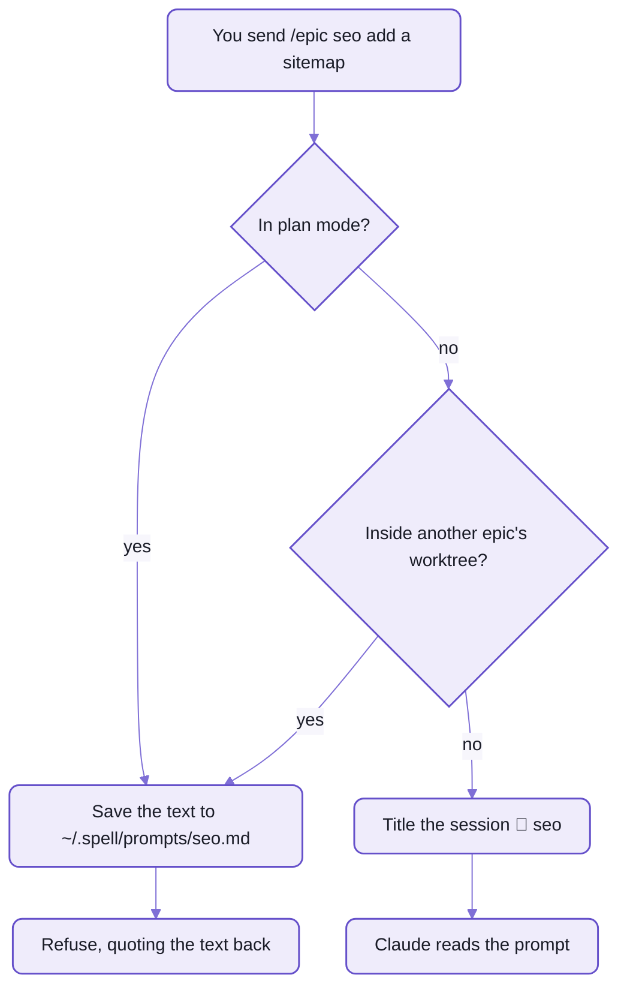

# The skills and hooks

The plugin gives Claude Code seventeen SKILLS and eight HOOKS.
This page says what each one is for, and when to reach for which.

- A SKILL is a workflow you start by typing its name (`/epic`, `/isolate`, `/bg` ...).
  - Each is a `SKILL.md` in [skills/](skills/):  instructions Claude follows, with judgement and dialog in them.
    The repo actions themselves are `epic` verbs ([README-cli.md](README-cli.md)).
  - Claude also starts a skill by itself when what you ask matches it ("isolate this", "what's going on?"),
    except `/bedtime`, which only you can start.
- A HOOK is a script Claude Code runs by itself when something happens:
  a session starts, you send a prompt, a turn ends.
  - Every hook acts only in a repo that has `.epic/config.json5`, and always exits 0, so it never blocks a session.
    The worktree hook is the exception:  its failure is Claude Code's answer.

## Planning and review

The skills for an epic's life, from the first prompt to the last review.

| Skill | What it does | Reach for it when |
| --- | --- | --- |
| `/epic <name> [what to plan]` | plans an epic on its page, in its own worktree and window, then builds it phase by phase | you have a piece of work worth a page |
| `/epic review [<name>]` | opens the epic page in the Review tab and listens:  applies your marks, writes answers into the items | you've marked a page, or want to go through one together |
| `/epic resume [<name>]` | picks an epic back up in a new session, in the right worktree and window, where its page says it stopped | a session died, or you're back the next day |
| `/epics [all]` | lists the open epics:  phase, worktree, session, what's waiting on you;  changes nothing | "where are my epics at?" |
| `/details [topic]` | explains a question on a page in the side bar, which you answer ON the page | a question needs a picture, or more than four options |
| `/comment <file> ...` | lets you comment on files inline, in the editor tab plan mode opens, one file per round | you want to mark up a file line by line |
| `/docs-check <epic...>` | makes the docs an epic wrote agree with what was chosen and built, and with each other;  left uncommitted | before an epic merges, or before you fly |
| `/send [<epic>] <text>` | files your words and screenshots as a request in another epic, and wakes that epic's session | you notice something that belongs to another epic, or to the tooling |

- `/epic` has more verbs, each for one moment:
  - `/epic future <name> [idea]`:  write an idea down as a future epic, with no worktree
  - `/epic phase [ids] [name]`:  add a phase to this session's epic, from its items or from scratch
  - `/epic start <P1 | ids>`:  work a phase, or a block of its items, now
  - `/epic request <epic> [<rN>]`:  take up a request sent with `/send`, into a phase
  - `/epic color <look>`:  recolour this window
  - `/epic done`:  the same as `/isolate done`
- `/send` also goes off by itself when you ask a session to change how you WORK
  (the pages, the Review tab, skills, windows):
  the request goes to the epic that looks after the tooling, not into this session's work.

## Worktrees and sessions

The skills that move work between worktrees, windows and sessions, and keep track of them.

| Skill | What it does | Reach for it when |
| --- | --- | --- |
| `/isolate <name>` | moves this session into its own worktree, in a new tinted window or this one | work started in `main` that should have its own branch |
| `/isolate done` | offers to merge into `main` and to open a pull request, then removes the worktree | the work is finished |
| `/park [<name>]` | commits the work as WIP in its own worktree, with a PARKED note of where it stopped and what's next | you need to stop, and pick it up later |
| `/unpark [<name>]` | finds the parked work, offers its window, merges the new `main` in and carries on | you're ready to go back to it |
| `/wait-for <name>` | parks, waits in the background for another session or epic to finish, then merges `main` in and carries on | this work needs another one merged first |
| `/worktrees [sessions]` | takes stock of every session and worktree:  in process, hung or parked, dead;  then cleans up what you pick | "what's open?", or the machine feels cluttered |
| `/session [<words>]` | finds and reopens a saved session in the Claude panel | you can't find a session in the panel's list |
| `/title [<title>]` | shows or changes this session's title | a session's name doesn't say what it's doing |
| `/wtf [<name>] [?]` | says what's going on:  the goal, the worktree, the phase, what's done, what's waiting;  `?` puts the open questions in the modal | you've come back to a window and lost the thread |

- `/wait-for ?` lists what it could wait for, to pick from.
- `/park <other>` tells another running session to park itself.

## Background and offline

The skills for work that runs while you're elsewhere.

| Skill | What it does | Reach for it when |
| --- | --- | --- |
| `/bg ["name"] [n] <task>` | runs a task in a named background agent, with a budget of `n` agents (one by default), so the panel is free in seconds | a task that doesn't need you watching |
| `/bedtime` | builds an epic's remaining phases overnight:  you pick the phases and answer its questions first;  a commit per phase, never merged | the end of the day, with a clear plan |
| `/airplane [land \| status]` | readies the pages to be worked on with no Claude;  `land` gathers what you left, across every epic and page | before a flight, or bad wifi;  `land` after |

- `/bg ?` lists what's running;  `/bg stop <name>` stops one.
  Each agent shows in the epic page's "Agents running" panel, where you can send it a note.
- In the morning after `/bedtime`, `/epic review <name>` goes through the night's work.

<details>
<summary>Each skill's arguments, as Claude Code shows them</summary>

| Skill | Arguments |
| --- | --- |
| `epic` | `<name> [what to plan] \| done \| review [<name>] \| resume [<name>] \| future <name> [idea] \| phase [ids] [name] \| start <P1 \| ids> \| request <epic> [<rN>] \| color <look>` |
| `epics` | `[all]` |
| `details` | `[topic]` |
| `comment` | `<file> [<file> ...]`, globs too |
| `docs-check` | `<epic...>`;  none:  asks which |
| `send` | `[<epic>] <text>`;  no epic:  the tooling's |
| `isolate` | `<name> \| done` |
| `park` | `[<name>]` |
| `unpark` | `[<name>]` |
| `wait-for` | `<name> \| ?` |
| `worktrees` | `[sessions]`:  the table alone |
| `session` | `[<words> \| <id> \| name [<title>]]` |
| `title` | `[<title>]` |
| `wtf` | `[<name>] [?]` |
| `bg` | `["name"] [n] <task> \| ? \| stop <name>` |
| `bedtime` | none:  it asks |
| `airplane` | `[land \| status]` |

- A look after an epic's name opens its window in that tint:  `/epic seo -teal`, `/isolate seo -teal`.

</details>

## Hooks

The hooks keep worktrees, windows and the shared pages in order without being asked.
They come from the plugin's [hooks.json](hooks/hooks.json);  a repo's own Claude settings hold none.

| When | Script | What it does |
| --- | --- | --- |
| a worktree is made or removed | [worktree.mjs](hooks/worktree.mjs) | makes the worktree, `<worktreesFolder>/<name>` on branch `<name>` from local `main`, installs it, keeps the session saved at the repo's root;  a removal stops the checkout's servers first |
| a session starts, or enters a worktree | [behind-main.mjs](hooks/behind-main.mjs) | says when the worktree is behind `main`, and offers the merge |
| a session starts | [worktree-guard.mjs](hooks/worktree-guard.mjs) | tells a worktree's session that started outside it to enter it |
| a session starts | [server-prune.mjs](hooks/server-prune.mjs) | at most hourly, stops page servers whose checkout is gone |
| a session leaves a worktree | [left-worktree.mjs](hooks/left-worktree.mjs) | reminds the reply to end with its closing line, "*You can close this tab*" |
| you send a prompt | [prompt-gate.mjs](hooks/prompt-gate.mjs) | names the session for an `/epic`, `/isolate` or `/unpark`, or refuses one that would go wrong (below) |
| a turn ends | [handoff.mjs](hooks/handoff.mjs) | moves the session to another window, when a move was armed |
| a turn ends | [shared-commit.mjs](hooks/shared-commit.mjs) | commits the content folder (`epic shared commit`), so every page edit is saved |

- A worktree's session gets there through Claude Code's own worktree tool, never by starting in its folder:
  only then does Claude Code bring it back there when it's reopened from another window.

### The prompt gate

The prompt gate reads an `/epic`, `/isolate` or `/unpark` prompt BEFORE Claude does,
so it can name the session first, and refuse one that would go wrong without losing what you typed.
Every other prompt passes untouched.



_A refused prompt is never lost:  `/epic seo` alone, later, picks up the saved text._

- `/epic future <name>` is titled `📅 <name>` instead, and never refused:  it makes no worktree.
- `/epic resume` and `/unpark` are only renamed:  they pick their window themselves.
- `/epic <name>` typed in ANOTHER epic's session isn't refused:
  it means "open a window for that epic", and the session keeps its own name.
- An epic that belongs to another repo is let through, not renamed, with a note saying which window to use.
- `/epic review <name>` is refused only in a session titled for a different epic.

<details>
<summary>Each hook's event and time limit</summary>

| Event | Script | Time limit |
| --- | --- | --- |
| `WorktreeCreate` | `worktree.mjs create` | 900 seconds (the install runs inside it) |
| `WorktreeRemove` | `worktree.mjs remove` | Claude Code's default |
| `SessionStart` | `behind-main.mjs` | 10 seconds |
| `SessionStart` | `worktree-guard.mjs` | 10 seconds |
| `SessionStart` | `server-prune.mjs` | 20 seconds |
| `PostToolUse` on `EnterWorktree` | `behind-main.mjs` | 10 seconds |
| `PostToolUse` on `ExitWorktree` | `left-worktree.mjs` | 10 seconds |
| `UserPromptSubmit` | `prompt-gate.mjs` | Claude Code's default |
| `Stop` | `handoff.mjs` | Claude Code's default |
| `Stop` | `shared-commit.mjs` | Claude Code's default (it detaches, and commits in the background) |

- Each runs `node "${CLAUDE_PLUGIN_ROOT}/hooks/<script>"`:  the plugin's own folder, wherever it's installed.
- The prompt gate's rules are in [PromptGate.ts](src/command/PromptGate.ts);  the hook is its thin caller.
  `SPELL_PROMPTS_DIR` moves the saved prompts' folder.
- The rename uses the hook's `sessionTitle` output, which Claude Code doesn't document yet.

</details>

## In Claude Code

A plugin's skills are named after the plugin, as `/spell-epic:epic` and `/spell-epic:isolate`.
To type bare `/epic`, link each skill into your own skills folder, once:

```sh
for skill in ~/www/spell/spell-epic/skills/*/; do ln -s "$skill" ~/.claude/skills/; done
```

- Both names then run the same skill, from the plugin's one folder.
- A skill's new text reaches a running session after `/reload-plugins`;
  `epic` and the hooks are live at once, since they're run fresh each time.
- A repo's own copy of a skill wins over the link in that repo:  remove it, or it shadows the plugin's.
- Installing the plugin itself:
  [README-adopting.md](README-adopting.md), or the kit's [README-agents.md](../README-agents.md), "The epic plugin".

## See also

- [README.md](README.md):  spell-epic's front page, and an epic's life
- [README-cli.md](README-cli.md):  the `epic` verbs the skills run
- [README-pages.md](README-pages.md):  the pages `/epic review` and `/details` work on
- [README-vscode.md](README-vscode.md):  the window moves the hooks make
- [The kit's README](../README.md):  Spell as a whole
- [The kit's README-agents.md](../README-agents.md):  every skill and hook in Spell, and what an agent reads first
- Also beside it:  [README-adopting.md](README-adopting.md)

<details>
<summary>More in the docs site</summary>

These guides live in the content folder, so they need a checkout with `spell.epics` beside the repos and the page
server running (`spell server start`, then the URL it prints):

- "Background agents:  /bg":  `/guides/background-agents.html`
- "Details Pages":  `/guides/details.html`
- "Windows and Review":  `/guides/windows-and-review.html`
- "Airplane Mode":  `/guides/airplane.html`

</details>

<details>
<summary>Until repo-split P13 lands:  the page server's command today</summary>

- `spell server start` is `spell dev server start` today:  the same command, under `dev`.
  That spelling keeps working after P13.

</details>
