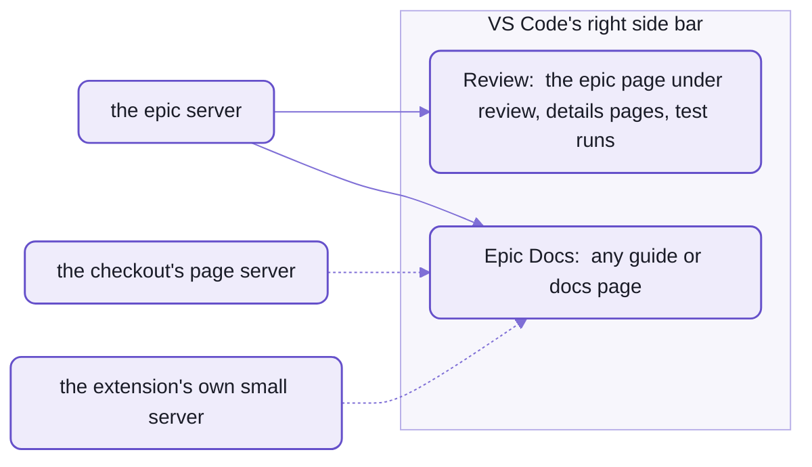
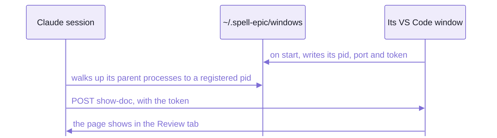

# The Spell Epic extension

Spell Epic is spell-epic's VS Code extension, built from your checkout and installed by hand.

- It puts two views in VS Code's RIGHT side bar, Review and Epic Docs:
  a page sits beside your code and the Claude panel, served live.
- It runs the WINDOW BRIDGE, which lets a Claude session reach its own window.
- Its id is `spell-app.spell-epic` and every one of its ids is `spellEpic.*`,
  so it runs beside Spell's language extension, which is spell-app's.
- Both extensions, and how windows and worktrees are laid out:  [the kit's README-vscode.md](../README-vscode.md).



_Both views show live pages from a server;  the epic server first, then the others if it isn't running._

## The views

Each view is a web view holding one frame of the page's address, as VS Code's Simple Browser does.
The page's own live reload runs inside it, so an edit the agent makes shows in place.

| View | Icon | Shows | Opened by |
| --- | --- | --- | --- |
| Review | a checklist | the epic page being reviewed, its details pages, test runs | `/epic review <name>`, `epic open <name> --review`, "Review:  Open Epic..." |
| Epic Docs | the spell hat | any guide or docs page | `epic open`, `epic pages open --vs`, `/spell-docs` |

- **Review:  Open Epic...**, the list button on the Review view, picks any registered repo's epic, from any window.
- The title-bar buttons on both:  Back, Forward, Reload, Restart Page Server, Open in Browser;
  the docs view adds Inspect and Show Console (Developer Tools on the page).
- Home Page is a palette command on each:  a fresh view at the docs' home page, for a page that stopped responding.
- Copy, cut, paste, select-all and undo work inside the pages:  the extension forwards them into the framed page.
- A window reload keeps each view's page.
- Showing the page already in view doesn't reload it, but a `#id` scrolls there.
- Opened by hand before anything was shown:
  Epic Docs shows the docs' home page;  Review, a line saying how to fill it.

One setting:

| Setting | Default | What it does |
| --- | --- | --- |
| `spellEpic.docPreview.location` | `sidebar` | where docs pages open:  the Epic Docs view, or `beside`, VS Code's Simple Browser next to the editor;  review pages always open in Review |

### Which server serves a page

The extension never starts a page server itself:  a VS Code started from the Dock may have no `node` on its `PATH`.
The commands that open pages start one first (`epic hub ensure`).

For a page file, the first of these that answers:

1. the epic server, spell-epic's one per machine (`epic hub`, port 4848 when it's free),
   when the file is in a registered repo's content folder:  every repo's pages on one port, from any window
2. the main checkout's page server, for a worktree's file, when it serves worktrees
3. the file's own checkout's page server
4. a small server of the extension's own, in-process on `127.0.0.1`, one per folder,
   with live reload and the epic routes, but no route modules

- A page is served from its checkout's ROOT, not its own folder:  docs link to source files all over the repo.
- A page can also be opened by a link:
  `vscode://spell-app.spell-epic/doc-preview?file=<absolute path>[&view=review]`,
  or `?url=` for a loopback address already served.

## The window bridge

A Claude Code session finds its OWN window through the extension,
so it can show you a page beside itself, add a folder, or hand itself over to a worktree's window.
Without it, a command can only reach whichever window is focused, which often isn't the session's.



_The session's process runs inside its window's extension host, so its parent processes lead to the right window._

- Each window writes one registry file, `~/.spell-epic/windows/<pid>.json`:
  its process id, port, token, window file and folders, readable only by you, since the token is the password.
  Files of crashed windows are deleted when any window starts.
- The bridge is plain HTTP on `127.0.0.1`, each request carrying the token.

| Operation | What it does |
| --- | --- |
| `show-doc` | shows a page in the Epic Docs or Review view, landing on an id, with a query (`test=1` for a test run) |
| `reload` | rebuilds a view from scratch, at the page it shows |
| `add-folder` | adds a folder to the window:  only to a window opened from a saved window file |
| `remove-folder` | removes a folder `add-folder` put there;  never the first |
| `open-session` | opens a Claude session in an editor tab, or a new one, with a prompt TYPED in, never sent:  you press Enter |
| `close-session-tab` | closes the one Claude tab with a given label |
| `close-window` | closes the window, just after answering |

What uses it:

- `/isolate <name>` and `/epic <name>`:  the handoff to the worktree's new window.
  That's `epic window handoff`.
- Send with nobody listening:  waking an epic's session, `/epic review <name>` typed in
  ([README-pages.md](README-pages.md), "How Send wakes a session").
- `/isolate done`:  closing the worktree's window.
- `epic window show`, `epic open`, `epic phase`:  showing a page beside the session.

## Building and installing it

It's a yarn project of its own, outside the kit's one install, so it installs its own dependencies once.
From spell-epic's folder:

```sh
cd ~/www/spell/spell-epic/vscode
yarn install      # once:  it's a yarn project of its own
yarn check        # type check
yarn package      # builds out/extension.js, then writes spell-epic.vsix
code --install-extension spell-epic.vsix
```

- Or `yarn vscode:package` at spell-epic's root, then the same `code --install-extension`.
- NO script installs it for you:  install it again after a change you want in every window, then reload the windows.
- `code` must be on your `PATH` (VS Code's "Shell Command:  Install 'code' command in PATH").
- An epic's worktree installs the extension's dependencies for you (the epic settings' `extraInstalls`).

## Hacking on it

| File | What's in it |
| --- | --- |
| [extension.ts](vscode/src/extension.ts) | starts the views and the bridge |
| [DocView.ts](vscode/src/DocView.ts) | the two side-bar views:  one frame each, navigated, never rebuilt (a rebuilt frame flashes white) |
| [DocPreview.ts](vscode/src/DocPreview.ts) | shows a page:  which view, and which server serves it |
| [WindowBridge.ts](vscode/src/WindowBridge.ts) | the window bridge:  the registry file and its operations |
| [docUrls.ts](vscode/src/docUrls.ts) | the pure parts:  page addresses, the epics "Open Epic..." lists;  no `vscode`, so its tests run under plain `node` |
| [build.mjs](vscode/build.mjs) | the esbuild bundle, `out/extension.js` |
| [package.json](vscode/package.json) | the views, commands, menus and the setting VS Code reads |

- The pages in the views come from the content folder and spell-epic's own routes, never from the extension:
  a change to a page's look is spell-epic's code ([README-pages.md](README-pages.md)), live without reinstalling.
  Only a change to the views, the bridge or the commands needs a new `.vsix`.
- Its tests are in spell-epic's [tests/vscode/](tests/vscode/):
  `yarn test` at spell-epic's root runs them (`yarn test:vscode` alone).
- The client side of the bridge, what `epic window` runs, is [window.mjs](src/window.mjs).

## See also

- [README.md](README.md):  spell-epic's front page
- [README-pages.md](README-pages.md):  what the views show
- [README-skills.md](README-skills.md):  the skills that move sessions between windows
- [README-cli.md](README-cli.md):  `epic window`, `epic hub`, `epic open`
- [README-adopting.md](README-adopting.md):  the extension's place in setting up another repo
- [The kit's README](../README.md):  Spell as a whole
- [The kit's README-vscode.md](../README-vscode.md):  both extensions, windows and worktrees

<details>
<summary>More in the docs site</summary>

These guides live in the content folder, so they need a checkout with `spell.epics` beside the repos and the page
server running (`spell server start`, then the URL it prints):

- "Windows and Review":  `/guides/windows-and-review.html`
- "Reviewing an Epic Page":  `/guides/epic-components/review.html`
- "Airplane Mode":  `/guides/airplane.html`

</details>
