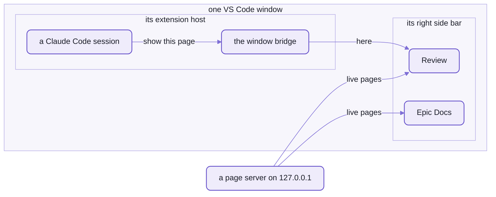
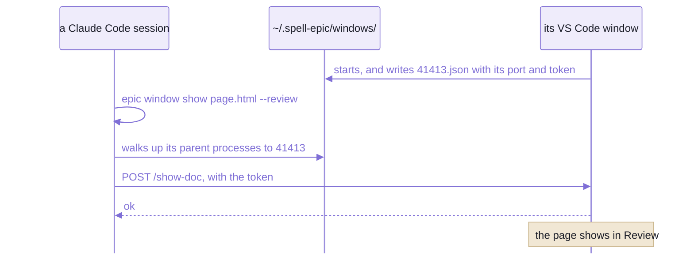

# The Spell Epic extension

```text
[Epic: READMEs](http://127.0.0.1:4747/api/docs/show?path=%2Fepics%2Freadme%2Freadme.plan.html&window=41413&view=review) • [🌐](http://127.0.0.1:4747/api/docs/show?path=%2Fepics%2Freadme%2Freadme.plan.html&in=browser)
```

_The last line of a Claude reply:  what `epic pages link <page> --review` printed for the epic writing these pages._

The Claude panel draws it as two links:  "Epic: READMEs • 🌐".
Click the first, and the epic page opens in VS Code's right side bar, in the Review tab,
in the window that session runs in:  `window=41413` names it.
The 🌐 opens the same page in Chrome.

A chat scrollback is where a plan goes to scroll away.
The epic page stays:  beside the session for as long as the epic runs,
reloading itself each time the agent edits it, and taking your review marks while the agent works.

Spell Epic is [spell-epic](README.md)'s VS Code extension, and it does two jobs:
- **two views in the right side bar**, Review and Epic Docs, each holding one live page from a server on your machine
- **the window bridge**, which lets a Claude Code session reach the window it runs in, not just the one in front



_Two jobs in one window:  the tabs show live pages from a server,
and a session in the same window puts a page in one through the bridge._

You build it from your checkout and install it by hand:  it isn't on the Marketplace, and no script installs it.

**The views need no agent.**
Any epic page opens from the Review tab's own list, with Claude switched off, on a plane included.
**Opening and closing sessions needs Claude Code.**
The bridge does both through Claude Code's own VS Code extension, so that part works with Claude Code and nothing
else, today.

<details>
<summary>Its name and ids, beside Spell's language extension</summary>

- It shows as "Spell Epic", version 0.1.0.
  Its id is `spell-app.spell-epic`, and every id it has is `spellEpic.*`:
  so it runs beside Spell's language extension, spell-app's, whose ids are `spell.*`.
- It starts with every window (`onStartupFinished`), since every window needs its bridge;
  and on a `vscode://` link to it (`onUri`).
- Both extensions side by side, and how windows and worktrees are laid out:
  [the kit's README-vscode.md](https://github.com/spell-app/spell/blob/main/README-vscode.md).

</details>

## Install it:  three commands and a reload

Run the kit's install first ([setup from zero](https://github.com/spell-app/spell/blob/main/README.md#setup-from-zero)):
the bundler, and the kit's own code that goes into the bundle, come from there.
The extension adds a small install of its own, because it's a yarn project apart, with its own lockfile:

```sh
cd ~/www/spell/epic/vscode
yarn install                               # once:  vsce, and the types for VS Code and node
yarn package                               # bundles out/extension.js, then writes spell-epic.vsix
code --install-extension spell-epic.vsix
```

Or let `epic plugin install` (and so `epic init`) install it:  it installs `vscode/spell-epic.vsix` with
`code --install-extension` whenever VS Code doesn't have that version yet (epic `epic-friend` P15).

Then reload each window ("Developer:  Reload Window", in the Command Palette):
a window keeps running the copy it started with.
A reload restarts that window's Claude panel too, so do it between turns.

To check it took, ask a Claude Code session in that window to run `epic window which`:

```sh
epic window which
```

<details>
<summary>What it printed</summary>

```text
pid        41413
workspace  (none:  not opened from a .code-workspace)
folders    /Users/<you>/www/spell
```

</details>

- `pid` is the window's extension host, the process the extension runs in;  the bridge, below, says why it matters.
- Before the install, or before the reload, it exits 1:

  ```text
  no window:  the spell-epic extension's bridge isn't running in this session's VS Code window
    (install spell-epic's VS Code extension, vscode/spell-epic.vsix, then reload the window)
  ```

One installed copy serves every window, and it remembers the checkout it was built in.
So build it from the main checkout, up to date with `main`.
A build from an older branch downgrades every window at its next reload, and nothing stops you.
A build from a worktree, once the worktree is gone, loses Restart Page Server,
and its fallback server loses the engine's scripts and styles.

- `code` must be on your `PATH`:  in VS Code, "Shell Command:  Install 'code' command in PATH".
- Build and install it again after any change you want in every window, and after moving the checkout;
  then reload the windows.
- From spell-epic's root instead:  `yarn vscode:package`, then `code --install-extension vscode/spell-epic.vsix`.
- In an epic's worktree, `vscode/`'s own install is done for you:
  the kit's epic settings list it in `extraInstalls` ([.epic/config.json5](https://github.com/spell-app/spell/blob/main/.epic/config.json5)).

<details>
<summary>What's in the .vsix, and what's built into it</summary>

- Three files, by its [.vscodeignore](vscode/.vscodeignore):
  `package.json`, the bundle `out/extension.js`, and `media/spell.svg`, the Spell hat.
- The bundle is about 760 KB, because it carries the kit's page server (`spell/server`):
  the fallback server below runs it.
  It carries spell-epic's repo list and settings readers too.
- esbuild makes it, as CommonJS for node 20, with `vscode` and `vite-plus/fmt` left out ([build.mjs](vscode/build.mjs)).
  Every import is a package name, and the kit's `sourceNames()` plugin finds each one's source file:
  esbuild alone finds neither a name without its extension nor a folder's `index.ts`.
- The checkout's own path goes in as a constant, `ENGINE_ROOT`.
  It's how an installed copy, living in VS Code's extensions folder, knows which `epic` restarts a server,
  and where the engine's own files are for its fallback server.

</details>

## Two views, each a page that stays

A browser tab is a page you go to.
Each of these is a page that stays where you work:  a frame holding the page's local address,
as VS Code's Simple Browser does, docked in the right side bar beside your code and the Claude panel.

| View | Icon | What it shows | What opens it |
| --- | --- | --- | --- |
| Review, `spellEpic.reviewView` | a checklist | the epic page under review, its details pages, test runs | `/epic review <name>`, `epic open <name> --review`, `epic test <name>`;  its own "Review:  Open Epic..." |
| Epic Docs, `spellEpic.docView` | the Spell hat | any guide or docs page, an epic page too | `epic open <name>`, `epic pages open <page> --vs`, `/spell-docs` (spell-app's skill) |

- Each view holds ONE page, and keeps its own:  the page you're reviewing stays put while the docs move.

Four things a browser tab wouldn't do:
- **It doesn't reload under you.**
  Showing the page already in view leaves it alone, and a `#id` only scrolls there:
  so an agent can point you at an item without throwing away the note you're halfway through.
  The page's own live reload still runs inside the frame, so an edit on disk shows in place.
- **It outlives a window reload.**
  Each view remembers its page for that window,
  and waits about 10 seconds for a page server that's restarting, as one does after a merge.
  Switching between the two tabs keeps each page as it was, scroll and all.
- **VS Code still answers.**
  Its keys work from inside the page (Cmd + Shift + P, Cmd + P, Cmd + B ...),
  and copy, cut, paste, select-all, undo and redo act in the page rather than on the view around it.
  Right-click shows the view's own menu, in place of VS Code's, whose Cut, Copy and Paste would miss the page:
  Cut with a selection in a field, Copy with any selection, Paste in a field, and Select All;
  then Back, Forward and Reload;  Open in Browser;  and Inspect.
- **Links go where they belong.**
  A docs page opens in the view;  another file the server serves opens in the editor, a folder in Explorer;
  any other site, in your browser.

Two quirks you'll meet in the first minute:
- The first page shown in a window opens the side bar AND moves your focus into it:
  VS Code has no way to show a view without focusing it.
  Later pages leave your focus where it is.
- Opened before anything was shown, Epic Docs shows the docs' home page, and Review says what fills it:
  "Nothing to review yet:  the list button above (Review:  Open Epic...), or /epic review <name>."

### The buttons

Both title bars carry the same row, and Review adds a list button right of Home:

| Button | What it does |
| --- | --- |
| Back, Forward | the page's own history.  The view can't read a frame from another origin, so the page reports where it is;  a page from no page server never does, and both stay off |
| Reload | the page again, in the same frame |
| Home Page | a NEW frame, at the docs' home page:  the epic server's, else the window's own repo's |
| Review:  Open Epic... | lists every epic page of every registered repo, and of the window's first folder, newest first, by title;  the one you pick opens in Review, in any window.  No terminal, no Claude:  it's how you review on a plane |
| Restart Page Server | stops and starts the server behind the page, then shows the page again, on its new port if it moved |
| Open in Browser | the page, in your default browser |
| Inspect | VS Code's Developer Tools, which hold the page;  a second click closes them.  The tooltip says what to pick next:  Cmd + Shift + C for the element picker, or the Console tab and the page's frame (`127.0.0.1`) in the menu at its top left;  VS Code can't choose the frame itself.  Desktop VS Code only |

### When a page misbehaves

Four fixes, gentlest first:

| When the page ... | Try | What it does |
| --- | --- | --- |
| is stale, or shows an error | Reload | loads it again, in the same frame |
| stops taking clicks | `epic window reload` (`--review` for Review) | a new frame, at the same page |
| stops answering at all | Home Page | a new frame, at the docs' home page |
| lost its server, or has a stale one | Restart Page Server | the server behind it, stopped and started, and the page shown again |

Home Page builds a new frame rather than steering the old one,
because a wedged page ignores every message the view sends it, Back included.

### One setting

| Setting | Default | What it does |
| --- | --- | --- |
| `spellEpic.docPreview.location` | `sidebar` | where docs pages open:  `sidebar`, the Epic Docs view;  or `beside`, VS Code's Simple Browser in a column next to the editor, loaded afresh each time.  Pages for review always open in Review |

## Which server answers:  the first of four

A view never shows a file:  it shows a live page from a server on `127.0.0.1`.
That's what reloads the page when it changes, and what your review marks are sent to.
For a page file, the extension takes the first of these that answers:

1. **the epic server**, spell-epic's one per machine (`epic hub`, on port 4848),
   for a page in a registered repo's epic folder:  every repo's pages on one port, from any window
2. **the main checkout's page server**, for a worktree's page, when it serves worktrees (at `/worktrees/<name>/`)
3. **the page's own page server**, when one runs:  in a Spell kit, the kit's, for a page of any repo in it;
   else its checkout's
4. **a small server of the extension's own**, inside VS Code, one per checkout, for as long as the window runs

The first three are processes of their own, and the extension never starts one:
a VS Code started from the Dock may have no `node` on its `PATH`.
So the commands that open pages start one first (`epic hub ensure`), and the fourth is a fallback, not a plan.
**The fourth is for reading, not reviewing:**
it has live reload and the engine's own files, but none of the `/api/` routes your review marks are sent to.

- A checkout's server, and the fallback, serve from the checkout's ROOT, not the page's folder:
  docs link to source files all over the repo.
- What the epic server serves, and how a repo registers with it:
  [README-epics.md](https://github.com/spell-app/spell/blob/main/README-epics.md), "One epic server for the machine".

<details>
<summary>How it finds the servers, and what Restart Page Server runs</summary>

- The epic server, by its pid file:  `~/.spell-epic/server.json` (`SPELL_EPIC_HOME` moves the folder).
- A page server, by the `.spell-server.json` at its root:  in a Spell kit, the kit's root, since the page server
  is the kit's ([the kit's README/server.md](https://github.com/spell-app/spell/blob/main/README/server.md)).
- The fallback, one per checkout, live-reloads the docs folders (`epics`, `guides`, `pages`, `templates`, `sagas`),
  else the whole checkout.
  The engine's files it serves (`/_epic/assets/`, `/_epic/pack/`, `/templates/`) come from the checkout the extension
  was built from.
- Restart Page Server asks the server what it is (its `/api/server`), then runs that same checkout's `epic`:
  - for the epic server:  `epic hub stop`, then `epic hub ensure`
  - for a checkout's page server:  `epic server stop`, then `epic server ensure`, in that checkout
  - both in a login shell (`$SHELL -lc`), for the `PATH` a Dock-started VS Code lacks
  - a worktree's server may come back on another port, and the page follows it there

</details>

<details>
<summary>Opening a page with a vscode:// link</summary>

- `vscode://spell-app.spell-epic/doc-preview?file=<absolute path>[&view=review]`,
  or `?url=` for a page a server already serves, which must be on `127.0.0.1` or `localhost`.
- It's what `epic open` falls back to when the bridge doesn't answer, and a weaker path:
  macOS hands the link to whichever window is in front.
- Without the extension installed, VS Code says it can't handle the link.
- Run outside VS Code altogether (a session in another terminal), `epic open` shows the page in Chrome instead.

</details>

## The window bridge:  a session finds its OWN window

`code --add`, `code -r` and a `vscode://` link all act on the window in front,
and the window in front is often not the session's.
The bridge gives every window a private address, and every session a way to find its own.

Here are the parents of the session that wrote this page:

```text
  PID  PARENT  PROCESS
85448   41615  zsh                    the shell the session runs a command in
41615   41413  claude                 the Claude Code session
41413     910  Code Helper (Plugin)   the window's extension host:  ~/.spell-epic/windows/41413.json
  910       1  Code                   VS Code
```

_This session's own parent processes, from `ps`:  the first with a registry file is its window._

A session runs inside its window's extension host, the process the extension runs in.
So `epic window` walks up its parent processes to the first one with a registry file, and asks THAT window,
whichever one has the focus.



_Whichever window is in front, a session's parents lead it to its own._

The registry file, with its token blanked:

```json
{
  "pid": 41413,
  "port": 55946,
  "token": "…",
  "workspaceFile": null,
  "folders": ["/Users/<you>/www/spell"]
}
```

There's one per window, named for its extension host's pid, and only you can read it (the folder 700, the file 600).
The token is the password:  anything else that reaches the port without it gets a 401.

- `workspaceFile` is the window file the window was opened from, `null` for a folder or an untitled window:
  `add-folder` checks it, below.
- The file is rewritten when the window's folders change, and deleted when the window closes;
  a crashed window's file is deleted when any window starts.
- `SPELL_EPIC_WINDOWS_DIR` moves the folder, for tests.

A command run in a terminal, rather than by a session, has no such parent:
a terminal's shell belongs to VS Code's terminal process, not the extension host.
So it guesses from the folder it's run in:  the window holding that folder in any of its folders but the first,
the repo root, unless that first one is a worktree.
That's why the check after an install asks a session, not a terminal.

### Seven operations

| Operation | What it does | Who sends it |
| --- | --- | --- |
| `show-doc` | shows a page in Epic Docs or Review (`view`), landing on an id (`hash`), with a query (`query`:  `test=1` for a test run) | `epic open`, `epic window show`, `epic pages open --vs`, `epic pages link --show`, `epic phase`, `epic test`;  the link in a reply |
| `reload-view` | a new frame for a view, at the page it shows;  answers its address, `null` for a view never shown | `epic window reload` |
| `add-folder` | adds a folder after the window's last;  refused in a window not opened from a window file | `epic window add <path>` |
| `remove-folder` | removes a folder;  never the first, the repo root | `epic window remove <path>` |
| `open-session` | opens a Claude Code session in an editor tab, never the side bar, with a prompt TYPED in, never sent:  you press Enter.  No session id:  a new session | a move to a worktree's window;  waking an epic:  `epic window launch`, `/send`, Send with nobody listening |
| `close-session-tab` | closes the ONE Claude Code tab showing a session's title, which ends that tab's `claude` process | a move to a worktree's window, in the window it leaves |
| `close-window` | closes the window, just after answering | `epic window close <name>` |

How Send picks the session it wakes:  [README-pages.md](README-pages.md), "How Send wakes a session".

<details>
<summary>The link in a reply, step by step</summary>

- `epic pages link <page> [--hash <id>] [--review]` prints it;  `--show` also shows the page now, with no click.
- The Claude panel follows only http(s) links, so a `vscode://` link would do nothing there.
  The link goes to the page server's `/api/docs/show` ([showRoutes.ts](src/tools/showRoutes.ts)),
  which sends `show-doc` to the window its pid names.
- `window=` gone, because that window reloaded since:  the window holding the page's checkout, else any.
- `in=browser`, the 🌐:  Chrome, in front, reusing the page's tab.
- It answers a tiny page that closes its own tab, then brings VS Code to the front (on macOS).
- It answers only a link you clicked:  a request from another site gets a 403, so no page can make VS Code jump.
- A worktree's page goes through the main checkout's server, so every link has one port.

</details>

<details>
<summary>The protocol, for a script of your own</summary>

- Plain HTTP on `127.0.0.1`, on a free port, one server per window.
- `POST /<operation>`, a JSON object as the body (64 KB at most), and `Authorization: Bearer <token>`,
  checked in constant time.
- It answers `{ ok: true, ... }`, or `{ error }` with a 4xx or 5xx status:
  401 for a bad token, 404 for an unknown operation or a missing file, 409 for `add-folder` in a window with no
  window file, 413 for a body too big.
- A window whose bridge fails to start still works;  its sessions just can't reach it.
- The client every `epic window` verb uses:  `Window.request(op, body, window)`, in [window.mjs](src/window.mjs).

</details>

### A session moves by being resumed

A process can't change windows, so a session moves by being resumed in the new one.
`/isolate <name>` and `/epic <name>` open the worktree's window, then run `epic window handoff <name>`.
When the turn ends, the plugin's `Stop` hook ([handoff.mjs](hooks/handoff.mjs)) runs `epic window resume`:
1. `open-session` in the new window:  the SAME session, resumed in an editor tab, its prompt typed in
2. `show-doc` there, if the session asked for a page while the move was pending:  the last one asked for
3. `close-session-tab` in the old window, which ends the old `claude` process

- Why wait for the turn to end:  until then, the old process is still writing the session's transcript,
  and the new tab would load it half-written.
- The skills that move sessions, and the hooks:  [README-skills.md](README-skills.md).

Where the bridge can let you down:
- **Two sessions with one title stall the close.**
  A Claude Code tab says nothing of its session but its label:  the title, cut to 24 characters and an ellipsis.
  With no single match, the old tab stays open and idle;  close it by hand.
- **`add-folder` needs a window file.**
  In a one-folder or untitled window, adding a folder reopens the window as a new workspace,
  which restarts every extension, the Claude panel that asked included;  so the bridge refuses.
  And never a worktree's folder:  VS Code writes it into the window file, where it outlives the worktree.
- **It leans on Claude Code's own extension.**
  `open-session` calls its `claude-vscode.primaryEditor.open`, with the prompt as its second argument
  (as of its version 2.1.287);  `close-session-tab` finds its tabs by their webview type.
  A change there can break both, and no other agent's extension is driven at all.
- **Made on macOS;  Linux and Windows not yet tried by a person** (epic `epic-friend` P15).
  - The process table, a process's folder and open files, links and running `code` go through the kit's
    `Processes` and `Links` (`spell/server`), which ask each system its own way.
  - A pasted picture:  `ClipboardImage`, AppleScript on macOS, `wl-paste` or `xclip` on Linux, PowerShell on
    Windows.
  - Windows can't say which files a process has open, so a session's window isn't found there:
    `epic session open` opens in the last window.
  - Bringing VS Code forward after a link works on macOS only;  `epic open`'s fallback, the doc-preview URI, goes
    through the editor's own `--open-url` on every system.
- **Cursor too, tried only from its command line** (epic `epic-friend` P16).
  - Cursor runs VS Code's extensions, and its command takes VS Code's flags:  the tools run `cursor` where they'd
    run `code`, and its links start `cursor://` (`Editor`, `spell/epic/config/Editor`).
  - Which one:  `SPELL_EPIC_EDITOR` on this machine, else the window the command runs in (Cursor's marks in the
    environment), else `editor` in `.epic/config.json5`, else VS Code.
  - `epic plugin install` puts the `.vsix` into the editor it names:  `cursor --install-extension` was checked
    against a scratch Cursor profile (Cursor 3.22).
  - Cursor keeps its right side bar for its own agent (since its 3.15.6, Claude Code's panel opens as an editor tab:
    [Cursor's forum](https://forum.cursor.com/t/claude-code-extension-no-longer-appears-in-the-right-sidebar-after-cursor-3-15-6-update/167700)),
    so Review and Epic Docs may not show there:  **View: Open View...**, then drag the view where you want it, or
    **View: Move View**.  No person has tried that, nor a window move, in Cursor yet.

## Working on it

The pages in the views are never the extension's:  they come from the epic folder and spell-epic's own routes.
So a change to how a page looks is spell-epic's code ([README-pages.md](README-pages.md)), live with no reinstall.
A new `.vsix` is for a change to the views, the buttons, the bridge or the commands,
or to the code it bundles:  the kit's page server, which the fallback runs, and spell-epic's repo list.

| File | What's in it |
| --- | --- |
| [extension.ts](vscode/src/extension.ts) | starts the views and the bridge;  nothing to stop by hand |
| [DocView.ts](vscode/src/DocView.ts) | the two views:  one frame each, steered rather than rebuilt (a rebuilt frame flashes white);  the buttons, the menu, and the keys and edits passed through |
| [DocPreview.ts](vscode/src/DocPreview.ts) | shows a page:  which view, which server, and the `vscode://` link |
| [WindowBridge.ts](vscode/src/WindowBridge.ts) | the window bridge:  the registry file and the seven operations |
| [docUrls.ts](vscode/src/docUrls.ts) | the pure parts:  page addresses, the "Open Epic..." list, which file a served address is, a Claude tab's label;  no `vscode`, so its tests run under plain `node` |
| [build.mjs](vscode/build.mjs) | the esbuild bundle, `out/extension.js`, with the checkout's path built in |
| [package.json](vscode/package.json) | the views, commands, menus and the setting VS Code reads |
| [window.mjs](src/window.mjs) | the bridge's other side:  what `epic window` runs |

Two checks, both from spell-epic's root.
The type check is `yarn vscode:check`.
The tests are seven, of the pure parts, in [tests/vscode/](tests/vscode/), run by plain `node --test`:

```sh
yarn test:vscode
```

<details>
<summary>Output</summary>

```text
...
✔ stamped() and samePage():  a fresh ?t=, ignored with the hash when comparing ...
...
✔ folderIndex():  a window's folder by any spelling -- one reopened from the recent list after a move (I59) ...
ℹ tests 7
ℹ suites 0
ℹ pass 7
ℹ fail 0
...
```

</details>

- `yarn test` runs them with the rest, and with the bridge's other side's own, [window.test.mjs](tests/window.test.mjs).
- The views and the bridge's server need a running VS Code, so they have no tests:
  try a change by hand, in a window reloaded after the install.
- `vscode/`'s own `yarn check` stops at `command not found: node_modules/.bin/tsc`:
  it looks for TypeScript in spell-epic's folder, and the one install keeps it at the kit's root.

## See also

- [README-pages.md](README-pages.md):  what the two views show, and how a review round runs on them
- [README-skills.md](README-skills.md):  the skills that open pages and move sessions, and the hook that finishes a move
- [README-cli.md](README-cli.md#windows-and-the-page-server):  every `epic window`, `epic hub` and `epic pages` verb
- [README-epics.md](https://github.com/spell-app/spell/blob/main/README-epics.md):  the extension as one step of setting up a repo that isn't Spell, and the
  epic server in full
- [The kit's README-vscode.md](https://github.com/spell-app/spell/blob/main/README-vscode.md):  Spell's language extension beside this one, and how window files
  and worktrees are laid out

<details>
<summary>More in the docs site</summary>

In the epic folder, so only where a checkout has `spell.epics`, served by `spell server start`:

- "Windows and Review":  `/guides/windows-and-review.html`

</details>
