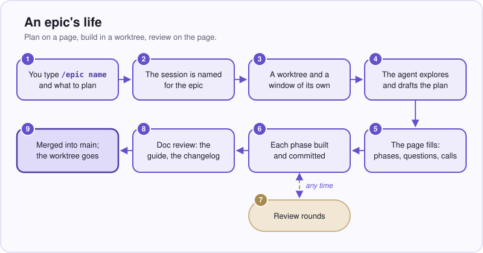
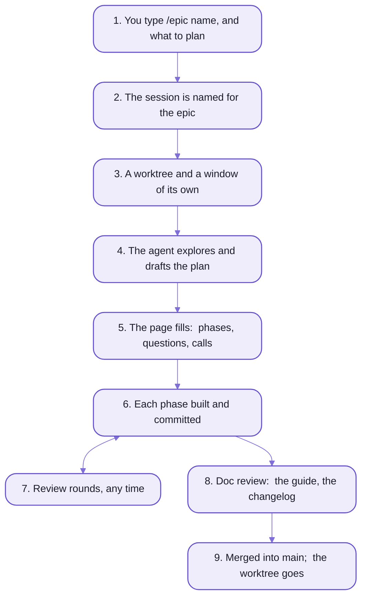

# spell-epic:  epics and sagas

spell-epic is a way of building software with a coding agent where the plan is a living page.
You ask for an EPIC;  the agent plans it on its page, builds it phase by phase in a worktree of its own,
and you review it on the page itself, in VS Code, while it works.

It's a Claude Code plugin today;  other agents are coming (below).

It changes where your attention goes.
You stop reading chat scrollback, and start reading a page that stays true.

- Every question comes with its options and a recommendation, so you can decide from the page alone.
- The calls the agent made without you are listed, for you to approve or revisit:  nothing is decided behind your back.
- Colours carry one meaning each, on every page:  red needs you, green is settled.
- You review when you have time, not when the agent asks:  your marks wait on the page until you press Send.
- Each epic works in its own worktree and VS Code window, so three can run at once without touching each other.
- Each epic ends with a guide and a changelog entry, so the project remembers why it is the way it is.

| For you | For the agent | For the project |
| --- | --- | --- |
| one page per piece of work, readable cold | a record to resume from, in any session | every decision kept, with its reasons |
| questions with options, answered by a click | your answers arrive as marks, applied by one command | worktrees that never collide |
| review whenever you like, even offline | background agents for the slow parts, listed on the page | a guide per epic, a changelog entry per merge |

## An epic's life



_The page is the memory:  every decision, call, issue and test lives there._

<details>
<summary>As text</summary>



</details>

<details>
<summary>The nine steps, in detail</summary>

1. You type `/epic <name> <what to plan>` in a Claude Code session.
2. A hook reads the prompt before Claude does:  it titles the session `🚧 <name>`,
   and refuses one that would go wrong (in plan mode, or inside another worktree), saving your text first.
3. The session makes its worktree and installs it:  `../<repo>.worktrees/<name>`, on branch `<name>`.
   It writes a stub epic page (so your prompt survives a lost session),
   and moves itself into a new window, `⎇ <name>`.
4. It explores, read-only, then drafts the plan in Claude Code's plan mode:
   phases named `P1 · Short Name` with estimates, the last always "Doc Review".
   Questions it can't settle alone come to you in the question modal.
5. Once you approve the plan, a background agent fills the page:  phases, items, the overview.
   The page shows in VS Code's Review tab.
6. Each phase:  marked active, built, every finding recorded as an item as it goes, committed
   (`P1:  Name -- summary`, in each repo it touched), then marked done with what was built.
   The agent stops after each phase and asks whether to go on.
7. At any time you mark the page, and a `/epic review <name>` session takes the marks
   ([README-pages.md](README-pages.md), "A review round").
8. The last phase, Doc Review:  open items pruned, the To test list complete, a text pass,
   the epic's GUIDE written, a changelog entry.
9. `/isolate done` offers to merge into `main` and to open a pull request, removes the worktree (its servers stopped
   first) and closes the window.
   The epic page stays, as the record.

</details>

## The words

An epic is one piece of work with one name:  one branch, one worktree, one window, one session, one page.
Everything on its page has a short id, so you can say "approve J3" in chat.

| Word | What it is | Id |
| --- | --- | --- |
| epic | a planning session and the work it plans, under one name (`readme`) | its name |
| saga | an epic of epics:  the larger aim several epics serve | `SAGA:/<id>` |
| epic page | an epic's live record, `epics/<name>/<name>.plan.html`, in the shared content folder | |
| phase | one step of the plan, built and committed on its own:  `P1 · Short Name` | `P1` |
| question | something only you can decide;  answered, it's a decision | `Q1` |
| judgement call | a choice the agent made without you, open until you review it | `J1` |
| caveat | a limit or risk the plan accepts | `C1` |
| todo | later work that isn't a caveat or an issue | `T1` |
| issue | a problem found, open until fixed | `I1` |
| test | something you check by hand before merging:  a step, and what should happen | `V1` |

- Nothing on a page is deleted:  an item is closed, or canceled (struck through),
  and rewritten text moves into a folded Original Discussion.
- The epic page is SHARED content:  every checkout, `main` and each worktree, sees the one file,
  and it's committed for you after every turn, in the content folder's own git repo.
- Every question, issue and call ends with a "Net effect" list:  what changes, in plain words.

## What the pages do

A page is a document you can act on.
Each line below is one thing you can do on a page;  [README-pages.md](README-pages.md) shows them.

- **Review marks**:  each item has Approve, Revisit (with a note), Make Todo and, apart, Do Now.
  A todo has its own:  do it in the next phase, Revisit, drop it.
- **Picks**:  a question's options are cards;  press Choose on one.
- **Send and Review Now**:  in the page's header.
  Send hands your marks to the session listening;  Review Now sends them AND asks for every revisit to be answered now.
- **Do Now**:  the wand on one item.
  A background agent writes the answer into it, with no Send.
- **Comments**:  a bullhorn beside every block of any docs page, or select text and press ⌘-I;
  each comment becomes a thread the agent answers under the paragraph it quotes.
- **Test runs**:  "Start testing" steps through the open tests one card at a time;  a failure becomes an issue.
- **Requests between epics**:  `/send <epic> <text>` files your words and screenshots in another epic, and wakes it.
- **Colours**:  one meaning each, on every page:
  red needs you, yellow is open, blue is in progress, green is settled, orange changed since you looked.

## In VS Code

The pages live in VS Code's RIGHT side bar, beside your code and the Claude panel, through spell-epic's own extension.

- **Review**:  the epic page you're reviewing, its details pages and test runs.
- **Epic Docs**:  any guide or docs page, live-reloading as the agent edits it.
- Each epic's window has a look of its own (one of twelve tints) and is titled `⎇ <name>`;
  its Claude session is titled `🚧 <name>`, so the panel's list reads like your epics.
- The extension also lets a session reach its own window:
  to show you a page, or to move itself into a worktree's window.
- Building and installing it:  [README-vscode.md](README-vscode.md).

## Built from Spell UI and Epic UI

The pages are plain HTML.
A page holds only data and prose;  custom elements draw everything else.

- [Spell UI](../spell-ui/README.md)'s `<ui-*>` elements draw the page's frame:  sections, tables, buttons, icons.
- Epic UI, spell-epic's own `<epic-*>` elements, draws what's particular to epics:
  `<epic-page>`, `<epic-item>`, `<epic-question>`, the review buttons, the comment threads.
  - They're a component pack:  `<ui-root>` loads them the first time a page uses one, like Spell UI's own.
  - Each has a docs page in the Epic UI set, served at `/components/epics/`.
- The `epic` command writes the same markup through the same element definitions:
  each element is described ONCE, so the tool and the page always agree.
- How elements and packs work:  [the kit's README-element.md](../README-element.md).

```html
<epic-section id="judgements" kind="judgements">
  <epic-item id="j3" title="One 'From' column, not two" status="open" state="open" source="parts/j3.html"></epic-item>
</epic-section>
```

_What a page file holds:  data in attributes, prose in children (here, in a part file).
The elements draw the section, the chip, the buttons and the fold._

## Beyond Spell

Nothing about the method is Spell's.
A project that isn't Spell needs:

- Claude Code with the plugin, and `epic` on the terminal's `PATH`
- one config file in the repo, `.epic/config.json5`, which `epic init` writes
- a content folder beside the repo, for the pages:  `epic init` makes it too
- the VS Code extension, for the Review tab

It has run end to end once outside Spell, in a throwaway repo.
The rough edges are listed, not hidden:  [README-adopting.md](README-adopting.md).

## 🌱 Coming:  other agents

The same workflow driven from Codex and other coding agents:  planning on the page, worktrees, the review loop.
The pages, the `epic` command and the content folder are plain files and programs any agent can use;
the skills and hooks around them are Claude Code's.

Where it stands:  planned;  Claude Code only for now.

## The commands

`epic` is the command line under all of it.
The agent runs it;  you can too (`epic summary readme`).

- It edits the one shared epic page from any checkout, runs the review inbox,
  and drives worktrees, windows and the servers.
- It's on every Claude session's `PATH` while the plugin is on, with no build step.
- Every verb, by group:  [README-cli.md](README-cli.md).

The skills are what you type:  `/epic`, `/isolate`, `/details`, `/bg` and thirteen more,
plus eight hooks that run without being asked.
When to reach for which:  [README-skills.md](README-skills.md).

## Try it

In a Spell checkout with the plugin installed ([the kit's README-agents.md](../README-agents.md), "The epic plugin"),
in a new Claude Code session:

```text
/epic hello-epic add a --version flag to the cli
```

- The session names itself `🚧 hello-epic`, asks whether to open a new window, and makes the worktree.
- The epic page opens in the Review tab:  watch it fill.
- `/epics` lists every open epic;  `/wtf` says where this one stands.

## Working on it

spell-epic is ONE package, `spell-epic`, laid out as a plain JavaScript repo.
Its rules for working on it:  [the repo's AGENTS.md](AGENTS.md), and [the code's](src/AGENTS.md).

- the code in `src/`, its tests in `tests/` at the same paths
- the plugin's parts at the root

| Folder | What's in it |
| --- | --- |
| [.claude-plugin/](.claude-plugin/) | the plugin's manifest, and a marketplace of one (this folder), so the plugin loads in place |
| [skills/](skills/) | the seventeen skills, a `SKILL.md` each |
| [hooks/](hooks/) | `hooks.json` and the scripts it runs |
| [bin/epic](bin/epic) | the `epic` command;  its code is in [src/command/](src/command/) |
| [src/](src/) | the code:  the `<epic-*>` elements, the epic tool, the epic server, the docs tools, Epic UI's pages |
| [tests/](tests/) | its tests, at the same paths as the code;  and the extension's |
| [templates/](templates/) | every kind of page's starting point, and the epic-page writing rules ([plan-doc.md](templates/epics/plan-doc.md)) |
| [vscode/](vscode/) | the VS Code extension, a yarn project of its own |
| [scripts/](scripts/) | dev-only scripts:  Epic UI's data |
| [docs/images/](docs/images/) | the screenshots on these pages |

- ONE copy per machine, which every repo and every window runs:
  - an edit is live at once for `epic` and the hooks
  - a skill's new text reaches a running session after `/reload-plugins`
- It's a child repo of the kit, and installs with the kit's one `yarn install`:  never in here alone.
- Its dependencies are the kit (`spell-kit`:  the page server, the element framework, the toolchain) and Spell UI,
  imported by their package names.
- It adds no commands to `spell`:  the docs tools are `epic pages <verb>` (`spell dev docs <verb>` before
  repo-split P13).
  - `epic`'s own move to a `cli/` folder here, and its verbs' renames, are still to come.

```sh
# from spell-epic's folder, ~/www/spell/spell-epic
yarn ts                 # src/ and tests/
yarn test               # node and browser (chromium) projects, then the window script's and the extension's tests
yarn lint
yarn plugin:validate    # claude plugin validate .
yarn vscode:check       # the extension's type check (after yarn install in vscode/)
yarn vscode:package     # the extension's bundle and spell-epic.vsix:  NOT installed by any script
```

<details>
<summary>Until repo-split P14 lands:  imports</summary>

- Inside spell-epic, its own files are imported by an alias today;  after repo-split P14, by `spell-epic` and `#/`.

</details>

<details>
<summary>Every kind of page</summary>

| Page | What it's for | Made by |
| --- | --- | --- |
| epic page | an epic's live record:  overview, phases, items, log | `/epic <name>` (`epic new`) |
| saga page | a saga's purpose, what's done so far, ideas not done yet, and a card per epic | `epic saga page <id>` |
| details page | one question explained with a picture, answered on the page | `/details` (`epic ask new`) |
| choice page | a table of names the agent recommends, typed over, then "Do it" | `epic choices new` |
| review page | several calls at once:  keep, change, talk over | the details tools, from a template |
| guide | what an epic built, for a reader coming to it cold:  written at Doc Review | `epic pages new durable guides/<page>.html` |
| home page | the docs' front door, a card per area;  each area's list page (Epics, Sagas, Guides) | `epic pages index` |

- Every kind starts from a template in [templates/](templates/):  `epic pages template <name>` prints one's path.
- More on each:  [README-pages.md](README-pages.md).

</details>

<details>
<summary>The modes:  standing, future, bedtime, airplane</summary>

- **Standing epic**:  a long-lived one whose phases each go onto `main` at once, never through `/isolate done`.
  - Each phase merges with `epic merge <name>`.
  - The feedback epic, where comments with no other home go, is one.
- **Future epic**:  `/epic future <name> [idea]` writes an idea down, with no worktree:  a stub page and a review
  page of its big open questions.
  `/epic <name>` plans it later.
- **Bedtime**:  `/bedtime` builds an epic's remaining phases overnight, unattended:  you pick the phases and answer
  its questions first;  a commit per phase, calls recorded on the page, never merged.
  `/epic review <name>` in the morning.
- **Airplane mode**:  `/airplane` before a flight readies the pages to be marked with no Claude;
  `/airplane land` afterwards gathers everything you left, across every epic and page, and works through it.

</details>

<details>
<summary>Where spell-epic came from</summary>

- It grew inside spell-app as its planning tools, then was lifted out into a repo of its own in October 2026
  (epic `epic-eject`), with a fresh git history:  its first commit names the spell-app commit the files came from.
- To see how a file came to be before that, look in spell-app's history.
- spell-app kept its old `spell dev plan-doc ...` spellings, each handed on to `epic` word for word,
  until repo-split P13 removed them.
- It became a child repo of the kit, installed with the kit's one install, in epic `epic-engine`.

</details>

## See also

- [README-pages.md](README-pages.md):  the pages, the review round, the `<epic-*>` elements
- [README-skills.md](README-skills.md):  the skills and hooks
- [README-cli.md](README-cli.md):  the `epic` command
- [README-vscode.md](README-vscode.md):  the extension
- [README-adopting.md](README-adopting.md):  using spell-epic beyond Spell
- [The kit's README](../README.md):  Spell as a whole
- [The kit's README-agents.md](../README-agents.md):  agents, WWOD and the plugin
- [The kit's README-vscode.md](../README-vscode.md):  both VS Code extensions

<details>
<summary>More in the docs site</summary>

These guides live in the content folder, so they need a checkout with `spell.epics` beside the repos and the page
server running (`spell server start`, then the URL it prints):

- "Epic Pages":  `/guides/plan-docs/plan-docs.html`
- "spell-epic:  the epic engine, outside spell-app":  `/guides/spell-epic/spell-epic.html`
- "Windows and Review":  `/guides/windows-and-review.html`
- "Reviewing an Epic Page":  `/guides/epic-components/review.html`
- "Airplane Mode":  `/guides/airplane.html`
- Epic UI, every `<epic-*>` element:  `/components/epics/`

</details>
