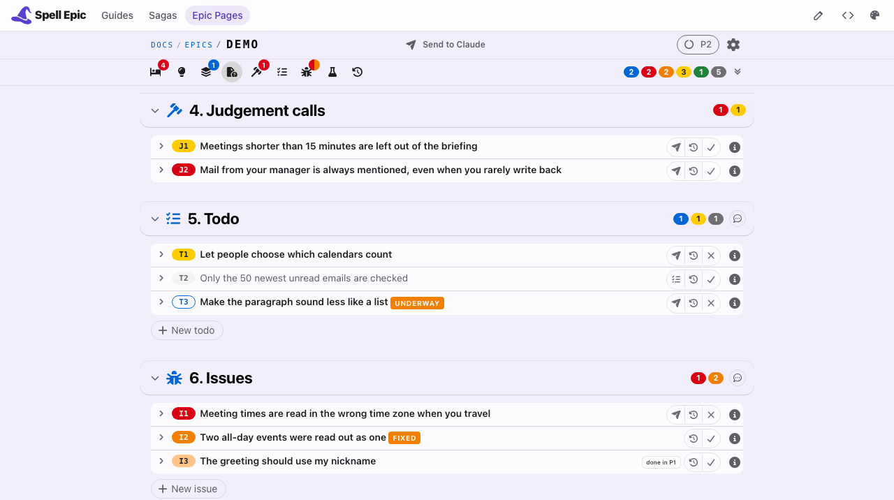
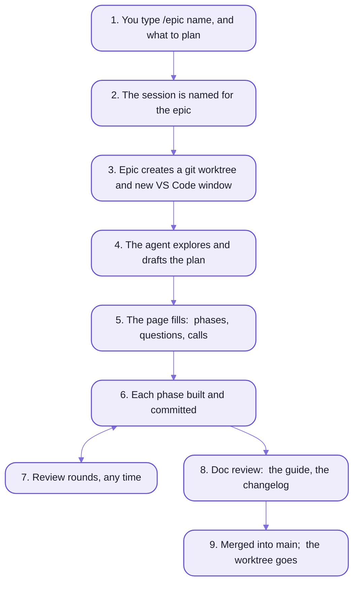
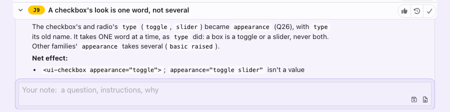

# spell-epic:  epics and sagas



_The demo epic, in its second phase.  Red needs you, orange is your turn to read, yellow is open, blue is with the agent:
you can read the page by its colours before you read a word._

`spell-epic` is a way of building software with a coding agent where the plan is a page that stays true.
You ask for an EPIC;  the agent plans it on its page, builds it phase by phase in a worktree of its own,
and you review it on the page itself, in VS Code, while it works.

- **Real today:**  the repo this plugin lives in is built this way.  Its pages hold 70 epics, 48 of them done.
- **Not yet:**  all of it in any agent but Claude Code.
  It's a Claude Code plugin first;  Codex runs most of its skills ([which](README-skills.md#in-codex)) and its
  end-of-turn hooks from the same files, not yet tried with a real Codex (below, "Coming").

Here to run one?  [Skip to "Try it"](#try-it--a-small-epic-in-your-own-repo).

## An epic's life


_Every decision, call, issue and test along the way is kept on the epic page._

<details>
<summary>As text</summary>



</details>

<details>
<summary>The nine steps, in detail</summary>

1. You type `/epic <name> <what to plan>` in a Claude Code session.
   - Or `/epic <name>` alone:  the page opens with a kickoff box at the top of its Overview.
     You type what the epic should do there, paste or drop pictures (each labelled IMG1, IMG2 ... so your words can
     name them), and press Send.
2. A hook reads the prompt before Claude does:  it titles the session `🚧 <name>`,
   and refuses one that would go wrong (in plan mode, or inside another worktree), saving your text first.
3. The session asks where to run, a new window or this one, and which saga the epic serves.
   - It makes its worktree and installs it:  `../<repo>.worktrees/<name>`, on branch `<name>`.
   - It writes a stub epic page, so your prompt survives a lost session,
     and moves itself into its window, `⎇ <name>`, when its turn ends.
4. It explores, read-only, and writes the Overview and its open questions on the page, no plan mode.
   - The page shows in VS Code's Review tab, the Overview alone at first.
   - Each answer you give rewrites the Overview, the changed words marked for you to accept.
5. You press Accept Overview:  the phases are written, named `P1 · Short Name` with estimates, the last always
   "Doc Review", each with Claude's build plan under it.
   One press of Accept Phases agrees the phases and their plans;  Accept Phase or Defer Phase works on one.
6. Each phase is built by named background agents, every finding recorded as an item as it goes.
   - It's checked against its accepted plan by a `plan-check` agent, committed (`P1:  Name -- summary`),
     and marked done with what was built.
   - Then straight on to the next accepted phase.
     It stops to ask only when the next has no accepted plan, something urgent comes up, or the last is done.
7. At any time you mark the page, and a `/epic review <name>` session takes the marks
   ([README-pages.md](README-pages.md) walks a review round).
8. The last phase, Doc Review:  open items pruned, the Manual tests list complete, a text pass,
   the epic's GUIDE written, a changelog entry.
9. `/epic done` offers to merge the branch into `main`, and to open a pull request.
   - Then `epic worktree remove <name>` takes the worktree away, its servers stopped first.
   - The epic page stays, as the record.

</details>

<details>
<summary>Four other ways an epic runs:  standing, future, bedtime, airplane</summary>

- **Standing**:  a long-lived epic whose phases each go onto `main` at once, never through `/epic done`.
  - Each phase merges with `epic merge <name>`.
  - The feedback epic, where comments with no other home go, is one.
- **Future**:  `/epic future <name> [idea]` writes an idea down, with no worktree:
  a stub page, and a review page of its big open questions.
  `/epic <name>` plans it later.
- **Bedtime** and **airplane mode**:  `/bedtime` builds an epic's remaining phases overnight, never merging;
  `/airplane` readies the pages to be marked on a flight, with no Claude, and `/airplane land` takes the marks after.
  Both, and what they cost:  [README-skills.md](README-skills.md#background-and-offline--work-that-goes-on-without-you).

</details>

## If you know tickets, pull requests and chat, three things move

A ticket says what to do;  a pull request, what was done;
and the reasoning in between lives in a chat that scrolls away.
An epic page holds all three, for as long as the work runs and after it's merged.

### The plan stays true, because the agent writes it as it goes

A ticket goes stale the day the work starts, and a chat is true for one session.
An epic page is written while the work happens, by the agent doing it:
each phase marked active, then done, with what was built and its commits;
each issue, todo and manual test recorded when it's found, not at the end.

- Nothing on it is deleted.
  An item is closed, or canceled and struck through, and text rewritten later moves into a folded Original Discussion.
- A new session picks the work up from the page, not from a summary of a chat:
  `/epic resume <name>`, in the epic's worktree and window.
- The page doesn't read itself, though.
  The one behind these READMEs holds 109 items, and 36 were still waiting for a review while this one was written.

### A question waits for you, with its options and their costs

In a chat, the agent asks and then waits for you, or guesses.
Here a question goes on the page, its options laid out with what each would cost and the one the agent recommends,
so you can decide from the page alone, when you have time.

- Your marks wait on the page, dashed, until you press Send, and one command applies them:
  with nobody listening, Send types `/epic review <name>` into the epic's session for you, and you press Enter.
- What the agent decided without you is listed too, as judgement calls you approve or revisit.
  They're calm (yellow) by default, and red only when one would surprise you.
- A revisit's answer is written INTO its item, by a background agent the page lists while it runs,
  so a slow answer never holds up the rest.

A team reviews the same pages:
each reply carries its writer's name, and the plans sync through an epic repo every turn
([README-teams.md](README-teams.md#working-with-others));  a comment reaches the others once it's answered.

### Every epic gets its own branch, worktree and window

An agent working in your only checkout shares it with you, and with every other agent you start.
An epic is one name:  one branch, one worktree, one VS Code window, one session, one page.

So three can run at once without touching each other, and your main checkout isn't touched until you merge.

- Each phase is committed on its own, in every repo it touched, under one subject (`P1:  Name -- summary`).
  Then the next agreed phase starts, with no stop, unless something needs you.
- The session you typed into answers, and named background agents build:
  a question you ask mid-phase gets its answer in seconds, not when the phase ends.
  - Several agents share the worktree:  each claims the files it changes, and merges take turns.
- And when it merges, it leaves a GUIDE behind for the next reader, and a changelog entry.

Every worktree is another checkout, with an install of its own:  that's the price of three at once.

## Try it:  a small epic in your own repo

You need a git repo with at least one commit, Claude Code, and VS Code.
One command, from any folder of the repo, sets it up:

```sh
cd ~/www/my-app
npx spell@next epic init
```

It installs the plugin, the `epic` command and the VS Code extension, asks your name and colour,
and makes an epic repo beside yours for the pages.
Every question, flag and edge:  [README-setup.md](README-setup.md).

Then start a Claude Code session in your repo, and give it a job nothing depends on:

```text
/epic hello-epic add a --version flag to the command line
```

1. The session titles itself `🚧 hello-epic`, and makes the epic's worktree, `~/www/my-app.worktrees/hello-epic`,
   on a branch of the same name.
2. The epic page opens in VS Code's Review tab, your prompt quoted at the top,
   and fills while the agent reads your code, read-only.
3. Its Overview says what it understood, with the questions it couldn't settle:
   answer on the page, or in the chat.
4. Press **Accept Overview**.
   It writes the phases, each with a build plan;  **Accept Phases** agrees them all, and it builds,
   a phase per commit, without stopping.
5. `/epic done` merges the branch, or opens a pull request.
   The worktree goes;  the page stays, as the record.

What each button does, and the page's parts:  [README-how-it-works.md](README-how-it-works.md).

From a terminal, `epic list` lists every epic once, with how many of its items you haven't reviewed:

```sh
epic list
```

<details>
<summary>What it printed</summary>

```text
in progress:  (not reviewed / items)
  data                     340 / 700  (../spell.worktrees/data)
  epic-engine              331 / 871  (../spell.worktrees/epic-engine)
  ...
future:  (not reviewed / items)
  epic-linux                 3 / 3
  ...
```

</details>

_On Spell's own repo, which runs a dozen at once._

**Not yet:**  `epic init` has run end to end only in throwaway repos outside Spell.
Its rough edges:  [what's still Spell-shaped](README-config.md#whats-still-spell-shaped).

Working on Spell itself?  The kit's checkout runs `node epic/bin/epic plugin install` instead:
[the kit's agents page](https://github.com/spell-app/spell/blob/main/README/agents.md#the-epic-plugin).

---

**From here down, it's the reference:**
the words, what a page does, VS Code, how a page is built, the commands, using it beyond Spell, and working on it.

## The words:  everything on a page has an id you can say

An epic is one piece of work with one name.
Everything on its page has a short id, so "approve J3" works in chat, and `seo#J3` names the same item to `epic`.

| Word | What it is | Id |
| --- | --- | --- |
| epic | a planning session and the work it plans, under one name (`readme`) | its name |
| saga | an epic of epics:  the larger aim several epics serve | `SAGA:/<id>` |
| epic page | an epic's live record, `epics/<name>/<name>.plan.html`, in the epic folder | |
| phase | one step of the plan, built and committed on its own:  `P1 · Short Name` | `P1` |
| question | something only you can decide;  answered, it's a decision | `Q1` |
| judgement call | a choice the agent made without you, open until you review it | `J1` |
| todo | a loose end:  work still to do, or (marked `limit`) a limit the plan accepts | `T1` |
| issue | a problem found, open until fixed | `I1` |
| manual test | something you check by hand before merging:  a step, and what should happen | `M1` |
| comment | a note you leave on any block of a page, answered in a thread under it | `C1` |

- The epic page is in the epic repo:  `main` and every worktree see ONE file, in the epic folder,
  a git repo of its own beside the code.
- An epic page isn't the only kind.
  A question that needs a picture gets a details page, a list of names a choice page,
  and a finished epic leaves a guide:  [every kind, and what makes each](README-pages.md#the-other-pages-from-the-same-parts).

## A page is something you act on

A wiki page is read;  this one has buttons.
- Open an item and three sit at its right, one group:  Make Todo, Revisit, which opens a box for your note,
  and Approve (the check).
- A question's option cards each have Choose.
- A todo that's work has three of its own:  the plane, do it in the next phase;  Revisit;  and the x, drop it.
- Last on every item's line, an (i):  Clarify, which has Claude rewrite that item in plainer words, at once,
  without waiting for Send.
- A todo can be flagged red, as a reminder that stays until you review it (`epic update <epic>#T3 --loud`).



_A judgement call on a real epic page, its note box open:  the yellow chip says it's open.
On an issue or a judgement call the group reads Do this, Revisit, Approve;
on other items, Make Todo takes Do this's place._

Nothing you press is sent until you press Send, the paper plane in the page's header.

Two more things you'll do on a page, and one you can do from any session:
- comment on any block of any docs page, with the bullhorn beside it, or select text and press ⌘-I:
  the agent answers in a thread under it
- check the work by hand:  each manual test is answered where it is, with the same buttons as any item,
  and a failure becomes an issue
- ask another epic for something:  `/send <epic> <text>` puts your words and screenshots into that epic,
  and wakes it;
  there it becomes a todo, or part of a phase, your screenshots shown on it ([README-skills.md](README-skills.md))

Every mark and what applying it does, the colours, the comments and the manual tests:  [README-pages.md](README-pages.md).

## In VS Code:  the page beside your code

The pages open in VS Code's RIGHT side bar, beside your code and the Claude panel,
through spell-epic's own extension, Spell Epic.

- **Review**:  the epic page you're reviewing, and any guide or docs page, each reloading itself as the agent edits it.
- **Details**:  the details, review and choice pages, so a question never replaces the epic page.
- Each epic's window has a look of its own (one of twelve tints) and is titled `⎇ <name>`;
  its Claude session is titled `🚧 <name>`, so the panel's list reads like your epics.
- A session reaches its own window through the extension:
  to show you a page, or to move itself into a worktree's window.
- **Not yet:**  on the Marketplace.
  You build it from your checkout and install it by hand:  [README-vscode.md](README-vscode.md).

## Built from Spell UI and Epic UI:  the page holds only data

An epic page is a plain HTML file that holds data and prose, and nothing else:
custom elements draw the rest, the chips, the buttons, the folds, the 👍.
Here's a question from the epic that planned these READMEs, as its files hold it:

```html
<!-- readme.plan.html:  the item's line, in the Questions section -->
<epic-item
  id="q1"
  title="Pictures:  Mermaid diagrams, drawn SVGs, or both?"
  status="decided"
  state="recent"
  answered
  source="parts/q1.html"
></epic-item>

<!-- parts/q1.html:  its body, loaded the first time it opens -->
<epic-choices chosen="A">
  <epic-option letter="A" title="Mermaid for every diagram, a few SVG hero pictures" recommended>...</epic-option>
  <epic-option letter="B" title="Mermaid only">...</epic-option>
  <epic-option letter="C" title="Drawn SVGs everywhere">...</epic-option>
</epic-choices>
```

_Trimmed from the real files:  data in attributes, prose in children, and the body in a part file of its own._

- The frame (sections, tables, buttons, icons) is [Spell UI](https://github.com/spell-app/spell/blob/main/ui/README.md)'s `<ui-*>` elements.
- What's particular to epics is Epic UI, spell-epic's own `<epic-*>` set:
  `<epic-page>`, `<epic-item>`, `<epic-question>`, the review buttons, the comment threads.
- The `epic` command writes its markup from the same element definitions the elements are drawn from,
  so the tool and the page can't disagree about what a tag holds.

Think of a stylesheet, one level up.
CSS restyles a page without touching its HTML;  these elements re-DRAW a page, its chips, buttons and cards,
without touching its file.
So a change to the look is a change to one element, and every epic page follows at once, with none rewritten.

- What an element draws itself (the id chip, the review buttons, the fold) lives in its shadow root,
  as every Spell UI element's does.
- The prose stays the page's own children:
  find-in-page and `#id` links reach it, and a live edit patches it in place,
  so an open item stays open and a half-typed note keeps its text.
- Questions, judgement calls, todos, issues and manual tests are all one element, `<epic-item>`:
  its kind is its id's letter (`q7`, `j3`) and the section it sits in, so there's one element to style and test,
  and no kind attribute to keep in step with the id.
- A change to the markup ships with a migration that rewrites every page, never with a second way to read the old
  markup:  no tag carries a version, and `epic migrate` brings each page up to today's.

The cost:  nothing draws without a server, the epic server or a checkout's page server.
How a page loads its elements, what it looks like from disk, and every element:
[README-pages.md](README-pages.md#the-epic--elements--the-page-is-data-they-draw-it).

## The commands:  `epic`, and the skills you type

`epic` is the command line under all of it:  the agent runs it, and so can you, from any folder of the repo.
It edits the one shared epic page from any checkout, runs the review inbox,
and drives the worktrees, windows and servers an epic works in.

```sh
epic summary spanish
```

<details>
<summary>Output</summary>

```text
Spanish
  32 phases done  (--all lists them)
estimate:  ... in all, 0m left
open judgements:
  - J4  The inflector in play: the parsing parser's, else English
  - J5  Element tags keep the project's name as written
...
```

</details>

_On Spell's own pages:  the plan for writing Spell in Spanish, every phase done, its judgement calls still open for review._

Every verb, by group, and how to name what one acts on:  [README-cli.md](README-cli.md).

The skills are what you type:  `/epic`, `/isolate`, `/details`, `/bg` and the rest,
plus the hooks that run without being asked.
When to reach for which:  [README-skills.md](README-skills.md).

## Beyond Spell:  what it takes

Nothing about the method is Spell's.
Another project needs the plugin and `epic`, the VS Code extension, and what `epic init` makes:
one config file in the repo, `.epic/config.json5`, and an epic folder beside it for the pages.

One command sets a project up:  `npx spell@next epic init` installs the plugin and the extension,
asks your name and colour, and starts the epic server.
- It has run end to end outside Spell, in throwaway repos;  its rough edges are listed in README-epics.md.
- The steps, sharing with a team, every setting and the rest of the edges:  [README-epics.md](https://github.com/spell-app/spell/blob/main/README-epics.md).

## Working on it

This folder is the plugin, `spell-epic`, laid out like any one-package repo:
the code in `src/`, its tests in `tests/` at the same paths, the plugin's parts at the folder's root.
The rules for working on it:  [the folder's AGENTS.md](AGENTS.md) and [the code's](src/AGENTS.md),
on top of WWOD, [the house style](https://github.com/spell-app/spell/blob/main/README.md#wwod-the-house-style) every folder shares.

| Folder | What's in it |
| --- | --- |
| [.claude-plugin/](.claude-plugin/) | the plugin's manifest, `epic`;  its marketplace, `spell`, is the repo's root `.claude-plugin/marketplace.json`.  Claude Code installs a copy of this folder, which `epic plugin install` links back to it |
| [.codex-plugin/](.codex-plugin/) | the same plugin's manifest for Codex, naming this same folder:  `epic plugin install --codex` |
| [skills/](skills/) | the skills, a `SKILL.md` each ([README-skills.md](README-skills.md)) |
| [coherence/](coherence/) | the coherence review's rules ([procedures](coherence/procedures.md)) and the `coherence` agent that reads them:  ONE way of doing each thing;  each repo's own catalog and word list are its `agents/coherence/` |
| [designer/](designer/) | the design review's rules:  [the house taste](designer/designer.md), with the asks behind it quoted;  [craft](designer/craft.md), interfaces.dev's and jakub.kr's rules;  [procedures](designer/procedures.md);  and the `designer` agent that reads them |
| [plan-check/](plan-check/) | the `plan-check` agent, which holds a phase's diff up against its accepted build plan before the phase closes:  what wasn't built, and what was built unasked |
| [voices/](voices/) | how each kind of people-facing page is written:  `readme` (these pages), and three for pages that aren't developers':  for newcomers, essays, product pages;  `epic voice` lists them |
| [hooks/](hooks/) | `hooks.json` and the eleven scripts it runs, plus `patch-checkout.mjs`, which one of them starts;  `codex-hooks.json`, three of the same scripts for Codex |
| [monitors/](monitors/) | `listen.mjs` (`InboxPoller`), which keeps an epic's session listening to its epic page:  a small poller that runs `epic session listen` for a moment as the page's inbox changes.  The `Stop` hook starts it at each turn's end in every session (`--hook`, `asyncRewake`:  its exit wakes the session);  `monitors.json` runs it as a monitor too, which Claude Code starts only in a terminal session, never in VS Code's panel |
| [bin/epic](bin/epic) | the `epic` command:  its program in [src/cli/](src/cli/), the work its verbs do in [src/command/](src/command/) |
| [src/](src/) | the code:  the `<epic-*>` elements, the epic tool, the epic server, the docs tools, Epic UI's viewer page |
| [tests/](tests/) | its tests, at the same paths as the code;  and the extension's |
| [templates/](templates/) | the pages' starting points, and the epic-page writing rules ([plan-doc.md](templates/epics/plan-doc.md)) |
| [vscode/](vscode/) | the VS Code extension, a yarn project of its own |
| [epic_settings.json5](epic_settings.json5) | how the tooling behaves, every key with its default;  yours and your team's override it ([Your settings](README-config.md#your-settings)) |
| [docs/images/](docs/images/) | the pictures on these pages |

There's ONE copy per machine, and every repo and every window runs it, so your edit is everyone's at once:
`epic` and the hooks on their next run, a skill's new text after `/reload-plugins`.

It's a folder of the kit, cloned with it, and the kit's one `yarn install` installs it, never an install in here.
- It stands on the kit (`spell`:  the page server, the element framework, the toolchain) and on Spell UI,
  by their package names.
- Nothing stands on it:  it declares its own part of the kit's page server's settings, in its `package.json`
  (its route modules, its folders, Epic UI), and the server runs them by their paths, importing none of it.

Its git history, kept when it was merged into the kit, starts on 2026-10-17, when it was lifted out of spell-app:
the first commit names the spell-app commit the files came from, so anything older is there
(its SHA from before the merge:  [the commit map](https://github.com/spell-app/spell/blob/main/tools/one-repo/commit-map-app.txt) gives its new one).

```sh
# from the plugin's folder, ~/www/spell/epic
yarn ts                 # src/ and tests/
yarn test:unit          # the node project, then the window script's and the extension's tests:  before a merge
yarn test               # node, browser (chromium) and motion projects, then the same scripts' tests
yarn test:integration   # the slow ones
yarn lint
yarn review             # ts, lint, test and test:integration:  the finishing pass
yarn pack:build         # after changing an <epic-*> element:  the pack, which a test checks is current
yarn plugin:validate    # claude plugin validate .
yarn vscode:check       # the extension's type check (after yarn install in vscode/)
yarn vscode:package     # the extension's bundle and spell-epic.vsix:  NOT installed by any script
```

<details>
<summary>Imports</summary>

- Every file is imported by `spell/epic` and its path under `src/`, with no extension, inside this folder too:
  `spell/epic/tool/PlanDoc`, `spell/ui/core`, `spell/server`.
  - A same-folder peer stays `./PlanItem`, and nothing climbs into `src/` with `../`:
    lint fails it, and its message names the package-name import to write.
  - Files outside `src/` (`tests/`, `scripts/`, `hooks/`, `vscode/`) import `src/` the same way.
- Plain `node` (the hooks, the window script, the docs tools' `.js` scripts) imports a file with its extension:
  `import { EpicConfig } from "spell/epic/config/EpicConfig.ts"`.
- More:  [the folder's AGENTS.md](AGENTS.md), "Imports";
  the names a page's packs share one Solid and one Spell UI by:  [README-pages.md](README-pages.md#how-a-page-draws-them).

</details>

## 🌱 Coming

- **Other agents:**  the same workflow driven from Codex and other coding agents:
  planning on the page, worktrees, the review loop.
  - The pages, the `epic` command and the epic folder are plain files and programs any agent can use.
  - Where it stands:  any agent follows `epic guide` and ends its turns with `epic turn end`;
    Codex has the end-of-turn hooks and seventeen of the skills, from the same files.
  - Send doesn't wake it yet ([README-teams.md](README-teams.md#with-codex)), and it's untried with a real Codex.
- **Installing from npm:**  a repo that isn't Spell installs the plugin alone, from npm.
  Where it stands:  `spell-epic`, `spell-ui` and `spell` are published, under the `next` tag until Spell's first release
  (planned for December 1, 2026);  and a repo that isn't Spell sets up with `npx spell@next epic init`
  ([README-epics.md](https://github.com/spell-app/spell/blob/main/README-epics.md)).

## The pages

| Page | What's on it |
| --- | --- |
| [README.md](README.md) | <ul><li>this page:  an epic page, and an epic's life</li><li>three things that move, if you know tickets, pull requests and chat</li><li>try it;  the words, what a page lets you do;  how a page is built;  the commands</li><li>beyond Spell;  working on it</li></ul> |
| [README-how-it-works.md](README-how-it-works.md) | <ul><li>sagas, epics and guides:  how each holds the next</li><li>the workflow:  two Accepts, then it builds</li><li>the page in annotated pictures:  header, items, "While you were out", the Review tab</li></ul> |
| [README-pages.md](README-pages.md) | <ul><li>your first review, in four moves</li><li>the header and toolbar;  eight sections whose ids never change</li><li>a review round and Claude's status cards, comments and manual tests;  what each colour means</li><li>saga, details, choice and run pages, guides, the home page;  the `<epic-*>` elements</li></ul> |
| [README-skills.md](README-skills.md) | <ul><li>the skills you type, and the hooks that run by themselves:  how many, and what each does</li><li>planning and review;  worktrees and sessions;  background and offline</li><li>the hooks, and the prompt gate that reads first</li><li>two names for every skill</li></ul> |
| [README-cli.md](README-cli.md) | <ul><li>the six commands you'll actually type</li><li>an address is a page and an id:  `seo#J3`</li><li>one copy of the code;  one writer for every epic page;  how a `wait` wakes a session</li><li>every verb, by group;  where it stops</li></ul> |
| [README-vscode.md](README-vscode.md) | <ul><li>the Spell Epic extension:  three commands and a reload</li><li>three views, each a page that stays;  which server answers</li><li>the window bridge, and how a session moves</li><li>windows you tell apart:  a look, a title, a ✅</li><li>working on it</li></ul> |
| [README-epics.md](https://github.com/spell-app/spell/blob/main/README-epics.md), at the kit's root | <ul><li>what an epic is, why you'd want one, how you'll use it</li><li>try it, in one command</li></ul> |
| [README-setup.md](README-setup.md) | <ul><li>every step of setting a repo up;  the extension</li><li>on GitLab;  when main takes only pull or merge requests</li><li>the plans live beside your repo;  what your AGENTS.md adds</li></ul> |
| [README-teams.md](README-teams.md) | <ul><li>joining, who you are and your colour, every turn syncs</li><li>two people on one page;  whose agent answers whom</li><li>with Codex, or another agent</li></ul> |
| [README-config.md](README-config.md) | <ul><li>the epic folder;  your settings;  every key of the config file</li><li>worktrees;  one epic server per machine</li><li>what's still Spell-shaped</li></ul> |
| [README-superpowers.md](README-superpowers.md) | <ul><li>epics beside the superpowers plugin:  who plans, who finishes</li><li>the stand-aside words, and where they reach a session</li><li>a live trial;  common clashes and their fixes</li></ul> |
| [README-demo.md](README-demo.md) | <ul><li>showing epics to a room in about 20 minutes:  one ask, a plan on a page, two Accepts, a phase built</li><li>the clock times, the pitch, and what to do when something goes wrong</li></ul> |
| [README-faq.md](README-faq.md) | <ul><li>when something goes wrong:  what you see, why, and the fix</li></ul> |

Every other folder's pages:  [the kit's index](https://github.com/spell-app/spell/blob/main/README.md#every-readme).

## The guides

Three longer pages, about the epic tooling and shipped with it, in [the guides folder](guides/):
VS Code's Epic Docs tab shows them, and so does the page server at their own addresses (`/guides/...`).

| Guide | What's in it |
| --- | --- |
| [Epic Pages, a Tour](guides/plan-docs/plan-docs.html) | <ul><li>an epic page's parts, each drawn live:  the header, the Overview, phases, items, the Log</li><li>what each colour and mark means, and what a click does</li></ul> |
| [Background Agents](guides/background-agents.html) | <ul><li>`/bg`:  a task handed to a helper, so the panel is free again</li><li>names, the running list, redirecting one, what comes back</li></ul> |
| [Airplane Mode](guides/airplane.html) | <ul><li>`/airplane`:  working on the pages with no Claude</li><li>what's kept for later, and `/airplane land` when you're back</li></ul> |

## See also

- [README-pages.md](README-pages.md):  the next step, an epic page section by section and a review round on it
- [The kit's agents page](https://github.com/spell-app/spell/blob/main/README/agents.md#the-epic-plugin):  installing the plugin,
  and what every session reads before your first prompt
- [The kit's development guide](https://github.com/spell-app/spell/blob/main/README/development.md):  one epic's worktree of the whole kit,
  and merging `main` into it
- [README-faq.md](README-faq.md):  when something goes wrong, what you see, why, and the fix
- [One repo, five parts](https://github.com/spell-app/spell/blob/main/README.md#one-repo-five-parts):  where the `epic/` folder sits, and what it needs
