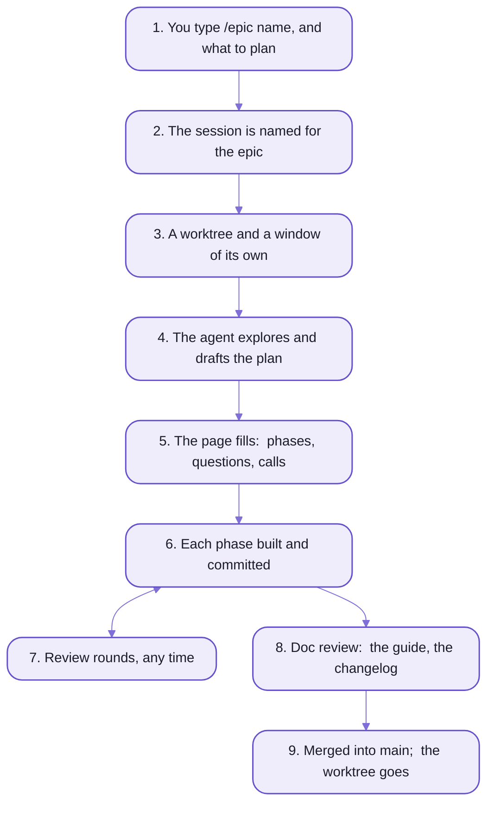
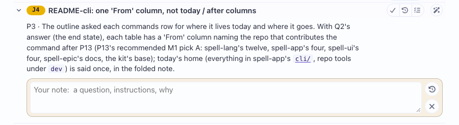

# spell-epic:  epics and sagas

```text
In Claude Code, you type:
  /epic readme Goal: update readmes for all of the various new repos and to be fully informative and pretty. ...

On the epic page, the agent asks:
  Q1 · Pictures:  Mermaid diagrams, drawn SVGs, or both?
    A · Mermaid for every diagram, a few SVG hero pictures  👍
        Cost: the hero SVGs are a few hours of care; everything else is minutes.
    B · Mermaid only
        Cost: nothing looks designed; "pretty" is a stretch.
    C · Drawn SVGs everywhere
        Cost: each picture is slow to make and slower to fix; Opus agents will drift them out of truth.

You press Choose on A, then Send.  In the page's log:
  11:55  Q1 picked A: Mermaid for every diagram, a few SVG hero pictures
```

_A real session, as text:  the epic that planned these READMEs, its first question, and the answer landing._

You just watched a decision get made, and kept.
It didn't scroll away in a chat, and nobody copied it into a ticket afterwards:
it was asked on a page, answered on the page, and it's still there, with eleven more.
The 👍 is advice, not a default:  three of that page's first five answers went the other way.

That page isn't a wiki somebody remembers to update.
The agent writes it as it works, through a command, `epic`, which keeps every id, colour and count right,
and a hook commits it to git after every turn.

`spell-epic` is a way of building software with a coding agent where the plan is a page that stays true.
You ask for an EPIC;  the agent plans it on its page, builds it phase by phase in a worktree of its own,
and you review it on the page itself, in VS Code, while it works.

- **Real today:**  Spell is built this way.  Its pages hold 50 epics, 35 of them done.
- **Not yet:**  any agent but Claude Code.
  It's a Claude Code plugin, and its skills, hooks and question modal are Claude Code's (below, "Coming").

Here to run one?  [Skip to "Try it"](#try-it--a-small-epic-start-to-finish).

## An epic's life

Here's the whole life of one, drawn as one of the "few SVG hero pictures" that question chose.


_The page is the memory:  every decision, call, issue and test lives there._

<details>
<summary>As text</summary>



</details>

<details>
<summary>The nine steps, in detail</summary>

1. You type `/epic <name> <what to plan>` in a Claude Code session.
2. A hook reads the prompt before Claude does:  it titles the session `🚧 <name>`,
   and refuses one that would go wrong (in plan mode, or inside another worktree), saving your text first.
3. The session asks where to run, a new window or this one, and which saga the epic serves.
   Then it makes its worktree and installs it:  `../<repo>.worktrees/<name>`, on branch `<name>`.
   It writes a stub epic page, so your prompt survives a lost session,
   and moves itself into its window, `⎇ <name>`, when its turn ends.
4. It explores, read-only, and writes the Overview and its open questions on the page, no plan mode.
   The page shows in VS Code's Review tab, the Overview alone at first.
   Each answer you give rewrites the Overview, the changed words marked for you to accept.
5. You press Accept Overview:  a background agent writes the phases, named `P1 · Short Name` with estimates, the last
   always "Doc Review".  You mark each Looks good or Defer, then press Accept Phases.
6. Each phase:  Claude's own build plan first, on the phase, for you to accept;  then built, every finding recorded as
   an item as it goes, committed (`P1:  Name -- summary`, in each repo it touched), and marked done with what was built.
   The agent stops after each phase and asks whether to go on.
7. At any time you mark the page, and a `/epic review <name>` session takes the marks
   ([README-pages.md](README-pages.md) walks a review round).
8. The last phase, Doc Review:  open items pruned, the Manual tests list complete, a text pass,
   the epic's GUIDE written, a changelog entry.
9. `/isolate done` offers to merge the branch into `main`, and to open a pull request.
   Then `epic worktree remove <name>` takes the worktree away, its servers stopped first.
   The epic page stays, as the record.

</details>

<details>
<summary>Four other ways an epic runs:  standing, future, bedtime, airplane</summary>

- **Standing**:  a long-lived epic whose phases each go onto `main` at once, never through `/isolate done`.
  - Each phase merges with `epic merge <name>`.
  - The feedback epic, where comments with no other home go, is one.
- **Future**:  `/epic future <name> [idea]` writes an idea down, with no worktree:
  a stub page, and a review page of its big open questions.
  `/epic <name>` plans it later.
- **Bedtime** and **airplane mode**:  `/bedtime` builds an epic's remaining phases overnight, never merging;
  `/airplane` readies the pages to be marked on a flight, with no Claude, and `/airplane land` takes the marks after.
  Both, and what they cost:  [README-skills.md](README-skills.md#background-and-offline--work-that-goes-on-without-you).

</details>

## If you know tickets, pull requests and chat, three things move

A ticket says what to do;  a pull request, what was done;
and the reasoning in between lives in a chat that scrolls away.
An epic page holds all three, for as long as the work runs and after it's merged.

### The plan stays true, because the agent writes it as it goes

A ticket goes stale the day the work starts, and a chat is true for one session.
An epic page is written while the work happens, by the agent doing it:
each phase marked active, then done, with what was built and its commits;
each issue, todo and manual test recorded when it's found, not at the end.

- Nothing on it is deleted.
  An item is closed, or canceled and struck through, and text rewritten later moves into a folded Original Discussion.
- A new session picks the work up from the page, not from a summary of a chat:
  `/epic resume <name>`, in the epic's worktree and window.
- The page doesn't read itself, though.
  The one behind these READMEs holds 109 items, and 36 were still waiting for a review while this one was written.

### A question waits for you, with its options and their costs

In a chat, the agent asks and then waits for you, or guesses.
Here a question goes on the page, its options laid out with what each would cost and the one the agent recommends,
so you can decide from the page alone, when you have time.

- Your marks wait on the page, dashed, until you press Send, and one command applies them.
  Nobody listening?  Send types `/epic review <name>` into the epic's session for you, and you press Enter.
- What the agent decided without you is listed too, as judgement calls you approve or revisit.
  They're calm (yellow) by default, and red only when one would surprise you.
- A revisit's answer is written INTO its item, by a background agent the page lists while it runs,
  so a slow answer never holds up the rest.

One reviewer is assumed, though:
a few of the pages' own words still name the person who reviews Spell's
([README-adopting.md](README-adopting.md#whats-still-spell-shaped) lists that with the other rough edges).

### Every epic gets its own branch, worktree and window

An agent working in your only checkout shares it with you, and with every other agent you start.
An epic is one name:  one branch, one worktree, one VS Code window, one session, one page.
So three can run at once without touching each other, and your main checkout isn't touched until you merge.

- Each phase is committed on its own, in every repo it touched, under one subject (`P1:  Name -- summary`).
  Then the agent stops, and asks before it starts the next.
- In Spell, an epic's worktree holds every repo, each on the epic's branch:
  [the kit's README-development.md](https://github.com/spell-app/spell/blob/main/README-development.md) follows a change across repos.
- And when it merges, it leaves a GUIDE behind for the next reader, and a changelog entry.

Every worktree is another checkout, with an install of its own:  that's the price of three at once.

## Try it:  a small epic, start to finish

You need, once:
- a Spell checkout ([setup from zero](https://github.com/spell-app/spell/blob/main/README.md#setup-from-zero), on the kit's front page)
- the plugin, and `epic` on your terminal's `PATH`:  one command from the kit's checkout,
  `node epic/bin/epic plugin install`
  ([the kit's README-agents.md](https://github.com/spell-app/spell/blob/main/README-agents.md#the-epic-plugin) says
  what it does)
  - outside Spell:  `/plugin marketplace add spell-app/spell`, then `/plugin install epic@spell`
- Spell Epic, the VS Code extension, for the Review tab ([README-vscode.md](README-vscode.md))
- a content folder for the pages:  a new machine has none, and `epic init` at the kit's root makes an empty one,
  keeping the kit's settings as they are

Then open the kit's folder in VS Code, start a Claude Code session, and give it a job nothing depends on.
`spell pony` draws a pony in a wizard hat, saying your words, and keeps a long saying on one line:

```text
/epic hello-epic let spell pony wrap a long saying over several lines
```

1. The session is titled `🚧 hello-epic` before the agent reads a word:  the prompt hook does it.
2. The agent asks two things in Claude Code's question modal:
   where to run, a new window or this one (with a recommendation);  and which saga the epic serves, if any.
3. It makes the worktree, `~/www/spell.worktrees/hello-epic`, with every repo on branch `hello-epic`,
   and writes the epic page with your prompt quoted at the top.
4. Picked a new window?  When its turn ends, the session moves to `⎇ hello-epic` and types `continue` there:
   press Enter.
5. The page opens in the Review tab, and fills while the agent explores, read-only, and drafts its plan.

- `/epics` lists every open epic;  `/wtf` says where this one stands.
- Done with it?  `/isolate done` offers to merge it into `main`, or to leave it unmerged;
  then `epic worktree remove hello-epic` takes the worktree away.
  The page stays, as the record.
- **Not yet:**  these steps walked end to end on a machine that's never had the plugin.

---

**From here down, it's the reference:**
the words, what a page does, VS Code, how a page is built, the commands, using it beyond Spell, and working on it.

## The words:  everything on a page has an id you can say

An epic is one piece of work with one name.
Everything on its page has a short id, so "approve J3" works in chat, and `seo#J3` names the same item to `epic`.

| Word | What it is | Id |
| --- | --- | --- |
| epic | a planning session and the work it plans, under one name (`readme`) | its name |
| saga | an epic of epics:  the larger aim several epics serve | `SAGA:/<id>` |
| epic page | an epic's live record, `epics/<name>/<name>.plan.html`, in the shared content folder | |
| phase | one step of the plan, built and committed on its own:  `P1 · Short Name` | `P1` |
| question | something only you can decide;  answered, it's a decision | `Q1` |
| judgement call | a choice the agent made without you, open until you review it | `J1` |
| todo | a loose end:  work still to do, or (marked `limit`) a limit the plan accepts | `T1` |
| issue | a problem found, open until fixed | `I1` |
| manual test | something you check by hand before merging:  a step, and what should happen | `M1` |
| comment | a note you leave on any block of a page, answered in a thread under it | `C1` |

- The epic page is shared content:  `main` and every worktree see ONE file, in the content folder,
  a git repo of its own beside the code.
- An epic page isn't the only kind.
  A question that needs a picture gets a details page, a list of names a choice page,
  and a finished epic leaves a guide:  [every kind, and what makes each](README-pages.md#the-other-pages-from-the-same-parts).

## A page is something you act on

A wiki page is read;  this one has buttons.
Open an item and three sit at its right, one group:  Make Todo, Revisit, which opens a box for your note,
and Approve (the check).
A question's option cards each have Choose, and a todo that's work has three of its own:
the plane, do it in the next phase;  Revisit;  and the x, drop it.



_A judgement call on a real epic page, its note box open:  the yellow chip says it's open, and calm;
Approve, Revisit and Make Caveat sit together, Do Now's wand apart._

Nothing you press goes anywhere until Send, in the page's header, hands it all over:  you press the paper plane.

Two more things you'll do on a page, and one you can do from any session:
- comment on any block of any docs page, with the bullhorn beside it, or select text and press ⌘-I:
  the agent answers in a thread under it
- check the work by hand:  Start testing, on the Manual tests section's title, shows one test at a time, as a card,
  and a failure becomes an issue
- ask another epic for something:  `/send <epic> <text>` puts your words and screenshots into that epic,
  and wakes it ([README-skills.md](README-skills.md))

Every mark and what applying it does, the colours, the comments and the test runs:  [README-pages.md](README-pages.md).

## In VS Code:  the page beside your code

The pages open in VS Code's RIGHT side bar, beside your code and the Claude panel,
through spell-epic's own extension, Spell Epic.

- **Review**:  the epic page you're reviewing, its details pages and its test runs.
- **Epic Docs**:  any guide or docs page, reloading itself as the agent edits it.
- Each epic's window has a look of its own (one of twelve tints) and is titled `⎇ <name>`;
  its Claude session is titled `🚧 <name>`, so the panel's list reads like your epics.
- A session reaches its own window through the extension:  to show you a page, or to move itself into a worktree's
  window.
- **Not yet:**  on the Marketplace.
  You build it from your checkout and install it by hand:  [README-vscode.md](README-vscode.md).

## Built from Spell UI and Epic UI:  the page holds only data

An epic page is a plain HTML file that holds data and prose, and nothing else.
Custom elements draw the rest:  the chips, the buttons, the folds, the 👍.
Here's the question from the top of this page, as its files hold it:

```html
<!-- readme.plan.html:  the item's line, in the Questions section -->
<epic-item
  id="q1"
  title="Pictures:  Mermaid diagrams, drawn SVGs, or both?"
  status="decided"
  state="recent"
  answered
  source="parts/q1.html"
></epic-item>

<!-- parts/q1.html:  its body, loaded the first time it opens -->
<epic-choices chosen="A">
  <epic-option letter="A" title="Mermaid for every diagram, a few SVG hero pictures" recommended>...</epic-option>
  <epic-option letter="B" title="Mermaid only">...</epic-option>
  <epic-option letter="C" title="Drawn SVGs everywhere">...</epic-option>
</epic-choices>
```

_Trimmed from the real files:  data in attributes, prose in children, and the body in a part file of its own._

The frame (sections, tables, buttons, icons) is [Spell UI](https://github.com/spell-app/spell/blob/main/ui/README.md)'s `<ui-*>` elements.
What's particular to epics is Epic UI, spell-epic's own `<epic-*>` set:
`<epic-page>`, `<epic-item>`, `<epic-question>`, the review buttons, the comment threads.
And the `epic` command writes its markup from the same element definitions the elements are drawn from,
so the tool and the page can't disagree about what a tag holds.

The cost:  nothing draws without a server, the epic server or a checkout's page server.
How a page loads its elements, what it looks like from disk, and every element:
[README-pages.md](README-pages.md#the-epic--elements--the-page-is-data-they-draw-it).

## The commands:  `epic`, and the skills you type

`epic` is the command line under all of it.
The agent runs it;  so can you, from any folder of the repo.
It edits the one shared epic page from any checkout, runs the review inbox,
and drives the worktrees, windows and servers an epic works in.

```sh
epic summary spanish
```

<details>
<summary>Output</summary>

```text
Spanish
  [x] P1 · Unicode Words  (2-3h)
...
  [x] P11 · Solitario  (3-4h)
...
  [x] P17 · Parser Warnings in Spanish  (3-4h)
...
estimate:  ... in all, ... left
...
open limits:
  - T1  Agreement is a warning, never an error
  - T2  ser and estar are interchangeable to the parser
...
```

</details>

_On Spell's own pages:  the plan for writing Spell in Spanish, its Solitario done, its limits still open._

Every verb, by group, and how to name what one acts on:  [README-cli.md](README-cli.md).

The skills are what you type:  `/epic`, `/isolate`, `/details`, `/bg` and fourteen more,
plus nine hooks that run without being asked.
When to reach for which:  [README-skills.md](README-skills.md).

## Beyond Spell:  what it takes

Nothing about the method is Spell's.
Another project needs the plugin and `epic`, the VS Code extension,
and what `epic init` makes:  one config file in the repo, `.epic/config.json5`, and a content folder beside it
for the pages.

It has run end to end once outside Spell, in a throwaway repo, and its rough edges are listed, not hidden.
The first is the biggest:  it installs only inside a Spell checkout, since it runs on Spell UI and the kit
from their one install.
The steps, every setting and the rest of the edges:  [README-adopting.md](README-adopting.md).

## Working on it

This repo is ONE package, `spell-epic`, laid out like any one-package repo:
the code in `src/`, its tests in `tests/` at the same paths, the plugin's parts at the root.
The rules for working on it:  [the repo's AGENTS.md](AGENTS.md) and [the code's](src/AGENTS.md),
on top of WWOD, [the house style](https://github.com/spell-app/spell/blob/main/README.md#wwod-the-house-style) every repo shares.

| Folder | What's in it |
| --- | --- |
| [.claude-plugin/](.claude-plugin/) | the plugin's manifest, `epic`;  its marketplace, `spell`, is the repo's root `.claude-plugin/marketplace.json`.  Claude Code installs a copy of this folder, which `epic plugin install` links back to it |
| [skills/](skills/) | the nineteen skills, a `SKILL.md` each |
| [coherence/](coherence/) | the coherence review's rules ([procedures](coherence/procedures.md)) and the `coherence` agent that reads them:  ONE way of doing each thing;  each repo's own catalog and word list are its `agents/coherence/` |
| [designer/](designer/) | the design review's rules:  [the owner's taste](designer/designer.md), his own asks quoted;  [craft](designer/craft.md), interfaces.dev's and jakub.kr's rules;  [procedures](designer/procedures.md);  and the `designer` agent that reads them |
| [hooks/](hooks/) | `hooks.json` and the nine scripts it runs |
| [monitors/](monitors/) | `listen.mjs` (`InboxPoller`), which keeps an epic's session listening to its epic page:  a small poller that runs `epic session listen` for a moment as the page's inbox changes.  The `Stop` hook starts it at each turn's end in every session (`--hook`, `asyncRewake`:  its exit wakes the session);  `monitors.json` runs it as a monitor too, which Claude Code starts only in a terminal session, never in VS Code's panel |
| [bin/epic](bin/epic) | the `epic` command:  its program in [src/cli/](src/cli/), the work its verbs do in [src/command/](src/command/) |
| [src/](src/) | the code:  the `<epic-*>` elements, the epic tool, the epic server, the docs tools, Epic UI's pages |
| [tests/](tests/) | its tests, at the same paths as the code;  and the extension's |
| [templates/](templates/) | the pages' starting points, and the epic-page writing rules ([plan-doc.md](templates/epics/plan-doc.md)) |
| [vscode/](vscode/) | the VS Code extension, a yarn project of its own |
| [scripts/](scripts/) | dev-only scripts:  Epic UI's data |
| [docs/images/](docs/images/) | the pictures on these pages |

There's ONE copy per machine, and every repo and every window runs it, so your edit is everyone's at once:
`epic` and the hooks on their next run, a skill's new text after `/reload-plugins`.

It's a child repo of the kit:  `yarn clone spell-epic` brings it and Spell UI,
and the kit's one `yarn install` installs it, never an install in here.
It stands on the kit (`spell`:  the page server, the element framework, the toolchain) and on Spell UI,
by their package names.
Nothing stands on it:  it declares its own part of the kit's page server's settings, in its `package.json`
(its route modules, its folders, Epic UI), and the server runs them by their paths, importing none of it.

Its git history starts on 2026-10-17, when it was lifted out of spell-app:
the first commit names the spell-app commit the files came from, so anything older is there.

```sh
# from the plugin's folder, ~/www/spell/epic
yarn ts                 # src/ and tests/, after the declarations of the repos below
yarn test               # node and browser (chromium) projects, then the window script's and the extension's tests
yarn lint
yarn review             # ts, lint and test:  the finishing pass
yarn pack:build         # after changing an <epic-*> element:  the pack, which a test checks is current
yarn plugin:validate    # claude plugin validate .
yarn vscode:check       # the extension's type check (after yarn install in vscode/)
yarn vscode:package     # the extension's bundle and spell-epic.vsix:  NOT installed by any script
```

<details>
<summary>Imports</summary>

- Every file is imported by its package's name and its path under `src/`, with no extension, inside spell-epic too:
  `spell/epic/tool/PlanDoc`, `spell/ui/core`, `spell/server`.
  - A same-folder peer stays `./PlanItem`, and nothing climbs into `src/` with `../`:
    lint fails it, and its message names the package-name import to write.
  - Files outside `src/` (`tests/`, `scripts/`, `hooks/`, `vscode/`) import `src/` the same way.
- Plain `node` (the hooks, the window script, the docs tools' `.js` scripts) imports a file with its extension:
  `spell/epic/config/EpicConfig.ts`.
- More:  [the repo's AGENTS.md](AGENTS.md), "Imports";
  the names a page's packs share one Solid and one Spell UI by:  [README-pages.md](README-pages.md#how-a-page-draws-them).

</details>

## 🌱 Coming

- **Other agents:**  the same workflow driven from Codex and other coding agents:
  planning on the page, worktrees, the review loop.
  The pages, the `epic` command and the content folder are plain files and programs any agent can use;
  the skills and hooks around them are Claude Code's.
  Where it stands:  planned;  Claude Code only for now.
- **npm packages:**  spell-epic, Spell UI and the kit published, so a repo that isn't Spell installs it alone.
  Where it stands:  planned;  today everything installs inside the kit.

## The pages

| Page | What's on it |
| --- | --- |
| [README.md](README.md) | <ul><li>this page:  a decision made and kept, and an epic's life</li><li>three things that move, if you know tickets, pull requests and chat</li><li>try it;  the words, what a page lets you do, the commands</li><li>beyond Spell;  working on it</li></ul> |
| [README-pages.md](README-pages.md) | <ul><li>your first review, in four moves</li><li>the header and toolbar;  eight sections whose ids never change</li><li>a review round, comments and test runs;  what each colour means</li><li>saga, details and choice pages, guides, the home page;  the `<epic-*>` elements</li></ul> |
| [README-skills.md](README-skills.md) | <ul><li>nineteen skills you type, nine hooks that run by themselves</li><li>planning and review;  worktrees and sessions;  background and offline</li><li>the hooks, and the prompt gate that reads first</li><li>two names for every skill</li></ul> |
| [README-cli.md](README-cli.md) | <ul><li>the six commands you'll actually type</li><li>an address is a page and an id:  `seo#J3`</li><li>one copy of the code;  how a `wait` wakes a session</li><li>every verb, by group;  where it stops</li></ul> |
| [README-vscode.md](README-vscode.md) | <ul><li>the Spell Epic extension:  three commands and a reload</li><li>two views, each a page that stays;  which server answers</li><li>the window bridge, and how a session moves</li><li>working on it</li></ul> |
| [README-adopting.md](README-adopting.md) | <ul><li>epics in your own repo:  three steps and an extension</li><li>the content folder, the config file, worktrees, your `AGENTS.md`</li><li>one epic server for the machine</li><li>what's still Spell-shaped</li></ul> |

Every other repo's pages:  [the kit's index](https://github.com/spell-app/spell/blob/main/README.md#every-readme).

## See also

- [README-pages.md](README-pages.md):  the next step, an epic page section by section and a review round on it
- [The kit's README-agents.md](https://github.com/spell-app/spell/blob/main/README-agents.md#the-epic-plugin):  installing the plugin,
  and what every session reads before your first prompt
- [The kit's README-development.md](https://github.com/spell-app/spell/blob/main/README-development.md):  one epic's worktree across the five repos,
  and merging `main` into it
- [The kit's README-element.md](https://github.com/spell-app/spell/blob/main/README-element.md):  how `<ui-root>` loads a pack like Epic UI
- [The five repos](https://github.com/spell-app/spell/blob/main/README.md#one-repo-five-parts):  where spell-epic sits, and what it needs
