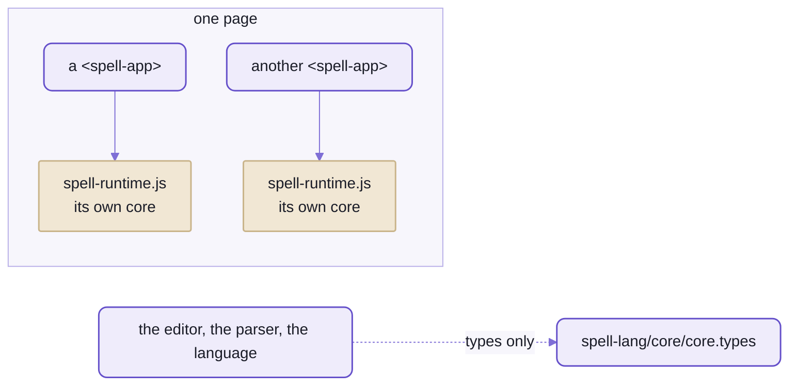

# core:  what compiled Spell runs on

```spell
set the suits to ["clubs", "diamonds", "hearts", "spades"]
print a random item of the suits
print a random item of the suits
print a random item of the suits
print a random item of the suits
```

```sh
spell run try/deal --seed 7
```

<details>
<summary>What it printed</summary>

```text
✓ Compiling @local/try/deal
clubs
spades
diamonds
clubs
```

</details>

```sh
spell run try/deal --seed 7 --target py
```

<details>
<summary>What it printed</summary>

```text
✓ Compiling @local/try/deal
clubs
spades
diamonds
clubs
```

</details>

_Four random draws, run as JavaScript and then as Python:  the same four suits._

Random, and the same in two languages.
Neither run touched its language's own random numbers:  no `Math.random()`, no `random` module.
Both called the runtime's helper, `core.randomItemOf()` in JavaScript and `core.random_item_of()` in Python,
and both helpers draw from one generator, written twice, step for step.

Ask a model for "a random suit" in JavaScript and then in Python, and you get two programs, two generators and
two answers.
Spell compiles the line to the same call every time, and that call is tested once per language, against one file of
expected draws.

[The parser](README-parser.md) reads the English, [a writer](README-targets.md) turns it into code,
and this is what the code calls:  `spell-lang/core`, one of [spell-lang's](README.md) six folders.
It's ONE object, `core`, of 143 helpers (`core.getRange(1, 100)`, `core.randomItemOf(deck)`,
`core.move(card, tableau)` ...), and the five classes a program's types extend.
Every `core.` in compiled JavaScript is a call into it;  compiled Python's go to its twin, `spell_core`.

<details>
<summary>The project, to run it yourself</summary>

A folder, `try/deal/`, with two files:
- `Deal.spell`:  the five lines above
- `__project.json5`, which names it:

  ```json5
  {
    "imports": [
      { "path": "/Deal.spell", "active": true }
    ]
  }
  ```

```sh
spell lint try/deal
```

<details>
<summary>What it printed</summary>

```text
✓ @local/try/deal
```

</details>

- Without `--seed`, each run draws differently.
- A seed is a whole number from 1 to 2147483646 (`spell help run`).
- No checkout yet:  [setup from zero](https://github.com/spell-app/spell-kit/blob/main/README.md#setup-from-zero), then `spell` on your PATH
  ([README-cli](https://github.com/spell-app/spell-kit/blob/main/README-cli.md#setting-it-up)).

</details>

## One import, for what JavaScript has no word for

Compiled JavaScript names the runtime on its first line, and imports nothing else:

```js
import { core, Thing, List, App, Drawable, DrawableList } from "@spell/core"
```

`@spell/core` isn't a package you can install.
It's a name, and whatever runs the program points it at a copy of this folder:
a page's runner in the browser, node's module hooks under `spell run`
(below, ["Who may import it"](#who-may-import-it--one-copy-per-running-app)).

FizzBuzz shows what the core is for.
Here are its three kinds of line ([the frozen test project](https://github.com/spell-app/spell-app/blob/main/spaces/@spell/test/fizzbuzz/FizzBuzz.spell)),
and what each becomes:

```mermaid
%%{init: {"theme":"base","themeVariables":{"fontFamily":"-apple-system, BlinkMacSystemFont, Segoe UI, Helvetica, Arial, sans-serif","fontSize":"15px","primaryColor":"#EFECFB","primaryBorderColor":"#6550CA","primaryTextColor":"#1A1C27","secondaryColor":"#F4F1E9","tertiaryColor":"#F7F6FC","lineColor":"#7F6FD6","textColor":"#7F6FD6","clusterBkg":"#F7F6FC","clusterBorder":"#B9B0E8","titleColor":"#1A1C27","edgeLabelBackground":"#F7F6FC","actorBkg":"#EFECFB","actorBorder":"#6550CA","actorTextColor":"#1A1C27","actorLineColor":"#9C90DE","signalColor":"#7F6FD6","signalTextColor":"#7F6FD6","labelBoxBkgColor":"#EFECFB","labelBoxBorderColor":"#6550CA","labelTextColor":"#1A1C27","loopTextColor":"#7F6FD6","noteBkgColor":"#F1E7D4","noteBorderColor":"#C9B48A","noteTextColor":"#1A1C27","activationBkgColor":"#DCD6F7","activationBorderColor":"#6550CA","sequenceNumberColor":"#FFFFFF"},"flowchart":{"curve":"basis","padding":12,"nodeSpacing":40,"rankSpacing":44}}}%%
flowchart LR
  subgraph spell ["Spell"]
    direction TB
    s1["for each number from 1 to 100"]
    s2["the number divided by 15 is an integer"]
    s3["print the number, #quot;fizzbuzz#quot;"]
  end
  subgraph js ["compiled JavaScript"]
    direction TB
    j1["core.getRange(1, 100)"]
    j2["core.isOfType(number / 15, #quot;integer#quot;)"]
    j3["core.console.log(number, #quot;fizzbuzz#quot;)"]
  end
  subgraph py ["compiled Python"]
    direction TB
    p1["range(1, 101)"]
    p2["(number / 15).is_integer()"]
    p3["print(number, #quot;fizzbuzz#quot;)"]
  end
  spell --> js
  spell --> py
  js --> core(("core"))
  %% the Spell look:  yarn mermaid:pretty
  classDef default fill:#EFECFB,stroke:#6550CA,stroke-width:1.5px,color:#1A1C27,rx:8px,ry:8px
```



_FizzBuzz's three kinds of line:  in JavaScript each one calls the core, in Python none does._

- JavaScript has no range that includes its end:  `core.getRange(1, 100)`.
- Nor one test for each of Spell's type names:  `core.isOfType(number / 15, "integer")`.
- Nor a console that knows how to print a card:  `core.console.log()`.
- Python has a word for all three, so FizzBuzz's Python imports nothing:
  [its snapshot](https://github.com/spell-app/spell-app/blob/main/spaces/@spell/test/fizzbuzz/fizzbuzz.snapshot.py) has one import line,
  `from __future__ import annotations`, where [the JavaScript's](https://github.com/spell-app/spell-app/blob/main/spaces/@spell/test/fizzbuzz/fizzbuzz.snapshot.js)
  imports the core.

Both writers keep one rule:  the language's own word where it has one, the core only where it doesn't.
The cost lands on JavaScript, whose output leans on the core far harder:
reading it means knowing the core's names, and the Core Reference lists all 143, in both languages
(below, "More in the docs site").

## A type is a class, and the class is the core's

The other half of the import is classes.
Here's the start of the card from [the kit's front page](https://github.com/spell-app/spell-kit/blob/main/README.md), in the outline style:

```spell
a "card" is a drawable thing:
	- its "suit" is one of clubs, diamonds, hearts or spades
	- its "color" is:
		red if its suit is diamonds or hearts
		black otherwise
```

_The card's first five lines, its rank and phrases left out._

And what it compiles to in a project named `solitaire`:

```js
export class Card extends Drawable {
  static elementTag = core.defineElement(this, "solitaire")

  // - its "suit" is one of clubs, diamonds, hearts or spades
  static Suits = ["clubs", "diamonds", "hearts", "spades"]
  static { this.declareProp("suit", { oneOf: Card.Suits }) }
  get suit() { return this.getProp("suit") }
  set suit(value) { this.setProp("suit", value) }

  get color() {
    if (core.includes(["diamonds", "hearts"], this.suit)) return "red"
    return "black"
  }
}
```

`Drawable` is one of the core's five classes, beside `Thing`, `List`, `App` and `DrawableList`;
a card that only said `a card is a thing` would be `class Card extends Thing`.
`declareProp()`, `getProp()` and `setProp()` are `Thing`'s, and they make `suit` reactive
([below](#reactivity--a-write-reads-back-at-once)).

`core.defineElement()` gives every card an element of its own, `<solitaire-card>`, to draw itself in.
And `color` is a plain getter, worked out each time it's read:  nothing caches it, so nothing can go stale.

The other two targets lean on the core in their own ways
(the whole card in all three is folded under it on the kit's front page):
- TypeScript's `@prop`, the decorator on each property, comes from the core too.
  Its element class, `CardElement`, extends `SpellElement`, from a name of its own, `@spell/elements`:
  the core never imports Spell UI.
- Python's `color` asks `self.suit in [...]`:  Python has the word, so there's no core call.
  And there's no element, and no `defineElement()`:  a drawable thing's element is a browser's alone.

## The pieces:  one object, built as it loads

`core` is assembled, not written in one file.
Each module of the folder adds its helpers to the one object as it loads, so importing the folder is what builds it.

| Piece | What it does | Where |
| --- | --- | --- |
| the `core` object | the one object, and the types of everything on it | [index.ts](src/core/index.ts), [core.ts](src/core/core.ts), [core.types.ts](src/core/core.types.ts) |
| the classes | `Thing`, `List`, `App`, `Drawable`, `DrawableList`, and their ids:  what a program's types extend | [classes/](src/core/classes/) |
| list helpers | positions, ranges, filtering, adding and removing, shuffling | [collection-core.ts](src/core/collection-core.ts), [collection-other.ts](src/core/collection-other.ts), [positions.ts](src/core/positions.ts) |
| text | text helpers, and dotted paths | [string.ts](src/core/string.ts), [paths.ts](src/core/paths.ts) |
| drawing | Solid's `h()`, `@drawn`, mounting an app;  each drawable thing in its own element (`<solitaire-card>`), inside its own error boundary, so a throw while drawing it shows a stand-in for that thing alone | [drawing.ts](src/core/drawing.ts), [elements.ts](src/core/elements.ts) |
| notices and prompts | `notify`, `alert`, `warn` ... | [ui.ts](src/core/ui.ts) |
| events | `trigger()`, `on()`, `off()`, `once()`;  pauses and processes | [runtime.ts](src/core/runtime.ts), [SpellEvent.ts](src/core/SpellEvent.ts) |
| JSON | every object's JSON names its class first, as `"$type"`:  `{ "$type": "Card", "rank": "ace" }`;  `core.fromJSON()` reads it back as that class | [json.ts](src/core/json.ts) |
| carrying over | keeps the game in progress when the program is recompiled | [carry.ts](src/core/carry.ts) |
| state by id | a program's state, for a page that mirrors one running elsewhere (in Python, say):  whole the first time, then patches | [state.ts](src/core/state.ts), [page.ts](src/core/page.ts) |
| saving by id | things saved as readable JSON entries, by key (`Person#matt`), with versions and upgrades;  each entry checked against its class | [saving.ts](src/core/saving.ts), [checking.ts](src/core/checking.ts) |
| references | one thing named in text:  `Tableau#T1` by its name, `Tableau#1` by its place | [references.ts](src/core/references.ts) |
| the program's things | every thing still alive, in the order made:  what the Thing Explorer lists | [things.ts](src/core/things.ts) |
| seeded random | `core.seedRandom(n)`:  everything random after it repeats, run after run | [ParkMiller.ts](src/core/ParkMiller.ts) |
| the console, tests | `print`, `expect`, `to test ...`, and assertions | [console.ts](src/core/console.ts), [assert.ts](src/core/assert.ts), [tests.ts](src/core/tests.ts) |
| messages | what the core says to the person running a program, in the program's language:  English built in, another language's from the project's words file | [messages.ts](src/core/messages.ts) |
| the model alone | the core without drawing, for libraries:  `spell-lang/core/model` | [model.ts](src/core/model.ts) |
| the method list | every name on the core, for another language's core to match;  and the script that writes it | [coreDeclarations.ts](src/core/coreDeclarations.ts), [writeCoreDeclarations.ts](src/core/writeCoreDeclarations.ts) |

Its tests are in [tests/core/](tests/core/), at the same paths as the code.

## Three things a reader trips on

Read enough compiled Spell and three things will make you stop and squint.
Each is the runtime keeping a promise the English made.

### Reactivity:  a write reads back at once

The card above, with four lines beside it in the same project:

```spell
the card is a new card whose suit is hearts
print the color of the card
set the suit of the card to spades
print the color of the card
```

```js
export const card = new Card({ suit: "hearts" })
core.console.log(card.color)
card.suit = "spades"
core.console.log(card.color)
```

```text
red
black
```

If you write Solid 2, you'd bet on `red` twice.
Solid 2 stages a write:  a read right after it sees the OLD value, until the next flush.
Spell can't work that way, because it's imperative:  `set x to 1` then `print x` must print 1.

So a thing's properties aren't Solid's signals but cells, from [the kit's util](https://github.com/spell-app/spell-kit/blob/main/README-util.md):
small reactive values, read and written synchronously.
- Drawing still follows:  Solid redraws only what read a changed cell, on its own schedule, so ten writes redraw once.
- A write of the value already there (`===`) tells nobody.
- The Python twin prints the same two lines.

In a test that looks at the page, call `core.flush()`, never Solid's own `flush()`.
A reader of only a derived value hears of a change on a microtask, and only the core's flush runs that check first.

### Positions count from 1

`the first card of the deck` is the first card, and `card 2 of the deck` the second, as a person counts.
JavaScript and Python count from 0, and so does the runtime.
The compiler bridges the two;  here's Klondike's deal, from the
[solitaire](https://github.com/spell-app/spell-app/blob/main/spaces/@spell/test/solitaire/Solitaire.spell) test project:

```spell
for row from 1 to 7
	turn the last card of its stock face up
	for column from row to 7
		add the last card of its stock to item column of the tableaus
		pause for 50 msec
```

<table>
<tr><th>JavaScript</th><th>Python</th></tr>
<tr>
<td>

```js
for (const row of core.getRange(1, 7)) {
  this.stock.lastItem?.turnFaceUp()
  for (const column of core.getRange(row, 7)) {
    core.getItemAt(core.everyThing(Tableau), position(column))?.append(this.stock.lastItem)
    await core.pauseFor(50, "msec")
  }
}
```

</td>
<td>

```py
for row in range(1, 8):
    await self.stock.last_item.turn_face_up()
    for column in core.get_range(row, 7):
        core.get_item_at(core.every_thing(Tableau), position(column)).append(self.stock.last_item)
        await core.pause_for(50, "msec")
```

</td>
</tr>
</table>

`column` is known only as the loop runs, so it goes through `position()`, which turns Spell's 2 into the language's 1.
A position written out is turned as it compiles:
`item 2 of the tableaus` is simply `core.getItemAt(tableaus, 1)`, in Python too;
`the first` is simply `0`.

| Spell | JavaScript | Python |
| --- | --- | --- |
| `item n of the cards` | `core.getItemAt(cards, position(n))` | `core.get_item_at(cards, position(n))` |
| `the first item of the cards` | `core.getItemAt(cards, 0)` | `core.get_item_at(cards, 0)` |
| `the last item of the cards` | `core.getItemAt(cards, -1)` | `core.get_item_at(cards, -1)` |
| `the position of 30 in the cards` | `spellPosition(positionOf(cards, 30))` | `spell_position(core.position_of(cards, 30))` |
| `for each card and position in the cards` | `core.map(cards, withSpellPositions((card, position_) => ...))` | `for position_, card in enumerate(cards, 1):` |

_Run on `[10, 20, 30]` with `n` set to 2:  the first four print 20, 10, 30 and 3, and the loop counts 1, 2, 3,
in both languages._

Three helpers do the turning, each imported by name:
`position()` turns Spell's position into an index, `spellPosition()` turns one back,
and `withSpellPositions()` hands a loop its positions from 1.
`-1` is the last item either way, and `0` is no position at all:  `item 0` reads nothing, as it would to anyone
counting from 1.

The core itself counts from 0, and has no idea where a project counts from.
That's on purpose:  counting is the language's business, and the output stays each platform's own.
So a project can count from 0 instead, with `"listsStartAt": 0` in its project file, and only the compiled numbers
change:  `card 0 of the deck` is the ace of clubs, and so, still, is `the first card of the deck`
(the [lists-from-zero](https://github.com/spell-app/spell-app/tree/main/spaces/@spell/test/lists-from-zero/) test project).

The edge:  only Spell's own lines count from 1.
JavaScript you write by hand that calls a compiled class gets the platform's indexes:
`tableaus.getItem(1)` is the second tableau.

### The TypeScript and Python runtimes, side by side

The core is written twice:
in TypeScript, for compiled JavaScript and TypeScript;  and in Python, as `spell_core`.
The same helpers, each by its language's names:

| Spell | JavaScript | Python |
| --- | --- | --- |
| `a random item of my-list` | `core.randomItemOf(myList)` | `core.random_item_of(my_list)` |
| `add thing to my-list before other-thing` | `core.addBefore(myList, otherThing, thing)` | `core.add_before(my_list, other_thing, thing)` |
| `fire event card click with card = 1` | `trigger("card-click", { card: 1 })` | `core.trigger("card-click", card=1)` |
| `print "Yo!"` | `core.console.log("Yo!")` | `print("Yo!")` |
| `for each number from 1 to 10:` | `core.getRange(1, 10).forEach(...)` | `for number in range(1, 11):` |

_From Spell's generated syntax table:  Python takes its own words where it has them, `print` and `range`, and the
core only where it doesn't._

Not every call goes through `core.`:
compiled JavaScript imports a few helpers by name, `trigger`, `on`, `off` and `once` for events and the position
helpers above, where Python says `core.trigger()`.

Two copies of anything drift:  the next fix lands in one language, and nobody notices.
These two are held together by files a test reads:
- [core.declarations.json5](src/core/core.declarations.json5) is the TypeScript core's method list, read from the
  running core.
  `spell_core` must have each name, or list it in [not_ported_yet.json5](src/py/core/not_ported_yet.json5) with why;
  a test fails otherwise.
- Both cores read the same four expected files in their tests:  seeded random, state by id, saving by id,
  and the runtime's messages.
- And the core contract test runs every frozen test project in each target that writes it, from the same seed,
  and holds them to printing the same thing, line for line
  ([how the targets agree](README-targets.md)).

The draws at the top of this page repeat because both cores copy the same arithmetic:
Park and Miller's "minimal standard" generator, multiply by 16,807 and keep the remainder after dividing by
2,147,483,647.
That's simple enough to copy into a second language step for step, which is the point.
A shuffle is lodash's, step for step, in both.

**Not yet:**  36 of the core's names have no Python twin, mostly a browser's own:
a drawable thing's element, a page's shadow root, carrying things over a recompile
([the list, by why](README-targets.md#the-python-half)).

Running the Python half (uv, Python 3.12 or later, the standard library only):  [README-targets](README-targets.md).

## Who may import it:  one copy per running app

A program's things, its console and its event listeners all live in its core.
So every running app gets a core of its own, and that one rule decides who may import this folder.



_Two apps on one page, two cores;  everything else reads only the types._

Compiled JavaScript and TypeScript import it as `@spell/core`.
In a page, ONLY the runner in `spell-app` imports the core's code:
[spellRuntime.ts](https://github.com/spell-app/spell-app/blob/main/src/app/runner/spellRuntime.ts) bundles it as `spell-runtime.js`,
the one module in each runner's bundle (the `<spell-app>` element's, the VS Code runner's, the web app's)
that holds the runtime's code.
Each `<spell-app>` then imports a fresh copy, from a `blob:` URL of its own,
with its own console, event listeners, running state and mount point.
So a program never runs on whatever else the page loaded, nor on another app's core.

Everything else, the editor, the parser and the language among them, imports only the core's TYPES
(`import type` from `spell-lang/core/core.types`), which erase to nothing.
Two tests in `spell-app` hold that line, [element.build.test.ts](https://github.com/spell-app/spell-app/blob/main/tests/app/runner/element.build.test.ts)
and [build.test.ts](https://github.com/spell-app/spell-app/blob/main/tests/app/build.test.ts):
import the core's code anywhere else, and it lands in a shared chunk, or loads twice.

Three more rules, each with its reason:
- `spell-lang/core/model` is the one other entry:  the core without drawing, so no Solid and no running program's
  things.
  A compiled TypeScript library (the `ts/lib` target) imports it, and so may the server and the app:
  a library's things are plain data, and belong to no program.
- The core never touches `document`, because an app runs in a shadow root:
  `core.appRoot` is where it mounts, and `core.domRoot()` where it looks elements up.
- Of Spell's own code it imports only the kit's util, `spell-kit/util`:  never the parser, the language or Spell UI.

Where `@spell/core` points, by where the program runs:

| Where | `@spell/core` is | Who points it |
| --- | --- | --- |
| a page:  the editor, VS Code, a `<spell-app>` | that app's own `spell-runtime.js` | the runner, rewriting the import:  `linkModule()` in [runCompiled.ts](https://github.com/spell-app/spell-app/blob/main/src/app/runner/runCompiled.ts) |
| node:  `spell run`, `spell test` | the core's source | node module hooks, which do the job of a page's import map:  [hooks.mjs](https://github.com/spell-app/spell-app/blob/main/src/cli/runner/hooks.mjs) |
| the type check | the core's source | [typecheck.ts](src/spell/node/typecheck.ts) |

## Working on it

At the root of `spell-lang`:

```sh
yarn vp test run --project core          # the TypeScript core's tests:  28 files in tests/core/
uv run --directory src/py/core pytest    # spell_core's:  25 modules in tests/py/core/tests/
yarn core:gen:declarations               # rewrite the method list, after adding, renaming or removing a name on core
```

- The repo's `yarn test` runs both, and so does `yarn review`.
- The rules for changing the core (who holds a card, what a list's items go through, the JSON, saving):
  [core's AGENTS.md](src/core/AGENTS.md).

<details>
<summary>The generated files, and what they pin</summary>

| File | What it is | Rewritten by |
| --- | --- | --- |
| [core.declarations.json5](src/core/core.declarations.json5) | the core's method list:  13 names it provides, 155 statements, each with its module and a description from its docstring | `yarn core:gen:declarations`, at the root of `spell-lang` |
| [core.scopes.js](src/core/core.scopes.js) | the built-in types' docs, for pages with no parser | `yarn lsp:scopes --builtins`, in `spell-app` |

- A test fails until you regenerate the method list after adding, renaming or removing anything on `core`;
  a name with no docstring fails it too.
- Python's test fails on a new name until it's ported, or listed as not ported yet.
- Never edit either by hand.

</details>

<details>
<summary>More in the docs site</summary>

These guides need a checkout with the content folder beside it, and the page server running.

| Guide | Served at |
| --- | --- |
| Core Reference:  every `core` name, in JavaScript and Python | `/guides/targets/core-reference.html` |
| Spell on Solid 2:  why cells, and the staging they work around | `/guides/solid/solid-2.html` |

</details>

## See also

- [README-targets](README-targets.md):  the writers that turn the Spell tree into these calls, and how to run the
  Python half
- [README-spell](README-spell.md):  the sentences behind each call, from types and lists to saving by id
- [core's AGENTS.md](src/core/AGENTS.md):  the rules for changing the core, in full
- [the kit's README-util](https://github.com/spell-app/spell-kit/blob/main/README-util.md):  the cells under every thing's properties
- [spell-app's README-app](https://github.com/spell-app/spell-app/blob/main/README-app.md):  the runner that gives each app its own copy
