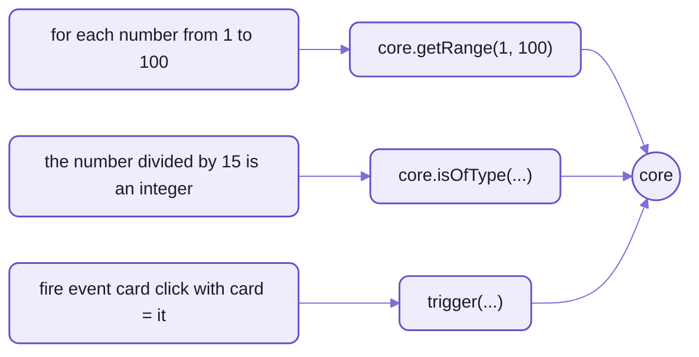

# core:  what compiled spell runs on

`spell-lang/core` is the runtime compiled JavaScript runs on:
what a person reading compiled output meets first.
Compiled code imports it as `@spell/core`, and nothing else:

```js
import { core, Thing, List, App, Drawable, DrawableList } from "@spell/core"
```

- `core` is ONE object of helpers (141 of them), for what JavaScript has no word of its own for:
  `core.getRange(1, 100)`, `core.randomItemOf(deck)`, `core.move(card, tableau)`.
- The classes spell's types extend:  `Thing`, `List` and `App`.
  So `a card is a thing` is `class Card extends Thing`.
- It draws with Solid, sends events, reads and writes things as JSON, and saves them by id.
- Its Python twin, `spell_core`, has the same helpers by Python's names
  ([README-targets](README-targets.md#the-python-half)).



_Three spell lines and the core calls they compile to:  the rest is plain JavaScript._

The three calls in full,
from the [FizzBuzz snapshot](tests/spaces/@spell/test/fizzbuzz/fizzbuzz.snapshot.js) and the `trigger` rule's tests:
- `core.getRange(1, 100)`
- `core.isOfType(number / 15, "integer")`
- `trigger("card-click", { card: 1 })`

## The pieces

| Piece | What it does | Where |
| --- | --- | --- |
| the classes | `Thing`, `List`, `App`, `Drawable`, `DrawableList`:  what spell's types extend | [classes/](core/src/classes/) |
| list helpers | positions, ranges, filtering, adding and removing, shuffling | [collection-core.ts](core/src/collection-core.ts), [collection-other.ts](core/src/collection-other.ts), [positions.ts](core/src/positions.ts) |
| drawing | Solid's `h()`, `@drawn`, mounting an app;  each thing drawn inside its own error boundary | [drawing.ts](core/src/drawing.ts), [elements.ts](core/src/elements.ts) |
| events | `trigger()`, `on()`, `off()`, `once()` | [runtime.ts](core/src/runtime.ts), [SpellEvent.ts](core/src/SpellEvent.ts) |
| JSON | every object's JSON says its class first, `"$type"`;  `core.fromJSON()` reads it back as that class | [json.ts](core/src/json.ts) |
| carrying over | keeps the game in progress when the program is recompiled | [carry.ts](core/src/carry.ts) |
| state by id | a program's state for a page that mirrors it:  whole the first time, then patches | [state.ts](core/src/state.ts), [page.ts](core/src/page.ts) |
| saving by id | things saved as readable JSON entries, by key (`Person#bob`), with versions and upgrades | [saving.ts](core/src/saving.ts), [checking.ts](core/src/checking.ts) |
| references | one thing named in text:  `Tableau#T1`, `Tableau#1` | [references.ts](core/src/references.ts) |
| seeded random | `core.seedRandom(n)`:  everything random after it repeats, run after run | [ParkMiller.ts](core/src/ParkMiller.ts) |
| the console, tests | `print`, `expect`, `to test ...` | [console.ts](core/src/console.ts), [tests.ts](core/src/tests.ts) |
| the model alone | the core without drawing, for libraries:  `spell-lang/core/model` | [model.ts](core/src/model.ts) |

- `core` is built up as it loads ([index.ts](core/src/index.ts)):
  each module adds its helpers to the one object.
- Random numbers come only from the core's own generator, never `Math.random()`,
  so a seeded game deals the same in JavaScript and Python.
- Each drawable thing is its own web component (`<solitaire-card>`),
  and a throw while drawing one shows a stand-in for that thing alone.

## Three things a reader trips on

### Reactivity:  a write reads back at once

A thing's properties are spell CELLS:  small, synchronous reactive values, from [the kit's util](../README-util.md).

```spell
the card is a new card whose direction is up
print the card is face up
set the direction of the card to down
print the card is face up
```

```js
export const card = new Card({ direction: "up" })
core.console.log(card.isFaceUp)
card.direction = "down"
core.console.log(card.isFaceUp)
```

```text
true
false
```

- A read right after a write sees it:  spell is imperative, so `set x to 1` then `print x` must print 1.
- Drawing follows:  Solid re-draws what read a cell when it changes, on its own schedule, so ten writes re-draw once.
- Why not Solid's own signals:  Solid 2 stages writes, so a read right after a write sees the OLD value until a flush.
- `core.flush()` settles everything now, when a test needs it.

### Positions count from 1

`the first card of the deck` is the first card;  `card 2 of the deck` the second.
The compiler turns a position into the target's own, so the runtime sees what JavaScript and Python expect:

| Spell | JavaScript | Python |
| --- | --- | --- |
| `item n of the cards` | `core.getItemAt(cards, position(n))` | `core.get_item_at(cards, position(n))` |
| `the first item of the cards` | `core.getItemAt(cards, 0)` | `core.get_item_at(cards, 0)` |
| `the last item of the cards` | `core.getItemAt(cards, -1)` | `core.get_item_at(cards, -1)` |
| `the position of 30 in the cards` | `spellPosition(positionOf(cards, 30))` | `spell_position(core.position_of(cards, 30))` |
| `card 2 of the deck`, the deck a known list type | `deck.getItem(1)` | `deck[1]` |

_Run on `[10, 20, 30]` with `n` set to 2, each prints 20, 10, 30 and 3, in both languages._

- `position()` turns spell's position into the language's index;  `spellPosition()` turns one back.
- A literal position is turned at compile time:  `the first` is simply `0`.
- `-1` is the last item either way.
- A project can count from 0 instead:  `"listsStartAt": 0` in its project file
  (the [cards-from-zero](tests/spaces/@spell/test/cards-from-zero/) test project).
- `for each card and position in the cards` hands the loop positions from 1 (`withSpellPositions()`).

### The TypeScript and Python runtimes, side by side

The same `core`, in two languages:  the JavaScript one, and `spell_core` in Python, by Python's names.

| Spell | JavaScript | Python |
| --- | --- | --- |
| `a random item of my-list` | `core.randomItemOf(myList)` | `core.random_item_of(my_list)` |
| `add thing to my-list before other-thing` | `core.addBefore(myList, otherThing, thing)` | `core.add_before(my_list, other_thing, thing)` |
| `fire event card click with card = 1` | `trigger("card-click", { card: 1 })` | `core.trigger("card-click", card=1)` |
| `print "Yo!"` | `core.console.log("Yo!")` | `print("Yo!")` |
| `for each number from 1 to 10:` | `core.getRange(1, 10).forEach(...)` | `for number in range(1, 11):` |

_Python uses its own words where it has them, `print` and `range`, and `core` only where it doesn't._

How they're kept in step:
- [core.declarations.json5](core/core.declarations.json5) is the JavaScript core's method list,
  read from the running core.
  `spell_core` must have each name, or list it in [not_ported_yet.json5](py/core/not_ported_yet.json5), with why.
- 36 names aren't ported yet, mostly a browser's own:
  a drawable thing's element, a page's shadow root, carrying things over a recompile.
- Both cores read the same expected files in their tests:  seeded random, state by id, and saving by id.
- A compiled program must print exactly what the JavaScript prints:  the core contract test, in spell-app's command line.

## Who may import it

- Compiled JavaScript, as `@spell/core`.
- In a page, ONLY spell-app's runner, which bundles it as `spell-runtime.js` and gives each running app its own copy,
  so two apps on a page never share a `core` ([README-app](../spell-app/README-app.md)).
- Everything else (the editor, the parser, spell itself) imports only its TYPES, so a page never loads a second copy.
- `spell-lang/core/model` is the one other entry:  the core without drawing, no Solid, no running program's things.
  A compiled TypeScript library (`ts/lib`) imports it, so the server and app may too.
- It runs in a shadow root, so never `document`:  `core.appRoot` is where an app mounts.
- It imports only the kit's util;  never the parser or spell.

<details>
<summary>The generated files, and what they pin</summary>

| File | What it is | Rewritten by |
| --- | --- | --- |
| [core.declarations.json5](core/core.declarations.json5) | the core's method list:  13 names it provides, 153 statements, each with its module and a description from its docstring | `yarn core:gen:declarations`, at spell-lang's root |
| [core.scopes.js](core/src/core.scopes.js) | the built-in types' docs, for pages with no parser | `yarn lsp:scopes --builtins`, in spell-app |

- A test fails until you regenerate the method list after adding, renaming or removing anything on `core`;
  a name with no docstring fails it too.
- Python's test fails on a new name until it's ported, or listed as not ported yet.
- Never edit either by hand.

</details>

<details>
<summary>The files</summary>

| File | What it is |
| --- | --- |
| [index.ts](core/src/index.ts) | the entry:  loads every module, which assembles `core` |
| [core.ts](core/src/core.ts), [core.types.ts](core/src/core.types.ts) | the `core` object, and its types |
| [classes/](core/src/classes/) | `Thing`, `List`, `App`, `Drawable`, `DrawableList`, ids |
| [collection-core.ts](core/src/collection-core.ts), [collection-other.ts](core/src/collection-other.ts), [positions.ts](core/src/positions.ts) | list helpers |
| [string.ts](core/src/string.ts), [paths.ts](core/src/paths.ts) | text helpers, dotted paths |
| [things.ts](core/src/things.ts) | the running program's things, for the Thing Explorer |
| [drawing.ts](core/src/drawing.ts), [elements.ts](core/src/elements.ts), [ui.ts](core/src/ui.ts) | drawing, each drawable thing's element, notices and prompts |
| [runtime.ts](core/src/runtime.ts), [SpellEvent.ts](core/src/SpellEvent.ts) | events, pauses, processes |
| [json.ts](core/src/json.ts), [carry.ts](core/src/carry.ts), [state.ts](core/src/state.ts), [page.ts](core/src/page.ts) | JSON, carrying over, state by id, a page drawing a program running elsewhere |
| [saving.ts](core/src/saving.ts), [checking.ts](core/src/checking.ts), [references.ts](core/src/references.ts) | saving and loading by id, checking an entry, naming a thing |
| [ParkMiller.ts](core/src/ParkMiller.ts) | seeded random |
| [console.ts](core/src/console.ts), [assert.ts](core/src/assert.ts), [tests.ts](core/src/tests.ts) | the console, assertions, spell's tests |
| [model.ts](core/src/model.ts) | `spell-lang/core/model`:  the core without drawing |
| [coreDeclarations.ts](core/src/coreDeclarations.ts), [writeCoreDeclarations.ts](core/src/writeCoreDeclarations.ts) | the method list, and the script that writes it |

- Its tests:  [tests/core/](tests/core/), at the same paths, with the expected files both cores read.

</details>

<details>
<summary>More in the docs site</summary>

These guides need a checkout with the content folder beside it, and the page server running.

| Guide | Served at |
| --- | --- |
| Core Reference:  every `core` method, in JavaScript and Python | `/guides/targets/core-reference.html` |
| Drawable Things | `/guides/drawable-thing.html` |

</details>

## See also

- The pages beside this one:
  [README-targets](README-targets.md), [README-spell](README-spell.md), [README-parser](README-parser.md)
- The rules for working in this folder:  [core's AGENTS.md](core/AGENTS.md)
- spell-lang's front page:  [README](README.md)
- The kit, and every repo:  [the kit's README](../README.md)
- Also beside it:  [README-markdown.md](README-markdown.md) · [README-rulex.md](README-rulex.md)
