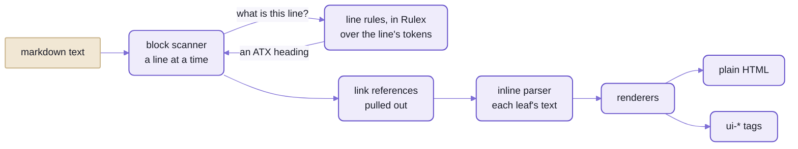
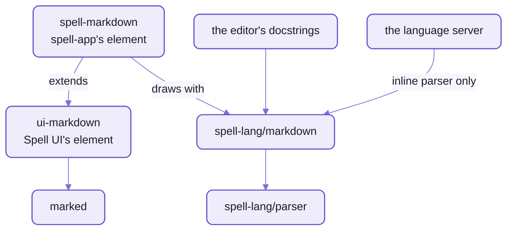

# Markdown on Spell's parser

```ts
import { MD } from "spell-lang/markdown"

MD.toHTML("# Hello\n\n- one **bold**\n- [x] done")
```

```html
<h1>Hello</h1><ul><li>one <strong>bold</strong></li><li class="task-list-item"><input type="checkbox" disabled="" checked="" /> done</li></ul>
```

That's marked's job, and the HTML you'd expect from it.
The surprise is the machine:  the parser that reads Spell, handed a second language.

It isn't a wrapper around marked, and there's no markdown hiding in the parser.
The parser knows no language until rules are registered on it;  this engine registers markdown's,
and never imports Spell.
It passes all 670 of 670 examples of GitHub's markdown spec.

`spell-lang/markdown` is the second language on [the parser](README-parser.md), after Spell itself.
It's no demo:  the editor's docstrings, the `<spell-markdown>` element and the language server all draw with it.
It isn't the fastest or the smallest, either:  about 1.6 times marked's time, and seven times its bytes
([the numbers](#exact-and-slower-and-bigger-than-marked)).

## A heading is a rule, not a regular expression

In marked, an ATX heading is this, one of its block rules:

```js
/^ {0,3}(#{1,6})(?=\s|$)(.*)(?:\n+|$)/
```

Here it's a class with two syntaxes on it, written in [Rulex](README-rulex.md)
([lineRules.ts](src/markdown/blocks/lineRules.ts)):

```ts
/** A run of 1-6 `#`, then nothing, or a space and anything. */
class atx_heading extends P.Sequence {}
lineRules.addRule(atx_heading, { syntax: "#{1,6}" })
lineRules.addRule(atx_heading, { syntax: "#{1,6}{spaces}{any}*" })
```

- `#{1,6}`:  one to six `#`, touching.
  Rulex counts tokens, and to markdown's tokenizer each `#` is a token of its own.
- `{spaces}`:  at least one space before the rest.
  So `## Setup` is a heading, and `##Setup` stays a paragraph, as the spec says.
- `{any}*`:  whatever follows, which becomes the heading's text.
- marked's ` {0,3}` has no twin here:
  the block scanner measures indentation in columns, from the raw line, before it asks the rule.

A parser generator hands you a parser for one grammar, after a build step.
This parser is handed its grammars while it runs, Spell's, markdown's or yours,
and each syntax string becomes rule objects once, as its rule registers
([README-rulex](README-rulex.md#it-compiles-once-when-a-rule-registers)).

<details>
<summary>What markdown's tokenizer makes of a line</summary>

The rules match tokens, not characters, so the tokenizer decides what a rule can see
([MarkdownTokenizer.ts](src/markdown/MarkdownTokenizer.ts)):
- words are letters and digits, in any script
- every other character is a symbol of its own:  `#`, `*`, `_` and `-` reach the rules one at a time
- whitespace rides on the token before it, so a rule can tell touching from spaced
- no comments, quotes or numbers:  `#`, `--`, `"` and `1.` are plain symbols and words here,
  where to Spell's tokenizer `#` and `--` start a comment

`## Setup`, as the line rules get it:

```text
SymbolToken  "#"
SymbolToken  "#"      with " " riding on it:  what {spaces} reads
WordToken    "Setup"
```

</details>

## Rulex says what a line is;  code does the rest

Markdown is two kinds of problem, and the engine treats them differently.
What KIND of line this is (a heading, a fence, a list marker) is a grammar question, so Rulex answers it.
What nests in what, and which `*` pairs with which, is bookkeeping across lines and characters:  that's code.



_Rulex answers one question, what a line is;  the block scanner and the inline parser, both code, handle what nests and
what pairs._

1. **The line rules** ([lineRules.ts](src/markdown/blocks/lineRules.ts)):  seven kinds of line, in 103 lines of
   TypeScript.
   - thematic breaks, ATX headings, setext underlines, fence openings, bullet and ordered list markers,
     table delimiter rows
   - Two leaf rules Rulex can't say, "any one token" and "1 to 9 digits", are built in code at the top of the file.
2. **The block scanner** ([BlockScanner.ts](src/markdown/blocks/BlockScanner.ts)), a port of commonmark.js 0.29's:
   - the stack of open containers (block quotes, list items), lazy continuation lines, tabs counted to 4-column
     stops, GitHub's tables
   - It walks the text a line at a time, and asks the line rules what each line is;
     it reads columns, levels and info strings from the raw text itself, since those are about characters, not tokens.
   - Then the link reference definitions come out of the paragraphs
     ([extractReferences.ts](src/markdown/inlines/extractReferences.ts)):
     they count for the whole document, so `[foo]` may come before `[foo]: /url`.
3. **The inline parser** ([InlineParser.ts](src/markdown/inlines/InlineParser.ts)), a port of commonmark.js 0.29's:
   - emphasis by its delimiter rules, links and images, code spans, entities, raw HTML, GitHub's strikethrough
   - then GitHub's autolinks over what's left as text ([autolinkText.ts](src/markdown/inlines/autolinkText.ts))
4. **The renderers** ([render/](src/markdown/render/)) write the blocks and inlines as a markup tree,
   then as plain HTML or `ui-*` tags.

So yes, there are regular expressions in here too.
The inline parser is a straight port, regexes and all:
most of it is "any token but a backtick" scanning, which Rulex has no way to say.

The cost of asking a parser what each line is:  it's slower than a regex.
So five of the line rules sit behind a cheap regular-expression guard (`^#` for a heading),
and a line that can't be one never reaches the rule.
The guard never decides, the rule does;  but without the guards the block phase takes 254 ms instead of 76 ms,
over the 2 MB of markdown measured below, for the same output.

## Three functions, six options

Everything goes through `MD`, the folder's one namespace.
`MD.toHTML(text)` is this engine's `marked.parse(text)`;  `MD.render()` is what a page wants, outline and all.

| Function | Returns | Options |
| --- | --- | --- |
| `MD.toHTML(text, options)` | plain HTML, as the spec writes it | `autolinks`, `tagfilter` |
| `MD.toMarkup(text, options)` | the same as a markup tree (`{ tag, attrs, children }`), for code that walks it | `autolinks`, `tagfilter` |
| `MD.render(text, options)` | `{ markup, html, headings }`:  `ui-*` tags by default, GitHub's heading ids, and the outline of headings | all six |

With Spell UI's elements instead of plain tags, a GitHub alert becomes a `<ui-message>`:

```ts
MD.render("> [!NOTE]\n> Hi", { ui: true }).html
```

```html
<ui-message state="info" icon="info circle" header="Note"><p>Hi</p></ui-message>
```

And the outline comes back with the HTML, ids and all:

```ts
MD.render("# Getting started!\n\n## Setup\n\n## Setup\n", { headingOffset: 1 }).headings
```

```js
[
  { level: 2, text: "Getting started!", id: "getting-started" },
  { level: 3, text: "Setup", id: "setup" },
  { level: 3, text: "Setup", id: "setup-1" }
]
```

- `headingOffset` pushed every heading down a level;  the second "Setup" got GitHub's `-1`.

| Option | Default | What it does |
| --- | --- | --- |
| `ui` | on | Spell UI's elements instead of plain tags:  `ui-header`, `ui-table`, `ui-message` for alerts, `ui-checkbox` for tasks ...;  `render()` only |
| `headingIds` | on | GitHub's slugs as heading ids, so `#setup` links work;  `render()` only |
| `headingOffset` | `0` | shifts every heading's level, clamped to 1-6, for a page that has its own `<h1>` |
| `breaks` | off | a line end inside a paragraph is a `<br>`, as in GitHub's comments |
| `autolinks` | on | bare `www.x.com`, `https://...` and `a@b.c` become links |
| `tagfilter` | on | raw `<script>`, `<style>`, `<iframe>` ... are written escaped |

<details>
<summary>What <code>ui: true</code> draws, tag by tag</summary>

| Markdown | Plain | `ui: true` |
| --- | --- | --- |
| heading | `<h2>` | `<ui-header level="2" id="setup">` |
| list | `<ul>`, `<ol>` | `<ui-list bulleted>`, `<ui-list ordered>`, each `<ui-item>` numbered by its `value`;  a bullet list inside a numbered one stays `<ul>` |
| task item | `<input type="checkbox" disabled>` | `<ui-checkbox readonly>`, in a `<ui-list>` with no bullets |
| alert (`> [!NOTE]`) | GitHub's own:  `<div class="markdown-alert markdown-alert-note">` | `<ui-message state icon header>` |
| quote | `<blockquote>` | `<ui-segment secondary>` |
| table | `<table>` | `<ui-table celled>` around the `<table>` |
| code block | `<pre><code>` | `<ui-code language copy>` |
| `---` | `<hr>` | `<ui-divider>` |

Each row is pinned by [render.test.ts](tests/markdown/render/render.test.ts).

</details>

**Raw HTML passes through:**  the tag filter is GitHub's, not a sanitizer.

```ts
MD.toHTML("<script>alert(1)</script>\n\nhi <b onclick=x>there</b>")
```

```html
&lt;script>alert(1)&lt;/script><p>hi <b onclick=x>there</b></p>
```

The `<script>` is escaped;  the `onclick` isn't.
The caller sanitizes:  `<spell-markdown sanitized>` loads DOMPurify for it, which keeps the `ui-*` tags.

## Exact, and slower and bigger than marked

| | This engine | marked 18 |
| --- | --- | --- |
| GitHub's spec examples | 670 of 670 | not scored:  see "How these were measured" |
| 166 files, 2 MB | about 155 ms | about 100 ms |
| one 28 kB page | about 2 ms | about 1 ms |
| browser bundle, minified and gzipped | 98 kB | 14 kB |

The time is fine for a page;  the bytes are the real cost.
- Fast enough for a live preview:  `<spell-markdown editable>` renders the WHOLE text again on every change,
  and a page-sized text takes about 2 ms.
- Too big to replace marked everywhere:  Spell UI's `<ui-markdown>` keeps marked
  ([who draws with it](#who-draws-with-it-and-who-doesnt)).
- Most of the weight isn't markdown:
  the bundle carries the whole parser, its code writers for JavaScript and TypeScript included,
  and markdown's own code is under a tenth of it.
- On 144 of the 166 files, the two write the same HTML, once whitespace and entity spelling are evened out.
  Where the other 22 first differ, it's one of three things:
  - whitespace inside code:  this engine keeps a tab as a tab, and the blank lines before a closing fence,
    as the spec says
  - GitHub's tag filter:  `<title>` in text is written escaped, as GitHub does;  marked leaves it
  - where a paragraph breaks

<details>
<summary>How these were measured</summary>

- On 2026-10-21, with Node 24.21 on an Apple M5 Pro.
- The files:  every `.md` file git tracks in the kit and its four child repos, 166 files and 2 MB,
  joined into one text.
  The page:  a 28 kB README.
- Times:  the median of 7 runs after a warm-up, as the docs site's comparison script runs them;
  the ratio moved between 1.5 and 1.7 over repeated runs.
- The bundle:  `MD.render(text, { ui: true })`, what `<spell-markdown>` calls, built alone by Vite and minified;
  marked 18 the same way.
- marked isn't scored on the spec, because a raw count would be unfair to it.
  Many of its misses are the same page written differently:  `<br>` for `<br />`, an entity left as an entity,
  a paragraph's leading spaces kept.
  And it can't turn GitHub's autolinks off for the core examples that say a bare URL ISN'T a link.

</details>

<details>
<summary>Where the time and the bytes go</summary>

- Of the 155 ms, the block phase is about 76 ms;  the inline phase and rendering are the rest.
- The bundle, by esbuild's map of the same entry, minified, before gzip:

  | What | kB |
  | --- | --- |
  | the parser's code writers (JavaScript, TypeScript, the tree diagram), which markdown never calls | 75 |
  | the HTML entity table (`entities`) | 52 |
  | lodash, through the kit's util | 37 |
  | the rest of the parser:  rules, Rulex, the tokenizer, the syntax tree's classes, scopes | 96 |
  | markdown's own code:  blocks, inlines, renderers | 29 |
  | the rest (pluralize, chalk, util's reactive engine ...) | 26 |
  | all of it | 315 |

- None of it is trimmed yet.

</details>

## Who draws with it, and who doesn't

Two elements draw markdown, and they're the same element with different engines.
Spell UI's `<ui-markdown>` uses marked:  Spell UI stands on the kit alone, beside spell-lang, so it can't import this
engine, and wouldn't want its bytes.
spell-app's `<spell-markdown>` extends it and swaps this engine in, because the app loads the parser anyway.



_Every arrow points down, to what it uses:  Spell UI never reaches this engine, and spell-app uses it three ways._

| Who | What for |
| --- | --- |
| spell-app's `<spell-markdown>` ([MDEngine.ts](../spell-app/src/app/components/spell-markdown/MDEngine.ts)) | a `<ui-markdown>` in every way, plain or `editable`, but drawn by this engine in `ui-*` tags;  the engine loads in a chunk of its own on the first render |
| the editor's docstrings ([Markdown.tsx](../spell-app/src/app/solid/Markdown.tsx)) | a type's or member's docs, as plain HTML;  the engine loads on first use, so a runner page carries no parser until it shows a docstring |
| the language server ([SpellLanguageService.ts](../spell-app/src/lsp/SpellLanguageService.ts)) | `**bold**`, `*italic*`, `~~struck~~` and links inside a comment keep its colour with a modifier;  a `` `code` `` span is coloured as a string |

The cost lands on the page:  its first `<spell-markdown>` loads the engine when it first renders, parser and all.

## Working on it:  the spec is the scoreboard

Progress here is a number you can read:  670 of 670, section by section, and a test that fails when it moves.
From spell-lang's root, in a checkout set up as [the kit's README](../README.md#setup-from-zero) says:

```sh
cd ~/www/spell/spell-lang
yarn vp test run --project markdown        # markdown's tests:  7 files, 34 tests
yarn tsx scripts/markdown/spec-report.mts  # the spec, section by section;  name a section to see its failures
```

The spec report, trimmed:

```text
670/670
  11/11  Tabs
    1/1  Precedence
  19/19  Thematic breaks
  18/18  ATX headings
  27/27  Setext headings
  ...
131/131  Emphasis and strong emphasis
    2/2  Strikethrough (extension)
  87/87  Links
  ...
```

- The spec test ([spec.test.ts](tests/markdown/spec/spec.test.ts)) renders every example with plain tags,
  and pins the pass count per section in a snapshot.
  - A regression fails it.
  - A gain fails it too, until you update the snapshot after reading the diff, which is the progress report:
    `yarn vp test run --project markdown -u`.
  - HTML is compared with whitespace between tags evened out:  `<li>foo\n<ul>` and `<li>foo<ul>` draw the same.
- What the 670 leave out:
  - the spec's two task-list examples, which cmark-gfm's own runner doesn't run either
  - alerts (`> [!NOTE]`), which aren't in the spec at all
  - Both are tested in [render.test.ts](tests/markdown/render/render.test.ts).
- Tables and strikethrough stay on for every example;  autolinks and the tag filter only for their own,
  as cmark-gfm runs them:  a core example says a bare URL ISN'T a link.
- The examples come from cmark-gfm's `spec.txt` (GFM 0.29, CC-BY-SA 4.0), into
  [gfm-spec.json](src/markdown/spec/gfm-spec.json):

  ```sh
  cd ~/www/spell/spell-lang
  yarn markdown:spec:update <path to spec.txt>
  ```

- The other tests:  [tests/markdown/](tests/markdown/), at the same paths as the code.
- The rules for working in this folder, and what it may import:  [markdown's AGENTS.md](src/markdown/AGENTS.md).

<details>
<summary>The files</summary>

| File | What it is |
| --- | --- |
| [index.ts](src/markdown/index.ts) | the entry:  `MD` |
| [MarkdownTokenizer.ts](src/markdown/MarkdownTokenizer.ts) | how text becomes tokens |
| [MarkdownParser.ts](src/markdown/MarkdownParser.ts) | a parser with markdown's tokenizer, and `matchWhole()` for a rule that must take a whole line |
| [blocks/lineRules.ts](src/markdown/blocks/lineRules.ts) | each kind of line, in Rulex |
| [blocks/BlockScanner.ts](src/markdown/blocks/BlockScanner.ts) | the container stack, lazy continuation, tables;  the line guards |
| [inlines/InlineParser.ts](src/markdown/inlines/InlineParser.ts) | emphasis, links, entities, raw HTML |
| [inlines/autolinkText.ts](src/markdown/inlines/autolinkText.ts), [extractReferences.ts](src/markdown/inlines/extractReferences.ts) | GitHub's autolinks;  link reference definitions |
| [render/](src/markdown/render/) | blocks and inlines to markup, then HTML or `ui-*` tags |
| [toHTML.ts](src/markdown/toHTML.ts) | `toHTML()`, `toMarkup()`, `render()` |
| [spec/gfm-spec.json](src/markdown/spec/gfm-spec.json) | the spec's examples |

</details>

<details>
<summary>More in the docs site</summary>

These guides need a checkout with the content folder beside it, and the page server running.

| Guide | Served at |
| --- | --- |
| Markdown on the parser | `/guides/markdown/markdown.html` |

</details>

## See also

- [README-parser](README-parser.md#creating-parsers-for-other-languages):
  a parser for a language of your own, with this engine as the worked example
- [README-rulex](README-rulex.md):  every construct the line rules use, counts and `{spaces}` included
- [README-spell](README-spell.md):  the other language on the same parser, Spell itself
- [spell-app's README-app](../spell-app/README-app.md):  `<spell-markdown>` and the editor that draws with this
- [spell-lang's front page](README.md):  the language, its pipeline, and every page of the repo
