# Markdown on the parser

`spell-lang/markdown` is GitHub-flavoured markdown,
written as rules on the same [parser](README-parser.md) spell runs on.
- It's the proof that the parser knows no language:  it never imports spell.
- It's also a real engine, used in three places:
  spell-app's `<spell-markdown>` element, the editor's docstrings,
  and the language server's colouring of markdown inside comments.
- It passes all 670 of 670 examples of GitHub's markdown spec, with GitHub's extensions on:
  tables, task lists, strikethrough, autolinks, the tag filter, and alerts (`> [!NOTE]`).

If you're writing a parser for a language of your own, this is the worked example:
[README-parser](README-parser.md#creating-parsers-for-other-languages).

```mermaid
%%{init: {"theme":"base","themeVariables":{"fontFamily":"-apple-system, BlinkMacSystemFont, Segoe UI, Helvetica, Arial, sans-serif","fontSize":"15px","primaryColor":"#EFECFB","primaryBorderColor":"#6550CA","primaryTextColor":"#1A1C27","secondaryColor":"#F4F1E9","tertiaryColor":"#F7F6FC","lineColor":"#7F6FD6","textColor":"#7F6FD6","clusterBkg":"#F7F6FC","clusterBorder":"#B9B0E8","titleColor":"#1A1C27","edgeLabelBackground":"#F7F6FC","actorBkg":"#EFECFB","actorBorder":"#6550CA","actorTextColor":"#1A1C27","actorLineColor":"#9C90DE","signalColor":"#7F6FD6","signalTextColor":"#7F6FD6","labelBoxBkgColor":"#EFECFB","labelBoxBorderColor":"#6550CA","labelTextColor":"#1A1C27","loopTextColor":"#7F6FD6","noteBkgColor":"#F1E7D4","noteBorderColor":"#C9B48A","noteTextColor":"#1A1C27","activationBkgColor":"#DCD6F7","activationBorderColor":"#6550CA","sequenceNumberColor":"#FFFFFF"},"flowchart":{"curve":"basis","padding":12,"nodeSpacing":40,"rankSpacing":44}}}%%
flowchart LR
  text[markdown text] --> tokenizer[markdown's tokenizer]
  tokenizer --> lines[line rules, in Rulex]
  lines --> blocks[block scanner]
  blocks --> inlines[inline parser]
  inlines --> out[plain HTML, or ui-* tags]
  %% the Spell look:  yarn mermaid:pretty
  classDef default fill:#EFECFB,stroke:#6550CA,stroke-width:1.5px,color:#1A1C27,rx:8px,ry:8px
```



_Each line is sorted by a Rulex rule;  the block scanner nests them;  the inline parser does emphasis and links._

## How to call it

```ts
import { MD } from "spell-lang/markdown"

MD.toHTML("# Hello\n\n- one **bold**\n- [x] done")
```

```html
<h1>Hello</h1><ul><li>one <strong>bold</strong></li><li class="task-list-item"><input type="checkbox" disabled="" checked="" /> done</li></ul>
```

With Spell UI's elements instead of plain tags:

```ts
MD.render("> [!NOTE]\n> Hi", { ui: true }).html
```

```html
<ui-message state="info" icon="info circle" header="Note"><p>Hi</p></ui-message>
```

| Function | Returns |
| --- | --- |
| `MD.toHTML(text, options)` | plain HTML, as the spec writes it |
| `MD.toMarkup(text, options)` | the same as a markup tree, for code that walks it |
| `MD.render(text, options)` | `{ markup, html, headings }`:  `ui-*` tags by default, GitHub's heading ids, and the outline of headings |

Options:
- `ui`:  draw with Spell UI's elements (`ui-header`, `ui-table`, `ui-message` alerts, `ui-checkbox` tasks ...)
- `headingIds`:  give headings GitHub's slugs, so `#links` work
- `headingOffset`:  push every heading down a level or more, for a page that has its own `<h1>`
- `breaks`:  a newline inside a paragraph is a line break
- `autolinks`, `tagfilter`:  GitHub's extensions, both on unless turned off

**Raw HTML passes through:**  the caller sanitizes it before putting it on a page.

## How it's built

Three stages, the first in Rulex, the other two in code where rules weren't enough.

1. **Line rules:**  each kind of line is a Rulex rule ([lineRules.ts](markdown/src/blocks/lineRules.ts)):
   thematic breaks, headings, fences, list markers, quotes, table rows.
   A heading, in two syntaxes on one rule:

   ```ts
   /** A run of 1-6 `#`, then nothing, or a space and anything. */
   class atx_heading extends P.Sequence {}
   lineRules.addRule(atx_heading, { syntax: "#{1,6}" })
   lineRules.addRule(atx_heading, { syntax: "#{1,6}{spaces}{any}*" })
   ```

2. **The block scanner** ([BlockScanner.ts](markdown/src/blocks/BlockScanner.ts)):
   the stack of open containers (quotes, list items), lazy continuation lines, tables.
   A port of commonmark.js 0.29's.
3. **The inline parser** ([InlineParser.ts](markdown/src/inlines/InlineParser.ts)):
   emphasis by its delimiter rules, links, entities, raw HTML;  then GitHub's autolinks.
   A port of commonmark.js 0.29's.

Then the renderers ([render/](markdown/src/render/)) write the blocks and inlines as plain HTML or `ui-*` tags.

- Its tokenizer ([MarkdownTokenizer.ts](markdown/src/MarkdownTokenizer.ts)):
  words are letters and digits, every other character is a symbol of its own,
  and whitespace rides on the token before it.
  So Rulex can count `#`s, and tell `**bold**` from `** bold **`.
- What Rulex can't say is hand-written:  block nesting, emphasis pairing, "any token but a backtick".
- The line rules took the block stage from 342 ms to 50 ms over the repo's markdown files.

## The numbers

Measured on 2026-10-04, over the repo's 172 markdown files (1315 kB):

| | This engine | marked |
| --- | --- | --- |
| GitHub spec examples passed | 670 of 670 | |
| time for all 172 files | 101 ms (1.8× marked's) | 56 ms |
| the biggest file (32 kB) | 2.2 ms | |
| browser bundle, gzipped | 59 kB | 14 kB |

- So Spell UI's `<ui-markdown>` keeps marked:  too big to replace it everywhere yet.
- Spell's own elements, which load the parser anyway, use this one.

## What uses it

| Who | What for |
| --- | --- |
| spell-app's `<spell-markdown>` ([MDEngine.ts](../spell-app/app/components/spell-markdown/MDEngine.ts)) | Spell UI's `<ui-markdown>`, drawn with this engine and `ui-*` tags, plain or editable |
| the editor's docstrings ([Markdown.tsx](../spell-app/app/src/solid/Markdown.tsx)) | a type's or member's docs, as plain HTML, loaded on first use |
| the language server ([SpellLanguageService.ts](../spell-app/lsp/src/SpellLanguageService.ts)) | `**bold**`, `*italic*` and code inside a comment, coloured in the editor |

<details>
<summary>The files</summary>

| File | What it is |
| --- | --- |
| [index.ts](markdown/src/index.ts) | the entry:  `MD` |
| [MarkdownTokenizer.ts](markdown/src/MarkdownTokenizer.ts) | how text becomes tokens |
| [MarkdownParser.ts](markdown/src/MarkdownParser.ts) | a parser with markdown's tokenizer, and `matchWhole()` for a rule that must take a whole line |
| [blocks/lineRules.ts](markdown/src/blocks/lineRules.ts) | each kind of line, in Rulex |
| [blocks/BlockScanner.ts](markdown/src/blocks/BlockScanner.ts) | the container stack, lazy continuation, tables |
| [inlines/InlineParser.ts](markdown/src/inlines/InlineParser.ts) | emphasis, links, entities, raw HTML |
| [inlines/autolinkText.ts](markdown/src/inlines/autolinkText.ts), [extractReferences.ts](markdown/src/inlines/extractReferences.ts) | GitHub's autolinks;  link reference definitions |
| [render/](markdown/src/render/) | blocks and inlines to markup, then HTML or `ui-*` tags |
| [toHTML.ts](markdown/src/toHTML.ts) | `toHTML()`, `toMarkup()`, `render()` |
| [spec/gfm-spec.json](markdown/src/spec/gfm-spec.json) | the spec's examples |

</details>

<details>
<summary>The spec test, and refreshing the examples</summary>

- [spec.test.ts](tests/markdown/src/spec/spec.test.ts) renders every example with plain HTML tags,
  and pins the pass count per section in a snapshot:  670 of 670 today.
  - A regression fails it.
  - A gain updates it:  `vitest -u`, after reading the diff.
- The examples come from cmark-gfm's `spec.txt`:

  ```sh
  cd ~/www/spell/spell-lang
  yarn markdown:spec:update <path to spec.txt>
  ```

- The other tests:  [tests/markdown/](tests/markdown/), at the same paths as the code.

</details>

<details>
<summary>More in the docs site</summary>

These guides need a checkout with the content folder beside it, and the page server running.

| Guide | Served at |
| --- | --- |
| Markdown on the parser | `/guides/markdown/markdown.html` |
| Rulex:  how markdown maps onto it | `/guides/rulex/rulex.html` |

</details>

## See also

- The pages beside this one:
  [README-parser](README-parser.md), [README-rulex](README-rulex.md), [README-spell](README-spell.md)
- The rules for working in this folder:  [markdown's AGENTS.md](markdown/AGENTS.md)
- spell-lang's front page:  [README](README.md)
- The kit, and every repo:  [the kit's README](../README.md)
- Also beside it:  [README-core.md](README-core.md) · [README-targets.md](README-targets.md)
