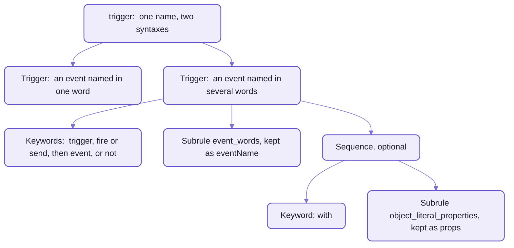
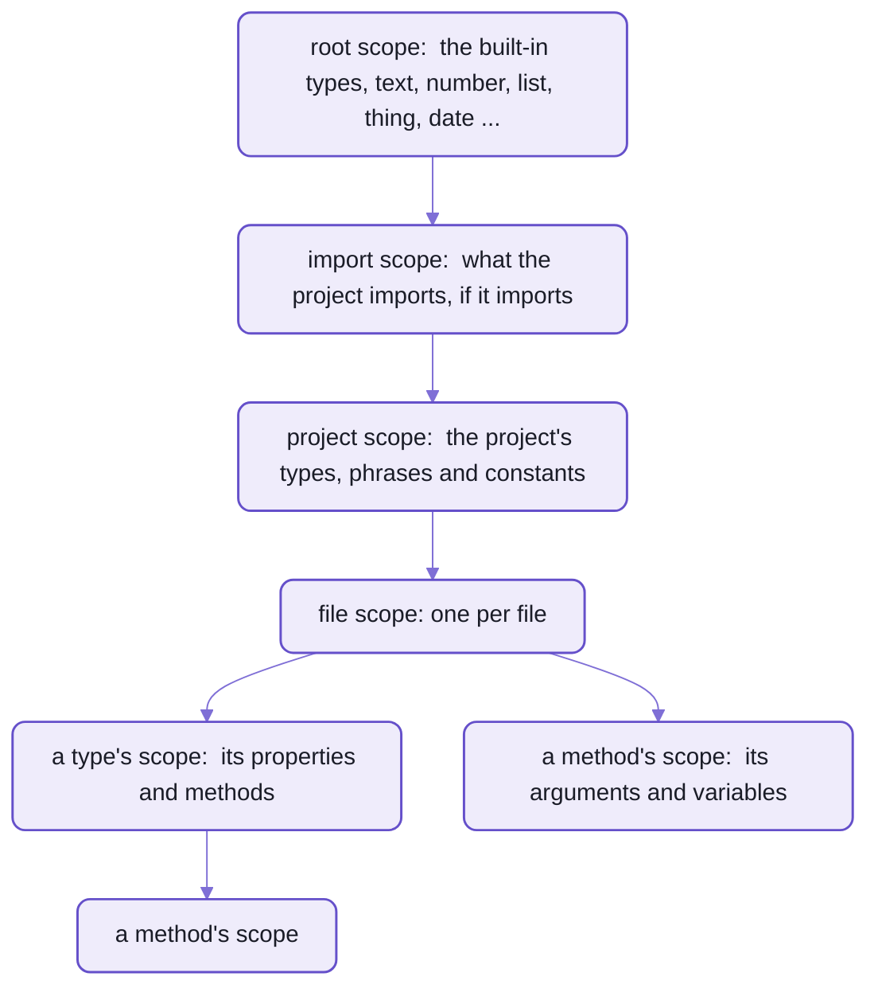

# The parser:  rules as classes, for any language

```ts
import { P } from "spell-parser/parser"
import "spell-parser/parser/rulex" // opt in:  rules written with `syntax` need it

const parser = new P.Parser({ module: "pets" })
class pet extends P.Sequence {}
parser.addRule(pet, { syntax: "(dog|cat)" })
class pet_pair extends P.Sequence {}
parser.addRule(pet_pair, { syntax: "{first:pet} and {second:pet}" })

const match = parser.parse("dog and cat", "pet_pair")
match.groups.second.value // => "cat"
parser.parse("bird and cat", "pet_pair") // => undefined
parser.expectedAfter("dog", "pet_pair").map((e) => e.rule.toRulexSyntax()) // => [ "and" ]
```

_The pets language, whole:  two rules, a parse, a refusal, and what could come next.  It runs as shown._

That's a language, with its autocomplete.
There's no grammar file in it, no generator to run, and no generated parser to check in:
the two classes ARE the rules, registered while the program runs.

`spell-parser/parser` is a parser that knows no language.
You hand it rules, each a class with a syntax string, and it hands back a tree of matches,
each knowing its rule, the tokens it took and its named parts.
[Spell](README-spell.md) is written on it, and so is [GitHub markdown](README-markdown.md),
which passes all 670 of the spec's examples.

## If you've used a parser generator, three things move

### The grammar is code, and it grows while it reads

In ANTLR or PEG.js, you write a grammar, run the generator, and import the parser it wrote.
By the time the first token is read, the grammar is frozen.

Here a rule is a plain class, and a rule can register new rules in the middle of a parse.
- In Spell, `it "is a face card" if its rank is jack, queen or king` declares a phrase,
  and every line after it can say `the card is a face card`:  the phrase became a rule.
- So a program teaches the parser its own words, a line at a time
  ([below](#how-earlier-lines-teach-later-ones)).
- The class says what a rule IS and what it builds;  its syntax says how it's WRITTEN.
  So another language can register the same class in its own words.

### Rulex reads like a regular expression, over words

`{first:pet} and {second:pet}` is [Rulex](README-rulex.md):
the shape of a regular expression, but its atoms are words, symbols and other rules, by name.
- A rule named inside another is looked up when it's parsed, so rules may recurse.
- What comes back is a tree with named parts (`match.groups.second`), not a flat list of capture groups.
- Where it stops:  Rulex can't say every shape, so markdown writes its block nesting and emphasis in code
  ([what Rulex can't say](README-rulex.md#what-it-cant-say)).

### The same text gives the same tree, every time

There's nothing to sample and no temperature to turn down:  parse a line twice, and the matches are the same.
- A line no rule understands is kept as a parse error, named in the output,
  and the rest of the file still parses ([3. Matches](#3-matches)).
- So a sentence the rules don't cover never runs as a guess, however clear it is to you:
  you get the line and column where the parser stopped.

## One line, six stages

The parser works in six stages, and the rest of this page takes them in order,
following one line of Spell all the way down:  `fire event card click with card = 1`.

```mermaid
%%{init: {"theme":"base","themeVariables":{"fontFamily":"-apple-system, BlinkMacSystemFont, Segoe UI, Helvetica, Arial, sans-serif","fontSize":"15px","primaryColor":"#EFECFB","primaryBorderColor":"#6550CA","primaryTextColor":"#1A1C27","secondaryColor":"#F4F1E9","tertiaryColor":"#F7F6FC","lineColor":"#7F6FD6","textColor":"#7F6FD6","clusterBkg":"#F7F6FC","clusterBorder":"#B9B0E8","titleColor":"#1A1C27","edgeLabelBackground":"#F7F6FC","actorBkg":"#EFECFB","actorBorder":"#6550CA","actorTextColor":"#1A1C27","actorLineColor":"#9C90DE","signalColor":"#7F6FD6","signalTextColor":"#7F6FD6","labelBoxBkgColor":"#EFECFB","labelBoxBorderColor":"#6550CA","labelTextColor":"#1A1C27","loopTextColor":"#7F6FD6","noteBkgColor":"#F1E7D4","noteBorderColor":"#C9B48A","noteTextColor":"#1A1C27","activationBkgColor":"#DCD6F7","activationBorderColor":"#6550CA","sequenceNumberColor":"#FFFFFF"},"flowchart":{"curve":"basis","padding":12,"nodeSpacing":40,"rankSpacing":44}}}%%
flowchart LR
  line["fire event card click with card = 1"] --> tokens["1 · tokens"]
  tokens --> rules["2 · rules"]
  rules --> matches["3 · matches"]
  matches --> tree["4 · the Spell tree"]
  tree --> output["5 · output"]
  output --> run["6 · running it"]
  rules <-.->|declare, look up| scope[("scope")]
  matches -.->|or compile straight from the matches| own["your own output"]
  %% the Spell look:  yarn mermaid:pretty
  classDef default fill:#EFECFB,stroke:#6550CA,stroke-width:1.5px,color:#1A1C27,rx:8px,ry:8px
  classDef step fill:#EFECFB,stroke:#6550CA,stroke-width:1.5px,color:#1A1C27,rx:16px,ry:16px
  class tokens,rules,matches,tree,output,run step
```



_Each stage below opens with that line's close-up.
A language may skip the tree:  the dates language, further down, compiles straight from its matches._

- The parser imports only the kit's shared helpers, `spell/util`:  no UI framework, no JSX, no DOM.
  So the same parser runs in the editor's page, under node, and in the language server.
- To run the commands on this page, you need the kit's checkout:  [setup](https://github.com/spell-app/spell/blob/main/README.md#setup-from-zero).
- The deep map of how Spell's lines go through it, about 1,600 lines for the curious:
  [PARSING.md](src/spell/PARSING.md).

## 1. Tokens

The tokenizer is a setting, not a lexer you write.
Each language picks what a word is, which quotes make text and whether indentation matters;
the rules only ever see tokens.

Our line, as Spell's tokenizer reads it:

```text
WordToken      "fire"    whitespace " "
WordToken      "event"   whitespace " "
WordToken      "card"    whitespace " "
WordToken      "click"   whitespace " "
WordToken      "with"    whitespace " "
WordToken      "card"    whitespace " "
SymbolToken    "="       whitespace " "
NumberToken    1
```

- Whitespace rides on the token before it,
  so a rule can tell `**bold**` from `** bold **` ([README-rulex](README-rulex.md)).
- For a whole file, Spell groups lines into nested blocks by their indent.
  `to play`, then `print 1` and `print 2` indented under it:

  ```text
  BlockToken
    LineToken
      WordToken "to"
      WordToken "play"
    BlockToken
      LineToken
        WordToken "print"
        NumberToken 1
      LineToken
        WordToken "print"
        NumberToken 2
  ```

- Some tokens span lines and are still ONE token:  a JSX element, or a `<css>` or `<markdown>` block,
  whose text is never read as Spell.
- Spell's settings, `SpellParser.tokenizer` ([SpellParser.ts](src/spell/SpellParser.ts)):
  - double-quoted text only, so a single quote can sit inside `isn't`
  - indentation matters at the start of a line
  - raw `css` and `markdown` blocks
- Spell's words are the tokenizer's default:  a letter in any script, then letters, accents, digits, `-` or `_`.
  So `año`, `está` and `corazón` are one word each, as Spanish needs.

<details>
<summary>Every kind of token, and the settings</summary>

From [Tokens.ts](src/parser/tokenizer/Tokens.ts):

| Token | What it holds |
| --- | --- |
| `WordToken` | a word:  a letter in any script, then letters, accents, digits, `-` or `_` (so `card-click` is one word) |
| `NumberToken` | a number, its `value` a JavaScript number |
| `SymbolToken` | ONE punctuation character:  `>=` is two, and the `Symbols` rule takes them as a run |
| `TextToken` | quoted text, quotes included |
| `CommentToken` | a comment, to the end of the line (Spell's:  `//`, `--`, or a heading's `#`s) |
| `JSX*Token`s | a JSX element, its attributes and children |
| `LineToken` | one line's tokens, for a language with blocks |
| `BlockToken` | lines and nested blocks, by indent |
| `IndentToken`, `NewlineToken`, `InlineWhitespaceToken` | whitespace, when the language keeps it as tokens |

The tokenizer, [Tokenizer.ts](src/parser/tokenizer/Tokenizer.ts), takes these settings:
- `whitespacePolicy`:  `ALL` keeps every space as a token (the default);  `NONE` drops them all;
  `LEADING_ONLY` keeps indents and newlines, and hangs inline spaces on the token before (Spell's, markdown's)
- `quoteSymbols`:  which quotes make text, double and single by default
- `rawTextTags`:  the tags whose contents stay raw text
- a subclass overrides what a word is (`WORD_START`, `WORD_CHAR`) or which tokens it tries
  (`matchTopTokens()`), as [MarkdownTokenizer](src/markdown/MarkdownTokenizer.ts) does

</details>

## 2. Defining rules

Registering a rule hands the parser two things:  a class, which builds and declares,
and a syntax string with its tests, which says how the rule is written.
Rulex compiles the string into rule objects on the spot, and the parser files them under the rule's name.
Here's our line's rule, as registering it left it:



_A Group of two `Trigger` rules, one per syntax.
Rulex folded `(trigger|fire|send) event?` into a single Keywords rule._

- A syntax is compiled ONCE, when its rule is registered:  parsing never sees the string again
  ([when, and what a bad one says](README-rulex.md#it-compiles-once-when-a-rule-registers)).
- A rule's NAME comes from its class name, in snake_case:  `ListAddRelative` is `list_add_relative`.
  - So every production build keeps class names (`keepNames`), and a build test in spell-app fails without it.
  - Where the class name won't do, a plain `static ruleName = "line"` says it (Spell's `BlockLine`).

### A real rule:  Spell's `trigger`

The class says how the rule behaves;  each `addRule()` is one way to write it, with its own tests.
From [Trigger.ts](src/spell/rules/events/Trigger.ts), trimmed of its docstring's bullets and a comment,
then its English registrations, from [events.en.ts](src/spell/rules/events/events.en.ts):

```ts
/**
 * `trigger` rule:  fires a global event, optionally with a `props` object.
 */
export class Trigger extends SpellStatement<"eventName|props?"> {
  @proto static alias = "statement"

  getAST(match: P.MatchFor<this>) {
    const { eventName, props } = match.groups
    const args: P.ASTExpression[] = [new P.ASTQuotedExpression(match, eventName.raw!)]
    if (props) args.push(P.asAST<P.ASTExpression>(props.AST))
    return new P.ASTCoreMethodInvocation(match, { methodName: "trigger", args })
  }
}

events.addRule(Trigger, {
  syntax: "(trigger|fire|send) event? {eventName:keyword} (with {props:object_literal_properties})?",
  tests: [
    {
      compileAs: "statement",
      tests: [
        { input: `trigger card-click`, js: 'trigger("card-click")' },
        { input: `fire event card-click with card = 1`, js: 'trigger("card-click", { card: 1 })' }
      ]
    }
  ]
})
// `fire event card click with card = it`:  an event's name of several words -- see `event_words`
events.addRule(Trigger, {
  syntax: "(trigger|fire|send) event? {eventName:event_words} (with {props:object_literal_properties})?",
  tests: [
    { compileAs: "statement", tests: [["fire event card click with card = 1", 'trigger("card-click", { card: 1 })']] }
  ]
})
```

- `@proto static` sets a default on the class, inherited by its subclasses;
  `@proto` refuses a setting the rule doesn't declare.
- `SpellStatement<"eventName|props?">` names the groups its matches have, so `match.groups.props` is typed.
- `syntax`, `tests` and the rule's name are NOT inherited:  share a syntax with a constant
  (Spell's `VARIABLE_SYNTAX`).
- One rule class per file, the file named for the class;
  its registrations sit with the rest of its module's, one file per human language:
  `events.en.ts` for English, `events.es.ts` for Spanish.

The command line reads the same registrations back:

```sh
spell explain trigger
```

<details>
<summary>Output</summary>

```text
trigger  (trigger|fire|send) event? {eventName:keyword} (with {props:object_literal_properties})?
e.g. trigger card-click

trigger  (trigger|fire|send) event? {eventName:event_words} (with {props:object_literal_properties})?
e.g. fire event card click with card = 1
```

</details>

### The kinds of rule

Rulex compiles a syntax string into a tree of these;  you can also make them by hand.
The docstring of [the `Rule` class](src/parser/rules/Rule.ts) shows all five ways to make a rule, with examples.

| Rule | Matches | Rulex |
| --- | --- | --- |
| `Keyword` / `Keywords` | one word, or a run of words | `give`, `give it back` |
| `Symbol` / `Symbols` | one punctuation character, or a run with no space between | `:`, `>=` |
| `Subrule` | another rule, by name, looked up at parse time (so it may recurse) | `{expression}` |
| `Sequence` | its parts, in order | `give {thing} to {who}` |
| `Choice` | the best of several alternatives | `({number}\|{text})` |
| `Group` | the registrations of one name, merged:  a `Choice` the parser makes for you | (one name, several `addRule()`s) |
| `Repeat` | one rule many times, with an optional delimiter | `{word}+`, `[{item},]` |
| `Pattern` | a token whose text matches a regular expression | (in code:  `pattern: /^\d+$/`) |
| `TokenType` / `Word` | any token of one class;  any word | (in code:  `tokenType: P.NumberToken`) |

### Registration and ties

- A module's rules register as its registration file loads (Spell's `<module>.en.ts`),
  so the order of that file IS the registration order.
- A rule with several syntaxes is registered once per syntax;  the registrations merge into a `Group` under its name,
  as `trigger`'s did above.
- That order matters only at a tie:  when two rules match the same words equally well,
  the one registered first wins ([below](#how-a-choice-is-settled)).
- A rule may name itself, but not FIRST.
  Like any top-down parser, `({sum} plus {num}|{num})` calls itself on the same token forever,
  and the parse dies with `RangeError: Maximum call stack size exceeded`.
  Write it as a repeat, `{num} (plus {num})*`, or as Spell does:  one expression rule and a table of precedence.

## 3. Matches

A parse hands back a tree you can read, not a yes or a no.
`spell parse` prints our line's, one match a line:

```sh
spell parse "fire event card click with card = 1"
```

<details>
<summary>Output</summary>

```text
statement › trigger  fire event card click with card = 1
  Keywords  fire event
  eventName: event_words  card click
  Sequence  with card = 1
    Keyword  with
    props: object_literal_properties  card = 1
      object_literal_property  card = 1
        property › member_words  card
        Symbol  =
        value: operand › number  1

trigger("card-click", { card: 1 })
```

</details>

- Each line is a match:  its rule, then the text it took.
  `statement › trigger` is the `trigger` rule, the one the `statement` choice kept.
- A name before a colon is the group it's kept under:  `eventName:`, `props:`.
  That's what `trigger`'s `getAST()` reads as `match.groups.eventName`.
- The last line is the JavaScript it compiles to (stage 5).

Five fields of a match do most of the work.
`rule` and `tokens` say what matched what;  `groups` holds the named parts, and ONLY what the syntax matched.
`data` is what the rule worked out for itself while parsing, such as a scope lookup,
and `datatype` is what the match IS, in Spell's words:  `text`, `Card`, `list of cards`.

<details>
<summary>Every field of a match</summary>

From [Match.ts](src/parser/Match.ts):

| Field | What it is |
| --- | --- |
| `rule` | the rule that matched |
| `tokens` | every token it took |
| `matched` | its sub-matches and tokens, in order |
| `items` | a `Repeat`'s items, without the delimiters |
| `groups` | named sub-matches:  a match, or a list when the name repeats |
| `data` | what the rule stashed while parsing |
| `datatype` | what the match is, in Spell's words, worked out the first time it's asked |
| `scope` | the scope it was matched in |
| `raw`, `value` | the text it matched;  a `Pattern`'s or literal's value |
| `inputText` | the text it took, trailing whitespace included |
| `start`, `end`, `next` | where it starts, where its text stops, and where the next token starts |
| `choiceRule` | the `Choice` that picked it, if any |
| `AST` | its node of the Spell tree, built when first read |
| `compile()` | its output:  through the Spell tree when the rule has one, else the rule's own `compile()` |

</details>

Nothing throws when a line doesn't parse.
`parser.parse()` returns `undefined`, as `bird and cat` did;  only `parser.compile()` throws, "Can't parse input".
Spell goes further:  its block rule falls back to a `parse_error` rule that takes the whole line,
so the lines around it still compile:

```sh
spell parse $'print 1\nflibber the jabberwock\nprint 2'
```

<details>
<summary>Output</summary>

```text
...
  line  flibber the jabberwock
    parse_error  flibber the jabberwock
...

core.console.log(1)
/* PARSE ERROR: Don't understand "flibber the jabberwock" */
core.console.log(2)
```

</details>

### How a choice is settled

A `Choice` tries EVERY alternative, then keeps:
1. the highest `priority`:  only for rules that match the same words
2. then the longest match
3. then the one registered first

- Operators are different:  how tightly `*` binds against `+` is Spell's precedence table,
  read by its one expression rule, not by priority.
- Nothing reports a tie.
  Two rules that match the same words equally well don't warn you;  the earlier one wins,
  so the order of a module's registration file is part of its grammar.
- The code:  `getBestMatch()`, in [Choice.ts](src/parser/rules/Choice.ts).

### How earlier lines teach later ones

Scope is what the program has declared so far:  its types, properties, variables and phrases.
A line that declares something records it, so the lines after it can use the new words.



_A name is looked up from the innermost scope out:  a method sees its own variables first,
then its type's, its file's and its project's, and the built-in types last._

On its own, a line about a card face up means nothing:

```sh
spell parse "print the card is face up"
```

<details>
<summary>Output</summary>

```text
Doesn't parse as statement or expression
```

</details>

Three lines earlier, it does.
Here's the whole program in one parse, and the end of what it prints:

```sh
spell parse $'a card is a thing\na card has a direction as either up or down\na card "is face up" if its direction is up\nset the card to a new card\nprint the card is face up'
```

<details>
<summary>Output</summary>

```text
...
  /*! SPELL: DECLARES {
    syntax: "{operator:is_or_is_not} face up", output: "is_face_up", rule: "method_postfix",
    of: "Card", kind: "method", name: '"is face up"', returns: "choice",
  } */
  get isFaceUp() {
    return this.direction === "up"
  }
}
export const card = new Card()
core.console.log(card.isFaceUp)
```

</details>

- The third line's quoted phrase became a rule while it parsed, and the comment above `isFaceUp` shows its syntax,
  written by Spell in Rulex:  `{operator:is_or_is_not} face up`.
  `{operator:is_or_is_not}` takes `is not` and `isn't` too, so `the card is not face up` reads as well
  ([more syntaxes Spell writes](README-rulex.md#your-program-writes-rulex-too)).
- That `SPELL: DECLARES` comment is a marker, never written to disk:
  a compile takes each one back out into the project's declarations, so a project that imports this one gets the
  same rules without parsing it ([SpellDeclarations.ts](src/spell/SpellDeclarations.ts)).
- Only a rule's `mutateScope()` changes scope.
  Building the Spell tree never does, nor looks scope up.
- A rule made mid-parse is a rule class `specialize()`d with plain data, and registered with `scope.addRule()`.
  The scope keeps the pair, so a project's declarations can hand the rule on to projects that import it.
- `Subrule` looks its rule up by name at the moment it parses, which is how a rule added on line 3 is there on line 13.

Order still matters, though not for everything.
A line can name a type, or call a method, declared further down,
because every type and method a project declares is stubbed before its files parse.
A phrase can't be used above its definition yet.
Move `print the card is face up` above the line that makes the phrase, and `spell lint` says so:

```text
Card.spell:4:16  Don't understand "is face up"
```

### Re-parsing after an edit

The editor re-parses as you type, so it re-parses only what an edit could have changed:
`IncrementalParse` for a file, `IncrementalProject` for a project's files in order
([IncrementalParse.ts](src/parser/IncrementalParse.ts)).
- An edit inside one indented body re-parses that body, and keeps everything after it as it was.
- Any other edit re-parses from the first changed line to the end of the file, and the files after it.
- An edit that changes WHICH types or methods a file declares re-parses the whole project:
  rare, and the only way a line above it can learn of the change.
- A line you're typing into a broken state can keep its last working declarations (`keepLastGood`),
  so the lines below still parse as they did.
  It's opt-in, since a full parse wouldn't do it.
- Taking back is cheap:  every scope change and every rule added mid-parse is written in the parser's journal
  (`ParseJournal`), and a rewind undoes them in order.
- Completion asks the same parser what could come next, as the pets language did at the top of this page:
  `expectedAfter()`, in [Expectations.ts](src/parser/Expectations.ts).

## 4. The Spell tree

Each match builds a node of the Spell tree, its AST:  what the line MEANT, in no target's words.
Our line's:

```sh
spell parse --tree "fire event card click with card = 1"
```

<details>
<summary>Output</summary>

```text
Core trigger
  args: Text "card-click"
  args: Object literal  Object
    properties: Object literal property
      property: Name card
      value: Number 1

trigger("card-click", { card: 1 })
```

</details>

- `card click` is already `"card-click"`:  the rule decided the event's name, so no writer has to.
- 84 classes of node, from `ASTNode` down, in [AST.ts](src/parser/ast/AST.ts).
- Language-neutral:
  - operators as meanings:  `plus` and `equals`, not `+` and `==`
    (`spell parse --tree "print 1 is 2"` shows `equals`)
  - Spell's own values:  `up`, not `"up"`
- A rule builds its node with `getAST(match)`, which is pure:  it never changes scope, nor looks it up.
  What it needs from scope, the rule looked up while parsing, into `match.data`.
- Nodes hold what was parsed;  they never write output.  That's the writers' job.
- `spell parse --tree --html` prints the tree as a `<ui-tree-diagram>`, for a docs page:
  a writer too, `TreeWriter`, whose output is boxes for a diagram instead of code.

## 5. Output

A writer turns the Spell tree into one target's code.
Our line, through three of them:

| Target | Our line | Imported from |
| --- | --- | --- |
| JavaScript | `trigger("card-click", { card: 1 })` | `trigger`, from `@spell/core` |
| TypeScript | `trigger("card-click", { card: 1 })` | `trigger`, from `@spell/core` |
| Python | `core.trigger("card-click", card=1)` | `core`, from `spell_core` |

A writer is a class with ONE METHOD PER KIND OF NODE, named for the node's class, so a new target is a new class.
The same `if` node, in two writers:

<table>
<tr><th>JavaScript's writer</th><th>Python's writer</th></tr>
<tr>
<td>

```ts
ASTIfStatement(node: P.ASTIfStatement): string {
  const written = `if (${this.condition(node.condition)}) ${this.body(node.statements)}`
  this.noteGuard(node)
  return written
}
```

</td>
<td>

```ts
ASTIfStatement(node: P.ASTIfStatement): string {
  const written = pyText.block(`if ${this.condition(node.condition)}`, this.blockBody(node.statements))
  this.noteGuard(node)
  return written
}
```

</td>
</tr>
</table>

_The same node, two writers:  `if (...) ...` for JavaScript, an indented block for Python._

- A node with no method of its own is written by its nearest base class's.
  Our line's node, an `ASTCoreMethodInvocation`, has none:
  both writers write it with their `ASTScopedMethodInvocation()`.
- A subclass writer overrides only what it writes differently:  TypeScript's writer extends JavaScript's.
- A writer writes a child with `this.write(child)`, never `child.compile()`, which is always JavaScript's:
  that's how a subclass's overrides reach every child.
- Methods are found by class name, so builds keep class names, as rule names already need.
- A node no method writes makes the writer throw, naming the node:  Python's says which kinds it can't write yet.

The base class is `Writer` ([Writer.ts](src/parser/writers/Writer.ts)), and every writer in
[src/parser/writers/](src/parser/writers/) and [src/py/](src/py/) is a subclass of it.
Which one writes which target, and what each produces:
[README-targets](README-targets.md#one-tree-a-writer-per-language).
What a project's compile writes, and where it puts it:  [README-spell](README-spell.md#the-compiler).

## 6. Running the output

Compiled JavaScript imports [the runtime](README-core.md) as `@spell/core`, and nothing else.
Whatever runs the program decides what that name means, and each app on a page gets a runtime of its own
([where it points, and why](README-core.md#who-may-import-it--one-copy-per-running-app)).
Compiled Python imports `spell_core` instead ([README-targets](README-targets.md#the-python-half)).

## Creating parsers for other languages

Markdown is the worked example:  a second language on the same parser, which never imports Spell.
A new language takes five pieces.

1. **A tokenizer setting:**  what a word is, what a symbol is, how whitespace and quotes work.
   - Markdown's ([MarkdownTokenizer.ts](src/markdown/MarkdownTokenizer.ts)) makes every character but a letter or
     a digit a symbol of its own, so a Rulex count like `#{1,6}` counts `#`s
     ([what it makes of a line](README-markdown.md#a-heading-is-a-rule-not-a-regular-expression)).
2. **Rule modules:**  a parser per module, one rule class per file, and the registrations in an order that breaks ties.
   - Spell's are the folders of [src/spell/rules/](src/spell/rules/), each with its own parser,
     combined into one by `spellParser.import(...)`;  each folder's `<module>.en.ts` registers its rules, in order.
   - Markdown's line rules are one file, [lineRules.ts](src/markdown/blocks/lineRules.ts), its heading one class
     registered twice.
3. **What scope records:**  if a line can teach later lines words, its rule's `mutateScope()` records them.
   - Markdown needs none;  Spell's whole design rests on it.
4. **A tree, or your own data:**  rules may build Spell tree nodes (`getAST()`),
   or compile straight to a value (`compile()`), as the dates language below does.
   - Markdown builds its own tree of blocks, then renders it.
5. **A writer:**  a class with a method per kind of node, if you build a tree.

### A language in 23 lines:  dates

A dates mini-language, run as shown:

```ts
const dates = new P.Parser({ module: "dates" })

class weekday extends P.Sequence {}
dates.addRule(weekday, { syntax: "(monday|tuesday|wednesday|thursday|friday|saturday|sunday)" })
class day_name extends P.Sequence {}
dates.addRule(day_name, { syntax: "(today|tomorrow|yesterday)" })
class count extends P.TokenType {}
dates.addRule(count, { tokenType: P.NumberToken })

class next_weekday extends P.Sequence {
  compile(match) {
    return `nextWeekday("${match.groups.day.compile()}")`
  }
}
dates.addRule(next_weekday, { syntax: "next {day:weekday}" })

class offset extends P.Sequence {
  compile(match) {
    const { count, unit, direction, from } = match.groups
    const days = count.value * (unit.value.startsWith("week") ? 7 : 1)
    return `addDays(${from.compile()}, ${direction.value === "before" ? -days : days})`
  }
}
dates.addRule(offset, { syntax: "{count} (unit:day|days|week|weeks) (direction:from|after|before) {from:day_name}" })

class date extends P.Sequence {}
dates.addRule(date, { syntax: "({next_weekday}|{offset}|{day_name})" })
```

| `dates.compile(text, "date")` | Gives |
| --- | --- |
| `next friday` | `nextWeekday("friday")` |
| `3 days from today` | `addDays(today, 3)` |
| `2 weeks before tomorrow` | `addDays(tomorrow, -14)` |
| `today` | `today` |
| `next week` | throws "Can't parse input":  `week` isn't a weekday |

- A rule with no Spell tree compiles itself:  `compile(match)`, here returning text.
- A named literal's match has its word as `value`;  a number token's, its number.
- Its words are case-sensitive:  `Next Friday` fails, unless a choice is marked `/i` ([README-rulex](README-rulex.md)).

### Where rules alone aren't enough

Write that part in code.
Markdown's block scanner (nested containers, lazy continuation lines) and its inline parser (emphasis pairing)
are hand-written, ported from commonmark.js ([README-markdown](README-markdown.md)).
A language with files gets a few more hooks:

<details>
<summary>What a language overrides on its <code>Parser</code></summary>

From [Parser.ts](src/parser/Parser.ts);  each does nothing, or the simplest thing, until a language overrides it.
`SpellParser` overrides them all.

| Hook | What it's for |
| --- | --- |
| `tokenizer` | the language's tokenizer settings |
| `getScope()` | the scope a parse starts in:  Spell's has its built-in types |
| `commit()` | lock in a match parsed on its own, e.g. by a rule test:  apply its scope changes |
| `declaredTypes()`, `declaredMethods()` | a cheap scan, without parsing, for what a file declares, so a line can use it above its declaration |
| `stubDeclaredMethods()`, `changesMethods()` | make those methods callable early;  say when an edit changes them |
| `tokenizeRoot()`, `parseItem()`, `isBrokenItem()` | parse a file item by item, for incremental parsing |
| `getBodyMark()`, `reparseBody()`, `assembleFile()` | re-parse just one indented body after an edit |
| `normalizeTestOutput()` | what a rule test compares, e.g. Spell drops its `SPELL: DECLARES` comments |

- A fallback rule that takes any tokens, as Spell's `parse_error` does, keeps a bad line as an error node
  instead of ending the parse.

</details>

### Spell in another human language

Spanish is the worked example:  its own syntax strings, registered on Spell's SAME rule classes.
- That's why `addRule()` takes only a syntax and its tests:  the class is reusable.
- Each folder of rules registers its English in `<folder>.en.ts`, and its Spanish in `<folder>.es.ts`,
  the same rules in the same order.
- Words with negated forms are WORD RULES, registered word by word.
  English's `is`, from [expressions.en.ts](src/spell/rules/expressions/expressions.en.ts),
  and Spanish's, from [expressions.es.ts](src/spell/rules/expressions/expressions.es.ts):

  ```ts
  expressions.addRule(Negatable.specialize({ ruleName: "is_or_is_not", alias: "is" }), {
    syntax: "(is|(negated:is not|isn't|isnt))"
  })
  expressionsEs.addRule(Negatable.specialize({ ruleName: "is_or_is_not", alias: "is" }), {
    syntax: "(es|está|esta|(negated:no es|no está|no esta))"
  })
  ```

  A rule asks which form matched (`Negatable.isNegated()`), never which word.
- A language's other words (its type words, its plurals, its messages) are its LANGUAGE PACK,
  in [src/spell/languages/](src/spell/languages/), and a file picks its language by its name, `Carta.es.spell`.
  - A type's words are Spell's vocabulary, handed to the parser:  each pack brings its own.
- A third language is a third file per folder, and a pack.
  `spell parser packs check` compares each pack against English, module by module, and says what it still lacks:

  ```sh
  spell parser packs check
  ```

  <details>
  <summary>Output</summary>

  ```text
  Spanish (es):  complete, 19 modules
  ```

  </details>

## Testing rules

A rule's tests sit beside its syntax, in the same `addRule()` call:
each is an input, and what each writer makes of it.
Spell's `plus`, from [math.en.ts](src/spell/rules/math/math.en.ts):

```ts
math.addRule(Plus, {
  syntax: "(operator:plus|+) {expression:operand}",
  tests: [
    {
      compileAs: "expression",
      beforeEach(scope: P.Scope) {
        scope.variables?.add("price")
        scope.variables?.add("tax")
      },
      tests: [
        ["price + tax", "(price + tax)"],
        ["price+tax", "(price + tax)"],
        ["price plus tax", "(price + tax)"]
      ]
    }
  ]
})
```

- A test is `[input, js, ts?]`, or `{ input, js, ts }`.
  Leave out the TypeScript when it's the same as the JavaScript.
- Each input is parsed once, then written by both writers, JavaScript's and TypeScript's.
- `compileAs` parses the input as another rule;  `beforeEach` seeds the scope, here with two variables.
- A module's test file runs them all, through `unitTestModuleRules()` ([src/parser/test/](src/parser/test/)).
  Spell's `events` module's is three lines ([events.test.ts](tests/spell/rules/events/events.test.ts)).
  - A module with no rules to test fails, rather than passing quietly.
  - It snapshots the groups each rule's matches have, too:
    change a syntax, and the snapshot says which `Groups` type argument to update.
- Blessing writes each writer's current output into each test, in its source:
  run the tests with `BLESS_RULE_TESTS=1` (Spell's script for it is `yarn spell:test:rules:bless`), then read the diff.
- `parser.speedTest()` runs every rule test once to warm up, then 20 more times, and reports the average.
  `spell speedtest --against HEAD` does it in fresh processes, against a commit
  ([the language commands](https://github.com/spell-app/spell/blob/main/README-cli.md#spell-parser)).

### Adding a rule

A rule is one new file, its class, exported from the module's index file;
then its `addRule()` calls, with their tests, in the module's `<module>.en.ts`, whose order breaks ties,
and again in Spanish's `<module>.es.ts`.
Spell's recipe for that, step by step, with a whole rule to copy from:  [README-spell](README-spell.md#adding-a-rule).

## What it costs

Parsing is nearly the whole bill.
Measured warm on a laptop, Drawable Solitaire's four files (510 lines) parse in about 70 ms,
and compile to JavaScript in under 10 ms;  its card file alone, 154 lines, parses in about 17 ms.
- Why:  every `Choice` parses every alternative before it picks one.
- What keeps that affordable:  a `Sequence` checks its fixed words where they must fall,
  before any of its parts parse (`Sequence.test()`), so most rules fail on the first token they look at.
- Against a parser written by hand for one language, a general one is slower:
  markdown on this parser against marked, in [README-markdown](README-markdown.md).

<details>
<summary>More in the docs site</summary>

These guides need a checkout with the content folder beside it, and the page server running.

| Guide | Served at |
| --- | --- |
| Parser Model:  binding and datatypes | `/guides/precedence/parser-model.html` |
| Precedence And Types | `/guides/precedence/precedence.html` |

</details>

## See also

- [README-rulex](README-rulex.md):  the syntax every rule is written in, construct by construct;  the natural next page
- [README-markdown](README-markdown.md):  the second language on the parser, built the way this page describes
- [README-spell](README-spell.md):  Spell's twenty rule modules, its compiler, and its own recipe for a rule
- [PARSING.md](src/spell/PARSING.md):  the map of Spell's parse, for when you change how parsing works
- [The parser folder's AGENTS.md](src/parser/AGENTS.md):  the rules for working in it
