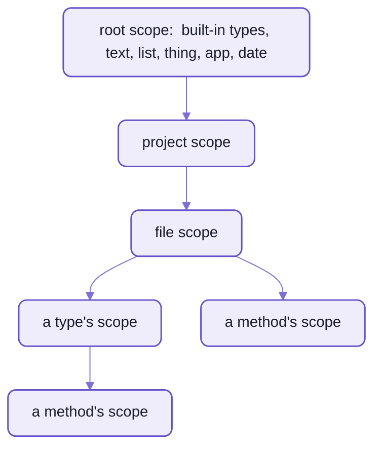

# The parser:  rules as classes, for any language

`spell-lang/parser` is a generic rule-based parser that knows no language.
If you've used a parser generator (yacc, ANTLR, PEG.js),
the difference is that there's no grammar file and no code generation step:  the rules are the program.
- A rule is a class with a syntax string, written in [Rulex](README-rulex.md),
  which reads like a regular expression over words and other rules.
- A parse builds a tree of matches:  each knows its rule, the tokens it took, and its named parts.
- Scope records what earlier lines declared, so later lines understand new words.
- Two languages run on it today:  [spell](README-spell.md) and [GitHub markdown](README-markdown.md).

```mermaid
%%{init: {"theme":"base","themeVariables":{"fontFamily":"-apple-system, BlinkMacSystemFont, Segoe UI, Helvetica, Arial, sans-serif","fontSize":"15px","primaryColor":"#EFECFB","primaryBorderColor":"#6550CA","primaryTextColor":"#1A1C27","secondaryColor":"#F4F1E9","tertiaryColor":"#F7F6FC","lineColor":"#7F6FD6","textColor":"#7F6FD6","clusterBkg":"#F7F6FC","clusterBorder":"#B9B0E8","titleColor":"#1A1C27","edgeLabelBackground":"#F7F6FC","actorBkg":"#EFECFB","actorBorder":"#6550CA","actorTextColor":"#1A1C27","actorLineColor":"#9C90DE","signalColor":"#7F6FD6","signalTextColor":"#7F6FD6","labelBoxBkgColor":"#EFECFB","labelBoxBorderColor":"#6550CA","labelTextColor":"#1A1C27","loopTextColor":"#7F6FD6","noteBkgColor":"#F1E7D4","noteBorderColor":"#C9B48A","noteTextColor":"#1A1C27","activationBkgColor":"#DCD6F7","activationBorderColor":"#6550CA","sequenceNumberColor":"#FFFFFF"},"flowchart":{"curve":"basis","padding":12,"nodeSpacing":40,"rankSpacing":44}}}%%
flowchart LR
  input[input text] --> tokenizer[tokenizer]
  tokenizer --> parser[parser]
  parser --> rules[rules]
  rules --> matches[matches]
  matches --> ast((the spell tree))
  ast --> output[a writer's output]
  %% the Spell look:  yarn mermaid:pretty
  classDef default fill:#EFECFB,stroke:#6550CA,stroke-width:1.5px,color:#1A1C27,rx:8px,ry:8px
```



_Each stage below opens with its own close-up of one line going through it._

It imports only the kit's shared helpers:  no UI framework, no JSX, no DOM.
The deep map of how spell's lines go through it is [PARSING.md](src/spell/PARSING.md);
this page is the overview.

## 1. Tokens

A tokenizer turns text into tokens:  words, numbers, symbols, text, comments.
Each language sets its own tokenizer up:  what a word is, which quotes make text, whether indentation matters.

Spell's tokens for one line, `if the card is face up: print "yes", 2`:

```text
WordToken      "if"      whitespace " "
WordToken      "the"     whitespace " "
WordToken      "card"    whitespace " "
WordToken      "is"      whitespace " "
WordToken      "face"    whitespace " "
WordToken      "up"
SymbolToken    ":"       whitespace " "
WordToken      "print"   whitespace " "
TextToken      "\"yes\""
SymbolToken    ","       whitespace " "
NumberToken    2
```

- Whitespace rides on the token before it,
  so a rule can tell `**bold**` from `** bold **` ([README-rulex](README-rulex.md)).
- For a whole file, spell groups lines into nested blocks by their indent.
  `to play`, then `print 1` and `print 2` indented under it:

  ```text
  BlockToken
    LineToken
      WordToken "to"
      WordToken "play"
    BlockToken
      LineToken
        WordToken "print"
        NumberToken 1
      LineToken
        WordToken "print"
        NumberToken 2
  ```

- Some tokens span lines and are still ONE token:  a JSX element, a `<css>` or `<markdown>` block.

<details>
<summary>Every kind of token</summary>

From [Tokens.ts](src/parser/tokenizer/Tokens.ts):

| Token | What it holds |
| --- | --- |
| `WordToken` | a word:  a letter, then letters, digits, `-` or `_` (so `card-click` is one word) |
| `NumberToken` | a number, its `value` a JavaScript number |
| `SymbolToken` | one punctuation character, or a run the language merges |
| `TextToken` | quoted text, quotes included |
| `CommentToken` | a comment, to the end of the line (spell's:  `//`, `--`, or a heading's `#`s) |
| `JSX*Token`s | a JSX element, its attributes and children |
| `LineToken` | one line's tokens, for a language with blocks |
| `BlockToken` | lines and nested blocks, by indent |

- The tokenizer:  [Tokenizer.ts](src/parser/tokenizer/Tokenizer.ts).
- Spell's settings:  `SpellParser.tokenizer`, in [SpellParser.ts](src/spell/SpellParser.ts).
  - double-quoted text only
  - indentation matters at the start of a line
  - raw `css` and `markdown` blocks

</details>

## 2. Defining rules

A rule is a class, registered with a parser:
- the class says what the rule IS, and how it behaves
- registering it says how it's WRITTEN:  a syntax string, and its tests
- so another language's parser can reuse the same class, with that language's own syntax

The smallest language, two rules, run as shown:

```ts
import { P } from "spell-lang/parser"
import "spell-lang/parser/rulex" // opt in:  rules written with `syntax` need it

const parser = new P.Parser({ module: "pets" })
class pet extends P.Sequence {}
parser.addRule(pet, { syntax: "(dog|cat)" })
class pet_pair extends P.Sequence {}
parser.addRule(pet_pair, { syntax: "{first:pet} and {second:pet}" })

const match = parser.parse("dog and cat", "pet_pair")
Object.keys(match.groups) // => [ "first", "second" ]
parser.parse("bird and cat", "pet_pair") // => undefined
```

- A rule's NAME comes from its class name, in snake_case:  `ListAddRelative` is `list_add_relative`.
  So every production build keeps class names (`keepNames`).
- `{first:pet}` is another rule, by name, its match kept as `first`.
- `(dog|cat)` is a choice.

### The kinds of rule

Rulex compiles a syntax string into a tree of these;  you can also make them by hand.

| Rule | Matches | Rulex |
| --- | --- | --- |
| `Keyword` / `Keywords` | one word, or a run of words | `give`, `give it back` |
| `Symbol` / `Symbols` | one punctuation character, or a run | `:`, `>=` |
| `Subrule` | another rule, by name, looked up at parse time (so it may recurse) | `{expression}` |
| `Sequence` | its parts, in order | `give {thing} to {who}` |
| `Choice` | the best of several alternatives | `({number}\|{text})` |
| `Repeat` | one rule many times, with an optional delimiter | `{word}+`, `[{item},]` |
| `Pattern` | a token whose text matches a regular expression | (in code:  `pattern: /^\d+$/`) |
| `TokenType` | any token of one class | (in code:  `tokenType: P.NumberToken`) |

The top docstring of [Rule.ts](src/parser/rules/Rule.ts) has every way to make a rule, with examples.

### A real rule:  spell's `trigger`

The class says how the rule behaves;  each `addRule()` is one way to write it, with its own tests:

```ts
/**
 * `trigger` rule:  fires a global event, optionally with a `props` object.
 */
export class Trigger extends SpellStatement<"eventName|props?"> {
  @proto static alias = "statement"

  getAST(match: P.MatchFor<this>) {
    const { eventName, props } = match.groups
    const args: P.ASTExpression[] = [new P.ASTQuotedExpression(match, eventName.raw!)]
    if (props) args.push(P.asAST<P.ASTExpression>(props.AST))
    return new P.ASTCoreMethodInvocation(match, { methodName: "trigger", args })
  }
}
events.addRule(Trigger, {
  syntax: "(trigger|fire|send) event? {eventName:keyword} (with {props:object_literal_properties})?",
  tests: [
    {
      compileAs: "statement",
      tests: [
        { input: `trigger card-click`, js: 'trigger("card-click")' },
        { input: `fire event card-click with card = 1`, js: 'trigger("card-click", { card: 1 })' }
      ]
    }
  ]
})
```

- `@proto static` sets a default on the class, inherited by its subclasses.
- `syntax`, `tests` and the rule's name are NOT inherited:  share a syntax with a constant.
- The whole file:  [Trigger.ts](src/spell/rules/events/Trigger.ts), one rule class per file.

### Registration and ties

- A module's rules register as its files load, so the order of its index file IS the registration order.
- A rule with several syntaxes is registered once per syntax;  the registrations merge under its name.
- When two rules match the same words equally well, the one registered first wins (below, "How a choice is settled").

### Two more small languages

A dates mini-language, in twenty lines, run as shown:

```ts
const dates = new P.Parser({ module: "dates" })

class weekday extends P.Sequence {}
dates.addRule(weekday, { syntax: "(monday|tuesday|wednesday|thursday|friday|saturday|sunday)" })
class day_name extends P.Sequence {}
dates.addRule(day_name, { syntax: "(today|tomorrow|yesterday)" })
class count extends P.TokenType {}
dates.addRule(count, { tokenType: P.NumberToken })

class next_weekday extends P.Sequence {
  compile(match) {
    return `nextWeekday("${match.groups.day.compile()}")`
  }
}
dates.addRule(next_weekday, { syntax: "next {day:weekday}" })

class offset extends P.Sequence {
  compile(match) {
    const { count, unit, direction, from } = match.groups
    const days = count.value * (unit.value.startsWith("week") ? 7 : 1)
    return `addDays(${from.compile()}, ${direction.value === "before" ? -days : days})`
  }
}
dates.addRule(offset, { syntax: "{count} (unit:day|days|week|weeks) (direction:from|after|before) {from:day_name}" })

class date extends P.Sequence {}
dates.addRule(date, { syntax: "({next_weekday}|{offset}|{day_name})" })
```

| `dates.compile(text, "date")` | Gives |
| --- | --- |
| `next friday` | `nextWeekday("friday")` |
| `3 days from today` | `addDays(today, 3)` |
| `2 weeks before tomorrow` | `addDays(tomorrow, -14)` |
| `today` | `today` |
| `next week` | throws "Can't parse input":  `week` isn't a weekday |

- A rule with no spell tree compiles itself:  `compile(match)`, here returning text.
- A named literal's match has its word as `value`;  a number token's, its number.

Markdown's heading rule, two syntaxes on one class ([lineRules.ts](src/markdown/blocks/lineRules.ts)):

```ts
/** A run of 1-6 `#`, then nothing, or a space and anything. */
class atx_heading extends P.Sequence {}
lineRules.addRule(atx_heading, { syntax: "#{1,6}" })
lineRules.addRule(atx_heading, { syntax: "#{1,6}{spaces}{any}*" })
```

## 3. Matches

A successful parse is a `Match`, and a tree of them:  one per rule that matched.
Nothing throws:  a line no rule understands becomes a parse-error match, and the rest of the file still parses.

`spell parse "print 1 + 2 * 3"`, the match tree:

```text
statement › print  print 1 + 2 * 3
  Keyword  print
  expressions: Repeat  1 + 2 * 3
    expression  1 + 2 * 3
      lhs: operand › number  1
      Repeat  + 2 * 3
        expression_suffix › plus  + 2
          operator › Symbol  +
          expression: operand › number  2
        expression_suffix › times  * 3
          operator › Symbol  *
          expression: operand › number  3
```

- Each line is a match:  its rule, then its text.
  So `statement › print` is the `print` rule, chosen for a statement.
- A name before a colon (`expressions:`, `lhs:`) is the group it's kept under.

What a match holds:
- `rule`:  the rule that matched
- `tokens`:  the tokens it took
- `groups`:  its named parts, ONLY what the syntax matched, e.g. `match.groups.eventName`
- `data`:  what the rule worked out for itself while parsing, e.g. a scope lookup
- `datatype`:  what it IS, in spell's words:  `text`, `Card`, `list of cards`

<details>
<summary>Every field of a match</summary>

From [Match.ts](src/parser/Match.ts):

| Field | What it is |
| --- | --- |
| `rule` | the rule that matched |
| `tokens` | every token it took |
| `matched` | its sub-matches and tokens, in order |
| `items` | a `Repeat`'s items, without the delimiters |
| `groups` | named sub-matches:  a match, or a list when the name repeats |
| `data` | what the rule stashed while parsing |
| `datatype` | what the match is, in spell's words |
| `scope` | the scope it was matched in |
| `raw`, `value` | the text it matched;  a `Pattern`'s or literal's value |
| `choiceRule` | the `Choice` that picked it, if any |
| `AST` | its node of the spell tree, built when first read |
| `compile()` | its output:  through the spell tree when the rule has one, else the rule's own `compile()` |

</details>

### How a choice is settled

A `Choice` tries EVERY alternative, then keeps:
1. the highest `priority`:  only for rules that match the same words
2. then the longest match
3. then the one registered first

Operators are different:  how tightly `*` binds against `+` is spell's precedence table,
read by its one expression rule, not by priority.

### How earlier lines teach later ones

Scope is what the program has declared so far:  types, properties, variables, phrases.
A line that declares something records it, so the lines after it can use the new words.



_A name is looked up from the innermost scope out, so a method sees its own variables, its type's, its file's ..._

Alone, `print the card is face up` doesn't parse:

```text
Doesn't parse as statement or expression
```

After three lines that declare a type, a property and a phrase, it does:

```sh
spell parse $'a card is a thing\na card has a direction as either up or down\na card "is face up" if its direction is up\nset the card to a new card\nprint the card is face up'
```

```js
export class Card extends Thing {
  // a card has a direction as either up or down
  static Directions = ["up", "down"]
  static { this.declareProp("direction", { oneOf: Card.Directions }) }
  get direction() { return this.getProp("direction") }
  set direction(value) { this.setProp("direction", value) }

  get isFaceUp() {
    return this.direction == "up"
  }
}
export const card = new Card()
core.console.log(card.isFaceUp)
```

- The phrase became a rule of its own while parsing:
  its syntax is `{operator:is} face up`, so `the card is not face up` reads too.
- Only a rule's `mutateScope()` changes scope;  building the spell tree never does, nor looks scope up.
- The real output also carries `SPELL: DECLARES` comments, left out here:
  they tell editors what each line declared.

### Re-parsing after an edit

The editor re-parses as you type, so it re-parses only what an edit changed:
`IncrementalParse` and `IncrementalProject` ([IncrementalParse.ts](src/parser/IncrementalParse.ts)).
- A line whose declarations changed re-parses what follows it;  one that changed nothing doesn't.
- Completion asks the same parser what could come next
  (`expectedAfter()`, in [Expectations.ts](src/parser/Expectations.ts)).

## 4. The spell tree

Each match builds a node of the spell tree (its AST):  what the line MEANT, in no target's words.
83 kinds of node, in [AST.ts](src/parser/ast/AST.ts).

`spell parse --tree "print 1 + 2 * 3"`:

```text
Print
  args: plus
    lhs: Number 1
    rhs: times
      lhs: Number 2
      rhs: Number 3
```

- Language-neutral:
  - operators as meanings:  `plus` and `equals`, not `+` and `==`
  - spell's own values:  `up`, not `"up"`
- A rule builds its node with `getAST(match)`, which is pure:  it never changes scope, nor looks it up.
  What it needs from scope, the rule looked up while parsing, into `match.data`.
- Nodes hold what was parsed;  they never write output.  That's the writers' job.

## 5. Output and bundling

A writer turns the spell tree into one target's code.
It's a class with ONE METHOD PER KIND OF NODE, named for the node's class, so a new target is a new class:

<table>
<tr><th>JavaScript's writer</th><th>Python's writer</th></tr>
<tr>
<td>

```ts
ASTIfStatement(node: P.ASTIfStatement): string {
  const written =
    `if (${this.condition(node.condition)}) ` +
    this.body(node.statements)
  this.noteGuard(node)
  return written
}
```

</td>
<td>

```ts
ASTIfStatement(node: P.ASTIfStatement): string {
  const written = pyText.block(
    `if ${this.condition(node.condition)}`,
    this.blockBody(node.statements)
  )
  this.noteGuard(node)
  return written
}
```

</td>
</tr>
</table>

_The same node, two writers:  `if (...) ...` for JavaScript, an indented block for Python._

- A node with no method of its own is written by its nearest base class's.
- A subclass writer overrides only what it writes differently:  TypeScript's writer extends JavaScript's.
- Methods are found by class name, so builds keep class names, as rule names already need.

<details>
<summary>The writer classes</summary>

| Writer | Writes | Where |
| --- | --- | --- |
| `Writer` | the base:  one method per node class, found by name | [Writer.ts](src/parser/writers/Writer.ts) |
| `ProgramWriter` | what every program's writer shares:  reads the whole project first, how names are written, where lists start counting | [ProgramWriter.ts](src/parser/writers/ProgramWriter.ts) |
| `JSWriter` | JavaScript on Solid, as a person writes it | [JSWriter.ts](src/parser/writers/JSWriter.ts) |
| `TSWriter` | TypeScript on Solid:  JSX, decorators, the types spell knows | [TSWriter.ts](src/parser/writers/TSWriter.ts) |
| `LibraryWriter` | a project's classes alone, as a TypeScript library | [LibraryWriter.ts](src/parser/writers/LibraryWriter.ts) |
| `TreeWriter` | not code:  boxes for a diagram of the tree (`spell parse --tree --html`) | [TreeWriter.ts](src/parser/writers/TreeWriter.ts) |
| `PyWriter`, `ElementsWriter` | Python, and a Python program's drawing half in JavaScript | spell-lang's [src/py/](src/py/) |

</details>

What a project's compile writes, and where:
- its compiled code, in the checkout's build folder, never committed:
  - `<Project>.spell.js`, `.spell.tsx`, `.spell.py`
  - the scope pack, `.scopes.js`, which the editor's Type Explorer reads
- beside its source:
  - its declarations, `<Project>.declarations.json5`:  what other projects import
  - its words, `<Project>.en.js`
- More:  [README-spell](README-spell.md#the-compiler) and [README-targets](README-targets.md).

## 6. Running the output

Compiled JavaScript imports [the runtime](README-core.md) as `@spell/core`, and nothing else.
Where it runs:
- under node:  `spell run` compiles a project and runs it, printing what it prints
- in a page:  spell-app's runner loads its own copy of the runtime, `spell-runtime.js`,
  and links the program's `@spell/core` import to it, so two apps on one page never share one
  ([README-app](../spell-app/README-app.md))
- as Python:  compiled Python imports `spell_core` instead ([README-targets](README-targets.md#the-python-half))

## Creating parsers for other languages

Markdown is the worked example:  a second language on the same parser, which never imports spell.
A new language takes five pieces.

1. **A tokenizer setting:**  what's a word, what's a symbol, how whitespace and strings work.
   - Markdown's ([MarkdownTokenizer.ts](src/markdown/MarkdownTokenizer.ts)):
     words are letters and digits, every other character is a symbol of its own,
     and whitespace rides on the token before it.
   - So Rulex counts work on it:  `#{1,6}` takes one to six `#` symbols.
2. **Rule modules:**  a parser per module, one rule class per file, an index file whose order is the registration order.
   - Spell's are folders under [src/spell/rules/](src/spell/rules/);  markdown's line rules are one file.
3. **What scope records:**  if a line can teach later lines words, its rule's `mutateScope()` records them.
   - Markdown needs none;  spell's whole design rests on it.
4. **A tree, or your own data:**  rules may build spell tree nodes (`getAST()`),
   or compile straight to a value (`compile()`), as the dates language above does.
   - Markdown builds its own block tree, then renders it.
5. **A writer:**  a class with a method per kind of node, if you build a tree.

Where rules alone aren't enough, write it in code:
markdown's block scanner (nested containers, lazy continuation) and its inline parser (emphasis pairing)
are hand-written, ported from commonmark.js ([README-markdown](README-markdown.md)).

**Spell in another human language** would start the same way:
its own syntax strings, registered on spell's SAME rule classes.
- That's why `addRule()` takes only a syntax and its tests:  the class is reusable.
- Words with negated forms register per language:

  ```ts
  addRule(Negatable.specialize({ ruleName: "es" }), { syntax: "(es|(negated:no es))" })
  ```

- A type's words are spell's vocabulary, handed to the parser:  a translation brings its own.

## Testing rules

A rule's tests sit beside its syntax, in its `addRule()` call.
Each test is an input and what each writer makes of it:

```ts
math.addRule(Plus, {
  syntax: "(operator:plus|+) {expression:operand}",
  tests: [
    {
      compileAs: "expression",
      beforeEach(scope: P.Scope) {
        scope.variables?.add("price")
        scope.variables?.add("tax")
      },
      tests: [
        ["price + tax", "(price + tax)"],
        ["price+tax", "(price + tax)"],
        ["price plus tax", "(price + tax)"]
      ]
    }
  ]
})
```

- A test is `[input, js, ts?]`, or `{ input, js, ts }`.
  Leave out the TypeScript when it's the same as the JavaScript.
- `compileAs` parses the input as another rule;  `beforeEach` seeds the scope.
- Each module's test file runs them all, through `unitTestModuleRules()` ([src/parser/test/](src/parser/test/)).
- Blessing writes the writers' current output into each test, in its source:
  `yarn spell:test:rules:bless`, then read the diff.
- `parser.speedTest()` runs every rule test once to warm up, then 20 more times, and reports the average.
  `spell speedtest --against HEAD` does it in fresh processes, against a commit.

### Adding a rule

1. Pick the module it belongs in, and add a file named for its class, `<RuleClass>.ts`,
   in that module's folder of [src/spell/rules/](src/spell/rules/).
2. Write the class:  its `@proto static` settings first, then `getAST()` (or `compile()`).
3. Register it right after the class, once per syntax, each with its tests.
4. Export it from the module's index file, in the place that gives the tie-break order you want.
5. Run `yarn spell:test:rules`;  bless the outputs once they're right, and read the diff.
6. Run `yarn spell:gen:syntax`, which regenerates the syntax table:  a test fails until you do.
7. A change to how parsing WORKS (not one more rule) updates [PARSING.md](src/spell/PARSING.md) in the same change.

Spell's own version of this, with its layout:  [README-spell](README-spell.md#adding-a-rule).

<details>
<summary>More in the docs site</summary>

These guides need a checkout with the content folder beside it, and the page server running.

| Guide | Served at |
| --- | --- |
| Parser Model:  binding and datatypes | `/guides/precedence/parser-model.html` |
| Precedence And Types | `/guides/precedence/precedence.html` |
| Targets and Writers | `/guides/targets/targets.html` |
| Rulex | `/guides/rulex/rulex.html` |

</details>

## See also

- The pages beside this one:
  [README-rulex](README-rulex.md), [README-markdown](README-markdown.md),
  [README-spell](README-spell.md), [README-core](README-core.md), [README-targets](README-targets.md)
- The detailed map of spell's parse pipeline:  [PARSING.md](src/spell/PARSING.md)
- The rules for working in this folder:  [parser's AGENTS.md](src/parser/AGENTS.md)
- spell-lang's front page:  [README](README.md)
- The kit, and every repo:  [the kit's README](../README.md)
