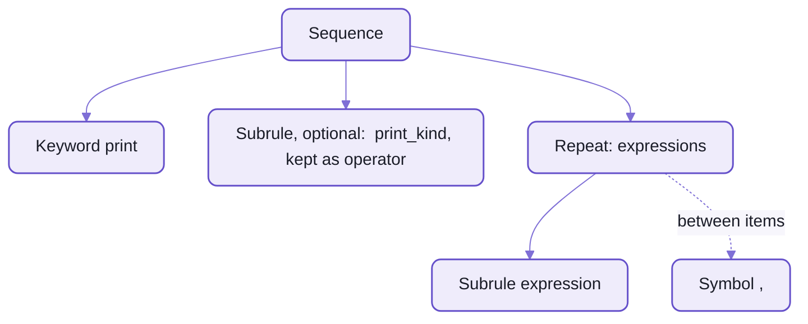
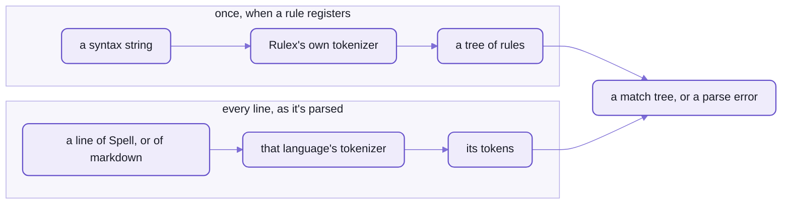

# Rulex:  regular expressions for words

```text
print {operator:print_kind}? [expressions:{expression} ,]
```

_Spell's `print` statement, all of it, as its English registration in [UI.en.ts](src/spell/rules/UI/UI.en.ts)
declares it, for the rule in [Print.ts](src/spell/rules/UI/Print.ts)._

If you read regular expressions, you can read most of that already.
`?` is optional, `[ ... ,]` is a list with commas between, and a name before a colon keeps what a part matched.
Then it parts company with a regex:  it reads WORDS, not characters, and `{expression}` is another rule, by name.
So is `{print_kind}`, a choice of five:  `info`, `warning`, `error`, `group` or `collapsed group`.

Hand it a line, and each part of the syntax shows up in the match:

```sh
spell parse 'print warning "low on cards", 3'
```

<details>
<summary>Output</summary>

```text
statement › print  print warning "low on cards", 3
  Keyword  print
  operator: print_kind › Keyword  warning
  expressions: Repeat  "low on cards", 3
    expression: operand › text  "low on cards"
    Symbol  ,
    expression: operand › number  3

core.console.warn("low on cards", 3)
```

</details>

- The optional `{print_kind}` matched `warning`, and kept it as `operator`.
- The list, `[ ... ]`, took two expressions with a comma between, and kept them as `expressions`.
- The rule's class read those two names to write the last line, the JavaScript.

Rulex is the syntax every rule of Spell's parser is written in:
all of Spell's grammar, and [markdown's](README-markdown.md) line rules too.
Each rule is [a class](README-parser.md) with its syntax as a string beside it,
and the string becomes a small tree of rule objects the moment the class registers:



_`print`'s syntax, compiled:  six rule objects, built once when the rule registers._

The examples below lean on four helper rules:
`{pet}` is `dog` or `cat`, `{word}` is any one word, `{words}` a run of them, and `{number}` any number.
Every one of them was run through the real Rulex, on Spell's tokenizer unless it says markdown's.

<details>
<summary>The four helpers, in code</summary>

```ts
parser.addRule(new P.Keyword({ name: "pet", literal: ["dog", "cat"] }))
parser.addRule(new P.Word({ name: "word" }))
parser.addRule(new P.Repeat({ name: "words", rule: new P.Word() }))
parser.addRule(new P.TokenType({ name: "number", tokenType: P.NumberToken }))
```

Built in code, not in Rulex:  [README-parser](README-parser.md) has every kind of rule, and how to make each by hand.

</details>

## If you know regular expressions, three things move

### It reads tokens, and spacing is part of the syntax

A regex walks characters.
Rulex walks the tokens a language's tokenizer made:  words, numbers, symbols, quoted text.

- A keyword is a whole token, so there's no `\b` to forget, and no way to match half a word.
- Matching is exact and case-sensitive, unless you add `/i`.
- A rule is anchored at the start, never at the end:  `^give it back`, not `^give it back$`.
  `give it back now` matches it with one word left over, and whoever asked decides whether that's fine.
  Markdown's line rules ask for the whole line;  in Spell, what a statement leaves over is a parse error of its own.
- Spacing is written, not escaped.
  A space in the syntax is `\s*`:  any spacing, or none.
  Parts written touching must touch.
  `{space}` is exactly one space, and `{spaces}` is one or more.
- But the tokens are the language's, not Rulex's.
  Spell's tokenizer reads `--` and `#` as the start of a comment, so in Spell `-{3,}` never sees a `---`.
  Markdown's reads them as plain symbols, and there it matches.

### A rule can name another rule, so it nests

`{expression}` isn't a character class:  it's the rule called `expression`, looked up by name as a line is parsed.

- So a rule may name itself, or a rule registered after it.
  A JavaScript regex can't recurse;
  this is how `print 1 + 2 * 3` hands `1 + 2 * 3` to rules of its own, nested as deep as the sum goes.
- `[ ... ]` is a list, not a character class:  `[{pet},]` is pets with commas between.
- Parentheses only group.
  What lands in `match.groups` is each `{subrule}`, under its rule's name or the one you give it, and any part you
  name:  `{thing:expression}` is a regex's `(?<thing>...)`, and lands in `match.groups.thing`.
- A choice parses EVERY alternative, then keeps the best one
  ([how it picks](README-parser.md#how-a-choice-is-settled)).
  A regex's `a|b` takes the first one that works.

### It doesn't backtrack, except before a word

A regex that overshoots backs up and tries again.
Rulex keeps what it took.

- A repeat takes all it can and a choice keeps its best, and neither gives any back.
  `{pet}+ dog` never matches `dog cat dog`:  `{pet}+` ate the last dog.
- The one exception is a `{subrule}` right before a required word:
  it gives back what it took, a token at a time, until the word fits ([Sequence.ts](src/parser/rules/Sequence.ts)).
  `{thing:words} to {who:pet}` matches `red hot to dog`, and `{word}+ to {pet}` doesn't.
  It's how a method call with a word in the middle reads right when its first blank could have eaten the word.
- The cost:  you write a syntax so its greedy parts can stop.
  When one won't, the fix is usually to make the greedy part a `{subrule}`.

## Three real rules from Spell's grammar

**`plus`** ([Plus.ts](src/spell/rules/math/Plus.ts)):

```text
(operator:plus|+) {expression:operand}
```

| Accepts | Compiles to |
| --- | --- |
| `price + tax` | `(price + tax)` |
| `price+tax` | `(price + tax)` |
| `price plus tax` | `(price + tax)` |

- The `+` or the word `plus`, kept as `operator`, then an operand.
- `price+tax` passes because the space in the syntax allows spacing, and doesn't require it.
- How tightly it binds against `*` isn't in the syntax:  that's the class's `precedence`.
- Those three rows are the rule's own tests, written beside its syntax as `[input, output]` pairs,
  and `yarn spell:test:rules` runs them:  [the whole call](README-parser.md#testing-rules).

**`for each`** ([ListIteration.ts](src/spell/rules/lists/ListIteration.ts)):

```text
for each? {item:singular_identifier} ((and|,) {position:singular_identifier})? (in|of) {list:expression} :? {statement_body}?
```

| Accepts | Compiles to |
| --- | --- |
| `for each card in deck:` | `core.map(deck, () => {})` |
| `for card in deck: print card` | `core.map(deck, (card) => core.console.log(card))` |
| `for each card and position in the cards: print position, card` | `core.map(cards, withSpellPositions((card, position_) => core.console.log(position_, card)))` |

- `each` is optional;  so is a second name for the item's position, counted from 1.
- `{statement_body}` is what follows on the line, or the block indented under it.

**`print`**, the syntax at the top of this page, accepts:

| Accepts | Compiles to |
| --- | --- |
| `print "Yo!"` | `core.console.log("Yo!")` |
| `print warning "low on cards", 3` | `core.console.warn("low on cards", 3)` |
| `print collapsed group "deal"` | `core.console.groupCollapsed("deal")` |
| `print 1 + 2 * 3` | `core.console.log(1 + 2 * 3)` |

Any rule's syntax, with an example, is a command away:

```sh
spell explain print
```

<details>
<summary>Output</summary>

```text
print  print {operator:print_kind}? [expressions:{expression} ,]
e.g. print "Yo!"
```

</details>

`spell explain for` lists two rules, `for each card in deck` and `for each number from 1 to 10`:
a word names every rule whose syntax starts with it.

## Your program writes Rulex too

Spell's own rules aren't the only ones.
When a program declares an alias, Spell writes a Rulex syntax for it and registers it as a rule,
while it's still reading the file.

The card on [the kit's front page](https://github.com/spell-app/spell/blob/main/README.md) has four quoted aliases, and each becomes a rule.
Here are the lines behind two of them:

```spell
a "card" is a view:
	- its "rank" is one of ace, 2 ... 10, jack, queen, king
	- it "is a face card" if its rank is jack, queen or king
	- it "is a (rank)"
```

_Four of the card's ten lines, the rest left out._

And the syntaxes Spell wrote for them:

| The card says | The syntax Spell registers |
| --- | --- |
| `it "is a face card" if ...` | `{operator:is_or_is_not_a} face card` |
| `it "is a (rank)"` | `{operator:is_or_is_not_a} (expression:ace\|2\|3\|4\|5\|6\|7\|8\|9\|10\|jack\|queen\|king)` |

- `(rank)` became a choice of the rank's own thirteen values.
- `is a` became `{operator:is_or_is_not_a}`, Spell's word rule for every form of it:
  `is a`, `is an`, `are a` ..., and negated, `is not a`, `isn't an` ....
  So "an ace" reads, and `isn't` comes free, and negates.

So from the next line on, these read exactly, and compile to calls on the card
(each inside a `print`, through `spell parse`):

| A later line says | Spell reads it as |
| --- | --- |
| `the card is a queen` | `card.isARank("queen")` |
| `the card is an ace` | `card.isARank("ace")` |
| `the card isn't a queen` | `!card.isARank("queen")` |
| `the card is a face card` | `card.isAFaceCard` |
| `the card is a horse` | `card`, then `/* PARSE ERROR: Don't understand "is a horse" */` |

Ask a language model what "the card is a horse" means, and it will find you a meaning.
Spell reads `the card`, says it doesn't understand the rest, and quotes the words.
That's how a language that reads like English stays exact:
every sentence it understands matches a syntax like these, and a sentence that matches none is an error, not a guess.

<details>
<summary>Run it yourself</summary>

[The Solitaire example's card](https://github.com/spell-app/spell/blob/main/app/spaces/@spell/examples/Solitaire/Card.spellml) has the
same alias, written `alias="is a (rank)"` on its rank, and Spell writes it the same syntax:

```sh
spell parse --in @spell/examples/Solitaire $'set the card to a new card\nprint the card is a queen'
```

<details>
<summary>Output</summary>

```text
...
export const card = new Card()
core.console.log(card.isARank("queen"))
```

</details>

- A project writes its aliases' syntaxes down, so another project can register the same rules from data:
  that example's are in
  [Solitaire.snapshot.declarations.json5](https://github.com/spell-app/spell/blob/main/app/tests/spell/__examples__/Solitaire/Solitaire.snapshot.declarations.json5),
  its test's copy of what a compile writes.
- The code that builds an alias's syntax, word by word:
  [QuotedPropertyFormula.ts](src/spell/rules/classes/QuotedPropertyFormula.ts).
- What aliases are, from the language's side:  [README-spell](README-spell.md).

</details>

## What it can't say

Rulex describes tokens in a row.
Anything that needs memory, or counting across a line, is written in code instead, on the same rule classes,
then used by name like any other `{subrule}`.

- No backreferences:  "a closing fence as long as the opening one" (markdown's code fences) is code.
- No negation:  "any token but a backtick" (markdown's code spans) is a rule with a blacklist, in code.
- No nesting by indent:  Spell's blocks come from the tokenizer, not from Rulex.
- No pairing:  which `*` closes which, by the spec's delimiter rules, is markdown's inline parser.
- No looking things up:  "a word that is a declared type" is a rule class's `parse()`, written once,
  then used in syntax as `{known_type}`.

Rulex and regular expressions aren't rivals, either:  each does the half it's good at.
Markdown's `{digits}` is a `Pattern` rule, the regex `/^[0-9]{1,9}$/` for what's inside one token,
and Rulex puts it in a row:  `{digits}(.|\))` is an ordered list's `1.` or `1)`
([lineRules.ts](src/markdown/blocks/lineRules.ts)).

## It compiles once, when a rule registers

Registration is eager:  for Spell's rule modules, that's the moment they're imported.
So a bad syntax fails at load, never halfway through someone's program, and the message names the part it couldn't
read:

| Syntax | Fails with |
| --- | --- |
| `give (thing\|other` | rulex couldn't read `(thing\|other` in `give (thing\|other` |
| `[{pet}]` | rulex couldn't read `[{pet}]` in `[{pet}]` |
| `{pet}/i` | rulex `{pet}/i`:  `/i` goes after a keyword or a choice of keywords |
| `x?{2}` | rulex `x?{2}` has a flag AND a count:  use one |
| `x{3,2}` | rulex count `{3,2}` matches nothing |
| `a {space}` | rulex `{space}` must sit between two parts, unnamed and unflagged |

- `[{pet}]` fails because a list needs a delimiter, and a bare `[` only ever opens one;  `x{0}` matches nothing too.
- It's opt-in, by one import, and the parser's own entry never pulls it in:

  ```ts
  import "spell/parser/parser/rulex"
  ```

  Without it, registering a rule that has a `syntax` throws "Rulex parser is not installed".
  Spell's parser and markdown's both import it.
- It runs wherever the parser does:  in the editor's page, and under node for the `spell` command.
- There's no cache, and no need for one:  each registration compiles afresh,
  and every syntax on Spell's parser compiles in about 13 ms, all together.
- A `Sequence` class whose syntax compiles to one other rule wraps it;
  any other mismatch throws, naming the syntax and both classes ([Rule.ts](src/parser/rules/Rule.ts)).
- Rules made WHILE parsing, like the card's aliases, compile their syntax the same way.



_Two tokenizers:  Rulex's reads each syntax once;  the language's reads every line, and decides what `#` is._

`rule.toRulexSyntax()` prints a rule back as its syntax, and it's what `spell explain` shows.
Every syntax of Spell's own prints back as written, but one, and that one comes back as the same rule:
`(expression:{value_choices})` prints as `{expression:value_choices}`.

- What a rule doesn't keep, it can't print:
  redundant parentheses and a space inside `{first: pet}` go, and `{a} {spaces} {b}` comes back as
  `{a}{spaces}{b}`.
  Each reads back as the same rule.
- One round trip breaks:  a choice of symbols prints without its escapes.
  `(-|\+|\*)`, markdown's bullet, comes back as `(-|+|*)`, which still reads the same;
  but markdown's ordered-list marker `{digits}(.|\))` comes back as `{digits}(.|))`, which Rulex can't read.

## The cheat sheet

Every construct, with the helper rules from the top of the page.
"Compiles to" is the rule tree Rulex built:
`Class(what it matches)`, a name before a colon for where its match lands, `?` for optional.

### Words and symbols

| Construct | Syntax | Matches | Doesn't | Compiles to |
| --- | --- | --- | --- | --- |
| keyword | `give` | `give` | `Give`, `gift`, `forgive` | `Keyword("give")` |
| keywords | `give it back` | `give it back`, `give  it   back` | `give back` | `Keywords(["give","it","back"])`:  one rule, merged |
| symbol | `:` | `:`, and the first of `::` | | `Symbol(":")` |
| symbols | `>=` | `>=` | `> =`, `>` | `Symbols([">","="])`, touching |
| symbols, spaced | `> =` | `>=`, `> =` | | `Symbols([">","="])` |
| escaped symbol | `\?` | `?` | | `Symbol("?")` |
| number | `1` | `1` | `2` | `Keyword(1)` |

- Every Rulex special character escapes with `\`:  `\? \* \+ \( \) \[ \] \{ \} \| \: \\`.
  As literals, `| ) ( [ {` MUST be escaped, or they open or close a group.
- Nothing else needs it:  `--`, `//`, `#`, quotes and `<b>` are plain symbols in a syntax (below, its tokenizer).
- Numbers are digits only, and no syntax of Spell's uses one.

### Other rules

| Construct | Syntax | Matches | Doesn't | Compiles to |
| --- | --- | --- | --- | --- |
| subrule | `{pet}` | `dog`, `cat` | `bird` | `Subrule(pet)` |
| named subrule | `{first:pet} and {second:pet}` | `dog and cat`, kept as `first` and `second` | `dog cat` | `Sequence[Subrule(first:pet) Keyword("and") Subrule(second:pet)]` |

- A subrule is looked up by NAME at parse time, so a rule may refer to itself, or to one registered later.
- The name before the colon is where its match lands:  `match.groups.first`.

### Choices

| Construct | Syntax | Matches | Doesn't | Compiles to |
| --- | --- | --- | --- | --- |
| choice of words | `(a\|an) {pet}` | `a dog`, `an cat` | `the dog` | `Sequence[Keyword(["a","an"]) Subrule(pet)]` |
| named choice | `(op:+\|-) {number}` | `+ 2`, `- 2`, kept as `op` | `* 2` | `Sequence[Symbol(op:["+","-"]) Subrule(number)]` |
| choice of rules | `({pet}\|{number})` | `dog`, `3` | `bird` | `Choice[Subrule(pet) Subrule(number)]` |
| nested choice | `(is\|(negated:is not\|isn't)) {pet}` | `is dog`, `is not dog`, `isn't dog` | `was dog` | a `Choice` inside a `Choice`, the inner one kept as `negated` |

- `an cat` matches too:  Rulex checks words, not grammar.
- An all-word or all-symbol choice merges into ONE literal rule, not a `Choice`.
- Which alternative wins when several match:  above, "A rule can name another rule".

### Lists

| Construct | Syntax | Matches | Doesn't | Compiles to |
| --- | --- | --- | --- | --- |
| list | `[{pet},]` | `dog`, `dog, cat, dog`, `dog, cat,` | `dog cat` and `dog , cat` (each takes only `dog`) | `Repeat[Subrule(pet) / Symbol(",")]`, the comma touching |
| list, comma spaced | `[{pet} ,]` | `dog, cat`, `dog , cat` | | `Repeat[Subrule(pet) / Symbol(",")]` |
| list, any delimiter | `[{pet} (,\|and)]` | `dog, cat and dog`, `dog and cat` | `dog or cat` (takes only `dog`) | `Repeat[Subrule(pet) / Choice[Symbol(",") Keyword("and")]]` |
| named list | `[pets:{pet},]?` | `dog, cat`, kept as `pets` | | an optional `Repeat`, kept as `pets` |

- Item first, then the delimiter;  either may be any rule, and a trailing delimiter is allowed.
- The name goes INSIDE the bracket;  only `?` may follow `]`.

### How many

| Construct | Syntax | Matches | Doesn't | Compiles to |
| --- | --- | --- | --- | --- |
| optional | `the? {pet}` | `the dog`, `dog` | `the the dog` | `Sequence[Keyword("the")? Subrule(pet)]` |
| one or more | `{pet}+` | `dog`, `dog cat dog` | `bird` | `Repeat[Subrule(pet)]` |
| zero or more | `very* good` | `good`, `very very good` | `very` | `Sequence[Repeat?[Keyword("very")] Keyword("good")]` |
| exactly n | `{pet}{2}` | `dog cat` | `dog`;  of `dog cat dog`, takes two | `Repeat[Subrule(pet)]`, exactly 2 |
| n to m | `#{1,6}` | `#`, `######` | `#######` (takes six) | `Repeat[Symbol("#")]`, 1 to 6, touching |
| n or more | `-{3,}` | `---`, `-----` | `--`, `- - -` | `Repeat[Symbol("-")]`, 3 or more, touching |
| spaced copies | `- {3,}` | `- - -`, `---` | `--` | the same, its copies free to space |

- Counts count TOKENS, one symbol each:  `!{1,3}` takes `!` to `!!!`, and of `!!!!` only the first three.
- A symbol touching its flag repeats as a run:  `\*+` takes `**`, but of `* *` only the first.
  Spaced, `\* +`, its copies may space.
- The `#` and `-` rows ran on markdown's tokenizer;  to Spell's, `#` and `--` start a comment.
- `x+` is `x{1,}`;  `x*` is `x{0,}`.
- `{` then a digit is a count;  `{` then a letter is a subrule.

### Case and spacing

| Construct | Syntax | Matches | Doesn't | Compiles to |
| --- | --- | --- | --- | --- |
| any case | `(note\|tip)/i` | `NOTE`, `Tip`, `note` | `warning` | `Keyword(["note","tip"])`, any case |
| touching | `\*\*{word}\*\*` | `**bold**` | `** bold **`, `* *bold* *` | parts marked to touch |
| spaced | `{word} 's` | `dog's`, `dog 's` | | parts free to space |
| touching, again | `{word}'s` | `dog's` | `dog 's` | the `'` and `s` marked to touch |
| exactly one space | `\[{space}\]` | `[ ]` | `[]`, `[  ]` | the next part wants one space |
| some spaces | `-{spaces}{word}` | `- item`, `-   item` | `-item` | the next part wants a space or more |

- `/i` follows a keyword or a choice of words;  `{x}/i` is an error, since a subrule's own rule decides what it
  matches.
- Touching in the syntax means touching in the input;  a space in the syntax allows, but doesn't require, one.
- `{space}` and `{spaces}` aren't rules:  they own the boundary between the two parts around them.

<details>
<summary>Rulex's own grammar, in words</summary>

Rulex can't define itself, so its grammar is built in code from plain parser rules
([rulex.ts](src/parser/rulex/rulex.ts)).
A syntax is a sequence of:
- a keyword (a word), a number or a symbol, or `\` and any symbol
- `{name}` or `{group:name}`:  another rule
- `(a|b|...)` or `(group:a|b|...)`:  a choice, each alternative itself a sequence
- `[item delimiter]` or `[group:item delimiter]`:  a list
- `{space}` or `{spaces}` between two parts
- each part optionally followed by `?`, `+`, `*`, a count `{n}`, `{n,m}` or `{n,}`, and `/i` after a literal

Runs of plain keywords merge into one `Keywords`, and of plain symbols into one `Symbols`;
a named part is never merged, since a merged rule can't carry one item's name.

</details>

<details>
<summary>The tokenizer it reads syntax with</summary>

Two tokenizers are involved, and only one is the language's:
- the rules MATCH the language's tokens:  Spell's, or markdown's
- Rulex READS each syntax string with its own, [RulexTokenizer.ts](src/parser/rulex/RulexTokenizer.ts):
  words, numbers, symbols and whitespace only

So `--`, `//`, `#`, commas, quotes and `<tag>` are ordinary symbols in a syntax,
whatever they mean in the language being parsed.
Its numbers are digits only:  `1.1` is `1`, `.` and `1`.

</details>

<details>
<summary>Its tests</summary>

- [rulex.test.ts](tests/parser/rulex/rulex.test.ts), with its snapshots:  what each construct compiles to,
  every error above, the round trip, and spacing at parse time.
- Rulex is itself a parser, so its own rules carry inline tests in the same `[input, output]` form as Spell's.
- Every Spell rule's tests run through it too:  `yarn spell:test:rules`, in spell-parser's folder.

</details>

<details>
<summary>More in the docs site</summary>

These guides need a checkout with the content folder beside it, and the page server running.

| Guide | Served at |
| --- | --- |
| Rulex:  every construct, how it matches, its traps, and markdown in it | `/guides/rulex/rulex.html` |

</details>

## See also

- [README-parser](README-parser.md):  the rule classes Rulex builds, and how to make them by hand
- [README-markdown](README-markdown.md):  a second language's lines in Rulex, and the parts written in code
- [README-spell](README-spell.md):  Spell's twenty rule modules, and the aliases a program declares
- [The command line](https://github.com/spell-app/spell/blob/main/README/cli.md#spell-parser):  `spell parse`, `spell explain` and the other language commands
- [spell-parser's front page](README.md):  where Rulex sits in the pipeline, from a line of English to running code
