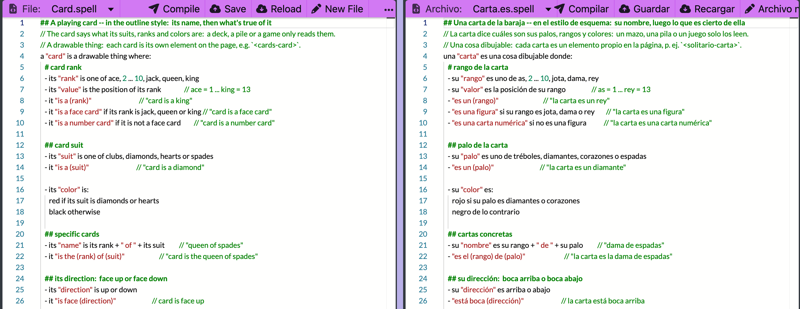
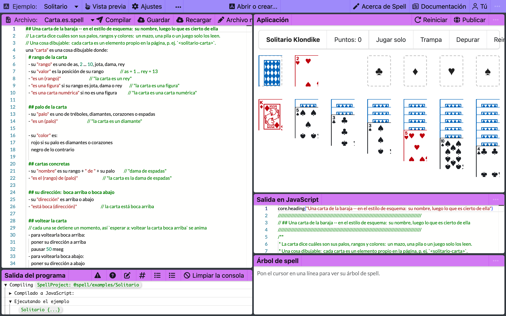
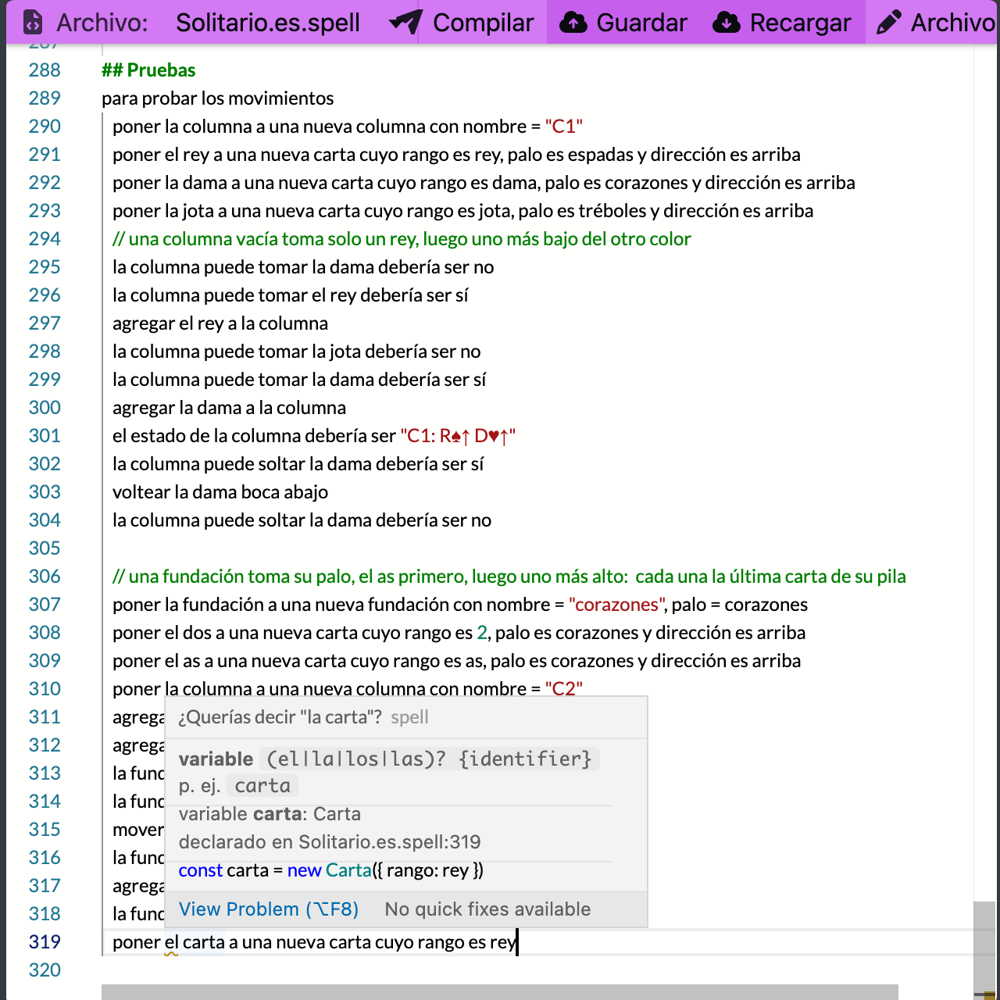

# Spell in Spanish:  the same language, in other words



_Solitaire's card on the left, Solitario's on the right:
the same outline, line for line, the left in English and the right in Spanish._

The right-hand file isn't a translation of the left one's output, or a comment in Spanish over English code.
It's a Spell program, written in Spanish, and it compiles:

```js
  /** "la carta es una figura" */
  get esUnaFigura() {
    return core.includes(["jota", "dama", "rey"], this.rango)
  }
```

_Line 9 of [Carta.es.spell](https://github.com/spell-app/spell-app/blob/main/spaces/@spell/examples/Solitario/Carta.es.spell),
`- "es una figura" si su rango es jota, dama o rey`, as the compiler writes it (below, "Try it")._

Spanish is Spell's second human language.
A file says it's Spanish in its name, `Carta.es.spell`, and Spell reads it with Spanish words, plurals and articles,
into the same tree an English file reads into.
From there it's an ordinary program:  the same JavaScript, TypeScript and Python writers, the same runtime,
the same editor.
The names stay the author's, accents and all:  `esUnaFigura`, `dirección`, `class Fundación`.

The proof is a whole game.
[Solitario](https://github.com/spell-app/spell-app/tree/main/spaces/@spell/examples/Solitario/) is the Solitaire example
written again in Spanish, line for line, cards and all, and it deals, plays and passes the same six tests.
A person wrote it;  `spell translate` writes a first draft of one for any English project
(below, "Translating a project").



_Solitario open in the editor, in a Spanish browser:  the program, the game, and the editor's own words, in Spanish._

## Try it

You need the kit's checkout with its child repos, and `spell` on your `PATH`:
the kit's [setup from zero](https://github.com/spell-app/spell/blob/main/README.md#setup-from-zero) does both.

**Run Solitario's tests.**
They're Solitaire's six, in Spanish:

```sh
spell test @spell/examples/Solitario
```

<details>
<summary>Output</summary>

```text
✓ Compiling @spell/examples/Solitario
✓ test la preparación de la carta  (25 checks)
✓ test los comodines  (15 checks)
✓ test la creación del mazo  (10 checks)
✓ test el mazo con comodines  (5 checks)
✓ test las pilas  (9 checks)
✓ test los movimientos  (11 checks)

6 passed
```

</details>

- `spell test @spell/examples/Solitaire` runs the English six:  the same counts, `card setup` for `la preparación de la carta`.
- `--verbose` prints each check, in the program's language:
  ``✅ Como se esperaba, `su rango` es `dama` ``, and a failing one `❌ Inesperado: 2 + 2 debería ser 5 pero en realidad es 4`.
- The command's own lines, `✓ Compiling`, stay English:  the program speaks Spanish, the tool doesn't.

**Ask what a Spanish word starts.**
On the front page, `spell explain if` lists the two rules `if` starts.
In Solitario, `si` starts the same two, with Spanish syntax strings:

```sh
spell explain si --in @spell/examples/Solitario
```

<details>
<summary>Output</summary>

```text
if  si {condition:expression} (entonces|:)? {statement_body}?
e.g. si x

backwards_if  si {operator:expression} (si no|sino|de lo contrario) es? {expression}
e.g. imprimir 1 si bar si no 2
```

</details>

The rule names, `if` and `backwards_if`, are the same:  they're the same rules.

**Ask what a Spanish type is.**

```sh
spell explain carta --in @spell/examples/Solitario
```

<details>
<summary>Output</summary>

```text
...Carta.es.spell:4
plantilla Carta, subplantilla de View

La carta dice cuáles son sus palos, rangos y colores:  un mazo, una pila o un juego solo los leen.
Una vista:  cada carta es un elemento propio en la página, p. ej. <solitario-carta>.

propiedades:  rango, valor, palo, color, nombre, dirección, imagen, símbolo, estado, pila
enumeraciones:  Rangos, Palos, Direcciones
declarado en Carta.es.spell:4

export class Carta extends View {
  static elementTag = core.defineElement(this, "Solitario")
}
```

</details>

The labels are the language server's, in the file's language:  `propiedades`, `declarado en`.
`View` is the runtime's own name, and stays English.

**See what it compiles to.**

```sh
spell compile @spell/examples/Solitario --stdout
```

<details>
<summary>Output</summary>

```text
...
  /** "la carta es una figura" */
  get esUnaFigura() {
    return core.includes(["jota", "dama", "rey"], this.rango)
  }

  /** "la carta es una carta numérica" */
  get esUnaCartaNumérica() {
    return !this.esUnaFigura
  }
...
  get color() {
    if (core.includes(["diamantes", "corazones"], this.palo)) return "rojo"
    return "negro"
  }
...
```

</details>

- `esUnaCartaNumérica` is a legal name in JavaScript, TypeScript and Python 3, so Spell keeps the accent.
  Two ways of typing `é` are one name:  names are normalized to one form of each accent.
- `--target py` writes `es_una_figura`, the same getter as a Python property.
- `core.includes` is the runtime's, and stays English:  nobody reads it but the program.

## How a file says its language

A file's name says its language, and nothing else does:

| File | Read as |
| --- | --- |
| `Card.spell` | English, as every file was before Spanish |
| `Card.en.spell` | English, said out loud |
| `Carta.es.spell` | Spanish |
| `Carte.zz.spell` | an error:  `no language pack for "zz"`, naming the ones Spell reads |

There's no setting in the project file, so ONE project may mix languages.
Each file parses with its own language's rules, over the project's shared types,
and uses what another file declares by the words it was declared with.
From [fileLanguage.test.ts](tests/spell/languages/fileLanguage.test.ts), an English player and a Spanish team:

```spell
## File Player.spell
a player is a thing
a player has a score as a number
to reset a player:
	set the score of the player to 0
```

```spell
## File Equipo.es.spell
un equipo es una lista de players
para preparar un equipo:
	el p es un nuevo player
	reset el p
	agregar el p al equipo
	eco el score del p
```

_The Spanish file names the English type, `player`, and calls its English method, `reset`._

- The team compiles to `class Equipo extends List`, its items `Player`s, and `p.reset()`.
- The program speaks the language of the file that declares its app, else its first file's:
  that's the language of its test lines and its messages.
- Each language present gets its own words file, `<Project>.es.js` beside `<Project>.en.js`,
  which maps each compiled name back to the words that declared it.
- **The catch:**  a plural English name in a Spanish file is made singular by SPANISH's rules.
  `players` finds `Player`, but `una lista de cards` looks for a template named `Cards`:
  to Spanish, one syllable ending in `-s` is already singular, as `mes` is.

## What works in Spanish

**Real today:**  the whole grammar, and everything a person meets writing it.

| What | In Spanish |
| --- | --- |
| the grammar | every rule of all 19 rule modules:  templates, aliases, actions, lists, math, drawing, events, tests, async |
| articles | `un / una / unos / unas`, `el / la / los / las`, and the contractions `del` and `al` |
| plurals | Spanish's own:  `corazón / corazones`, and words that don't change, `lunes` |
| "is" | `es` and `está` both mean "is";  `no es` and `no está` its negation |
| numbers | the decimal comma:  `1,5` is a number, `1, 5` a list of two |
| a property's kind | `palo de carta`, plural `palos de carta`, where English says `card suit` |
| the parser's messages | `No entiendo "..."`, and its warnings with Spanish examples:  `Di qué contiene "nombres-de-cartas", p. ej. "poner nombres-de-cartas a una nueva lista de texto"` |
| a test's lines | `▶️ Ejecutando`, `✅ Como se esperaba`, `❌ Inesperado`, in JavaScript and in Python |
| Spell UI | every component has a Spanish tag:  `<es-boton>`, `<es-menu>`, `<es-cuadricula columnas="7">` |
| drawing | a Spanish view gets its tag from its Spanish names, `<solitario-carta>` |
| the editor | its menus and panes, on a Spanish page;  colouring, completion and hover in each file's language |
| translating | `spell translate <project> --to es`:  an English project written again in Spanish (below) |

### A wrong article is a warning



_`el carta`, typed at the end of Solitario's tests:  `carta` is feminine, so the editor asks `¿Querías decir "la carta"?`_

- A type's gender is read off its declaration:  `una "carta" es una cosa` makes `carta` feminine.
- Spanish checks gender and number, `el carta` and `un cartas`;  English uses the same check for `a apple`,
  which asks `Did you mean "an apple"?`.
- It's a warning, never an error:  the line still compiles, as `const carta = new Carta(...)`.
  A strict parser would need gender while it matches, and it doesn't have it.

On the command line, `spell compile` and `spell run` print it.
In a folder of your own, `try/prueba/`, put a project file listing `Prueba.es.spell`, and in that file:

```spell
una "carta" es una cosa
las cartas tienen un palo como uno de tréboles o espadas
el carta = una nueva carta cuyo palo es espadas
imprimir el palo de la carta
```

```sh
spell run try/prueba
```

<details>
<summary>What it printed</summary>

```text
✓ Compiling @local/try/prueba  1 warning
    try/prueba/Prueba.es.spell:3:1  warning:  ¿Querías decir "la carta"?
espadas
```

</details>

### The editor:  colours, accents and completion

- VS Code and the editor colour Spanish keywords:  their keyword lists are written from the language packs,
  English and Spanish in one grammar.
- A keyword typed without its accent gets it back as you type a space or Enter:  `el numero de` becomes `el número de`.
  - Only where that's unambiguous:  never `si` / `sí`, never a name a person chose.
  - So a Spanish file types on an English keyboard.
- In a Spanish file, completion offers Spanish keywords (`si`, `para`, `devolver`), and the Type Explorer's
  built-in types are Spanish's.
- `si no:` and `de lo contrario` go back out a level, as `otherwise` does, and an accented word is one word to double-click.
- The editor speaks the PAGE's language, the document's `lang`, else the browser's:
  "Guardar" where an English browser gets "Save" ([README-app](https://github.com/spell-app/spell-app/blob/main/README-app.md)).
- The language server's labels (hover, completion, the Define fix, the Type Explorer) speak the FILE's:
  `declarado en`, in any editor ([README-lsp](https://github.com/spell-app/spell-app/blob/main/README-lsp.md)).

### Spell UI in Spanish

A Spanish page names Spell UI's components in Spanish:  `<ui-root lang="es">`, or the document's `lang="es"`,
and every component loads on demand as an `es-*` tag, its attributes and texts in Spanish.
Solitario's menu is one:

```spell
devolver <es-contenedor>
	<es-menu>
		<es-elemento tipo="encabezado">Solitario Klondike</es-elemento>
		<es-elemento>{"Puntos: " + su puntuación}</es-elemento>
		<es-menu posicion="derecha">
			<es-elemento onClick={jugar solo}>Jugar solo</es-elemento>
```

_From [Solitario.es.spell](https://github.com/spell-app/spell-app/blob/main/spaces/@spell/examples/Solitario/Solitario.es.spell),
its `para dibujarlo`._

- Tag and attribute names are plain ASCII, `es-boton`, `tamano`;  values keep their accents,
  and are found without them too:  `pequeno` finds `pequeño`.
- All 104 components have their Spanish beside their English, `UIButton.es.ts` beside `UIButton.en.ts`,
  and only a Spanish page loads it.
- How the names work, and the page that checks them:  [Spell UI's runtime page](https://github.com/spell-app/spell-ui/blob/main/README-runtime.md#vocabularies-and-localization).

## How it works:  one set of rules, two sets of words

A parser generator would give Spanish a grammar file of its own, and a second parser.
Spell keeps ONE set of rule classes, the code that says what a line compiles to, and registers each of them
once per language, with that language's syntax string and tests:

```text
src/spell/rules/<module>/
  <Rule>.ts             the rule's class:  what it compiles to, in no language's words
  <module>.en.ts        every rule of the module, with its English syntax and tests
  <module>.es.ts        the same rules, in the same order, with Spanish's
```

- The small words are WORD RULES each language registers:  its articles, "is" or "is not", "it".
  A rule asks which form matched, negated or not, never which word,
  and a guard test fails if an English word comes back into rule code.
- Everything else a language brings is its LANGUAGE PACK, in [languages/es/](src/spell/languages/es/):
  - [words.ts](src/spell/languages/es/words.ts):  its word tables, number words, ordinals, the built-in types' words
  - [inflector.ts](src/spell/languages/es/inflector.ts):  singulars and plurals both ways, ported from Python-Inflector's rules
  - [agreement.ts](src/spell/languages/es/agreement.ts):  the article check above
  - [parserMessages.ts](src/spell/languages/es/parserMessages.ts) and [messages.ts](src/spell/languages/es/messages.ts):
    what the parser and the runtime say
  - [GLOSSARY.md](src/spell/languages/es/GLOSSARY.md):  the words chosen, so every module says `poner`, not `fijar`
- Each file's scope picks its pack from the file's language, so a Spanish program never loads English's inflector.
- The code of one rule in both languages, and how a third language starts:
  [README-parser](README-parser.md#spell-in-another-human-language).

### Keeping the two in step

A new English rule must never leave Spanish behind without anyone noticing.
`spell translate check` compares each pack with English, module by module:
a rule missing, out of order, or with no syntax or tests, and the word tables.

```sh
spell translate check es
```

<details>
<summary>Output</summary>

```text
Spanish (es):  complete, 19 modules
```

</details>

- It exits 1 on anything missing, and runs in spell-parser's tests too.
- `spell translate fix es` writes a stub for each missing registration, the English copied and marked to translate;
  `--ai` asks Claude to draft each one, marked for review.
- A difference on purpose is marked in the pack's file, `// packs: ok -- why`, so the check passes.
- Every option:  [the command line's page](https://github.com/spell-app/spell/blob/main/README-cli.md#spell-parser).

## Translating a project

`spell translate` writes an English project again in Spanish, as a project of its own beside it.
Solitaire comes out linted clean and passing its six tests, with no person in the loop, in under a minute:
about 52 seconds from nothing at all, 31-41 from the shared glossary of names.

It works in three passes:
1. **Names:**  every name the project chose (types, properties, values, methods, texts, comments), with its gender.
   - First from the Spanish glossary, a list shared by every project:  `carta` is `carta` in every program.
   - The rest by Claude, the templates first, then the other names in a few calls at once.
   - They land in a dictionary beside the project, `<Project>.es.names.json5`, for a person to review
     (with `--out`, in that folder, with the rest of what the run writes).
2. **Lines:**  each line read in English, then written again with the SAME rule's Spanish words,
   its articles agreeing by gender.
   No model writes these:  the rule that read the line writes it back.
3. **Fix-ups:**  the translation is linted, its tests run, and each statement compiled beside its English one.
   A line that fails, couldn't be written, or compiles to a different program
   goes back to Claude, in context, a few rounds at most.

Without Claude (`--no-ai`), the lines are still written, and each name the dictionary lacks is marked for a person.
Here with `--cold` too, which starts from no glossary and writes only into `--out`:

```sh
spell translate @spell/examples/fizzbuzz --to es --no-ai --cold --out /tmp/fizzbuzz-es
```

<details>
<summary>Output</summary>

```text
fizzbuzz in Spanish:  /tmp/fizzbuzz-es  (1 files, ...)
  10 of 10 lines translated
  names:  /tmp/fizzbuzz-es/fizzbuzz.es.names.json5
  pre-calculated:  none (--cold)
  passes:  names ..., lines ..., fix-ups ... (0 lines fixed in 0 rounds, 1 check)
  claude -p:  0 calls:  fix-ups 0
  shape:  7 of 7 statements compile to the same program as the English
  7 lines still need a person, marked // TODO: translate:
    FizzBuzz.es.spell:2  phrases "play fizzbuzz"
    FizzBuzz.es.spell:3  names "number"
    FizzBuzz.es.spell:4  names "number", texts "fizzbuzz"
    FizzBuzz.es.spell:5  names "number", texts "fizz"
    FizzBuzz.es.spell:6  names "number", texts "buzz"
    FizzBuzz.es.spell:7  names "number"
    FizzBuzz.es.spell:9  phrases "play fizzbuzz"
```

</details>

- Every line is Spanish but its names:  `para number de 1 a 100`, `si el number dividido por 15 es un entero: ...`.
  It exits 1, because seven lines still need a person.
- With Claude, the same command fills the names in and fixes the lines;
  through the Claude API when `ANTHROPIC_API_KEY` is set, else through `claude -p`, a little slower.
- `--update` re-translates only the English lines changed since the last run:  hand edits to the Spanish stay.
- `--effort fast|balanced|best` says how much Claude spends;  `spell translate speedtest` times whole runs.

With `--review`, a person reviews the names before any line is written with them.
After the names pass a page opens in the editor's side bar, a row per name Claude drafted:
accept it, type over it, or pick one of the alternatives Claude gave, and tick a name "for every project"
to put it in the shared glossary.
Each answer is used as you give it, and one Spell can't read says why on its row straight away.
After Send, the lines are written with the answers, each kept in the dictionary as reviewed;
with no Send in time (30 minutes, `--review-timeout`), the answers given by then count and Claude's names stand for the rest.
The page also shows each pass as it runs, and picks the effort for the next one.

- Every option, and what it leaves for a person:
  [the command line's page](https://github.com/spell-app/spell/blob/main/README-cli.md#translating-a-project).

**The edge:**  the translation reads differently from a person's.
Translated cold, Solitaire's names match the hand-made Solitario's about 7 times in 10
(`reina` where Solitario says `dama`), and its comments are worded otherwise:
it's a first draft that runs, for a Spanish speaker to review.

## The edges

**First drafts.**
Spell UI's Spanish, the runtime's messages and the editor's words are first drafts, not yet reviewed by a native speaker.

**Still English:**
- the runtime's own names:  `View`, `core.includes`
- what a developer reads at run time:  assertions, thrown errors, type checks
- the project-level compile errors (imports, exports, targets), and a few lines of the editor's Program Output
  (`Compiling`, `Started afresh`)
- Monaco's own menus (`View Problem`), the project prompts, the property editor's field names
- an English library's names, imported into a Spanish file

**Where the parser is lenient:**
- `ser` and `estar` are the same to it:  `es` and `está` both mean "is".
- A wrong article is a warning, so a line that reads oddly to a Spanish speaker still compiles.
- `spell lint` counts a project's warnings, `✓ ... 1 warning`, but lists only its errors:
  `spell compile` prints the warnings.

**Not yet:**
- Python:  Solitario compiles to Python, but the core contract test, which runs each test project under every
  target and compares, runs Solitaire there and not Solitario yet.
- The docs teach English Spell.
  The Spanish syntax table is generated, [spellSyntax.es.json](src/spell/spellSyntax.es.json), but no page reads it yet.
- A file read back in the other language:  an English program shown in Spanish, or the reverse, as you read it.
  The translator writes a second project, which then lives on its own:  `--update` carries English changes over.
- Translating the other way:  the command takes any pack as `--to`, but only English into Spanish has been tried.
- A third language:  Norwegian and Portuguese are next, with help from friends;  neither is started
  ([README](README.md#a-third-human-language)).

## Where things are

| What | Where |
| --- | --- |
| the language packs, English's and Spanish's | [src/spell/languages/](src/spell/languages/), `SP.Language` |
| the rules' Spanish, a file per module | [src/spell/rules/](src/spell/rules/), each `<module>.es.ts` |
| which language a file is | `SP.Language.forFile()`, [Language.ts](src/spell/languages/Language.ts) |
| the pack check and fix | [packsCommand.ts](src/cli/packsCommand.ts) |
| the translator | its passes in [src/spell/translate/](src/spell/translate/);  the command in [translateProject.ts](src/cli/translateProject.ts), its review page in [NamesReview.ts](src/cli/NamesReview.ts), Claude in [claudeRunners.ts](src/cli/claudeRunners.ts), the timing in [translateTimes.ts](src/cli/translateTimes.ts) |
| the Spanish glossary of names, shared by every project | [glossary.json5](src/spell/languages/es/glossary.json5) |
| the runtime's messages | [core's messages.ts](src/core/messages.ts), and `spell_core`'s [messages.py](src/py/core/spell_core/messages.py) |
| the Spanish example | [Solitario](https://github.com/spell-app/spell-app/tree/main/spaces/@spell/examples/Solitario/), and its snapshots in [tests/spell/__examples__/](https://github.com/spell-app/spell-app/tree/main/tests/spell/__examples__/) |
| Spell UI's Spanish | `UI<Name>.es.ts` beside each component, and [components.es.ts](https://github.com/spell-app/spell-ui/blob/main/src/components/components.es.ts) for what many share |
| the editor's and the language server's words | [AppTexts.es.ts](https://github.com/spell-app/spell-app/blob/main/src/app/ui/AppTexts.es.ts), [LspTexts.es.ts](https://github.com/spell-app/spell-app/blob/main/src/lsp/LspTexts.es.ts) |

## See also

- [README-parser](README-parser.md#spell-in-another-human-language):  one rule's code in both languages, and how a third starts
- [README-spell](README-spell.md):  everything a line of Spell can say, in English, and how to add a rule in both languages
- [README-examples](https://github.com/spell-app/spell-app/blob/main/README-examples.md#solitario--the-same-game-in-spanish):  Solitario beside Solitaire
- [The command line's page](https://github.com/spell-app/spell/blob/main/README-cli.md#translating-a-project):  `spell translate` and `speedtest`, every option
- [Spell UI's runtime page](https://github.com/spell-app/spell-ui/blob/main/README-runtime.md#vocabularies-and-localization):  a Spell UI page written in Spanish
- [spell-parser's README](README.md):  the language, its pipeline, and every page of the repo
