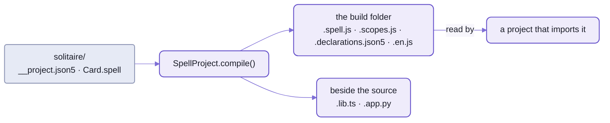

# Spell:  what the language can say

```spell
a "card" is a view:
	- its "suit" is one of clubs, diamonds, hearts or spades
	- its "color" is:
		red if its suit is diamonds or hearts
		black otherwise

	- its "rank" is one of ace, 2 ... 10, jack, queen, king
	- it "is a face card" if its rank is jack, queen or king
	- it "is a (rank)"
	- it "is the (rank) of (suit)"
```

_The card from [the kit's front page](https://github.com/spell-app/spell/blob/main/README.md), in the outline style:  a name, then bullets of what's true of it.
It lints clean, and every output on this page is the compiler's own, from a real run._

Ten lines, and the language is bigger than it was.
Each quoted bullet teaches Spell new words, and from the next line on Spell reads them like its own:

```sh
spell parse --in ./solitaire 'the card is a new card whose rank is 7 and suit is hearts
print the card is a face card, the card is not a 7, the color of the card'
```

<details>
<summary>What it printed</summary>

```text
... the match tree, and in it:
    expression_suffix › is_a_face_card  is a face card
    expression_suffix › is_a_$rank  is not a 7

export const card = new Card({ rank: 7, suit: "hearts" })
core.console.log(card.isAFaceCard, !card.isARank(7), card.color)
```

</details>

The match tree names the rules that read those two aliases, `is_a_face_card` and `is_a_$rank`.
Nobody wrote them:  the card's bullets made them, a moment before.
The `not` came free;  an alias that starts with `is` reads `is not` and `isn't` too.

If you've grown a grammar for a parser generator, that's the part to notice.
There, a new phrase is an edit to the grammar file and a rebuild;
in a regular expression, it's one more alternation nobody can read next month.
Spell has no grammar file.
Its grammar is 270 syntax strings on 244 rule classes, and a program adds rules of its own as it's read.

And it doesn't guess.
The same line compiles to the same code every time, and a line nothing reads is an error where it stands:
`print the card is rather fond of jazz` prints the card,
then compiles the rest to `/* PARSE ERROR: Don't understand "is rather fond of jazz" */`,
and `spell lint` fails on it by file, line and column.

<details>
<summary>Run the card yourself</summary>

You need `spell` on your PATH:
[setup from zero](https://github.com/spell-app/spell/blob/main/README.md#setup-from-zero),
then [the command line](https://github.com/spell-app/spell/blob/main/README/cli.md#setting-it-up).
In any folder outside the checkout, save the card as `try/solitaire/Card.spell`, then:

```sh
echo '{}' > try/solitaire/__project.json5
cd try
spell compile ./solitaire --stdout
```

<details>
<summary>What it printed</summary>

```text
✓ @local/try/solitaire
import { core, Thing, List, App, View, ViewableList } from "@spell/core"

export class Card extends View {
  static elementTag = core.defineElement(this, "solitaire")
...
```

</details>

- `{}` is a whole project file (below, "The compiler").
- `--stdout` prints the code and writes nothing;  without it, the code goes to the build folder (below, "The compiler").
- `--target ts/solid` prints the TypeScript, `--target py` the Python.
- The element's tag is the app's name, then the template's:  `<solitaire-card>`.
- Look for `2 ... 10`:  it became the nine numbers between, and the choice of words a list on the class, `Card.Suits`.
- The whole of all three, JavaScript, TypeScript and Python, is folded under the card on
  [the kit's front page](https://github.com/spell-app/spell/blob/main/README.md);  the three side by side, a line of Spell at a time, are in
  [README-targets](README-targets.md#the-card-line-by-line).

</details>

## Two styles, one meaning

The card above is an outline.
Here are the same facts as sentences, as a card could be written:

```spell
a card is a thing
cards have a rank as one of ace, 2, 3, 4, 5, 6, 7, 8, 9, 10, jack, queen or king
cards have a suit as one of clubs, diamonds, hearts or spades
the color of a card is red if its suit is either diamonds or hearts otherwise it is black
a card "is a face card" if its rank is one of jack, queen or king
a card "is a (rank)" for its ranks
a card "is the (rank) of (suits)" for its ranks and its suits
```

_Seven lines in the sentence style, the way the Solitaire example's card was written before it was an outline, and then spellx._

Compile both, and `diff` finds the same JavaScript, member for member, but for three things:
- the outline's card is a `view`, so it extends `View` and gets an element of its own;
  the sentences' card is a plain `Thing`
- each stored property's comment quotes the line that made it, bullet or sentence
- `(suits)`, with an `s`, makes `isTheRankOfSuits`, where `(suit)` makes `isTheRankOfSuit`
  (below, "Aliases become rules", says why that `s` matters)

| The outline's bullet | The sentence | Both compile to |
| --- | --- | --- |
| `- its "suit" is one of clubs, diamonds, hearts or spades` | `cards have a suit as one of clubs, diamonds, hearts or spades` | `static Suits = [...]`, and a `suit` declared as one of them |
| `- its "color" is:`, then one value a line | `the color of a card is red if its suit is either diamonds or hearts otherwise it is black` | `get color()`, worked out each time it's read |
| `- it "is a face card" if its rank is jack, queen or king` | `a card "is a face card" if its rank is one of jack, queen or king` | `get isAFaceCard()` |
| `- it "is a (rank)"` | `a card "is a (rank)" for its ranks` | `isARank(rank)` |

- In an outline, `it` and `its` mean the template its first line names, and a blank like `(rank)` finds its own list;
  a sentence names both.
- A file may mix the two:
  in [Solitaire's game](https://github.com/spell-app/spell/blob/main/app/spaces/@spell/examples/Solitaire/Solitaire.spellml), one block of plain Spell holds its play, `to play a card`, a sentence,
  and what a pile does while a card is dragged over it, an outline under `a pile:`.
- That the two compile the same is a test's job, [outline.test.ts](tests/spell/parserTests/outline.test.ts),
  not a hope.

## The whole language, module by module

Spell's grammar is twenty modules of rules.
Each row below is one rule's own test:  a line it reads, and the JavaScript that line becomes.

| Module | What it reads | Rules | A line | Its JavaScript |
| --- | --- | --- | --- | --- |
| `spell` | the base:  a file, its blocks and lines, a statement;  a line nothing else reads | 5 | (the whole file) | |
| core | numbers, text, yes and no, nothing, comments | 12 | `nothing` | `undefined` |
| variables | names, of one word or several | 9 | `the start pile` | `startPile` |
| constants | words that are values | 3 | `red` | `"red"` |
| expressions | comparisons, `and` / `or`, `is a`, `is in` | 28 | `thing is green or blue` | `core.includes(["green", "blue"], thing)` |
| math | arithmetic, biggest and smallest, rounding | 10 | `largest of the prices` | `core.largestOf(prices)` |
| properties | `the ... of ...`, `its ...`, object literals | 13 | `the short rank of the card` | `card.shortRank` |
| lists | positions, ranges, adding, removing, `for each`, `where` | 42 | `remove last card of deck` | `core.removeItemAt(deck, -1)` |
| UI | `print`, notices, alerts and prompts, styles | 8 | `prompt "Name for the new baby?"` | `await core.prompt("Name for the new baby?")` |
| classes | templates, properties, aliases, saving, versions | 52 | `a card is a thing` | `export class Card extends Thing {}` |
| async | waiting, pauses, processes | 5 | `pause for 2 seconds` | `await core.pauseFor(2, "seconds")` |
| draw | drawing a list's items | 3 | `draw each card in the deck` | `core.drawItems(deck)` |
| JSX | elements, fragments, `<markdown>` blocks | 8 | `<a/>` | `h("a")` |
| types | type names, singular and plural | 11 | `things` | `Thing` |
| assignment | `set ... to ...`, `... is ...`, `get`, `return` | 4 | `set unknown-var to yes` | `export const unknownVar = true` |
| statements | statements with nothing else to say | 1 | `do nothing` | `core.doNothing()` |
| events | firing and handling events | 3 | `on card click` | `on("card-click")` |
| if | `if`, `otherwise`, a value `if ... otherwise` | 6 | `print 1 if bar else 2` | `core.console.log(bar ? 1 : 2)` |
| methods | `to ...` actions, animations, quoted aliases | 17 | `to start the game` | `export function startTheGame() {}` |
| tests | `expect`, `should be`, `echo` | 4 | `its rank should be queen` | `core.expect(it.rank, ...)` |

The weight is in `classes`:  52 of the 244 rule classes, and 95 of the 270 syntaxes, are ways to DECLARE
something (a template, a property, an alias, how a thing is saved).
A language that reads like English spends most of its grammar letting you say what things ARE;
doing things is the smaller half.

- Nineteen modules are folders of [the rules folder](src/spell/rules/), one rule class per file;
  the base rules sit at the top of it:  a block, a line, a blank line, a line nothing reads.
- The 244 classes are 227 rules, and 17 base classes that no syntax names.
  There are more syntaxes than rules because a rule with several ways to be written is registered once per way.
- Every rule, with every syntax and what each target writes for it:
  the generated syntax table, [spellSyntax.json](src/spell/spellSyntax.json), which the Spell Syntax guide draws
  (below, "More in the docs site").
  - Each syntax there carries an example from its tests, as the JavaScript, TypeScript and Python writers write it.
  - The counts on this page are from it, on 2026-10-22;  `yarn spell:gen:syntax` rewrites it (below, "Adding a rule").

## What a line can say

Each part below is one family of lines:  real lines, from the frozen test projects and the rules' own tests,
and the JavaScript they become.

### Templates, choices and worked-out values

| Spell | JavaScript |
| --- | --- |
| `a card is a thing` | `export class Card extends Thing {}` |
| `a deck is a list of cards` | `export class Deck extends List { static instanceType = Card }` |
| `solitaire is an app` | `export class Solitaire extends App`, its element `<solitaire-app>`, and `export const solitaire = new Solitaire()` |
| `cards have a suit as one of clubs, diamonds, hearts or spades` | `static Suits = ["clubs", "diamonds", "hearts", "spades"]`, and the property |
| `the color of a card is red if ... otherwise it is black` | `get color() { ... }` |
| `- its "color" is one of red, black:` + its value lines below | `static Colors = ["red", "black"]`, then `get color() { ... }` |
| `the value of a card is the position of its rank in card ranks` | `get value() { return spellPosition(positionOf(Card.Ranks, this.rank)) }` |
| `- its "suit" is a card suit`, in a foundation's outline | `static { this.declareProp("suit", { oneOf: () => Card.Suits }) }` |
| `card suits`, `every card suit` | `Card.Suits` |
| `a random card suit` | `core.randomItemOf(Card.Suits)` |

- `Thing`, `List` and `App` are the runtime's base classes ([README-core](README-core.md)).
- After `a card is a thing`, "card" is a word every line knows, in every file of the project:
  each template a project declares is known before its first line is read, so a line may use one declared further down.
- A stored property is declared with its choices;  a worked-out one is a getter, read when you ask for it.
  - A worked-out one can have choices too:  `- its "color" is one of red, black:`, its value lines indented under it,
    then its aliases, bulleted, under those.
- A property's choices are a kind of their own, named by the template, then the property:  a card's suits make `card suit`.
  - Another template's property can be one of them, `its "suit" is a card suit`:  setting it to `stars` warns, as a card's own would.
  - Its plural is the list, `card suits`;  a loop over it can name its item for it, `for each card rank in card ranks`.
  - It holds plain text and numbers, so it has no properties or aliases of its own:  Spell says so if you give it one.
  - Spanish puts the words in its own order:  `palo de carta`, plural `palos de carta`.
- A card's value is its rank's position, so an ace is 1 and a queen is 12:  the Solitaire example's card test checks the queen.

### Aliases become rules

An alias in quotes teaches Spell new words, as a rule of its own, from the next line on.
That's where the card's `is_a_face_card` came from.

```mermaid
%%{init: {"theme":"base","themeVariables":{"fontFamily":"-apple-system, BlinkMacSystemFont, Segoe UI, Helvetica, Arial, sans-serif","fontSize":"15px","primaryColor":"#EFECFB","primaryBorderColor":"#6550CA","primaryTextColor":"#1A1C27","secondaryColor":"#F4F1E9","tertiaryColor":"#F7F6FC","lineColor":"#7F6FD6","textColor":"#7F6FD6","clusterBkg":"#F7F6FC","clusterBorder":"#B9B0E8","titleColor":"#1A1C27","edgeLabelBackground":"#F7F6FC","actorBkg":"#EFECFB","actorBorder":"#6550CA","actorTextColor":"#1A1C27","actorLineColor":"#9C90DE","signalColor":"#7F6FD6","signalTextColor":"#7F6FD6","labelBoxBkgColor":"#EFECFB","labelBoxBorderColor":"#6550CA","labelTextColor":"#1A1C27","loopTextColor":"#7F6FD6","noteBkgColor":"#F1E7D4","noteBorderColor":"#C9B48A","noteTextColor":"#1A1C27","activationBkgColor":"#DCD6F7","activationBorderColor":"#6550CA","sequenceNumberColor":"#FFFFFF"},"flowchart":{"curve":"basis","padding":12,"nodeSpacing":40,"rankSpacing":44}}}%%
flowchart LR
  bullet["it #quot;is a (rank)#quot;<br/>a bullet of the card"] -->|parsing it adds| rule["the rule is_a_$rank<br/>to the project's scope"]
  rule -->|which reads| later["the card is not a 7<br/>on any later line"]
  later -->|compiled| js["!card.isARank(7)"]
  %% the Spell look:  yarn mermaid:pretty
  classDef default fill:#EFECFB,stroke:#6550CA,stroke-width:1.5px,color:#1A1C27,rx:8px,ry:8px
```



_A quoted bullet is parsed like any line, and parsing it adds a rule:
every later line can use the alias, in this project and in any project that imports it._

| Spell | Reads, after it | JavaScript |
| --- | --- | --- |
| `a card "is face up" if its direction is up` | `the card is face up`, `the card is not face up` | `get isFaceUp() { return this.direction === "up" }` |
| `a card "is a (suit)" for its suits` | `the card is a spade`, `the card is a heart` ... | `isASuit(suit) { return this.suit === suit }` |
| `a card "is the (rank) of (suits)" for its ranks and its suits` | `the card is the queen of spades` | `isTheRankOfSuits(rank, suit)` |

- A blank in brackets is one alias per value of a list:  `(suit)` reads each suit, `(rank)` each rank.
- An alias may sit indented under its property, `- it "is a (suit)"` under `- its "suit" is one of ...`:
  it reads as if written after it.
- The blank reads the word in the form you wrote it:  `(suit)` reads `spade`, `(suits)` reads `spades`.
  So the card at the top of this page answers to `the card is the queen of spade`;
  the Solitaire example's card wrote `(suits)`, and answers to `the queen of spades`.
- An alias reaches every file of its project, e.g. from Solitaire's `Card.spellml` to its `Solitaire.spellml`:
  a tableau's `return the card is a king` reads an alias the card made, `is a (rank)`.
  - It travels with its project's declarations too, to a project that imports it.

**The edge, and it's a sharp one:**  an alias in the other form doesn't fail;  it reads as something else.
Against the card at the top, `the card is the queen of spades` compiles to `card === "spades".queen`:
`spell lint` passes it, and only a test catches it,
`` `the card is the queen of spades` should be `yes` but is actually `false` ``.

**Not yet:**  an alias used above the line that makes it.
An action can be called before its definition (below);  an alias can't, and `spell lint` says so at the line
([why, in README-parser](README-parser.md#how-earlier-lines-teach-later-ones)).

### Actions, and waiting for them

`to ...` defines an action.
Its first line is how you call it, with each blank's type in brackets:

| Spell | JavaScript |
| --- | --- |
| `to start the game` | `export function startTheGame() {}` |
| `to move (a card) to (a pile)` | `async moveToPile(pile) { ... }`, a method of the card |
| `for each card in the deck`, then `move it to the stock` | `deck.forEach((card) => card.moveToPile(stock))` |
| `wait for: move the card to the stock` | `await card.moveToPile(stock)` |

- An action may be written in any file, yet be a method of a template another file declares:
  a class takes its members from every file of the project.
  - E.g. Solitaire's `to play a card` is a method of `Card`, which its `Card.spellml` declares
    ([Solitaire.spellml](https://github.com/spell-app/spell/blob/main/app/spaces/@spell/examples/Solitaire/Solitaire.spellml)).
- An action that pauses (`pause for 50 msec`) compiles to an `async` method,
  and its caller waits for it only when it says `wait for`:  that's what makes Solitaire's deal animate, card by card.
- An action can be used above its definition, or from an earlier file:
  every action's first line is registered before the project's first line is read.
- An action of a template can DESCRIBE itself, in lines indented under it, before its steps:

  ```spell
  	- to turn it over:
  		- shortcut meta+T
  		- enabled when it is face down
  		- undone as "Turn Card"
  		set its direction to up
  ```

  - `shortcut` (once per key), `enabled when`, `selected when`, `undone as` and `icon` are the lines it may have;
    `meta` is command on a Mac, control elsewhere.
  - They're the template's data, kept beside the class:
    `core.describeAction(Card, "turnOver", { title: "turn it over", shortcuts: ["meta+T"], ... })`,
    each condition a getter of its own, `turnOverIsEnabled`.
  - Its shortcut runs it while it's enabled, from the focused thing up to the app;
    run any way, an action `undone as "Turn Card"` is one undo step, and the app's undo then reads `Undo Turn Card`.
  - A template's MENU lists its actions, and the app's own `undo` and `redo`, `"-"` a line between groups:

    ```spell
    solitaire is an app where:
    	- its "game menu" is a menu of "deal", "-", "undo" and "redo"
    	- its menu bar is "game menu"
    ```

    - The page draws it as the app's menu bar, as a toolbar (`<ui-toolbar menu="game menu" />`), and as a right
      click's menu (`context-menu="game menu"` on any element of a drawing), each item a `<ui-action>`.

### Lists count from 1, and `where`

| Spell | JavaScript |
| --- | --- |
| `add thing to the start of my-list` | `core.prepend(myList, thing)` |
| `the first item of my-list` | `core.getItemAt(myList, 0)` |
| `remove item 4 of my-list` | `core.removeItemAt(myList, 3)` |
| `the number of items in my-list where its id > 1` | `core.itemCountOf(core.filter(myList, (item) => item.id > 1))` |
| `return tasks in its tasks where it is active` | `return core.filter(this.tasks, (task) => task.isActive)` |
| `move card to tableau` | `core.move(card, tableau)` |
| `a card belongs to one pile` | `Pile.exclusive = true`, and a `pile` getter on the card |

- Positions count from 1, as people count:
  the compiler turns them into the target's own ([README-core](README-core.md#positions-count-from-1)).
- A project whose project file says `"listsStartAt": 0` counts from 0 instead:  the frozen `lists-from-zero`.
- `a card belongs to one pile` makes piles exclusive:  adding a card to one takes it out of the last.

### Drawing

A view is a web component of its own, with its own styles:
the card at the top draws as `<solitaire-card>`.

```spell
a "tableau" is a pile where:
	<css>
		::slotted(:not(:last-child)) {
			height: 2.6rem;
			overflow: hidden;
		}
	</css>
```

_Solitaire's tableau as it was once written, its rules and its other styles left out:
each card in the column but the last shows only its top.  Today [its styles.css](https://github.com/spell-app/spell/blob/main/app/spaces/@spell/examples/Solitaire/styles.css) lays the piles out._

```js
export class Tableau extends Pile {
  static elementTag = core.defineElement(this, "Solitaire")
  static css = css`...`
```

- A tag's name is its app's, then its template's:  the tableau is `<solitaire-tableau>`.
- `to draw it` returns markup, with Spell inside its braces:
  `<text color={its color}>{its picture}</text>`, the front of
  [Solitaire's Card.spellml](https://github.com/spell-app/spell/blob/main/app/spaces/@spell/examples/Solitaire/Card.spellml).
  - A click on the card is its own handler there, `<on click>`, whose body is `play it`.
- The element's attributes are its card's properties, and its methods call its card's:
  the TypeScript target writes that element out as a class, `CardElement`
  ([README-targets](README-targets.md#the-card-line-by-line)).
- `draw each card in the deck` draws each in turn:  `core.drawItems(deck)`.
- A thing has ONE drawing, its `to draw it`:  a card face down checks its own direction there,
  in the two sided view it's built on ([Solitaire's Card.spellml](https://github.com/spell-app/spell/blob/main/app/spaces/@spell/examples/Solitaire/Card.spellml), below).
  - In an outline, `- to "draw it":` takes markup as its body, no `return` needed;
    `- to draw it:` unquoted takes a method's body, which returns it.
  - In that body, a line of markup IS what it draws, with no `return`:  the lines around it pick which,
    `if it is face up`, then markup, `otherwise`, then other markup.
  - Several such lines draw all of them, in order;  so does a loop, one each time round:
    `<ui-text>Scores</ui-text>`, then `for each score in its scores` with `<ui-text>{the score}</ui-text>` under it.
- A view can have SLOTS, named drawings it places:
  - `- it has slots "front" and "back"` names them;  `- to draw its front:` draws one, `drawFront()`
    (Spanish:  `- tiene las ranuras "frente" y "dorso"`)
  - `draw its front` places it, on a line of its own or inside markup:  `<div>{draw its front}</div>`
  - the slot's drawing carries its name for CSS, `part="front"`, so a page can style it with `::part(front)`
  - where the view is drawn, a slot can be filled from outside, the web's way:
    `<solitaire-card><ui-text in="front">Ace</ui-text></solitaire-card>` (`in=` is Spell's word for `slot=`;
    spellx's `<card><text slot="front">Ace</text></card>`)
    - that card shows the filling in place of its front;  every other card draws its own
    - a placed slot compiles to the web's `<slot name="front">`, holding its own drawing
  - the old `- it has parts ...` still reads, as an error naming `slots`;  `spell lint --fix` writes it
- `a card is a two sided view` gives the card a front and a back:
  - its direction, `down` or `up` (a new one starts face down), `it is face up`, `it is face down`
  - `turn it face up`, `turn it face down`, `turn it over`
  - a drawing that shows its front face up and its back face down
  - So the card says only `- to draw its front:` and `- to draw its back:`.
    In Spanish:  `una carta es una vista reversible`, `para dibujar su frente`, `voltear la carta`.
  - A two sided view is written in Spell itself, and compiled once into the runtime's `TwoSidedView`:
    [TwoSidedView.spell](src/core/templates/TwoSidedView.spell).
    The card compiles to just its own two drawings, `class Card extends TwoSidedView`.
- A viewable list has three:
  - its `to draw it` is the WRAPPER around its items, by default nothing but the place they show
  - its `to draw each item` is the wrapper each item is drawn in, by default just the item's own drawing:
    `core.drawItems()` draws each item with it, `drawEachItem(item)`
  - its `to draw its placeholder` is what it shows while it's empty, by default nothing:
    `drawItsPlaceholder()`, e.g. a stock pile's face-down card (Spanish:  `para dibujar su marcador`)
- A viewable list's element numbers its items for CSS:  each one's `--index`, from 0, and its own `--count`,
  so a pile can lay its cards out with no code
  ([Solitaire's styles.css](https://github.com/spell-app/spell/blob/main/app/spaces/@spell/examples/Solitaire/styles.css)).
- A thing that moves from one list to another glides there on the page.
- A viewable list's wrapper may have named places a child can fill,
  `<children name="header"/>`, filled by a child written `<h3 in="header">`.

### Events

A thing hears an event when its handler says so, and sends one with `send`:

| Spell | JavaScript |
| --- | --- |
| `- on mouse down:` in a card's outline | `onMouseDown(event) { ... }`, a method of `Card` |
| `- when flipped:` | `onFlipped(event) { ... }`:  `when` and `on` say the same |
| `send flipped to the card with side = 1` | `send(card, "flipped", { side: 1 })` |
| `send closing`, in a handler | `if ((await send(this, "closing", {}, this)).canceled) return` |
| `trigger card-click` | `trigger("card-click")`:  to every `on card-click` in the program |

- `send` goes to ONE thing, and up its chain until a handler takes it:
  - the thing itself
  - then the list holding it (`a card belongs to one pile`:  its pile)
  - then the app
  - then the program's `on <event>` listeners
  - Nobody takes it:  it's dropped, silently.
- A handler that runs takes the event:  a card's `- on mouse down:` runs, its pile's doesn't.
  - `pass event` (or `pass mouse down`) hands it on up the chain.
- An event whose name is still happening (`closing`, `dropping`;  Spanish `cerrando`) can be cancelled.
  - `cancel event` in its handler, and the sender stops:  `send closing` returns from the step that sent it.
  - Its finished half, `closed`, is what happened, and can't be.
- What comes with it is named in the handler:  `send flipped with side = 1` is read as `side` in `- when flipped:`.
  - `target`:  the thing whose handler is running;  `the original target`:  the thing it was sent to;
    `sender`:  the thing that sent it.
  - A card's press passed up to its pile:  in the pile's handler, `target` is the pile, `the original target` the card.
- `- while the mouse is down:` holds while it's true, and is put back after:
  every property its steps set returns to what it was as the mouse goes up.
  - `- while the mouse is over it:` likewise, as the mouse comes and goes.
- The mouse and the keys can be read anywhere, a handler's step or not, as they are at that moment:
  - `the shift key is down`, `the meta key` (command on a Mac, control elsewhere), `the option key`,
    `the control key`
  - `the mouse is down` (the left button), `the right button`, `the center button`, `the mouse is still down`
    (held a second, barely moving)
  - `space is down`, `the escape key is down`, `the up arrow is down` ...
  - `the thing under the mouse`
- `trigger` and `fire` stay what they were:  to every listener, no chain, nothing to cancel.
  `card click` and `card-click` name the same event, and `with card = 1` hands the listener a property
  ([README-parser](README-parser.md#one-line-six-stages) follows `fire event card click with card = 1` through every
  stage of the parse).
- `- it sends "flipped" with side as a direction` says an event a template's things send, and what comes with it:
  `core.describeEvent(Card, "flipped", { params: { side: "Direction" } })`.

<details>
<summary>Every event a thing hears</summary>

| Event | When it's sent | Who gets it first | Can be cancelled | What comes with it |
| --- | --- | --- | --- | --- |
| `click` | a click on the thing's view | the innermost thing under the mouse, then up its chain | no | |
| `double click` | a double click | the same | no | |
| `right click` | a right click | the same | no | |
| `center click` | a click of the center button | the same | no | |
| `mouse down`, `mouse up` | a button pressed, let go | the same | no | |
| `mouse enter`, `mouse leave` | the mouse comes onto the view, leaves it | the thing, then up its chain | no | |
| `mouse still down` | held a second, moving 4 pixels at most | the thing pressed, then up its chain | no | |
| `key down` | a key pressed | the thing whose view has the focus, then up its chain;  else the app | no | `key`:  its name, `a`, `enter`, `arrowup` |
| `a card is dragged over it`, `dragged out of it` | a drag comes onto a list's view, leaves it | the list | no | the card |
| `a card is dropped on it` | the drop | the list | no | the card |
| `created` | a thing is made | the new thing:  `- when created:` is its creation hook, not an event | no | |
| one a template declares, `flipped` | `send flipped` | the thing it's sent to, then up its chain | when its name is still happening (`closing`) | what the template says (`side`) |
| one the program triggers, `card-click` | `trigger card-click` | every `on card-click` | no | its `with` properties |

- The mouse's events come from the browser's own, `click` to `mouseleave`;  the view's element sends each once,
  from the innermost thing, and never for a press in a control inside the view.
- The page's mouse and key events have English names only, so far.

</details>

### Tests, in English

`to test ...` is a test, and each `expect ... to be ...` one check in it:

```spell
to test card setup
	the card is a new card whose rank is queen, suit is spades and direction is up
	expect the rank of the card to be queen
	expect the color of the card to be black
	expect the card is face up to be yes
```

_The first checks of a card test, in the sentence style:  `expect ... to be ...`, a few left out._

```js
export function testCardSetup() {
  return core.test("test card setup", function testCardSetup() {
    // ...
    const card = new Card({
      rank: "queen",
      suit: "spades",
      direction: "up"
    })
    // ...
    core.expect(card.rank, `the rank of the card`, "queen", `queen`)
    core.expect(card.color, `the color of the card`, "black", `black`)
    core.expect(card.isFaceUp, `the card is face up`, true, `yes`)
```

- Each check keeps its words, so a failure says in English what was wrong, as the alias edge above showed.
- In a template's outline, `- to test card setup:` tests that template:  a test like any other, starting with a new
  one of it as its `it`, `const it = new Card()`.
- A program runs its own tests the first time it loads, and never on a hot reload:
  `if (!core.isCarryingOver) testCardSetup()`.
- `spell test` runs them.
  On a copy of the Solitaire example (a compile writes beside a project's source):

```sh
cp -R ~/www/spell/app/spaces/@spell/examples/Solitaire try/
cd try
spell test ./Solitaire
```

<details>
<summary>What it printed</summary>

```text
✓ Compiling @local/try/Solitaire
✓ test card setup  (19 checks)
✓ test a new deck  (5 checks)
✓ test piles  (8 checks)
✓ test the moves  (11 checks)

4 passed
```

</details>

- A warning is something the program should say;  it never stops a line compiling, and never counts as an error.

### Ids, names and addresses

Every thing has an `id`, built in:  nobody declares it.

| Spell | JavaScript |
| --- | --- |
| `bob is a new person whose name is "bob"` | `export const bob = new Person({ name: "bob" })` |
| `matt = a new person with id = "matt", name = "Matt"` | `export const matt = new Person({ id: "matt", name: "Matt" })` |
| `a person is saved in its own file` | `Person.savedInFile = true` |
| `a dated-event is saved inline` | `DatedEvent.savedInline = true` |

- A thing saves as readable JSON, its type first:
  the format is the runtime's ([README-core](README-core.md#the-pieces--one-object-built-as-it-loads), "JSON").
- Saved in its own file, each person is a file of their own;
  saved inline, a small thing stays inside what holds it ([people](https://github.com/spell-app/spell/blob/main/app/spaces/@spell/test/people/People.spell)).

One thing of a running program is named by its template, then its name or its place:

| | By name | By place |
| --- | --- | --- |
| In text | `Tableau#T1` | `Tableau#1` |
| In Spell | `print the name of tableau T1` | `print the name of the first tableau` |
| Compiled | `core.thingNamed(Tableau, "T1")?.name` | `core.thingAtPlace(Tableau, 1)?.name` |

- From [thing-references](https://github.com/spell-app/spell/blob/main/app/spaces/@spell/test/thing-references/ThingReferences.spell),
  which also names two tableaus `T1`:  a reference to `T1` warns, and finds the first.

A project, and each file in it, has an ADDRESS:  a group, then the project, then the file.

```text
@spell/examples/Solitaire/Solitaire.spellml

@spell/examples                       the group:  its space, then its short name, examples
@spell                                the space:  an org, or a person at one, as in owen@spell
@spell/examples/Solitaire             the project's address:  its name is ONE part, with no dot
/Solitaire.spellml                     the file in it:  every file's name has a dot
/assets/                              a folder in it:  a slash at the end
```

- The groups (`@spell/examples`, `@spell/library`, `@spell/test`) are spell-app's spaces',
  which tells Spell where each one's folder is ([README-spaces](https://github.com/spell-app/spell/blob/main/app/README-spaces.md)).
- A project outside every group is `@local/<folders>`:  the card above, compiled in `try/`, was `@local/try/solitaire`.

## The compiler

A project is a folder with a project file, `__project.json5`.
It compiles as ONE program, a module per target, with each class's members gathered from every file.
Here's Solitaire's project file, its files in the order they run:

```json5
{
  "imports": [
    { "path": "/Card.spellml", "active": true },
    { "path": "/Deck.spellml", "active": true },
    { "path": "/Pile.spellml", "active": true },
    { "path": "/Solitaire.spellml", "active": true },
    { "path": "/styles.css", "active": true }
  ]
}
```

- `imports` lists the project's own files by path, and other projects by address, naming what it takes from them:
  `{ "path": "@spell/library/people", "active": true, "import": ["Person"] }`.
- Other keys:  `"targets"` (the people library's is `["ts/lib"]`), `"listsStartAt"`, `"title"`, and `"packs"`:
  the component packs a `.spellml` drawing names components from by their bare names, Spell UI's (`["spell-ui"]`)
  unless it says more ([README-spellx.md](README-spellx.md)).
- A file's human language is in its name, not the project file:  `Carta.es.spell` is Spanish, `Card.spell` English.
- A project file can start as `{}`, as the card's did:  the first compile lists the folder's files in it,
  and spell-app's spaces keeps that list in step with the folder, adding a new file and dropping a deleted one.
- `SpellProject` reads a project's files (`SpellFile`s) and compiles them
  ([SpellProject.ts](src/spell/SpellProject.ts)).



_A compile writes everything it builds to a build folder, never committed:
only code that others import or edit stays beside the source._

What a compile writes, for a project `<Project>`:
- Code, in the build folder (spell-app's `build/`), which mirrors the project's path and is never committed:
  - `<Project>.spell.js`, always:  `js/solid`, what the editor, the runners and `spell run` run
  - `<Project>.spell.tsx` and `<Project>.spell.py`, when the project or the command asks for them
  - for a Python program that draws, its drawing half too, `<Project>.elements.spell.js`
  - the scope pack, `<Project>.scopes.js`:  what the Type Explorer shows, for pages that have no parser;
    written after a clean compile
  - `<Project>.declarations.json5`:  what other projects import, so they needn't parse this one
  - `<Project>.en.js`:  Spell's English for each member, for a runner's Thing Explorer
    (a Spanish project's is `<Project>.es.js`);
    and Python's own copy of those words, `<Project>.py.en.json5`
  - A project that imports one never compiled compiles it first;  so does the page server, when a page asks for one.
- Beside the source, and committed with it:
  - `<Project>.lib.ts`, for a library (`ts/lib`)
  - `<Project>.app.py`, a Python program's web app, rewritten only while nobody has edited it
- Outside every group, the build folder is the project's own folder.

You seldom run it by hand.
The page server compiles `@spell/examples` and `@spell/library` as it starts,
and spell-app's spaces compiles a project whose built file is missing.
When you do, `spell compile --stale` rebuilds only the projects whose build is missing or older than its sources.

Every compile writes `js/solid` first;  a project file's `"targets"` add more,
and `spell compile --target <name>` adds one for a single run.
All four, and what each writes:  [README-targets](README-targets.md).

From code:

```ts
import { SP } from "spell/parser/spell"

SP.spellParser.compile("print 1 + 2", "statement") // => "core.console.log(1 + 2)"
```

- `SP.spellParser` is the shared parser, every module's rules in it.
- `SP.spellParser.parse(text, "statement")` returns the match tree instead ([README-parser](README-parser.md)).

## The frozen test projects

Seven projects in spell-app's [spaces/@spell/test/](https://github.com/spell-app/spell/tree/main/app/spaces/@spell/test/)
pin what Spell does, line for line:
each has a snapshot of every target's output beside it, and a test fails on any change.
They're NEVER edited to follow the live examples, which people change.

| Project | What it shows |
| --- | --- |
| [fizzbuzz](https://github.com/spell-app/spell/tree/main/app/spaces/@spell/test/fizzbuzz/) | a loop, `if` / `otherwise`, `print` |
| [counter](https://github.com/spell-app/spell/tree/main/app/spaces/@spell/test/counter/) | a counter, drawn as a button that counts its clicks:  a frozen library, for `counter-app` to import |
| [counter-app](https://github.com/spell-app/spell/tree/main/app/spaces/@spell/test/counter-app/) | that library's counter, made and drawn:  one project importing another |
| [lists-from-zero](https://github.com/spell-app/spell/tree/main/app/spaces/@spell/test/lists-from-zero/) | a rack of five tiles, its lists counting from 0 |
| [thing-references](https://github.com/spell-app/spell/tree/main/app/spaces/@spell/test/thing-references/) | naming one thing:  `tableau T1`, `the first tableau` |
| [people](https://github.com/spell-app/spell/tree/main/app/spaces/@spell/test/people/) | people and what they keep, as a TypeScript library |
| [todos-form-based](https://github.com/spell-app/spell/tree/main/app/spaces/@spell/test/todos-form-based/) | a to-do app drawn with Spell UI's form elements |

Two examples are tested the same way, but as they are, never as frozen copies:
[Solitaire](https://github.com/spell-app/spell/tree/main/app/spaces/@spell/examples/Solitaire/), a whole game,
and [Solitario](https://github.com/spell-app/spell/tree/main/app/spaces/@spell/examples/Solitario/), the same game in Spanish.
- Their snapshots are spell-app's tests', not beside the example:
  [`tests/spell/__examples__/`](https://github.com/spell-app/spell/tree/main/app/tests/spell/__examples__/).
- A change to an example changes its snapshots, blessed again with it.

The snapshots, for a project `<Project>`:

| Snapshot | What it pins |
| --- | --- |
| `<Project>.snapshot.js` | the JavaScript |
| `<Project>.snapshot.tsx` | the TypeScript |
| `<Project>.snapshot.tsc.txt` | what `tsc` says of the TypeScript |
| `<Project>.snapshot.py` | the Python |
| `<Project>.snapshot.pyright.txt` | what pyright says of the Python |
| `<Project>.snapshot.declarations.json5` | its declarations |
| `<Project>.en.snapshot.js` | its words (`Solitario.es.snapshot.js`, in Spanish) |
| `<Project>.elements.snapshot.js` | a program's drawing half, for Python |
| `<Project>.lib.snapshot.ts` | the library target, for `people` |

- Seven have a Python snapshot too, `PYTHON_FIXTURES`, which the Python runtime runs:
  `counter`, `counter-app`, `fizzbuzz`, `lists-from-zero`, `people`, `thing-references` and Solitaire.
  What `tsc` and pyright found, and why the to-do app has no Python yet:
  [README-targets](README-targets.md#typescript--the-same-program-typed-as-solid-developers-write-it).
- They and their tests are spell-app's, beside its other `@spell` groups:
  so a test project can import another `@spell` project, and Spell's own tests never read a folder above it.
- `spell content check` checks them all, with the examples and Spell guides, in spell-app
  ([fixtures.test.ts](https://github.com/spell-app/spell/blob/main/app/tests/spell/test/fixtures.test.ts), [typescript.test.ts](https://github.com/spell-app/spell/blob/main/app/tests/spell/test/typescript.test.ts),
  [python.test.ts](https://github.com/spell-app/spell/blob/main/app/tests/spell/test/python.test.ts)).
- After a deliberate change:  `spell content check --bless`, then read the diff.  The diff is the review.
- Add a test project by copying a project in:  every folder there with a project file is one.
- In tests, read them with `loadFixtureProject()`, `fixturePath()` and `fixtureProjectId()`,
  from spell-app's `spell/app/spaces/test`:  by name, a frozen project's or a tested example's (`Solitaire`).
- Spell's own tests here write their projects inline, with `parseSpellProject()` from `spell/parser/spell/test`.
- They're the group `@spell/test`, which the app lists in dev only.

## Adding a rule

A rule is a class with a syntax string and its own tests;  what each part does is
[README-parser](README-parser.md)'s.
Spell's rules live in its modules, laid out like this:

```text
src/spell/rules/<module>/
  <module>.parser.ts    the module's parser, and nothing else
  <RuleClass>.ts        one rule class each:  what it does, in every language
  <module>.en.ts        its English:  every rule's syntax and tests, in tie-break order
  <module>.es.ts        the same rules' Spanish, in the same order
  <module>.shared.ts    what several of its rule files share, if anything
  index.ts              exports every rule class

tests/spell/rules/<module>/
  <module>.test.ts      calls unitTestModuleRules(), or its tests never run
  __snapshots__/        its group specs
```

1. Add `<RuleClass>.ts` to the module's folder.
   Its docstring's first line starts with the rule's name, its class name in snake case:
   `` `pause` rule:  delay for a certain amount of time ``.
2. Write the class:  its `@proto static` settings first, then `getAST()`.
   Export it from the module's `index.ts`.
3. Register it in the module's `<module>.en.ts`:  `<module>.addRule(...)`, once per syntax, each with its tests.
   Its place there is its registration order, which breaks ties.
4. Register it in `<module>.es.ts` too, with its Spanish syntax, in the same place.
   `spell translate check` lists what the Spanish lacks against the English;
   `spell translate fix` writes a stub for each, the English copied and marked to translate.
5. `yarn spell:test:rules`, then `yarn spell:test:rules:bless` once the output is right, and read the diff.
6. `yarn spell:gen:syntax`:  the syntax table's test fails until you do.
7. A built-in type's member (`the length of the name`) is data, not a rule (below, "The built-in types"):
   add it to the table in [builtinTypes.ts](src/spell/builtinTypes.ts), then run `yarn lsp:scopes --builtins` in
   spell-app, which rewrites their docs for pages with no parser, [core.scopes.js](src/core/core.scopes.js).
8. A new operator, or a change to how parsing works:  [PARSING.md](src/spell/PARSING.md), in the same change.

The `yarn` scripts run in spell-parser's folder.
A test pins every rule's name, module and registration order, so a renamed class that renames a rule fails it
([ruleNames.test.ts](tests/spell/rules/ruleNames.test.ts)).

<details>
<summary>A whole rule, to copy from:  <code>pause</code></summary>

```ts
import { proto } from "spell/util"
import { P } from "spell/parser/parser"
// Import directly to avoid circular import
import { SpellStatement } from "spell/parser/spell/rules/Statement"
import { Wording } from "spell/parser/spell/rules/expressions"

/**
 * `pause` rule:  delay for a certain amount of time, e.g. `pause for 2 seconds`.
 * - Compiles to `await core.pauseFor(number, 'units')`.
 * ...
 */
export class Pause extends SpellStatement<"number|units"> {
  @proto static alias = "statement"

  getAST(match: P.MatchFor<this>) {
    const { number, units } = match.groups
    return new P.ASTAwaitExpression(match, {
      expression: new P.ASTCoreMethodInvocation(match, {
        methodName: "pauseFor",
        args: [
          P.asAST<P.ASTExpression>(number.AST),
          new P.ASTQuotedExpression(units, Wording.meaningOf(units) ?? DEFAULT_UNITS)
        ]
      })
    })
  }
}
```

_[Pause.ts](src/spell/rules/async/Pause.ts), in the `async` module:  the class, the same in every language._

```ts
_async.addRule(Pause, {
  syntax: "pause for {number:expression} {units:pause_units}",
  tests: [
    {
      compileAs: "statement",
      tests: [
        // ...
        [`pause for (10 + 10) sec`, 'await core.pauseFor(10 + 10, "sec")']
      ]
    }
  ]
})
```

_Its English, in [async.en.ts](src/spell/rules/async/async.en.ts):  one of its four tests kept.
Its Spanish, in [async.es.ts](src/spell/rules/async/async.es.ts), registers the same class as
`pausar (por|durante)? {number:expression} {units:pause_units}`._

- The syntax is [Rulex](README-rulex.md):  `{number:expression}` is another rule, kept as `number`;
  `{units:pause_units}` a word rule, kept as `units`:  `seconds`, `msec` ... in English, `segundos`, `mseg` ... in
  Spanish, each MEANING the runtime's name for the unit, so `pausar 2 segundos` compiles as `pause for 2 seconds` does.
- `getAST()` builds the language-neutral Spell tree;  each target's writer turns it into code.

</details>

The rules for writing rules, in full, are in [the `spell` folder's AGENTS.md](src/spell/AGENTS.md), "Parser rules":
what goes on the class and what on the match, and why `getAST()` must never touch scope.

**The cost:**  each human language lives in its own syntax strings, so every rule is written once per language.
A rule's class takes any language's syntax, which is why `addRule()` takes only `{ syntax, tests }`:
English's are in each module's `<module>.en.ts`, Spanish's in its `<module>.es.ts`
([how a language is added](README-parser.md#spell-in-another-human-language)).
Spanish has all of English's:  `spell translate check` says `Spanish (es):  complete, 19 modules`.
A file in Spanish says so in its name, `Carta.es.spell`, as Solitario's do;  a plain `.spell` is English,
and one project may mix them, each file read by its own language's rules.

## What lives here, and what doesn't

Spell reads and compiles projects;  it doesn't keep them.
Where projects live, and the editor, the language server and the extension people use them in, are spell-app's,
all on one language service built on this parser ([what isn't in this folder](README.md#whats-not-here)).
Two seams show when you work in this folder:
- **Project groups:**  Spell's registry of groups starts empty.
  spell-app's spaces registers `@spell/examples` and the rest ([README-spaces](https://github.com/spell-app/spell/blob/main/app/README-spaces.md)),
  and Spell never imports spaces.
- **Projects on disk:**  Spell holds none, not even the frozen test projects:  they're spell-app's too.

And what IS here, though you might look elsewhere:
- **The highlighter:**  `SP.SpellHighlighter.spans(text)` colours a snippet with no project,
  for `<ui-code language="spell">`.
- **Node-only helpers**, never in the entry (`spell/parser/spell/node/...`):
  the TypeScript check and its build, pyright, the syntax table.

## 🌱 Coming:  mixins, and Spell UI written in Spell

Today a template has one parent:  a card is a view, or a thing.
Next is "a card is a sortable view", a template that takes its behaviour from several named sources,
the way Spell UI's elements would compose too.
After that, Spell UI's simpler elements written in Spell, and compiled ahead to the TypeScript Spell UI ships:
divider, label, card, then form controls, with every attribute given a Spell phrase.

Where it stands:  planned, not started.

<details>
<summary>The built-in types:  members that are data, not rules</summary>

A built-in type's members are data in [builtinTypes.ts](src/spell/builtinTypes.ts):
each says its words, and what it reads as in `core` or JavaScript.

| Type | Some of its members |
| --- | --- |
| thing | `id`;  `(a thing) belongs to one (list)`;  `draw (a thing)` |
| list | `length`, `size`;  `item (n) of (a list)`;  `items in (a list) where`;  `add (a thing) to (a list)`;  `shuffle (a list)` |
| app | `start (an app)` |
| view, viewable list | what a thing or list that draws itself adds |
| text | `length`;  `characters`;  `character (n) of (a text)`;  `(a text) as upper case` |
| date | `year`, and its other parts |

</details>

<details>
<summary>The files</summary>

| File | What it is |
| --- | --- |
| [SpellParser.ts](src/spell/SpellParser.ts) | Spell's parser:  its tokenizer settings, the shared root scope |
| [languages/](src/spell/languages/) | the language packs, English's and Spanish's:  each one's words, inflector and messages, `SP.Language` |
| [rules/](src/spell/rules/) | the twenty modules;  `SP.spellParser` from their index |
| [SpellProject.ts](src/spell/SpellProject.ts), [SpellFile.ts](src/spell/SpellFile.ts) | a project and its files:  reading, compiling, saving |
| [hoistClassMembers.ts](src/spell/hoistClassMembers.ts) | gathers each class's members from every file into its class |
| [SpellLocation.ts](src/spell/SpellLocation.ts), [SpellUrls.ts](src/spell/SpellUrls.ts), [SpellSetup.ts](src/spell/SpellSetup.ts) | addresses, their URLs and folders, the registry of groups |
| [targets.ts](src/spell/targets.ts) | the four targets:  `SP.TARGETS` |
| [builtinTypes.ts](src/spell/builtinTypes.ts) | the built-in types' members |
| [SpellDeclarations.ts](src/spell/SpellDeclarations.ts), [SpellWords.ts](src/spell/SpellWords.ts) | what a project declares, and its words |
| [SpellWarnings.ts](src/spell/SpellWarnings.ts) | warnings:  what a program should say, which never stops it compiling |
| [highlight/](src/spell/highlight/) | `SpellHighlighter`:  colours a snippet with no project |
| [node/](src/spell/node/) | node only:  the TypeScript check and build, pyright, the syntax table |
| [test/](src/spell/test/) | test helpers:  `parseSpellProject()`, `runSpell()`, `unitTestModuleRules()` |
| [spellSyntax.json](src/spell/spellSyntax.json) | GENERATED:  every rule, syntax and output |
| [spellSyntax.es.json](src/spell/spellSyntax.es.json) | GENERATED:  the same, in Spanish's syntax |
| [PARSING.md](src/spell/PARSING.md) | the detailed map of the parse pipeline |

</details>

<details>
<summary>PARSING.md, the deep map</summary>

[PARSING.md](src/spell/PARSING.md) is the detailed map of how Spell's text becomes the Spell tree,
for anyone working on the parser or the language:
- tokens, then block, line, statement
- when scope changes, and how projects share a parser
- expressions and precedence, members, datatypes
- outline bodies, value kinds, inferred aliases
- projects on disk and their build folders
- incremental parsing, and the language server's use of it

It's kept up to date in the same change as the parsing mechanism.
Its file references are dated:  trust the code where they drift.

</details>

<details>
<summary>More in the docs site</summary>

These guides need a checkout with the epic folder beside it, and the page server running.

| Guide | Served at |
| --- | --- |
| Spell Syntax:  every rule, drawn from the syntax table | `/guides/spell-syntax/spell-syntax.html` |
| Outline Spell | `/guides/outline-spell.html` |
| People and Orgs:  ids, addresses, saving | `/guides/people-and-orgs.html` |
| Views | `/guides/drawable-thing.html` |

</details>

## See also

- [README-parser](README-parser.md):  what a rule is underneath, how a choice is settled, and how scope lets
  earlier lines teach later ones
- [README-rulex](README-rulex.md):  the little language every syntax string here is written in
- [README-targets](README-targets.md):  what each writer makes of the Spell tree, and what Python can't do yet
- [README-core](README-core.md):  what compiled Spell calls:  `Thing`, `List`, drawing, events, positions from 1
- [the `spell` folder's AGENTS.md](src/spell/AGENTS.md):  the rules for writing rules, for when you add one
