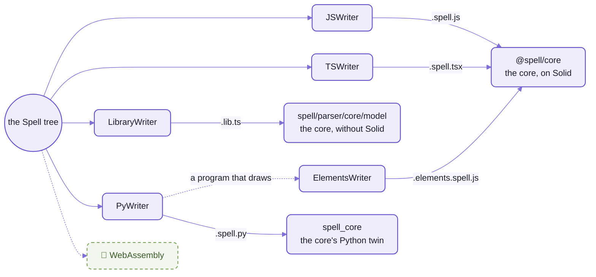

# Output targets:  one program, three languages, the same output

```spell
a "card" is a view:
	- its "suit" is one of clubs, diamonds, hearts or spades
```

That second line, as JavaScript:

```js
  // - its "suit" is one of clubs, diamonds, hearts or spades
  static Suits = ["clubs", "diamonds", "hearts", "spades"]
  static { this.declareProp("suit", { oneOf: Card.Suits }) }
  get suit() { return this.getProp("suit") }
  set suit(value) { this.setProp("suit", value) }
```

As TypeScript:

```ts
export type Suit = (typeof Card.Suits)[number]
  ...
  // - its "suit" is one of clubs, diamonds, hearts or spades
  static Suits = ["clubs", "diamonds", "hearts", "spades"] as const
  @prop({ oneOf: () => Card.Suits })
  accessor suit!: Suit
```

As Python:

```py
    # - its "suit" is one of clubs, diamonds, hearts or spades
    SUITS = ("clubs", "diamonds", "hearts", "spades")
    suit = prop(one_of=SUITS)
```

_"One of four values", three ways:  a getter and setter, a decorator and a type, a keyword argument._

A transpiler carries one language's shapes into another, so what it writes keeps the accent of where it came from.
Nothing is carried across here.
The parser reads the program ONCE, into one tree of what it means,
and each target has a writer of its own that turns that tree into code a person in that language would write.
The same program gives the same file every time, and a snapshot test pins it, character for character.

And the three agree.
Every frozen test project is compiled to JavaScript, TypeScript and Python, then run headless from the same seed,
and each must print the same thing, line for line, its drawing included:
that's [the core contract test](https://github.com/spell-app/spell/blob/main/app/tests/cli/contract.test.ts).
The edge:  Python runs seven of the nine:  the to-do app is still beyond its writer (below),
and Solitario, the Spanish example, compiles to Python but isn't run under it yet.

## Four targets, and what each one costs

JavaScript is the one everything runs.
The other three are for where your code has to live:  a typed codebase, a library someone else imports, or Python.

| Target | What you get | What it costs |
| --- | --- | --- |
| `js/solid`:  JavaScript on Solid | what the editor, the runners and `spell run` run;  draws into the page;  compiled for every project, whatever its file asks for | no types:  the snapshots and the runs are all that check it |
| `ts/solid`:  TypeScript on Solid | the same program as a Solid developer writes it:  types where Spell knows them, standard decorators, JSX;  `tsc` checks it | a build before it runs;  a program that draws can't open in a browser from `spell run` yet |
| `ts/lib`:  a TypeScript library | a project's classes in a single `.lib.ts` file, for code that isn't Spell to import;  the core without Solid | no drawing and no top-level steps:  it never runs on its own |
| `py`:  Python | Python as a person writes it:  PEP 8's names, `range()`, `elif`, `async def` only where it waits;  a program that draws becomes a web app | Python 3.12 and uv;  thinner type hints than TypeScript's;  44 of the core's names not ported yet |

🌱 WebAssembly is the fifth, and not here yet (below, "Coming").

## One tree, a writer per language

Each target is a writer that walks [the Spell tree](README-parser.md#4-the-spell-tree), on a runtime of its own.
(The other half, human languages going in, is on [spell-parser's front page](README.md#languages-in-targets-out).)



_Four writers, three runtimes:  JavaScript and TypeScript share the core, a library takes it without Solid, Python
has its twin._

A new target is a new class, not a new compiler.
A writer has one method per kind of node, and one that extends another overrides only what it writes differently:
`TSWriter` extends `JSWriter`, and `LibraryWriter` extends `TSWriter`.
How a writer finds its methods, with the same `if` in JavaScript's writer and Python's:
[README-parser](README-parser.md#5-output).

Underneath them all is `ProgramWriter` ([ProgramWriter.ts](src/parser/writers/ProgramWriter.ts)).
It reads the whole project before it writes a line,
so it knows a card's rank is one of thirteen values, not just some text.
It also holds what changes from one language to the next:
- how names are cased:  `camelCase` for JavaScript, PEP 8's `snake_case` and `UPPER_CASE` for Python
- where lists start counting:  from 1, Spell's own, or from 0 when the project file says `"listsStartAt": 0`
- each language's file separator and import lines

| Target | Writer | Writes | Its runtime |
| --- | --- | --- | --- |
| `js/solid` | [`JSWriter`](src/parser/writers/JSWriter.ts) | `<Project>.spell.js` | `@spell/core`, spell-parser's core |
| `ts/solid` | [`TSWriter`](src/parser/writers/TSWriter.ts), on `JSWriter` | `<Project>.spell.tsx` | `@spell/core`;  `@spell/elements` for a view's element |
| `ts/lib` | [`LibraryWriter`](src/parser/writers/LibraryWriter.ts), on `TSWriter` | `<Project>.lib.ts`, beside the source, committed | `spell/parser/core/model`:  the core with no drawing, so no Solid |
| `py` | [`PyWriter`](src/py/PyWriter.ts), on [`PyBaseWriter`](src/py/PyBaseWriter.ts) | `<Project>.spell.py` and its words, `<Project>.py.en.json5`;  beside the source, for a program that draws, its web app, `<Project>.app.py` | `spell_core` |
| `py`, a program that draws | [`ElementsWriter`](src/py/ElementsWriter.ts), on `JSWriter` | its page, in JavaScript:  `<Project>.elements.spell.js` | `@spell/core` |

- Every project also gets its declarations, its words and its scope pack, whatever its targets;
  which files go in the build folder and which beside the source:  [README-spell](README-spell.md#the-compiler).
- The list itself is `SP.TARGETS` ([targets.ts](src/spell/targets.ts)):
  each target's name, its writer, its file's ending, and what its runtime can do.

## The card, line by line

The two lines at the top of this page come from a card of ten.
[The kit's front page](https://github.com/spell-app/spell/blob/main/README.md) opens with all ten, and folds their whole output, in all three, under them.
Most of it comes out the same shape in all three.
The differences sit in four places:  imports, types, the element, and each language's own words.

| The card says | JavaScript | TypeScript | Python |
| --- | --- | --- | --- |
| _no line of its own:  the imports_ | `core, Thing, List, App, View, ViewableList` from `@spell/core`:  the whole set, used or not | the same and `prop`;  `E, SpellElement` from `@spell/elements` | `from spell_core import View, prop`:  only what it uses |
| `a "card" is a view:` | `class Card extends View`, its tag from `core.defineElement(this, "solitaire")` | the same, and a `CardElement` class after it | `class Card(View):`, and no element:  Python draws HTML as text |
| `- its "suit" is one of ...` | `static Suits`, a getter and a setter | `Suits` `as const`, then `@prop(...) accessor suit!: Suit` | `SUITS`, a tuple, then `suit = prop(one_of=SUITS)` |
| `- its "color" is:` ... | `get color()`, asking `core.includes(["diamonds", "hearts"], this.suit)` | the same, character for character | `@property def color(self) -> Any:`, asking `self.suit in [...]` |
| `- it "is a face card" if ...` | `get isAFaceCard()` | the same | `@property def is_a_face_card(self) -> bool:` |
| `- it "is a (rank)"` | `isARank(rank)` | `isARank(rank: Rank)` | `def is_a_rank(self, rank: Any) -> bool:` |
| `- it "is the (rank) of (suit)"` | `this.rank === rank && this.suit === suit` | the same | `self.rank == rank and self.suit == suit` |

_Every target keeps the line of Spell that made each stored property, as a comment above it._

TypeScript is JavaScript with types, nearly everywhere:
of the 207 examples in Spell's [syntax table](src/spell/spellSyntax.json) that carry their output,
TypeScript writes 184 character for character as JavaScript does.
The other 23 add a type (`List<Card>`, `: boolean`), declare a member added from outside its class,
or draw in JSX where JavaScript calls `h()`.

The one class TypeScript writes and JavaScript doesn't is the element.
JavaScript makes the card's `<solitaire-card>` when the page runs, from `core.defineElement()`;
TypeScript writes it out as `CardElement`, so the type checker can see it.
- The page defines the tag with that class, `core.useElement(Card, CardElement)`.
- Its attributes are its card's properties, from its vocabulary;  its methods call its card's.
- Below it, a declaration of `"solitaire-card"` for JSX, so a drawing that uses the tag is checked too.

<details>
<summary>More lines, all three ways, from the syntax table</summary>

Each rule's first test in the [syntax table](src/spell/spellSyntax.json) is written by every target:

| Spell | JavaScript | TypeScript | Python |
| --- | --- | --- | --- |
| `a deck is a list of cards` | `class Deck extends List` | `class Deck extends List<Card>` | `class Deck(List):`, `item_type = Card` |
| `draw each card in the deck` | `core.drawItems(deck)` | `core.drawItems(deck)` | `core.draw_items(deck)` |
| `<a/>` | `h("a")` | `<a />` | `h("a")` |

_TypeScript leaves JavaScript only to type or to draw;  where Python has no word of its own, it calls `core`.
More rows, JavaScript beside Python:  [README-core](README-core.md#the-typescript-and-python-runtimes-side-by-side)._

</details>

## TypeScript:  the same program, typed, as Solid developers write it

`ts/solid` is what you'd get if a Solid developer typed the program in by hand.
- Types where Spell knows them:  `Suit` and `Rank` from their values, parameters, `List<Card>`, lists `as const`.
- Where the program never says a type, what it does says it:
  a property's type from the values it's given, a method's from what it returns
  (`play(): Promise<boolean | undefined>`).
- Standard decorators:  `@prop`, `@derived`, `@thing`, and `@drawn` on `draw()`,
  which draws each thing in its own error boundary.
- Drawing a thing or a list's items is JavaScript's:  `core.drawThing(this.stock)`, `core.drawItems(this)`.
  So a view shows as its own element, and a viewable list's items as its children.
- Real JSX, which Solid's compiler builds, in Solid's shapes where they fit:
  - an `if ... return` chain becomes a `<Show>` or a `<Switch>`
  - any other `to draw` re-runs whole, in its error boundary
- A type Spell doesn't know is written `any /* spell: type unknown */`, never a bare `any`:
  so every gap shows, and can be counted.
  In the seven [frozen test projects](README-spell.md#the-frozen-test-projects)' TypeScript, the count is zero.

`tsc` checks it against `@spell/core`'s own types, and its report is pinned beside each test project.
Six of the seven check clean;  `solitaire` has four errors, two of each:
`the first pile in the foundations where ...` is typed as a list that may be nothing, without `firstItem`:

```text
407:26 TS2533 Object is possibly 'null' or 'undefined'.
407:129 TS2339 Property 'firstItem' does not exist on type '{} | Pick<List<Foundation>, "getItem"> | readonly Foundation[]'.
```

The cost:
- It never runs as is.
  It needs the build a hand-written Solid app gets from Vite:  esbuild strips the types and lowers the decorators,
  then Solid's compiler turns the JSX into DOM calls ([buildTsx()](src/spell/node/buildTsx.ts)).
- `spell run <project> --target ts` does that build and runs it under node:  its prints and tests in the terminal.
  **A program that draws can't open in a browser that way yet:**  `--target js`, or none, does.
- A view's element imports `@spell/elements`, which is spell-app's `SpellElement` and Spell UI's `E`.
  So the type check reads the app folder's types, which every checkout of the kit has;
  where they're missing, it skips itself.

## A library:  Spell's classes, for code that isn't Spell

Sometimes the program isn't the point, the types are.
The editor keeps the people and orgs of its "You" panel as Spell,
in [People.spell](https://github.com/spell-app/spell/blob/main/app/spaces/@spell/library/people/People.spell):

```spell
a person is a thing:
	- it is saved in its own file
	- it has names as text
	- it has a nickname as text
	- its "emails" is a list of text
```

Its project file asks for `"targets": ["ts/lib"]`, and the compile writes
[people.lib.ts](https://github.com/spell-app/spell/blob/main/app/spaces/@spell/library/people/people.lib.ts) beside it:

```ts
import { Thing, List, prop } from "spell/parser/core/model"
...
export class Person extends Thing {
  static savedInFile = true

  // - it has names as text
  @prop({ type: "text" })
  accessor names!: string
  ...
  // - its "emails" is a list of text
  @prop({ itemType: "text", init: () => new List<string>({ instanceType: "text" }) })
  accessor emails!: List<string>
```

spell-app's [people store](https://github.com/spell-app/spell/blob/main/app/src/spaces/server/node/people/PeopleStore.ts) imports it like any other
TypeScript, by package name:  `import * as People from "spell/app/spaces/@spell/library/people/people.lib.ts"`.

- It's `TSWriter`'s TypeScript, with the program's top-level steps left out:
  headings, tests, `print`, the things it makes.
  So importing it runs nothing but the class declarations.
- Its core comes from `spell/parser/core/model`, and only what it uses:
  no Solid, and a thing it makes joins no program's list.
- One file, its own types, with no `.d.ts` beside it.
  Vite, `tsx` and `tsc` import it as they import any TypeScript;
  a browser page with no build step, or plain node, can't load it as is.
- It's committed, and marked generated, so GitHub folds it in a pull request's diff.
  [A test](https://github.com/spell-app/spell/blob/main/app/tests/spaces/library/people.test.ts) fails when it isn't what the Spell compiles to now:
  the fix is `spell compile @spell/library/people`.

Compile a program as a library and you see what's left:

```sh
spell compile @spell/examples/fizzbuzz --target ts/lib --stdout
```

<details>
<summary>Output</summary>

```text
✓ @spell/examples/fizzbuzz
import { core } from "spell/parser/core/model"

/** File FizzBuzz.spell */
export function playFizzbuzz() {
  core.getRange(1, 100).forEach((number) => {
    ...
  })
}
```

</details>

The JavaScript starts with a heading and ends by calling `playFizzbuzz()`;  the library does neither,
so importing it plays nothing.

The cost:  a library can't draw, and never runs.
Ask it to, and it says so (below, "Choosing a target").

<a id="the-python-half"></a>

## Python:  Python's own words, on Python's own core

Everything Spell has for Python is in [src/py/](src/py/), in two halves:
- its TypeScript files WRITE Python:  `spell/parser/py`, the writers above
- [src/py/core/](src/py/core/) is `spell_core`, what compiled Python imports:
  `from spell_core import core, Thing, List, App, prop, h`

The Python reads as a Python programmer would write it:
- PEP 8's names:  `Card.SUITS`, `play_fizzbuzz()`, and `class_` for a name that's a keyword
- Python's own words where it has them:  `for number in range(1, 101):`, `elif`, `x is None`, `in`, f-strings;
  `core` only where it has none (`core.random_item_of()`)
- `async def` only for a function that waits, and every call of it awaits it:
  a program that never waits is plain Python, and its top level runs the rest with `asyncio.run(...)`
- type hints where Spell knows the kind

`spell_core` is a uv project for Python 3.12 or later, and its list of dependencies is empty:
`dependencies = []`, the standard library only ([pyproject.toml](src/py/core/pyproject.toml)).
Each of its modules is the twin of one in the JavaScript core, its helpers by Python's names.
It runs a compiled program by itself, `python -m spell_core.run <program> --seed n`.
A shared method list and shared expected files keep the two cores in step
([README-core](README-core.md#the-typescript-and-python-runtimes-side-by-side)).

To run it you need Python 3.12 or later and [uv](https://docs.astral.sh/uv/) on your `PATH`.
Here's the Solitaire example's card testing itself in Python:

```sh
spell run @spell/examples/Solitaire --target py --no-browser
```

<details>
<summary>What it printed</summary>

```text
✓ Compiling @spell/examples/Solitaire
...
✅ test card setup
  ▶️ Executing   `get a new card whose rank is queen, suit is spades and direction is up`
  ✅ As expected `its rank` is `queen`
  ✅ As expected `its suit` is `spades`
  ✅ As expected `its name` is `"queen-of-spades"`
  ✅ As expected `its color` is `black`
...
```

</details>

Those tests are the card's own, written in English beside it.
Run it again without `--target py`, and diff what the two print:  all 119 lines are the same,
but for the deck its test shuffles, which `--seed` makes the same too.

What the two don't share is how a thing looks when you `print` it, and that's on purpose:
the contract compares only what a program prints as data, and a dumped thing goes to stderr.
Python dumps the card as `Card(rank='queen', suit='spades', direction='up')`;
node dumps its insides, `Card { Symbol(props): Map(3) {...}, ... }`.

A program that draws runs as a web app, without `--no-browser`:
- Its Python runs on Quart, served by `spell_quart`, which is spell-app's
  ([README-spaces](https://github.com/spell-app/spell/blob/main/app/README-spaces.md)).
  `spell run` serves it and opens it in your browser, until Ctrl-C.
- Its page draws from the state Python sends:  the whole state when it opens, then a patch after each change,
  a game per visitor.
- So its Python target writes two more files:
  - its page half, `<Project>.elements.spell.js`:  the classes and their drawing, in JavaScript;
    a click calls Python, `this.turnOver()` becoming `sendCall("turn_over", [], this)`
  - its web app, `<Project>.app.py`:  a short Quart app with every route spelled out, for you to grow
    ([quartApp.ts](src/py/quartApp.ts))
- Each compile rewrites the app only while nobody has edited it:  its first line holds a hash of the rest.

The checks:
- pyright on every test project's Python, as Python 3.12, in the `basic` mode VS Code's Python extension uses:
  it finds nothing in any of the seven.
- ruff and pytest on `spell_core`:  they run in spell-parser's `yarn lint` and `yarn test`.

The cost, beyond Python and uv:
- **Its type hints are thinner than TypeScript's:**  where TypeScript says `rank: Rank`, Python says `rank: Any`.
- 44 of the JavaScript core's names aren't in `spell_core` yet, most of them a browser's own (below).
- Two test projects of the nine have no Python snapshot yet:  the to-do app (below), and Solitario,
  which compiles to Python but has no snapshot pinning it.
- A kind of node the Python writer can't write yet stops the compile, naming the kind.

<details>
<summary>What isn't Python yet</summary>

[not_ported_yet.json5](src/py/core/not_ported_yet.json5) lists the JavaScript core's names `spell_core` doesn't
have, grouped by why (44 names):

| Why | Names |
| --- | --- |
| a browser's only:  a view's element, a page's markup, its shadow root | 11 |
| pauses and events Python's runtime hasn't needed | 4 |
| a page's drag handlers:  the page calls them;  a Python program's page sends them to its things | 5 |
| carrying things over a recompile:  the page's runners only | 3 |
| an element's id on the page | 1 |
| what the lookups search:  Python's take it on each call | 1 |
| running a project's tests from a runner:  Python's tests run under pytest | 2 |
| remembered props:  a Python program keeps none yet | 1 |
| not decided yet:  a word of Python's own, a browser's only, or ported when a program needs it | 16 |

And the [todos-form-based](https://github.com/spell-app/spell/tree/main/app/spaces/@spell/test/todos-form-based/) test project has no Python snapshot:
the Python writer can't write its function's named arguments yet.
Its Spell, [todo.spell](https://github.com/spell-app/spell/blob/main/app/spaces/@spell/test/todos-form-based/todo.spell):

```spell
to create a new task (with title as text, completed as a choice)
```

JavaScript takes them apart, `let { title, completed } = props`.
Python's writer still writes them JavaScript's way, and a dict has no `.title`:

```py
def create_a_new_task(props: Any = {}) -> None:
    title = props.title
    completed = props.completed
```

</details>

## Choosing a target

You don't choose JavaScript:  every project gets `js/solid`, whatever it asks for, because everything runs it.
The others, a project asks for in its project file, `__project.json5`:  `"targets": ["js/solid", "ts/solid"]`.
- For one run, `spell compile <project> --target py` adds a target, and `--stdout` prints it instead of writing it.
- To run one, `spell run <project> --target ts` or `--target py`;  `js`, or none, is the default.
- A target says what its runtime can do, and the compile checks the project asks only for that:
  JavaScript and TypeScript draw into the page, Python draws HTML as text, and a library neither draws nor runs.

What it says when you ask for what isn't there:

| You ask for | Spell says |
| --- | --- |
| `spell compile --target wasm` | `There's no target 'wasm':  try js/solid, ts/solid, py, ts/lib.` |
| a program that draws, as `ts/lib` | `'Solitaire' draws a UI, which target 'ts/lib' can't.` |
| `spell run --target ts/lib` | `` "ts/lib" doesn't run:  it's compiled for other code to import (`spell compile`) `` |

Every option of `spell compile` and `spell run`:  [the command line](https://github.com/spell-app/spell/blob/main/README-cli.md#spell-parser).

## 🌱 Coming

### WebAssembly

`spell compile --target wasm`:  the part of Spell that computes, with no drawing, as a `.wasm` module
that runs in node and the browser.
- Written as WebAssembly text and assembled to a `.wasm` file, its values on WebAssembly's garbage-collected types.
- FizzBuzz first, then up to the card types.
- Its own small runtime, growing a feature at a time.

Where it stands:  planned, with its first decisions made.
Today the compiler answers in one line, above.

### A program on node, mirrored in the page

A JavaScript program running under node, while its page mirrors it by id:
the whole state when the page opens, then a patch after each change, as Python's web apps already do.
Then a browser test can play a game by sending its messages.

Where it stands:  planned;  Python's half of the idea is built.

<details>
<summary>More in the docs site</summary>

These guides need a checkout with the content folder beside it, and the page server running.

| Guide | Served at |
| --- | --- |
| Targets and Writers | `/guides/targets/targets.html` |
| The Python Target | `/guides/python-target.html` |
| Compile Targets | `/guides/compile-targets/compile-targets.html` |

- Targets and Writers still says the later half of the Python target is "not merged yet":  stale, all of it is built.

</details>

## See also

- [README-parser](README-parser.md#5-output):  how a writer walks the tree;  the same `if`, two writers
- [README-core](README-core.md):  the runtime JavaScript and TypeScript import, and how `spell_core` keeps in step
- [README-spell](README-spell.md#the-frozen-test-projects):  the test projects, and the two examples, whose snapshots pin every target
- [the `py` folder's AGENTS.md](src/py/AGENTS.md):  the rules for working on Python's writers and `spell_core`
- [The command line](https://github.com/spell-app/spell/blob/main/README-cli.md#spell-parser):  `spell compile`, `spell run` and the rest of the language's commands
