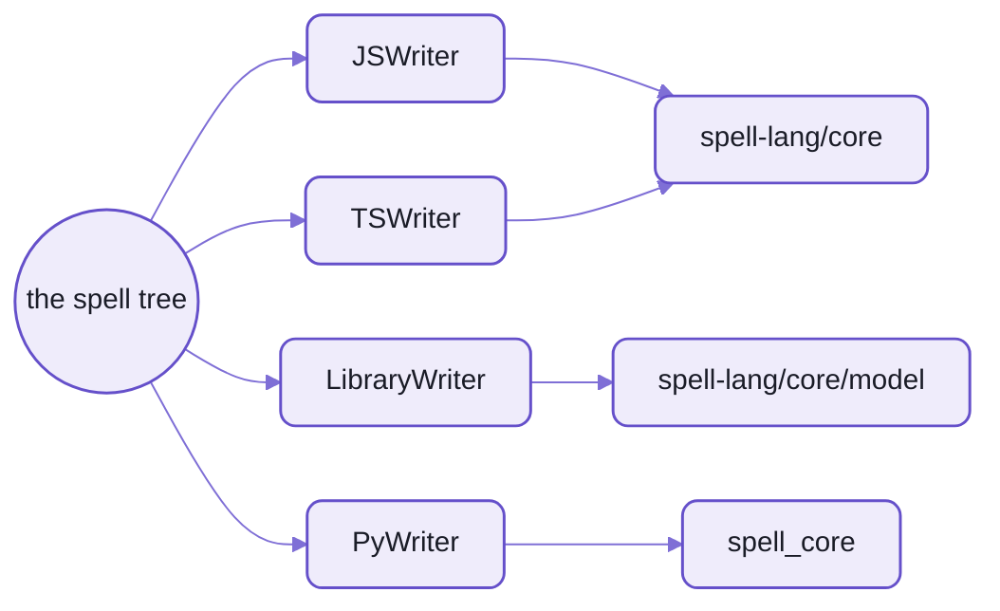

# Output targets:  one spell tree, a writer per language

Spell compiles one program to several languages.
The parser reads it into ONE tree, the spell tree, and a writer per target turns that tree into its language:
- **JavaScript** on Solid:  always compiled, what the editor and `spell run` run
- **TypeScript** on Solid:  the same program with JSX, decorators and the types spell knows
- **a TypeScript library:**  a project's classes alone, for other code to import
- **Python** on `spell_core`:  idiomatic Python, on asyncio when it waits
- 🌱 WebAssembly is coming (below)

Each target's output is checked on every [frozen test project](README-spell.md#the-frozen-test-projects):
`tsc` and pyright find nothing in any of them.



_Four writers, three runtimes:  JavaScript and TypeScript share the core, a library its model alone, Python its twin._

## One line through every writer

From the generated [spell syntax table](spell/spellSyntax.json), where every rule's first test is written by all three:

| Spell | JavaScript and TypeScript | Python |
| --- | --- | --- |
| `add thing to my-list before other-thing` | `core.addBefore(myList, otherThing, thing)` | `core.add_before(my_list, other_thing, thing)` |
| `fire event card click with card = 1` | `trigger("card-click", { card: 1 })` | `core.trigger("card-click", card=1)` |

And a whole member, the card's `color`, from the [cards](tests/spaces/@spell/test/cards/) test project:

```spell
the color of a card is red if its suit is either diamonds or hearts otherwise it is black
```

<table>
<tr><th>JavaScript</th><th>Python</th></tr>
<tr>
<td>

```js
get color() {
  if (core.includes(["diamonds", "hearts"], this.suit)) return "red"
  return "black"
}
```

</td>
<td>

```py
@property
def color(self) -> str:
    """color as derivation of suit"""
    if self.suit in ["diamonds", "hearts"]:
        return "red"
    return "black"
```

</td>
</tr>
</table>

_The JavaScript asks `core` whether a list includes the suit;  Python says `in`, its own word for it._

## What a writer is

A writer is a class with ONE METHOD PER KIND OF NODE in the spell tree, found by the node's class name:
`ASTIfStatement(node)` writes an `ASTIfStatement`.
- A node with no method of its own is written by its nearest base class's method.
- A writer that extends another overrides only what it writes differently:
  `TSWriter` extends `JSWriter`, `LibraryWriter` extends `TSWriter`.
- Side by side, the same `if` in JavaScript's and Python's writers:
  [README-parser](README-parser.md#5-output-and-bundling).

What every program's writer shares, `ProgramWriter` ([ProgramWriter.ts](parser/src/writers/ProgramWriter.ts)):
- it reads the whole project before writing any of it, so it knows what each value is
- its naming:  `camelCase` for JavaScript, PEP 8's `snake_case` and `UPPER_CASE` for Python
- where lists start counting:  from 1, spell's own, or 0 when the project says so
- each language's own file separator and import lines

| Writer | Target | Where |
| --- | --- | --- |
| `JSWriter` | `js/solid` | [JSWriter.ts](parser/src/writers/JSWriter.ts) |
| `TSWriter` | `ts/solid` | [TSWriter.ts](parser/src/writers/TSWriter.ts) |
| `LibraryWriter` | `ts/lib` | [LibraryWriter.ts](parser/src/writers/LibraryWriter.ts) |
| `PyWriter` | `py` | [PyWriter.ts](py/ts/PyWriter.ts), on [PyBaseWriter.ts](py/ts/PyBaseWriter.ts) |
| `ElementsWriter` | `py`'s drawing half, in JavaScript | [ElementsWriter.ts](py/ts/ElementsWriter.ts) |

The list of targets, each a language, its runtime and its writer:  `SP.TARGETS`, in [targets.ts](spell/src/targets.ts).

## The Python half

Everything spell has for Python is in [py/](py/), in two halves:
- [py/ts/](py/ts/), TypeScript, WRITES Python:  `spell-lang/py`, the writers above
- [py/core/](py/core/) is `spell_core`, what compiled Python imports:
  `from spell_core import core, Thing, List, App, prop, h`

`spell_core`:
- a uv project:  Python 3.12 or later, the standard library only ([pyproject.toml](py/core/pyproject.toml))
- each module the twin of one in the JavaScript core, its helpers by Python's names:  `core.random_item_of()`
- runs a compiled program:  `python -m spell_core.run <program> --seed n`
- kept in step with the JavaScript core by shared method lists and expected files
  ([README-core](README-core.md#the-typescript-and-python-runtimes-side-by-side))

What the Python reads like:
- PEP 8's names:  `Card.SUITS`, `play_fizzbuzz()`, `class_` for a keyword
- Python's own words:  `for number in range(1, 101):`, `x is None`, f-strings
- `async def` only for a function that waits, and every call of it awaits it;
  a program that never waits is plain Python
- type hints where spell knows the kind

To run it you need Python 3.12 or later and [uv](https://docs.astral.sh/uv/) on your `PATH`;  then:

```sh
spell run try/fizzbuzz --target py
```

```text
✓ Compiling @local/try/fizzbuzz
1
2
3 fizz
...
```

- A program that draws runs as a web app:
  - its Python on Quart, served by `spell_quart` (spell-app's spaces, [README-spaces](../spell-app/README-spaces.md))
  - its page drawn from the state Python sends, a patch after each change
- So a drawing program's Python target also writes two more files:
  - its page half, `<Project>.elements.spell.js`
  - its web app, `<Project>.app.py`, which each compile rewrites only while nobody has edited it
- The checks:  pyright on every test project's Python, and ruff and pytest on `spell_core`.
  Ruff and pytest run in spell-lang's `yarn lint` and `yarn test`.

## Choosing a target

- A project names the targets it wants in its project file:

  ```json5
  {
    "targets": ["js/solid", "ts/solid"],
    "imports": [ ... ]
  }
  ```

- `js/solid` is always compiled, whatever the list says.
- For one run:  `spell compile <project> --target py` adds a target;  `--stdout` prints it instead of writing it.
- To run one:  `spell run <project> --target ts` or `--target py`.
- A target says what its runtime can do, checked as the project compiles, so a project asks only for that:
  - JavaScript and TypeScript draw into the page;  Python draws HTML as text
  - a library neither draws nor runs:  it keeps only the classes

## 🌱 Coming:  WebAssembly

`spell compile --target wasm`:  the part of spell that computes, with no drawing,
written as WebAssembly text and assembled to a `.wasm` file, its values on WebAssembly's garbage-collected types.
FizzBuzz first, then up to the card types;  its own small runtime grows a feature at a time.

Where it stands:  planned, with its first decisions made.

## 🌱 Coming:  a program on node, mirrored in the page

A JavaScript program running under node, while its page mirrors it by id:
the whole state when the page opens, then a patch after each change, as Python's web apps already do.
Then a browser test can play a game by sending its messages.

Where it stands:  planned;  Python's half of the idea is built.

<details>
<summary>The files each target writes</summary>

| Target | Files | Where |
| --- | --- | --- |
| `js/solid` | `<Project>.spell.js`;  the scope pack `<Project>.scopes.js` | the build folder |
| `ts/solid` | `<Project>.spell.tsx` | the build folder |
| `py` | `<Project>.spell.py`;  a drawing program's `<Project>.elements.spell.js` | the build folder |
| `py` | a drawing program's web app, `<Project>.app.py`;  its words, `<Project>.py.en.json5` | beside the source |
| `ts/lib` | `<Project>.lib.ts`, one file with its own types | beside the source, committed |
| every project | `<Project>.declarations.json5`, `<Project>.en.js` | beside the source |

- The build folder is `build/` at the checkout's root, mirroring each project's path:  never committed.

</details>

<details>
<summary>What isn't ported to Python yet</summary>

[not_ported_yet.json5](py/core/not_ported_yet.json5) lists the JavaScript core's names `spell_core` doesn't have,
grouped by why (36 names):

| Why | Names |
| --- | --- |
| a browser's only:  a drawable thing's element, a page's markup, its shadow root | 11 |
| pauses and events Python's runtime hasn't needed | 4 |
| carrying things over a recompile:  the page's runners only | 3 |
| an element's id on the page | 1 |
| what the lookups search:  Python's take it on each call | 1 |
| not decided yet:  a word of Python's own, a browser's only, or ported when a program needs it | 16 |

- The [todos-form-based](tests/spaces/@spell/test/todos-form-based/) test project has no Python snapshot:
  the Python writer can't write its method's named arguments yet.

</details>

<details>
<summary>More in the docs site</summary>

These guides need a checkout with the content folder beside it, and the page server running.

| Guide | Served at |
| --- | --- |
| Targets and Writers | `/guides/targets/targets.html` |
| The Python Target | `/guides/python-target.html` |
| Core Reference | `/guides/targets/core-reference.html` |
| Compile Targets | `/guides/compile-targets/compile-targets.html` |

- Two of these still say parts of Python are "not merged":  stale, all of it is built.

</details>

## See also

- The pages beside this one:
  [README-core](README-core.md), [README-spell](README-spell.md), [README-parser](README-parser.md)
- The rules for working on Python:  [py's AGENTS.md](py/AGENTS.md)
- spell-lang's front page:  [README](README.md)
- The kit, and every repo:  [the kit's README](../README.md)
- Also beside it:  [README-markdown.md](README-markdown.md) · [README-rulex.md](README-rulex.md)
