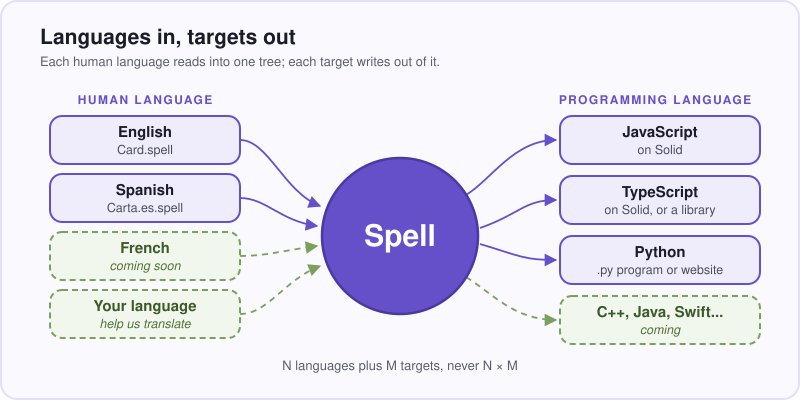
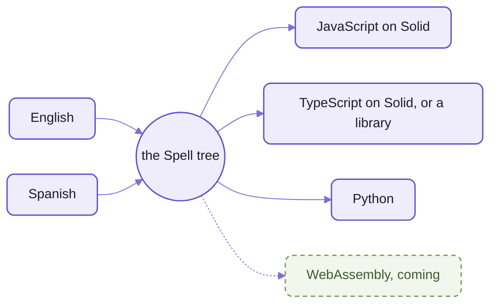
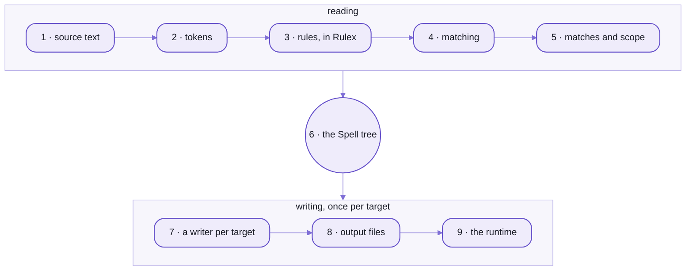

# spell-parser:  English you can run

<a id="fizzbuzz"></a>

```spell
## File FizzBuzz.spell
to play fizzbuzz
	for each number from 1 to 100
		if the number divided by 15 is an integer: print the number, "fizzbuzz"
		otherwise if the number divided by 3 is an integer: print the number, "fizz"
		otherwise if the number divided by 5 is an integer: print the number, "buzz"
		otherwise print the number

play fizzbuzz
```

_FizzBuzz, all eight lines of it, from [the frozen test projects](https://github.com/spell-app/spell-app/blob/main/spaces/@spell/test/fizzbuzz/FizzBuzz.spell)._

You've probably written FizzBuzz for an interviewer, in a language with braces.
This time it's English, and it runs.
The compiler turns it into JavaScript or into Python, and the two print the same hundred lines:

<table>
<tr><th>JavaScript</th><th>Python</th></tr>
<tr>
<td>

```js
core.heading("File FizzBuzz.spell")
/** File FizzBuzz.spell */
export function playFizzbuzz() {
  core.getRange(1, 100).forEach((number) => {
    if (core.isOfType(number / 15, "integer"))
      core.console.log(number, "fizzbuzz")
    else if (core.isOfType(number / 3, "integer"))
      core.console.log(number, "fizz")
    else if (core.isOfType(number / 5, "integer"))
      core.console.log(number, "buzz")
    else core.console.log(number)
  })
}

playFizzbuzz()
```

</td>
<td>

```py
from __future__ import annotations

def play_fizzbuzz() -> None:
    """File FizzBuzz.spell"""
    for number in range(1, 101):
        if (number / 15).is_integer():
            print(number, "fizzbuzz")
        elif (number / 3).is_integer():
            print(number, "fizz")
        elif (number / 5).is_integer():
            print(number, "buzz")
        else:
            print(number)


play_fizzbuzz()
```

</td>
</tr>
</table>

_What `spell compile --stdout` prints, then the same with `--target py`:
the JavaScript's import line left out, and its long lines folded to fit._

Neither column is a translation of the other.
The compiler reads the English once, into a tree of what it means,
and each language has a writer of its own, which turns that tree into code the way that language's programmers would.
- "From 1 to 100" includes the 100, as people mean it, and Python's `range()` stops one short:
  so it's `range(1, 101)`.
- JavaScript has no word for a range, or for "is an integer", so it calls Spell's runtime, `core`, for both.
  Python has words for both, and needs no runtime here at all.
- The `##` line is a heading.
  Both keep it as a comment, and the JavaScript tells the runtime too, with `core.heading()`,
  so the editor's Thing Explorer can group what the program made under it.

Ask a model for FizzBuzz in Python, and you'll get a good one, a little different each time you ask.
These eight lines give the same JavaScript and the same Python every time, character for character:
a test holds them to their snapshots, [the JavaScript](https://github.com/spell-app/spell-app/blob/main/spaces/@spell/test/fizzbuzz/fizzbuzz.snapshot.js)
and [the Python](https://github.com/spell-app/spell-app/blob/main/spaces/@spell/test/fizzbuzz/fizzbuzz.snapshot.py), and fails the day they differ.

Everything that just happened lives in this repo, `spell-parser`:
the parser that read those eight lines, the grammar it read them with, the writers that wrote both columns
(and a third, for TypeScript), and `core`, the runtime the JavaScript calls.
That's all of Spell the language.
The editor that runs a program as you type it is [spell-app](https://github.com/spell-app/spell-app/blob/main/README.md)'s,
and the checkout every repo is cloned into is [the kit](https://github.com/spell-app/spell/blob/main/README.md)'s.

Why English, now that models write the code?
Because the person who asked can read what came back, find the sentence that's wrong, and change it.
That's the long view, and the kit's page says how far along it is:  [where it's going](https://github.com/spell-app/spell/blob/main/README.md#where-its-going).

Here to run it?  [Skip to "Try it in two minutes"](#try-it-in-two-minutes).

## Underneath, a parser that knows no language

With ANTLR or yacc, the grammar is a file, a generator turns it into a parser,
and the grammar is frozen before the first token is read.
Spell's parser has no grammar file, and generates nothing.
Its rules are classes, each with a syntax string, registered while the program runs,
and a Spell program registers more of them as it's read.
After `a card "is face up" if its direction is up`, the line `the card is face up` is a rule of its own,
and `the card is not face up` comes with it.

The syntax strings are written in [Rulex](README-rulex.md), which reads like a regular expression over WORDS.
Here's the rule FizzBuzz's loop matched, from [ListRangeIteration.ts](src/spell/rules/lists/ListRangeIteration.ts):

```text
for each? {item:singular_identifier} from {start:expression} down? to {end:expression} :? {statement_body}?
```

- `each?` is optional, and `{start:expression}` is another rule, by name, its match kept as `start`.
- Rules name rules, so they nest and recurse,
  and a parse hands back a tree of matches with named parts, not a row of capture groups.

The parser knows no language until it's handed rules.
Spell's are 244 classes, with 270 syntaxes between them
([module by module](README-spell.md#the-whole-language-module-by-module)).
[GitHub's Markdown](README-markdown.md) is a second set of rules on the same parser,
and it passes all 670 of the 670 examples in its spec.

It's a parser, not a prompt:  the same text gives the same tree, every time.
**The cost of being exact:**  Spell reads the shapes its rules know and the aliases your program adds,
not all of English.
A sentence outside them is an error at its line and column, however plain it is to you
("is a whole number" is one, [below](#try-it-in-two-minutes)).
The parser on its own, and how to write a language of your own on it:  [README-parser](README-parser.md).

## Languages in, targets out

The tree in the middle is the Spell tree:  what a program means, in no language's words.
It holds `equals`, not `==`, and `up`, not `"up"`.
Each human language reads into it, and each target writes out of it,
so a new language, or a new target, is one piece of work, not one per pair.



_N languages plus M targets, never N × M:  the dashed box is coming._

<details>
<summary>As text</summary>



</details>

- **Real today:**  English and Spanish in, four targets out.
  A file written in Spanish says so in its name, `Carta.es.spell`;  a plain `.spell` is English, and one project may mix them.
  Every project gets JavaScript, `js/solid`;  a project asks for the rest by name:  `ts/solid`, `ts/lib`, `py`.
  Seven frozen test projects and two examples, Solitaire and Solitario, pin what the writers write,
  in snapshots that `tsc` and pyright check too ([the frozen test projects](README-spell.md#the-frozen-test-projects)).
  Spanish, file by file:  [README-spanish](README-spanish.md).
- **Not yet:**  a third human language, and WebAssembly (below, "Coming").
- What each target gives you, and what it costs:
  [README-targets](README-targets.md#four-targets-and-what-each-one-costs).

## The pipeline:  nine steps, the same for every program

Whatever language a program is written in, and whichever targets it's written to, it takes the same nine steps.
Five read it, once;  three write it, once per target;  the Spell tree sits between them.



_A compile reads a program once, then writes it once per target, from the same tree._

1. **Source text:**  the `.spell` files of a project, which its project file lists
   ([the compiler](README-spell.md#the-compiler)).
2. **Tokens:**  words, numbers, symbols and text in double quotes;  indentation makes blocks
   ([tokens](README-parser.md#1-tokens)).
3. **Rules:**  each a class with a syntax string in Rulex, compiled once, when it registers
   ([README-rulex](README-rulex.md)).
4. **Matching:**  every way a line could read is tried, and one wins
   ([how a choice is settled](README-parser.md#how-a-choice-is-settled)).
5. **Matches and scope:**  each line records what it declares, so later lines know its words
   ([how earlier lines teach later ones](README-parser.md#how-earlier-lines-teach-later-ones)).
6. **The Spell tree:**  84 kinds of node, saying what was meant, in no target's words
   ([the Spell tree](README-parser.md#4-the-spell-tree)).
7. **A writer per target:**  a class with a method per kind of node
   ([one tree, a writer per language](README-targets.md#one-tree-a-writer-per-language)).
8. **Output files:**  `<Project>.spell.js`, `.spell.tsx` and `.spell.py`, in a build folder that's never committed
   ([the compiler](README-spell.md#the-compiler)).
9. **The runtime:**  compiled JavaScript imports `@spell/core`, and compiled Python imports `spell_core`
   ([README-core](README-core.md)).

The detailed map of all nine, for anyone changing the parser:  [PARSING.md](src/spell/PARSING.md).

## How Spell reads:  sentences or an outline, one meaning

A Spell program is sentences, as FizzBuzz is, or an outline, as the card on [the kit's front page](https://github.com/spell-app/spell/blob/main/README.md) is:
a name, then bullets of what's true of it.
The two compile to the same JavaScript, member for member, and a file may mix them
([two styles, one meaning](README-spell.md#two-styles-one-meaning)).

Six ideas carry most of the language, and each reads both ways:
- **Templates and things.**  `a card is a thing` makes a template, a class named `Card`.
  "Card" is then a word every line of the project knows, even a line above its declaration.
- **Properties, and values worked out from them.**
  `cards have a suit as one of clubs, diamonds, hearts or spades` stores a suit, one of four values;
  `the color of a card is red if its suit is either diamonds or hearts otherwise it is black` works the color out
  each time it's read, a getter, so there's nothing to keep in step.
- **Aliases become rules.**  Quoted words are a new alias, a rule from the next line on (above, "Underneath").
  A blank in brackets makes an alias per value:
  after `a card "is a (rank)" for its ranks`, `the card is a queen` reads, and so does `the card is not an ace`.
- **Precedence, as you'd read it.**  `its suit is either diamonds or hearts` asks ONE question:
  `core.includes(["diamonds", "hearts"], this.suit)`.
  Write it in JavaScript the way you'd say it, `suit == "diamonds" || "hearts"`, and it's never false.
  Sums come before comparisons, too:
  the tableau's rule in [Solitaire](https://github.com/spell-app/spell-app/blob/main/spaces/@spell/examples/Solitaire/Solitaire.spellx),
  `its value is the value of the card + 1`, is `this.value === card.value + 1`.
- **Lists count from 1.**  `the first card of the deck` is the first, and `card 2 of the deck` the second,
  as a person counts.
  The compiler turns Spell's positions into JavaScript's and Python's own, which count from 0
  ([positions count from 1](README-core.md#positions-count-from-1)).
- **Ids and addresses.**  Every thing has an `id`, built in, and saves as readable JSON;
  `a person is saved in its own file` gives each person a file of their own.
  Projects and files have addresses too, like `@spell/examples/Solitaire/Solitaire.spellx`
  ([ids, names and addresses](README-spell.md#ids-names-and-addresses)).

Every rule, and what each target writes for it:  [README-spell](README-spell.md).

## Try it in two minutes

You need the kit's checkout with its child repos, and `spell` on your `PATH`:
the kit's [setup from zero](https://github.com/spell-app/spell/blob/main/README.md#setup-from-zero) does both.
Then work in a folder of your own, outside the checkout.

**How Spell reads a line:**

```sh
spell parse "print 1 + 2 * 3"
```

<details>
<summary>Output</summary>

```text
statement › print  print 1 + 2 * 3
  Keyword  print
  expressions: Repeat  1 + 2 * 3
    expression  1 + 2 * 3
      lhs: operand › number  1
      Repeat  + 2 * 3
        expression_suffix › plus  + 2
          operator › Symbol  +
          expression: operand › number  2
        expression_suffix › times  * 3
          operator › Symbol  *
          expression: operand › number  3

core.console.log(1 + 2 * 3)
```

</details>

That's the match tree, a rule a line, each inside the one that holds it
([how to read one](README-parser.md#3-matches)).
Look at `+ 2` and `* 3`:  two suffixes side by side, because precedence is settled only when the tree is built.
`--tree` prints that tree, where `*` has already claimed the 2:

```sh
spell parse --tree "print 1 + 2 * 3"
```

<details>
<summary>Output</summary>

```text
Print
  args: plus
    lhs: Number 1
    rhs: times
      lhs: Number 2
      rhs: Number 3

core.console.log(1 + 2 * 3)
```

</details>

**What a word starts:**  `if` starts two rules.
FizzBuzz uses the first;  the second reads a value backwards, the way people say it.

```sh
spell explain if
```

<details>
<summary>Output</summary>

```text
if  if {condition:expression} (then|:)? {statement_body}?
e.g. if a

backwards_if  if {operator:expression} (else|otherwise) (it is)? {expression}
e.g. print 1 if bar else 2
```

</details>

**A whole program, two ways.**
Copy FizzBuzz out of the frozen test projects first:  nobody edits those.

```sh
mkdir -p try
cp -R ~/www/spell/spell-app/spaces/@spell/test/fizzbuzz try/fizzbuzz
spell run try/fizzbuzz
```

<details>
<summary>What it printed</summary>

```text
✓ Compiling @local/try/fizzbuzz
1
2
3 fizz
4
5 buzz
...
15 fizzbuzz
...
```

</details>

```sh
diff <(spell run try/fizzbuzz 2>/dev/null) <(spell run try/fizzbuzz --target py 2>/dev/null) && echo same
```

<details>
<summary>What it printed</summary>

```text
same
```

</details>

- `--target py` runs the Python instead, and needs Python 3.12 or later and uv
  ([the Python half](README-targets.md#the-python-half)).
- `spell compile try/fizzbuzz --stdout --target py` prints the Python at the top of this page.
- A project outside every group is named for its folders, `@local/try/fizzbuzz`
  ([naming projects](https://github.com/spell-app/spell/blob/main/README-cli.md#naming-projects--a-path-an-address-or-a-group)).
- The copy brings the test's snapshot files with it:  harmless, or delete the `*snapshot*` files.

**Then break it.**
In `try/fizzbuzz/FizzBuzz.spell`, change the fizzbuzz line's `is an integer` to `is a whole number`:

```sh
spell lint try/fizzbuzz
```

<details>
<summary>What it printed</summary>

```text
✗ @local/try/fizzbuzz  1 error
try/fizzbuzz/FizzBuzz.spell:4:31  Don't understand "is a whole number: print the number, "fizzbuzz""
```

</details>

To you, the two say the same thing.
Spell has no rule for "a whole number", so it names the line and column where it stopped understanding, and exits 1.
It doesn't guess.
The edge:  `spell run` reports the same error, then runs what it did understand,
here an `if` with nothing inside it, so not one line prints.
Lint first.

## The language commands

You've just used four of them.
The kit's `spell` takes fifteen commands from this repo:
`compile`, `lint`, `watch` and `format` build a program;  `run` and `test` run it;
`parse`, `repl`, `explain` and `describe` show what Spell made of it;  `speedtest` times the parser;
`translate` writes a project in another language, `translate check` and `translate fix` check the language packs against English,
and `translate speedtest` times a translation.
[commands.ts](src/cli/commands.ts) lists them, and spell-parser's `package.json` names that file,
`"spell": { "commands" }`.
What each does, every option, with examples:
[the command line's page](https://github.com/spell-app/spell/blob/main/README-cli.md#spell-parser), or `spell help <command>`.

**Their work is spell-app's, for now.**
The names live here, and each command hands its work to spell-app's `language` hook
([hooks.ts](https://github.com/spell-app/spell-app/blob/main/src/cli/hooks.ts)), so the command line and the editor can't disagree:
- it finds projects the app's way:  by address (`@spell/examples/Solitaire`), group, `@here`,
  or the "which project?" prompt, with the build folder under spell-app's `build/`
- it asks the editor's language service, so the command line sees what an editor sees
- without spell-app, each command stops, says to clone it (`yarn clone spell-app`), and exits 2
- `spell translate check` / `fix` are the exception:
  they need no project, so their work is here, in [packsCommand.ts](src/cli/packsCommand.ts).

<details>
<summary>The files in cli/</summary>

| Path | What |
| --- | --- |
| [cli/commands.ts](src/cli/commands.ts) | the list the kit's `spell` loads:  each command's name, arguments, flags and help |
| [cli/cli.types.ts](src/cli/cli.types.ts) | `LanguageCommands`, the `language` hook's shape;  each command's flags |
| [cli/packsCommand.ts](src/cli/packsCommand.ts) | `spell translate check` and `fix`:  what each language pack lacks against English, and stubs for it |
| [cli/translateProject.ts](src/cli/translateProject.ts) | `spell translate`'s work once spell-app has parsed the project:  its three passes, its dictionary, its files |
| [cli/NamesReview.ts](src/cli/NamesReview.ts) | `spell translate --review`:  the names drafted, on a page in the Review tab, and the answers back into the dictionary and the glossary |
| [cli/claudeRunners.ts](src/cli/claudeRunners.ts) | how the translator asks Claude:  the Claude API with `ANTHROPIC_API_KEY` set, else `claude -p`;  `--effort`'s tiers |
| [cli/translateTimes.ts](src/cli/translateTimes.ts) | `spell translate speedtest`:  scratch copies, runs, and the table |
| [cli/index.ts](src/cli/index.ts) | `spell-parser/cli`:  the types, for spell-app |

</details>

<details>
<summary>🌱 Moving each command's work down into spell-parser</summary>

Planned, and not started:  then the commands run with `spell-parser` alone.
What each one needs:
- First, for every command that takes a project:
  - a loader that reads a project FOLDER by itself, as Spell's tests already do (`parseSpellProject()`)
  - hooks for what stays spell-app's:  addresses and groups, the build folder, the editor pages after
    `compile` and `lint`, and opening a UI project in a browser for `run`
- Then, command by command:
  - `parse`, `repl`:  the parser alone;  only a project argument (`--in`) needs the loader
  - `explain`:  the language service, from spell-app's `lsp`
  - `describe`:  the Type Explorer's builder (`ScopeExplorer`), from spell-app's `lsp`
  - `format`:  the language service's formatting;  its frozen-projects check names spell-app's `spaces/@spell/test/`
  - `test`, `watch`:  the loader;  `watch`'s compile step as `compile`'s
  - `speedtest`:  finds Spell by its package, not through spaces
  - `compile`, `lint`, `run`:  the loader, plus spell-app's hooks above
- And the progress lists and screens they draw, which are spell-app's today:
  [its Ink screens](https://github.com/spell-app/spell-app/tree/main/src/cli/ui).

</details>

## The pieces, and the page for each

`spell-parser` is ONE npm package, its code in six folders under [src/](src/).
A file's import name is the package's name, then its path under `src/`, with no extension:
`spell-parser/parser` is a folder's barrel, its `index.ts`, and `spell-parser/parser/rules/Rule` is one file.
The name is the same inside this repo as from every other, so there's no alias table, and no `../` to count.

| Folder | Import name | What it is | Its page, and what's on it |
| --- | --- | --- | --- |
| [parser/](src/parser/) | `spell-parser/parser` | the parser that knows no language:  tokens, rules, matches, scope, the Spell tree, the writers | [README-parser](README-parser.md) <ul><li>rules as classes:  what moves if you've used a parser generator</li><li>one line through six stages:  tokens, rules, matches, the Spell tree, output, running it</li><li>how a choice is settled;  how earlier lines teach later ones</li><li>parsers for other languages, with a dates language in 23 lines;  testing rules;  what it costs</li></ul> |
| [parser/rulex/](src/parser/rulex/) | `spell-parser/parser/rulex` | Rulex, the syntax rules are written in:  a rule with a syntax string needs this import | [README-rulex](README-rulex.md) <ul><li>what moves if you know regular expressions</li><li>three real rules from Spell's grammar;  your program writes Rulex too</li><li>what it can't say;  it compiles once, when a rule registers</li><li>the cheat sheet</li></ul> |
| [markdown/](src/markdown/) | `spell-parser/markdown` | GitHub's Markdown, on the same parser, drawing HTML or `ui-*` tags | [README-markdown](README-markdown.md) <ul><li>a heading is a rule, not a regular expression</li><li>Rulex says what a line is;  code does the rest</li><li>three functions, six options</li><li>exact, and slower and bigger than marked;  who draws with it</li><li>the spec as the scoreboard</li></ul> |
| [spell/](src/spell/) | `spell-parser/spell` | Spell itself:  its twenty rule modules, projects, the compiler | [README-spell](README-spell.md) <ul><li>two styles, one meaning</li><li>the whole language, module by module</li><li>what a line can say:  templates, aliases, actions, lists, drawing, events, tests, ids</li><li>the compiler;  the frozen test projects;  adding a rule</li><li>🌱 mixins, and Spell UI written in Spell</li></ul> |
| [spellx/](src/spellx/) | `spell-parser/spellx` | Spellx, Spell in tags:  the tree a `.spellx` file reads into;  Spell's own parser compiles it | [README-spellx](README-spellx.md) <ul><li>a card in tags, its plain Spell twin, and the tree it reads to</li><li>a closed vocabulary, not HTML's open one;  English and Spanish</li><li>how it reads:  tag tokens, twins, prose, markup, closers</li><li>using it;  the tree's nodes;  the edges</li></ul> |
| [spell/languages/](src/spell/languages/) | `spell-parser/spell` (`SP.Language`) | the language packs, English's and Spanish's:  each one's words, plurals, articles and messages | [README-spanish](README-spanish.md) <ul><li>a Spanish program beside its English twin, Solitario and Solitaire</li><li>a file's name says its language;  mixing languages in a project</li><li>what works:  the grammar, the packs check, article warnings, messages, Spell UI, the editor</li><li>translating an English project into Spanish, names first, then lines, then fix-ups</li><li>one set of rules, two sets of words;  the edges</li></ul> |
| [core/](src/core/) | `spell-parser/core` | the runtime compiled JavaScript calls, as `@spell/core` | [README-core](README-core.md) <ul><li>one import, for what JavaScript has no word for</li><li>a template is a class, and the class is the core's;  its pieces</li><li>three things a reader trips on:  reactivity, positions from 1, the Python twin</li><li>a run keeps an undo history, and what the person chose last time</li><li>who may import it:  one copy per running app</li></ul> |
| [py/](src/py/) | `spell-parser/py` | Python:  the writers that write it, and `spell_core`, what it runs on | [README-targets](README-targets.md) <ul><li>four targets, and what each one costs</li><li>one tree, a writer per language;  the card, line by line</li><li>TypeScript as Solid developers write it, a library, Python in its own words</li><li>choosing a target;  🌱 WebAssembly, and a program on node</li></ul> |
| [cli/](src/cli/) | `spell-parser/cli` | the language's thirteen `spell` commands, and the `language` hook's shape | [above](#the-language-commands), and every option on [the command line's page](https://github.com/spell-app/spell/blob/main/README-cli.md#spell-parser) |

- It stands only on [the kit](https://github.com/spell-app/spell/blob/main/README.md):  its shared helpers, `spell/util`, and its toolchain.
- Inside, the arrows point one way:
  - `markdown` and `py` stand on `parser`;  `core` stands on nothing here
  - `spell` stands on `parser` and `py`, and of `core` it reads only the types file, never the runtime itself
  - nothing here imports a repo above it
- [package.json](package.json)'s `exports` maps every name to its file.
- Outside `src/`, and never imported:  `tests/` (at the same paths as the code), `scripts/`, `docs/`, the configs.
- The rules for working in each folder are in its `AGENTS.md`, and [the repo's own](AGENTS.md) lists them.

### What's NOT here

`spell-parser` is the language alone.
The tools people use it in live in [spell-app](https://github.com/spell-app/spell-app/blob/main/README.md), the repo above it,
and the command line's base is the kit's:

| What | Where |
| --- | --- |
| the editor and the runner:  `<spell-viewer>`, `<spell-editor>`, the live loop | spell-app's [src/app/](https://github.com/spell-app/spell-app/tree/main/src/app), [README-app](https://github.com/spell-app/spell-app/blob/main/README-app.md) |
| the language server, and the VS Code extension that runs it | spell-app's [src/lsp/](https://github.com/spell-app/spell-app/tree/main/src/lsp) and [vscode/](https://github.com/spell-app/spell-app/tree/main/vscode), [README-lsp](https://github.com/spell-app/spell-app/blob/main/README-lsp.md) |
| projects on disk, their addresses and groups, the editor's server | spell-app's [src/spaces/](https://github.com/spell-app/spell-app/tree/main/src/spaces), [README-spaces](https://github.com/spell-app/spell-app/blob/main/README-spaces.md) |
| the example projects people open and edit | spell-app's [spaces/@spell/examples/](https://github.com/spell-app/spell-app/tree/main/spaces/@spell/examples), [README-examples](https://github.com/spell-app/spell-app/blob/main/README-examples.md) |
| the `spell` command's base:  arguments, help, finding each repo's commands | the kit's [src/cli/](https://github.com/spell-app/spell/tree/main/src/cli), [README-cli](https://github.com/spell-app/spell/blob/main/README-cli.md#each-repo-brings-its-own-commands) |

The language's own commands are this repo's (above):  the command line finds them here.

## Spell in Spanish

A project can be written in Spanish, and compile to the same targets:
the second box on the left of the picture above.
Each file's name says its language, `Carta.es.spell`, and its outline reads the way an English one does:

```spell
una "carta" es una cosa dibujable donde:
	# rango de la carta
	- su "rango" es uno de as, 2 ... 10, jota, dama, rey
	- su "valor" es la posición de su rango      				// as = 1 ... rey = 13
	- "es un (rango)"											// "la carta es un rey"
	- "es una figura" si su rango es jota, dama o rey			// "la carta es una figura"
```

_The top of [Carta.es.spell](https://github.com/spell-app/spell-app/blob/main/spaces/@spell/examples/Solitario/Carta.es.spell),
from Solitario, the Solitaire example in Spanish, line for line._

- It isn't a translation layer, or a second parser:  the same rule classes are registered twice,
  each folder's `<folder>.en.ts` and `<folder>.es.ts`, with the words in a LANGUAGE PACK beside them.
- Names keep their Spanish, accents and all:  `"es una figura"` compiles to `get esUnaFigura()`.
- One project may mix languages, each file read by its own rules.
- The parser, a test's lines, Spell UI's tags and the editor all speak it;  a wrong article is a warning.
- `spell translate` writes an English project again in Spanish:  names first, then each line by its own rule,
  then Claude fixes what fails lint, a test, or compiles to a different program.
- **Not yet:**  docs that teach Spanish Spell, and a third language (below).
- Solitario's tests, the commands to try, pictures of the editor, and every edge:
  [README-spanish](README-spanish.md).

## 🌱 Coming

None of these is here yet.
Each says where it stands.

### A third human language

Norwegian and Portuguese are next, with help from friends;  neither is started.
Each is a pack of its own, beside English's and Spanish's in [src/spell/languages/](src/spell/languages/),
and a third file per folder of rules:  words, not code.
`spell translate check` then lists what it still lacks against English
([how a language starts](README-parser.md#spell-in-another-human-language)).

### Two more targets, and mixins

Each is planned, and its page says how far:
- WebAssembly, the part of Spell that computes, FizzBuzz first ([README-targets](README-targets.md#webassembly))
- a JavaScript program on node, its page mirrored by id, as Python's web apps already work
  ([README-targets](README-targets.md#a-program-on-node-mirrored-in-the-page))
- mixins, "a card is a sortable view", and then Spell UI's simpler elements written in Spell
  ([README-spell](README-spell.md#-coming--mixins-and-spell-ui-written-in-spell))

### The other direction:  any program, read back as Spell

An agent reads a program someone already has, in React or in Python, and rewrites it as Spell,
so the person can read what they have, and change it.

Where it stands:  an idea, not started.

## Working on it

`spell-parser` is a child repo of [the kit](https://github.com/spell-app/spell/blob/main/README.md):  cloned inside it, with the one install every repo shares.
Setting that up, and how the checks, tests and worktrees work across repos:
[README-development](https://github.com/spell-app/spell/blob/main/README-development.md).

At spell-parser's root, each check runs over the whole repo:

```sh
cd ~/www/spell/spell-parser
yarn ts               # the declarations (the kit's, then this repo's two programs), then the tests' tsc
yarn test             # Vitest, a project per folder, then spell_core's pytest
yarn lint             # oxlint, then ruff on spell_core;  lint:fix fixes what it can
yarn format           # oxfmt, then ruff format;  format:check only checks
yarn review           # the finishing pass:  ts, lint:fix, format, test
```

- TypeScript sees two programs:
  - [tsconfig.json](tsconfig.json):  the browser-safe code, `parser`, `markdown`, `core`, `py`'s writers and `spell`
  - [tsconfig.node.json](tsconfig.node.json):  what needs node:  the cli, the node tools and test helpers
    (the `spell` folder's and the parser's), core's declarations writer, the scripts and configs
- One folder's tests:  `yarn vp test run --project parser`, or `markdown`, `core`, `py`, `spell`, `cli`.
- Tests live in `tests/<folder>/`, at the same paths as the code under `src/`:

  ```text
  tests/parser/rules/Rule.test.ts    tests    src/parser/rules/Rule.ts
  ```

- The frozen test projects, spell-app's [spaces/@spell/test/](https://github.com/spell-app/spell-app/tree/main/spaces/@spell/test/),
  pin every target's output, and their tests are spell-app's:  [README-spell](README-spell.md#the-frozen-test-projects).
- The folders' own scripts, each named for its folder:

  | Script | What it does |
  | --- | --- |
  | `yarn spell:test:rules` | every rule module's tests;  `:bless` writes each test's output into its source |
  | `yarn spell:gen:syntax` | regenerates the syntax table, `spellSyntax.json` |
  | `yarn spell:test:ui`, `spell:test:coverage` | Spell's tests in Vitest's UI, or with coverage |
  | `yarn core:gen:declarations` | regenerates the core's method list, `core.declarations.json5` |
  | `yarn markdown:spec:update` | refreshes the GFM spec examples Markdown is tested on |

- The rules for working here, for people and agents:  [AGENTS.md](AGENTS.md).

<details>
<summary>Where Spell came from, in four lines</summary>

- Spell began in 2017 as a "non-programmer programming environment", from a Future of Programming talk:
  a layperson can read a program before they can write one.
- Its lineage is HyperCard ("programming for the rest of us"), SuperCard, Inform and literate programming,
  and it aims to fix what HyperCard couldn't:  one platform, no network, a closed file format.
- Its own parser dates from then, too:  the talk's notes found the language too dynamic for YACC, ANTLR or Chevrotain.
- [The 2017 notes](docs/spell/thoughts/) are history, not current plans.

</details>

## License

MIT, as spell-parser's [package.json](package.json) says.

## See also

- [README-parser](README-parser.md):  the parser on its own, if the rules-as-classes part is why you came
- [README-spell](README-spell.md):  everything a line of Spell can say, and how to add a rule
- [README-targets](README-targets.md):  what each target writes, and what each one costs
- [README-spanish](README-spanish.md):  Spell in Spanish, with Solitario to run, the editor speaking it, and a project translated into it
- [the kit's README](https://github.com/spell-app/spell/blob/main/README.md):  setup from zero, the five repos, and every page of every repo
